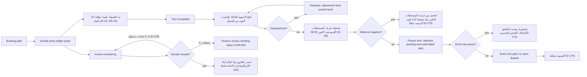

تتحرك الأموال على قضبان محددة: كل حجز يُقيَّد في سجل بقيد مزدوج، وتجري تشغيلات صرف المستحقات أيام الاثنين الساعة 06:00، ويعيد ترقيم الفواتير المحاولة ثلاث مرات قبل المراجعة المالية، وتلتقط تسويةٌ يومية الساعة 08:00 بتوقيت القاهرة كل ما تختلف عليه بوابة الدفع. هذه هي رؤية المحرّك لآلة الحالات 7.9 (التسوية)؛ أما واجهة الدور المالي فهي [UF-ADM-13](/ar/docs/user-flows/admin#uf-adm-13-الإعدادات).

**مرحلة التسليم:** P2 (التسوية اليومية للسجل)، P4 (صرف المستحقات الأسبوعي)، P5 (المحاسبة والفواتير الكاملة).

## المحفِّز والجهات الفاعلة

- **المحفِّز:** حجز مدفوع، أو رحلة مكتملة، أو استرداد، أو الساعة الأسبوعية.
- **الجهات الفاعلة:** السجل؛ تشغيلة صرف المستحقات؛ خدمة الفواتير؛ مهمة التسوية؛ الشؤون المالية.

## المخطط

## المؤقّتات والقواعد

| الخطوة | المؤقّت (حرفيًا) | أثر القاعدة |
|---|---|---|
| السجل | سجل بقيد مزدوج مع أنواع الأحداث booking_paid, refund, coupon, deal_cost, commission, gateway_fee, plan_charge, payout, invoice, settlement, reversal | [FR-ACC-01](/ar/docs/srs/requirements/acc#fr-acc-01--سجل-القيد-المزدوج) |
| العمولة | قيمة مؤقتة "10 بالمئة من السعر الأساسي للرحلة، قابلة للضبط لكل سوق ولكل نوع صفقة" | D-15, [OD-15](/ar/docs/brd/compliance#11-القرارات-المفتوحة), [FR-NEG-05](/ar/docs/srs/requirements/neg#fr-neg-05--إتمام-التعاقد) |
| إيقاع صرف المستحقات | "تجري تشغيلات صرف المستحقات أسبوعيًا أيام الاثنين الساعة 06:00" عبر Stripe Connect Express أو تحويل بنكي أو مزوّد محلي | [FR-ACC-03](/ar/docs/srs/requirements/acc#fr-acc-03--أرباح-المورّدين-وصرف-المستحقات), BRD 5.2, D-28 |
| الرصيد السالب | "تُخصم من صرف المستحقات التالي بالعملة نفسها، ولا تجري أي تشغيلة صرف ما دام الرصيد سالبًا" | [FR-ACC-03](/ar/docs/srs/requirements/acc#fr-acc-03--أرباح-المورّدين-وصرف-المستحقات), D-173 |
| التعليق | يُعلَّق صرف المستحقات أثناء توقّف الفحص المخبري | D-175 |
| ترقيم الفواتير | "يعيد الترقيم المحاولة 3 مرات، ثم تنتقل الحالة إلى المراجعة المالية"؛ الفواتير الصادرة لا تُعدَّل أبدًا، وتشير الإشعارات الدائنة إليها | [FR-ORG-07](/ar/docs/srs/requirements/org#fr-org-07--فواتير-b2b-وb2c), D-179 إلى D-181 |
| نوع الفاتورة | B2B عند وجود رقم ضريبي، وإلا فـ B2C | [FR-ORG-07](/ar/docs/srs/requirements/org#fr-org-07--فواتير-b2b-وb2c), [BRL-28](/ar/docs/brd/requirements#7-قواعد-العمل), D-180 |
| التسوية | تُقارن تقارير تسوية بوابة الدفع بالسجل يوميًا؛ وتُدرَج الاستثناءات | [FR-PAY-05](/ar/docs/srs/requirements/pay#fr-pay-05--مطابقة-بوابة-الدفع), D-29 |
| ملخص الشؤون المالية | "يصدر ملخص استثناءات الشؤون المالية يوميًا الساعة 08:00 بتوقيت القاهرة"؛ وتحذّر لوحات المعلومات عندما يتجاوز عمر البيانات 26 ساعة | [FR-ACC-09](/ar/docs/srs/requirements/acc#fr-acc-09--المطابقة-اليومية-وموجز-المالية), D-176, D-250 |
| إغلاق التسوية | تُغلق عند تحقق "كل بند مدفوع" و"لا نزاع مفتوح" | [FR-ACC-05](/ar/docs/srs/requirements/acc#fr-acc-05--التسويات), [BR-ACC-06](/ar/docs/brd/requirements#614-المحاسبة-والفواتير-والتسويات-acc), D-174 |
| العملات | يُشتق السوق من الدولة؛ وتتبع تحويلات العملة السوقَ؛ والتقريب والعرض وفق كل سوق | [FR-MKT-02](/ar/docs/srs/requirements/mkt#fr-mkt-02--السوق-من-بلد-التسجيل), [FR-MKT-04](/ar/docs/srs/requirements/mkt#fr-mkt-04--تبديل-حالة-السوق), [FR-MKT-05](/ar/docs/srs/requirements/mkt#fr-mkt-05--التقريب-والعرض) |
| عزل المستأجرين | كل بند في السجل محصور بنطاق المستأجر مع الجهة المنظِّمة المالكة | [FR-ORG-01](/ar/docs/srs/requirements/org#fr-org-01--عزل-مساحة-العمل) |
| الفواتير بين الأطراف | فواتير لكل زوج من الأطراف — المسافر، الجهة المنظِّمة، المورّد، المنصة | [FR-ACC-08](/ar/docs/srs/requirements/acc#fr-acc-08--فواتير-لجميع-الأطراف) |
| الإبلاغ عن الإيرادات | تُبلَّغ إيرادات الخطط إلى الشؤون المالية | [FR-SUB-06](/ar/docs/srs/requirements/sub#fr-sub-06--تقارير-الإيرادات) |
| التصديرات | "تنتهي صلاحيتها بعد 7 أيام", "جاهزة خلال 15 دقيقة" | [FR-ACC-06](/ar/docs/srs/requirements/acc#fr-acc-06--التصديرات-بحسب-الخطة), D-249, D-177 |

## قصص المستخدم

- **بصفتي مشغّلًا ماليًا**، أريد أن تجري تشغيلات صرف المستحقات بنفسها كل اثنين مع خصم الأرصدة السالبة، حتى يبدأ أسبوعي بالاستثناءات لا بالتشغيل اليدوي. *([FR-ACC-03](/ar/docs/srs/requirements/acc#fr-acc-03--أرباح-المورّدين-وصرف-المستحقات), D-28)*
- **بصفتي مالك جهة منظِّمة**، أريد ملخصًا يوميًا لاستثناءات الأموال في ساعة معروفة، حتى تظهر المشكلات قبل أن يتصل المتصلون. *([FR-ACC-09](/ar/docs/srs/requirements/acc#fr-acc-09--المطابقة-اليومية-وموجز-المالية), D-176)*
- **بصفتي مدقّقًا**، أريد الفواتير الصادرة غير قابلة للتعديل مع الإشعارات الدائنة وحدها كوسيلة تصحيح، حتى لا يعيد المسار كتابة التاريخ أبدًا. *(D-181)*
- **بصفتي سائقًا**، أريد أن تُحفظ مستحقاتي — لا أن تضيع — أثناء إيقاف الفحص المخبري، حتى يستعيد إنجاز الأوراق المال. *(D-175)*
