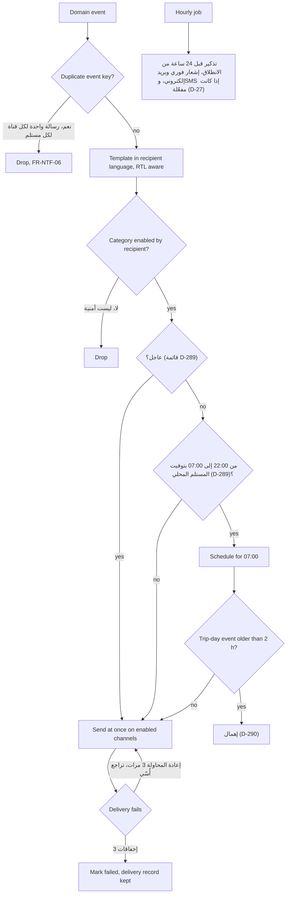

الإشعارات قائمة انتظار تلتزم الذوق: لا شيء صاخب بين 22:00 و07:00 بالتوقيت المحلي للمستلم، وتُرسَل الرسائل المؤجلة عند 07:00، وتُهمَل أحداث يوم الرحلة الأقدم من ساعتين، ورسالة واحدة لكل حدث لكل قناة لكل مستلم، وثلاث إعادات محاولة مع تراجع أُسّي عند فشل قناة. أما جانب المستلم فيغطّيه [UF-SHR-15](/ar/docs/user-flows/shared#uf-shr-15-تسليم-الإشعارات-وساعات-الهدوء).

**مرحلة التسليم:** P1 (القنوات والقوالب)، P3 (ساعات الهدوء).

## المُحفِّز والفاعلون

- **المُحفِّز:** أي حدث نطاقي له قالب إشعار مطابق.
- **الفاعلون:** خدمة الإشعارات؛ مجدول ساعات الهدوء؛ قائمة انتظار إعادة المحاولة؛ مهمة التذكير المجدولة كل ساعة.

## المخطط

## المؤقتات والقواعد

| الخطوة | المؤقت (نصًّا) | تتبع القاعدة |
|---|---|---|
| ساعات الهدوء | "لا تُرسَل رسائل SMS والإشعارات الفورية بين 22:00 و07:00 بالتوقيت المحلي للمستلم ما لم تكن عاجلة"؛ وتُرسَل الرسائل المؤجلة عند 07:00؛ وتُهمَل أحداث يوم الرحلة الأقدم من ساعتين | [FR-NTF-03](/ar/docs/srs/requirements/ntf#fr-ntf-03--ساعات-الهدوء), [BR-NTF-03](/ar/docs/brd/requirements#612-الإشعارات-ntf), D-289, D-290 |
| إعادة المحاولة | "تُعاد محاولة عمليات الإخفاق 3 مرات مع تراجع أُسّي" | [FR-NTF-05](/ar/docs/srs/requirements/ntf#fr-ntf-05--سجلات-التسليم-وإعادة-المحاولة) |
| منع التكرار | "ينتج عن الحدث الواحد رسالة واحدة على الأكثر لكل قناة ولكل مستلم" (مفتاح حدث فريد) | [FR-NTF-06](/ar/docs/srs/requirements/ntf#fr-ntf-06--منع-تكرار-التسليم) |
| التذكيرات | "تذكير قبل 24 ساعة من الانطلاق عبر الإشعار الفوري والبريد الإلكتروني، إضافة إلى SMS إذا كانت مفعّلة… عند تشغيل المهمة المجدولة كل ساعة" | [FR-NTF-07](/ar/docs/srs/requirements/ntf#fr-ntf-07--تذكيرات-الرحلات-وإشعارات-التغييرات), D-27 |
| إشعارات التغيير | "تُخطَر تغييرات المركبة أو السائق أو الموعد خلال ساعة واحدة" | [FR-NTF-07](/ar/docs/srs/requirements/ntf#fr-ntf-07--تذكيرات-الرحلات-وإشعارات-التغييرات), D-186 |
| اللغة | قوالب مُدارة بالإصدارات، واللغة والتخطيط حسب المستلم مع دعم الكتابة من اليمين إلى اليسار (RTL) | [FR-NTF-02](/ar/docs/srs/requirements/ntf#fr-ntf-02--اللغة-والتخطيط), [FR-NTF-04](/ar/docs/srs/requirements/ntf#fr-ntf-04--قوالب-مُدارة-بالإصدارات) |
| رسائل الأمان | لا يمكن تعطيل رسائل أمن الحساب | [FR-NTF-01](/ar/docs/srs/requirements/ntf#fr-ntf-01--القنوات-حسب-التفضيل) |
| سجلات التسليم | حالات التسليم: في قائمة الانتظار، ومُرسَل، ومُسلَّم، وفاشل، ومُهمَل، مع طوابع زمنية للمحاولة والمحاولة التالية | [FR-NTF-05](/ar/docs/srs/requirements/ntf#fr-ntf-05--سجلات-التسليم-وإعادة-المحاولة), إشعارات ERD |

## القصص

- **بصفتي مستلمًا**، أريد هدوءًا بين 22:00 و07:00 ما لم يكن الأمر عاجلًا، حتى تحترم المنصة ليلتي. *([FR-NTF-03](/ar/docs/srs/requirements/ntf#fr-ntf-03--ساعات-الهدوء), D-289)*
- **بصفتي مراقب عمليات**، أريد أن يتخلص تقادم أحداث يوم الرحلة من الإشعارات القديمة، حتى لا تُربك دفعة اللحاق صباحَ اليوم أبدًا. *(D-290)*
- **بصفتي مسافرًا**، أريد تذكيرًا واحدًا لكل قناة لا خمسة، حتى يبقى يوم الرحلة هادئًا. *([FR-NTF-06](/ar/docs/srs/requirements/ntf#fr-ntf-06--منع-تكرار-التسليم))*
- **بصفتي مشرف منصة**، أريد قوالب مُدارة بالإصدارات، حتى لا يتشعّب السجل بسبب تصحيح صياغة. *([FR-NTF-04](/ar/docs/srs/requirements/ntf#fr-ntf-04--قوالب-مُدارة-بالإصدارات))*
