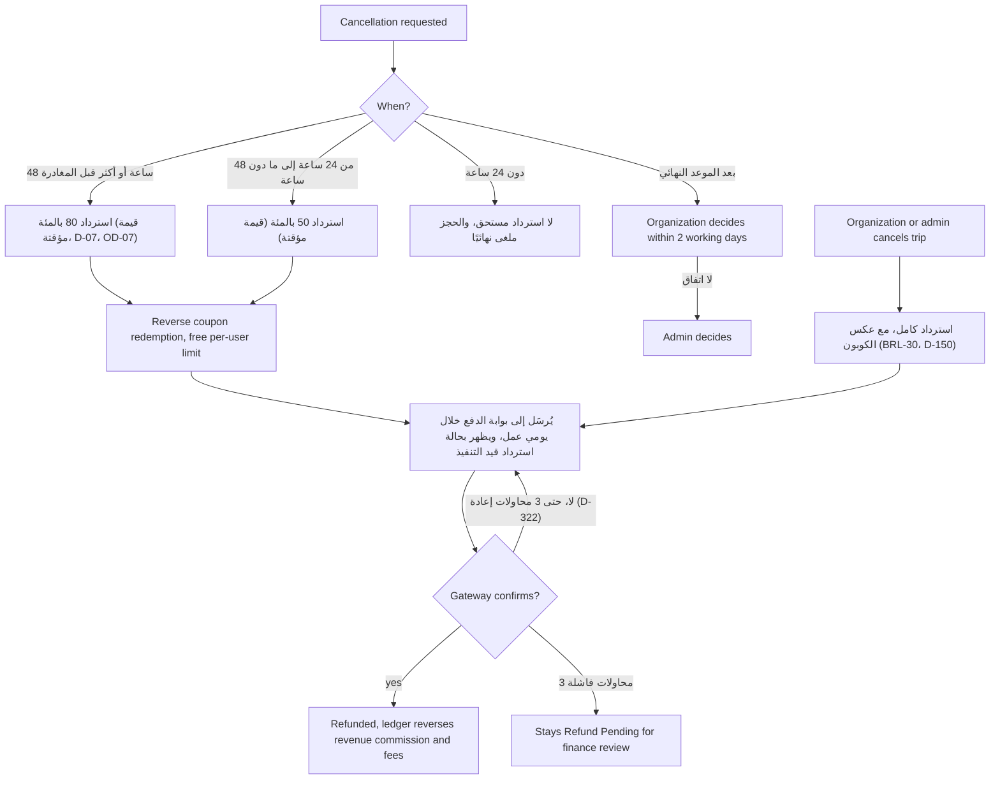

الاسترداد خط معالجة لا مجرد زر: يحسب محرك السياسة المبلغ من نافذة الإلغاء، ويُلغى استبدال الكوبون عكسيًا، وتحصل بوابة الدفع على ما يصل إلى ثلاث محاولات، وكل ما ترفضه البوابة ينتهي في مراجعة الإدارة المالية. جانب المسافر هو [UF-TRV-06](/ar/docs/user-flows/traveler#uf-trv-06-إلغاء-حجز)؛ واستردادات مشرف المنصة خارج السياسة هي [UF-ADM-16](/ar/docs/user-flows/admin#uf-adm-16-الاسترداد-خارج-السياسة).

**مرحلة التسليم:** P2 (الاسترداد وفق السياسة)، وP5 (الإلغاء العكسي للكوبون والمحاسبة الكاملة).

## المُحفِّز والفاعلون

- **المُحفِّز:** إلغاء (من المسافر أو الجهة المنظِّمة أو مشرف المنصة)، أو معالجة تغيير رحلة، أو قرار خارج السياسة.
- **الفاعلون:** محرك السياسة؛ مهمة الاسترداد؛ بوابة الدفع؛ مراجعة الإدارة المالية.

## المخطط

## المؤقتات والقواعد

| الخطوة | المؤقت (نصًّا) | تتبّع القاعدة |
|---|---|---|
| نوافذ السياسة | "80 بالمئة عند 48 ساعة أو أكثر، و50 بالمئة من 24 ساعة إلى ما دون 48 ساعة، ولا شيء دون 24 ساعة" (قيمة مؤقتة) | [BRL-12](/ar/docs/brd/requirements#7-قواعد-العمل)، [FR-BKG-04](/ar/docs/srs/requirements/bkg#fr-bkg-04--إلغاء-المسافر-والاسترداد)، D-07، [OD-07](/ar/docs/brd/compliance#11-القرارات-المفتوحة) |
| الرسوم | "جميع الرسوم قابلة للاسترداد إلى حين تحديد رسوم غير قابلة للاسترداد" | [BRL-12](/ar/docs/brd/requirements#7-قواعد-العمل)، D-156 |
| الإلغاء العكسي للكوبون | "يُلغي الاسترداد استبدال الكوبون عكسيًا ويحرر حد المسافر لكل مستخدم"؛ ويعود الكوبون المستنفَد إلى الحالة النشطة إذا كان لا يزال داخل نافذته | [BRL-11](/ar/docs/brd/requirements#7-قواعد-العمل)، [FR-CPN-06](/ar/docs/srs/requirements/cpn#fr-cpn-06--الاستبدال-والإلغاء-العكسي) |
| اتفاقية مستوى الإرسال | "يُرسَل إلى بوابة الدفع خلال يومي عمل ويظهر بحالة «استرداد قيد التنفيذ»" | [FR-PAY-03](/ar/docs/srs/requirements/pay#fr-pay-03--تنفيذ-الاسترداد) |
| التأكيد | "لا تصبح الحالة Refunded إلا بعد تأكيد البوابة؛ وعندها يعكس السجل الإيراد والعمولة والرسوم" | [FR-PAY-03](/ar/docs/srs/requirements/pay#fr-pay-03--تنفيذ-الاسترداد) |
| محاولات الإعادة | "تُعاد محاولة عمليات الاسترداد الفاشلة 3 مرات، ثم تبقى بحالة Refund Pending لمراجعتها لدى الإدارة المالية" | [FR-PAY-03](/ar/docs/srs/requirements/pay#fr-pay-03--تنفيذ-الاسترداد)، D-149، D-35، D-322 |
| بعد الموعد النهائي | "تذهب الطلبات بعد الموعد النهائي إلى الجهة المنظِّمة، التي تبت فيها خلال يومي عمل، ثم إلى مشرف المنصة" | [FR-BKG-04](/ar/docs/srs/requirements/bkg#fr-bkg-04--إلغاء-المسافر-والاسترداد)، [BR-BKG-04](/ar/docs/brd/requirements#67-الحجز-والدفع-bkg)، D-151 |
| المحظورات القاطعة | "لا إلغاء بعد انطلاق الرحلة أو بعد تسجيل الحضور" — وتتحول تلك الحالات إلى نزاعات | D-152، D-153 |
| إلغاء الرحلة من الجهة المنظِّمة أو مشرف المنصة | "يُسترَد كل حجز مؤكد كاملًا، مع إلغاء استبدالات الكوبونات عكسيًا" | [BRL-30](/ar/docs/brd/requirements#7-قواعد-العمل)، [FR-BKG-06](/ar/docs/srs/requirements/bkg#fr-bkg-06--إلغاء-الجهة-المنظِّمة-للرحلة)، D-150 |
| خارج السياسة | استرداد من مشرف المنصة مع تسجيل السبب وسجل التدقيق | [FR-PAY-04](/ar/docs/srs/requirements/pay#fr-pay-04--الاسترداد-خارج-السياسة)، [BRL-19](/ar/docs/brd/requirements#7-قواعد-العمل) |
| إلغاء المعالجة | معالجة تغيير الرحلة "الإلغاء مع استرداد كامل"؛ وسبب الاسترداد يتضمن المعالجة | [BRL-24](/ar/docs/brd/requirements#7-قواعد-العمل)، [FR-TRIP-06](/ar/docs/srs/requirements/trip#fr-trip-06--التغييرات-التي-تمس-الحجوزات-المؤكدة) |

## قصص المستخدم

- **بصفتي مسافرًا**، أريد أن تعرض معاينة الاسترداد مبلغ السياسة الدقيق قبل أن أؤكد، حتى أقرر بأرقام حقيقية. *([FR-BKG-04](/ar/docs/srs/requirements/bkg#fr-bkg-04--إلغاء-المسافر-والاسترداد))*
- **بصفتي مشغل إدارة مالية**، أريد أن تتوقف الاستردادات التي ترفضها البوابة في المراجعة بعد ثلاث محاولات بدلًا من التكرار اللانهائي، حتى يبقى الطابور صادقًا. *([FR-PAY-03](/ar/docs/srs/requirements/pay#fr-pay-03--تنفيذ-الاسترداد)، D-322)*
- **بصفتي جهة منظِّمة**، أريد مسار استرداد كامل نظيفًا عندما ألغي رحلة، حتى يكون تعويض المسافرين فعلًا واحدًا لا جدول بيانات. *([BRL-30](/ar/docs/brd/requirements#7-قواعد-العمل))*
- **بصفتي مالك كوبون**، أريد أن يحرر الحجز المسترد حدي لكل مستخدم من الكوبونات، حتى لا تحرق رحلة ملغاة خصمي. *([BRL-11](/ar/docs/brd/requirements#7-قواعد-العمل)، [FR-CPN-06](/ar/docs/srs/requirements/cpn#fr-cpn-06--الاستبدال-والإلغاء-العكسي))*
