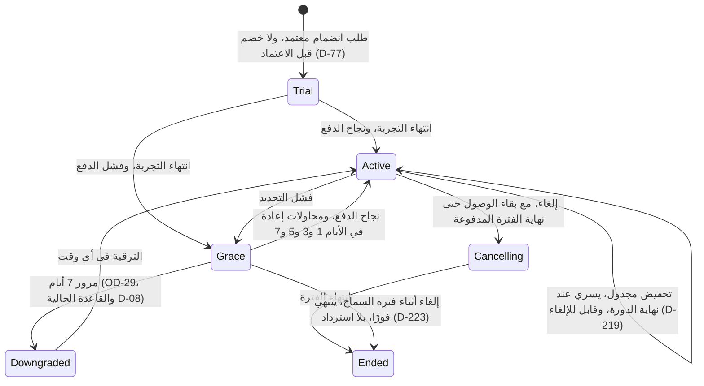

تجدّد الخطط نفسها، وتتابع تحصيل مدفوعاتها بنفسها، وتجدول تخفيضها بنفسها. تُعاد محاولة الرسوم الفاشلة في الأيام 1 و3 و5 و7 مع رسالة بريد إلكتروني في كل مرة؛ وتلي ذلك فترة سماح مدتها سبعة أيام؛ وتنتظر التخفيضات نهاية الدورة ويمكن إلغاؤها حتى ذلك الحين. هذه هي رؤية المحرّك لآلة الحالات 7.6 (الاشتراك)؛ أما واجهة المسافر فهي [UF-TRV-10](/ar/docs/user-flows/traveler#uf-trv-10-تغيير-الخطة) وتنبيه حدود الخطة المشترك [UF-SHR-06](/ar/docs/user-flows/shared#uf-shr-06-تنبيه-حدود-الخطة).

**مرحلة التسليم:** P5 تحقيق الإيرادات والإطلاق الخليجي.

## المُحفِّز والفاعلون

- **المُحفِّز:** محاولة خصم رسوم اشتراك، أو تغيير خطة، أو تصفير العدادات الشهري.
- **الفاعلون:** منتج الفوترة لدى بوابة الدفع؛ جدول المطالبة بعد الفشل؛ مهمة التصفير؛ تجاوزات مشرف المنصة.

## المخطط

## المؤقتات والقواعد

| الخطوة | المؤقت (نصًّا) | تتبّع القاعدة |
|---|---|---|
| المطالبة بعد الفشل (Dunning) | "تُعاد محاولة الرسوم الفاشلة في الأيام 1 و3 و5 و7، مع رسالة بريد إلكتروني عند كل محاولة" | [FR-SUB-08](/ar/docs/srs/requirements/sub#fr-sub-08--المطالبة-بعد-الفشل-dunning)، [FR-PAY-06](/ar/docs/srs/requirements/pay#fr-pay-06--رسوم-الاشتراك-وتحصيل-المتأخرات)، D-09 |
| فترة السماح | تستمر فترة السماح 7 أيام مع الاحتفاظ بالميزات | [BRL-14](/ar/docs/brd/requirements#7-قواعد-العمل)، [FR-SUB-03](/ar/docs/srs/requirements/sub#fr-sub-03--فترة-السماح) |
| بعد فترة السماح | السلوك بعد فترة السماح هو [OPEN: [OD-29](/ar/docs/brd/compliance#11-القرارات-المفتوحة)] (القاعدة الحالية D-08: الهبوط إلى الباقة الأساسية، وحظر الحجوزات والصفقات الجديدة) | [OD-29](/ar/docs/brd/compliance#11-القرارات-المفتوحة)، D-08 |
| الترقيات | "تسري الترقية فورًا مع الاحتساب النسبي" | [BRL-13](/ar/docs/brd/requirements#7-قواعد-العمل)، [FR-SUB-04](/ar/docs/srs/requirements/sub#fr-sub-04--الترقية-والتخفيض-والإلغاء) |
| التخفيضات | "يسري التخفيض في نهاية الدورة"، ويمكن إلغاؤه قبل ذلك | [BRL-13](/ar/docs/brd/requirements#7-قواعد-العمل)، [FR-SUB-04](/ar/docs/srs/requirements/sub#fr-sub-04--الترقية-والتخفيض-والإلغاء)، D-219، D-232 |
| الإلغاء | "يحتفظ الإلغاء بالوصول حتى نهاية الفترة المدفوعة. ويُنهي الإلغاء أثناء فترة السماح الخطة فورًا دون استرداد" | [FR-SUB-04](/ar/docs/srs/requirements/sub#fr-sub-04--الترقية-والتخفيض-والإلغاء)، D-223 |
| التجارب | "إشعار بدء التجربة في اليوم 0 وتذكيرات قبل النهاية بـ3 أيام ويوم واحد"؛ ومدد التجارب هي [OPEN: [OD-28](/ar/docs/brd/compliance#11-القرارات-المفتوحة)] | [FR-SUB-07](/ar/docs/srs/requirements/sub#fr-sub-07--التجارب-المجانية)، D-231، [OD-28](/ar/docs/brd/compliance#11-القرارات-المفتوحة) |
| تصفير العدادات | "في الساعة 00:00 من اليوم الأول من كل شهر بحسب المنطقة الزمنية للمالك" | [FR-SUB-10](/ar/docs/srs/requirements/sub#fr-sub-10--تصفير-العدادات)، D-218 |
| بعد التخفيض | تستمر العناصر التي تجاوزت الحدود في العمل؛ وتصطدم الإجراءات الجديدة ببوابة الحدود | [FR-SUB-09](/ar/docs/srs/requirements/sub#fr-sub-09--الحدود-بعد-التخفيض)، D-144 |
| تجاوز مشرف المنصة | يلزم مشرف ثانٍ وتاريخ انتهاء؛ ويُرسَل بريد إلكتروني للمالك؛ ويعود تلقائيًا إلى ما كان عليه عند تاريخ الانتهاء | [FR-SUB-05](/ar/docs/srs/requirements/sub#fr-sub-05--تجاوزات-مشرف-المنصة)، D-227، D-230 |
| بوابة الحدود | بوابة من جانب الخادم تُرجع الخطة والحد والباقة التالية؛ وتفشل خدمة الخطة بإغلاق مسار الميزات | [FR-SUB-02](/ar/docs/srs/requirements/sub#fr-sub-02--بوابات-الميزات)، [FR-SUB-11](/ar/docs/srs/requirements/sub#fr-sub-11--فشل-خدمة-الخطط)، D-224 |

## قصص المستخدم

- **بصفتي مالك خطة**، أريد أربع محاولات إعادة متباعدة مع رسالة بريد إلكتروني عند كل منها، حتى لا تُنهي بطاقة واحدة خاوية خدمتي. *([FR-SUB-08](/ar/docs/srs/requirements/sub#fr-sub-08--المطالبة-بعد-الفشل-dunning)، D-09)*
- **بصفتي مالك خطة**، أريد أن ينتظر التخفيض الدورة التي دفعت ثمنها، حتى أحتفظ بما اشتريته حتى نهايتها. *([BRL-13](/ar/docs/brd/requirements#7-قواعد-العمل)، D-219)*
- **بصفتي مشرف منصة**، أريد أن تحمل التجاوزات تاريخ انتهاء ومعتمدًا ثانيًا، حتى لا يتحول جميل أبدًا إلى ثغرة. *([FR-SUB-05](/ar/docs/srs/requirements/sub#fr-sub-05--تجاوزات-مشرف-المنصة)، D-227)*
- **بصفتي مالك جهة منظِّمة**، أريد أن تُصفَّر العدادات في أول الشهر بحسب تقويمي، حتى يطابق حساب الحصص دفاتري. *([FR-SUB-10](/ar/docs/srs/requirements/sub#fr-sub-10--تصفير-العدادات)، D-218)*
