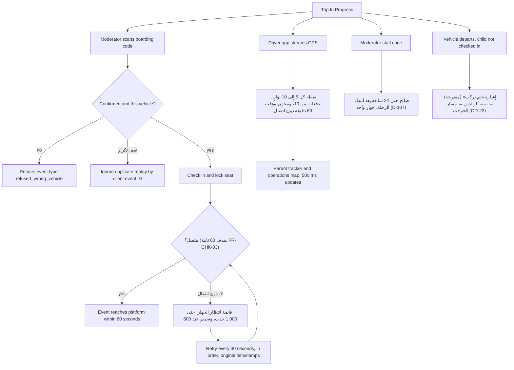

يوم الرحلة آلةٌ تعمل بين الناس: رموز صعود تُمسح ضوئيًا مقابل المركبة الصحيحة، وأحداث تسجيل حضور تُدفع خلال دقيقة، وقائمة انتظار على الجهاز تصمد في المناطق الميتة، ونقاط GPS كل 5 إلى 10 ثوانٍ، ووصول المشرف ينتهي بعد 24 ساعة من انتهاء الرحلة. الجانب الخاص بالمشرف هو [UF-MOD-04](/ar/docs/user-flows/moderator#uf-mod-04-تسجيل-حضور-راكب)؛ والجانب الخاص بالمسافر هو [UF-TRV-08](/ar/docs/user-flows/traveler#uf-trv-08-يوم-الرحلة).

**مرحلة التسليم:** P3 العمق التشغيلي.

## المحفِّز والجهات الفاعلة

- **المحفِّز:** تصل الرحلة إلى حالة قيد التنفيذ.
- **الجهات الفاعلة:** جهاز المشرف؛ خدمة تسجيل الحضور؛ بث GPS من السائق؛ الوالدان وفريق العمليات يراقبان.

## المخطط

## المؤقّتات والقواعد

| الخطوة | المؤقّت (حرفيًا) | أثر القاعدة |
|---|---|---|
| تسليم تسجيل الحضور | "يصل إلى المنصة خلال 60 ثانية" | [FR-CHK-03](/ar/docs/srs/requirements/chk#fr-chk-03--سجل-الحدث), [BR-CHK-03](/ar/docs/brd/requirements#69-تسجيل-الحضور-والمشرفون-والتتبع-chk-mod-trk) |
| قائمة الانتظار دون اتصال | "قائمة انتظار على الجهاز (حتى 1,000؛ وتحذير عند 800)، وإعادة المحاولة كل 30 ثانية… مع الطوابع الزمنية الأصلية"؛ وتُتجاهل التكرارات بحسب معرّف الحدث لدى العميل | [FR-CHK-05](/ar/docs/srs/requirements/chk#fr-chk-05--قائمة-الانتظار-دون-اتصال), D-117 |
| إيقاع GPS | "إرسال نقطة كل 5 إلى 10 ثوانٍ فقط أثناء كون الرحلة قيد التنفيذ، بدفعات تصل إلى 10 نقاط في الطلب الواحد وتخزين مؤقت يصل إلى 60 دقيقة دون اتصال" | [FR-TRK-02](/ar/docs/srs/requirements/trk#fr-trk-02--جمع-الموقع), D-34, D-121 |
| حداثة الخريطة | تحديث الخريطة "خلال 500 مللي ثانية" | [FR-TRK-01](/ar/docs/srs/requirements/trk#fr-trk-01--موقع-المركبة-المباشر), [FR-SEAT-02](/ar/docs/srs/requirements/seat#fr-seat-02--خريطة-المقاعد-الحية) |
| رمز المشرف | "صالح حتى 24 ساعة بعد انتهاء الرحلة، وعلى جهاز واحد في كل مرة" | [FR-MOD-05](/ar/docs/srs/requirements/mod#fr-mod-05--تسجيل-دخول-المشرف), [FR-MOD-03](/ar/docs/srs/requirements/mod#fr-mod-03--إبطال-الوصول), D-107, D-108 |
| نهاية الرحلة | حدث النهاية إلى الوالدين وفريق العمليات؛ والإشغال لحظيًا أثناء الرحلة | [FR-TRK-06](/ar/docs/srs/requirements/trk#fr-trk-06--نهاية-التتبع), [FR-CHK-07](/ar/docs/srs/requirements/chk#fr-chk-07--الإشغال) |
| خصوصية المسافر | لا يرى المسافرون الموقع المباشر ولا وقت الوصول المتوقع مطلقًا | [FR-TRK-07](/ar/docs/srs/requirements/trk#fr-trk-07--لا-موقع-مباشر-للمسافرين), [BRL-29](/ar/docs/brd/requirements#7-قواعد-العمل), D-317 |
| عدم الصعود | ليست حالة رسمية؛ المغادرة دون تسجيل حضور ترفع إشارة «لم يركب» المقترحة ويحل مسار الحوادث محل الإلغاء | [OD-22](/ar/docs/brd/compliance#11-القرارات-المفتوحة), D-25, مقترحات متابع الوالدين |
| تقرير نهاية الرحلة | تقرير المشرف بعدد الركاب وسبب عدم التطابق، للقراءة فقط بعد الإرسال | [FR-MOD-02](/ar/docs/srs/requirements/mod#fr-mod-02--تقرير-نهاية-الرحلة), [FR-MOD-06](/ar/docs/srs/requirements/mod#fr-mod-06--قفل-التقرير) |
| نطاق بيانات التتبع | تُحفظ بيانات GPS الخام 90 يومًا ثم ملخص ساعي؛ والنطاق محدود بالرحلة | [FR-TRK-05](/ar/docs/srs/requirements/trk#fr-trk-05--نطاق-بيانات-التتبع) |
| بيانات الطفل | تنطبق قيود بيانات الطفل على التتبع والسجل التاريخي والتقارير | [FR-PAR-05](/ar/docs/srs/requirements/par#fr-par-05--قيود-بيانات-الأبناء) |
| تعيين المشرف | يُعيَّن مشرف لكل مركبة مع رقم هاتف قبل النشر | [FR-STF-05](/ar/docs/srs/requirements/stf#fr-stf-05--إسناد-المشرف) |
| إعادة الركوب | إعادة الركوب عند توقف مسموح بها (مقترح) | [FR-CHK-04](/ar/docs/srs/requirements/chk#fr-chk-04--تسجيل-المغادرة-عند-المحطات), القسمان 7.2 و7.3 |

## قصص المستخدم

- **بصفتي مشرفًا**، أريد أن يعمل تسجيل الحضور في منطقة بلا تغطية وأن يُزامَن لاحقًا بالترتيب، حتى لا يؤدي ضعف الإشارة إلى فقدان مسافر أبدًا. *([FR-CHK-05](/ar/docs/srs/requirements/chk#fr-chk-05--قائمة-الانتظار-دون-اتصال), D-117)*
- **بصفتي والدًا**، أريد أن تتحدث الخريطة خلال نصف ثانية، حتى أرى الحافلة تصل إلى البوابة. *([FR-TRK-01](/ar/docs/srs/requirements/trk#fr-trk-01--موقع-المركبة-المباشر))*
- **بصفتي مراقبًا للعمليات**، أريد تخزينًا مؤقتًا لبيانات GPS يغطي ساعة قيادة دون اتصال، حتى لا تُحدث المقاطع النفقية فجوات. *([FR-TRK-02](/ar/docs/srs/requirements/trk#fr-trk-02--جمع-الموقع), D-121)*
- **بصفتي جهة منظِّمة**، أريد انتهاء صلاحية وصول المشرف بعد يوم من الرحلة، حتى لا يتحول رمز طاقم موسمي إلى مفتاح دائم. *([FR-MOD-03](/ar/docs/srs/requirements/mod#fr-mod-03--إبطال-الوصول), D-107)*
