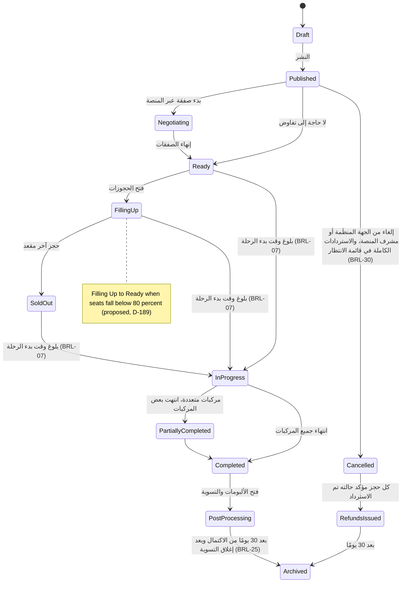

تنتقل الرحلة عبر ثلاث عشرة حالة من المسودة إلى المؤرشفة، وتنتمي عدة انتقالات إلى النظام لا إلى أي شخص: بلوغ وقت البدء، وإغلاق التسوية، ومرور ثلاثين يومًا. هذه هي رؤية المحرّك لآلة الحالات 7.1؛ أما جانب الجهة المنظِّمة فهو [UF-ORG-06](/ar/docs/user-flows/organization#uf-org-06-إنشاء-رحلة-معالج-إرشادي).

**مرحلة التسليم:** P2 (الإنشاء والحجز)، وP3 (المركبات المتعددة والبرامج)، وP6 (الأرشفة في مرحلة التتبع).

## المُحفِّز والفاعلون

- **المُحفِّز:** تنشر الجهة المنظِّمة مسودة، أو يبلغ الوقت موعد المغادرة، أو يُكمل آخر حجز دورة حياته.
- **الفاعلون:** الجهة المنظِّمة؛ مهمة وقت البدء؛ نافذة المعالجات؛ مهمة الأرشفة؛ المسافرون يختارون المعالجات.

## المخطط

## المؤقتات والقواعد

| الخطوة | المؤقت (نصًّا) | تتبّع القاعدة |
|---|---|---|
| انتقال البدء | "بلوغ وقت بدء الرحلة؛ الرحلة جاهزة" ينقل الرحلة إلى قيد التنفيذ | [BRL-07](/ar/docs/brd/requirements#7-قواعد-العمل)، القسم 7.1 |
| نافذة المعالجات | "7 أيام للاختيار؛ ثم تُحال الحالة إلى مشرف المنصة"؛ وحالة المعالجة معروضة أو مختارة أو مُصعَّدة أو منتهية | [BRL-24](/ar/docs/brd/requirements#7-قواعد-العمل)، [FR-TRIP-06](/ar/docs/srs/requirements/trip#fr-trip-06--التغييرات-التي-تمس-الحجوزات-المؤكدة)، D-148 |
| إشعار التغيير | "تُبلَّغ تغييرات المركبة أو السائق أو المواعيد خلال ساعة واحدة" | [FR-NTF-07](/ar/docs/srs/requirements/ntf#fr-ntf-07--تذكيرات-الرحلات-وإشعارات-التغييرات)، D-186 |
| إلغاء الجهة المنظِّمة | "يُسترَد كل حجز مؤكد كاملًا، مع إلغاء استبدالات الكوبونات عكسيًا" | [BRL-30](/ar/docs/brd/requirements#7-قواعد-العمل)، [FR-BKG-06](/ar/docs/srs/requirements/bkg#fr-bkg-06--إلغاء-الجهة-المنظِّمة-للرحلة)، D-150 |
| بوابة التسوية | تُؤرشف الرحلة "بعد 30 يومًا من الاكتمال، وبعد إغلاق تسويتها فقط" | [BRL-25](/ar/docs/brd/requirements#7-قواعد-العمل)، [FR-ACC-10](/ar/docs/srs/requirements/acc#fr-acc-10--الأرشفة-بعد-التسوية)، D-26 |
| الحالة النهائية لصرف الاستردادات | تتحول الملغاة إلى تم صرف الاستردادات عندما يكون "كل حجز مؤكد حالته تم الاسترداد"، ثم إلى المؤرشفة "بعد 30 يومًا" | القسم 7.1 |
| بوابة الجاهزية | تكون الرحلة جاهزة عند اكتمال التعيين؛ وتسند الصفقات المنجزة نهائيًا مورّدي المنصة، ويرى السائقون رحلاتهم المسندة | [FR-STF-01](/ar/docs/srs/requirements/stf#fr-stf-01--مسارا-السائق)، [FR-STF-03](/ar/docs/srs/requirements/stf#fr-stf-03--بوابة-الجاهزية-ready)، [FR-STF-04](/ar/docs/srs/requirements/stf#fr-stf-04--الإسناد-بعد-إنهاء-الصفقة) |
| تغييرات البرامج | يمكن تغيير البرامج حتى المغادرة؛ وتتحول التغييرات اللاحقة إلى معالجات للمسافرين | [FR-TRIP-04](/ar/docs/srs/requirements/trip#fr-trip-04--تغييرات-البرامج-حتى-الانطلاق) |
| بوابات النشر | تبقى المسودات والرحلات المستهدفة مخفية عن التصفح؛ وتنطبق نوافذ الوصول المبكر لمسافري VIP قبل الإتاحة العامة | [FR-TRIP-02](/ar/docs/srs/requirements/trip#fr-trip-02--المسودة-والنشر-العلني-والمستهدف)، [FR-TRV-02](/ar/docs/srs/requirements/trv#fr-trv-02--ظهور-الرحلات-والوصول-المبكر) |

## قصص المستخدم

- **بصفتي جهة منظِّمة**، أريد أن تبدأ الرحلة نفسها عند موعد المغادرة، حتى لا يضطر أحد إلى الضغط على زر في منتصف العملية. *([BRL-07](/ar/docs/brd/requirements#7-قواعد-العمل))*
- **بصفتي مسافرًا متأثرًا بتغيير**، أريد سبعة أيام لاختيار معالجتي قبل أن يقرر أحدٌ مكاني، حتى يبقى تغيير الجدول قرارًا لي. *([BRL-24](/ar/docs/brd/requirements#7-قواعد-العمل)، [FR-TRIP-06](/ar/docs/srs/requirements/trip#fr-trip-06--التغييرات-التي-تمس-الحجوزات-المؤكدة))*
- **بصفتي مشغل إدارة مالية**، أريد أن تكون الأرشفة مرتبطة بإغلاق التسوية، حتى لا يختفي شيء بينما لا يزال المال معلقًا. *([BRL-25](/ar/docs/brd/requirements#7-قواعد-العمل)، [FR-ACC-10](/ar/docs/srs/requirements/acc#fr-acc-10--الأرشفة-بعد-التسوية))*
- **بصفتي ولي أمر**، أريد أن أُخبَر بتغييرات المركبة أو السائق خلال الساعة، حتى لا أُفاجأ عند الالتقاط. *([FR-NTF-07](/ar/docs/srs/requirements/ntf#fr-ntf-07--تذكيرات-الرحلات-وإشعارات-التغييرات)، D-186)*
