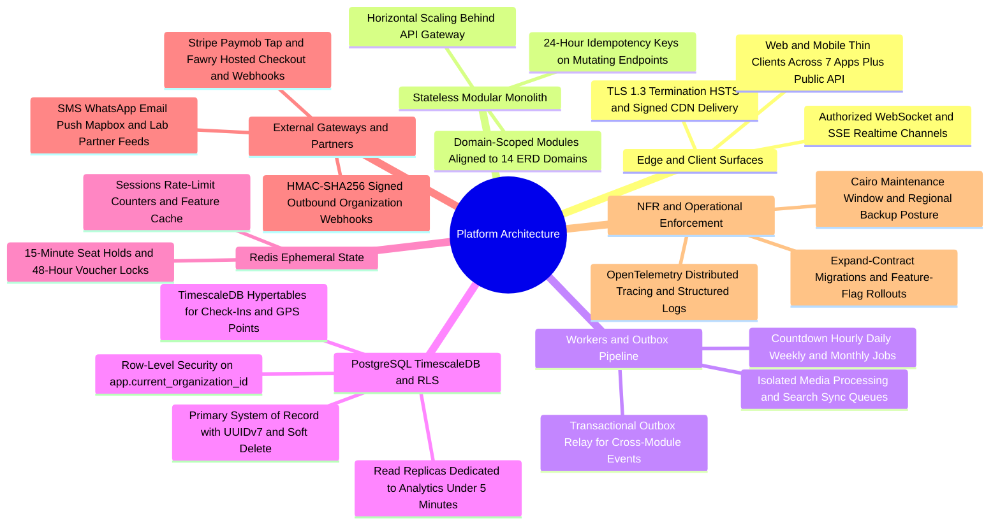
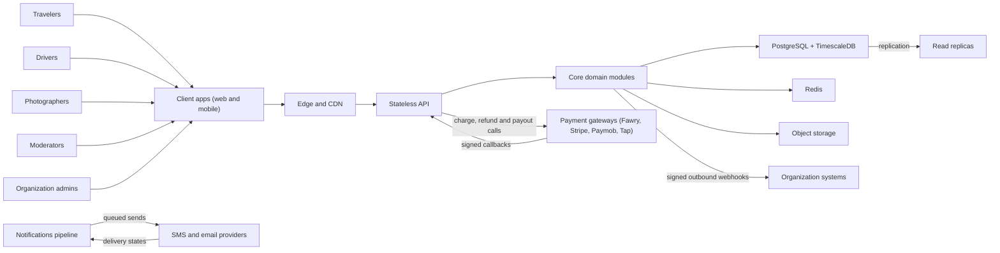

The system design on one page: who talks to what, how the service is shaped, where the data lives, what the platform integrates with, and how each quality attribute is enforced. Table-level design is the [Data Model](/en/docs/erd); runtime stories are in [System Workflows](/en/docs/workflows); end-to-end choreography is in the [End-to-End System](/en/docs/system); and deep engineering blueprints live in [Architecture & Operations Recommendations](/en/docs/recommendations/architecture-and-ops).

<TraceBar
  brd={[
    { label: 'Constraints §9.3', href: '/en/docs/brd/compliance#93-constraints' },
    { label: 'Business Rules §7', href: '/en/docs/brd/requirements#7-business-rules' },
  ]}
  srs={[
    { label: 'Quality & NFRs §8', href: '/en/docs/srs/quality' },
    { label: 'API & Interfaces §9', href: '/en/docs/srs/quality#9-interface-and-api-requirements' },
  ]}
  erd={[
    { label: 'Data Model', href: '/en/docs/erd', detail: '14 domains' },
    { label: 'ACL & RLS', href: '/en/docs/erd/acl' },
  ]}
  plan={[
    { label: 'Platform Tasks', href: '/en/docs/plan', detail: '18 T-P*-PLAT-*' },
  ]}
  workflows={[
    { label: 'System Workflows', href: '/en/docs/workflows' },
    { label: 'Job Catalog', href: '/en/docs/workflows/scheduled-jobs' },
  ]}
  userFlows={[
    { label: '106 Role Flows', href: '/en/docs/user-flows' },
  ]}
  design={[
    { label: 'Design System & Surfaces', href: '/en/docs/design' },
  ]}
  system={[
    { label: 'End-to-End System', href: '/en/docs/system' },
    { label: 'Lifecycle Journey', href: '/en/docs/system/lifecycle' },
    { label: 'Mindmap Atlas', href: '/en/docs/system/mindmaps' },
  ]}
  recommendations={[
    { label: 'REC-ARCH-01 Outbox', href: '/en/docs/recommendations/architecture-and-ops#rec-arch-01' },
    { label: 'REC-DATA-02 RLS & Timescale', href: '/en/docs/recommendations/architecture-and-ops#rec-data-02' },
    { label: 'REC-BOOK-03 Seat Holds', href: '/en/docs/recommendations/architecture-and-ops#rec-book-03' },
    { label: 'REC-PAY-04 MENA Gateways', href: '/en/docs/recommendations/architecture-and-ops#rec-pay-04' },
    { label: 'REC-TAX-05 ZATCA & ETA', href: '/en/docs/recommendations/architecture-and-ops#rec-tax-05' },
    { label: 'REC-OFF-06 Offline Check-In', href: '/en/docs/recommendations/architecture-and-ops#rec-off-06' },
  ]}
/>

<MindmapBlock
  title="Platform Architecture — Topology, Data Stores, Integrations & NFR Enforcement"
  caption="Single-deployment modular monolith behind TLS edge and CDN, backed by PostgreSQL 16 with RLS and TimescaleDB, Redis 7 holds and sessions, transactional outbox workers, and MENA gateway integrations."
  trace={{
    architecture: [
      { label: 'System Context', href: '/en/docs/architecture#system-context' },
      { label: 'Service Model', href: '/en/docs/architecture#service-model' },
      { label: 'Data Architecture', href: '/en/docs/architecture#data-architecture' },
      { label: 'Integrations', href: '/en/docs/architecture#integrations' },
      { label: 'Deployment', href: '/en/docs/architecture#deployment-topology' },
      { label: 'Quality Attributes', href: '/en/docs/architecture#quality-attributes' },
    ],
    system: [
      { label: 'End-to-End System', href: '/en/docs/system' },
    ],
    recommendations: [
      { label: 'REC-TRK-07 GPS Fan-Out', href: '/en/docs/recommendations/architecture-and-ops#rec-trk-07' },
      { label: 'REC-MED-08 Media Pipeline', href: '/en/docs/recommendations/architecture-and-ops#rec-med-08' },
      { label: 'REC-SEC-09 Safety & Audit', href: '/en/docs/recommendations/architecture-and-ops#rec-sec-09' },
      { label: 'REC-FIN-10 Ledger & Recon', href: '/en/docs/recommendations/architecture-and-ops#rec-fin-10' },
      { label: 'REC-UX-11 RTL & A11y', href: '/en/docs/recommendations/architecture-and-ops#rec-ux-11' },
      { label: 'REC-OPS-12 Rollout & Drills', href: '/en/docs/recommendations/architecture-and-ops#rec-ops-12' },
    ],
  }}
>

</MindmapBlock>

## System context

One deployment serves every role through the same edge and the same API. Travelers, drivers, photographers, moderators and organization admins use their own apps; the apps are thin clients over the API. Payment gateways, SMS and email providers are the third parties the platform calls or trusts callbacks from; organization systems receive outbound webhooks.

- The edge terminates TLS and serves media from the CDN; client apps never reach the API directly.
- Real-time updates — seat map, vehicle tracking, deals, operations — leave the core modules over a separate channel, authorized per channel at subscribe time ([NFR-PERF-06](/en/docs/srs/quality#81-performance-nfr-perf)).
- Every inbound call from a gateway is verified and idempotent; every outbound webhook is signed ([FR-API-07](/en/docs/srs/requirements/api#fr-api-07--webhook-contract-parity)).

## Service model

A modular monolith: one deployable API, a set of internal workers and one primary database. Each domain module mirrors a domain in the [ERD](/en/docs/erd) — identity and access, applications, organizations, suppliers, fleet and trips, deals, booking and payment, coupons, plans, operations, media, finance, platform. Modules share the request path but keep their tables, rules and state machines inside their own boundary.

Workers run everything that is not a request: the scheduled jobs from the [job catalog](/en/docs/workflows/scheduled-jobs) — countdown expiries, dunning retries, the daily gateway reconciliation, the weekly payout run, the retention purges — and the notifications pipeline from [Notifications](/en/docs/workflows/notifications). Workers own no public surface; they reach the data through the same modules as the API.

The API is stateless behind the gateway and scales by adding instances ([NFR-SCL-03](/en/docs/srs/quality#84-scalability-nfr-scl)). Sessions, caches, seat holds and rate-limit counters live in Redis, so any instance serves any request. Cross-module effects are written as outbox events and delivered by the pipeline: one domain event reaches the notifications pipeline and outbound webhooks without being re-raised by each consumer.

## Data architecture

PostgreSQL is the system of record. Time-series metrics use TimescaleDB hypertables: `checkin_events` and `tracking_points` partition on `occurred_at` per the [base conventions](/en/docs/erd). Analytics run on read replicas, never on the primary; dashboards see data no older than 5 minutes ([BR-ANL-04](/en/docs/brd/requirements#617-analytics-anl)).

Tenant isolation is enforced at the database with row-level security: every row owned by an organization carries `organization_id` and an RLS policy keyed on `app.current_organization_id`, and the same rule is repeated at the repository and API layers ([NFR-SEC-07](/en/docs/srs/quality#82-security-nfr-sec)). The policy definitions and the permission catalog are in [Access control (ACL)](/en/docs/erd/acl).

Table-level conventions apply to every table and are defined in the [Data Model](/en/docs/erd): `id BIGSERIAL` internally and `uuid` UUIDv7 externally ([DAT-10](/en/docs/srs/data#62-data-isolation)), soft delete through `deleted_at` and `deleted_by` with a 30-day restore window ([DAT-11](/en/docs/srs/data#63-soft-delete-immutability-and-deletion)), partial indexes over live rows, and immutable tables — ledger, audit and event records are insert only, corrections are new reversing rows ([DAT-08](/en/docs/srs/data#63-soft-delete-immutability-and-deletion)). The platform domain keeps the cross-cutting tables the pipeline needs: `outbox_events`, `idempotency_keys`, `notification_deliveries`, `audit_logs`.

## Integrations

**Inbound payment callbacks.** Every gateway callback is verified and processed at most once per gateway event identifier ([FR-PAY-02](/en/docs/srs/requirements/pay#fr-pay-02--idempotent-callbacks)). A gateway outage loses no confirmed payment: callbacks queue and replay ([NFR-AVL-03](/en/docs/srs/quality#83-availability-nfr-avl)). Mutating endpoints accept an idempotency key kept 24 hours ([NFR-SEC-06](/en/docs/srs/quality#82-security-nfr-sec)).

**Outbound webhooks.** Webhook deliveries use the same envelope and signing as the public API contract ([FR-API-07](/en/docs/srs/requirements/api#fr-api-07--webhook-contract-parity)) — event identifier, type, occurred time and signature — so partners verify both surfaces with one implementation. Deliveries retry 5 times over 24 hours and replay for 7 days; secret rotation keeps the old secret valid for 24 hours ([FR-ORG-06](/en/docs/srs/requirements/org#fr-org-06--crm-and-webhooks)).

**SMS and email.** All outbound messaging passes one notification facade. Recipients choose channels per preference, quiet hours hold non-urgent messages until 07:00 recipient-local, one message per event per channel, and failed sends retry 3 times with exponential backoff ([FR-NTF-05](/en/docs/srs/requirements/ntf#fr-ntf-05--delivery-records-and-retries)). The facade calls the SMS provider and the transactional email provider; push follows the same pipeline.

## Deployment topology

Each environment runs the same containers — the API image and the worker image — configured per environment. One artifact promotes from staging to production; only configuration differs.

Migrations run before the new containers take traffic, versioned with expand-contract for breaking changes and a documented rollback ([NFR-MNT-01](/en/docs/srs/quality#89-maintainability-nfr-mnt)). Features ship behind flags per phase ([NFR-MNT-03](/en/docs/srs/quality#89-maintainability-nfr-mnt)).

Health checks gate the rollout. Readiness checks the database, Redis and the real-time channel; a failed check removes the container from the gateway. Planned maintenance stays inside the window at 01:00 to 03:00 Cairo time, at most 4 hours per month, announced 72 hours in advance ([NFR-AVL-02](/en/docs/srs/quality#83-availability-nfr-avl)).

Tracing is wired before the first deployment of each phase: OpenTelemetry traces across API, jobs, real-time channel and gateway callbacks ([NFR-OBS-03](/en/docs/srs/quality#86-observability-nfr-obs)), and structured logs carry request, trace, tenant and user IDs ([NFR-OBS-01](/en/docs/srs/quality#86-observability-nfr-obs)).

## Quality attributes

| Attribute | Group | Where enforced |
|---|---|---|
| Latency budgets | NFR-PERF | Endpoint budgets in the API modules; seat map and tracking over the real-time channel; thumbnails from the CDN. |
| Tenant isolation | NFR-SEC | RLS at the database, repeated at the repository and API layers; secrets rotated from the managed store; rate limits per role. |
| Uptime | NFR-AVL | Callback queue and replay at the integration boundary; the maintenance window and status page. |
| Scaling | NFR-SCL | Stateless API behind the gateway; hypertables partition by time; replicas carry analytics. |
| Retention and residency | NFR-DAT | Purge jobs in the scheduler; one region per market. |
| Observability | NFR-OBS | Trace propagation from the edge to workers and gateway callbacks; delivery dashboards per channel. |
| Language and numerals | NFR-I18N | Templates and screens in Arabic and English; Western digits; full RTL mirroring. |
| Accessibility | NFR-A11Y | WCAG 2.1 AA surfaces; keyboard operability; the seat map list alternative. |

The quality groups are defined in [Quality and Interface Requirements](/en/docs/srs/quality). The tables they govern are in the [Data Model](/en/docs/erd); the behavior over time is in [System Workflows](/en/docs/workflows).
