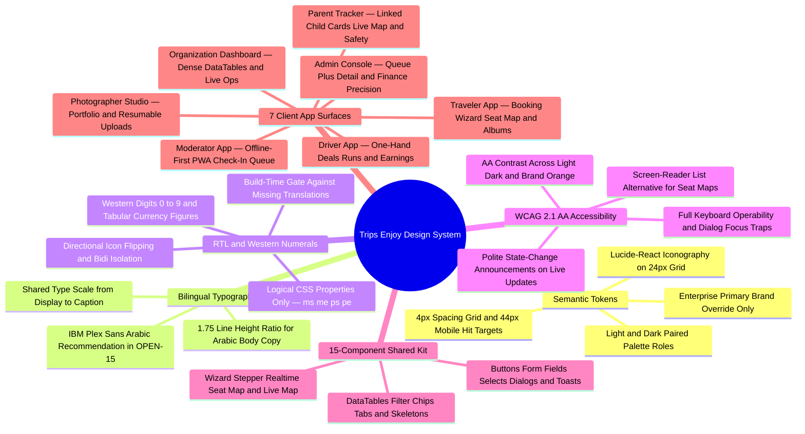
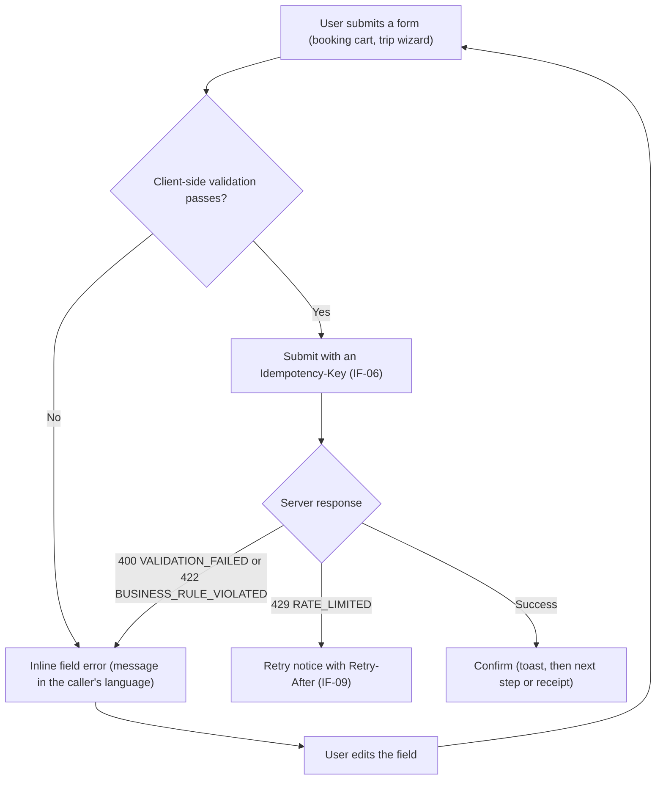

One design system serves all surfaces: the traveler app, the organization dashboard, the admin console, the driver app, the photographer app, the moderator app and the parent tracker. Every screen is Arabic and English from the first release (NFR-I18N-01), so each component ships with both directions and both themes or it does not ship.

<TraceBar
  brd={[
    { label: 'Enterprise Branding', href: '/en/docs/brd/requirements#63-organizations-and-employees-org', detail: 'BR-ORG-08' },
  ]}
  srs={[
    { label: 'UI Requirements §4.1', href: '/en/docs/srs#41-user-interfaces', detail: 'UI-01..09' },
    { label: 'I18N Rules §8.7', href: '/en/docs/srs/quality#87-internationalization-nfr-i18n' },
    { label: 'Accessibility §8.8', href: '/en/docs/srs/quality#88-accessibility-nfr-a11y' },
  ]}
  erd={[
    { label: 'JSONB Translatable Copy', href: '/en/docs/erd', detail: 'en/ar JSONB' },
  ]}
  plan={[
    { label: 'Delivery Plan', href: '/en/docs/plan', detail: '231 tasks · surface-tagged' },
  ]}
  workflows={[
    { label: 'Notifications & Quiet Hours', href: '/en/docs/workflows/notifications' },
    { label: 'Offline Trip Day', href: '/en/docs/workflows/trip-day' },
  ]}
  userFlows={[
    { label: '106 Role Flows', href: '/en/docs/user-flows' },
    { label: 'Language & RTL Flow', href: '/en/docs/user-flows/shared#uf-shr-13-language-and-layout' },
  ]}
  architecture={[
    { label: 'Edge, CDN & Client Apps', href: '/en/docs/architecture#system-context' },
  ]}
  design={[
    { label: 'Tokens & Foundations', href: '/en/docs/design#foundations' },
    { label: 'Shared Kit', href: '/en/docs/design#components' },
    { label: '7 App Surfaces', href: '/en/docs/design#app-surfaces' },
  ]}
  system={[
    { label: 'End-to-End System', href: '/en/docs/system' },
    { label: 'Mindmap Atlas', href: '/en/docs/system/mindmaps' },
  ]}
  recommendations={[
    { label: 'Arabic Web Font Choice', href: '/en/docs/recommendations/open-decisions#open-15', detail: 'OPEN-15' },
    { label: 'RTL & Seat-Map A11y', href: '/en/docs/recommendations/architecture-and-ops#rec-ux-11', detail: 'REC-UX-11' },
  ]}
/>

<MindmapBlock
  title="Design System — Tokens, Bilingual RTL Rules, Accessibility, Shared Kit & 7 Surfaces"
  caption="How one semantic token contract and 15-component shared kit power seven distinct web, mobile, and offline-first surfaces with native Arabic RTL mirroring, Western numerals, and WCAG 2.1 AA compliance."
  trace={{
    design: [
      { label: 'Color & Typography', href: '/en/docs/design#foundations' },
      { label: 'Components', href: '/en/docs/design#components' },
      { label: 'RTL & Localization', href: '/en/docs/design#rtl-and-localization' },
      { label: 'Accessibility', href: '/en/docs/design#accessibility' },
      { label: 'Governance', href: '/en/docs/design#governance' },
    ],
    recommendations: [
      { label: 'OPEN-15 Font Resolution', href: '/en/docs/recommendations/open-decisions#open-15' },
      { label: 'REC-UX-11 RTL Engineering', href: '/en/docs/recommendations/architecture-and-ops#rec-ux-11' },
    ],
  }}
>

</MindmapBlock>

## Foundations

### Color roles

Tokens are semantic roles, never raw hex values in component code. Both themes keep AA contrast, including brand orange text — #C93A00 on light, #FF8655 on dark (NFR-A11Y-04). The values below are the v1 palette recorded here; changes follow Governance.

| Token | Light | Dark | Role |
|---|---|---|---|
| `primary` | #C93A00 | #FF8655 | Brand actions, links, active states |
| `surface` | #FFFFFF | #111827 | Page background |
| `surface-raised` | #F9FAFB | #1F2937 | Cards, sheets, dialogs |
| `muted` | #F3F4F6 | #27303F | Section fills, disabled states |
| `border` | #E5E7EB | #374151 | Hairlines, dividers, input borders |
| `text` | #111827 | #F9FAFB | Primary text |
| `text-muted` | #6B7280 | #9CA3AF | Secondary text, hints |
| `success` | #15803D | #4ADE80 | Confirmed, paid, checked in |
| `warning` | #B45309 | #FBBF24 | Pending, needs action, changes requested |
| `danger` | #B91C1C | #F87171 | Cancelled, rejected, failed payment |
| `info` | #1D4ED8 | #60A5FA | In progress, neutral notices |

Every semantic color has a light and dark value in the same token — components never branch on theme. Enterprise custom branding ([BR-ORG-08](/en/docs/brd/requirements#63-organizations-and-employees-org)) swaps `primary` and the logo per organization on traveler-facing pages; nothing else moves.

### Typography

One scale serves both languages. Latin text uses the system UI stack. The Arabic display face is [OPEN: pick the Arabic web font — candidates: IBM Plex Sans Arabic, Noto Kufi Arabic, Cairo] (see [recommended resolution OPEN-15](/en/docs/recommendations/open-decisions#open-15)); until it lands, Arabic falls back to the system Arabic stack.

| Token | Size / line height | Use |
|---|---|---|
| `display` | 40 / 48 | Landing numbers, marketing headers |
| `h1` | 32 / 40 | Page titles |
| `h2` | 24 / 32 | Section titles |
| `h3` | 20 / 28 | Card titles |
| `body` | 16 / 24 | Default text |
| `body-sm` | 14 / 20 | Table cells, meta rows |
| `caption` | 12 / 16 | Hints, timestamps |

Arabic typography rules:

- Line height for Arabic body text is 16 / 28 (1.75); Arabic runs taller than Latin at the same size, so the line height token resolves per language, not per component.
- Weights stay within 400, 500, 600, 700 for both scripts; heavier weights render poorly in Arabic at small sizes.
- Western digits 0 to 9 in both languages (NFR-I18N-04, D-159). Arabic text never substitutes Arabic-Indic numerals, so tabular figures align identically in both directions.

### Spacing and radii

Spacing is a 4 px scale: 4 (chip and icon padding), 8 (between related controls), 12 (form field gaps), 16 (card padding), 24 (section spacing), 32 (desktop page gutters), 48 (hero blocks). Touch surfaces keep a 44 px hit area per control with at least 8 px between targets.

Radii: 4 px for inputs and chips, 8 px for buttons and cards, 12 px for dialogs and media, full radius for pills and avatars.

### Iconography

The lucide-react set is the only icon library; no mixed families. Icons draw on a 24 px grid at 16, 20 or 24 px. An icon is decorative only when an adjacent label carries the meaning; a lone icon control always has an accessible name. The role icons reserved for surface identity reuse the landing vocabulary: Map, Building2, Shield, Car, Camera, Eye, HeartHandshake. Directional icons mirror in RTL per the rules in "RTL and localization".

## Components

The shared kit is what every surface composes from; nothing is built twice.

| Component | Variants | Used by |
|---|---|---|
| Button | primary, secondary, ghost, destructive; sizes sm, md, lg; loading state | All surfaces |
| Input and form field | text, email, phone, password, number, textarea; label, hint, error slots | All surfaces; heavy in the trip wizard ([UF-ORG-06](/en/docs/user-flows/organization#uf-org-06-create-a-trip-wizard)) |
| Select | single choice, searchable list (fleet, drivers, staff) | Organization dashboard, Admin console |
| Card | static, clickable, with media | Traveler app, Photographer app |
| DataTable | sortable columns, sticky header, row actions | Organization dashboard, Admin console |
| List row | title, meta line, trailing status, tap target | Driver app, Moderator app, Traveler app |
| Chip and badge | status (success, warning, danger, info), filter chip with count | All surfaces |
| Dialog | destructive confirm, form dialog, fullscreen sheet on mobile | All surfaces |
| Toast | success, error, info; optional action; auto-dismiss | All surfaces |
| Skeleton | card, table, map and seat-map placeholders | All surfaces |
| Tabs | section tabs, segmented control on mobile | Traveler app, Photographer app, Organization dashboard |
| Wizard stepper | multi-step forms with progress and per-step validation | Trip creation ([UF-ORG-06](/en/docs/user-flows/organization#uf-org-06-create-a-trip-wizard)), booking ([UF-TRV-03](/en/docs/user-flows/traveler#uf-trv-03-book-a-trip)) |
| Seat map | bus layout by seat class, real-time status | Traveler app booking ([UF-TRV-03](/en/docs/user-flows/traveler#uf-trv-03-book-a-trip)), Organization dashboard ([UF-ORG-09](/en/docs/user-flows/organization#uf-org-09-manage-bookings-and-seats)) |
| Live map and timeline | vehicle position, stops, child marker | Live operations ([UF-ORG-12](/en/docs/user-flows/organization#uf-org-12-live-operations)), Moderator app, Parent tracker ([UF-PAR-03](/en/docs/user-flows/parent#uf-par-03-live-map)) |
| Empty and error state | icon, one-line message, primary action | All surfaces |

## Patterns

### Forms and validation

Validation runs on blur, then on change after the first error. The submit button disables only while a request is pending, never because fields are invalid — users must see why. Errors render inline under the field from the stable error code, message in the caller's language (IF-03, IF-08). Every mutating form sends an Idempotency-Key, so a double submit cannot book twice (IF-06). Destructive actions (cancel a trip, reject an application) confirm through a dialog that names the consequence.

### Empty, loading and error states

Loading shows skeletons shaped like the final content, after a 300 ms delay so fast loads do not flash; the seat map and live map keep skeletons even inside their performance budgets ([NFR-PERF-04](/en/docs/srs/quality#81-performance-nfr-perf), [NFR-PERF-06](/en/docs/srs/quality#81-performance-nfr-perf)). Empty states name the first useful action (browse trips, upload an album). Errors map the stable code to a localized message; another tenant's record reads as not found (IF-12), so 404 copy stays generic. Retryable failures offer a retry button; the Moderator app adds an offline banner while its queue is pending ([UF-MOD-06](/en/docs/user-flows/moderator#uf-mod-06-offline-queue)).

### Lists and pagination

Lists page by cursor, default 20 per page, maximum 100 (IF-05). Traveler surfaces use infinite scroll; dashboards use explicit next and previous with a count. Filters render as chips with counts above the list. Row status updates optimistically from real-time events, then reconciles.

### Notification surfaces

The in-app inbox and toasts are the in-app channel of the preference matrix ([FR-NTF-01](/en/docs/srs/requirements/ntf#fr-ntf-01--channels-by-preference)); account security messages always show. Toasts carry one action at most and auto-dismiss; the inbox keeps unread badges and unread counts on the bell. Copy comes from versioned templates ([FR-NTF-04](/en/docs/srs/requirements/ntf#fr-ntf-04--versioned-templates)) — surfaces render template output and never hardcode notification text. Quiet hours apply to SMS and push only ([FR-NTF-03](/en/docs/srs/requirements/ntf#fr-ntf-03--quiet-hours)); in-app surfaces show immediately.

## App surfaces

### Traveler app

- The booking wizard, seat map and remedy chooser dominate: card layout, wizard stepper, seat map with real-time status ([UF-TRV-03](/en/docs/user-flows/traveler#uf-trv-03-book-a-trip), [UF-TRV-07](/en/docs/user-flows/traveler#uf-trv-07-choose-a-remedy-after-a-trip-change)).
- Coupons render as removable chips with inline validation feedback ([UF-TRV-04](/en/docs/user-flows/traveler#uf-trv-04-apply-a-coupon)).
- Trip day and albums favor timelines and media cards over tables ([UF-TRV-08](/en/docs/user-flows/traveler#uf-trv-08-trip-day), [UF-TRV-09](/en/docs/user-flows/traveler#uf-trv-09-albums)).
- Profile, language and privacy reuse the form kit and dialog confirmations ([UF-TRV-12](/en/docs/user-flows/traveler#uf-trv-12-profile-language-and-notifications), [UF-TRV-13](/en/docs/user-flows/traveler#uf-trv-13-privacy-requests)).

### Driver app

- Mobile first: large touch targets, one-hand reach, availability as a single toggle ([UF-DRV-02](/en/docs/user-flows/driver#uf-drv-02-set-availability-and-profile)).
- Deal offers are cards that show pay before any action button ([UF-DRV-03](/en/docs/user-flows/driver#uf-drv-03-respond-to-a-deal)); the vehicle run pairs the manifest list with check actions ([UF-DRV-04](/en/docs/user-flows/driver#uf-drv-04-run-an-assigned-vehicle)).
- Earnings and payouts use numeric emphasis with tabular figures ([UF-DRV-06](/en/docs/user-flows/driver#uf-drv-06-earnings-and-payouts)).

### Photographer app

- Responsive web first, mobile follows (D-86): portfolio grid, album cards, upload progress with resumable batch feedback ([UF-PHO-02](/en/docs/user-flows/photographer#uf-pho-02-portfolio-profile-and-availability), [UF-PHO-05](/en/docs/user-flows/photographer#uf-pho-05-create-and-upload-an-album)).
- Privacy modes and watermark preview are dialogs, not separate screens ([UF-PHO-06](/en/docs/user-flows/photographer#uf-pho-06-privacy-and-sharing), [UF-PHO-07](/en/docs/user-flows/photographer#uf-pho-07-watermark)).

### Moderator app

- Installable web app on phones, offline first: every row shows a queued-check-in status while the queue syncs ([UF-MOD-06](/en/docs/user-flows/moderator#uf-mod-06-offline-queue)).
- Check-in and check-out are one large primary action per passenger row ([UF-MOD-04](/en/docs/user-flows/moderator#uf-mod-04-check-in-a-passenger), [UF-MOD-05](/en/docs/user-flows/moderator#uf-mod-05-check-out-at-a-stop-or-destination)).
- Incident reporting is a short form reachable from any row without leaving the manifest ([UF-MOD-07](/en/docs/user-flows/moderator#uf-mod-07-report-an-incident)).

### Organization dashboard

- The densest surface: DataTables for bookings, fleet, deals, invoices and settlements ([UF-ORG-09](/en/docs/user-flows/organization#uf-org-09-manage-bookings-and-seats), [UF-ORG-04](/en/docs/user-flows/organization#uf-org-04-fleet), [UF-ORG-14](/en/docs/user-flows/organization#uf-org-14-invoices), [UF-ORG-15](/en/docs/user-flows/organization#uf-org-15-accounting-and-settlements)).
- Trip creation is a wizard stepper with per-step validation and review ([UF-ORG-06](/en/docs/user-flows/organization#uf-org-06-create-a-trip-wizard)); live operations combines the map, stop timeline and alerts ([UF-ORG-12](/en/docs/user-flows/organization#uf-org-12-live-operations)).
- Coupons, analytics and CRM reuse table plus filter chip patterns ([UF-ORG-13](/en/docs/user-flows/organization#uf-org-13-coupons), [UF-ORG-16](/en/docs/user-flows/organization#uf-org-16-analytics), [UF-ORG-17](/en/docs/user-flows/organization#uf-org-17-crm-and-webhooks)).

### Admin console

- Queue plus detail panel is the core pattern: applications, appeals, disputes and payment escalations ([UF-ADM-02](/en/docs/user-flows/admin#uf-adm-02-review-an-application), [UF-ADM-03](/en/docs/user-flows/admin#uf-adm-03-decide-an-appeal), [UF-ADM-10](/en/docs/user-flows/admin#uf-adm-10-disputes), [UF-ADM-12](/en/docs/user-flows/admin#uf-adm-12-payment-escalations)).
- Finance screens prioritize precision: minor-unit amounts, tabular figures, explicit currency labels ([UF-ADM-11](/en/docs/user-flows/admin#uf-adm-11-finance-operations)).
- Account actions and refund overrides always confirm through destructive dialogs ([UF-ADM-04](/en/docs/user-flows/admin#uf-adm-04-manage-an-account), [UF-ADM-16](/en/docs/user-flows/admin#uf-adm-16-out-of-policy-refund)).

### Parent tracker

- A section of the traveler app (D-124): child cards with status chips and a live map with child markers ([UF-PAR-02](/en/docs/user-flows/parent#uf-par-02-child-trip-status), [UF-PAR-03](/en/docs/user-flows/parent#uf-par-03-live-map)).
- Notifications land in the in-app inbox under the same channel preferences as the rest of the app ([UF-PAR-04](/en/docs/user-flows/parent#uf-par-04-notifications), [FR-NTF-01](/en/docs/srs/requirements/ntf#fr-ntf-01--channels-by-preference)).
- Child-safety reporting stays one tap away as a prominent form ([UF-PAR-05](/en/docs/user-flows/parent#uf-par-05-report-a-child-safety-concern)).

## RTL and localization

- Components use logical CSS properties only — margin-inline-start (ms-), margin-inline-end (me-), padding-inline (ps-/pe-), inset-inline and text-start / text-end. Physical left and right never appear in component styles.
- Directional icons mirror in Arabic: chevrons, arrows and the back control flip; symmetric icons (search, settings, camera) stay; timelines, carousels and progress flow start to end automatically.
- Numerals are Western digits 0 to 9 in both languages (NFR-I18N-04, D-159) with tabular figures for money and seat numbers; dates format per display language (NFR-I18N-04).
- Every amount displays with its currency label (NFR-I18N-03); the API delivers minor units (IF-02) and the UI formats.
- Mixed-direction text is isolated: Latin tokens embedded in Arabic — booking references, URLs, phone numbers — render inside bidi isolation, never freely interleaved on one line.
- A missing translation fails the build (NFR-I18N-05), so no surface can render a fallback string.

## Accessibility

- WCAG 2.1 AA on all surfaces (NFR-A11Y-01).
- Contrast holds AA in light and dark themes, including brand orange text values (NFR-A11Y-04); the token table above is the contrast contract.
- Every web action is keyboard-operable (NFR-A11Y-02): focus order follows visual and logical order, the focus ring is a named token, dialogs trap and return focus, and no component introduces a keyboard trap.
- The seat map ships a list alternative readable by screen readers (NFR-A11Y-03); maps expose a text summary of stops and status.
- Touch targets stay at least 44 px on mobile surfaces: driver app, moderator app and the parent tracker.
- Icon-only controls carry accessible names; real-time updates (tracking, seat status) announce politely and on state change only, not per event.

## Governance

- Tokens live in one versioned source; every release states the token version it ships.
- Component and token changes land through a pull request with visual review in both themes (light, dark) and both directions (LTR, RTL) before merge.
- The kit is the only source of UI truth: a surface that needs a variant extends the kit, never local CSS.
- A component without dark parity, RTL support and its accessibility checks does not merge.
- Enterprise custom branding applies through the branding tokens only ([BR-ORG-08](/en/docs/brd/requirements#63-organizations-and-employees-org)); surfaces never re-skin themselves.
