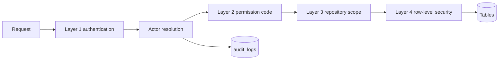

Part of the [data model](/en/docs/erd); conventions and base columns are documented there.

Access control runs at four layers. A request that passes all of them still leaves an audit trail; a request that fails any of them is refused ([BRL-01](/en/docs/brd/requirements#7-business-rules), [FR-EMP-04](/en/docs/srs/requirements/emp#fr-emp-04--server-side-scope)).

| Layer | Checks | Refuses with |
|---|---|---|
| 1. Authentication | Session token, API-key hash, or shared-token hash resolves to an actor. Expired, revoked (`revoked_at`, `token_version`) and locked actors fail here ([BRL-21](/en/docs/brd/requirements#7-business-rules), [BRL-22](/en/docs/brd/requirements#7-business-rules)). | 401 Unauthenticated |
| 2. Permission | Service layer matches the required permission code against the actor's grant set for the active organization ([FR-EMP-04](/en/docs/srs/requirements/emp#fr-emp-04--server-side-scope)). | 403 Forbidden |
| 3. Repository scope | Every repository is bound to one tenant or platform scope; cross-tenant joins never run ([DAT-02](/en/docs/srs/data#62-data-isolation)). | Empty result or 403 |
| 4. Row-level security | Postgres RLS policies are the final backstop on every table in the [policy catalog](#policy-catalog) ([DAT-01](/en/docs/srs/data#62-data-isolation), [NFR-SEC-07](/en/docs/srs/quality#82-security-nfr-sec)). | Empty result or 403 |

The client hides areas the employee has no permission for, but that is cosmetic; the server re-checks on every request ([FR-EMP-01](/en/docs/srs/requirements/emp#fr-emp-01--permission-sets)).



## Actor resolution

Every request resolves to exactly one actor before any query runs. The actor sets the database session variables that RLS policies read.

| Actor kind | Credential | Sets | Tables involved |
|---|---|---|---|
| User session | Refresh-token hash in `sessions` | `app.current_user_id`, `app.current_organization_id` from `sessions.active_organization_id`, active role from `sessions.active_role_id` | sessions, user_roles, organization_members |
| Organization API key | `key_hash` in `api_keys` | `app.current_user_id` null, `app.current_organization_id` from the key, grant set = key `scopes` | api_keys |
| Admin operator | Staff session with an `admin_*` role | `app.is_admin()` true; every query logged to `audit_logs` | user_roles, audit_logs |
| Platform job | Internal service identity (payout runs, outbox relay, analytics rollup) | `app.is_platform_job()` true; writes through the platform repository only | outbox_events, payout_runs |
| Shared-link holder | `token_hash` in `album_shared_links` | No tenant context; may read one album's published photos only | album_shared_links, photos |
| Boarding code | `boarding_code_hash` in `booking_passengers` | No tenant context; authorizes one passenger's check-in only | booking_passengers, checkin_events |

Role and tenant context are set per request, not per connection. Bumping `users.token_version` invalidates every issued token at once ([FR-AUTH-10](/en/docs/srs/requirements/auth#fr-auth-10--sessions-and-tokens)); removing an `organization_members` row ends that organization's context at once ([FR-EMP-05](/en/docs/srs/requirements/emp#fr-emp-05--employee-removal)).

## Role catalog

Roles come from the `role` lookup (not extensible). A user may hold several roles at once, each scoped globally or to one organization ([FR-AUTH-06](/en/docs/srs/requirements/auth#fr-auth-06--multi-role-accounts), [FR-AUTH-07](/en/docs/srs/requirements/auth#fr-auth-07--staff-access-to-several-organizations)).

| Role | Scope | How it is obtained | What it unlocks |
|---|---|---|---|
| traveler | Account | Self-registration | Bookings, passengers, receipts, allowed albums |
| organization_owner | One organization | Application approval creates the first owner | All permissions in that organization, including permission management |
| organization_employee | One organization | Owner invitation ([FR-EMP-06](/en/docs/srs/requirements/emp#fr-emp-06--invitation-and-first-sign-in)) | Only the granted permission set |
| org_driver, org_photographer | One organization | Owner invitation as staff | Assigned trips, vehicles, albums; no management areas |
| platform_driver, platform_photographer | Platform | Supplier application approval ([FR-ONB-01](/en/docs/srs/requirements/onb#fr-onb-01--application-and-supplier-access)) | Deals, assignments, albums, earnings — own rows only |
| moderator | Per assignment | Staff assignment on a trip vehicle ([FR-STF-05](/en/docs/srs/requirements/stf#fr-stf-05--moderator-assignment)) | Check-in writes and passenger reads for the assigned vehicle while `access_until` holds |
| admin_super, admin_operations, admin_finance | Platform | Admin grant by another admin | Bypass role; every query logged ([FR-ADM-05](/en/docs/srs/requirements/adm#fr-adm-05--immutable-audit-log)) |

Roles decide *where a user may act*; the permission grant set decides *what they may do there*. The two are joined at `organization_members` → `member_permissions`.

## Permission catalog

Permissions are `area.action` codes stored in `permissions` and granted per member through `member_permissions` ([FR-EMP-01](/en/docs/srs/requirements/emp#fr-emp-01--permission-sets)). The `permission_area` lookup fixes the areas: trips, bookings, operations, accounting, coupons, employees, fleet, subscription, integrations, analytics.

| Area | Code | Grants | Trace |
|---|---|---|---|
| trips | `trip.create` | Create and edit trips in the wizard | [FR-TRIP-01](/en/docs/srs/requirements/trip#fr-trip-01--trip-creation-wizard) |
| trips | `trip.publish` | Publish public or targeted, cancel, archive | [FR-TRIP-02](/en/docs/srs/requirements/trip#fr-trip-02--draft-public-and-targeted-publishing) |
| bookings | `booking.view` | See bookings, passengers and seats | [FR-BKG-01](/en/docs/srs/requirements/bkg#fr-bkg-01--booking-composition) |
| bookings | `booking.manage` | Assign seats, apply remedies, cancel within policy | [FR-SEAT-01](/en/docs/srs/requirements/seat#fr-seat-01--company-assigned-by-default), [BRL-24](/en/docs/brd/requirements#7-business-rules) |
| bookings | `booking.refund` | Refunds outside the automatic policy | [FR-PAY-04](/en/docs/srs/requirements/pay#fr-pay-04--refunds-outside-policy) |
| operations | `operations.checkin` | Moderator check-in operations | [FR-CHK-01](/en/docs/srs/requirements/chk#fr-chk-01--check-in-at-boarding) |
| operations | `operations.incidents` | Raise, acknowledge and resolve incidents | [FR-CHK-06](/en/docs/srs/requirements/chk#fr-chk-06--incident-reporting) |
| operations | `operations.reports` | Submit and annotate end-of-trip reports | [FR-MOD-02](/en/docs/srs/requirements/mod#fr-mod-02--end-of-trip-report) |
| accounting | `accounting.view` | Ledger, invoices, settlements, payouts | [FR-ACC-01](/en/docs/srs/requirements/acc#fr-acc-01--double-entry-ledger) |
| accounting | `accounting.export` | Financial exports | [FR-ACC-01](/en/docs/srs/requirements/acc#fr-acc-01--double-entry-ledger) |
| coupons | `coupon.manage` | Create, pause and revoke coupons within plan limits | [FR-CPN-01](/en/docs/srs/requirements/cpn#fr-cpn-01--creator-scope) |
| employees | `employee.invite` | Invite employees and drivers | [FR-EMP-06](/en/docs/srs/requirements/emp#fr-emp-06--invitation-and-first-sign-in) |
| employees | `employee.manage` | Grant, change and remove permission sets | [FR-EMP-01](/en/docs/srs/requirements/emp#fr-emp-01--permission-sets) |
| fleet | `fleet.manage` | Vehicle types, seat layouts, vehicle registry | [FR-FLT-01](/en/docs/srs/requirements/flt#fr-flt-01--reusable-vehicle-types) |
| subscription | `subscription.manage` | Change plan, billing and seats | [FR-SUB-02](/en/docs/srs/requirements/sub#fr-sub-02--feature-gates) |
| integrations | `integration.manage` | CRM connections and webhook endpoints | [FR-ORG-06](/en/docs/srs/requirements/org#fr-org-06--crm-and-webhooks) |
| integrations | `integration.api_keys` | Create, list and revoke organization API keys | [FR-API-02](/en/docs/srs/requirements/api#fr-api-02--api-key-lifecycle) |
| analytics | `analytics.view` | Dashboards and rollups at the plan's level | [BR-ANL-01](/en/docs/brd/requirements#617-analytics-anl) |

Every grant, change and removal writes an `audit_logs` row with actor, time, and before and after values — this is the employee's permission history ([FR-EMP-02](/en/docs/srs/requirements/emp#fr-emp-02--permission-changes-are-audited)).

### Permission templates

Offered as starting points when inviting an employee ([FR-EMP-01](/en/docs/srs/requirements/emp#fr-emp-01--permission-sets)); the owner can then adjust member by member.

| Template | Codes granted |
|---|---|
| Operations | `trip.create`, `trip.publish`, `booking.view`, `booking.manage`, `operations.checkin`, `operations.incidents`, `operations.reports`, `fleet.manage` |
| Finance | `booking.view`, `accounting.view`, `accounting.export`, `coupon.manage`, `subscription.manage` |
| Support | `booking.view`, `booking.manage`, `operations.incidents` |
| Manager | All codes except `employee.manage` and `integration.api_keys` — broad operational authority, while permission grants and API keys stay with the owner |

The organization owner holds every code by virtue of `member_type` owner; `member_permissions` rows are still written for the owner at creation so the audit history has a baseline ([FR-EMP-02](/en/docs/srs/requirements/emp#fr-emp-02--permission-changes-are-audited)).

## Policy catalog

RLS is enabled on every table below; policies are the last line of defense, not the permission check ([DAT-01](/en/docs/srs/data#62-data-isolation), [DAT-02](/en/docs/srs/data#62-data-isolation)). All `*_id`, status and FK columns referenced by policies are indexed per the [conventions](/en/docs/erd).

| Pattern | Tables | Rule |
|---|---|---|
| Tenant isolation | trips, trip_stops, trip_audiences, trip_vehicles, trip_staff_assignments, programs, program_tiers, vehicle_types, vehicle_type_seats, vehicles, bookings, booking_passengers, booking_programs, trip_seats, booking_remedies, organizations, organization_members, member_permissions, invitations, crm_connections, webhook_endpoints, webhook_deliveries, api_keys, coupons, coupon_programs, coupon_audiences, coupon_redemptions, incidents, trip_reports, albums, settlements, settlement_lines, refunds | `organization_id = app.current_organization_id()` for all operations |
| Account owned | users, user_roles, auth_factors, devices, consents, notification_preferences, privacy_requests, sessions, otp_challenges, availability_slots, payout_methods, notifications, subscriptions, child_links | `user_id = app.current_user_id()` (or the parent-side column named in the table) |
| Shared tenant or supplier | deals (read), deal_offers (read), organization-owned supplier profiles | Tenant rule **or** `provider_user_id = app.current_user_id()`; platform suppliers read through a logged platform repository |
| Assignment scoped | checkin_events (insert), booking_passengers (read for moderators) | Accepted, unexpired `trip_staff_assignments` row for the vehicle ([FR-STF-05](/en/docs/srs/requirements/stf#fr-stf-05--moderator-assignment), D-107) |
| Parent path | child_links → bookings, trips status, tracking summary | Active link; live position only while the trip is in progress and eligible ([FR-PAR-03](/en/docs/srs/requirements/par#fr-par-03--eligibility), [BRL-29](/en/docs/brd/requirements#7-business-rules)) |
| Actor-free token | album_shared_links → published photos | `token_hash` match and not revoked; no tenant context exists |
| Admin bypass | all of the above | `app.is_admin()` passes every policy; each query writes `audit_logs` ([FR-ADM-05](/en/docs/srs/requirements/adm#fr-adm-05--immutable-audit-log)) |
| Insert only | ledger_transactions, ledger_entries, audit_logs, deal_offers, checkin_events, tracking_points, consents, outbox_events | SELECT and INSERT policies only; no UPDATE or DELETE policy exists, so none can run ([DAT-08](/en/docs/srs/data#63-soft-delete-immutability-and-deletion)) |
| No RLS | lookup_types, lookups, countries, currencies, markets, market_payment_methods, tax_rates, plans, plan_limits, plan_prices, lab_partners, feature_flags, notification_templates, idempotency_keys | Platform reference data; reads go through cached public repositories, writes through admin only |

Representative policy definitions:

```sql
-- Tenant isolation (example: trips; same shape on every tenant table)
CREATE POLICY tenant_isolation ON trips FOR ALL
  USING      (organization_id = app.current_organization_id())
  WITH CHECK (organization_id = app.current_organization_id());

-- Account owned (example: notification_preferences)
CREATE POLICY own_rows ON notification_preferences FOR ALL
  USING      (user_id = app.current_user_id())
  WITH CHECK (user_id = app.current_user_id());

-- Shared tenant or supplier (example: deals)
CREATE POLICY deal_read ON deals FOR SELECT
  USING (organization_id = app.current_organization_id()
      OR provider_user_id = app.current_user_id());

-- Assignment scoped (example: moderator check-in writes)
CREATE POLICY moderator_checkin ON checkin_events FOR INSERT WITH CHECK (
  EXISTS (SELECT 1 FROM trip_staff_assignments a
          WHERE a.trip_vehicle_id = checkin_events.trip_vehicle_id
            AND a.user_id        = app.current_user_id()
            AND a.status_id      = app.lookup('assignment_status', 'accepted')
            AND a.access_until   > now()));

-- Admin bypass (example: trips; identical on every table)
CREATE POLICY admin_bypass ON trips FOR ALL
  USING (app.is_admin()) WITH CHECK (app.is_admin());
```

## API keys and machine access

API keys authenticate organizations and partners on the public API; they never act as a user ([FR-API-01](/en/docs/srs/requirements/api#fr-api-01--public-api)).

- Keys are stored as `key_hash` with a visible `key_prefix`; the plain key is shown once at creation.
- A key's `scopes` are a subset of the [permission catalog](#permission-catalog); `integration.api_keys` is required to manage keys ([FR-API-02](/en/docs/srs/requirements/api#fr-api-02--api-key-lifecycle)).
- Reads are tenant-scoped: another organization's data returns an empty result, not an error ([FR-API-03](/en/docs/srs/requirements/api#fr-api-03--read-resource-endpoints)); Draft trips are never returned.
- Revocation propagates within one minute via the key cache.
- Rate limits apply per key with 429 and `Retry-After`, and remaining-quota headers on every response ([FR-API-06](/en/docs/srs/requirements/api#fr-api-06--rate-limiting-behavior)).
- Outbound webhooks sign payloads with HMAC over the rotating `secret_enc`, valid with the previous secret for the 24-hour overlap ([FR-ORG-06](/en/docs/srs/requirements/org#fr-org-06--crm-and-webhooks), [FR-API-07](/en/docs/srs/requirements/api#fr-api-07--webhook-contract-parity)).

## Special access paths

| Path | Credential | Scope | Ends |
|---|---|---|---|
| Album shared link | `token_hash` on `album_shared_links` | Published photos of one album ([FR-MED-05](/en/docs/srs/requirements/med#fr-med-05--selected-user-access)) | Revocation or album archival |
| Boarding code | `boarding_code_hash` on `booking_passengers` | One passenger check-in ([FR-CHK-01](/en/docs/srs/requirements/chk#fr-chk-01--check-in-at-boarding)) | Check-out or trip end |
| Parent link | Active `child_links` row | Child status, and live position only in progress ([FR-PAR-03](/en/docs/srs/requirements/par#fr-par-03--eligibility)) | Cancellation or refund ([FR-PAR-06](/en/docs/srs/requirements/par#fr-par-06--link-ends-with-the-booking)) |
| Invitation token | `token_hash` on `invitations` | Accept one invitation, then first sign-in flow | 7 days ([D-286](/en/docs/erd/reference)) |

Hash-based credentials are looked up by exact `*_hash` match; the plaintext never reaches the database.
