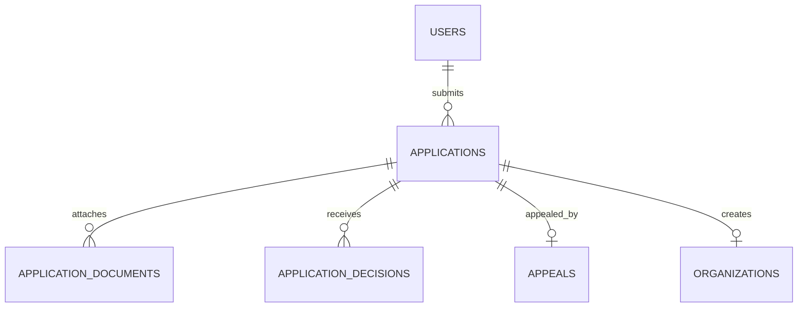

Part of the [data model](/en/docs/erd); conventions and base columns are documented there.

## applications
*(Base +) [FR-ONB-01](/en/docs/srs/requirements/onb#fr-onb-01--application-and-supplier-access) to [FR-ONB-09](/en/docs/srs/requirements/onb#fr-onb-09--applicant-status-notifications)*

| Column | Type | Notes |
|---|---|---|
| applicant_user_id | BIGINT FK users | |
| type_id | BIGINT FK lookups | `application_type`: organization, platform_driver, platform_photographer |
| status_id | BIGINT FK lookups | `application_status`: draft, submitted, pending_review, changes_requested, approved, rejected, appealed, closed |
| country_code | CHAR(2) FK countries | |
| requested_plan_id | BIGINT FK plans | Chosen at registration, no charge (D-77) |
| payload | JSONB | Role-specific fields (legal names, CR and tax numbers, license, vehicle, rates, service regions) |
| submitted_at | TIMESTAMPTZ | |
| review_due_at | TIMESTAMPTZ | 2 working days ([FR-ONB-03](/en/docs/srs/requirements/onb#fr-onb-03--decision-time-target)) |
| changes_due_at | TIMESTAMPTZ | 14 days, plus one 7-day extension (D-235) |
| extension_used | BOOLEAN | |
| decided_at | TIMESTAMPTZ | |
| reapply_after | DATE | Decision date plus 30 days ([BRL-06](/en/docs/brd/requirements#7-business-rules)) |
| previous_application_id | BIGINT FK applications | Re-application chain |

**application_documents** (Base +): `application_id FK`, `doc_type_id FK lookups (document_type: id_card, driving_license, vehicle_registration, insurance, lab_result, commercial_registration, tax_certificate, portfolio_photo, other)`, `storage_path TEXT` (restricted bucket, [DAT-04](/en/docs/srs/data#62-data-isolation)), `mime_type VARCHAR(80)`, `size_bytes BIGINT` (10 MB documents, 25 MB photos, D-80, D-81), `valid_until DATE NULL`, `issued_on DATE NULL`, `check_status_id FK lookups (document_check: pending, accepted, rejected)`.

**application_decisions** (Base +): `application_id FK`, `decision_id FK lookups (application_decision: approve, request_changes, reject, close, uphold_appeal, overturn)`, `reason_id FK lookups (decision_reason, D-234) NULL`, `message JSONB` (in the applicant's language), `items JSONB` (requested changes), `decided_by BIGINT FK users`.

**appeals** (Base +) D-237: `application_id FK UNIQUE`, `statement TEXT`, `files JSONB` (up to 5), `submitted_at`, `due_at` (5 working days), `status_id FK lookups (appeal_status: submitted, upheld, rejected)`.
