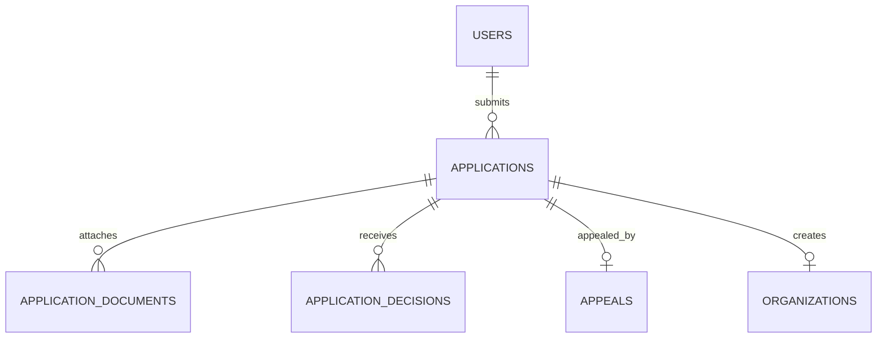

Part of the [data model](/en/docs/erd); conventions and base columns are documented there.

## applications
*(Base +) — one organization or supplier onboarding case, from draft through decision, appeal and re-application. [FR-ONB-01](/en/docs/srs/requirements/onb#fr-onb-01--application-and-supplier-access) to [FR-ONB-09](/en/docs/srs/requirements/onb#fr-onb-09--applicant-status-notifications)*

<TypeTable
  type={{
    "applicant_user_id": {
      type: "BIGINT FK users",
      required: true
    },
    "type_id": {
      type: "BIGINT FK lookups",
      description: "`application_type`: organization, platform_driver, platform_photographer",
      required: true,
    },
    "status_id": {
      type: "BIGINT FK lookups",
      description: "`application_status`: draft, submitted, pending_review, changes_requested, approved, rejected, appealed, closed",
      required: true,
    },
    "country_code": {
      type: "CHAR(2) FK countries",
      required: true
    },
    "requested_plan_id": {
      type: "BIGINT FK plans",
      description: "Chosen at registration, no charge (D-77)",
      required: true,
    },
    "payload": {
      type: "JSONB",
      description: "Role-specific fields (legal names, CR and tax numbers, license, vehicle, rates, service regions)",
      required: true,
    },
    "submitted_at": {
      type: "TIMESTAMPTZ",
      required: true
    },
    "review_due_at": {
      type: "TIMESTAMPTZ",
      description: "2 working days ([FR-ONB-03](/en/docs/srs/requirements/onb#fr-onb-03--decision-time-target))",
      required: true,
    },
    "changes_due_at": {
      type: "TIMESTAMPTZ",
      description: "14 days, plus one 7-day extension (D-235)",
      required: true,
    },
    "extension_used": {
      type: "BOOLEAN",
      required: true
    },
    "decided_at": {
      type: "TIMESTAMPTZ",
      required: true
    },
    "reapply_after": {
      type: "DATE",
      description: "Decision date plus 30 days ([BRL-06](/en/docs/brd/requirements#7-business-rules))",
      required: true,
    },
    "previous_application_id": {
      type: "BIGINT FK applications",
      description: "Re-application chain",
      required: true,
    },
  }}
/>

Indexes: `(applicant_user_id)`, `(type_id, status_id)` for the review queue, `(previous_application_id)`, partial `(review_due_at)` where `status_id` is `pending_review`.

**application_documents** (Base +) — identity and qualification files attached to an application, stored in the restricted bucket: `application_id FK`, `doc_type_id FK lookups (document_type: id_card, driving_license, vehicle_registration, insurance, lab_result, commercial_registration, tax_certificate, portfolio_photo, other)`, `storage_path TEXT` (restricted bucket, [DAT-04](/en/docs/srs/data#62-data-isolation)), `mime_type VARCHAR(80)`, `size_bytes BIGINT` (10 MB documents, 25 MB photos, D-80, D-81), `valid_until DATE NULL`, `issued_on DATE NULL`, `check_status_id FK lookups (document_check: pending, accepted, rejected)`. Indexes: `(application_id, check_status_id)`.

**application_decisions** (Base +) — one row per admin decision, request-for-changes or appeal outcome, forming the review trail: `application_id FK`, `decision_id FK lookups (application_decision: approve, request_changes, reject, close, uphold_appeal, overturn)`, `reason_id FK lookups (decision_reason, D-234) NULL`, `message JSONB` (in the applicant's language), `items JSONB` (requested changes), `decided_by BIGINT FK users`. Indexes: `(application_id, decided_at)`.

**appeals** (Base +) — one appeal per rejected application, reviewed by a second admin (D-237): `application_id FK UNIQUE`, `statement TEXT`, `files JSONB` (up to 5), `submitted_at`, `due_at` (5 working days), `status_id FK lookups (appeal_status: submitted, upheld, rejected)`. Indexes: `unique (application_id)`, `(status_id, due_at)`.
