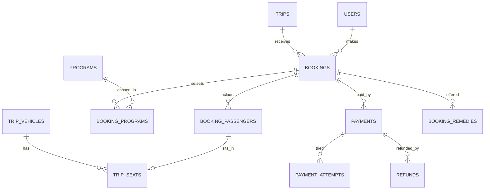

Part of the [data model](/en/docs/erd); conventions and base columns are documented there.

## bookings
*(Base +) [FR-BKG-01](/en/docs/srs/requirements/bkg#fr-bkg-01--booking-composition) to [FR-BKG-07](/en/docs/srs/requirements/bkg#fr-bkg-07--booking-states)*

| Column | Type | Notes |
|---|---|---|
| organization_id | BIGINT | Tenant column |
| trip_id | BIGINT FK trips | |
| booked_by_user_id | BIGINT FK users | |
| reference | VARCHAR(12) | Public booking reference used for child links |
| status_id | BIGINT FK lookups | `booking_status`: cart, seats_held, payment_pending, confirmed, payment_failed, checked_in, checked_out, cancelled, refund_pending, refunded |
| passenger_count | SMALLINT | |
| base_total_minor, programs_total_minor, plan_discount_minor, coupon_discount_minor, total_minor | BIGINT | Price locked when the hold starts (D-192) |
| currency_code | CHAR(3) | |
| hold_expires_at | TIMESTAMPTZ | 15 minutes; Fawry 48 h |
| payment_attempts | SMALLINT | Max 3 per hold (D-197) |
| buyer_tax_no | VARCHAR(50) NULL | Present means B2B invoice ([BRL-28](/en/docs/brd/requirements#7-business-rules)) |
| confirmed_at, cancelled_at | TIMESTAMPTZ | |
| cancel_reason_id | BIGINT FK lookups | `cancel_reason` |
| refund_rule_applied | VARCHAR(20) | For example `80_at_48h` |

**booking_passengers** (Base +): `organization_id`, `booking_id FK`, `full_name VARCHAR(200)`, `is_child BOOLEAN`, `birth_year SMALLINT NULL`, `trip_vehicle_id FK NULL`, `seat_id FK trip_seats NULL`, `checkin_status_id FK lookups (passenger_checkin: not_boarded, on_board, off_vehicle, completed)`, `boarding_code_hash CHAR(64)`.

**booking_programs** (Base +): `organization_id`, `booking_id FK`, `program_id FK`, `program_tier_id FK NULL`, `passenger_id FK booking_passengers NULL`, `quantity INT`, `unit_price_minor BIGINT`, `line_total_minor BIGINT`.

## trip_seats
*(Base +) [FR-SEAT-01](/en/docs/srs/requirements/seat#fr-seat-01--company-assigned-by-default) to [FR-SEAT-07](/en/docs/srs/requirements/seat#fr-seat-07--self-selection-by-plan)*

| Column | Type | Notes |
|---|---|---|
| organization_id | BIGINT | |
| trip_vehicle_id | BIGINT FK trip_vehicles | |
| vehicle_type_seat_id | BIGINT FK vehicle_type_seats | |
| label | VARCHAR(10) | |
| status_id | BIGINT FK lookups | `seat_status`: available, held, reserved, checked_in, checked_out, released |
| held_by_booking_id | BIGINT FK bookings NULL | |
| held_until | TIMESTAMPTZ | |
| reserved_by_passenger_id | BIGINT FK booking_passengers NULL | |

Unique `(trip_vehicle_id, label, deleted_at)`. Hold races are resolved with a Redis lock and a conditional update on `status_id`.

**payments** (Base +) [FR-PAY-01](/en/docs/srs/requirements/pay#fr-pay-01--payment-outcomes) to [FR-PAY-07](/en/docs/srs/requirements/pay#fr-pay-07--payment-methods-per-market): `organization_id NULL` (null for plan charges), `booking_id FK NULL`, `subscription_charge_id FK NULL`, `payer_user_id FK`, `gateway_id FK lookups (gateway)`, `method_id FK lookups (payment_method)`, `amount_minor`, `currency_code`, `status_id FK lookups (payment_status: pending, succeeded, failed, expired, refunded, partially_refunded)`, `gateway_reference VARCHAR(120)` (unique per gateway), `voucher_expires_at TIMESTAMPTZ NULL` (Fawry), `succeeded_at`.

**payment_attempts** (Base +): `payment_id FK`, `attempt_no SMALLINT`, `gateway_event_id VARCHAR(120)` (unique, idempotent callbacks), `result_id FK lookups (attempt_result)`, `failure_code VARCHAR(80)`, `raw_status VARCHAR(80)`.

**refunds** (Base +) [FR-PAY-03](/en/docs/srs/requirements/pay#fr-pay-03--refund-execution), [FR-PAY-04](/en/docs/srs/requirements/pay#fr-pay-04--refunds-outside-policy): `organization_id`, `payment_id FK`, `booking_id FK`, `amount_minor`, `currency_code`, `reason_id FK lookups (refund_reason: traveler_cancel, org_cancel, dispute, admin_outside_policy, remedy)`, `policy_rule VARCHAR(20)`, `status_id FK lookups (refund_status: requested, sent, confirmed, failed)`, `gateway_reference`, `retries SMALLINT` (3, D-322), `approved_by FK users NULL`, `dispute_id FK NULL`.

**booking_remedies** (Base +) [BRL-24](/en/docs/brd/requirements#7-business-rules): `organization_id`, `booking_id FK`, `change_type_id FK lookups (trip_change_type: program_removed, seat_mode_changed, vehicle_changed, time_changed)`, `options JSONB`, `chosen_option VARCHAR(40)`, `due_at` (7 days, D-148), `status_id FK lookups (remedy_status: offered, chosen, escalated, expired)`.
