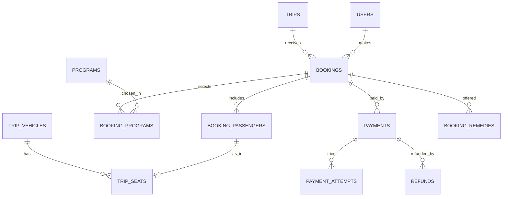

Part of the [data model](/en/docs/erd); conventions and base columns are documented there.

## bookings
*(Base +) — one reservation with locked pricing, from cart through payment to check-out. [FR-BKG-01](/en/docs/srs/requirements/bkg#fr-bkg-01--booking-composition) to [FR-BKG-07](/en/docs/srs/requirements/bkg#fr-bkg-07--booking-states)*

<TypeTable
  type={{
    "organization_id": {
      type: "BIGINT",
      description: "Tenant column",
      required: true,
    },
    "trip_id": {
      type: "BIGINT FK trips",
      required: true
    },
    "booked_by_user_id": {
      type: "BIGINT FK users",
      required: true
    },
    "reference": {
      type: "VARCHAR(12)",
      description: "Public booking reference used for child links",
      required: true,
    },
    "status_id": {
      type: "BIGINT FK lookups",
      description: "`booking_status`: cart, seats_held, payment_pending, confirmed, payment_failed, checked_in, checked_out, cancelled, refund_pending, refunded",
      required: true,
    },
    "passenger_count": {
      type: "SMALLINT",
      required: true
    },
    "base_total_minor, programs_total_minor, plan_discount_minor, coupon_discount_minor, total_minor": {
      type: "BIGINT",
      description: "Price locked when the hold starts (D-192)",
      required: true,
    },
    "currency_code": {
      type: "CHAR(3)",
      required: true
    },
    "hold_expires_at": {
      type: "TIMESTAMPTZ",
      description: "15 minutes; Fawry 48 h",
      required: true,
    },
    "payment_attempts": {
      type: "SMALLINT",
      description: "Max 3 per hold (D-197)",
      required: true,
    },
    "buyer_tax_no": {
      type: "VARCHAR(50) NULL",
      description: "Present means B2B invoice ([BRL-28](/en/docs/brd/requirements#7-business-rules))",
      required: true,
    },
    "confirmed_at, cancelled_at": {
      type: "TIMESTAMPTZ",
      required: true
    },
    "cancel_reason_id": {
      type: "BIGINT FK lookups",
      description: "`cancel_reason`",
      required: true,
    },
    "refund_rule_applied": {
      type: "VARCHAR(20)",
      description: "For example `80_at_48h`",
      required: true,
    },
  }}
/>

Indexes: `unique (reference)` — the public code child links resolve against, `(trip_id, status_id)`, `(booked_by_user_id, created_at)` for the traveler's list, partial `(hold_expires_at)` where `status_id` in `cart` or `seats_held` — the hold sweep.

**booking_passengers** (Base +) — one traveler per row, child or adult, with vehicle, seat and boarding state: `organization_id`, `booking_id FK`, `full_name VARCHAR(200)`, `is_child BOOLEAN`, `birth_year SMALLINT NULL`, `trip_vehicle_id FK NULL`, `seat_id FK trip_seats NULL`, `checkin_status_id FK lookups (passenger_checkin: not_boarded, on_board, off_vehicle, completed)`, `boarding_code_hash CHAR(64)`. Indexes: `(booking_id)`, `(trip_vehicle_id, checkin_status_id)` for the moderator roster.

**booking_programs** (Base +) — program line items with the price captured at booking: `organization_id`, `booking_id FK`, `program_id FK`, `program_tier_id FK NULL`, `passenger_id FK booking_passengers NULL`, `quantity INT`, `unit_price_minor BIGINT`, `line_total_minor BIGINT`. Indexes: `(booking_id)`, `(program_id)`.

## trip_seats
*(Base +) — one seat per trip vehicle, stamped from the vehicle-type layout and moved through hold and reservation states. [FR-SEAT-01](/en/docs/srs/requirements/seat#fr-seat-01--company-assigned-by-default) to [FR-SEAT-07](/en/docs/srs/requirements/seat#fr-seat-07--self-selection-by-plan)*

<TypeTable
  type={{
    "organization_id": {
      type: "BIGINT",
      required: true
    },
    "trip_vehicle_id": {
      type: "BIGINT FK trip_vehicles",
      required: true
    },
    "vehicle_type_seat_id": {
      type: "BIGINT FK vehicle_type_seats",
      required: true
    },
    "label": {
      type: "VARCHAR(10)",
      required: true
    },
    "status_id": {
      type: "BIGINT FK lookups",
      description: "`seat_status`: available, held, reserved, checked_in, checked_out, released",
      required: true,
    },
    "held_by_booking_id": {
      type: "BIGINT FK bookings NULL",
      required: true
    },
    "held_until": {
      type: "TIMESTAMPTZ",
      required: true
    },
    "reserved_by_passenger_id": {
      type: "BIGINT FK booking_passengers NULL",
      required: true
    },
  }}
/>

Unique `(trip_vehicle_id, label, deleted_at)`. Hold races are resolved with a Redis lock and a conditional update on `status_id`.

Indexes: `(trip_vehicle_id, status_id)` for availability maps, partial `(held_until)` where `status_id = held` — the hold sweep.

**payments** (Base +) — one gateway charge for a booking or a plan subscription ([FR-PAY-01](/en/docs/srs/requirements/pay#fr-pay-01--payment-outcomes) to [FR-PAY-07](/en/docs/srs/requirements/pay#fr-pay-07--payment-methods-per-market)): `organization_id NULL` (null for plan charges), `booking_id FK NULL`, `subscription_charge_id FK NULL`, `payer_user_id FK`, `gateway_id FK lookups (gateway)`, `method_id FK lookups (payment_method)`, `amount_minor`, `currency_code`, `status_id FK lookups (payment_status: pending, succeeded, failed, expired, refunded, partially_refunded)`, `gateway_reference VARCHAR(120)` (unique per gateway), `voucher_expires_at TIMESTAMPTZ NULL` (Fawry), `succeeded_at`. Indexes: partial `unique (gateway_id, gateway_reference)` where `gateway_reference is not null`, `(booking_id)`, `(subscription_charge_id)`, `(payer_user_id, created_at)`, partial `(voucher_expires_at)` where `status_id = pending`.

**payment_attempts** (Base +) — one row per gateway callback, idempotent by event id: `payment_id FK`, `attempt_no SMALLINT`, `gateway_event_id VARCHAR(120)` (unique, idempotent callbacks), `result_id FK lookups (attempt_result)`, `failure_code VARCHAR(80)`, `raw_status VARCHAR(80)`. Indexes: `unique (gateway_event_id)`, `(payment_id, attempt_no)`.

**refunds** (Base +) — money returned to a payer, by policy or admin decision ([FR-PAY-03](/en/docs/srs/requirements/pay#fr-pay-03--refund-execution), [FR-PAY-04](/en/docs/srs/requirements/pay#fr-pay-04--refunds-outside-policy)): `organization_id`, `payment_id FK`, `booking_id FK`, `amount_minor`, `currency_code`, `reason_id FK lookups (refund_reason: traveler_cancel, org_cancel, dispute, admin_outside_policy, remedy)`, `policy_rule VARCHAR(20)`, `status_id FK lookups (refund_status: requested, sent, confirmed, failed)`, `gateway_reference`, `retries SMALLINT` (3, D-322), `approved_by FK users NULL`, `dispute_id FK NULL`. Indexes: `(payment_id)`, `(booking_id)`, partial `(status_id)` where `status_id` in `requested` or `sent` — the retry sweep.

**booking_remedies** (Base +) — compensation choices offered when a booked trip changes ([BRL-24](/en/docs/brd/requirements#7-business-rules)): `organization_id`, `booking_id FK`, `change_type_id FK lookups (trip_change_type: program_removed, seat_mode_changed, vehicle_changed, time_changed)`, `options JSONB`, `chosen_option VARCHAR(40)`, `due_at` (7 days, D-148), `status_id FK lookups (remedy_status: offered, chosen, escalated, expired)`. Indexes: `(booking_id)`, partial `(due_at)` where `status_id = offered`.
