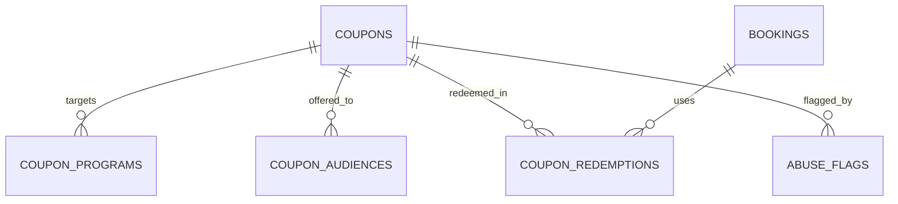

Part of the [data model](/en/docs/erd); conventions and base columns are documented there.

## coupons
*(Base +) — one discount code with creator scope, usage limits and audience targeting. [FR-CPN-01](/en/docs/srs/requirements/cpn#fr-cpn-01--creator-scope) to [FR-CPN-08](/en/docs/srs/requirements/cpn#fr-cpn-08--coupon-count-by-plan)*

<TypeTable
  type={{
    "code": {
      type: "VARCHAR(40)",
      description: "Unique with `deleted_at` (case-insensitive)",
      required: true,
    },
    "creator_type_id": {
      type: "BIGINT FK lookups",
      description: "`coupon_creator`: admin, organization, driver, photographer",
      required: true,
    },
    "creator_user_id": {
      type: "BIGINT FK users",
      required: true
    },
    "organization_id": {
      type: "BIGINT FK organizations NULL",
      description: "Scope for organization coupons",
      required: true,
    },
    "scope_user_id": {
      type: "BIGINT FK users NULL",
      description: "Scope for driver or photographer coupons",
      required: true,
    },
    "market_id": {
      type: "BIGINT FK markets NULL",
      description: "Null means all markets (admin only)",
      required: true,
    },
    "discount_type_id": {
      type: "BIGINT FK lookups",
      description: "`discount_type`: fixed, percent, program_specific, free_program, first_booking, minimum_spend",
      required: true,
    },
    "value_minor": {
      type: "BIGINT NULL",
      description: "Fixed amount",
      required: true,
    },
    "value_bp": {
      type: "INT NULL",
      description: "Percentage in basis points",
      required: true,
    },
    "currency_code": {
      type: "CHAR(3) NULL",
      required: true
    },
    "min_spend_minor": {
      type: "BIGINT NULL",
      required: true
    },
    "usage_limit": {
      type: "INT NULL",
      required: true
    },
    "per_user_limit": {
      type: "INT",
      description: "Default 1",
      required: true,
    },
    "used_count": {
      type: "INT",
      required: true
    },
    "valid_from, valid_until": {
      type: "TIMESTAMPTZ",
      required: true
    },
    "audience_id": {
      type: "BIGINT FK lookups",
      description: "`coupon_audience`: public, targeted",
      required: true,
    },
    "is_stackable": {
      type: "BOOLEAN",
      required: true
    },
    "status_id": {
      type: "BIGINT FK lookups",
      description: "`coupon_status`: draft, active, paused, expired, exhausted, revoked",
      required: true,
    },
  }}
/>

Indexes: `unique (code, deleted_at)` case-insensitive, `(organization_id, status_id)`, `(scope_user_id)`, partial `(valid_until)` where `status_id = active` — the expiry sweep.

**coupon_programs** (Base +) — programs a program-specific coupon applies to: `coupon_id FK`, `program_id FK`. Indexes: `unique (coupon_id, program_id, deleted_at)`.

**coupon_audiences** (Base +) — explicit recipients of a targeted coupon: `coupon_id FK`, `user_id FK NULL`, `segment_code VARCHAR(40) NULL`. Indexes: `(coupon_id)`, `(user_id)`.

**coupon_redemptions** (Base +) — one application per booking, reversible when the booking is refunded: `coupon_id FK`, `booking_id FK`, `user_id FK`, `organization_id`, `discount_minor BIGINT`, `currency_code`, `status_id FK lookups (redemption_status: applied, confirmed, reversed)`, `reversed_at`. Indexes: `(coupon_id, user_id)` for per-user limits, `(booking_id)`.

**abuse_flags** (Base +) — rule-engine output queued for moderation review (D-216, D-217): `subject_type_id FK lookups (flag_subject: coupon, user, booking, deal)`, `subject_id BIGINT`, `rule_code VARCHAR(60)`, `details JSONB`, `status_id FK lookups (flag_status: open, reviewed_ok, actioned)`, `review_due_at` (2 working days), `reviewed_by FK users NULL`. Indexes: `(subject_type_id, subject_id)`, partial `(review_due_at)` where `status_id = open`.
