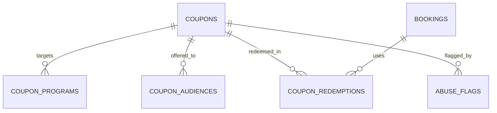

Part of the [data model](/en/docs/erd); conventions and base columns are documented there.

## coupons
*(Base +) [FR-CPN-01](/en/docs/srs/requirements/cpn#fr-cpn-01--creator-scope) to [FR-CPN-08](/en/docs/srs/requirements/cpn#fr-cpn-08--coupon-count-by-plan)*

| Column | Type | Notes |
|---|---|---|
| code | VARCHAR(40) | Unique with `deleted_at` (case-insensitive) |
| creator_type_id | BIGINT FK lookups | `coupon_creator`: admin, organization, driver, photographer |
| creator_user_id | BIGINT FK users | |
| organization_id | BIGINT FK organizations NULL | Scope for organization coupons |
| scope_user_id | BIGINT FK users NULL | Scope for driver or photographer coupons |
| market_id | BIGINT FK markets NULL | Null means all markets (admin only) |
| discount_type_id | BIGINT FK lookups | `discount_type`: fixed, percent, program_specific, free_program, first_booking, minimum_spend |
| value_minor | BIGINT NULL | Fixed amount |
| value_bp | INT NULL | Percentage in basis points |
| currency_code | CHAR(3) NULL | |
| min_spend_minor | BIGINT NULL | |
| usage_limit | INT NULL | |
| per_user_limit | INT | Default 1 |
| used_count | INT | |
| valid_from, valid_until | TIMESTAMPTZ | |
| audience_id | BIGINT FK lookups | `coupon_audience`: public, targeted |
| is_stackable | BOOLEAN | |
| status_id | BIGINT FK lookups | `coupon_status`: draft, active, paused, expired, exhausted, revoked |

**coupon_programs** (Base +): `coupon_id FK`, `program_id FK`.

**coupon_audiences** (Base +): `coupon_id FK`, `user_id FK NULL`, `segment_code VARCHAR(40) NULL`.

**coupon_redemptions** (Base +): `coupon_id FK`, `booking_id FK`, `user_id FK`, `organization_id`, `discount_minor BIGINT`, `currency_code`, `status_id FK lookups (redemption_status: applied, confirmed, reversed)`, `reversed_at`.

**abuse_flags** (Base +) D-216, D-217: `subject_type_id FK lookups (flag_subject: coupon, user, booking, deal)`, `subject_id BIGINT`, `rule_code VARCHAR(60)`, `details JSONB`, `status_id FK lookups (flag_status: open, reviewed_ok, actioned)`, `review_due_at` (2 working days), `reviewed_by FK users NULL`.
