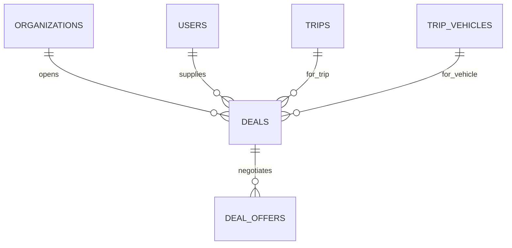

Part of the [data model](/en/docs/erd); conventions and base columns are documented there.

## deals
*(Base +) — one negotiation between an organization and a supplier for staffing a trip or vehicle. [FR-NEG-01](/en/docs/srs/requirements/neg#fr-neg-01--deal-proposal) to [FR-NEG-07](/en/docs/srs/requirements/neg#fr-neg-07--negotiation-by-plan)*

<TypeTable
  type={{
    "organization_id": {
      type: "BIGINT",
      description: "Tenant column; suppliers read through a platform-scoped repository",
      required: true,
    },
    "trip_id": {
      type: "BIGINT FK trips",
      required: true
    },
    "trip_vehicle_id": {
      type: "BIGINT FK trip_vehicles NULL",
      description: "Null for photographer deals",
      required: true,
    },
    "provider_user_id": {
      type: "BIGINT FK users",
      required: true
    },
    "provider_type_id": {
      type: "BIGINT FK lookups",
      description: "`provider_type`: driver, photographer",
      required: true,
    },
    "status_id": {
      type: "BIGINT FK lookups",
      description: "`deal_status`: proposed, countered_by_provider, countered_by_organization, accepted_by_one, finalized, rejected",
      required: true,
    },
    "current_amount_minor": {
      type: "BIGINT",
      required: true
    },
    "currency_code": {
      type: "CHAR(3)",
      required: true
    },
    "organization_accepted_at, provider_accepted_at": {
      type: "TIMESTAMPTZ",
      description: "Both set = finalized",
      required: true,
    },
    "last_offer_at": {
      type: "TIMESTAMPTZ",
      required: true
    },
    "expires_at": {
      type: "TIMESTAMPTZ",
      description: "last_offer_at plus 72 h ([BRL-26](/en/docs/brd/requirements#7-business-rules))",
      required: true,
    },
    "reject_reason_id": {
      type: "BIGINT FK lookups",
      description: "`deal_end_reason`: rejected, expired, provider_paused, trip_cancelled",
      required: true,
    },
    "finalized_at": {
      type: "TIMESTAMPTZ",
      required: true
    },
    "flagged_reason": {
      type: "TEXT",
      description: "Admin flag (D-252)",
      required: true,
    },
  }}
/>

Indexes: `(provider_user_id, status_id)` for the supplier inbox, `(trip_id, status_id)`, partial `(expires_at)` where `finalized_at is null and reject_reason_id is null` — the expiry sweep.

**deal_offers** (immutable) — one row per propose, counter, accept or reject; the negotiation history is append-only: `id`, `uuid`, `organization_id`, `deal_id FK`, `offered_by_side_id FK lookups (deal_side: organization, provider)`, `amount_minor BIGINT`, `note TEXT`, `action_id FK lookups (deal_action: propose, counter, accept, reject)`, `created_at`, `created_by`. Indexes: `(deal_id, created_at)`.
