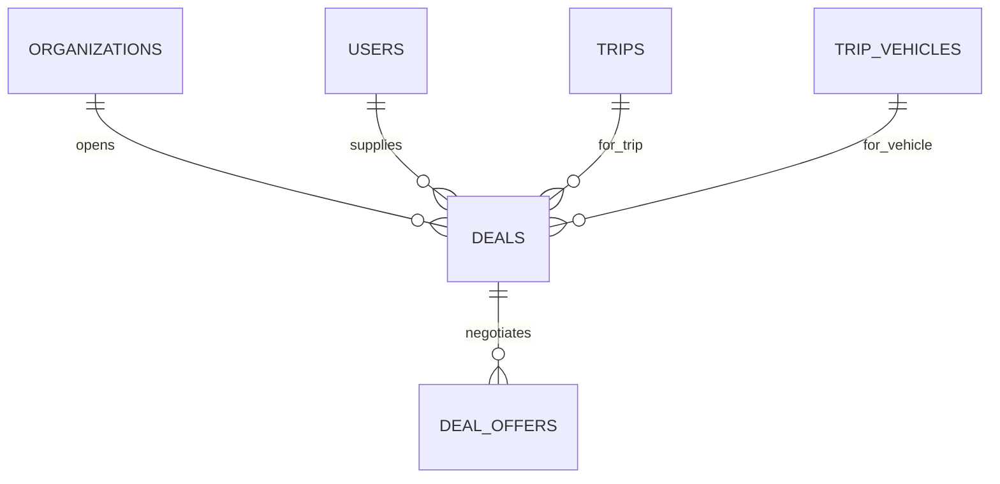

Part of the [data model](/en/docs/erd); conventions and base columns are documented there.

## deals
*(Base +) [FR-NEG-01](/en/docs/srs/requirements/neg#fr-neg-01--deal-proposal) to [FR-NEG-07](/en/docs/srs/requirements/neg#fr-neg-07--negotiation-by-plan)*

| Column | Type | Notes |
|---|---|---|
| organization_id | BIGINT | Tenant column; suppliers read through a platform-scoped repository |
| trip_id | BIGINT FK trips | |
| trip_vehicle_id | BIGINT FK trip_vehicles NULL | Null for photographer deals |
| provider_user_id | BIGINT FK users | |
| provider_type_id | BIGINT FK lookups | `provider_type`: driver, photographer |
| status_id | BIGINT FK lookups | `deal_status`: proposed, countered_by_provider, countered_by_organization, accepted_by_one, finalized, rejected |
| current_amount_minor | BIGINT | |
| currency_code | CHAR(3) | |
| organization_accepted_at, provider_accepted_at | TIMESTAMPTZ | Both set = finalized |
| last_offer_at | TIMESTAMPTZ | |
| expires_at | TIMESTAMPTZ | last_offer_at plus 72 h ([BRL-26](/en/docs/brd/requirements#7-business-rules)) |
| reject_reason_id | BIGINT FK lookups | `deal_end_reason`: rejected, expired, provider_paused, trip_cancelled |
| finalized_at | TIMESTAMPTZ | |
| flagged_reason | TEXT | Admin flag (D-252) |

**deal_offers** (immutable): `id`, `uuid`, `organization_id`, `deal_id FK`, `offered_by_side_id FK lookups (deal_side: organization, provider)`, `amount_minor BIGINT`, `note TEXT`, `action_id FK lookups (deal_action: propose, counter, accept, reject)`, `created_at`, `created_by`.
