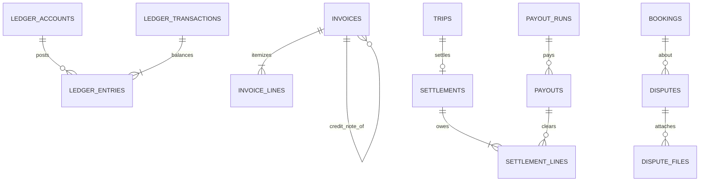

Part of the [data model](/en/docs/erd); conventions and base columns are documented there.

**ledger_accounts** (Base +) — the chart of accounts per owner and currency: `owner_type_id FK lookups (ledger_owner: platform, organization, supplier, traveler_clearing, gateway)`, `organization_id NULL`, `user_id NULL`, `account_kind_id FK lookups (ledger_account_kind: cash, receivable, payable, revenue, commission, fee_expense, deferred, refund_clearing, tax_payable)`, `currency_code`, `code VARCHAR(60)` unique. Indexes: `unique (code)`, `(owner_type_id, organization_id, user_id)`, `(account_kind_id)`.

**ledger_transactions** (immutable) — one balanced event; corrections are reversing transactions ([FR-ACC-01](/en/docs/srs/requirements/acc#fr-acc-01--double-entry-ledger)): `id`, `uuid`, `event_type_id FK lookups (ledger_event: booking_paid, refund, coupon, deal_cost, commission, gateway_fee, plan_charge, payout, invoice, settlement, reversal)`, `source_type VARCHAR(40)`, `source_id BIGINT`, `occurred_at`, `reverses_transaction_id FK NULL`, `created_at`, `created_by`. A check confirms entries sum to zero per currency. Indexes: `(source_type, source_id)`, `(event_type_id, occurred_at)`, `(reverses_transaction_id)`.

**ledger_entries** (immutable) — one debit or credit leg; exactly one of the two amounts is non-zero: `id`, `uuid`, `transaction_id FK`, `account_id FK`, `organization_id NULL`, `debit_minor BIGINT`, `credit_minor BIGINT` (one is zero), `currency_code`, `trip_id NULL`, `booking_id NULL`, `deal_id NULL`, `gateway_reference NULL`, `created_at`, `created_by`. Retention 7 years. Indexes: `(account_id, occurred_at)` for statements, `(transaction_id)`, `(booking_id)`, `(trip_id)`, `(deal_id)`.

## invoices
*(Base +) — fiscal documents for all buyer and issuer combinations, including credit notes. [FR-ORG-07](/en/docs/srs/requirements/org#fr-org-07--b2b-and-b2c-invoices), [FR-BKG-05](/en/docs/srs/requirements/bkg#fr-bkg-05--receipts-and-invoices)*

<TypeTable
  type={{
    "organization_id": {
      type: "BIGINT NULL",
      description: "Issuer when the organization invoices a traveler; null for platform-issued",
      required: true,
    },
    "issuer_type_id": {
      type: "BIGINT FK lookups",
      description: "`invoice_issuer`: organization, platform, supplier",
      required: true,
    },
    "buyer_type_id": {
      type: "BIGINT FK lookups",
      description: "`invoice_buyer`: traveler, organization, supplier",
      required: true,
    },
    "kind_id": {
      type: "BIGINT FK lookups",
      description: "`invoice_kind`: b2c, b2b, credit_note",
      required: true,
    },
    "number": {
      type: "VARCHAR(40)",
      description: "Unique per issuer and market; null while numbering is retried (D-179)",
      required: true,
    },
    "market_id": {
      type: "BIGINT FK markets",
      required: true
    },
    "buyer_name, buyer_tax_no, buyer_address": {
      type: "VARCHAR, VARCHAR, JSONB",
      required: true
    },
    "booking_id, subscription_charge_id, deal_id, settlement_id": {
      type: "BIGINT NULL",
      description: "Source",
      required: true,
    },
    "original_invoice_id": {
      type: "BIGINT FK invoices NULL",
      description: "For credit notes ([BRL-28](/en/docs/brd/requirements#7-business-rules))",
      required: true,
    },
    "subtotal_minor, tax_minor, total_minor": {
      type: "BIGINT",
      required: true
    },
    "currency_code": {
      type: "CHAR(3)",
      required: true
    },
    "status_id": {
      type: "BIGINT FK lookups",
      description: "`invoice_status`: pending_number, issued, voided_by_credit, finance_review",
      required: true,
    },
    "issued_at": {
      type: "TIMESTAMPTZ",
      required: true
    },
    "e_invoice_status_id": {
      type: "BIGINT FK lookups NULL",
      description: "Reserved for ZATCA ([OD-10](/en/docs/brd/compliance#11-open-decisions))",
      required: true,
    },
    "pdf_path": {
      type: "TEXT",
      required: true
    },
  }}
/>

Indexes: partial `unique (issuer_type_id, market_id, number)` where `number is not null`, `(booking_id)`, `(subscription_charge_id)`, `(settlement_id)`, partial `(status_id)` where `status_id = finance_review`.

**invoice_lines** (Base +) — itemized lines with per-line tax: `invoice_id FK`, `description JSONB`, `quantity NUMERIC(10,2)`, `unit_minor BIGINT`, `tax_rate_bp INT`, `tax_minor BIGINT`, `line_total_minor BIGINT`. Indexes: none beyond the FK rule.

**payout_runs** (Base +) — one weekly batch per market ([FR-ACC-03](/en/docs/srs/requirements/acc#fr-acc-03--supplier-earnings-and-payouts)): `run_date DATE` (Mondays 06:00, D-28), `market_id FK`, `status_id FK lookups (payout_run_status: draft, approved, submitted, completed, partial)`, `approved_by FK users`. Indexes: `unique (run_date, market_id)`, `(status_id)`.

**payouts** (Base +) — one transfer per payee per run: `payout_run_id FK`, `payee_user_id FK NULL`, `payee_organization_id FK NULL`, `payout_method_id FK`, `amount_minor`, `currency_code`, `status_id FK lookups (payout_status: pending, sent, paid, failed, held)`, `hold_reason_id FK lookups NULL` (lab pause D-175, negative balance D-173), `external_reference VARCHAR(120)`, `paid_at`. Indexes: `(payout_run_id, status_id)`, `(payee_user_id)`, `(external_reference)`.

**settlements** (Base +) — per-trip money split between platform, organization and suppliers ([FR-ACC-05](/en/docs/srs/requirements/acc#fr-acc-05--settlements), [BRL-25](/en/docs/brd/requirements#7-business-rules)): `organization_id`, `trip_id FK UNIQUE`, `status_id FK lookups (settlement_status: open, awaiting_payouts, disputed, closed)`, `opened_at` (trip Completed), `closed_at`, `totals JSONB` (gross, commission, fees, supplier costs, net). Indexes: `unique (trip_id, deleted_at)`, `(status_id)`.

**settlement_lines** (Base +) — one owed amount per party pair and reason: `settlement_id FK`, `from_party_type_id FK lookups (party)`, `from_party_id BIGINT`, `to_party_type_id FK lookups (party)`, `to_party_id BIGINT`, `reason_id FK lookups (settlement_reason: trip_revenue, commission, deal_cost, gateway_fee, refund, adjustment)`, `amount_minor`, `currency_code`, `payout_id FK NULL`, `settled_at`. Indexes: `(settlement_id)`, `(payout_id)`.

**reconciliation_exceptions** (Base +) — differences between gateway reports and the ledger ([FR-PAY-05](/en/docs/srs/requirements/pay#fr-pay-05--gateway-reconciliation)): `gateway_id FK lookups`, `report_date DATE`, `gateway_reference VARCHAR(120)`, `kind_id FK lookups (recon_exception: missing_in_ledger, missing_in_gateway, amount_mismatch, currency_mismatch)`, `gateway_amount_minor`, `ledger_amount_minor`, `status_id FK lookups (exception_status: open, resolved, written_off)`, `resolved_by FK users NULL`. Indexes: `(gateway_id, report_date)`, partial `(status_id)` where `status_id = open`.

**disputes** (Base +) — formal disputes over bookings, payments or conduct, with SLA clocks ([FR-ADM-04](/en/docs/srs/requirements/adm#fr-adm-04--dispute-outcomes-and-refunds), [FR-ADM-08](/en/docs/srs/requirements/adm#fr-adm-08--dispute-handling)): `organization_id NULL`, `booking_id FK NULL`, `deal_id FK NULL`, `raised_by FK users`, `type_id FK lookups (dispute_type: booking, payment, refund, supplier_conduct, organization_conduct, other)`, `status_id FK lookups (dispute_status: open, information_requested, under_review, resolved, closed)`, `ack_due_at` (2 working days), `resolve_due_at` (10 working days), `outcome TEXT`, `refund_id FK refunds NULL`, `assigned_to FK users NULL`. Indexes: `(booking_id)`, `(deal_id)`, `(assigned_to, status_id)`, partial `(resolve_due_at)` where `status_id` in `open`, `information_requested` or `under_review`.

**dispute_files** (Base +) — evidence attachments, up to 5 files of 10 MB (D-259): `dispute_id FK`, `storage_path TEXT`, `size_bytes BIGINT`. Indexes: none beyond the FK rule.
