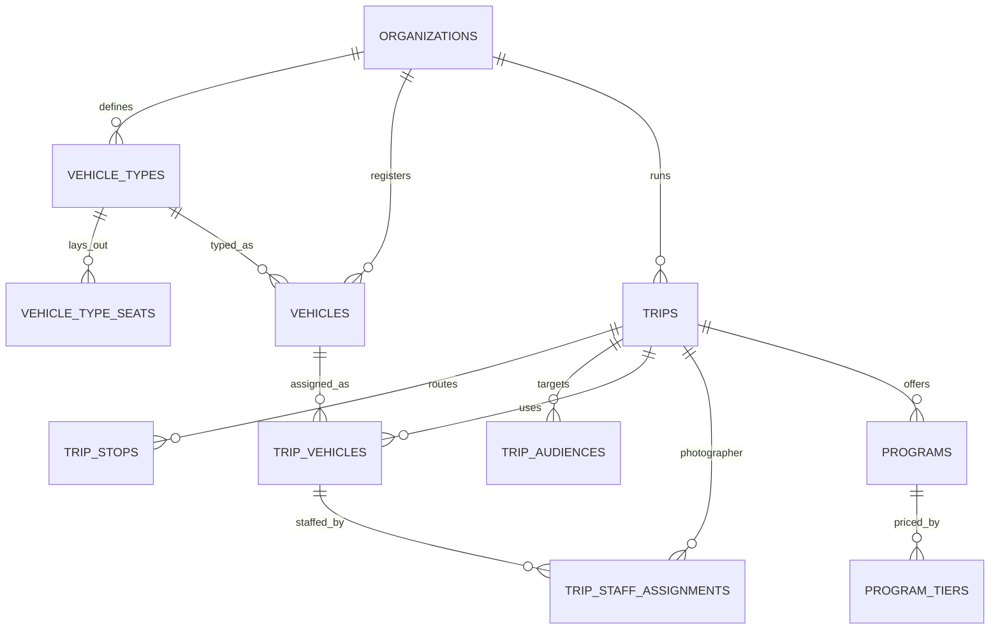

Part of the [data model](/en/docs/erd); conventions and base columns are documented there.

**vehicle_types** (Base +) [FR-FLT-01](/en/docs/srs/requirements/flt#fr-flt-01--reusable-vehicle-types), [FR-FLT-06](/en/docs/srs/requirements/flt#fr-flt-06--archiving-vehicle-types): `organization_id`, `name JSONB`, `seat_count SMALLINT`, `layout JSONB` (grid rows, columns, aisles, doors), `archived_at TIMESTAMPTZ`.

**vehicle_type_seats** (Base +): `organization_id`, `vehicle_type_id FK`, `label VARCHAR(10)` (for example 12B), `row_no SMALLINT`, `col_no SMALLINT`, `seat_kind_id FK lookups (seat_kind: standard, accessible, crew, blocked)`. Unique `(vehicle_type_id, label, deleted_at)`.

**vehicles** (Base +) [FR-FLT-02](/en/docs/srs/requirements/flt#fr-flt-02--vehicle-registry): `organization_id`, `vehicle_type_id FK`, `plate_no VARCHAR(20)`, `model VARCHAR(80)`, `year SMALLINT`, `seat_count SMALLINT` (must equal the type), `registration_status_id FK lookups (registration_status)`, `registration_valid_until DATE`, `provider_vehicle_id FK provider_vehicles NULL` (a platform driver's own vehicle used on a deal).

## trips
*(Base +) [FR-TRIP-01](/en/docs/srs/requirements/trip#fr-trip-01--trip-creation-wizard) to [FR-TRIP-07](/en/docs/srs/requirements/trip#fr-trip-07--active-trip-limit)*

| Column | Type | Notes |
|---|---|---|
| organization_id | BIGINT FK organizations | Tenant column |
| market_id | BIGINT FK markets | Copied from the organization at creation |
| code | VARCHAR(20) | Human reference, unique per organization |
| title, description | JSONB | |
| category_id | BIGINT FK lookups | `trip_category` |
| status_id | BIGINT FK lookups | `trip_status`: draft, published, negotiating, ready, filling_up, sold_out, in_progress, partially_completed, completed, post_processing, archived, cancelled, refunds_issued |
| publish_mode_id | BIGINT FK lookups | `publish_mode`: draft, public, targeted |
| timezone | VARCHAR(64) | |
| starts_at, ends_at | TIMESTAMPTZ | |
| base_price_minor | BIGINT | |
| currency_code | CHAR(3) | From market |
| capacity_total | INT | Sum of vehicle seats |
| seats_reserved | INT | Counter; Filling Up at 80 percent (D-189) |
| seat_mode_id | BIGINT FK lookups | `seat_mode`: company_assigned, self_select |
| child_tracking_enabled | BOOLEAN | [FR-TRK-04](/en/docs/srs/requirements/trk#fr-trk-04--per-trip-child-tracking-switch) |
| vip_early_access_until | TIMESTAMPTZ NULL | D-146 |
| priority_seat_window_until | TIMESTAMPTZ NULL | D-316 |
| published_at, cancelled_at, completed_at, archived_at | TIMESTAMPTZ | |
| cancel_reason | TEXT | |
| counted_in_cycle | DATE | Month counted for the active-trip limit (D-143) |

Indexes: `(organization_id, status_id)`, partial `(starts_at)` where published or filling up.

**trip_stops** (Base +): `organization_id`, `trip_id FK`, `seq SMALLINT`, `kind_id FK lookups (stop_kind: pickup, stop, destination, dropoff)`, `name JSONB`, `address JSONB`, `lat NUMERIC(10,7)`, `lng NUMERIC(10,7)`, `planned_at TIMESTAMPTZ`.

**trip_audiences** (Base +): `organization_id`, `trip_id FK`, `user_id FK NULL`, `email CITEXT NULL`, `phone_hash CHAR(64) NULL`. Targeted publishing list ([FR-TRIP-02](/en/docs/srs/requirements/trip#fr-trip-02--draft-public-and-targeted-publishing)).

## trip_vehicles
*(Base +) [FR-TRIP-03](/en/docs/srs/requirements/trip#fr-trip-03--multi-vehicle-trips)*

| Column | Type | Notes |
|---|---|---|
| organization_id | BIGINT | Tenant column |
| trip_id | BIGINT FK trips | |
| vehicle_id | BIGINT FK vehicles NULL | |
| vehicle_type_id | BIGINT FK vehicle_types | |
| label | VARCHAR(40) | Bus A, Bus B |
| status_id | BIGINT FK lookups | `trip_vehicle_status`: planning, ready, departed, ended |
| seat_count | SMALLINT | |
| departed_at, ended_at | TIMESTAMPTZ | |
| last_lat, last_lng, last_point_at | NUMERIC, NUMERIC, TIMESTAMPTZ | Latest position cache |

## trip_staff_assignments
*(Base +) [FR-STF-01](/en/docs/srs/requirements/stf#fr-stf-01--driver-tracks) to [FR-STF-05](/en/docs/srs/requirements/stf#fr-stf-05--moderator-assignment)*

| Column | Type | Notes |
|---|---|---|
| organization_id | BIGINT | |
| trip_id | BIGINT FK trips | |
| trip_vehicle_id | BIGINT FK trip_vehicles NULL | Null for trip-level photographer |
| staff_role_id | BIGINT FK lookups | `staff_role`: driver, moderator, photographer |
| user_id | BIGINT FK users | |
| track_id | BIGINT FK lookups | `supplier_track`: organization, platform |
| deal_id | BIGINT FK deals NULL | Required when track is platform ([BRL-04](/en/docs/brd/requirements#7-business-rules)) |
| status_id | BIGINT FK lookups | `assignment_status`: proposed, accepted, replaced, released |
| access_until | TIMESTAMPTZ | Moderators: trip end plus 24 h (D-107) |

Unique active `(trip_vehicle_id, staff_role_id)` where status accepted.

## programs
*(Base +) [FR-PRG-01](/en/docs/srs/requirements/prg#fr-prg-01--pricing-models) to [FR-PRG-06](/en/docs/srs/requirements/prg#fr-prg-06--program-count-limit)*

| Column | Type | Notes |
|---|---|---|
| organization_id | BIGINT | |
| trip_id | BIGINT FK trips | |
| title, description | JSONB | |
| pricing_model_id | BIGINT FK lookups | `pricing_model`: free, per_person, by_quantity, per_group, tiered |
| price_minor | BIGINT NULL | Null for free and tiered |
| currency_code | CHAR(3) | |
| is_required | BOOLEAN | Pre-required |
| is_vip_only | BOOLEAN | |
| capacity | INT NULL | |
| enrolled_count | INT | |
| starts_at | TIMESTAMPTZ NULL | |

**program_tiers** (Base +): `organization_id`, `program_id FK`, `name JSONB`, `price_minor BIGINT`, `sort_by INT`.
