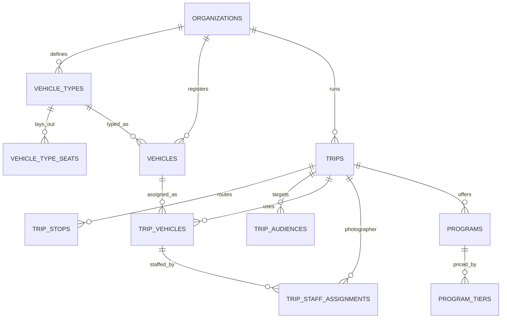

Part of the [data model](/en/docs/erd); conventions and base columns are documented there.

**vehicle_types** (Base +) — reusable seat layouts an organization defines once and assigns to vehicles: `organization_id`, `name JSONB`, `seat_count SMALLINT`, `layout JSONB` (grid rows, columns, aisles, doors), `archived_at TIMESTAMPTZ`. [FR-FLT-01](/en/docs/srs/requirements/flt#fr-flt-01--reusable-vehicle-types), [FR-FLT-06](/en/docs/srs/requirements/flt#fr-flt-06--archiving-vehicle-types). Indexes: `(organization_id, archived_at)`.

**vehicle_type_seats** (Base +) — one row per physical seat in a layout, the template `trip_seats` are stamped from: `organization_id`, `vehicle_type_id FK`, `label VARCHAR(10)` (for example 12B), `row_no SMALLINT`, `col_no SMALLINT`, `seat_kind_id FK lookups (seat_kind: standard, accessible, crew, blocked)`. Unique `(vehicle_type_id, label, deleted_at)`; that pair is the index.

**vehicles** (Base +) — the organization's registered fleet ([FR-FLT-02](/en/docs/srs/requirements/flt#fr-flt-02--vehicle-registry)): `organization_id`, `vehicle_type_id FK`, `plate_no VARCHAR(20)`, `model VARCHAR(80)`, `year SMALLINT`, `seat_count SMALLINT` (must equal the type), `registration_status_id FK lookups (registration_status)`, `registration_valid_until DATE`, `provider_vehicle_id FK provider_vehicles NULL` (a platform driver's own vehicle used on a deal). Indexes: `(organization_id, vehicle_type_id)`, `(registration_valid_until)` for the expiry sweep.

## trips
*(Base +) — one organized trip: pricing, schedule, capacity counters and lifecycle stamps. [FR-TRIP-01](/en/docs/srs/requirements/trip#fr-trip-01--trip-creation-wizard) to [FR-TRIP-07](/en/docs/srs/requirements/trip#fr-trip-07--active-trip-limit)*

<TypeTable
  type={{
    "organization_id": {
      type: "BIGINT FK organizations",
      description: "Tenant column",
      required: true,
    },
    "market_id": {
      type: "BIGINT FK markets",
      description: "Copied from the organization at creation",
      required: true,
    },
    "code": {
      type: "VARCHAR(20)",
      description: "Human reference, unique per organization",
      required: true,
    },
    "title, description": {
      type: "JSONB",
      required: true
    },
    "category_id": {
      type: "BIGINT FK lookups",
      description: "`trip_category`",
      required: true,
    },
    "status_id": {
      type: "BIGINT FK lookups",
      description: "`trip_status`: draft, published, negotiating, ready, filling_up, sold_out, in_progress, partially_completed, completed, post_processing, archived, cancelled, refunds_issued",
      required: true,
    },
    "publish_mode_id": {
      type: "BIGINT FK lookups",
      description: "`publish_mode`: draft, public, targeted",
      required: true,
    },
    "timezone": {
      type: "VARCHAR(64)",
      required: true
    },
    "starts_at, ends_at": {
      type: "TIMESTAMPTZ",
      required: true
    },
    "base_price_minor": {
      type: "BIGINT",
      required: true
    },
    "currency_code": {
      type: "CHAR(3)",
      description: "From market",
      required: true,
    },
    "capacity_total": {
      type: "INT",
      description: "Sum of vehicle seats",
      required: true,
    },
    "seats_reserved": {
      type: "INT",
      description: "Counter; Filling Up at 80 percent (D-189)",
      required: true,
    },
    "seat_mode_id": {
      type: "BIGINT FK lookups",
      description: "`seat_mode`: company_assigned, self_select",
      required: true,
    },
    "child_tracking_enabled": {
      type: "BOOLEAN",
      description: "[FR-TRK-04](/en/docs/srs/requirements/trk#fr-trk-04--per-trip-child-tracking-switch)",
      required: true,
    },
    "vip_early_access_until": {
      type: "TIMESTAMPTZ NULL",
      description: "D-146",
      required: true,
    },
    "priority_seat_window_until": {
      type: "TIMESTAMPTZ NULL",
      description: "D-316",
      required: true,
    },
    "published_at, cancelled_at, completed_at, archived_at": {
      type: "TIMESTAMPTZ",
      required: true
    },
    "cancel_reason": {
      type: "TEXT",
      required: true
    },
    "counted_in_cycle": {
      type: "DATE",
      description: "Month counted for the active-trip limit (D-143)",
      required: true,
    },
  }}
/>

Indexes: `unique (organization_id, code)`, `(organization_id, status_id)`, partial `(starts_at)` where published or filling up, `(counted_in_cycle, organization_id)` for the active-trip limit, `(market_id, status_id)` for the country-scoped client listing ([FR-MKT-06](/en/docs/srs/requirements/mkt#fr-mkt-06--country-scope-and-listing-filter)).

**trip_stops** (Base +) — ordered route points with planned times: `organization_id`, `trip_id FK`, `seq SMALLINT`, `kind_id FK lookups (stop_kind: pickup, stop, destination, dropoff)`, `name JSONB`, `address JSONB`, `lat NUMERIC(10,7)`, `lng NUMERIC(10,7)`, `planned_at TIMESTAMPTZ`. Indexes: `(trip_id, seq)`.

**trip_audiences** (Base +) — the invited guest list for targeted publishing ([FR-TRIP-02](/en/docs/srs/requirements/trip#fr-trip-02--draft-public-and-targeted-publishing)): `organization_id`, `trip_id FK`, `user_id FK NULL`, `email CITEXT NULL`, `phone_hash CHAR(64) NULL`. Indexes: `(trip_id)`, `(user_id)`, `(email)`.

## trip_vehicles
*(Base +) — one vehicle slot on a trip, caching its live position during the run. [FR-TRIP-03](/en/docs/srs/requirements/trip#fr-trip-03--multi-vehicle-trips)*

<TypeTable
  type={{
    "organization_id": {
      type: "BIGINT",
      description: "Tenant column",
      required: true,
    },
    "trip_id": {
      type: "BIGINT FK trips",
      required: true
    },
    "vehicle_id": {
      type: "BIGINT FK vehicles NULL",
      required: true
    },
    "vehicle_type_id": {
      type: "BIGINT FK vehicle_types",
      required: true
    },
    "label": {
      type: "VARCHAR(40)",
      description: "Bus A, Bus B",
      required: true,
    },
    "status_id": {
      type: "BIGINT FK lookups",
      description: "`trip_vehicle_status`: planning, ready, departed, ended",
      required: true,
    },
    "seat_count": {
      type: "SMALLINT",
      required: true
    },
    "departed_at, ended_at": {
      type: "TIMESTAMPTZ",
      required: true
    },
    "last_lat, last_lng, last_point_at": {
      type: "NUMERIC, NUMERIC, TIMESTAMPTZ",
      description: "Latest position cache",
      required: true,
    },
  }}
/>

Indexes: `(trip_id, status_id)`, `(vehicle_id)`.

## trip_staff_assignments
*(Base +) — who drives, moderates or photographs a trip vehicle, organization staff or platform supplier. [FR-STF-01](/en/docs/srs/requirements/stf#fr-stf-01--driver-tracks) to [FR-STF-05](/en/docs/srs/requirements/stf#fr-stf-05--moderator-assignment)*

<TypeTable
  type={{
    "organization_id": {
      type: "BIGINT",
      required: true
    },
    "trip_id": {
      type: "BIGINT FK trips",
      required: true
    },
    "trip_vehicle_id": {
      type: "BIGINT FK trip_vehicles NULL",
      description: "Null for trip-level photographer",
      required: true,
    },
    "staff_role_id": {
      type: "BIGINT FK lookups",
      description: "`staff_role`: driver, moderator, photographer",
      required: true,
    },
    "user_id": {
      type: "BIGINT FK users",
      required: true
    },
    "track_id": {
      type: "BIGINT FK lookups",
      description: "`supplier_track`: organization, platform",
      required: true,
    },
    "deal_id": {
      type: "BIGINT FK deals NULL",
      description: "Required when track is platform ([BRL-04](/en/docs/brd/requirements#7-business-rules))",
      required: true,
    },
    "status_id": {
      type: "BIGINT FK lookups",
      description: "`assignment_status`: proposed, accepted, replaced, released",
      required: true,
    },
    "access_until": {
      type: "TIMESTAMPTZ",
      description: "Moderators: trip end plus 24 h (D-107)",
      required: true,
    },
  }}
/>

Unique active `(trip_vehicle_id, staff_role_id)` where status accepted.

Indexes: `(user_id, status_id)` for a staff member's assignment list, `(deal_id)`, and the partial unique above as an index `(trip_vehicle_id, staff_role_id)` where `status_id` is `accepted`.

## programs
*(Base +) — bookable activities attached to a trip, priced by one of five models. [FR-PRG-01](/en/docs/srs/requirements/prg#fr-prg-01--pricing-models) to [FR-PRG-06](/en/docs/srs/requirements/prg#fr-prg-06--program-count-limit)*

<TypeTable
  type={{
    "organization_id": {
      type: "BIGINT",
      required: true
    },
    "trip_id": {
      type: "BIGINT FK trips",
      required: true
    },
    "title, description": {
      type: "JSONB",
      required: true
    },
    "pricing_model_id": {
      type: "BIGINT FK lookups",
      description: "`pricing_model`: free, per_person, by_quantity, per_group, tiered",
      required: true,
    },
    "price_minor": {
      type: "BIGINT NULL",
      description: "Null for free and tiered",
      required: true,
    },
    "currency_code": {
      type: "CHAR(3)",
      required: true
    },
    "is_required": {
      type: "BOOLEAN",
      description: "Pre-required",
      required: true,
    },
    "is_vip_only": {
      type: "BOOLEAN",
      required: true
    },
    "capacity": {
      type: "INT NULL",
      required: true
    },
    "enrolled_count": {
      type: "INT",
      required: true
    },
    "starts_at": {
      type: "TIMESTAMPTZ NULL",
      required: true
    },
  }}
/>

Indexes: `(trip_id)`; the `enrolled_count` counter updates by primary key.

**program_tiers** (Base +) — price tiers for tiered programs: `organization_id`, `program_id FK`, `name JSONB`, `price_minor BIGINT`, `sort_by INT`. Indexes: `(program_id, sort_by)`.
