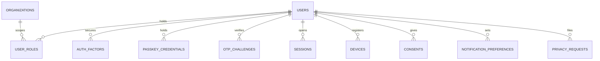

Part of the [data model](/en/docs/erd); conventions and base columns are documented there.

## users
*(Base +) — one login identity per person; every role, booking, grant and audit entry hangs off this row. [FR-AUTH-01](/en/docs/srs/requirements/auth#fr-auth-01--role-specific-registration-paths) to [FR-AUTH-10](/en/docs/srs/requirements/auth#fr-auth-10--sessions-and-tokens)*

<TypeTable
  type={{
    "full_name": {
      type: "VARCHAR(200)",
      required: true
    },
    "email": {
      type: "CITEXT",
      description: "Unique with `deleted_at` where not null",
      required: true,
    },
    "phone_enc": {
      type: "BYTEA",
      description: "enc; E.164",
      required: true,
    },
    "phone_hash": {
      type: "CHAR(64)",
      description: "Unique with `deleted_at` where not null",
      required: true,
    },
    "email_verified_at, phone_verified_at": {
      type: "TIMESTAMPTZ",
      description: "D-20",
      required: true,
    },
    "password_hash": {
      type: "VARCHAR(255)",
      description: "Argon2id; null for code-only accounts",
      required: true,
    },
    "country_code": {
      type: "CHAR(2) FK countries",
      description: "[BRL-23](/en/docs/brd/requirements#7-business-rules)",
      required: true,
    },
    "locale": {
      type: "VARCHAR(5)",
      description: "en or ar",
      required: true,
    },
    "timezone": {
      type: "VARCHAR(64)",
      required: true
    },
    "status_id": {
      type: "BIGINT FK lookups",
      description: "`account_status`: active, suspended, deletion_requested, closed",
      required: true,
    },
    "suspended_reason_id": {
      type: "BIGINT FK lookups",
      description: "`suspension_reason` (D-234)",
      required: true,
    },
    "deletion_requested_at, deletion_due_at": {
      type: "TIMESTAMPTZ",
      description: "30-day grace ([BRL-15](/en/docs/brd/requirements#7-business-rules))",
      required: true,
    },
    "failed_signins": {
      type: "SMALLINT",
      description: "Reset on success",
      required: true,
    },
    "locked_until": {
      type: "TIMESTAMPTZ",
      description: "[BRL-21](/en/docs/brd/requirements#7-business-rules)",
      required: true,
    },
    "token_version": {
      type: "INT",
      description: "Bump to revoke all tokens",
      required: true,
    },
    "traveler_plan_subscription_id": {
      type: "BIGINT FK subscriptions",
      description: "Free by default",
      required: true,
    },
  }}
/>

Indexes: `unique (email, deleted_at)`, `unique (phone_hash, deleted_at)`, partial `(status_id)` where `is_deleted = false`.

## user_roles
*(Base +) — role holdings, each optionally scoped to one organization; several may be active at once. [FR-AUTH-06](/en/docs/srs/requirements/auth#fr-auth-06--multi-role-accounts), [FR-AUTH-07](/en/docs/srs/requirements/auth#fr-auth-07--staff-access-to-several-organizations)*

<TypeTable
  type={{
    "user_id": {
      type: "BIGINT FK users",
      required: true
    },
    "role_id": {
      type: "BIGINT FK lookups",
      description: "`role`: traveler, organization_owner, organization_employee, platform_driver, platform_photographer, org_driver, org_photographer, moderator, admin_super, admin_operations, admin_finance",
      required: true,
    },
    "organization_id": {
      type: "BIGINT FK organizations NULL",
      description: "Set for organization-scoped roles",
      required: true,
    },
    "status_id": {
      type: "BIGINT FK lookups",
      description: "`role_status`: pending, active, paused, suspended, ended",
      required: true,
    },
    "started_at, ended_at": {
      type: "TIMESTAMPTZ",
      required: true
    },
  }}
/>

Unique `(user_id, role_id, organization_id, deleted_at)`.

Indexes: `(user_id, status_id)` for the sign-in role picker, `(organization_id, status_id)` for staff lists.

**auth_factors** (Base +) — second factors enrolled for sign-in: `user_id FK`, `factor_type_id FK lookups (auth_factor: totp, sms)`, `secret_enc BYTEA`, `verified_at TIMESTAMPTZ`, `last_used_at TIMESTAMPTZ`. Indexes: `unique (user_id, factor_type_id, deleted_at)`.

**passkey_credentials** (Base +) — WebAuthn credentials enrolled per user ([FR-AUTH-11](/en/docs/srs/requirements/auth#fr-auth-11--passkey-registration) to [FR-AUTH-13](/en/docs/srs/requirements/auth#fr-auth-13--passkey-management-and-device-loss-recovery)): `user_id FK`, `credential_id BYTEA` (up to 1023 bytes), `public_key BYTEA` (COSE — the private key never leaves the device), `aaguid CHAR(36)`, `sign_count INT`, `label VARCHAR(100)`, `last_used_at TIMESTAMPTZ`. Indexes: `unique (credential_id)`, `(user_id, deleted_at)` for the settings list.

## otp_challenges
*(Base +) — one verification-code challenge; consumed once, pausable after wrong attempts. [BRL-20](/en/docs/brd/requirements#7-business-rules)*

<TypeTable
  type={{
    "user_id": {
      type: "BIGINT FK users NULL",
      description: "Null before the account exists",
      required: true,
    },
    "channel_id": {
      type: "BIGINT FK lookups",
      description: "`otp_channel`: sms, whatsapp, email",
      required: true,
    },
    "destination_hash": {
      type: "CHAR(64)",
      required: true
    },
    "purpose_id": {
      type: "BIGINT FK lookups",
      description: "`otp_purpose`: verify_email, verify_phone, sign_in, staff_code, password_reset",
      required: true,
    },
    "code_hash": {
      type: "CHAR(64)",
      required: true
    },
    "expires_at": {
      type: "TIMESTAMPTZ",
      description: "5 minutes",
      required: true,
    },
    "wrong_attempts": {
      type: "SMALLINT",
      description: "Pause at 5",
      required: true,
    },
    "paused_until": {
      type: "TIMESTAMPTZ",
      description: "15 minutes",
      required: true,
    },
    "failed_deliveries": {
      type: "SMALLINT",
      description: "Switch channel at 3 (D-59)",
      required: true,
    },
    "consumed_at": {
      type: "TIMESTAMPTZ",
      required: true
    },
  }}
/>

Indexes: `(destination_hash, purpose_id)` for delivery lookup, partial `(expires_at)` where `consumed_at is null` for the sweep.

**sessions** (Base +) — one row per refresh token; carries the active role and organization for actor resolution: `user_id FK`, `active_role_id FK user_roles`, `active_organization_id FK organizations NULL`, `refresh_token_hash CHAR(64)`, `device_id FK devices NULL`, `ip INET`, `user_agent TEXT`, `expires_at TIMESTAMPTZ` (web 12 h, [BRL-22](/en/docs/brd/requirements#7-business-rules)), `revoked_at TIMESTAMPTZ`. Indexes: `unique (refresh_token_hash)`, `(user_id, expires_at)`, partial `(expires_at)` where `revoked_at is null`.

**devices** (Base +) — registered push targets with app version: `user_id FK`, `platform_id FK lookups (device_platform: ios, android, web)`, `push_token TEXT`, `app_version VARCHAR(20)`, `last_seen_at TIMESTAMPTZ`. Indexes: `(user_id, last_seen_at)`.

**consents** (immutable) — one grant or revocation per consent type and text version, never updated or deleted ([DAT-08](/en/docs/srs/data#63-soft-delete-immutability-and-deletion)): `id`, `uuid`, `user_id FK`, `consent_type_id FK lookups (consent_type: lab_test, background_check, child_tracking, guardianship, marketing, terms, privacy)`, `text_version VARCHAR(20)`, `granted BOOLEAN`, `occurred_at TIMESTAMPTZ`, `ip INET`, `created_at`, `created_by`. Indexes: `(user_id, consent_type_id, occurred_at)` — latest-consent lookup.

**notification_preferences** (Base +) — per user, category and channel opt-ins: `user_id FK`, `category_id FK lookups (notification_category)`, `channel_id FK lookups (notification_channel: email, sms, whatsapp, push, in_app)`, `enabled BOOLEAN`. Unique `(user_id, category_id, channel_id, deleted_at)`; that triple is the index.

**privacy_requests** (Base +) — data-copy and deletion requests with their 30-day clock ([FR-TRV-07](/en/docs/srs/requirements/trv#fr-trv-07--data-copy-and-deletion)): `user_id FK`, `type_id FK lookups (privacy_request_type: data_copy, deletion)`, `status_id FK lookups (privacy_request_status: received, verified, in_progress, delivered, cancelled)`, `due_at TIMESTAMPTZ` (30 days, D-162), `file_path TEXT`, `completed_at TIMESTAMPTZ`. Indexes: `(user_id, status_id)`, partial `(due_at)` where `completed_at is null`.
