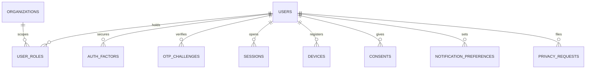

Part of the [data model](/en/docs/erd); conventions and base columns are documented there.

## users
*(Base +) [FR-AUTH-01](/en/docs/srs/requirements/auth#fr-auth-01--role-specific-registration-paths) to [FR-AUTH-10](/en/docs/srs/requirements/auth#fr-auth-10--sessions-and-tokens)*

| Column | Type | Notes |
|---|---|---|
| full_name | VARCHAR(200) | |
| email | CITEXT | Unique with `deleted_at` where not null |
| phone_enc | BYTEA | enc; E.164 |
| phone_hash | CHAR(64) | Unique with `deleted_at` where not null |
| email_verified_at, phone_verified_at | TIMESTAMPTZ | D-20 |
| password_hash | VARCHAR(255) | Argon2id; null for code-only accounts |
| country_code | CHAR(2) FK countries | [BRL-23](/en/docs/brd/requirements#7-business-rules) |
| locale | VARCHAR(5) | en or ar |
| timezone | VARCHAR(64) | |
| status_id | BIGINT FK lookups | `account_status`: active, suspended, deletion_requested, closed |
| suspended_reason_id | BIGINT FK lookups | `suspension_reason` (D-234) |
| deletion_requested_at, deletion_due_at | TIMESTAMPTZ | 30-day grace ([BRL-15](/en/docs/brd/requirements#7-business-rules)) |
| failed_signins | SMALLINT | Reset on success |
| locked_until | TIMESTAMPTZ | [BRL-21](/en/docs/brd/requirements#7-business-rules) |
| token_version | INT | Bump to revoke all tokens |
| traveler_plan_subscription_id | BIGINT FK subscriptions | Free by default |

## user_roles
*(Base +) [FR-AUTH-06](/en/docs/srs/requirements/auth#fr-auth-06--multi-role-accounts), [FR-AUTH-07](/en/docs/srs/requirements/auth#fr-auth-07--staff-access-to-several-organizations)*

| Column | Type | Notes |
|---|---|---|
| user_id | BIGINT FK users | |
| role_id | BIGINT FK lookups | `role`: traveler, organization_owner, organization_employee, platform_driver, platform_photographer, org_driver, org_photographer, moderator, admin_super, admin_operations, admin_finance |
| organization_id | BIGINT FK organizations NULL | Set for organization-scoped roles |
| status_id | BIGINT FK lookups | `role_status`: pending, active, paused, suspended, ended |
| started_at, ended_at | TIMESTAMPTZ | |

Unique `(user_id, role_id, organization_id, deleted_at)`.

**auth_factors** (Base +): `user_id FK`, `factor_type_id FK lookups (auth_factor: totp, sms)`, `secret_enc BYTEA`, `verified_at TIMESTAMPTZ`, `last_used_at TIMESTAMPTZ`.

## otp_challenges
*(Base +) [BRL-20](/en/docs/brd/requirements#7-business-rules)*

| Column | Type | Notes |
|---|---|---|
| user_id | BIGINT FK users NULL | Null before the account exists |
| channel_id | BIGINT FK lookups | `otp_channel`: sms, whatsapp, email |
| destination_hash | CHAR(64) | |
| purpose_id | BIGINT FK lookups | `otp_purpose`: verify_email, verify_phone, sign_in, staff_code, password_reset |
| code_hash | CHAR(64) | |
| expires_at | TIMESTAMPTZ | 5 minutes |
| wrong_attempts | SMALLINT | Pause at 5 |
| paused_until | TIMESTAMPTZ | 15 minutes |
| failed_deliveries | SMALLINT | Switch channel at 3 (D-59) |
| consumed_at | TIMESTAMPTZ | |

**sessions** (Base +): `user_id FK`, `active_role_id FK user_roles`, `active_organization_id FK organizations NULL`, `refresh_token_hash CHAR(64)`, `device_id FK devices NULL`, `ip INET`, `user_agent TEXT`, `expires_at TIMESTAMPTZ` (web 12 h, [BRL-22](/en/docs/brd/requirements#7-business-rules)), `revoked_at TIMESTAMPTZ`.

**devices** (Base +): `user_id FK`, `platform_id FK lookups (device_platform: ios, android, web)`, `push_token TEXT`, `app_version VARCHAR(20)`, `last_seen_at TIMESTAMPTZ`.

**consents** (immutable) [NFR-[DAT-05](/en/docs/srs/data#62-data-isolation)](/en/docs/srs/quality#85-data-nfr-dat): `id`, `uuid`, `user_id FK`, `consent_type_id FK lookups (consent_type: lab_test, background_check, child_tracking, guardianship, marketing, terms, privacy)`, `text_version VARCHAR(20)`, `granted BOOLEAN`, `occurred_at TIMESTAMPTZ`, `ip INET`, `created_at`, `created_by`.

**notification_preferences** (Base +): `user_id FK`, `category_id FK lookups (notification_category)`, `channel_id FK lookups (notification_channel: email, sms, whatsapp, push, in_app)`, `enabled BOOLEAN`. Unique `(user_id, category_id, channel_id, deleted_at)`.

**privacy_requests** (Base +) [FR-TRV-07](/en/docs/srs/requirements/trv#fr-trv-07--data-copy-and-deletion): `user_id FK`, `type_id FK lookups (privacy_request_type: data_copy, deletion)`, `status_id FK lookups (privacy_request_status: received, verified, in_progress, delivered, cancelled)`, `due_at TIMESTAMPTZ` (30 days, D-162), `file_path TEXT`, `completed_at TIMESTAMPTZ`.
