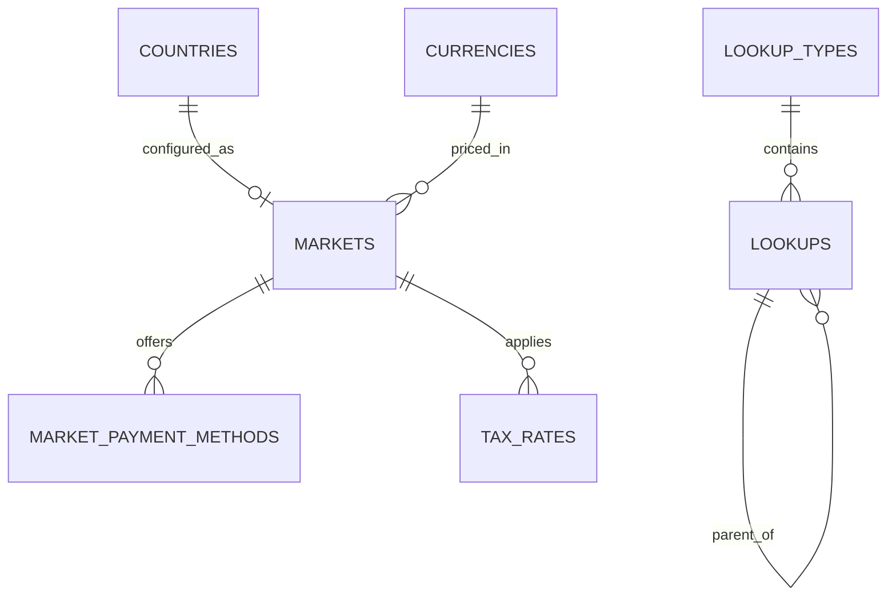

Part of the [data model](/en/docs/erd); conventions and base columns are documented there.

## lookup_types
*(Base +) — registry of every enumerable set; every status, type and category column in the model resolves through here.*

<TypeTable
  type={{
    "code": {
      type: "VARCHAR(80)",
      description: "Unique with `deleted_at`, for example `booking_status`",
      required: true,
    },
    "name": {
      type: "JSONB",
      description: "Translatable",
      required: true,
    },
    "description": {
      type: "JSONB",
      description: "Translatable",
      required: true,
    },
    "parent_id": {
      type: "BIGINT FK lookup_types",
      description: "Optional grouping",
      required: true,
    },
    "sort_by": {
      type: "INT",
      required: true
    },
    "is_public": {
      type: "BOOLEAN",
      description: "Shown to clients",
      required: true,
    },
    "is_system": {
      type: "BOOLEAN",
      description: "Cannot be edited by admin",
      required: true,
    },
  }}
/>

Indexes: `unique (code, deleted_at)`, `(parent_id)`.

## lookups
*(Base +) — one enumerable value inside a type; every `status_id`, `*_type_id` and category column FKs to a row here.*

<TypeTable
  type={{
    "lookup_type_id": {
      type: "BIGINT FK lookup_types",
      required: true
    },
    "code": {
      type: "VARCHAR(80)",
      description: "Unique with `(lookup_type_id, code, deleted_at)`",
      required: true,
    },
    "value": {
      type: "VARCHAR(255)",
      description: "Optional machine value",
      required: true,
    },
    "name": {
      type: "JSONB",
      description: "Translatable label",
      required: true,
    },
    "description": {
      type: "JSONB",
      required: true
    },
    "parent_id": {
      type: "BIGINT FK lookups",
      description: "For example incident category under a group",
      required: true,
    },
    "sort_by": {
      type: "INT",
      required: true
    },
    "is_public, is_system": {
      type: "BOOLEAN",
      required: true
    },
  }}
/>

Indexes: `unique (lookup_type_id, code, deleted_at)`, `(lookup_type_id, is_public)` for public client listings.

**countries** — ISO 3166-1 reference rows every `country_code` column points to: `code CHAR(2) PK`, `name JSONB`, `phone_prefix VARCHAR(6)`, `is_active BOOLEAN`. Reference data, no soft delete.

**currencies** — ISO 4217 reference rows behind every `currency_code` column: `code CHAR(3) PK`, `minor_units SMALLINT`, `symbol JSONB`. Reference data.

## markets
*(Base +) — per-country go-live configuration: currency, timezone, commission and invoicing rules. [BR-MKT-01](/en/docs/brd/requirements#616-markets-mkt), [BRL-27](/en/docs/brd/requirements#7-business-rules), [FR-MKT-01](/en/docs/srs/requirements/mkt#fr-mkt-01--market-configuration) to [FR-MKT-05](/en/docs/srs/requirements/mkt#fr-mkt-05--rounding-and-display)*

<TypeTable
  type={{
    "country_code": {
      type: "CHAR(2) FK countries",
      description: "Unique",
      required: true,
    },
    "currency_code": {
      type: "CHAR(3) FK currencies",
      description: "EGP, SAR, AED",
      required: true,
    },
    "default_timezone": {
      type: "VARCHAR(64)",
      description: "Africa/Cairo, Asia/Riyadh, Asia/Dubai (D-282)",
      required: true,
    },
    "status_id": {
      type: "BIGINT FK lookups",
      description: "`market_status`: draft, live, paused",
      required: true,
    },
    "launch_phase": {
      type: "SMALLINT",
      description: "2 or 5",
      required: true,
    },
    "commission_rate_bp": {
      type: "INT",
      description: "Basis points; placeholder 1000 (D-15)",
      required: true,
    },
    "invoice_rules": {
      type: "JSONB",
      description: "Numbering prefix, required buyer fields, e-invoicing flag ([OD-10](/en/docs/brd/compliance#11-open-decisions))",
      required: true,
    },
  }}
/>

Indexes: `unique (country_code)`, `(status_id)`.

**market_payment_methods** (Base +) — which payment method and gateway pairs are offered in a market: `market_id FK`, `method_id FK lookups (payment_method: card, apple_pay, google_pay, local_card, fawry_cash)`, `gateway_id FK lookups (gateway: stripe, paymob, tap, fawry)`, `use_for_bookings BOOLEAN`, `use_for_plans BOOLEAN`, `sort_by INT`, `is_active BOOLEAN`. Indexes: `unique (market_id, method_id, deleted_at)`, `(market_id, is_active, sort_by)`.

**tax_rates** (Base +) — VAT rate per market with a validity window: `market_id FK`, `tax_type_id FK lookups (tax_type: vat)`, `rate_bp INT` ([OD-27](/en/docs/brd/compliance#11-open-decisions)), `valid_from DATE`, `valid_to DATE NULL`. Indexes: `unique (market_id, tax_type_id, valid_from)`.
