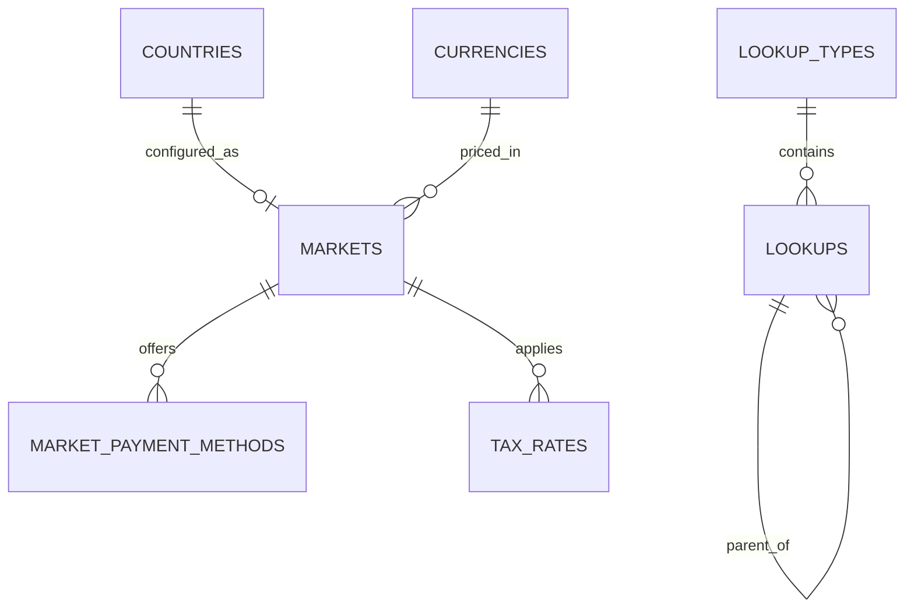

Part of the [data model](/en/docs/erd); conventions and base columns are documented there.

## lookup_types
*(Base +)*

| Column | Type | Notes |
|---|---|---|
| code | VARCHAR(80) | Unique with `deleted_at`, for example `booking_status` |
| name | JSONB | Translatable |
| description | JSONB | Translatable |
| parent_id | BIGINT FK lookup_types | Optional grouping |
| sort_by | INT | |
| is_public | BOOLEAN | Shown to clients |
| is_system | BOOLEAN | Cannot be edited by admin |

## lookups
*(Base +)*

| Column | Type | Notes |
|---|---|---|
| lookup_type_id | BIGINT FK lookup_types | |
| code | VARCHAR(80) | Unique with `(lookup_type_id, code, deleted_at)` |
| value | VARCHAR(255) | Optional machine value |
| name | JSONB | Translatable label |
| description | JSONB | |
| parent_id | BIGINT FK lookups | For example incident category under a group |
| sort_by | INT | |
| is_public, is_system | BOOLEAN | |

**countries**: `code CHAR(2) PK`, `name JSONB`, `phone_prefix VARCHAR(6)`, `is_active BOOLEAN`. Reference data, no soft delete.

**currencies**: `code CHAR(3) PK`, `minor_units SMALLINT`, `symbol JSONB`. Reference data.

## markets
*(Base +) [BR-MKT-01](/en/docs/brd/requirements#616-markets-mkt), [BRL-27](/en/docs/brd/requirements#7-business-rules)*

| Column | Type | Notes |
|---|---|---|
| country_code | CHAR(2) FK countries | Unique |
| currency_code | CHAR(3) FK currencies | EGP, SAR, AED |
| default_timezone | VARCHAR(64) | Africa/Cairo, Asia/Riyadh, Asia/Dubai (D-282) |
| status_id | BIGINT FK lookups | `market_status`: draft, live, paused |
| launch_phase | SMALLINT | 2 or 5 |
| commission_rate_bp | INT | Basis points; placeholder 1000 (D-15) |
| invoice_rules | JSONB | Numbering prefix, required buyer fields, e-invoicing flag ([OD-10](/en/docs/brd/compliance#11-open-decisions)) |

**market_payment_methods** (Base +): `market_id FK`, `method_id FK lookups (payment_method: card, apple_pay, google_pay, local_card, fawry_cash)`, `gateway_id FK lookups (gateway: stripe, paymob, tap, fawry)`, `use_for_bookings BOOLEAN`, `use_for_plans BOOLEAN`, `sort_by INT`, `is_active BOOLEAN`.

**tax_rates** (Base +): `market_id FK`, `tax_type_id FK lookups (tax_type: vat)`, `rate_bp INT` ([OD-27](/en/docs/brd/compliance#11-open-decisions)), `valid_from DATE`, `valid_to DATE NULL`.
