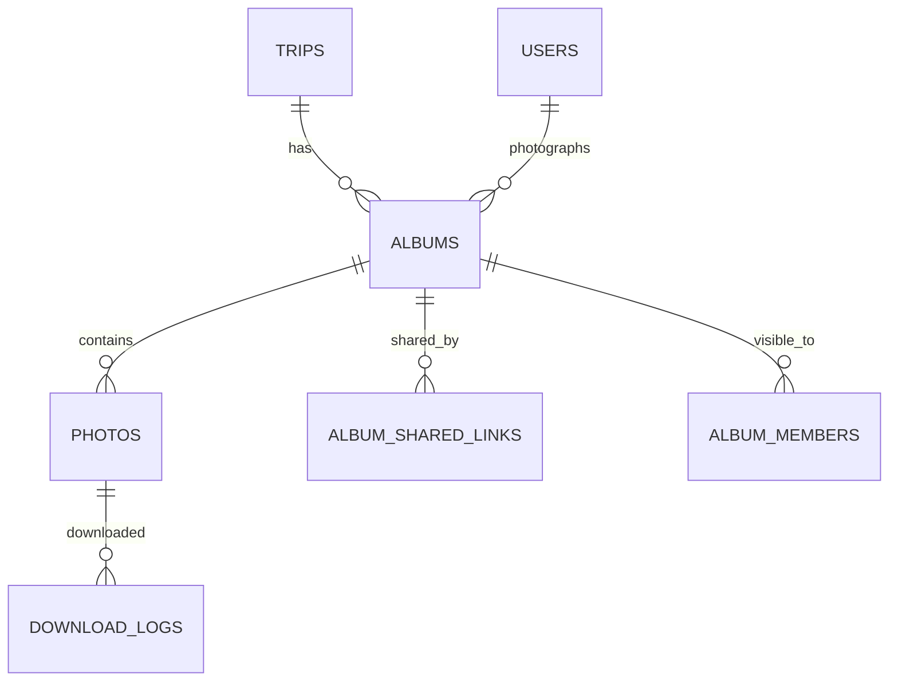

Part of the [data model](/en/docs/erd); conventions and base columns are documented there.

Media is the platform's single file store for every domain's uploads (application documents, portfolio photos, album photos, and any other file); the owning domain's table holds the entity link. A file that is not linked to its owning entity and not created by the system is deleted automatically, with its derived variants, 24 hours after upload ([BRL-31](/en/docs/brd/requirements#7-business-rules), [FR-MED-09](/en/docs/srs/requirements/med#fr-med-09--file-lifecycle-and-orphan-cleanup)).

**albums** (Base +) — one photo album per trip and photographer, with a bounded upload window ([FR-MED-01](/en/docs/srs/requirements/med#fr-med-01--album-creation-window) to [FR-MED-08](/en/docs/srs/requirements/med#fr-med-08--albums-per-trip-by-plan)): `organization_id`, `trip_id FK`, `photographer_user_id FK`, `title JSONB`, `privacy_mode_id FK lookups (album_privacy: public, shared_link, selected_users)`, `watermark_enabled BOOLEAN`, `status_id FK lookups (album_status: uploading, processing, published, archived)`, `upload_window_ends_at` (trip completion plus 14 days, D-267), `published_at`, `archived_at`. Indexes: `(trip_id)`, `(photographer_user_id, status_id)`, partial `(upload_window_ends_at)` where `status_id` in `uploading` or `processing`.

**photos** (Base +) — one image with its derived variants: `organization_id`, `album_id FK`, `original_path TEXT`, `variants JSONB` (thumb, medium, large, watermarked), `width`, `height`, `perceptual_hash CHAR(16)`, `processing_status_id FK lookups (processing_status)`, `upload_batch_id UUID`, `client_file_id VARCHAR(120)` (resumable upload, unique per batch). Indexes: `(album_id, created_at)`, `(upload_batch_id, client_file_id)`, `(perceptual_hash)` for duplicate detection.

**album_shared_links** (Base +) — revocable share tokens for one album: `album_id FK`, `token_hash CHAR(64)` (32-character token), `revoked_at`. Indexes: `unique (token_hash)`.

**album_members** (Base +) — explicit viewers in selected-users mode: `album_id FK`, `user_id FK`. Indexes: `unique (album_id, user_id, deleted_at)`.

**download_logs** (Base +) — one row per photo download, for licensing and abuse review: `photo_id FK`, `user_id FK`, `variant VARCHAR(20)`, `occurred_at`. Retention 1 year. Indexes: `(photo_id, occurred_at)`, `(occurred_at)` for the retention sweep.
