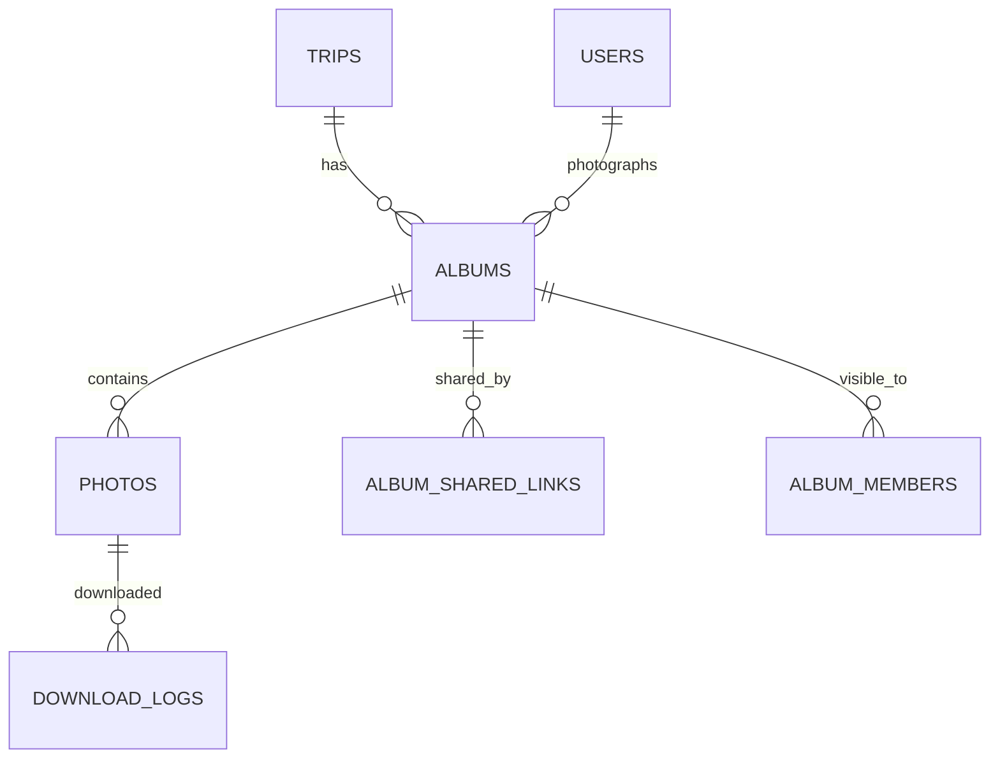

Part of the [data model](/en/docs/erd); conventions and base columns are documented there.

**albums** (Base +) [FR-MED-01](/en/docs/srs/requirements/med#fr-med-01--album-creation-window) to [FR-MED-08](/en/docs/srs/requirements/med#fr-med-08--albums-per-trip-by-plan): `organization_id`, `trip_id FK`, `photographer_user_id FK`, `title JSONB`, `privacy_mode_id FK lookups (album_privacy: public, shared_link, selected_users)`, `watermark_enabled BOOLEAN`, `status_id FK lookups (album_status: uploading, processing, published, archived)`, `upload_window_ends_at` (trip completion plus 14 days, D-267), `published_at`, `archived_at`.

**photos** (Base +): `organization_id`, `album_id FK`, `original_path TEXT`, `variants JSONB` (thumb, medium, large, watermarked), `width`, `height`, `perceptual_hash CHAR(16)`, `processing_status_id FK lookups (processing_status)`, `upload_batch_id UUID`, `client_file_id VARCHAR(120)` (resumable upload, unique per batch).

**album_shared_links** (Base +): `album_id FK`, `token_hash CHAR(64)` (32-character token), `revoked_at`.

**album_members** (Base +): `album_id FK`, `user_id FK`. Selected-users mode only.

**download_logs** (Base +): `photo_id FK`, `user_id FK`, `variant VARCHAR(20)`, `occurred_at`. Retention 1 year.
