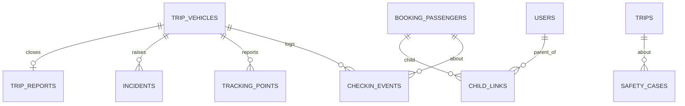

Part of the [data model](/en/docs/erd); conventions and base columns are documented there.

## checkin_events
*(immutable hypertable) — boarding and check-out facts as reported by devices, replayed idempotently from the offline queue. [FR-CHK-01](/en/docs/srs/requirements/chk#fr-chk-01--check-in-at-boarding) to [FR-CHK-05](/en/docs/srs/requirements/chk#fr-chk-05--offline-queue)*

<TypeTable
  type={{
    "id, uuid": {
      type: "BIGSERIAL, UUID",
      description: "Primary key `(id, occurred_at)`",
      required: true,
    },
    "organization_id": {
      type: "BIGINT",
      required: true
    },
    "trip_id": {
      type: "BIGINT",
      required: true
    },
    "trip_vehicle_id": {
      type: "BIGINT",
      required: true
    },
    "passenger_id": {
      type: "BIGINT FK booking_passengers",
      required: true
    },
    "event_type_id": {
      type: "BIGINT FK lookups",
      description: "`checkin_event`: check_in, check_out, refused_wrong_vehicle",
      required: true,
    },
    "stop_id": {
      type: "BIGINT FK trip_stops NULL",
      required: true
    },
    "moderator_user_id": {
      type: "BIGINT FK users",
      required: true
    },
    "lat, lng, accuracy_m": {
      type: "NUMERIC, NUMERIC, REAL",
      description: "Null when location is not permitted",
      required: true,
    },
    "occurred_at": {
      type: "TIMESTAMPTZ",
      description: "Device time of the event",
      required: true,
    },
    "received_at": {
      type: "TIMESTAMPTZ",
      description: "Server time; difference measures the 60-second target",
      required: true,
    },
    "client_event_id": {
      type: "UUID",
      description: "Unique; offline replay is idempotent",
      required: true,
    },
    "created_at, created_by": {
      type: "",
      required: true
    },
  }}
/>

Retention 1 year.

Indexes: `(trip_id, occurred_at)`, `(passenger_id, occurred_at)` for the passenger timeline, `(moderator_user_id, occurred_at)`, `unique (client_event_id, occurred_at)` — a hypertable unique must include the partition column, so global replay dedup is enforced again in the sync repository.

**tracking_points** (immutable hypertable) — raw GPS pings per trip vehicle ([FR-TRK-01](/en/docs/srs/requirements/trk#fr-trk-01--live-vehicle-location), [FR-TRK-02](/en/docs/srs/requirements/trk#fr-trk-02--location-collection)): `id`, `organization_id`, `trip_vehicle_id`, `occurred_at`, `lat`, `lng`, `speed_kmh REAL`, `heading SMALLINT`, `accuracy_m REAL`, `source_id FK lookups (gps_source: driver_app, moderator_app)`. Retention 90 days, then an hourly summary is kept. Indexes: `(trip_vehicle_id, occurred_at DESC)` — the live map reads the tail of each vehicle.

**incidents** (Base +) — operational incidents raised during a run ([FR-CHK-06](/en/docs/srs/requirements/chk#fr-chk-06--incident-reporting)): `organization_id`, `trip_id`, `trip_vehicle_id`, `reported_by FK users`, `category_id FK lookups (incident_category: safety, medical, vehicle_fault, lost_traveler, conduct, other)`, `severity_id FK lookups (severity)`, `description TEXT`, `attachments JSONB`, `lat`, `lng`, `status_id FK lookups (incident_status: open, acknowledged, resolved)`, `acknowledged_at`, `resolved_at`. Indexes: `(trip_id, status_id)`, `(trip_vehicle_id, created_at)`.

**trip_reports** (Base +) — the moderator's locked end-of-trip headcount report ([FR-MOD-02](/en/docs/srs/requirements/mod#fr-mod-02--end-of-trip-report), [FR-MOD-06](/en/docs/srs/requirements/mod#fr-mod-06--report-lock)): `organization_id`, `trip_vehicle_id FK UNIQUE`, `moderator_user_id`, `checked_in_count INT`, `final_headcount INT`, `mismatch_reason TEXT`, `notes TEXT`, `submitted_at` (locked after), `org_note TEXT`. Indexes: `unique (trip_vehicle_id, deleted_at)`.

## child_links
*(Base +) — a parent's live view of one child passenger on one booking. [FR-PAR-01](/en/docs/srs/requirements/par#fr-par-01--linking-a-child) to [FR-PAR-06](/en/docs/srs/requirements/par#fr-par-06--link-ends-with-the-booking)*

<TypeTable
  type={{
    "parent_user_id": {
      type: "BIGINT FK users",
      required: true
    },
    "booking_id": {
      type: "BIGINT FK bookings",
      required: true
    },
    "passenger_id": {
      type: "BIGINT FK booking_passengers",
      description: "Must be `is_child`",
      required: true,
    },
    "organization_id": {
      type: "BIGINT",
      description: "Copied for RLS on organization reads",
      required: true,
    },
    "guardianship_consent_id": {
      type: "BIGINT FK consents",
      description: "D-126",
      required: true,
    },
    "status_id": {
      type: "BIGINT FK lookups",
      description: "`child_link_status`: active, ended",
      required: true,
    },
    "ended_at": {
      type: "TIMESTAMPTZ",
      description: "Ends on cancellation or refund",
      required: true,
    },
  }}
/>

Unique active `(parent_user_id, passenger_id)`.

Indexes: `(booking_id)` for end-on-refund processing, `(parent_user_id, status_id)` for the parent's active links.

**safety_cases** (Base +) — child-safety reports escalated inside or outside the platform ([FR-PAR-07](/en/docs/srs/requirements/par#fr-par-07--child-safety-reporting)): `organization_id`, `trip_id FK`, `passenger_id FK NULL`, `reported_by FK users`, `reporter_role_id FK lookups (role)`, `description TEXT`, `status_id FK lookups (case_status: open, escalated, closed)`, `escalated_to VARCHAR(200)` (D-68), `escalated_at`, `closed_at`. Indexes: `(trip_id)`, partial `(status_id)` where `status_id` in `open` or `escalated`.
