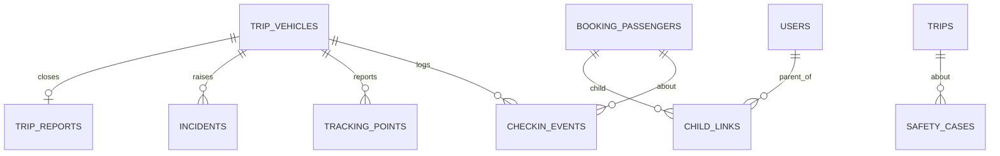

Part of the [data model](/en/docs/erd); conventions and base columns are documented there.

## checkin_events
*(immutable hypertable) [FR-CHK-01](/en/docs/srs/requirements/chk#fr-chk-01--check-in-at-boarding) to [FR-CHK-05](/en/docs/srs/requirements/chk#fr-chk-05--offline-queue)*

| Column | Type | Notes |
|---|---|---|
| id, uuid | BIGSERIAL, UUID | Primary key `(id, occurred_at)` |
| organization_id | BIGINT | |
| trip_id | BIGINT | |
| trip_vehicle_id | BIGINT | |
| passenger_id | BIGINT FK booking_passengers | |
| event_type_id | BIGINT FK lookups | `checkin_event`: check_in, check_out, refused_wrong_vehicle |
| stop_id | BIGINT FK trip_stops NULL | |
| moderator_user_id | BIGINT FK users | |
| lat, lng, accuracy_m | NUMERIC, NUMERIC, REAL | Null when location is not permitted |
| occurred_at | TIMESTAMPTZ | Device time of the event |
| received_at | TIMESTAMPTZ | Server time; difference measures the 60-second target |
| client_event_id | UUID | Unique; offline replay is idempotent |
| created_at, created_by | | |

Retention 1 year.

**tracking_points** (immutable hypertable) [FR-TRK-01](/en/docs/srs/requirements/trk#fr-trk-01--live-vehicle-location), [FR-TRK-02](/en/docs/srs/requirements/trk#fr-trk-02--location-collection): `id`, `organization_id`, `trip_vehicle_id`, `occurred_at`, `lat`, `lng`, `speed_kmh REAL`, `heading SMALLINT`, `accuracy_m REAL`, `source_id FK lookups (gps_source: driver_app, moderator_app)`. Retention 90 days, then an hourly summary is kept.

**incidents** (Base +) [FR-CHK-06](/en/docs/srs/requirements/chk#fr-chk-06--incident-reporting): `organization_id`, `trip_id`, `trip_vehicle_id`, `reported_by FK users`, `category_id FK lookups (incident_category: safety, medical, vehicle_fault, lost_traveler, conduct, other)`, `severity_id FK lookups (severity)`, `description TEXT`, `attachments JSONB`, `lat`, `lng`, `status_id FK lookups (incident_status: open, acknowledged, resolved)`, `acknowledged_at`, `resolved_at`.

**trip_reports** (Base +) [FR-MOD-02](/en/docs/srs/requirements/mod#fr-mod-02--end-of-trip-report), [FR-MOD-06](/en/docs/srs/requirements/mod#fr-mod-06--report-lock): `organization_id`, `trip_vehicle_id FK UNIQUE`, `moderator_user_id`, `checked_in_count INT`, `final_headcount INT`, `mismatch_reason TEXT`, `notes TEXT`, `submitted_at` (locked after), `org_note TEXT`.

## child_links
*(Base +) [FR-PAR-01](/en/docs/srs/requirements/par#fr-par-01--linking-a-child) to [FR-PAR-06](/en/docs/srs/requirements/par#fr-par-06--link-ends-with-the-booking)*

| Column | Type | Notes |
|---|---|---|
| parent_user_id | BIGINT FK users | |
| booking_id | BIGINT FK bookings | |
| passenger_id | BIGINT FK booking_passengers | Must be `is_child` |
| organization_id | BIGINT | Copied for RLS on organization reads |
| guardianship_consent_id | BIGINT FK consents | D-126 |
| status_id | BIGINT FK lookups | `child_link_status`: active, ended |
| ended_at | TIMESTAMPTZ | Ends on cancellation or refund |

Unique active `(parent_user_id, passenger_id)`.

**safety_cases** (Base +) [FR-PAR-07](/en/docs/srs/requirements/par#fr-par-07--child-safety-reporting): `organization_id`, `trip_id FK`, `passenger_id FK NULL`, `reported_by FK users`, `reporter_role_id FK lookups (role)`, `description TEXT`, `status_id FK lookups (case_status: open, escalated, closed)`, `escalated_to VARCHAR(200)` (D-68), `escalated_at`, `closed_at`.
