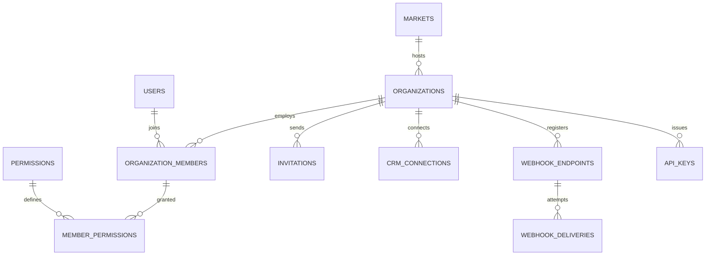

Part of the [data model](/en/docs/erd); conventions and base columns are documented there.

## organizations
*(Base +) — the tenant root; every tenant table's `organization_id` points here. [FR-ORG-01](/en/docs/srs/requirements/org#fr-org-01--tenant-isolation) to [FR-ORG-08](/en/docs/srs/requirements/org#fr-org-08--custom-branding)*

<TypeTable
  type={{
    "owner_user_id": {
      type: "BIGINT FK users",
      required: true
    },
    "application_id": {
      type: "BIGINT FK applications",
      required: true
    },
    "market_id": {
      type: "BIGINT FK markets",
      description: "From country ([BRL-27](/en/docs/brd/requirements#7-business-rules))",
      required: true,
    },
    "legal_name, trade_name": {
      type: "JSONB",
      required: true
    },
    "commercial_reg_no": {
      type: "VARCHAR(50)",
      required: true
    },
    "tax_no": {
      type: "VARCHAR(50)",
      required: true
    },
    "billing_email": {
      type: "CITEXT",
      required: true
    },
    "timezone": {
      type: "VARCHAR(64)",
      description: "Defaults from market",
      required: true,
    },
    "status_id": {
      type: "BIGINT FK lookups",
      description: "`organization_status`: active, suspended, closed",
      required: true,
    },
    "subscription_id": {
      type: "BIGINT FK subscriptions",
      required: true
    },
    "seat_self_selection_default": {
      type: "BOOLEAN",
      description: "[FR-ORG-05](/en/docs/srs/requirements/org#fr-org-05--seat-self-selection-setting)",
      required: true,
    },
    "child_tracking_default": {
      type: "BOOLEAN",
      required: true
    },
    "branding": {
      type: "JSONB",
      description: "Enterprise only ([BR-ORG-08](/en/docs/brd/requirements#63-organizations-and-employees-org))",
      required: true,
    },
    "invoice_settings": {
      type: "JSONB",
      description: "Prefix, footer, bank details",
      required: true,
    },
    "approved_at": {
      type: "TIMESTAMPTZ",
      required: true
    },
  }}
/>

Indexes: `unique (application_id)`, `(market_id)`, `(status_id)`.

## organization_members
*(Base +) — the staff roster; `email` is the access-list key used for organization switching. [BR-AUTH-06](/en/docs/brd/requirements#61-accounts-and-access-auth), [FR-EMP-01](/en/docs/srs/requirements/emp#fr-emp-01--permission-sets) to [FR-EMP-06](/en/docs/srs/requirements/emp#fr-emp-06--invitation-and-first-sign-in)*

<TypeTable
  type={{
    "organization_id": {
      type: "BIGINT FK organizations",
      description: "Tenant column",
      required: true,
    },
    "user_id": {
      type: "BIGINT FK users NULL",
      description: "Null until the invitation is accepted",
      required: true,
    },
    "email": {
      type: "CITEXT",
      description: "The access-list key used for organization switching",
      required: true,
    },
    "member_type_id": {
      type: "BIGINT FK lookups",
      description: "`member_type`: owner, employee, org_driver, org_photographer, moderator",
      required: true,
    },
    "status_id": {
      type: "BIGINT FK lookups",
      description: "`member_status`: invited, active, suspended, removed",
      required: true,
    },
    "joined_at, removed_at": {
      type: "TIMESTAMPTZ",
      required: true
    },
  }}
/>

Unique `(organization_id, email, deleted_at)`.

Indexes: `(user_id, status_id)` for "my organizations", `(organization_id, status_id)` for the roster.

**permissions** (reference) — the ACL code catalog, one row per `area.action` code ([catalog](/en/docs/erd/acl)): `id`, `code VARCHAR(80) UNIQUE` (for example `trip.create`, `booking.refund`, `accounting.export`, `integration.manage`, `analytics.view`), `area_id FK lookups (permission_area)`, `name JSONB`. Indexes: `unique (code)`, `(area_id)`.

**member_permissions** (Base +) — one granted permission per member row; every insert and soft delete writes an audit log entry ([FR-EMP-02](/en/docs/srs/requirements/emp#fr-emp-02--permission-changes-are-audited)): `organization_id`, `member_id FK organization_members`, `permission_id FK permissions`. Indexes: `unique (member_id, permission_id, deleted_at)`.

**invitations** (Base +) — single-use emailed invitations that create the member before first sign-in: `organization_id`, `member_id FK`, `channel_id FK lookups (otp_channel)`, `token_hash CHAR(64)`, `expires_at` (7 days, D-286, D-94), `accepted_at`. Indexes: `(member_id)`, partial `(expires_at)` where `accepted_at is null`.

**crm_connections** (Base +) — stored credentials for a organization's CRM integration: `organization_id`, `provider_id FK lookups (crm_provider)`, `credentials_enc BYTEA`, `status_id FK lookups (integration_status: connected, error, disconnected)`, `last_sync_at`. Indexes: `unique (organization_id, provider_id, deleted_at)`.

**webhook_endpoints** (Base +) — HTTPS endpoints receiving signed events ([FR-ORG-06](/en/docs/srs/requirements/org#fr-org-06--crm-and-webhooks)): `organization_id`, `url TEXT` (HTTPS only), `secret_enc BYTEA`, `previous_secret_enc BYTEA`, `previous_secret_valid_until TIMESTAMPTZ` (24 h after rotation), `events TEXT[]` (event codes), `is_active BOOLEAN`. Indexes: `(organization_id, is_active)`.

**webhook_deliveries** (Base +) — one row per attempt, replayable for 7 days: `organization_id`, `endpoint_id FK`, `event_uuid UUID`, `event_type VARCHAR(80)`, `payload JSONB`, `attempt SMALLINT` (up to 5 over 24 h), `status_code SMALLINT`, `next_attempt_at`, `delivered_at`, `replay_until` (7 days, D-63). Indexes: `(endpoint_id, created_at)`, partial `(next_attempt_at)` where `delivered_at is null` — the retry sweep.

**api_keys** (Base +) — machine credentials for the public API, hashed at rest ([FR-API-02](/en/docs/srs/requirements/api#fr-api-02--api-key-lifecycle)): `organization_id`, `name VARCHAR(100)`, `key_prefix VARCHAR(12)`, `key_hash CHAR(64)`, `scopes TEXT[]`, `last_used_at`, `revoked_at`. Indexes: `unique (key_hash)`, `(key_prefix)`, `(organization_id, revoked_at)`.
