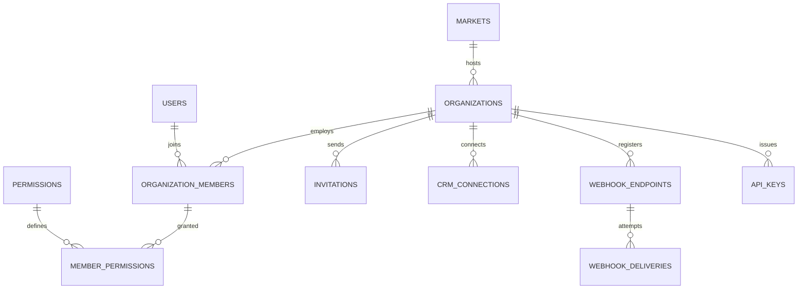

Part of the [data model](/en/docs/erd); conventions and base columns are documented there.

## organizations
*(Base +) [FR-ORG-01](/en/docs/srs/requirements/org#fr-org-01--tenant-isolation) to [FR-ORG-08](/en/docs/srs/requirements/org#fr-org-08--custom-branding)*

| Column | Type | Notes |
|---|---|---|
| owner_user_id | BIGINT FK users | |
| application_id | BIGINT FK applications | |
| market_id | BIGINT FK markets | From country ([BRL-27](/en/docs/brd/requirements#7-business-rules)) |
| legal_name, trade_name | JSONB | |
| commercial_reg_no | VARCHAR(50) | |
| tax_no | VARCHAR(50) | |
| billing_email | CITEXT | |
| timezone | VARCHAR(64) | Defaults from market |
| status_id | BIGINT FK lookups | `organization_status`: active, suspended, closed |
| subscription_id | BIGINT FK subscriptions | |
| seat_self_selection_default | BOOLEAN | [FR-ORG-05](/en/docs/srs/requirements/org#fr-org-05--seat-self-selection-setting) |
| child_tracking_default | BOOLEAN | |
| branding | JSONB | Enterprise only ([BR-ORG-08](/en/docs/brd/requirements#63-organizations-and-employees-org)) |
| invoice_settings | JSONB | Prefix, footer, bank details |
| approved_at | TIMESTAMPTZ | |

## organization_members
*(Base +) [BR-AUTH-06](/en/docs/brd/requirements#61-accounts-and-access-auth), [FR-EMP-01](/en/docs/srs/requirements/emp#fr-emp-01--permission-sets) to [FR-EMP-06](/en/docs/srs/requirements/emp#fr-emp-06--invitation-and-first-sign-in)*

| Column | Type | Notes |
|---|---|---|
| organization_id | BIGINT FK organizations | Tenant column |
| user_id | BIGINT FK users NULL | Null until the invitation is accepted |
| email | CITEXT | The access-list key used for organization switching |
| member_type_id | BIGINT FK lookups | `member_type`: owner, employee, org_driver, org_photographer, moderator |
| status_id | BIGINT FK lookups | `member_status`: invited, active, suspended, removed |
| joined_at, removed_at | TIMESTAMPTZ | |

Unique `(organization_id, email, deleted_at)`.

**permissions** (reference): `id`, `code VARCHAR(80) UNIQUE` (for example `trip.create`, `booking.refund`, `accounting.export`, `integration.manage`, `analytics.view`), `area_id FK lookups (permission_area)`, `name JSONB`.

**member_permissions** (Base +): `organization_id`, `member_id FK organization_members`, `permission_id FK permissions`. Every insert and soft delete writes an audit log entry ([FR-EMP-02](/en/docs/srs/requirements/emp#fr-emp-02--permission-changes-are-audited)).

**invitations** (Base +): `organization_id`, `member_id FK`, `channel_id FK lookups (otp_channel)`, `token_hash CHAR(64)`, `expires_at` (7 days, D-286, D-94), `accepted_at`.

**crm_connections** (Base +): `organization_id`, `provider_id FK lookups (crm_provider)`, `credentials_enc BYTEA`, `status_id FK lookups (integration_status: connected, error, disconnected)`, `last_sync_at`.

**webhook_endpoints** (Base +) [FR-ORG-06](/en/docs/srs/requirements/org#fr-org-06--crm-and-webhooks): `organization_id`, `url TEXT` (HTTPS only), `secret_enc BYTEA`, `previous_secret_enc BYTEA`, `previous_secret_valid_until TIMESTAMPTZ` (24 h after rotation), `events TEXT[]` (event codes), `is_active BOOLEAN`.

**webhook_deliveries** (Base +): `organization_id`, `endpoint_id FK`, `event_uuid UUID`, `event_type VARCHAR(80)`, `payload JSONB`, `attempt SMALLINT` (up to 5 over 24 h), `status_code SMALLINT`, `next_attempt_at`, `delivered_at`, `replay_until` (7 days, D-63).

**api_keys** (Base +): `organization_id`, `name VARCHAR(100)`, `key_prefix VARCHAR(12)`, `key_hash CHAR(64)`, `scopes TEXT[]`, `last_used_at`, `revoked_at`.
