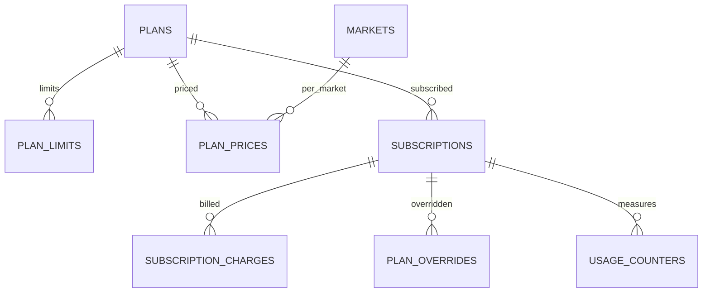

Part of the [data model](/en/docs/erd); conventions and base columns are documented there.

**plans** (Base +) — the plan catalog per role scope, from Free to Enterprise ([FR-SUB-01](/en/docs/srs/requirements/sub#fr-sub-01--plan-catalog)): `role_scope_id FK lookups (plan_role: organization, driver, photographer, traveler)`, `code VARCHAR(40)` (starter, growth, enterprise, basic, professional, premium, studio, pro, free, explorer, vip), `name JSONB`, `tier_rank SMALLINT`, `trial_days SMALLINT NULL` ([OD-28](/en/docs/brd/compliance#11-open-decisions)), `is_default_on_approval BOOLEAN`, `is_active BOOLEAN`. Indexes: `unique (role_scope_id, code, deleted_at)`, `(tier_rank)`.

**plan_limits** (Base +) — numeric limits and feature flags per plan: `plan_id FK`, `limit_key VARCHAR(60)` (for example `active_trips_per_month`, `employees`, `vehicles_per_trip`, `programs_per_trip`, `coupons_active`, `bookings_per_month`, `portfolio_images`, `albums_per_trip`), `limit_value INT NULL` (null means unlimited), `feature_key VARCHAR(60) NULL` (for example `platform_suppliers`, `seat_self_select`, `child_tracking`, `watermark`, `album_privacy_link`, `album_privacy_selected`, `analytics_level`, `export`), `feature_value VARCHAR(40) NULL`. Indexes: `unique (plan_id, limit_key, deleted_at)`.

**plan_prices** (Base +) — price per plan, market and interval, mirrored in the gateway: `plan_id FK`, `market_id FK`, `interval_id FK lookups (billing_interval: monthly, annual)`, `amount_minor BIGINT` ([OD-26](/en/docs/brd/compliance#11-open-decisions)), `currency_code`, `gateway_price_ref VARCHAR(120)`, `valid_from DATE`. Indexes: `unique (plan_id, market_id, interval_id, deleted_at)`, `(gateway_price_ref)`.

## subscriptions
*(Base +) — one plan holding per organization or user, with period, trial, grace and scheduled downgrade. [FR-SUB-02](/en/docs/srs/requirements/sub#fr-sub-02--feature-gates) to [FR-SUB-07](/en/docs/srs/requirements/sub#fr-sub-07--trials)*

<TypeTable
  type={{
    "owner_type_id": {
      type: "BIGINT FK lookups",
      description: "`subscription_owner`: organization, user",
      required: true,
    },
    "organization_id": {
      type: "BIGINT FK NULL",
      required: true
    },
    "user_id": {
      type: "BIGINT FK NULL",
      required: true
    },
    "plan_id": {
      type: "BIGINT FK plans",
      required: true
    },
    "plan_price_id": {
      type: "BIGINT FK plan_prices NULL",
      description: "Null for Free",
      required: true,
    },
    "status_id": {
      type: "BIGINT FK lookups",
      description: "`subscription_status`: trial, active, grace, downgraded, cancelling, ended",
      required: true,
    },
    "current_period_start, current_period_end": {
      type: "TIMESTAMPTZ",
      required: true
    },
    "trial_ends_at": {
      type: "TIMESTAMPTZ",
      required: true
    },
    "grace_started_at": {
      type: "TIMESTAMPTZ",
      description: "7 days ([BRL-14](/en/docs/brd/requirements#7-business-rules))",
      required: true,
    },
    "scheduled_plan_id": {
      type: "BIGINT FK plans NULL",
      description: "Downgrade at period end",
      required: true,
    },
    "cancel_at_period_end": {
      type: "BOOLEAN",
      required: true
    },
    "gateway_subscription_ref": {
      type: "VARCHAR(120)",
      required: true
    },
  }}
/>

Indexes: partial `unique (organization_id)` where `status_id` in `trial`, `active` or `grace`, partial `unique (user_id)` where `status_id` in `trial`, `active` or `grace` — one live subscription per owner, `(current_period_end)` for renewal and downgrade jobs.

**subscription_charges** (Base +) — one billing period's charge with its retry schedule: `subscription_id FK`, `period_start`, `period_end`, `amount_minor`, `proration_minor`, `currency_code`, `status_id FK lookups (charge_status: due, paid, failed, void)`, `attempt_no SMALLINT` (retries days 1, 3, 5, 7, D-09), `next_retry_at`. Indexes: `(subscription_id, period_start)`, partial `(next_retry_at)` where `status_id` in `due` or `failed`.

**plan_overrides** (Base +) — time-boxed manual plan lift, approved by a second admin (D-227): `subscription_id FK`, `override_plan_id FK plans`, `reason TEXT`, `starts_at`, `ends_at` (required), `requested_by FK users`, `approved_by FK users` (second admin, must differ), `reverted_at`. Indexes: `(subscription_id, starts_at)`.

**usage_counters** (Base +) — plan-limit consumption per period: `subscription_id FK`, `limit_key VARCHAR(60)`, `period_start DATE`, `used INT`. Unique `(subscription_id, limit_key, period_start)`; that triple is the index. Reset at 00:00 on the 1st in the owner's time zone (D-218).
