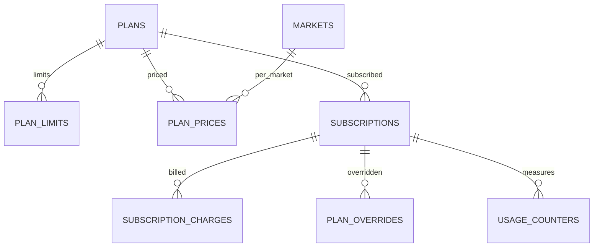

Part of the [data model](/en/docs/erd); conventions and base columns are documented there.

**plans** (Base +) [FR-SUB-01](/en/docs/srs/requirements/sub#fr-sub-01--plan-catalog): `role_scope_id FK lookups (plan_role: organization, driver, photographer, traveler)`, `code VARCHAR(40)` (starter, growth, enterprise, basic, professional, premium, studio, pro, free, explorer, vip), `name JSONB`, `tier_rank SMALLINT`, `trial_days SMALLINT NULL` ([OD-28](/en/docs/brd/compliance#11-open-decisions)), `is_default_on_approval BOOLEAN`, `is_active BOOLEAN`.

**plan_limits** (Base +): `plan_id FK`, `limit_key VARCHAR(60)` (for example `active_trips_per_month`, `employees`, `vehicles_per_trip`, `programs_per_trip`, `coupons_active`, `bookings_per_month`, `portfolio_images`, `albums_per_trip`), `limit_value INT NULL` (null means unlimited), `feature_key VARCHAR(60) NULL` (for example `platform_suppliers`, `seat_self_select`, `child_tracking`, `watermark`, `album_privacy_link`, `album_privacy_selected`, `analytics_level`, `export`), `feature_value VARCHAR(40) NULL`.

**plan_prices** (Base +): `plan_id FK`, `market_id FK`, `interval_id FK lookups (billing_interval: monthly, annual)`, `amount_minor BIGINT` ([OD-26](/en/docs/brd/compliance#11-open-decisions)), `currency_code`, `gateway_price_ref VARCHAR(120)`, `valid_from DATE`.

## subscriptions
*(Base +) [FR-SUB-02](/en/docs/srs/requirements/sub#fr-sub-02--feature-gates) to [FR-SUB-07](/en/docs/srs/requirements/sub#fr-sub-07--trials)*

| Column | Type | Notes |
|---|---|---|
| owner_type_id | BIGINT FK lookups | `subscription_owner`: organization, user |
| organization_id | BIGINT FK NULL | |
| user_id | BIGINT FK NULL | |
| plan_id | BIGINT FK plans | |
| plan_price_id | BIGINT FK plan_prices NULL | Null for Free |
| status_id | BIGINT FK lookups | `subscription_status`: trial, active, grace, downgraded, cancelling, ended |
| current_period_start, current_period_end | TIMESTAMPTZ | |
| trial_ends_at | TIMESTAMPTZ | |
| grace_started_at | TIMESTAMPTZ | 7 days ([BRL-14](/en/docs/brd/requirements#7-business-rules)) |
| scheduled_plan_id | BIGINT FK plans NULL | Downgrade at period end |
| cancel_at_period_end | BOOLEAN | |
| gateway_subscription_ref | VARCHAR(120) | |

**subscription_charges** (Base +): `subscription_id FK`, `period_start`, `period_end`, `amount_minor`, `proration_minor`, `currency_code`, `status_id FK lookups (charge_status: due, paid, failed, void)`, `attempt_no SMALLINT` (retries days 1, 3, 5, 7, D-09), `next_retry_at`.

**plan_overrides** (Base +) D-227: `subscription_id FK`, `override_plan_id FK plans`, `reason TEXT`, `starts_at`, `ends_at` (required), `requested_by FK users`, `approved_by FK users` (second admin, must differ), `reverted_at`.

**usage_counters** (Base +): `subscription_id FK`, `limit_key VARCHAR(60)`, `period_start DATE`, `used INT`. Unique `(subscription_id, limit_key, period_start)`. Reset at 00:00 on the 1st in the owner's time zone (D-218).
