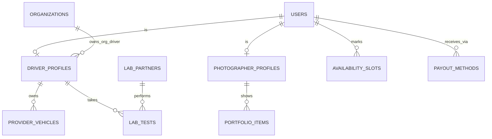

Part of the [data model](/en/docs/erd); conventions and base columns are documented there.

## driver_profiles
*(Base +)*

| Column | Type | Notes |
|---|---|---|
| user_id | BIGINT FK users | Unique per track |
| track_id | BIGINT FK lookups | `supplier_track`: platform, organization |
| organization_id | BIGINT FK organizations NULL | Set for organization-owned drivers ([BRL-05](/en/docs/brd/requirements#7-business-rules)) |
| license_no_enc | BYTEA | enc |
| license_valid_until | DATE | |
| service_regions | TEXT[] | |
| subscription_id | BIGINT FK subscriptions NULL | Platform drivers only |
| lab_status_id | BIGINT FK lookups | `driver_lab_status`: clear, paused, suspended |
| suspended_since | TIMESTAMPTZ | Close after 30 days ([BRL-16](/en/docs/brd/requirements#7-business-rules)) |
| visibility_id | BIGINT FK lookups | `profile_visibility`: standard, featured, top |
| verified_badge | BOOLEAN | Plan-driven |

**photographer_profiles** (Base +): `user_id FK`, `track_id FK lookups (supplier_track)`, `organization_id NULL`, `bio JSONB`, `equipment TEXT`, `service_regions TEXT[]`, `rates JSONB` (per currency), `subscription_id FK NULL`, `visibility_id FK lookups`, `verified_badge BOOLEAN`, `watermark_settings JSONB`.

**provider_vehicles** (Base +) [FR-ONB-07](/en/docs/srs/requirements/onb#fr-onb-07--driver-vehicle-and-insurance-details): `driver_profile_id FK`, `plate_no VARCHAR(20)`, `model VARCHAR(80)`, `year SMALLINT`, `seat_count SMALLINT`, `registration_valid_until DATE`, `insurance_valid_until DATE` (at least 3 months at submission).

**availability_slots** (Base +) D-89: `user_id FK`, `starts_on DATE`, `ends_on DATE`, `kind_id FK lookups (availability_kind: available, unavailable)`. Dates and ranges only.

**portfolio_items** (Base +): `photographer_profile_id FK`, `storage_path TEXT`, `width INT`, `height INT`, `sort_by INT`. Count per plan ([FR-PHO-01](/en/docs/srs/requirements/pho#fr-pho-01--portfolio)); minimum 8 at application.

**lab_partners** (Base +): `market_id FK`, `name JSONB`, `address JSONB`, `api_settings_enc BYTEA`, `is_active BOOLEAN`.

## lab_tests
*(Base +) [FR-DRV-03](/en/docs/srs/requirements/drv#fr-drv-03--lab-test-pause) to [FR-DRV-06](/en/docs/srs/requirements/drv#fr-drv-06--missed-deadline-suspension)*

| Column | Type | Notes |
|---|---|---|
| driver_profile_id | BIGINT FK driver_profiles | |
| lab_partner_id | BIGINT FK lab_partners NULL | |
| test_type_id | BIGINT FK lookups | `lab_test_type`: drug_screen, medical_fitness, both |
| status_id | BIGINT FK lookups | `lab_test_status`: requested, pending, result_uploaded, passed, failed, missed |
| requested_by | BIGINT FK users | Admin |
| requested_at | TIMESTAMPTZ | |
| deadline_at | TIMESTAMPTZ | 3 days default, 1 to 7 (D-21) |
| booked_slot_at | TIMESTAMPTZ | |
| result_path | TEXT | Restricted bucket |
| result_source_id | BIGINT FK lookups | `lab_result_source`: partner, driver_upload |
| decided_by, decided_at | BIGINT, TIMESTAMPTZ | Admin decision |
| is_initial | BOOLEAN | Application lab result |

**payout_methods** (Base +): `user_id FK`, `organization_id NULL`, `method_id FK lookups (payout_method: stripe_connect, bank_transfer, local_provider)`, `details_enc BYTEA`, `external_account_id VARCHAR(100)`, `currency_code`, `is_default BOOLEAN`, `verified_at`.
