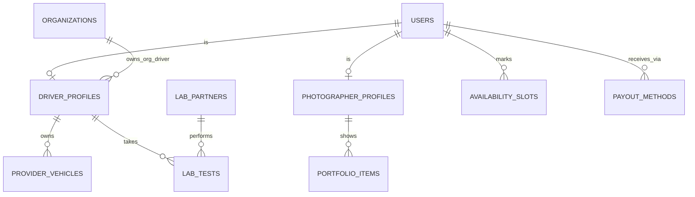

Part of the [data model](/en/docs/erd); conventions and base columns are documented there.

## driver_profiles
*(Base +) — one driver identity per user per track; lab status and subscription gate what the driver may do.*

<TypeTable
  type={{
    "user_id": {
      type: "BIGINT FK users",
      description: "Unique per track",
      required: true,
    },
    "track_id": {
      type: "BIGINT FK lookups",
      description: "`supplier_track`: platform, organization",
      required: true,
    },
    "organization_id": {
      type: "BIGINT FK organizations NULL",
      description: "Set for organization-owned drivers ([BRL-05](/en/docs/brd/requirements#7-business-rules))",
      required: true,
    },
    "license_no_enc": {
      type: "BYTEA",
      description: "enc",
      required: true,
    },
    "license_valid_until": {
      type: "DATE",
      required: true
    },
    "service_regions": {
      type: "TEXT[]",
      required: true
    },
    "subscription_id": {
      type: "BIGINT FK subscriptions NULL",
      description: "Platform drivers only",
      required: true,
    },
    "lab_status_id": {
      type: "BIGINT FK lookups",
      description: "`driver_lab_status`: clear, paused, suspended",
      required: true,
    },
    "suspended_since": {
      type: "TIMESTAMPTZ",
      description: "Close after 30 days ([BRL-16](/en/docs/brd/requirements#7-business-rules))",
      required: true,
    },
    "visibility_id": {
      type: "BIGINT FK lookups",
      description: "`profile_visibility`: standard, featured, top",
      required: true,
    },
    "verified_badge": {
      type: "BOOLEAN",
      description: "Plan-driven",
      required: true,
    },
  }}
/>

Indexes: `unique (user_id, track_id, deleted_at)`, `(organization_id, lab_status_id)` for staffing searches, `(visibility_id)`.

**photographer_profiles** (Base +) — one photographer identity per user per track, with portfolio-facing settings: `user_id FK`, `track_id FK lookups (supplier_track)`, `organization_id NULL`, `bio JSONB`, `equipment TEXT`, `service_regions TEXT[]`, `rates JSONB` (per currency), `subscription_id FK NULL`, `visibility_id FK lookups`, `verified_badge BOOLEAN`, `watermark_settings JSONB`. Indexes: `unique (user_id, track_id, deleted_at)`, `(organization_id)`, `(visibility_id)`.

**provider_vehicles** (Base +) — a driver's own vehicles offered on deals, with registration and insurance validity [FR-ONB-07](/en/docs/srs/requirements/onb#fr-onb-07--driver-vehicle-and-insurance-details): `driver_profile_id FK`, `plate_no VARCHAR(20)`, `model VARCHAR(80)`, `year SMALLINT`, `seat_count SMALLINT`, `registration_valid_until DATE`, `insurance_valid_until DATE` (at least 3 months at submission). Indexes: `(driver_profile_id)`, `(registration_valid_until)`, `(insurance_valid_until)` for the expiry sweep.

**availability_slots** (Base +) — date ranges a supplier marks available or blocked (D-89): `user_id FK`, `starts_on DATE`, `ends_on DATE`, `kind_id FK lookups (availability_kind: available, unavailable)`. Dates and ranges only. Indexes: `(user_id, starts_on, ends_on)` for overlap lookups.

**portfolio_items** (Base +) — a photographer's showcase images, capped per plan: `photographer_profile_id FK`, `storage_path TEXT`, `width INT`, `height INT`, `sort_by INT`. Count per plan ([FR-PHO-01](/en/docs/srs/requirements/pho#fr-pho-01--portfolio)); minimum 8 at application. Indexes: `(photographer_profile_id, sort_by)`.

**lab_partners** (Base +) — clinics that perform or receive driver lab tests in a market: `market_id FK`, `name JSONB`, `address JSONB`, `api_settings_enc BYTEA`, `is_active BOOLEAN`. Indexes: `(market_id, is_active)`.

## lab_tests
*(Base +) — one lab-test cycle per driver, driving the pause and suspension rules. [FR-DRV-03](/en/docs/srs/requirements/drv#fr-drv-03--lab-test-pause) to [FR-DRV-06](/en/docs/srs/requirements/drv#fr-drv-06--missed-deadline-suspension)*

<TypeTable
  type={{
    "driver_profile_id": {
      type: "BIGINT FK driver_profiles",
      required: true
    },
    "lab_partner_id": {
      type: "BIGINT FK lab_partners NULL",
      required: true
    },
    "test_type_id": {
      type: "BIGINT FK lookups",
      description: "`lab_test_type`: drug_screen, medical_fitness, both",
      required: true,
    },
    "status_id": {
      type: "BIGINT FK lookups",
      description: "`lab_test_status`: requested, pending, result_uploaded, passed, failed, missed",
      required: true,
    },
    "requested_by": {
      type: "BIGINT FK users",
      description: "Admin",
      required: true,
    },
    "requested_at": {
      type: "TIMESTAMPTZ",
      required: true
    },
    "deadline_at": {
      type: "TIMESTAMPTZ",
      description: "3 days default, 1 to 7 (D-21)",
      required: true,
    },
    "booked_slot_at": {
      type: "TIMESTAMPTZ",
      required: true
    },
    "result_path": {
      type: "TEXT",
      description: "Restricted bucket",
      required: true,
    },
    "result_source_id": {
      type: "BIGINT FK lookups",
      description: "`lab_result_source`: partner, driver_upload",
      required: true,
    },
    "decided_by, decided_at": {
      type: "BIGINT, TIMESTAMPTZ",
      description: "Admin decision",
      required: true,
    },
    "is_initial": {
      type: "BOOLEAN",
      description: "Application lab result",
      required: true,
    },
  }}
/>

Indexes: `(driver_profile_id, status_id)`, `(lab_partner_id)`, partial `(deadline_at)` where `status_id` in `requested` or `pending` — the missed-deadline sweep.

**payout_methods** (Base +) — where a supplier's earnings are sent, one default per user: `user_id FK`, `organization_id NULL`, `method_id FK lookups (payout_method: stripe_connect, bank_transfer, local_provider)`, `details_enc BYTEA`, `external_account_id VARCHAR(100)`, `currency_code`, `is_default BOOLEAN`, `verified_at`. Indexes: `(user_id)`, `(organization_id)`, partial `unique (user_id)` where `is_default`.
