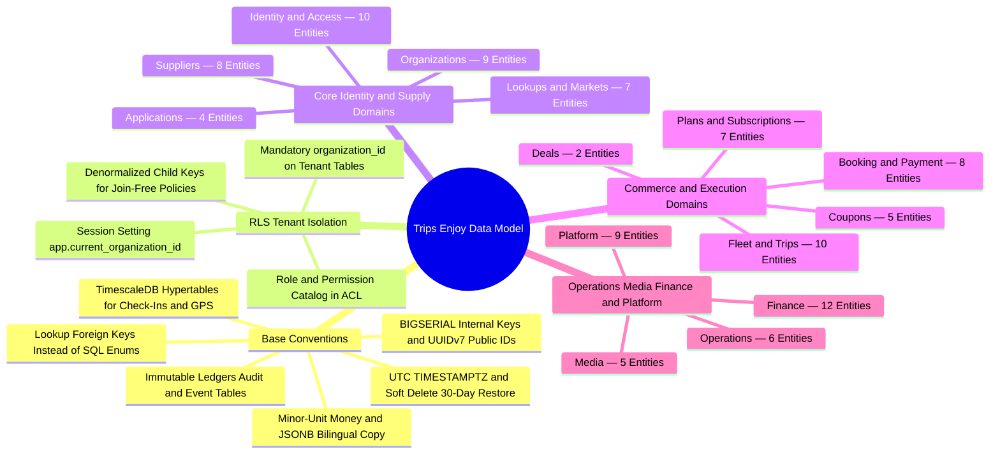
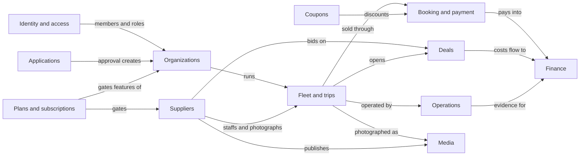

# Trips Enjoy: Entity-Relationship Design (ERD)

<TraceBar
  brd={[
    { label: 'BRD Rules', href: '/en/docs/brd/requirements#7-business-rules', detail: '[BRL-01](/en/docs/brd/requirements#7-business-rules) · [BRL-15](/en/docs/brd/requirements#7-business-rules) · [BRL-18](/en/docs/brd/requirements#7-business-rules)' },
  ]}
  srs={[
    { label: 'Data Rules §6', href: '/en/docs/srs/data', detail: '[DAT-01](/en/docs/srs/data#62-data-isolation)..15' },
    { label: 'Security & Data NFRs', href: '/en/docs/srs/quality#82-security-nfr-sec', detail: '[NFR-SEC-07](/en/docs/srs/quality#82-security-nfr-sec)' },
  ]}
  erd={[
    { label: 'Access Control & RLS', href: '/en/docs/erd/acl' },
    { label: 'Lookup Catalog', href: '/en/docs/erd/reference' },
  ]}
  plan={[
    { label: 'Delivery Plan', href: '/en/docs/plan', detail: '231 tasks · table-traced' },
  ]}
  workflows={[
    { label: 'System Workflows', href: '/en/docs/workflows' },
    { label: 'Money & Ledger', href: '/en/docs/workflows/money' },
  ]}
  userFlows={[
    { label: 'User Flows', href: '/en/docs/user-flows', detail: '106 UF-*' },
  ]}
  architecture={[
    { label: 'Data Architecture', href: '/en/docs/architecture#data-architecture' },
  ]}
  design={[
    { label: 'Design System', href: '/en/docs/design' },
  ]}
  system={[
    { label: 'End-to-End System', href: '/en/docs/system' },
    { label: 'Mindmap Atlas', href: '/en/docs/system/mindmaps' },
  ]}
  recommendations={[
    { label: 'RLS & TimescaleDB', href: '/en/docs/recommendations/architecture-and-ops#rec-data-02', detail: 'REC-DATA-02' },
    { label: 'Ledger Invariants', href: '/en/docs/recommendations/architecture-and-ops#rec-fin-10', detail: 'REC-FIN-10' },
  ]}
/>

<MindmapBlock
  title="Data Model Spine — 14 Domains, Base Conventions & RLS Isolation"
  caption="How Trips Enjoy models multi-tenant marketplace state in PostgreSQL 16 and TimescaleDB across 14 domains, immutable financial and event ledgers, UUIDv7 external keys, and strict row-level security."
  trace={{
    erd: [
      { label: 'Identity & Access', href: '/en/docs/erd/domains/identity-and-access' },
      { label: 'Organizations', href: '/en/docs/erd/domains/organizations' },
      { label: 'Fleet & Trips', href: '/en/docs/erd/domains/fleet-and-trips' },
      { label: 'Booking & Payment', href: '/en/docs/erd/domains/booking-and-payment' },
      { label: 'Operations', href: '/en/docs/erd/domains/operations' },
      { label: 'Finance', href: '/en/docs/erd/domains/finance' },
      { label: 'Platform', href: '/en/docs/erd/domains/platform' },
      { label: 'ACL & RLS', href: '/en/docs/erd/acl' },
    ],
    srs: [
      { label: '[DAT-01](/en/docs/srs/data#62-data-isolation)..15', href: '/en/docs/srs/data' },
    ],
    recommendations: [
      { label: 'REC-DATA-02', href: '/en/docs/recommendations/architecture-and-ops#rec-data-02' },
    ],
  }}
>

</MindmapBlock>

These apply to every table unless the table says otherwise.

| Rule | Detail |
|---|---|
| Primary key | `id BIGSERIAL` (internal only, never exposed to end users; see ID policy below). |
| Public identifier | `uuid UUID NOT NULL UNIQUE`, generated by the application as UUIDv7 (time-ordered). APIs, URLs, webhooks and exports use `uuid` only; `id` never leaves the backend (SRS [DAT-10](/en/docs/srs/data#62-data-isolation)). |
| Timestamps | `created_at`, `updated_at`, `deleted_at` as `TIMESTAMPTZ`. All times are stored in UTC. |
| Soft delete | Soft-deletable rows carry `deleted_at TIMESTAMPTZ NULL` plus `deleted_by BIGINT NULL` FK `users.id`; there is no boolean flag. A row is deleted when `deleted_at` is not null (SRS [DAT-11](/en/docs/srs/data#63-soft-delete-immutability-and-deletion)). |
| Restore window | Soft-deleted rows are restorable for 30 days, aligned with the account deletion grace ([BRL-15](/en/docs/brd/requirements#7-business-rules)). Restore clears `deleted_at` and `deleted_by`; after the window the row stays hidden and is removed by the retention purge (SRS section 6.4). |
| Uniqueness under soft delete | Unique constraints are partial unique indexes over live rows: `unique (cols) where deleted_at is null`. Where a deleted row's value must stay distinct, a companion `unique (cols, deleted_at) where deleted_at is not null` index applies the `deleted_at` tiebreak (SRS [DAT-15](/en/docs/srs/data#63-soft-delete-immutability-and-deletion)). |
| Audit columns | `created_by`, `updated_by`, `deleted_by` as `BIGINT` FKs to `users.id`. |
| No enum types | Every status, type and category is a `BIGINT` FK to `lookups.id` (named `*_id`, for example `status_id`). The lookup type is named in the column notes. |
| Tenant column | Every row owned by an organization carries `organization_id BIGINT NOT NULL`, indexed, with an RLS policy on `app.current_organization_id` (SRS [DAT-01](/en/docs/srs/data#62-data-isolation), [NFR-SEC-07](/en/docs/srs/quality#82-security-nfr-sec)). Child tables repeat `organization_id` (denormalized) so RLS never needs a join. |
| Money | `*_minor BIGINT` in minor units plus `currency_code CHAR(3)` FK `currencies.code`. Never a float, never a bare number (D-157). |
| Translatable text | `JSONB` shaped `{"en": "...", "ar": "..."}` for names and descriptions shown to users. |
| Country | `country_code CHAR(2)` FK `countries.code` (ISO 3166-1 alpha-2). |
| Immutable tables | `ledger_entries`, `ledger_transactions`, `audit_logs`, `deal_offers`, `checkin_events`, `tracking_points`, `consents`, `outbox_events`: insert only. They keep `created_at` and `created_by` but have no `updated_*` or `deleted_*` columns (SRS [DAT-13](/en/docs/srs/data#63-soft-delete-immutability-and-deletion)). Corrections are new reversing rows (SRS [DAT-08](/en/docs/srs/data#63-soft-delete-immutability-and-deletion)). |
| Time-series | `checkin_events` and `tracking_points` are TimescaleDB hypertables partitioned on `occurred_at`; primary key `(id, occurred_at)`. |
| Encrypted columns | Columns marked "enc" are encrypted at column level with KMS (SRS [DAT-05](/en/docs/srs/data#62-data-isolation)). A `*_hash` column next to them supports lookups. |
| Indexes | Every `*_id` foreign-key column is indexed (single-column b-tree) even where not repeated below. The per-table "Indexes" lines list composites, partial and unique indexes beyond that rule. Partial indexes are written `partial (cols) where condition`. Every soft-deletable table keeps a partial `where deleted_at is null` variant of each hot-query index (SRS [DAT-14](/en/docs/srs/data#63-soft-delete-immutability-and-deletion)). |

Base columns are not repeated in the tables below. "Base" means: `id`, `uuid`, `created_at`, `updated_at`, `deleted_at`, `created_by`, `updated_by`, `deleted_by`.
| Domain | Tables | Section |
|---|---|---|
| Lookups and markets | lookup_types, lookups, countries, currencies, markets, market_payment_methods, tax_rates | 3.1 |
| Identity and access | users, user_roles, auth_factors, passkey_credentials, otp_challenges, sessions, devices, consents, notification_preferences, privacy_requests | 3.2 |
| Applications | applications, application_documents, application_decisions, appeals | 3.3 |
| Organizations | organizations, organization_members, permissions, member_permissions, invitations, crm_connections, webhook_endpoints, webhook_deliveries, api_keys | 3.4 |
| Suppliers | driver_profiles, photographer_profiles, provider_vehicles, availability_slots, portfolio_items, lab_partners, lab_tests, payout_methods | 3.5 |
| Fleet and trips | vehicle_types, vehicle_type_seats, vehicles, trips, trip_stops, trip_audiences, trip_vehicles, trip_staff_assignments, programs, program_tiers | 3.6 |
| Deals | deals, deal_offers | 3.7 |
| Booking and payment | bookings, booking_passengers, booking_programs, trip_seats, payments, payment_attempts, refunds, booking_remedies | 3.8 |
| Coupons | coupons, coupon_programs, coupon_audiences, coupon_redemptions, abuse_flags | 3.9 |
| Plans | plans, plan_limits, plan_prices, subscriptions, subscription_charges, plan_overrides, usage_counters | 3.10 |
| Operations | checkin_events, incidents, trip_reports, tracking_points, child_links, safety_cases | 3.11 |
| Media | albums, photos, album_shared_links, album_members, download_logs | 3.12 |
| Finance | ledger_accounts, ledger_transactions, ledger_entries, invoices, invoice_lines, payout_runs, payouts, settlements, settlement_lines, reconciliation_exceptions, disputes, dispute_files | 3.13 |
| Platform | notifications, notification_deliveries, notification_templates, feature_flags, analytics_events, analytics_daily, audit_logs, outbox_events, idempotency_keys | 3.14 |

Read [Access control (ACL)](/en/docs/erd/acl) for the permission catalog, role model and row-level-security policy definitions. Every table's read and write path is governed there.

## ID policy

Every table has `id BIGSERIAL` as its internal primary key and the target of every foreign key. `id` may appear in admin tooling, logs and support screens but never in public APIs, URLs, webhooks or exports — those address rows by `uuid` (SRS [DAT-10](/en/docs/srs/data#62-data-isolation)). `uuid` is UUIDv7, so externally visible identifiers sort by creation time and UUIDv7 prefixes keep the index inserts locality-friendly.

Which identifiers a table class carries:

| Table class | Identifiers | Examples |
|---|---|---|
| Business rows (ledger, audit, events) | `id BIGSERIAL` internal plus `uuid UUIDv7` public | bookings, ledger_entries, audit_logs, analytics_events |
| Lookups and reference rows | `id BIGINT` plus stable `code` (`countries`, `currencies` key on `code` alone); no `uuid` — `code` is the public name | lookup_types, lookups, countries, currencies |
| Connector and ephemeral rows | `id BIGSERIAL` only; the row never crosses an API payload or URL | outbox_events, idempotency_keys |

Foreign keys always reference `id`; `code` is a naming and seed-matching key, never a join target between business tables.

## Domain relation map

How the domains depend on each other. Lookups and markets underpin every domain and are omitted; Platform (notifications, audit, outbox) is written by all domains.

## Domains

<Cards>
  <Card title="Lookups and markets" description="7 entities" href="/en/docs/erd/domains/lookups-and-markets" />
  <Card title="Identity and access" description="9 entities" href="/en/docs/erd/domains/identity-and-access" />
  <Card title="Applications" description="4 entities" href="/en/docs/erd/domains/applications" />
  <Card title="Organizations" description="9 entities" href="/en/docs/erd/domains/organizations" />
  <Card title="Suppliers" description="8 entities" href="/en/docs/erd/domains/suppliers" />
  <Card title="Fleet and trips" description="10 entities" href="/en/docs/erd/domains/fleet-and-trips" />
  <Card title="Deals" description="2 entities" href="/en/docs/erd/domains/deals" />
  <Card title="Booking and payment" description="8 entities" href="/en/docs/erd/domains/booking-and-payment" />
  <Card title="Coupons" description="5 entities" href="/en/docs/erd/domains/coupons" />
  <Card title="Plans and subscriptions" description="7 entities" href="/en/docs/erd/domains/plans-and-subscriptions" />
  <Card title="Operations" description="6 entities" href="/en/docs/erd/domains/operations" />
  <Card title="Media" description="5 entities" href="/en/docs/erd/domains/media" />
  <Card title="Finance" description="12 entities" href="/en/docs/erd/domains/finance" />
  <Card title="Platform" description="9 entities" href="/en/docs/erd/domains/platform" />
</Cards>
