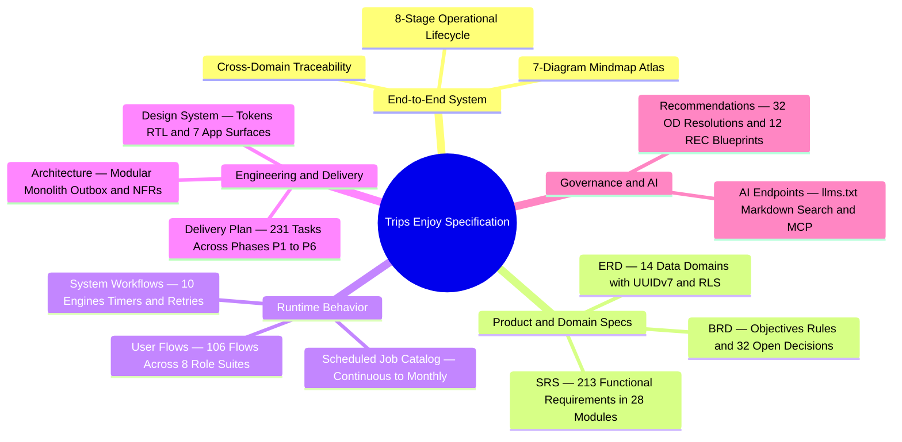

Trips Enjoy is a bilingual, multi-role organized-trips marketplace: travelers book seats on organized trips, organizations publish and operate them, and drivers, photographers and moderators deliver the experience on the ground. This is the complete product and engineering documentation set — **213** functional requirements across **28** modules, **14** data domains, **106** role flows, **10** system workflows, **231** delivery tasks (**213** functional + **18** platform), and **32** tracked `OD-*` decisions with concrete recommended resolutions.

All pages exist in Arabic and English interfaces; this documentation is written in English. New readers can start with the [End-to-End System](/en/docs/system) and the visual [Mindmap Atlas](/en/docs/system/mindmaps) to see how every pillar connects before diving into individual specifications.

<MindmapBlock
  title="Trips Enjoy Documentation Set — Complete Pillar Map"
  caption="How business goals, functional specifications, database tables, user flows, background workflows, phase tasks, architecture, UI tokens, and decision resolutions connect into one traceable blueprint."
  trace={{
    system: [
      { label: 'End-to-End System', href: '/en/docs/system', detail: '8 stages' },
      { label: 'Lifecycle Journey', href: '/en/docs/system/lifecycle', detail: 'STAGE-01..08' },
      { label: 'Mindmap Atlas', href: '/en/docs/system/mindmaps', detail: '7 maps' },
    ],
    brd: [
      { label: 'Business Spec', href: '/en/docs/brd' },
      { label: 'Requirements & Rules', href: '/en/docs/brd/requirements', detail: 'BRL-01..30' },
      { label: 'Open Decisions', href: '/en/docs/brd/compliance#11-open-decisions', detail: '32 OD-*' },
    ],
    srs: [
      { label: 'Software Spec', href: '/en/docs/srs', detail: '213 FRs · 28 modules' },
      { label: 'State Machines', href: '/en/docs/srs/state-machines', detail: '10 machines' },
      { label: 'Quality & NFRs', href: '/en/docs/srs/quality' },
    ],
    erd: [
      { label: 'Data Model', href: '/en/docs/erd', detail: '14 domains' },
      { label: 'ACL & RLS', href: '/en/docs/erd/acl' },
    ],
    userFlows: [
      { label: 'Role Flows', href: '/en/docs/user-flows', detail: '106 UF-*' },
    ],
    workflows: [
      { label: 'System Workflows', href: '/en/docs/workflows', detail: '10 workflows' },
      { label: 'Scheduled Jobs', href: '/en/docs/workflows/scheduled-jobs' },
    ],
    plan: [
      { label: 'Delivery Plan', href: '/en/docs/plan', detail: '231 tasks · P1–P6' },
      { label: 'Milestones', href: '/en/docs/plan/milestones' },
    ],
    architecture: [
      { label: 'Platform Architecture', href: '/en/docs/architecture' },
    ],
    design: [
      { label: 'Design System', href: '/en/docs/design', detail: 'RTL & WCAG AA' },
    ],
    recommendations: [
      { label: 'Recommendations Hub', href: '/en/docs/recommendations' },
      { label: 'Decision Resolutions', href: '/en/docs/recommendations/open-decisions', detail: '32 OD + 15 OPEN' },
      { label: 'Architecture & Ops', href: '/en/docs/recommendations/architecture-and-ops', detail: '12 REC-*' },
    ],
  }}
>

</MindmapBlock>

<Cards>
  <Card title="End-to-End System" description="Unified 8-stage operational lifecycle from onboarding to settlement, plus the visual Mindmap Atlas (/en/docs/system/mindmaps)." icon="Layers" href="/en/docs/system" />
  <Card title="Business (BRD)" description="Objectives, scope, stakeholders, commercial model, 30 business rules, risks and 32 tracked OD-* decisions." icon="Briefcase" href="/en/docs/brd" />
  <Card title="Software (SRS)" description="213 functional requirements across 28 modules, data requirements, 10 state machines and quality NFRs." icon="ClipboardList" href="/en/docs/srs" />
  <Card title="Data Model (ERD)" description="14 domains of PostgreSQL and TimescaleDB tables, lookup catalog and row-level security (RLS) paths." icon="Database" href="/en/docs/erd" />
  <Card title="User Flows" description="106 role flows across 8 suites: registration, approval, booking, live operations, passkeys and shared behaviors." icon="Route" href="/en/docs/user-flows" />
  <Card title="System Workflows" description="10 system workflows — state machines, timers, backoff retries and every scheduled job, with stories and diagrams." icon="Cog" href="/en/docs/workflows" />
  <Card title="Delivery Plan" description="Six phases (P1–P6) — 231 delivery tasks (213 functional + 18 platform), each with rich task cards, acceptance checks, milestones and gates." icon="ListTodo" href="/en/docs/plan" />
  <Card title="Architecture" description="System context, modular monolith service model, data architecture, integrations, deployment topology and quality attributes." icon="Network" href="/en/docs/architecture" />
  <Card title="Design System" description="Semantic design tokens, shared component kit, Arabic-first RTL and Western numeral rules, and WCAG 2.1 AA commitments." icon="Palette" href="/en/docs/design" />
  <Card title="Recommendations & Resolutions" description="Concrete recommended resolutions for all 32 OD-* decisions and 15 inline [OPEN] markers, plus 12 architecture and ops blueprints." icon="Lightbulb" href="/en/docs/recommendations" />
  <Card title="For AI Agents" description="llms.txt, llms-full.txt, per-page Markdown, search API and an MCP server for AI clients." icon="Bot" href="/en/docs/ai" />
</Cards>

## How to read the set

- Start with the [End-to-End System](/en/docs/system) and the [Mindmap Atlas](/en/docs/system/mindmaps) for a visual mental model of all 9 roles, 28 modules, 14 data domains, 10 workflows, and 6 delivery phases.
- Every artifact cites its peers by stable ID: `BR-*` (business), `BRL-*` (rules), `FR-*` (213 functional requirements), `D-*` (decided values), `OD-*` (32 tracked decisions), `UF-*` (106 role flows), `T-*` (231 phase delivery tasks), and `REC-*` (12 engineering & operational blueprints).
- Every SRS requirement lists its MoSCoW priority and upstream BRD IDs, and maps deterministically to a `<TaskCard />` in the [Delivery Plan](/en/docs/plan).
- Items marked `[OPEN]` or *(placeholder)* follow the open-decision process in the [BRD](/en/docs/brd/compliance#11-open-decisions) and carry concrete, MENA-benchmarked recommended resolutions in [Recommendations & Resolutions](/en/docs/recommendations/open-decisions).
