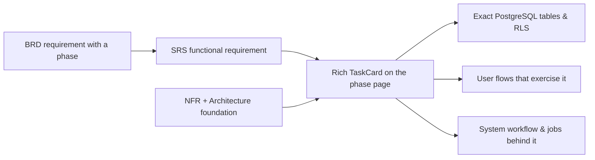
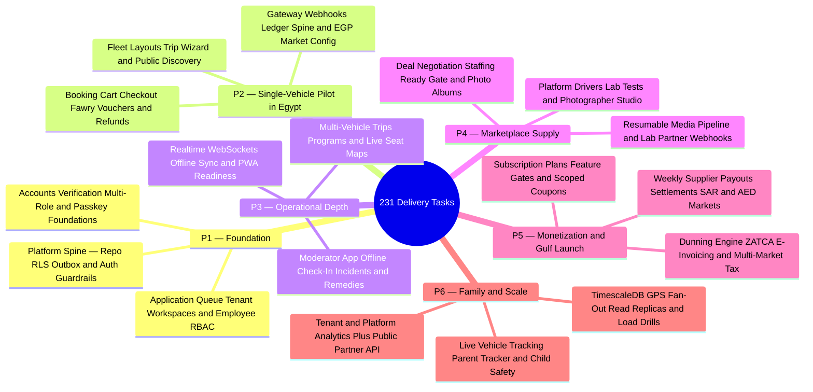

This is the end-to-end delivery view of the whole system: six phases (`P1`–`P6`) from foundation to scale totaling **231 tasks** (**213 functional tasks** generated 1-to-1 from the SRS functional requirements plus **18 cross-cutting platform foundation tasks** `T-P1-PLAT-1` through `T-P6-PLAT-3`). Nothing here is maintained by hand: the phase pages and milestones are produced deterministically by `bun scripts/generate-plan.ts` (and `bun scripts/generate-plan-ar.ts` for Arabic) from the living documentation, so the plan can never drift from the requirements.

<TraceBar
  brd={[
    { label: 'Delivery Phases §3.3', href: '/en/docs/brd#33-delivery-phases' },
    { label: 'Business Rules §7', href: '/en/docs/brd/requirements#7-business-rules', detail: 'BRL-01..30' },
    { label: 'Open Decisions §11', href: '/en/docs/brd/compliance#11-open-decisions', detail: '32 OD-*' },
  ]}
  srs={[
    { label: 'SRS Overview', href: '/en/docs/srs', detail: '213 FRs · 28 modules' },
    { label: 'Traceability Matrix', href: '/en/docs/srs/traceability' },
  ]}
  erd={[
    { label: 'Data Model', href: '/en/docs/erd', detail: '14 domains' },
    { label: 'ACL & RLS', href: '/en/docs/erd/acl' },
  ]}
  plan={[
    { label: 'Build Guide', href: '/en/docs/plan/build-guide' },
    { label: 'Milestones', href: '/en/docs/plan/milestones' },
    { label: 'Test Strategy', href: '/en/docs/plan/testing' },
  ]}
  workflows={[
    { label: 'System Workflows', href: '/en/docs/workflows' },
    { label: 'Coverage Matrix', href: '/en/docs/workflows/coverage', detail: '213/213 FRs' },
  ]}
  userFlows={[
    { label: '106 Role Flows', href: '/en/docs/user-flows' },
  ]}
  architecture={[
    { label: 'Platform Architecture', href: '/en/docs/architecture' },
  ]}
  design={[
    { label: 'Design System', href: '/en/docs/design' },
  ]}
  system={[
    { label: 'End-to-End Lifecycle', href: '/en/docs/system/lifecycle' },
    { label: 'Mindmap Atlas', href: '/en/docs/system/mindmaps' },
  ]}
  recommendations={[
    { label: 'Phase Decision Gates', href: '/en/docs/recommendations' },
    { label: 'Rollout & Chaos Gates', href: '/en/docs/recommendations/architecture-and-ops#rec-ops-12', detail: 'REC-OPS-12' },
  ]}
/>

## How it fits together

- Every **functional task** (`T-P{n}-{MOD}-{seq}`, **213** total) implements one [functional requirement](/en/docs/srs/requirements/auth) and inherits its MoSCoW priority (`Must`, `Should`, `Could`). Its phase comes from the requirement's business trace: `FR → BR → BRD phase`.
- Every **platform foundation task** (`T-P{n}-PLAT-{k}`, **18** total — 3 per phase) establishes the shared CI/CD, database/RLS, gateway, worker, observability, and load-testing spine required before or alongside that phase's functional epics.
- Every task renders as a self-contained **`<TaskCard />`** containing the full inline SRS `shall` specification, Given/When/Then acceptance criteria, concrete implementation deliverables, affected client surfaces, exact PostgreSQL/TimescaleDB tables touched, upstream `BR-*` / `BRL-*` / `OD-*` governance, and a color-coded **`<TraceBar />`** linking directly to `BRD`, `SRS`, `ERD`, `Plan`, `Workflows`, `User Flows`, `Architecture`, `Design`, and `Recommendations`.
- Tasks carry **no invented time estimates**. Size a phase by its task count (`231` across `P1`–`P6`) and priority mix (shown on each page and in [milestones](/en/docs/plan/milestones)); the definition of done, not a calendar date, closes a phase.

## How to build step by step

Work one phase at a time; the [build guide](/en/docs/plan/build-guide) holds the working loop and per-phase reading lists. For every phase, read the chain in this order before writing code:

1. **Business context (BRD)** — [requirements](/en/docs/brd/requirements) for the phase's business requirements and the [business rules](/en/docs/brd/requirements#7-business-rules) ([BRL-01](/en/docs/brd/requirements#7-business-rules) to [BRL-30](/en/docs/brd/requirements#7-business-rules)) that every task must respect.
2. **Requirements (SRS)** — each `<TaskCard />` embeds the requirement's verbatim `shall` statement and acceptance criteria inline and links via its `<TraceBar />` to the module page and [traceability matrix](/en/docs/srs/traceability).
3. **Data model (ERD)** — each `<TaskCard />` lists the exact PostgreSQL tables its feature reads and writes alongside links to the [data-model domains](/en/docs/erd), [lookup catalog](/en/docs/erd/reference), and [access control (RLS)](/en/docs/erd/acl).
4. **Behavior in motion** — follow the `User Flows` and `Workflows` pills in `<TraceBar />` to inspect the [user flows](/en/docs/user-flows) and [system workflows](/en/docs/workflows) that exercise the task: states, timers, retries and scheduled jobs.
5. **Build and verify** — implement the task's deliverables across the listed surfaces and tables, then verify every Given/When/Then criterion using the [test strategy](/en/docs/plan/testing).
6. **Gate the phase** — review the phase's open decisions and their recommended resolutions in [Recommendations & Resolutions](/en/docs/recommendations/open-decisions) **before** the phase starts, and check the [milestones ladder](/en/docs/plan/milestones) before calling the phase done.

## The phases

<MindmapBlock
  title="6-Phase Delivery Progression — P1 to P6 (231 Tasks)"
  caption="Sequential delivery ladder from multi-tenant identity foundation and the Egypt single-vehicle pilot to multi-vehicle check-ins, marketplace deals, Gulf monetization, and family live tracking."
  trace={{
    plan: [
      { label: 'P1 Foundation', href: '/en/docs/plan/p1' },
      { label: 'P2 Egypt Pilot', href: '/en/docs/plan/p2' },
      { label: 'P3 Operational Depth', href: '/en/docs/plan/p3' },
      { label: 'P4 Marketplace Supply', href: '/en/docs/plan/p4' },
      { label: 'P5 Monetization & Gulf', href: '/en/docs/plan/p5' },
      { label: 'P6 Family & Scale', href: '/en/docs/plan/p6' },
      { label: 'Milestones', href: '/en/docs/plan/milestones' },
      { label: 'Test Strategy', href: '/en/docs/plan/testing' },
    ],
    recommendations: [
      { label: 'Phase Decision Matrix', href: '/en/docs/recommendations' },
    ],
  }}
>

</MindmapBlock>

<Cards>
  <Card title="P1 — Foundation" description="Accounts, applications and approval, tenancy, plus 3 platform foundation tasks." icon="Milestone" href="/en/docs/plan/p1" />
  <Card title="P2 — Single-vehicle pilot" description="Trip creation, booking, EGP payments and ledger spine." icon="Milestone" href="/en/docs/plan/p2" />
  <Card title="P3 — Operational depth" description="Multi-vehicle, programs, live seat map, moderator app and offline check-in." icon="Milestone" href="/en/docs/plan/p3" />
  <Card title="P4 — Marketplace supply" description="Drivers, lab tests, photographers, deals and media albums." icon="Milestone" href="/en/docs/plan/p4" />
  <Card title="P5 — Monetization and Gulf" description="Plans, feature gates, coupons, settlements, SAR and AED markets." icon="Milestone" href="/en/docs/plan/p5" />
  <Card title="P6 — Family and scale" description="Live tracking, parent tracker, analytics and public API." icon="Milestone" href="/en/docs/plan/p6" />
  <Card title="Milestones" description="The 6-phase ladder with task counts, gates and decisions to close." icon="Flag" href="/en/docs/plan/milestones" />
  <Card title="Test Strategy" description="How inline acceptance criteria become the automated test pyramid." icon="FlaskConical" href="/en/docs/plan/testing" />
</Cards>

## Reading a phase page

Each phase page opens with its theme, **definition of done** (verbatim from BRD section 3.3), priority breakdown, a visual **phase scope mindmap**, and a compact quick-jump index table. Next come the 3 cross-cutting platform `<TaskCard />` blocks (`T-P{n}-PLAT-1..3`), followed by one epic section per SRS module containing full `<TaskCard />` and `<TraceBar />` entries, and finally **decisions to close** — the `OD-*` decisions cited by that phase's requirements, linked directly to their status in the BRD and their recommended resolutions in [Recommendations & Resolutions](/en/docs/recommendations/open-decisions).
