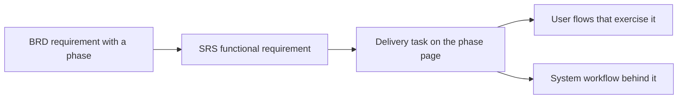

This is the end-to-end delivery view of the whole system: six phases from foundation to scale, every phase broken into tasks, and every task generated from — and linked to — one functional requirement. Nothing here is maintained by hand: the phase pages and milestones are produced by `bun scripts/generate-plan.ts` from the living documentation, so the plan can never drift from the requirements.

## How it fits together

- A **task** implements exactly one [functional requirement](/en/docs/srs/requirements/auth) and inherits its MoSCoW priority. Its phase comes from the requirement's business trace: FR → BR → the BRD's phase column.
- *Covered by* links the [user flows](/en/docs/user-flows) and [system workflows](/en/docs/workflows) that exercise the task — the same attribution as the [coverage page](/en/docs/workflows/coverage).
- Tasks carry **no invented estimates**. Size a phase by its task count and priority mix (shown on each page and in [milestones](/en/docs/plan/milestones)); the definition of done, not a date, closes a phase.

## The phases

<Cards>
  <Card title="P1 — Foundation" description="Accounts, applications and approval, tenancy." icon="Milestone" href="/en/docs/plan/p1" />
  <Card title="P2 — Single-vehicle pilot" description="Trip creation, booking, EGP payments." icon="Milestone" href="/en/docs/plan/p2" />
  <Card title="P3 — Operational depth" description="Multi-vehicle, programs, moderator app, check-in." icon="Milestone" href="/en/docs/plan/p3" />
  <Card title="P4 — Marketplace supply" description="Drivers, photographers, deals, media." icon="Milestone" href="/en/docs/plan/p4" />
  <Card title="P5 — Monetization and Gulf" description="Plans, gates, coupons, accounting, SAR and AED." icon="Milestone" href="/en/docs/plan/p5" />
  <Card title="P6 — Family and scale" description="Tracking, parents, analytics, public API." icon="Milestone" href="/en/docs/plan/p6" />
  <Card title="Milestones" description="The phase ladder with gates and decisions to close." icon="Flag" href="/en/docs/plan/milestones" />
  <Card title="Test Strategy" description="How acceptance criteria become the test pyramid." icon="FlaskConical" href="/en/docs/plan/testing" />
</Cards>

## Reading a phase page

Each phase page opens with its theme and **definition of done** (verbatim from BRD section 3.3), followed by the cross-cutting platform tasks, then one epic per module with its task table, and finally the **decisions to close** — the open decisions cited by that phase's requirements, which should be settled before the phase starts, not during it.
