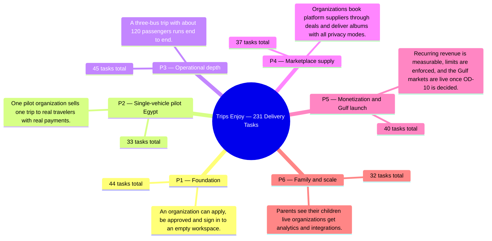

Each phase closes on its **definition of done** ([BRD section 3.3](/en/docs/brd#33-delivery-phases)) once every *Must* functional task and every *Platform Foundation* task passes verification against its acceptance criteria. Task counts (**231** total: **213** functional + **18** platform) come directly from the [generated phase pages](/en/docs/plan).

<MindmapBlock title="Six-Phase Milestone Ladder" caption="Progression from P1 Foundation through P6 Family and Scale, showing task volume and primary outcome per milestone." trace={{"brd":[{"label":"BRD §3.3 Phases","href":"/en/docs/brd#33-delivery-phases"}],"srs":[{"label":"SRS Traceability","href":"/en/docs/srs/traceability"}],"erd":[{"label":"Data Model","href":"/en/docs/erd"}],"plan":[{"label":"Plan Overview","href":"/en/docs/plan"},{"label":"Test Strategy","href":"/en/docs/plan/testing"}],"workflows":[{"label":"System Workflows","href":"/en/docs/workflows"}],"architecture":[{"label":"Architecture","href":"/en/docs/architecture"}],"design":[{"label":"Design System","href":"/en/docs/design"}],"system":[{"label":"End-to-End System","href":"/en/docs/system"}],"recommendations":[{"label":"Recommendations Hub","href":"/en/docs/recommendations"}]}}>

</MindmapBlock>

## The ladder

| Phase | Tasks (Functional M/S/C + Platform) | Definition of done | Decisions to close (Recommended Resolution) |
|---|---|---|---|
| [**P1** — Foundation](/en/docs/plan/p1) | **44** (41 FR: 41M / 0S / 0C + 3 PLAT) | An organization can apply, be approved and sign in to an empty workspace. | [OD-03](/en/docs/recommendations/open-decisions#od-03--mandatory-second-factor-for-organization-staff), [OD-12](/en/docs/recommendations/open-decisions#od-12--platform-admin-account-provisioning-and-mfa), [OD-21](/en/docs/recommendations/open-decisions#od-21--default-plan-tier-on-approval), [OD-23](/en/docs/recommendations/open-decisions#od-23--role-based-contact-verification-matrix) |
| [**P2** — Single-vehicle pilot (Egypt)](/en/docs/plan/p2) | **33** (30 FR: 29M / 1S / 0C + 3 PLAT) | One pilot organization sells one trip to real travelers with real payments. | [OD-07](/en/docs/recommendations/open-decisions#od-07--cancellation-refund-schedule-and-non-refundable-fees) |
| [**P3** — Operational depth](/en/docs/plan/p3) | **45** (42 FR: 39M / 3S / 0C + 3 PLAT) | A three-bus trip with about 120 passengers runs end to end. | [OD-25](/en/docs/recommendations/open-decisions#od-25--plan-gate-on-program-enrollment-reports) |
| [**P4** — Marketplace supply](/en/docs/plan/p4) | **37** (34 FR: 33M / 1S / 0C + 3 PLAT) | Organizations book platform suppliers through deals and deliver albums with all privacy modes. | [OD-13](/en/docs/recommendations/open-decisions#od-13--deal-negotiation-round-cap-and-72-hour-expiry), [OD-24](/en/docs/recommendations/open-decisions#od-24--driver-lab-test-completion-window) |
| [**P5** — Monetization and Gulf launch](/en/docs/plan/p5) | **40** (37 FR: 34M / 3S / 0C + 3 PLAT) | Recurring revenue is measurable, limits are enforced, and the Gulf markets are live once [OD-10](/en/docs/brd/compliance#11-open-decisions) is decided. | [OD-28](/en/docs/recommendations/open-decisions#od-28--free-trial-lengths-per-plan) |
| [**P6** — Family and scale](/en/docs/plan/p6) | **32** (29 FR: 19M / 6S / 4C + 3 PLAT) | Parents see their children live; organizations get analytics and integrations. | — |

## Reading the ladder

- **Phase gate rule:** A phase closes only when 100% of its *Must* functional tasks and all 3 *Platform Foundation* tasks pass automated and exploratory checks under the [Test Strategy](/en/docs/plan/testing); *Should* and *Could* tasks may trail into the following phase without blocking sign-off.
- **Pre-phase decision gate:** Every open decision in the rightmost column links directly to its concrete recommended resolution in [Open Decisions & Resolutions](/en/docs/recommendations/open-decisions) — lock those decisions before writing phase code, never mid-sprint.
- **End-to-end verification:** Rehearse the phase outcome against the corresponding stages in the [End-to-End Lifecycle](/en/docs/system/lifecycle) before promoting staging to production.
