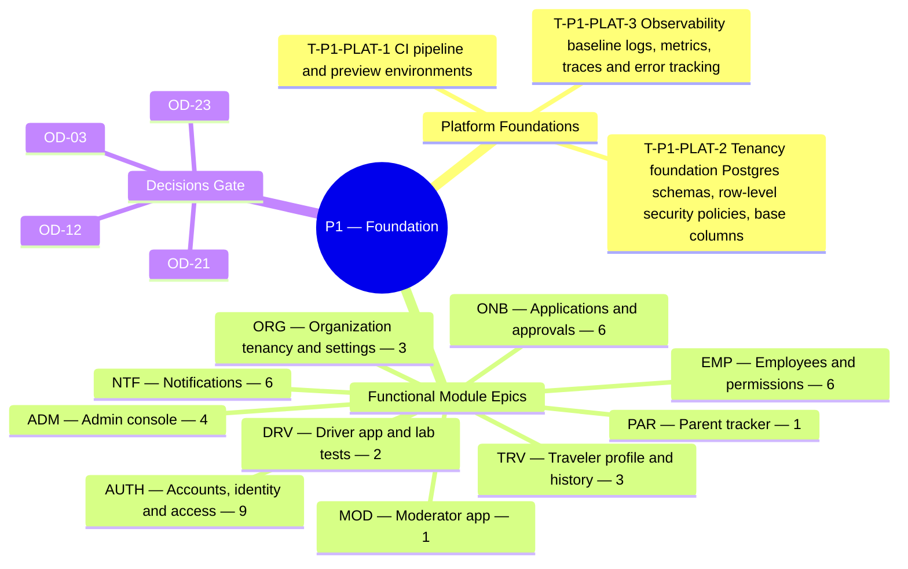

**Theme.** Foundation — accounts, organization applications and approval, tenancy

**Definition of done.** An organization can apply, be approved and sign in to an empty workspace. *([BRD section 3.3](/en/docs/brd#33-delivery-phases))*

**44 delivery tasks** (**41** functional tasks: **41** Must, **0** Should, **0** Could + **3** cross-cutting platform foundation tasks) across **10** SRS modules. Every task below carries its complete specification, implementation deliverables, acceptance criteria, affected PostgreSQL tables, and cross-specification links across BRD, SRS, ERD, Plan, Workflows, User Flows, Architecture, Design, End-to-End Lifecycle, and Recommendations.

**Data model.** [ERD conventions](/en/docs/erd), [Access Control & RLS](/en/docs/erd/acl), and the [lookup catalog](/en/docs/erd/reference) apply to every table touched in this phase.

<MindmapBlock title="P1 Scope Mindmap — Foundation" caption="Breakdown of platform foundations, module epics (44 tasks), and milestone gates for P1." trace={{"brd":[{"label":"BRD §3.3 Phases","href":"/en/docs/brd#33-delivery-phases"}],"srs":[{"label":"SRS Traceability","href":"/en/docs/srs/traceability"}],"erd":[{"label":"ERD Overview","href":"/en/docs/erd"}],"plan":[{"label":"Milestones","href":"/en/docs/plan/milestones"},{"label":"Build Guide","href":"/en/docs/plan/build-guide"}],"workflows":[{"label":"Workflow Coverage","href":"/en/docs/workflows/coverage"}],"architecture":[{"label":"Architecture","href":"/en/docs/architecture"}],"design":[{"label":"Design System","href":"/en/docs/design"}],"system":[{"label":"End-to-End Lifecycle","href":"/en/docs/system/lifecycle"}],"recommendations":[{"label":"Open Decisions","href":"/en/docs/recommendations/open-decisions"}]}}>

</MindmapBlock>

## Quick-jump task index

| Task | Module | Reference | Priority |
|---|---|---|---|
| [T-P1-PLAT-1 — CI pipeline and preview environments](#t-p1-plat-1) | `PLAT` | [NFR-MNT](/en/docs/srs/quality#89-maintainability-nfr-mnt) | Must |
| [T-P1-PLAT-2 — Tenancy foundation: Postgres schemas, row-level security policies, base columns](#t-p1-plat-2) | `PLAT` | [DAT-01..11](/en/docs/srs/data#62-data-isolation), [NFR-SEC-07](/en/docs/srs/quality#82-security-nfr-sec) | Must |
| [T-P1-PLAT-3 — Observability baseline: logs, metrics, traces and error tracking](#t-p1-plat-3) | `PLAT` | [NFR-OBS](/en/docs/srs/quality#86-observability-nfr-obs) | Must |
| [T-P1-AUTH-1 — Role-specific registration paths](#t-p1-auth-1) | `AUTH` | [FR-AUTH-01](/en/docs/srs/requirements/auth#fr-auth-01--role-specific-registration-paths) | Must |
| [T-P1-AUTH-2 — Country on every registration form](#t-p1-auth-2) | `AUTH` | [FR-AUTH-02](/en/docs/srs/requirements/auth#fr-auth-02--country-on-every-registration-form) | Must |
| [T-P1-AUTH-3 — Verification by one-time code](#t-p1-auth-3) | `AUTH` | [FR-AUTH-03](/en/docs/srs/requirements/auth#fr-auth-03--verification-by-one-time-code) | Must |
| [T-P1-AUTH-4 — Role-specific sign-in methods](#t-p1-auth-4) | `AUTH` | [FR-AUTH-04](/en/docs/srs/requirements/auth#fr-auth-04--role-specific-sign-in-methods) | Must |
| [T-P1-AUTH-5 — Sign-in lockout](#t-p1-auth-5) | `AUTH` | [FR-AUTH-05](/en/docs/srs/requirements/auth#fr-auth-05--sign-in-lockout) | Must |
| [T-P1-AUTH-6 — Multi-role accounts](#t-p1-auth-6) | `AUTH` | [FR-AUTH-06](/en/docs/srs/requirements/auth#fr-auth-06--multi-role-accounts) | Must |
| [T-P1-AUTH-7 — Staff access to several organizations](#t-p1-auth-7) | `AUTH` | [FR-AUTH-07](/en/docs/srs/requirements/auth#fr-auth-07--staff-access-to-several-organizations) | Must |
| [T-P1-AUTH-8 — Suspension and reinstatement](#t-p1-auth-8) | `AUTH` | [FR-AUTH-08](/en/docs/srs/requirements/auth#fr-auth-08--suspension-and-reinstatement) | Must |
| [T-P1-AUTH-9 — Sessions and tokens](#t-p1-auth-9) | `AUTH` | [FR-AUTH-10](/en/docs/srs/requirements/auth#fr-auth-10--sessions-and-tokens) | Must |
| [T-P1-ONB-1 — Application and supplier access](#t-p1-onb-1) | `ONB` | [FR-ONB-01](/en/docs/srs/requirements/onb#fr-onb-01--application-and-supplier-access) | Must |
| [T-P1-ONB-2 — Single admin queue](#t-p1-onb-2) | `ONB` | [FR-ONB-02](/en/docs/srs/requirements/onb#fr-onb-02--single-admin-queue) | Must |
| [T-P1-ONB-3 — Decision time target](#t-p1-onb-3) | `ONB` | [FR-ONB-03](/en/docs/srs/requirements/onb#fr-onb-03--decision-time-target) | Must |
| [T-P1-ONB-4 — Changes requested](#t-p1-onb-4) | `ONB` | [FR-ONB-04](/en/docs/srs/requirements/onb#fr-onb-04--changes-requested) | Must |
| [T-P1-ONB-5 — Rejection, appeal and re-application](#t-p1-onb-5) | `ONB` | [FR-ONB-05](/en/docs/srs/requirements/onb#fr-onb-05--rejection-appeal-and-re-application) | Must |
| [T-P1-ONB-6 — Applicant status notifications](#t-p1-onb-6) | `ONB` | [FR-ONB-09](/en/docs/srs/requirements/onb#fr-onb-09--applicant-status-notifications) | Must |
| [T-P1-ORG-1 — Tenant isolation](#t-p1-org-1) | `ORG` | [FR-ORG-01](/en/docs/srs/requirements/org#fr-org-01--tenant-isolation) | Must |
| [T-P1-ORG-2 — Tenant setup on approval](#t-p1-org-2) | `ORG` | [FR-ORG-02](/en/docs/srs/requirements/org#fr-org-02--tenant-setup-on-approval) | Must |
| [T-P1-ORG-3 — Organization-owned drivers and photographers](#t-p1-org-3) | `ORG` | [FR-ORG-03](/en/docs/srs/requirements/org#fr-org-03--organization-owned-drivers-and-photographers) | Must |
| [T-P1-EMP-1 — Permission sets](#t-p1-emp-1) | `EMP` | [FR-EMP-01](/en/docs/srs/requirements/emp#fr-emp-01--permission-sets) | Must |
| [T-P1-EMP-2 — Permission changes are audited](#t-p1-emp-2) | `EMP` | [FR-EMP-02](/en/docs/srs/requirements/emp#fr-emp-02--permission-changes-are-audited) | Must |
| [T-P1-EMP-3 — Employee limit per plan](#t-p1-emp-3) | `EMP` | [FR-EMP-03](/en/docs/srs/requirements/emp#fr-emp-03--employee-limit-per-plan) | Must |
| [T-P1-EMP-4 — Server-side scope](#t-p1-emp-4) | `EMP` | [FR-EMP-04](/en/docs/srs/requirements/emp#fr-emp-04--server-side-scope) | Must |
| [T-P1-EMP-5 — Employee removal](#t-p1-emp-5) | `EMP` | [FR-EMP-05](/en/docs/srs/requirements/emp#fr-emp-05--employee-removal) | Must |
| [T-P1-EMP-6 — Invitation and first sign-in](#t-p1-emp-6) | `EMP` | [FR-EMP-06](/en/docs/srs/requirements/emp#fr-emp-06--invitation-and-first-sign-in) | Must |
| [T-P1-MOD-1 — Moderator sign-in](#t-p1-mod-1) | `MOD` | [FR-MOD-05](/en/docs/srs/requirements/mod#fr-mod-05--moderator-sign-in) | Must |
| [T-P1-PAR-1 — Parent notifications](#t-p1-par-1) | `PAR` | [FR-PAR-04](/en/docs/srs/requirements/par#fr-par-04--parent-notifications) | Must |
| [T-P1-DRV-1 — Driver work area](#t-p1-drv-1) | `DRV` | [FR-DRV-01](/en/docs/srs/requirements/drv#fr-drv-01--driver-work-area) | Must |
| [T-P1-DRV-2 — Missed-deadline suspension](#t-p1-drv-2) | `DRV` | [FR-DRV-06](/en/docs/srs/requirements/drv#fr-drv-06--missed-deadline-suspension) | Must |
| [T-P1-ADM-1 — Account administration](#t-p1-adm-1) | `ADM` | [FR-ADM-01](/en/docs/srs/requirements/adm#fr-adm-01--account-administration) | Must |
| [T-P1-ADM-2 — Admin staff](#t-p1-adm-2) | `ADM` | [FR-ADM-02](/en/docs/srs/requirements/adm#fr-adm-02--admin-staff) | Must |
| [T-P1-ADM-3 — Configuration](#t-p1-adm-3) | `ADM` | [FR-ADM-03](/en/docs/srs/requirements/adm#fr-adm-03--configuration) | Must |
| [T-P1-ADM-4 — Immutable audit log](#t-p1-adm-4) | `ADM` | [FR-ADM-05](/en/docs/srs/requirements/adm#fr-adm-05--immutable-audit-log) | Must |
| [T-P1-NTF-1 — Channels by preference](#t-p1-ntf-1) | `NTF` | [FR-NTF-01](/en/docs/srs/requirements/ntf#fr-ntf-01--channels-by-preference) | Must |
| [T-P1-NTF-2 — Language and layout](#t-p1-ntf-2) | `NTF` | [FR-NTF-02](/en/docs/srs/requirements/ntf#fr-ntf-02--language-and-layout) | Must |
| [T-P1-NTF-3 — Versioned templates](#t-p1-ntf-3) | `NTF` | [FR-NTF-04](/en/docs/srs/requirements/ntf#fr-ntf-04--versioned-templates) | Must |
| [T-P1-NTF-4 — Delivery records and retries](#t-p1-ntf-4) | `NTF` | [FR-NTF-05](/en/docs/srs/requirements/ntf#fr-ntf-05--delivery-records-and-retries) | Must |
| [T-P1-NTF-5 — No duplicate delivery](#t-p1-ntf-5) | `NTF` | [FR-NTF-06](/en/docs/srs/requirements/ntf#fr-ntf-06--no-duplicate-delivery) | Must |
| [T-P1-NTF-6 — Trip reminders and change notices](#t-p1-ntf-6) | `NTF` | [FR-NTF-07](/en/docs/srs/requirements/ntf#fr-ntf-07--trip-reminders-and-change-notices) | Must |
| [T-P1-TRV-1 — Profile and preferences](#t-p1-trv-1) | `TRV` | [FR-TRV-01](/en/docs/srs/requirements/trv#fr-trv-01--profile-and-preferences) | Must |
| [T-P1-TRV-2 — Plan changes](#t-p1-trv-2) | `TRV` | [FR-TRV-05](/en/docs/srs/requirements/trv#fr-trv-05--plan-changes) | Must |
| [T-P1-TRV-3 — Supplier application keeps traveler access](#t-p1-trv-3) | `TRV` | [FR-TRV-06](/en/docs/srs/requirements/trv#fr-trv-06--supplier-application-keeps-traveler-access) | Must |

## Cross-cutting

These platform-wide engineering tasks establish the runtime, database, integration, and observability foundations required to close this phase gate.

### T-P1-PLAT-1 — CI pipeline and preview environments

<TaskCard id="T-P1-PLAT-1" title="CI pipeline and preview environments" phase="P1" module="PLAT" priority="Must" kind="platform" surfaces={["API","Worker","Web Apps"]} tables={["audit_events"]} trace={{"brd":[{"label":"BRD P1 Gate","href":"/en/docs/brd#33-delivery-phases"}],"srs":[{"label":"NFR-MNT","href":"/en/docs/srs/quality#89-maintainability-nfr-mnt"}],"erd":[{"label":"Platform","href":"/en/docs/erd/domains/platform"},{"label":"audit_events","href":"/en/docs/erd/domains/platform#audit_events","detail":"table"},{"label":"ACL & RLS","href":"/en/docs/erd/acl"}],"plan":[{"label":"Milestones","href":"/en/docs/plan/milestones"},{"label":"Test Strategy","href":"/en/docs/plan/testing"}],"workflows":[{"label":"scheduled-jobs","href":"/en/docs/workflows/scheduled-jobs"}],"userFlows":[{"label":"Role Flows","href":"/en/docs/user-flows"}],"architecture":[{"label":"Architecture","href":"/en/docs/architecture#deployment-topology"}],"design":[{"label":"Design System","href":"/en/docs/design#governance"}],"system":[{"label":"STAGE-01","href":"/en/docs/system/lifecycle#stage-01"}],"recommendations":[{"label":"REC-OPS-12","href":"/en/docs/recommendations/architecture-and-ops#rec-ops-12"}]}}>

**Platform scope.** Establish deterministic CI/CD pipelines running TypeScript type-checks, linting, unit/integration suites, expand-contract migration dry-runs, and isolated preview deployments for every pull request before staging promotion.

**Implementation deliverables.**

- Immutable Docker build producing identical API and Worker artifacts promoted from staging to production.
- Automated migration verification step enforcing rollback scripts (`NFR-MNT-01`) and phase feature-flag wiring (`NFR-MNT-03`).

**Acceptance & verification criteria.**

- Given a pull request with a failing type, lint, or migration check, when CI runs, then merge and preview promotion are blocked.
- Given a green merge, when deployed to staging, then readiness health checks gate traffic cutover with zero downtime.

</TaskCard>

### T-P1-PLAT-2 — Tenancy foundation: Postgres schemas, row-level security policies, base columns

<TaskCard id="T-P1-PLAT-2" title="Tenancy foundation: Postgres schemas, row-level security policies, base columns" phase="P1" module="PLAT" priority="Must" kind="platform" surfaces={["Database","Repository Layer","API Middleware"]} tables={["organizations","organization_members","lookups","audit_events"]} trace={{"brd":[{"label":"BRD P1 Gate","href":"/en/docs/brd#33-delivery-phases"}],"srs":[{"label":"DAT-01..11","href":"/en/docs/srs/data#62-data-isolation"},{"label":"NFR-SEC-07","href":"/en/docs/srs/quality#82-security-nfr-sec"}],"erd":[{"label":"Organizations","href":"/en/docs/erd/domains/organizations"},{"label":"Lookups and markets","href":"/en/docs/erd/domains/lookups-and-markets"},{"label":"organizations","href":"/en/docs/erd/domains/organizations#organizations","detail":"table"},{"label":"organization_members","href":"/en/docs/erd/domains/organizations#organization_members","detail":"table"},{"label":"lookups","href":"/en/docs/erd/domains/lookups-and-markets#lookups","detail":"table"},{"label":"audit_events","href":"/en/docs/erd/domains/platform#audit_events","detail":"table"},{"label":"ACL & RLS","href":"/en/docs/erd/acl"}],"plan":[{"label":"Milestones","href":"/en/docs/plan/milestones"},{"label":"Test Strategy","href":"/en/docs/plan/testing"}],"workflows":[{"label":"applications","href":"/en/docs/workflows/applications"}],"userFlows":[{"label":"Role Flows","href":"/en/docs/user-flows"}],"architecture":[{"label":"Architecture","href":"/en/docs/architecture#data-architecture"}],"design":[{"label":"Design System","href":"/en/docs/design#organization-dashboard"}],"system":[{"label":"STAGE-02","href":"/en/docs/system/lifecycle#stage-02"}],"recommendations":[{"label":"REC-DATA-02","href":"/en/docs/recommendations/architecture-and-ops#rec-data-02"}]}}>

**Platform scope.** Provision the foundational PostgreSQL + TimescaleDB schema conventions (`BIGSERIAL` internal PK, `UUIDv7` external ID, `deleted_at`/`deleted_by` soft delete, minor-unit money columns) and transaction-scoped Row-Level Security (`SET LOCAL app.current_organization_id`).

**Implementation deliverables.**

- Base migration macros enforcing `id`, `uuid`, `created_at`, `updated_at`, `deleted_at`, and `deleted_by` plus partial live-row indexes.
- Transaction-scoped RLS middleware + cross-tenant automated negative test harness proving Tenant A can never read or mutate Tenant B rows (`NFR-SEC-07`).

**Acceptance & verification criteria.**

- Given a pooled DB connection without `app.current_organization_id` set, when a tenant-scoped table is queried, then zero rows are returned (fail-closed).
- Given an immutable table (`audit_events`, `ledger_entries`), when `UPDATE` or `DELETE` is attempted, then PostgreSQL rejects the statement.

</TaskCard>

### T-P1-PLAT-3 — Observability baseline: logs, metrics, traces and error tracking

<TaskCard id="T-P1-PLAT-3" title="Observability baseline: logs, metrics, traces and error tracking" phase="P1" module="PLAT" priority="Must" kind="platform" surfaces={["API","Worker","Admin Console"]} tables={[]} trace={{"brd":[{"label":"BRD P1 Gate","href":"/en/docs/brd#33-delivery-phases"}],"srs":[{"label":"NFR-OBS","href":"/en/docs/srs/quality#86-observability-nfr-obs"}],"erd":[{"label":"Platform","href":"/en/docs/erd/domains/platform"},{"label":"ACL & RLS","href":"/en/docs/erd/acl"}],"plan":[{"label":"Milestones","href":"/en/docs/plan/milestones"},{"label":"Test Strategy","href":"/en/docs/plan/testing"}],"workflows":[{"label":"notifications","href":"/en/docs/workflows/notifications"}],"userFlows":[{"label":"Role Flows","href":"/en/docs/user-flows"}],"architecture":[{"label":"Architecture","href":"/en/docs/architecture#deployment-topology"}],"design":[{"label":"Design System","href":"/en/docs/design#admin-console"}],"system":[{"label":"STAGE-01","href":"/en/docs/system/lifecycle#stage-01"}],"recommendations":[{"label":"REC-ARCH-01","href":"/en/docs/recommendations/architecture-and-ops#rec-arch-01"}]}}>

**Platform scope.** Wire OpenTelemetry distributed tracing, structured JSON logging (`request_id`, `trace_id`, `organization_id`, `user_id` with PII scrubbing), RED latency metrics, and error alerting across HTTP endpoints and background workers.

**Implementation deliverables.**

- End-to-end W3C `traceparent` propagation from edge HTTP requests into `outbox_events` and worker jobs (`NFR-OBS-03`).
- Dashboards and SLO alerts for API latency (`NFR-PERF`), queue lag, and failed notification sends.

**Acceptance & verification criteria.**

- Given an API request that enqueues an outbox event, when the worker processes it, then both spans share the same `trace_id`.
- Given structured log output, when inspected for passwords, OTPs, tokens, or card data, then sensitive fields are redacted (`NFR-OBS-02`).

</TaskCard>

## AUTH — Accounts, identity and access

**Data model.** [Identity and access](/en/docs/erd/domains/identity-and-access) — the data-model domains and tables this module's requirements read and write.

### T-P1-AUTH-1 — Role-specific registration paths

<TaskCard id="T-P1-AUTH-1" title="Role-specific registration paths" phase="P1" module="AUTH" priority="Must" surfaces={["Visitor Web","Traveler App","Organization Dashboard","Admin Console"]} tables={["users"]} trace={{"brd":[{"label":"BR-AUTH-01","href":"/en/docs/brd/requirements#61-accounts-and-access-auth","detail":"P1"}],"srs":[{"label":"FR-AUTH-01","href":"/en/docs/srs/requirements/auth#fr-auth-01--role-specific-registration-paths","detail":"Must"},{"label":"Quality NFRs","href":"/en/docs/srs/quality"}],"erd":[{"label":"Identity and access","href":"/en/docs/erd/domains/identity-and-access"},{"label":"users","href":"/en/docs/erd/domains/identity-and-access#users","detail":"table"}],"plan":[{"label":"P1 Milestone","href":"/en/docs/plan/milestones"},{"label":"Testing Pyramid","href":"/en/docs/plan/testing"}],"workflows":[{"label":"scheduled-jobs","href":"/en/docs/workflows/scheduled-jobs"}],"userFlows":[{"label":"UF-SHR-01","href":"/en/docs/user-flows/shared#uf-shr-01-sign-up-chooser"},{"label":"UF-TRV-02","href":"/en/docs/user-flows/traveler#uf-trv-02-register-and-verify"}],"architecture":[{"label":"Architecture","href":"/en/docs/architecture#service-model"}],"design":[{"label":"Design Surface","href":"/en/docs/design#forms-and-validation"}],"system":[{"label":"STAGE-01","href":"/en/docs/system/lifecycle#stage-01"}],"recommendations":[{"label":"REC-SEC-09","href":"/en/docs/recommendations/architecture-and-ops#rec-sec-09"}]}}>

**Specification ([FR-AUTH-01](/en/docs/srs/requirements/auth#fr-auth-01--role-specific-registration-paths)).** The platform shall give each role its own registration path (/register/traveler, /register/driver, /register/photographer, /register/organization) and shall not show a combined onboarding form. Organization registration shall be web only.

**Implementation deliverables.**

- **Domain & API logic:** Implement authentication handlers, session/token rotation, lockout rate-limits, and role/tenant context switching with full auditability.
- **Persistence & RLS:** Read/write operations on `users` enforcing base-column conventions, soft-delete filters, and tenant/role access control ([ACL](/en/docs/erd/acl)).
- **Verification & telemetry:** Automated unit/integration coverage mapped to `FR-AUTH-01` acceptance scenarios ([Test Strategy](/en/docs/plan/testing)) with structured trace/audit emission.

**Acceptance criteria.**

- Given a visitor opens /register, when the visitor chooses a role, then only that role's form is shown.
- Given the mobile app, when a user chooses Organization, then the app hands off to the web registration page.

**Business trace & governing rules.**

- [BR-AUTH-01](/en/docs/brd/requirements#61-accounts-and-access-auth): Each role registers through its own path (traveler, driver, photographer, organization). There is no combined onboarding form.

</TaskCard>

### T-P1-AUTH-2 — Country on every registration form

<TaskCard id="T-P1-AUTH-2" title="Country on every registration form" phase="P1" module="AUTH" priority="Must" surfaces={["Visitor Web","Traveler App","Organization Dashboard","Admin Console"]} tables={["users"]} trace={{"brd":[{"label":"BR-AUTH-02","href":"/en/docs/brd/requirements#61-accounts-and-access-auth","detail":"P1"},{"label":"BRL-23","href":"/en/docs/brd/requirements#7-business-rules","detail":"rule"},{"label":"BRL-27","href":"/en/docs/brd/requirements#7-business-rules","detail":"rule"}],"srs":[{"label":"FR-AUTH-02","href":"/en/docs/srs/requirements/auth#fr-auth-02--country-on-every-registration-form","detail":"Must"},{"label":"Quality NFRs","href":"/en/docs/srs/quality"}],"erd":[{"label":"Identity and access","href":"/en/docs/erd/domains/identity-and-access"},{"label":"users","href":"/en/docs/erd/domains/identity-and-access#users","detail":"table"}],"plan":[{"label":"P1 Milestone","href":"/en/docs/plan/milestones"},{"label":"Testing Pyramid","href":"/en/docs/plan/testing"}],"workflows":[{"label":"scheduled-jobs","href":"/en/docs/workflows/scheduled-jobs"}],"userFlows":[{"label":"UF-TRV-02","href":"/en/docs/user-flows/traveler#uf-trv-02-register-and-verify"}],"architecture":[{"label":"Architecture","href":"/en/docs/architecture#service-model"}],"design":[{"label":"Design Surface","href":"/en/docs/design#forms-and-validation"}],"system":[{"label":"STAGE-01","href":"/en/docs/system/lifecycle#stage-01"}],"recommendations":[{"label":"REC-SEC-09","href":"/en/docs/recommendations/architecture-and-ops#rec-sec-09"}]}}>

**Specification ([FR-AUTH-02](/en/docs/srs/requirements/auth#fr-auth-02--country-on-every-registration-form)).** Every registration form shall collect the applicant's country and shall not submit without it. The country sets the account's market ([FR-MKT-02](/en/docs/srs/requirements/mkt#fr-mkt-02--market-from-country)).

**Implementation deliverables.**

- **Domain & API logic:** Implement authentication handlers, session/token rotation, lockout rate-limits, and role/tenant context switching with full auditability.
- **Persistence & RLS:** Read/write operations on `users` enforcing base-column conventions, soft-delete filters, and tenant/role access control ([ACL](/en/docs/erd/acl)).
- **Verification & telemetry:** Automated unit/integration coverage mapped to `FR-AUTH-02` acceptance scenarios ([Test Strategy](/en/docs/plan/testing)) with structured trace/audit emission.

**Acceptance criteria.**

- Given no country is selected, when the applicant submits, then submission is refused and the field is named.

**Business trace & governing rules.**

- [BR-AUTH-02](/en/docs/brd/requirements#61-accounts-and-access-auth): Every registration form records the applicant's country.
- [BRL-23](/en/docs/brd/requirements#7-business-rules): Every registration form records the applicant's country.
- [BRL-27](/en/docs/brd/requirements#7-business-rules): Market values (currency, payment methods, tax and invoicing rules, default time zone) follow the country: the organization's country for its trips and invoices, and the account's country for its own plan.

</TaskCard>

### T-P1-AUTH-3 — Verification by one-time code

<TaskCard id="T-P1-AUTH-3" title="Verification by one-time code" phase="P1" module="AUTH" priority="Must" surfaces={["Visitor Web","Traveler App","Organization Dashboard","Admin Console"]} tables={["users"]} trace={{"brd":[{"label":"BR-AUTH-03","href":"/en/docs/brd/requirements#61-accounts-and-access-auth","detail":"P1"},{"label":"BRL-20","href":"/en/docs/brd/requirements#7-business-rules","detail":"rule"},{"label":"OD-23","href":"/en/docs/brd/compliance#11-open-decisions","detail":"Decided"}],"srs":[{"label":"FR-AUTH-03","href":"/en/docs/srs/requirements/auth#fr-auth-03--verification-by-one-time-code","detail":"Must"},{"label":"Quality NFRs","href":"/en/docs/srs/quality"}],"erd":[{"label":"Identity and access","href":"/en/docs/erd/domains/identity-and-access"},{"label":"users","href":"/en/docs/erd/domains/identity-and-access#users","detail":"table"}],"plan":[{"label":"P1 Milestone","href":"/en/docs/plan/milestones"},{"label":"Testing Pyramid","href":"/en/docs/plan/testing"}],"workflows":[{"label":"scheduled-jobs","href":"/en/docs/workflows/scheduled-jobs#countdowns-per-record-timers"}],"userFlows":[{"label":"UF-SHR-02","href":"/en/docs/user-flows/shared#uf-shr-02-one-time-code"},{"label":"UF-TRV-02","href":"/en/docs/user-flows/traveler#uf-trv-02-register-and-verify"}],"architecture":[{"label":"Architecture","href":"/en/docs/architecture#service-model"}],"design":[{"label":"Design Surface","href":"/en/docs/design#forms-and-validation"}],"system":[{"label":"STAGE-01","href":"/en/docs/system/lifecycle#stage-01"}],"recommendations":[{"label":"OD-23 Resolution","href":"/en/docs/recommendations/open-decisions#od-23"},{"label":"REC-SEC-09","href":"/en/docs/recommendations/architecture-and-ops#rec-sec-09"}]}}>

**Specification ([FR-AUTH-03](/en/docs/srs/requirements/auth#fr-auth-03--verification-by-one-time-code)).** Accounts shall verify contact details by one-time code before acting: travelers at least one of email or phone; drivers, photographers and organization owners both (D-20). Codes expire after 5 minutes. After 5 wrong codes, verification pauses for 15 minutes. Resend is offered after a 45 to 60 second countdown. A resend does not reset the wrong-code count. After 3 failed deliveries, the code is offered on the other channel (D-58, D-59).

**Implementation deliverables.**

- **Domain & API logic:** Implement authentication handlers, session/token rotation, lockout rate-limits, and role/tenant context switching with full auditability.
- **Persistence & RLS:** Read/write operations on `users` enforcing base-column conventions, soft-delete filters, and tenant/role access control ([ACL](/en/docs/erd/acl)).
- **Verification & telemetry:** Automated unit/integration coverage mapped to `FR-AUTH-03` acceptance scenarios ([Test Strategy](/en/docs/plan/testing)) with structured trace/audit emission.

**Acceptance criteria.**

- Given a code older than 5 minutes, when it is entered, then it is rejected and resend is offered after the countdown.
- Given five wrong codes, when a sixth is entered, then verification is paused for 15 minutes and the resume time is shown.
- Given a photographer verified only email, when they submit the application, then submission is refused until the phone is verified.

**Business trace & governing rules.**

- [BR-AUTH-03](/en/docs/brd/requirements#61-accounts-and-access-auth): Accounts verify contact details by one-time code before acting: travelers verify at least one of email or phone; drivers, photographers and organization owners verify both (D-20).
- [BRL-20](/en/docs/brd/requirements#7-business-rules): Verification codes expire after 5 minutes. After 5 wrong codes, verification pauses for 15 minutes. A resend does not reset the wrong-code count; after 3 failed deliveries the code goes by the other channel (D-58, D-59).
- [OD-23](/en/docs/brd/compliance#11-open-decisions) (Verification by role — Decided) → see [Recommended Resolution](/en/docs/recommendations/open-decisions#od-23).

</TaskCard>

### T-P1-AUTH-4 — Role-specific sign-in methods

<TaskCard id="T-P1-AUTH-4" title="Role-specific sign-in methods" phase="P1" module="AUTH" priority="Must" surfaces={["Visitor Web","Traveler App","Organization Dashboard","Admin Console"]} tables={["users"]} trace={{"brd":[{"label":"BR-AUTH-04","href":"/en/docs/brd/requirements#61-accounts-and-access-auth","detail":"P1"},{"label":"OD-03","href":"/en/docs/brd/compliance#11-open-decisions","detail":"Decided"}],"srs":[{"label":"FR-AUTH-04","href":"/en/docs/srs/requirements/auth#fr-auth-04--role-specific-sign-in-methods","detail":"Must"},{"label":"Quality NFRs","href":"/en/docs/srs/quality"}],"erd":[{"label":"Identity and access","href":"/en/docs/erd/domains/identity-and-access"},{"label":"users","href":"/en/docs/erd/domains/identity-and-access#users","detail":"table"}],"plan":[{"label":"P1 Milestone","href":"/en/docs/plan/milestones"},{"label":"Testing Pyramid","href":"/en/docs/plan/testing"}],"workflows":[{"label":"scheduled-jobs","href":"/en/docs/workflows/scheduled-jobs"}],"userFlows":[{"label":"UF-ADM-01","href":"/en/docs/user-flows/admin#uf-adm-01-sign-in"},{"label":"UF-ORG-21","href":"/en/docs/user-flows/organization#uf-org-21-employee-first-sign-in"},{"label":"UF-SHR-03","href":"/en/docs/user-flows/shared#uf-shr-03-sign-in"}],"architecture":[{"label":"Architecture","href":"/en/docs/architecture#service-model"}],"design":[{"label":"Design Surface","href":"/en/docs/design#forms-and-validation"}],"system":[{"label":"STAGE-01","href":"/en/docs/system/lifecycle#stage-01"}],"recommendations":[{"label":"OD-03 Resolution","href":"/en/docs/recommendations/open-decisions#od-03"},{"label":"REC-SEC-09","href":"/en/docs/recommendations/architecture-and-ops#rec-sec-09"}]}}>

**Specification ([FR-AUTH-04](/en/docs/srs/requirements/auth#fr-auth-04--role-specific-sign-in-methods)).** Sign-in shall follow the role: admins use email and password plus a mandatory authenticator code; organization staff use email and password plus an SMS or authenticator code at every sign-in (D-48); travelers and suppliers use password or a one-time code, both offered (proposed, auth canvas); moderators use a staff code ([FR-MOD-05](/en/docs/srs/requirements/mod#fr-mod-05--moderator-sign-in)). No biometric sign-in in phase 1.

**Implementation deliverables.**

- **Domain & API logic:** Implement authentication handlers, session/token rotation, lockout rate-limits, and role/tenant context switching with full auditability.
- **Persistence & RLS:** Read/write operations on `users` enforcing base-column conventions, soft-delete filters, and tenant/role access control ([ACL](/en/docs/erd/acl)).
- **Verification & telemetry:** Automated unit/integration coverage mapped to `FR-AUTH-04` acceptance scenarios ([Test Strategy](/en/docs/plan/testing)) with structured trace/audit emission.

**Acceptance criteria.**

- Given an admin enters a correct password without a code, when sign-in is attempted, then access is refused and the code is requested.
- Given organization staff sign in, when no second-factor code is entered, then sign-in is refused.

**Business trace & governing rules.**

- [BR-AUTH-04](/en/docs/brd/requirements#61-accounts-and-access-auth): Sign-in strength follows the role: admins use password plus an authenticator; organization staff use password plus an SMS or authenticator code at every sign-in; travelers and suppliers use password or one-time code; moderators use a staff code.
- [OD-03](/en/docs/brd/compliance#11-open-decisions) (Second factor for organization staff — Decided) → see [Recommended Resolution](/en/docs/recommendations/open-decisions#od-03).

</TaskCard>

### T-P1-AUTH-5 — Sign-in lockout

<TaskCard id="T-P1-AUTH-5" title="Sign-in lockout" phase="P1" module="AUTH" priority="Must" surfaces={["Visitor Web","Traveler App","Organization Dashboard","Admin Console"]} tables={["users"]} trace={{"brd":[{"label":"BRL-21","href":"/en/docs/brd/requirements#7-business-rules","detail":"rule"}],"srs":[{"label":"FR-AUTH-05","href":"/en/docs/srs/requirements/auth#fr-auth-05--sign-in-lockout","detail":"Must"},{"label":"Quality NFRs","href":"/en/docs/srs/quality"}],"erd":[{"label":"Identity and access","href":"/en/docs/erd/domains/identity-and-access"},{"label":"users","href":"/en/docs/erd/domains/identity-and-access#users","detail":"table"}],"plan":[{"label":"P1 Milestone","href":"/en/docs/plan/milestones"},{"label":"Testing Pyramid","href":"/en/docs/plan/testing"}],"workflows":[{"label":"scheduled-jobs","href":"/en/docs/workflows/scheduled-jobs#countdowns-per-record-timers"}],"userFlows":[{"label":"UF-ADM-01","href":"/en/docs/user-flows/admin#uf-adm-01-sign-in"},{"label":"UF-SHR-03","href":"/en/docs/user-flows/shared#uf-shr-03-sign-in"}],"architecture":[{"label":"Architecture","href":"/en/docs/architecture#service-model"}],"design":[{"label":"Design Surface","href":"/en/docs/design#forms-and-validation"}],"system":[{"label":"STAGE-01","href":"/en/docs/system/lifecycle#stage-01"}],"recommendations":[{"label":"REC-SEC-09","href":"/en/docs/recommendations/architecture-and-ops#rec-sec-09"}]}}>

**Specification ([FR-AUTH-05](/en/docs/srs/requirements/auth#fr-auth-05--sign-in-lockout)).** The system shall lock any account for 15 minutes after 5 failed sign-in attempts, for every role (D-53), and rate-limit sign-in by IP ([NFR-SEC-13](/en/docs/srs/quality#82-security-nfr-sec)).

**Implementation deliverables.**

- **Domain & API logic:** Implement authentication handlers, session/token rotation, lockout rate-limits, and role/tenant context switching with full auditability.
- **Persistence & RLS:** Read/write operations on `users` enforcing base-column conventions, soft-delete filters, and tenant/role access control ([ACL](/en/docs/erd/acl)).
- **Verification & telemetry:** Automated unit/integration coverage mapped to `FR-AUTH-05` acceptance scenarios ([Test Strategy](/en/docs/plan/testing)) with structured trace/audit emission.

**Acceptance criteria.**

- Given five failed attempts, when a sixth is made within 15 minutes, then it is refused and the lock end time is shown.

**Business trace & governing rules.**

- [BRL-21](/en/docs/brd/requirements#7-business-rules): Accounts lock for 15 minutes after 5 failed sign-in attempts (all roles, D-53).

</TaskCard>

### T-P1-AUTH-6 — Multi-role accounts

<TaskCard id="T-P1-AUTH-6" title="Multi-role accounts" phase="P1" module="AUTH" priority="Must" surfaces={["Visitor Web","Traveler App","Organization Dashboard","Admin Console"]} tables={["users","user_roles"]} trace={{"brd":[{"label":"BR-AUTH-05","href":"/en/docs/brd/requirements#61-accounts-and-access-auth","detail":"P1"}],"srs":[{"label":"FR-AUTH-06","href":"/en/docs/srs/requirements/auth#fr-auth-06--multi-role-accounts","detail":"Must"},{"label":"Quality NFRs","href":"/en/docs/srs/quality"}],"erd":[{"label":"Identity and access","href":"/en/docs/erd/domains/identity-and-access"},{"label":"users","href":"/en/docs/erd/domains/identity-and-access#users","detail":"table"},{"label":"user_roles","href":"/en/docs/erd/domains/identity-and-access#user_roles","detail":"table"}],"plan":[{"label":"P1 Milestone","href":"/en/docs/plan/milestones"},{"label":"Testing Pyramid","href":"/en/docs/plan/testing"}],"workflows":[{"label":"scheduled-jobs","href":"/en/docs/workflows/scheduled-jobs"}],"userFlows":[{"label":"UF-SHR-05","href":"/en/docs/user-flows/shared#uf-shr-05-role-and-organization-switcher"},{"label":"UF-TRV-11","href":"/en/docs/user-flows/traveler#uf-trv-11-apply-for-a-supplier-role"}],"architecture":[{"label":"Architecture","href":"/en/docs/architecture#service-model"}],"design":[{"label":"Design Surface","href":"/en/docs/design#forms-and-validation"}],"system":[{"label":"STAGE-01","href":"/en/docs/system/lifecycle#stage-01"}],"recommendations":[{"label":"REC-SEC-09","href":"/en/docs/recommendations/architecture-and-ops#rec-sec-09"}]}}>

**Specification ([FR-AUTH-06](/en/docs/srs/requirements/auth#fr-auth-06--multi-role-accounts)).** One person shall hold several roles and switch between them without a second account. The active role is part of the session.

**Implementation deliverables.**

- **Domain & API logic:** Implement authentication handlers, session/token rotation, lockout rate-limits, and role/tenant context switching with full auditability.
- **Persistence & RLS:** Read/write operations on `users`, `user_roles` enforcing base-column conventions, soft-delete filters, and tenant/role access control ([ACL](/en/docs/erd/acl)).
- **Verification & telemetry:** Automated unit/integration coverage mapped to `FR-AUTH-06` acceptance scenarios ([Test Strategy](/en/docs/plan/testing)) with structured trace/audit emission.

**Acceptance criteria.**

- Given a person holds traveler and approved photographer roles, when they switch to photographer, then the studio opens and traveler data is not shown in it.

**Business trace & governing rules.**

- [BR-AUTH-05](/en/docs/brd/requirements#61-accounts-and-access-auth): One person can hold several roles (for example traveler and approved photographer) and switch between them without a second account.

</TaskCard>

### T-P1-AUTH-7 — Staff access to several organizations

<TaskCard id="T-P1-AUTH-7" title="Staff access to several organizations" phase="P1" module="AUTH" priority="Must" surfaces={["Visitor Web","Traveler App","Organization Dashboard","Admin Console"]} tables={["users","user_roles"]} trace={{"brd":[{"label":"BR-AUTH-06","href":"/en/docs/brd/requirements#61-accounts-and-access-auth","detail":"P1"}],"srs":[{"label":"FR-AUTH-07","href":"/en/docs/srs/requirements/auth#fr-auth-07--staff-access-to-several-organizations","detail":"Must"},{"label":"Quality NFRs","href":"/en/docs/srs/quality"}],"erd":[{"label":"Identity and access","href":"/en/docs/erd/domains/identity-and-access"},{"label":"users","href":"/en/docs/erd/domains/identity-and-access#users","detail":"table"},{"label":"user_roles","href":"/en/docs/erd/domains/identity-and-access#user_roles","detail":"table"}],"plan":[{"label":"P1 Milestone","href":"/en/docs/plan/milestones"},{"label":"Testing Pyramid","href":"/en/docs/plan/testing"}],"workflows":[{"label":"scheduled-jobs","href":"/en/docs/workflows/scheduled-jobs"}],"userFlows":[{"label":"UF-ORG-02","href":"/en/docs/user-flows/organization#uf-org-02-switch-organization"},{"label":"UF-SHR-05","href":"/en/docs/user-flows/shared#uf-shr-05-role-and-organization-switcher"}],"architecture":[{"label":"Architecture","href":"/en/docs/architecture#service-model"}],"design":[{"label":"Design Surface","href":"/en/docs/design#forms-and-validation"}],"system":[{"label":"STAGE-01","href":"/en/docs/system/lifecycle#stage-01"}],"recommendations":[{"label":"REC-SEC-09","href":"/en/docs/recommendations/architecture-and-ops#rec-sec-09"}]}}>

**Specification ([FR-AUTH-07](/en/docs/srs/requirements/auth#fr-auth-07--staff-access-to-several-organizations)).** Organization staff shall see and switch between the organizations whose member list includes their email, and no others. Switching changes the tenant context of the session.

**Implementation deliverables.**

- **Domain & API logic:** Implement authentication handlers, session/token rotation, lockout rate-limits, and role/tenant context switching with full auditability.
- **Persistence & RLS:** Read/write operations on `users`, `user_roles` enforcing base-column conventions, soft-delete filters, and tenant/role access control ([ACL](/en/docs/erd/acl)).
- **Verification & telemetry:** Automated unit/integration coverage mapped to `FR-AUTH-07` acceptance scenarios ([Test Strategy](/en/docs/plan/testing)) with structured trace/audit emission.

**Acceptance criteria.**

- Given a staff email listed by two organizations, when the staff member signs in, then both are listed and either opens.
- Given an organization that does not list the email, when the staff member searches for it, then it is not listed.

**Business trace & governing rules.**

- [BR-AUTH-06](/en/docs/brd/requirements#61-accounts-and-access-auth): Organization staff can switch between the organizations whose access list includes their email, and see no other organization.

</TaskCard>

### T-P1-AUTH-8 — Suspension and reinstatement

<TaskCard id="T-P1-AUTH-8" title="Suspension and reinstatement" phase="P1" module="AUTH" priority="Must" surfaces={["Visitor Web","Traveler App","Organization Dashboard","Admin Console"]} tables={["users"]} trace={{"brd":[{"label":"BR-AUTH-07","href":"/en/docs/brd/requirements#61-accounts-and-access-auth","detail":"P1"},{"label":"BR-ADM-02","href":"/en/docs/brd/requirements#61-accounts-and-access-auth","detail":"P1"}],"srs":[{"label":"FR-AUTH-08","href":"/en/docs/srs/requirements/auth#fr-auth-08--suspension-and-reinstatement","detail":"Must"},{"label":"Quality NFRs","href":"/en/docs/srs/quality"}],"erd":[{"label":"Identity and access","href":"/en/docs/erd/domains/identity-and-access"},{"label":"users","href":"/en/docs/erd/domains/identity-and-access#users","detail":"table"}],"plan":[{"label":"P1 Milestone","href":"/en/docs/plan/milestones"},{"label":"Testing Pyramid","href":"/en/docs/plan/testing"}],"workflows":[{"label":"scheduled-jobs","href":"/en/docs/workflows/scheduled-jobs"}],"userFlows":[{"label":"UF-ADM-04","href":"/en/docs/user-flows/admin#uf-adm-04-manage-an-account"},{"label":"UF-SHR-10","href":"/en/docs/user-flows/shared#uf-shr-10-suspended-account"}],"architecture":[{"label":"Architecture","href":"/en/docs/architecture#service-model"}],"design":[{"label":"Design Surface","href":"/en/docs/design#forms-and-validation"}],"system":[{"label":"STAGE-01","href":"/en/docs/system/lifecycle#stage-01"}],"recommendations":[{"label":"REC-SEC-09","href":"/en/docs/recommendations/architecture-and-ops#rec-sec-09"}]}}>

**Specification ([FR-AUTH-08](/en/docs/srs/requirements/auth#fr-auth-08--suspension-and-reinstatement)).** Admin shall suspend and reinstate any account with a reason code (D-234). A suspended account loses access at once and keeps its data. Early lifting of a safety suspension requires a second admin (D-233).

**Implementation deliverables.**

- **Domain & API logic:** Implement authentication handlers, session/token rotation, lockout rate-limits, and role/tenant context switching with full auditability.
- **Persistence & RLS:** Read/write operations on `users` enforcing base-column conventions, soft-delete filters, and tenant/role access control ([ACL](/en/docs/erd/acl)).
- **Verification & telemetry:** Automated unit/integration coverage mapped to `FR-AUTH-08` acceptance scenarios ([Test Strategy](/en/docs/plan/testing)) with structured trace/audit emission.

**Acceptance criteria.**

- Given a suspended account, when its user signs in, then access is refused with a suspension message and no data is deleted.

**Business trace & governing rules.**

- [BR-AUTH-07](/en/docs/brd/requirements#61-accounts-and-access-auth): Admin can suspend and reinstate any account. Suspension stops access at once and keeps the data.
- [BR-ADM-02](/en/docs/brd/requirements#61-accounts-and-access-auth): Admin manages any account: suspend, reinstate, reset credentials, review deletion and data-copy requests.

</TaskCard>

### T-P1-AUTH-9 — Sessions and tokens

<TaskCard id="T-P1-AUTH-9" title="Sessions and tokens" phase="P1" module="AUTH" priority="Must" surfaces={["Visitor Web","Traveler App","Organization Dashboard","Admin Console"]} tables={["users"]} trace={{"brd":[{"label":"BRL-22","href":"/en/docs/brd/requirements#7-business-rules","detail":"rule"}],"srs":[{"label":"FR-AUTH-10","href":"/en/docs/srs/requirements/auth#fr-auth-10--sessions-and-tokens","detail":"Must"},{"label":"Quality NFRs","href":"/en/docs/srs/quality"}],"erd":[{"label":"Identity and access","href":"/en/docs/erd/domains/identity-and-access"},{"label":"users","href":"/en/docs/erd/domains/identity-and-access#users","detail":"table"}],"plan":[{"label":"P1 Milestone","href":"/en/docs/plan/milestones"},{"label":"Testing Pyramid","href":"/en/docs/plan/testing"}],"workflows":[{"label":"scheduled-jobs","href":"/en/docs/workflows/scheduled-jobs#countdowns-per-record-timers"}],"userFlows":[{"label":"UF-SHR-03","href":"/en/docs/user-flows/shared#uf-shr-03-sign-in"}],"architecture":[{"label":"Architecture","href":"/en/docs/architecture#service-model"}],"design":[{"label":"Design Surface","href":"/en/docs/design#forms-and-validation"}],"system":[{"label":"STAGE-01","href":"/en/docs/system/lifecycle#stage-01"}],"recommendations":[{"label":"REC-SEC-09","href":"/en/docs/recommendations/architecture-and-ops#rec-sec-09"}]}}>

**Specification ([FR-AUTH-10](/en/docs/srs/requirements/auth#fr-auth-10--sessions-and-tokens)).** Access tokens shall last 15 minutes. Refresh tokens rotate on every use and last 30 days. Web sessions end after 12 hours; drafts are kept ([OD-02](/en/docs/brd/compliance#11-open-decisions)). Mobile apps stay signed in through refresh.

**Implementation deliverables.**

- **Domain & API logic:** Implement authentication handlers, session/token rotation, lockout rate-limits, and role/tenant context switching with full auditability.
- **Persistence & RLS:** Read/write operations on `users` enforcing base-column conventions, soft-delete filters, and tenant/role access control ([ACL](/en/docs/erd/acl)).
- **Verification & telemetry:** Automated unit/integration coverage mapped to `FR-AUTH-10` acceptance scenarios ([Test Strategy](/en/docs/plan/testing)) with structured trace/audit emission.

**Acceptance criteria.**

- Given a web session in use for 12 hours, when the next request is made, then the user must sign in again.
- Given an unpublished trip draft when the session ended, when the user signs in again, then the draft is available.

**Business trace & governing rules.**

- [BRL-22](/en/docs/brd/requirements#7-business-rules): Web sessions end after 12 hours of use. Drafts are kept.

</TaskCard>

## ONB — Applications and approvals

**Data model.** [Applications](/en/docs/erd/domains/applications), [Suppliers](/en/docs/erd/domains/suppliers) — the data-model domains and tables this module's requirements read and write.

### T-P1-ONB-1 — Application and supplier access

<TaskCard id="T-P1-ONB-1" title="Application and supplier access" phase="P1" module="ONB" priority="Must" surfaces={["Visitor Web","Driver App","Photographer Studio","Admin Console"]} tables={["applications"]} trace={{"brd":[{"label":"BR-ONB-01","href":"/en/docs/brd/requirements#62-applications-and-approvals-onb","detail":"P1"},{"label":"BRL-02","href":"/en/docs/brd/requirements#7-business-rules","detail":"rule"}],"srs":[{"label":"FR-ONB-01","href":"/en/docs/srs/requirements/onb#fr-onb-01--application-and-supplier-access","detail":"Must"},{"label":"SM §7.5 Application","href":"/en/docs/srs/state-machines#75-application"},{"label":"Quality NFRs","href":"/en/docs/srs/quality"}],"erd":[{"label":"Applications","href":"/en/docs/erd/domains/applications"},{"label":"Suppliers","href":"/en/docs/erd/domains/suppliers"},{"label":"applications","href":"/en/docs/erd/domains/applications#applications","detail":"table"}],"plan":[{"label":"P1 Milestone","href":"/en/docs/plan/milestones"},{"label":"Testing Pyramid","href":"/en/docs/plan/testing"}],"workflows":[{"label":"applications","href":"/en/docs/workflows/applications#timers-and-rules"}],"userFlows":[{"label":"UF-DRV-01","href":"/en/docs/user-flows/driver#uf-drv-01-register-and-apply"}],"architecture":[{"label":"Architecture","href":"/en/docs/architecture#service-model"}],"design":[{"label":"Design Surface","href":"/en/docs/design#admin-console"}],"system":[{"label":"STAGE-02","href":"/en/docs/system/lifecycle#stage-02"}],"recommendations":[{"label":"REC-ARCH-01","href":"/en/docs/recommendations/architecture-and-ops#rec-arch-01"}]}}>

**Specification ([FR-ONB-01](/en/docs/srs/requirements/onb#fr-onb-01--application-and-supplier-access)).** The platform shall accept applications from organizations, platform drivers and platform photographers. A plan may be chosen at registration with no charge; it is assigned on approval (D-77). Supplier actions are refused until approval.

**Implementation deliverables.**

- **Domain & API logic:** Build the onboarding state machine, admin review queue, 2-working-day SLA timers, changes-requested extensions, and appeal workflows.
- **Persistence & RLS:** Read/write operations on `applications` enforcing base-column conventions, soft-delete filters, and tenant/role access control ([ACL](/en/docs/erd/acl)).
- **Verification & telemetry:** Automated unit/integration coverage mapped to `FR-ONB-01` acceptance scenarios ([Test Strategy](/en/docs/plan/testing)) with structured trace/audit emission.

**Acceptance criteria.**

- Given a pending application, when the applicant tries to create a trip or accept a deal, then the action is refused with an approval-pending message.

**Business trace & governing rules.**

- [BR-ONB-01](/en/docs/brd/requirements#62-applications-and-approvals-onb): Organizations, platform drivers and platform photographers apply before they can act. Supplier actions stay blocked until approval.
- [BRL-02](/en/docs/brd/requirements#7-business-rules): Every non-traveler role must hold an active plan to use the app. A traveler can always use the app for free.

</TaskCard>

### T-P1-ONB-2 — Single admin queue

<TaskCard id="T-P1-ONB-2" title="Single admin queue" phase="P1" module="ONB" priority="Must" surfaces={["Visitor Web","Driver App","Photographer Studio","Admin Console"]} tables={["applications"]} trace={{"brd":[{"label":"BR-ONB-02","href":"/en/docs/brd/requirements#62-applications-and-approvals-onb","detail":"P1"},{"label":"BR-ADM-01","href":"/en/docs/brd/requirements#62-applications-and-approvals-onb","detail":"P1"}],"srs":[{"label":"FR-ONB-02","href":"/en/docs/srs/requirements/onb#fr-onb-02--single-admin-queue","detail":"Must"},{"label":"SM §7.5 Application","href":"/en/docs/srs/state-machines#75-application"},{"label":"Quality NFRs","href":"/en/docs/srs/quality"}],"erd":[{"label":"Applications","href":"/en/docs/erd/domains/applications"},{"label":"Suppliers","href":"/en/docs/erd/domains/suppliers"},{"label":"applications","href":"/en/docs/erd/domains/applications#applications","detail":"table"}],"plan":[{"label":"P1 Milestone","href":"/en/docs/plan/milestones"},{"label":"Testing Pyramid","href":"/en/docs/plan/testing"}],"workflows":[{"label":"applications","href":"/en/docs/workflows/applications"}],"userFlows":[{"label":"UF-ADM-02","href":"/en/docs/user-flows/admin#uf-adm-02-review-an-application"}],"architecture":[{"label":"Architecture","href":"/en/docs/architecture#service-model"}],"design":[{"label":"Design Surface","href":"/en/docs/design#admin-console"}],"system":[{"label":"STAGE-02","href":"/en/docs/system/lifecycle#stage-02"}],"recommendations":[{"label":"REC-ARCH-01","href":"/en/docs/recommendations/architecture-and-ops#rec-arch-01"}]}}>

**Specification ([FR-ONB-02](/en/docs/srs/requirements/onb#fr-onb-02--single-admin-queue)).** The admin console shall show all applications in one queue with their documents. Admin shall approve, request changes or reject. A rejection requires a reason code (D-234) and a message in the applicant's language.

**Implementation deliverables.**

- **Domain & API logic:** Build the onboarding state machine, admin review queue, 2-working-day SLA timers, changes-requested extensions, and appeal workflows.
- **Persistence & RLS:** Read/write operations on `applications` enforcing base-column conventions, soft-delete filters, and tenant/role access control ([ACL](/en/docs/erd/acl)).
- **Verification & telemetry:** Automated unit/integration coverage mapped to `FR-ONB-02` acceptance scenarios ([Test Strategy](/en/docs/plan/testing)) with structured trace/audit emission.

**Acceptance criteria.**

- Given a rejection without a reason, when the admin submits, then it is refused.

**Business trace & governing rules.**

- [BR-ONB-02](/en/docs/brd/requirements#62-applications-and-approvals-onb): All applications reach one admin queue with their documents. Admin can approve, request changes or reject; a rejection needs a reason.
- [BR-ADM-01](/en/docs/brd/requirements#62-applications-and-approvals-onb): Admin reviews all applications and appeals from one queue.

</TaskCard>

### T-P1-ONB-3 — Decision time target

<TaskCard id="T-P1-ONB-3" title="Decision time target" phase="P1" module="ONB" priority="Must" surfaces={["Visitor Web","Driver App","Photographer Studio","Admin Console"]} tables={["applications"]} trace={{"brd":[{"label":"BR-ONB-03","href":"/en/docs/brd/requirements#62-applications-and-approvals-onb","detail":"P1"}],"srs":[{"label":"FR-ONB-03","href":"/en/docs/srs/requirements/onb#fr-onb-03--decision-time-target","detail":"Must"},{"label":"SM §7.5 Application","href":"/en/docs/srs/state-machines#75-application"},{"label":"Quality NFRs","href":"/en/docs/srs/quality"}],"erd":[{"label":"Applications","href":"/en/docs/erd/domains/applications"},{"label":"Suppliers","href":"/en/docs/erd/domains/suppliers"},{"label":"applications","href":"/en/docs/erd/domains/applications#applications","detail":"table"}],"plan":[{"label":"P1 Milestone","href":"/en/docs/plan/milestones"},{"label":"Testing Pyramid","href":"/en/docs/plan/testing"}],"workflows":[{"label":"applications","href":"/en/docs/workflows/applications#timers-and-rules"},{"label":"applications","href":"/en/docs/workflows/applications#stories"}],"userFlows":[{"label":"UF-ADM-02","href":"/en/docs/user-flows/admin#uf-adm-02-review-an-application"}],"architecture":[{"label":"Architecture","href":"/en/docs/architecture#service-model"}],"design":[{"label":"Design Surface","href":"/en/docs/design#admin-console"}],"system":[{"label":"STAGE-02","href":"/en/docs/system/lifecycle#stage-02"}],"recommendations":[{"label":"REC-ARCH-01","href":"/en/docs/recommendations/architecture-and-ops#rec-arch-01"}]}}>

**Specification ([FR-ONB-03](/en/docs/srs/requirements/onb#fr-onb-03--decision-time-target)).** The queue shall flag any application pending for more than 2 working days.

**Implementation deliverables.**

- **Domain & API logic:** Build the onboarding state machine, admin review queue, 2-working-day SLA timers, changes-requested extensions, and appeal workflows.
- **Persistence & RLS:** Read/write operations on `applications` enforcing base-column conventions, soft-delete filters, and tenant/role access control ([ACL](/en/docs/erd/acl)).
- **Verification & telemetry:** Automated unit/integration coverage mapped to `FR-ONB-03` acceptance scenarios ([Test Strategy](/en/docs/plan/testing)) with structured trace/audit emission.

**Acceptance criteria.**

- Given an application pending for 3 working days, when the queue opens, then it is flagged overdue.

**Business trace & governing rules.**

- [BR-ONB-03](/en/docs/brd/requirements#62-applications-and-approvals-onb): The median decision time is 2 working days or less; overdue applications are flagged.

</TaskCard>

### T-P1-ONB-4 — Changes requested

<TaskCard id="T-P1-ONB-4" title="Changes requested" phase="P1" module="ONB" priority="Must" surfaces={["Visitor Web","Driver App","Photographer Studio","Admin Console"]} tables={["applications"]} trace={{"brd":[{"label":"BR-ONB-04","href":"/en/docs/brd/requirements#62-applications-and-approvals-onb","detail":"P1"}],"srs":[{"label":"FR-ONB-04","href":"/en/docs/srs/requirements/onb#fr-onb-04--changes-requested","detail":"Must"},{"label":"SM §7.5 Application","href":"/en/docs/srs/state-machines#75-application"},{"label":"Quality NFRs","href":"/en/docs/srs/quality"}],"erd":[{"label":"Applications","href":"/en/docs/erd/domains/applications"},{"label":"Suppliers","href":"/en/docs/erd/domains/suppliers"},{"label":"applications","href":"/en/docs/erd/domains/applications#applications","detail":"table"}],"plan":[{"label":"P1 Milestone","href":"/en/docs/plan/milestones"},{"label":"Testing Pyramid","href":"/en/docs/plan/testing"}],"workflows":[{"label":"applications","href":"/en/docs/workflows/applications#timers-and-rules"},{"label":"applications","href":"/en/docs/workflows/applications#stories"},{"label":"scheduled-jobs","href":"/en/docs/workflows/scheduled-jobs#countdowns-per-record-timers"},{"label":"scheduled-jobs","href":"/en/docs/workflows/scheduled-jobs#daily"}],"userFlows":[{"label":"UF-ADM-02","href":"/en/docs/user-flows/admin#uf-adm-02-review-an-application"},{"label":"UF-SHR-08","href":"/en/docs/user-flows/shared#uf-shr-08-application-status-changes-appeal"}],"architecture":[{"label":"Architecture","href":"/en/docs/architecture#service-model"}],"design":[{"label":"Design Surface","href":"/en/docs/design#admin-console"}],"system":[{"label":"STAGE-02","href":"/en/docs/system/lifecycle#stage-02"}],"recommendations":[{"label":"REC-ARCH-01","href":"/en/docs/recommendations/architecture-and-ops#rec-arch-01"}]}}>

**Specification ([FR-ONB-04](/en/docs/srs/requirements/onb#fr-onb-04--changes-requested)).** The applicant shall have 14 days to respond, with a reminder on day 7 and one 7-day extension on request (D-235). Resubmission returns the application to Pending Review. Without a response, the application closes [OPEN: closure day when the extension is used, [OD-32](/en/docs/brd/compliance#11-open-decisions)].

**Implementation deliverables.**

- **Domain & API logic:** Build the onboarding state machine, admin review queue, 2-working-day SLA timers, changes-requested extensions, and appeal workflows.
- **Persistence & RLS:** Read/write operations on `applications` enforcing base-column conventions, soft-delete filters, and tenant/role access control ([ACL](/en/docs/erd/acl)).
- **Verification & telemetry:** Automated unit/integration coverage mapped to `FR-ONB-04` acceptance scenarios ([Test Strategy](/en/docs/plan/testing)) with structured trace/audit emission.

**Acceptance criteria.**

- Given changes were requested 15 days ago with no extension and no response, when the daily job runs, then the application is Closed.

**Business trace & governing rules.**

- [BR-ONB-04](/en/docs/brd/requirements#62-applications-and-approvals-onb): When changes are requested, the applicant has 14 days to respond, with a reminder on day 7 and one 7-day extension on request (D-235). Unanswered applications close.

</TaskCard>

### T-P1-ONB-5 — Rejection, appeal and re-application

<TaskCard id="T-P1-ONB-5" title="Rejection, appeal and re-application" phase="P1" module="ONB" priority="Must" surfaces={["Visitor Web","Driver App","Photographer Studio","Admin Console"]} tables={["applications"]} trace={{"brd":[{"label":"BR-ONB-05","href":"/en/docs/brd/requirements#62-applications-and-approvals-onb","detail":"P1"},{"label":"BRL-06","href":"/en/docs/brd/requirements#7-business-rules","detail":"rule"}],"srs":[{"label":"FR-ONB-05","href":"/en/docs/srs/requirements/onb#fr-onb-05--rejection-appeal-and-re-application","detail":"Must"},{"label":"SM §7.5 Application","href":"/en/docs/srs/state-machines#75-application"},{"label":"Quality NFRs","href":"/en/docs/srs/quality"}],"erd":[{"label":"Applications","href":"/en/docs/erd/domains/applications"},{"label":"Suppliers","href":"/en/docs/erd/domains/suppliers"},{"label":"applications","href":"/en/docs/erd/domains/applications#applications","detail":"table"}],"plan":[{"label":"P1 Milestone","href":"/en/docs/plan/milestones"},{"label":"Testing Pyramid","href":"/en/docs/plan/testing"}],"workflows":[{"label":"applications","href":"/en/docs/workflows/applications#timers-and-rules"},{"label":"applications","href":"/en/docs/workflows/applications#stories"},{"label":"scheduled-jobs","href":"/en/docs/workflows/scheduled-jobs#countdowns-per-record-timers"}],"userFlows":[{"label":"UF-ADM-02","href":"/en/docs/user-flows/admin#uf-adm-02-review-an-application"},{"label":"UF-ADM-03","href":"/en/docs/user-flows/admin#uf-adm-03-decide-an-appeal"},{"label":"UF-SHR-08","href":"/en/docs/user-flows/shared#uf-shr-08-application-status-changes-appeal"}],"architecture":[{"label":"Architecture","href":"/en/docs/architecture#service-model"}],"design":[{"label":"Design Surface","href":"/en/docs/design#admin-console"}],"system":[{"label":"STAGE-02","href":"/en/docs/system/lifecycle#stage-02"}],"recommendations":[{"label":"REC-ARCH-01","href":"/en/docs/recommendations/architecture-and-ops#rec-arch-01"}]}}>

**Specification ([FR-ONB-05](/en/docs/srs/requirements/onb#fr-onb-05--rejection-appeal-and-re-application)).** A rejected applicant shall appeal within 14 days of the notice, with a statement and up to 5 files; one appeal per rejection; decided within 5 working days (D-237). Re-application is allowed 30 days after rejection; a closed application counts as rejected. The traveler account stays active.

**Implementation deliverables.**

- **Domain & API logic:** Build the onboarding state machine, admin review queue, 2-working-day SLA timers, changes-requested extensions, and appeal workflows.
- **Persistence & RLS:** Read/write operations on `applications` enforcing base-column conventions, soft-delete filters, and tenant/role access control ([ACL](/en/docs/erd/acl)).
- **Verification & telemetry:** Automated unit/integration coverage mapped to `FR-ONB-05` acceptance scenarios ([Test Strategy](/en/docs/plan/testing)) with structured trace/audit emission.

**Acceptance criteria.**

- Given a rejection 12 days ago, when the applicant re-applies, then it is refused and the earliest date is shown.
- Given a rejection 15 days ago, when the applicant tries to appeal, then the appeal is refused as out of time.

**Business trace & governing rules.**

- [BR-ONB-05](/en/docs/brd/requirements#62-applications-and-approvals-onb): A rejected applicant can appeal within 14 days of the notice (statement and up to 5 files, decided within 5 working days, one appeal per rejection, D-237) and can re-apply after 30 days. A closed application counts as rejected. The traveler account keeps working.
- [BRL-06](/en/docs/brd/requirements#7-business-rules): A rejected supplier or organization application can be re-submitted after 30 days. A closed application counts as rejected. The traveler account keeps working throughout.

</TaskCard>

### T-P1-ONB-6 — Applicant status notifications

<TaskCard id="T-P1-ONB-6" title="Applicant status notifications" phase="P1" module="ONB" priority="Must" surfaces={["Visitor Web","Driver App","Photographer Studio","Admin Console"]} tables={["applications"]} trace={{"brd":[{"label":"BR-ONB-09","href":"/en/docs/brd/requirements#62-applications-and-approvals-onb","detail":"P1"},{"label":"BR-NTF-01","href":"/en/docs/brd/requirements#62-applications-and-approvals-onb","detail":"P1"}],"srs":[{"label":"FR-ONB-09","href":"/en/docs/srs/requirements/onb#fr-onb-09--applicant-status-notifications","detail":"Must"},{"label":"SM §7.5 Application","href":"/en/docs/srs/state-machines#75-application"},{"label":"Quality NFRs","href":"/en/docs/srs/quality"}],"erd":[{"label":"Applications","href":"/en/docs/erd/domains/applications"},{"label":"Suppliers","href":"/en/docs/erd/domains/suppliers"},{"label":"applications","href":"/en/docs/erd/domains/applications#applications","detail":"table"}],"plan":[{"label":"P1 Milestone","href":"/en/docs/plan/milestones"},{"label":"Testing Pyramid","href":"/en/docs/plan/testing"}],"workflows":[{"label":"applications","href":"/en/docs/workflows/applications#timers-and-rules"}],"userFlows":[{"label":"admin","href":"/en/docs/user-flows/admin"}],"architecture":[{"label":"Architecture","href":"/en/docs/architecture#service-model"}],"design":[{"label":"Design Surface","href":"/en/docs/design#admin-console"}],"system":[{"label":"STAGE-02","href":"/en/docs/system/lifecycle#stage-02"}],"recommendations":[{"label":"REC-ARCH-01","href":"/en/docs/recommendations/architecture-and-ops#rec-arch-01"}]}}>

**Specification ([FR-ONB-09](/en/docs/srs/requirements/onb#fr-onb-09--applicant-status-notifications)).** Each state change shall notify the applicant in their language on at least one enabled channel.

**Implementation deliverables.**

- **Domain & API logic:** Build the onboarding state machine, admin review queue, 2-working-day SLA timers, changes-requested extensions, and appeal workflows.
- **Persistence & RLS:** Read/write operations on `applications` enforcing base-column conventions, soft-delete filters, and tenant/role access control ([ACL](/en/docs/erd/acl)).
- **Verification & telemetry:** Automated unit/integration coverage mapped to `FR-ONB-09` acceptance scenarios ([Test Strategy](/en/docs/plan/testing)) with structured trace/audit emission.

**Acceptance criteria.**

- Given an application moves to Approved, when the state changes, then the applicant is notified in their language.

**Business trace & governing rules.**

- [BR-ONB-09](/en/docs/brd/requirements#62-applications-and-approvals-onb): Applicants are notified of every status change in their language.
- [BR-NTF-01](/en/docs/brd/requirements#62-applications-and-approvals-onb): Notifications go out on the channels each user enables per category: email, SMS, WhatsApp, push and in-app.

</TaskCard>

## ORG — Organization tenancy and settings

**Data model.** [Finance](/en/docs/erd/domains/finance), [Organizations](/en/docs/erd/domains/organizations) — the data-model domains and tables this module's requirements read and write.

### T-P1-ORG-1 — Tenant isolation

<TaskCard id="T-P1-ORG-1" title="Tenant isolation" phase="P1" module="ORG" priority="Must" surfaces={["Organization Dashboard","Admin Console"]} tables={["organizations"]} trace={{"brd":[{"label":"BR-ORG-01","href":"/en/docs/brd/requirements#63-organizations-and-employees-org","detail":"P1"},{"label":"BRL-01","href":"/en/docs/brd/requirements#7-business-rules","detail":"rule"}],"srs":[{"label":"FR-ORG-01","href":"/en/docs/srs/requirements/org#fr-org-01--tenant-isolation","detail":"Must"},{"label":"Quality NFRs","href":"/en/docs/srs/quality"}],"erd":[{"label":"Finance","href":"/en/docs/erd/domains/finance"},{"label":"Organizations","href":"/en/docs/erd/domains/organizations"},{"label":"organizations","href":"/en/docs/erd/domains/organizations#organizations","detail":"table"}],"plan":[{"label":"P1 Milestone","href":"/en/docs/plan/milestones"},{"label":"Testing Pyramid","href":"/en/docs/plan/testing"}],"workflows":[{"label":"money","href":"/en/docs/workflows/money#timers-and-rules"}],"userFlows":[{"label":"organization","href":"/en/docs/user-flows/organization"}],"architecture":[{"label":"Architecture","href":"/en/docs/architecture#data-architecture"}],"design":[{"label":"Design Surface","href":"/en/docs/design#organization-dashboard"}],"system":[{"label":"STAGE-02","href":"/en/docs/system/lifecycle#stage-02"}],"recommendations":[{"label":"REC-DATA-02","href":"/en/docs/recommendations/architecture-and-ops#rec-data-02"}]}}>

**Specification ([FR-ORG-01](/en/docs/srs/requirements/org#fr-org-01--tenant-isolation)).** No user outside an organization shall read or change its trips, staff, suppliers, vehicles, coupons, invoices or accounts. Requests for another tenant's records return not found.

**Implementation deliverables.**

- **Domain & API logic:** Enforce PostgreSQL RLS tenant isolation (`app.current_organization_id`), workspace provisioning on approval, org-owned staff boundaries, and signed outbound webhooks.
- **Persistence & RLS:** Read/write operations on `organizations` enforcing base-column conventions, soft-delete filters, and tenant/role access control ([ACL](/en/docs/erd/acl)).
- **Verification & telemetry:** Automated unit/integration coverage mapped to `FR-ORG-01` acceptance scenarios ([Test Strategy](/en/docs/plan/testing)) with structured trace/audit emission.

**Acceptance criteria.**

- Given a user of organization A requests a trip of organization B, when it is processed, then the response is not found with no trip data.

**Business trace & governing rules.**

- [BR-ORG-01](/en/docs/brd/requirements#63-organizations-and-employees-org): Each approved organization gets an isolated workspace that no other organization can see.
- [BRL-01](/en/docs/brd/requirements#7-business-rules): Trip records are tenant-isolated. Only the owning organization's staff, the platform admin, and the people on a booking within their own scope (traveler, linked parent, assigned moderator, driver or photographer) may see them.

</TaskCard>

### T-P1-ORG-2 — Tenant setup on approval

<TaskCard id="T-P1-ORG-2" title="Tenant setup on approval" phase="P1" module="ORG" priority="Must" surfaces={["Organization Dashboard","Admin Console"]} tables={["organizations"]} trace={{"brd":[{"label":"BR-ORG-01","href":"/en/docs/brd/requirements#63-organizations-and-employees-org","detail":"P1"},{"label":"BRL-02","href":"/en/docs/brd/requirements#7-business-rules","detail":"rule"},{"label":"OD-21","href":"/en/docs/brd/compliance#11-open-decisions","detail":"Decided"}],"srs":[{"label":"FR-ORG-02","href":"/en/docs/srs/requirements/org#fr-org-02--tenant-setup-on-approval","detail":"Must"},{"label":"Quality NFRs","href":"/en/docs/srs/quality"}],"erd":[{"label":"Finance","href":"/en/docs/erd/domains/finance"},{"label":"Organizations","href":"/en/docs/erd/domains/organizations"},{"label":"organizations","href":"/en/docs/erd/domains/organizations#organizations","detail":"table"}],"plan":[{"label":"P1 Milestone","href":"/en/docs/plan/milestones"},{"label":"Testing Pyramid","href":"/en/docs/plan/testing"}],"workflows":[{"label":"applications","href":"/en/docs/workflows/applications#timers-and-rules"},{"label":"applications","href":"/en/docs/workflows/applications#stories"}],"userFlows":[{"label":"UF-ORG-01","href":"/en/docs/user-flows/organization#uf-org-01-first-sign-in-and-setup"}],"architecture":[{"label":"Architecture","href":"/en/docs/architecture#data-architecture"}],"design":[{"label":"Design Surface","href":"/en/docs/design#organization-dashboard"}],"system":[{"label":"STAGE-02","href":"/en/docs/system/lifecycle#stage-02"}],"recommendations":[{"label":"OD-21 Resolution","href":"/en/docs/recommendations/open-decisions#od-21"},{"label":"REC-DATA-02","href":"/en/docs/recommendations/architecture-and-ops#rec-data-02"}]}}>

**Specification ([FR-ORG-02](/en/docs/srs/requirements/org#fr-org-02--tenant-setup-on-approval)).** Approval shall create the tenant in the applicant's market, assign the plan chosen at registration or Starter by default (D-24, D-77), make the applicant the owner, and send a sign-in invitation.

**Implementation deliverables.**

- **Domain & API logic:** Enforce PostgreSQL RLS tenant isolation (`app.current_organization_id`), workspace provisioning on approval, org-owned staff boundaries, and signed outbound webhooks.
- **Persistence & RLS:** Read/write operations on `organizations` enforcing base-column conventions, soft-delete filters, and tenant/role access control ([ACL](/en/docs/erd/acl)).
- **Verification & telemetry:** Automated unit/integration coverage mapped to `FR-ORG-02` acceptance scenarios ([Test Strategy](/en/docs/plan/testing)) with structured trace/audit emission.

**Acceptance criteria.**

- Given an approved application with no plan chosen, when approval is saved, then the tenant exists on Starter and the owner is invited.

**Business trace & governing rules.**

- [BR-ORG-01](/en/docs/brd/requirements#63-organizations-and-employees-org): Each approved organization gets an isolated workspace that no other organization can see.
- [BRL-02](/en/docs/brd/requirements#7-business-rules): Every non-traveler role must hold an active plan to use the app. A traveler can always use the app for free.
- [OD-21](/en/docs/brd/compliance#11-open-decisions) (Default tier on approval — Decided) → see [Recommended Resolution](/en/docs/recommendations/open-decisions#od-21).

</TaskCard>

### T-P1-ORG-3 — Organization-owned drivers and photographers

<TaskCard id="T-P1-ORG-3" title="Organization-owned drivers and photographers" phase="P1" module="ORG" priority="Must" surfaces={["Organization Dashboard","Admin Console"]} tables={["organizations"]} trace={{"brd":[{"label":"BR-ORG-03","href":"/en/docs/brd/requirements#63-organizations-and-employees-org","detail":"P1"},{"label":"BRL-05","href":"/en/docs/brd/requirements#7-business-rules","detail":"rule"}],"srs":[{"label":"FR-ORG-03","href":"/en/docs/srs/requirements/org#fr-org-03--organization-owned-drivers-and-photographers","detail":"Must"},{"label":"Quality NFRs","href":"/en/docs/srs/quality"}],"erd":[{"label":"Finance","href":"/en/docs/erd/domains/finance"},{"label":"Organizations","href":"/en/docs/erd/domains/organizations"},{"label":"organizations","href":"/en/docs/erd/domains/organizations#organizations","detail":"table"}],"plan":[{"label":"P1 Milestone","href":"/en/docs/plan/milestones"},{"label":"Testing Pyramid","href":"/en/docs/plan/testing"}],"workflows":[{"label":"scheduled-jobs","href":"/en/docs/workflows/scheduled-jobs#countdowns-per-record-timers"}],"userFlows":[{"label":"UF-ORG-05","href":"/en/docs/user-flows/organization#uf-org-05-own-drivers-and-photographers"},{"label":"UF-ORG-21","href":"/en/docs/user-flows/organization#uf-org-21-employee-first-sign-in"}],"architecture":[{"label":"Architecture","href":"/en/docs/architecture#data-architecture"}],"design":[{"label":"Design Surface","href":"/en/docs/design#organization-dashboard"}],"system":[{"label":"STAGE-02","href":"/en/docs/system/lifecycle#stage-02"}],"recommendations":[{"label":"REC-DATA-02","href":"/en/docs/recommendations/architecture-and-ops#rec-data-02"}]}}>

**Specification ([FR-ORG-03](/en/docs/srs/requirements/org#fr-org-03--organization-owned-drivers-and-photographers)).** An organization shall invite its own drivers and photographers by SMS or email (link valid 7 days, D-94). They are visible only to that organization and accepted on assignment without admin approval. Removing one releases their future assignments and notifies operations.

**Implementation deliverables.**

- **Domain & API logic:** Enforce PostgreSQL RLS tenant isolation (`app.current_organization_id`), workspace provisioning on approval, org-owned staff boundaries, and signed outbound webhooks.
- **Persistence & RLS:** Read/write operations on `organizations` enforcing base-column conventions, soft-delete filters, and tenant/role access control ([ACL](/en/docs/erd/acl)).
- **Verification & telemetry:** Automated unit/integration coverage mapped to `FR-ORG-03` acceptance scenarios ([Test Strategy](/en/docs/plan/testing)) with structured trace/audit emission.

**Acceptance criteria.**

- Given organization A onboards a driver, when organization B searches the pool, then the driver is not listed.
- Given organization A assigns its own driver, when the assignment is saved, then it is Accepted with no admin step.

**Business trace & governing rules.**

- [BR-ORG-03](/en/docs/brd/requirements#63-organizations-and-employees-org): Organizations can onboard their own drivers and photographers, visible only to them and accepted on assignment without admin approval.
- [BRL-05](/en/docs/brd/requirements#7-business-rules): An organization-owned driver or photographer is accepted on assignment and is never visible to other organizations.

</TaskCard>

## EMP — Employees and permissions

**Data model.** [Organizations](/en/docs/erd/domains/organizations) — the data-model domains and tables this module's requirements read and write.

### T-P1-EMP-1 — Permission sets

<TaskCard id="T-P1-EMP-1" title="Permission sets" phase="P1" module="EMP" priority="Must" surfaces={["Organization Dashboard"]} tables={["organization_members"]} trace={{"brd":[{"label":"BR-ORG-02","href":"/en/docs/brd/requirements#63-organizations-and-employees-org","detail":"P1"}],"srs":[{"label":"FR-EMP-01","href":"/en/docs/srs/requirements/emp#fr-emp-01--permission-sets","detail":"Must"},{"label":"Quality NFRs","href":"/en/docs/srs/quality"}],"erd":[{"label":"Organizations","href":"/en/docs/erd/domains/organizations"},{"label":"organization_members","href":"/en/docs/erd/domains/organizations#organization_members","detail":"table"}],"plan":[{"label":"P1 Milestone","href":"/en/docs/plan/milestones"},{"label":"Testing Pyramid","href":"/en/docs/plan/testing"}],"workflows":[{"label":"applications","href":"/en/docs/workflows/applications"}],"userFlows":[{"label":"UF-ORG-03","href":"/en/docs/user-flows/organization#uf-org-03-invite-and-manage-employees"}],"architecture":[{"label":"Architecture","href":"/en/docs/architecture#data-architecture"}],"design":[{"label":"Design Surface","href":"/en/docs/design#organization-dashboard"}],"system":[{"label":"STAGE-02","href":"/en/docs/system/lifecycle#stage-02"}],"recommendations":[{"label":"REC-DATA-02","href":"/en/docs/recommendations/architecture-and-ops#rec-data-02"}]}}>

**Specification ([FR-EMP-01](/en/docs/srs/requirements/emp#fr-emp-01--permission-sets)).** The owner shall invite employees and grant each a set of permissions in the areas trips, bookings, operations, accounting, coupons, employees, fleet, subscription, integrations and analytics. Templates (Operations, Finance, Support, Manager) are offered as starting points.

**Implementation deliverables.**

- **Domain & API logic:** Enforce server-side permission sets, plan-gated employee seats, invitation ceremonies, immediate session revocation on removal, and immutable permission audit events.
- **Persistence & RLS:** Read/write operations on `organization_members` enforcing base-column conventions, soft-delete filters, and tenant/role access control ([ACL](/en/docs/erd/acl)).
- **Verification & telemetry:** Automated unit/integration coverage mapped to `FR-EMP-01` acceptance scenarios ([Test Strategy](/en/docs/plan/testing)) with structured trace/audit emission.

**Acceptance criteria.**

- Given an employee without accounting permission, when they open accounting, then the area is hidden and direct requests are refused.

**Business trace & governing rules.**

- [BR-ORG-02](/en/docs/brd/requirements#63-organizations-and-employees-org): The owner invites employees and grants each a permission set (trips, bookings, operations, accounting, coupons, employees, fleet, subscription, integrations, analytics). Employee count follows the plan.

</TaskCard>

### T-P1-EMP-2 — Permission changes are audited

<TaskCard id="T-P1-EMP-2" title="Permission changes are audited" phase="P1" module="EMP" priority="Must" surfaces={["Organization Dashboard"]} tables={["organization_members"]} trace={{"brd":[{"label":"BRL-19","href":"/en/docs/brd/requirements#7-business-rules","detail":"rule"}],"srs":[{"label":"FR-EMP-02","href":"/en/docs/srs/requirements/emp#fr-emp-02--permission-changes-are-audited","detail":"Must"},{"label":"Quality NFRs","href":"/en/docs/srs/quality"}],"erd":[{"label":"Organizations","href":"/en/docs/erd/domains/organizations"},{"label":"organization_members","href":"/en/docs/erd/domains/organizations#organization_members","detail":"table"}],"plan":[{"label":"P1 Milestone","href":"/en/docs/plan/milestones"},{"label":"Testing Pyramid","href":"/en/docs/plan/testing"}],"workflows":[{"label":"applications","href":"/en/docs/workflows/applications"}],"userFlows":[{"label":"UF-ORG-03","href":"/en/docs/user-flows/organization#uf-org-03-invite-and-manage-employees"},{"label":"UF-ORG-21","href":"/en/docs/user-flows/organization#uf-org-21-employee-first-sign-in"}],"architecture":[{"label":"Architecture","href":"/en/docs/architecture#data-architecture"}],"design":[{"label":"Design Surface","href":"/en/docs/design#organization-dashboard"}],"system":[{"label":"STAGE-02","href":"/en/docs/system/lifecycle#stage-02"}],"recommendations":[{"label":"REC-DATA-02","href":"/en/docs/recommendations/architecture-and-ops#rec-data-02"}]}}>

**Specification ([FR-EMP-02](/en/docs/srs/requirements/emp#fr-emp-02--permission-changes-are-audited)).** Every grant, change and removal shall be written to the audit log with actor, time, and before and after values, and shown in the employee's permission history.

**Implementation deliverables.**

- **Domain & API logic:** Enforce server-side permission sets, plan-gated employee seats, invitation ceremonies, immediate session revocation on removal, and immutable permission audit events.
- **Persistence & RLS:** Read/write operations on `organization_members` enforcing base-column conventions, soft-delete filters, and tenant/role access control ([ACL](/en/docs/erd/acl)).
- **Verification & telemetry:** Automated unit/integration coverage mapped to `FR-EMP-02` acceptance scenarios ([Test Strategy](/en/docs/plan/testing)) with structured trace/audit emission.

**Acceptance criteria.**

- Given an owner removes a permission, when saved, then the audit log records owner, employee, time and the removed permission.

**Business trace & governing rules.**

- [BRL-19](/en/docs/brd/requirements#7-business-rules): Every admin action and every permission change is written to an immutable audit log.

</TaskCard>

### T-P1-EMP-3 — Employee limit per plan

<TaskCard id="T-P1-EMP-3" title="Employee limit per plan" phase="P1" module="EMP" priority="Must" surfaces={["Organization Dashboard"]} tables={["organization_members"]} trace={{"brd":[{"label":"BR-ORG-02","href":"/en/docs/brd/requirements#63-organizations-and-employees-org","detail":"P1"},{"label":"BR-SUB-02","href":"/en/docs/brd/requirements#63-organizations-and-employees-org","detail":"P1"}],"srs":[{"label":"FR-EMP-03","href":"/en/docs/srs/requirements/emp#fr-emp-03--employee-limit-per-plan","detail":"Must"},{"label":"Quality NFRs","href":"/en/docs/srs/quality"}],"erd":[{"label":"Organizations","href":"/en/docs/erd/domains/organizations"},{"label":"organization_members","href":"/en/docs/erd/domains/organizations#organization_members","detail":"table"}],"plan":[{"label":"P1 Milestone","href":"/en/docs/plan/milestones"},{"label":"Testing Pyramid","href":"/en/docs/plan/testing"}],"workflows":[{"label":"applications","href":"/en/docs/workflows/applications"}],"userFlows":[{"label":"UF-ORG-03","href":"/en/docs/user-flows/organization#uf-org-03-invite-and-manage-employees"}],"architecture":[{"label":"Architecture","href":"/en/docs/architecture#data-architecture"}],"design":[{"label":"Design Surface","href":"/en/docs/design#organization-dashboard"}],"system":[{"label":"STAGE-02","href":"/en/docs/system/lifecycle#stage-02"}],"recommendations":[{"label":"REC-DATA-02","href":"/en/docs/recommendations/architecture-and-ops#rec-data-02"}]}}>

**Specification ([FR-EMP-03](/en/docs/srs/requirements/emp#fr-emp-03--employee-limit-per-plan)).** Active employees shall not exceed the plan limit (Starter 5, Growth 20, Enterprise unlimited).

**Implementation deliverables.**

- **Domain & API logic:** Enforce server-side permission sets, plan-gated employee seats, invitation ceremonies, immediate session revocation on removal, and immutable permission audit events.
- **Persistence & RLS:** Read/write operations on `organization_members` enforcing base-column conventions, soft-delete filters, and tenant/role access control ([ACL](/en/docs/erd/acl)).
- **Verification & telemetry:** Automated unit/integration coverage mapped to `FR-EMP-03` acceptance scenarios ([Test Strategy](/en/docs/plan/testing)) with structured trace/audit emission.

**Acceptance criteria.**

- Given a Starter organization with 5 active employees, when a sixth is invited, then it is blocked with an upgrade prompt.

**Business trace & governing rules.**

- [BR-ORG-02](/en/docs/brd/requirements#63-organizations-and-employees-org): The owner invites employees and grants each a permission set (trips, bookings, operations, accounting, coupons, employees, fleet, subscription, integrations, analytics). Employee count follows the plan.
- [BR-SUB-02](/en/docs/brd/requirements#63-organizations-and-employees-org): Plan limits and features are enforced automatically. A blocked action shows an upgrade prompt. Every non-traveler role needs an active plan to use the app ([BRL-02](/en/docs/brd/requirements#7-business-rules)).

</TaskCard>

### T-P1-EMP-4 — Server-side scope

<TaskCard id="T-P1-EMP-4" title="Server-side scope" phase="P1" module="EMP" priority="Must" surfaces={["Organization Dashboard"]} tables={["organization_members"]} trace={{"brd":[{"label":"BR-ORG-02","href":"/en/docs/brd/requirements#63-organizations-and-employees-org","detail":"P1"},{"label":"BRL-01","href":"/en/docs/brd/requirements#7-business-rules","detail":"rule"}],"srs":[{"label":"FR-EMP-04","href":"/en/docs/srs/requirements/emp#fr-emp-04--server-side-scope","detail":"Must"},{"label":"Quality NFRs","href":"/en/docs/srs/quality"}],"erd":[{"label":"Organizations","href":"/en/docs/erd/domains/organizations"},{"label":"organization_members","href":"/en/docs/erd/domains/organizations#organization_members","detail":"table"}],"plan":[{"label":"P1 Milestone","href":"/en/docs/plan/milestones"},{"label":"Testing Pyramid","href":"/en/docs/plan/testing"}],"workflows":[{"label":"applications","href":"/en/docs/workflows/applications"}],"userFlows":[{"label":"UF-ORG-03","href":"/en/docs/user-flows/organization#uf-org-03-invite-and-manage-employees"}],"architecture":[{"label":"Architecture","href":"/en/docs/architecture#data-architecture"}],"design":[{"label":"Design Surface","href":"/en/docs/design#organization-dashboard"}],"system":[{"label":"STAGE-02","href":"/en/docs/system/lifecycle#stage-02"}],"recommendations":[{"label":"REC-DATA-02","href":"/en/docs/recommendations/architecture-and-ops#rec-data-02"}]}}>

**Specification ([FR-EMP-04](/en/docs/srs/requirements/emp#fr-emp-04--server-side-scope)).** Every permission shall be enforced by the server on every request.

**Implementation deliverables.**

- **Domain & API logic:** Enforce server-side permission sets, plan-gated employee seats, invitation ceremonies, immediate session revocation on removal, and immutable permission audit events.
- **Persistence & RLS:** Read/write operations on `organization_members` enforcing base-column conventions, soft-delete filters, and tenant/role access control ([ACL](/en/docs/erd/acl)).
- **Verification & telemetry:** Automated unit/integration coverage mapped to `FR-EMP-04` acceptance scenarios ([Test Strategy](/en/docs/plan/testing)) with structured trace/audit emission.

**Acceptance criteria.**

- Given an employee with trip scope only calls an accounting endpoint, when processed, then it is refused as forbidden.

**Business trace & governing rules.**

- [BR-ORG-02](/en/docs/brd/requirements#63-organizations-and-employees-org): The owner invites employees and grants each a permission set (trips, bookings, operations, accounting, coupons, employees, fleet, subscription, integrations, analytics). Employee count follows the plan.
- [BRL-01](/en/docs/brd/requirements#7-business-rules): Trip records are tenant-isolated. Only the owning organization's staff, the platform admin, and the people on a booking within their own scope (traveler, linked parent, assigned moderator, driver or photographer) may see them.

</TaskCard>

### T-P1-EMP-5 — Employee removal

<TaskCard id="T-P1-EMP-5" title="Employee removal" phase="P1" module="EMP" priority="Must" surfaces={["Organization Dashboard"]} tables={["organization_members"]} trace={{"brd":[{"label":"BR-ORG-02","href":"/en/docs/brd/requirements#63-organizations-and-employees-org","detail":"P1"},{"label":"BR-AUTH-07","href":"/en/docs/brd/requirements#63-organizations-and-employees-org","detail":"P1"}],"srs":[{"label":"FR-EMP-05","href":"/en/docs/srs/requirements/emp#fr-emp-05--employee-removal","detail":"Must"},{"label":"Quality NFRs","href":"/en/docs/srs/quality"}],"erd":[{"label":"Organizations","href":"/en/docs/erd/domains/organizations"},{"label":"organization_members","href":"/en/docs/erd/domains/organizations#organization_members","detail":"table"}],"plan":[{"label":"P1 Milestone","href":"/en/docs/plan/milestones"},{"label":"Testing Pyramid","href":"/en/docs/plan/testing"}],"workflows":[{"label":"applications","href":"/en/docs/workflows/applications"}],"userFlows":[{"label":"UF-ORG-03","href":"/en/docs/user-flows/organization#uf-org-03-invite-and-manage-employees"}],"architecture":[{"label":"Architecture","href":"/en/docs/architecture#data-architecture"}],"design":[{"label":"Design Surface","href":"/en/docs/design#organization-dashboard"}],"system":[{"label":"STAGE-02","href":"/en/docs/system/lifecycle#stage-02"}],"recommendations":[{"label":"REC-DATA-02","href":"/en/docs/recommendations/architecture-and-ops#rec-data-02"}]}}>

**Specification ([FR-EMP-05](/en/docs/srs/requirements/emp#fr-emp-05--employee-removal)).** Removing an employee shall end their access to that organization at once; past actions and audit entries remain.

**Implementation deliverables.**

- **Domain & API logic:** Enforce server-side permission sets, plan-gated employee seats, invitation ceremonies, immediate session revocation on removal, and immutable permission audit events.
- **Persistence & RLS:** Read/write operations on `organization_members` enforcing base-column conventions, soft-delete filters, and tenant/role access control ([ACL](/en/docs/erd/acl)).
- **Verification & telemetry:** Automated unit/integration coverage mapped to `FR-EMP-05` acceptance scenarios ([Test Strategy](/en/docs/plan/testing)) with structured trace/audit emission.

**Acceptance criteria.**

- Given a removed employee, when they sign in, then the organization is not listed and audit entries still show their name.

**Business trace & governing rules.**

- [BR-ORG-02](/en/docs/brd/requirements#63-organizations-and-employees-org): The owner invites employees and grants each a permission set (trips, bookings, operations, accounting, coupons, employees, fleet, subscription, integrations, analytics). Employee count follows the plan.
- [BR-AUTH-07](/en/docs/brd/requirements#63-organizations-and-employees-org): Admin can suspend and reinstate any account. Suspension stops access at once and keeps the data.

</TaskCard>

### T-P1-EMP-6 — Invitation and first sign-in

<TaskCard id="T-P1-EMP-6" title="Invitation and first sign-in" phase="P1" module="EMP" priority="Must" surfaces={["Organization Dashboard"]} tables={["organization_members"]} trace={{"brd":[{"label":"BR-ORG-02","href":"/en/docs/brd/requirements#63-organizations-and-employees-org","detail":"P1"},{"label":"BR-AUTH-04","href":"/en/docs/brd/requirements#63-organizations-and-employees-org","detail":"P1"}],"srs":[{"label":"FR-EMP-06","href":"/en/docs/srs/requirements/emp#fr-emp-06--invitation-and-first-sign-in","detail":"Must"},{"label":"Quality NFRs","href":"/en/docs/srs/quality"}],"erd":[{"label":"Organizations","href":"/en/docs/erd/domains/organizations"},{"label":"organization_members","href":"/en/docs/erd/domains/organizations#organization_members","detail":"table"}],"plan":[{"label":"P1 Milestone","href":"/en/docs/plan/milestones"},{"label":"Testing Pyramid","href":"/en/docs/plan/testing"}],"workflows":[{"label":"applications","href":"/en/docs/workflows/applications"}],"userFlows":[{"label":"UF-ORG-01","href":"/en/docs/user-flows/organization#uf-org-01-first-sign-in-and-setup"},{"label":"UF-ORG-03","href":"/en/docs/user-flows/organization#uf-org-03-invite-and-manage-employees"}],"architecture":[{"label":"Architecture","href":"/en/docs/architecture#data-architecture"}],"design":[{"label":"Design Surface","href":"/en/docs/design#organization-dashboard"}],"system":[{"label":"STAGE-02","href":"/en/docs/system/lifecycle#stage-02"}],"recommendations":[{"label":"REC-DATA-02","href":"/en/docs/recommendations/architecture-and-ops#rec-data-02"}]}}>

**Specification ([FR-EMP-06](/en/docs/srs/requirements/emp#fr-emp-06--invitation-and-first-sign-in)).** An invitation link shall go to the employee's email, valid 7 days (D-286). On first sign-in the employee sets a password and enrolls a second factor (SMS or authenticator) before the workspace opens.

**Implementation deliverables.**

- **Domain & API logic:** Enforce server-side permission sets, plan-gated employee seats, invitation ceremonies, immediate session revocation on removal, and immutable permission audit events.
- **Persistence & RLS:** Read/write operations on `organization_members` enforcing base-column conventions, soft-delete filters, and tenant/role access control ([ACL](/en/docs/erd/acl)).
- **Verification & telemetry:** Automated unit/integration coverage mapped to `FR-EMP-06` acceptance scenarios ([Test Strategy](/en/docs/plan/testing)) with structured trace/audit emission.

**Acceptance criteria.**

- Given an accepted invitation, when the employee signs in for the first time, then second-factor setup is required before the workspace opens.

**Business trace & governing rules.**

- [BR-ORG-02](/en/docs/brd/requirements#63-organizations-and-employees-org): The owner invites employees and grants each a permission set (trips, bookings, operations, accounting, coupons, employees, fleet, subscription, integrations, analytics). Employee count follows the plan.
- [BR-AUTH-04](/en/docs/brd/requirements#63-organizations-and-employees-org): Sign-in strength follows the role: admins use password plus an authenticator; organization staff use password plus an SMS or authenticator code at every sign-in; travelers and suppliers use password or one-time code; moderators use a staff code.

</TaskCard>

## MOD — Moderator app

**Data model.** [Operations](/en/docs/erd/domains/operations) — the data-model domains and tables this module's requirements read and write.

### T-P1-MOD-1 — Moderator sign-in

<TaskCard id="T-P1-MOD-1" title="Moderator sign-in" phase="P1" module="MOD" priority="Must" surfaces={["Moderator App","Organization Dashboard"]} tables={["checkin_events"]} trace={{"brd":[{"label":"BR-AUTH-04","href":"/en/docs/brd/requirements#69-check-in-moderators-and-tracking-chk-mod-trk","detail":"P1"}],"srs":[{"label":"FR-MOD-05","href":"/en/docs/srs/requirements/mod#fr-mod-05--moderator-sign-in","detail":"Must"},{"label":"Quality NFRs","href":"/en/docs/srs/quality"}],"erd":[{"label":"Operations","href":"/en/docs/erd/domains/operations"},{"label":"checkin_events","href":"/en/docs/erd/domains/operations#checkin_events","detail":"table"}],"plan":[{"label":"P1 Milestone","href":"/en/docs/plan/milestones"},{"label":"Testing Pyramid","href":"/en/docs/plan/testing"}],"workflows":[{"label":"scheduled-jobs","href":"/en/docs/workflows/scheduled-jobs#countdowns-per-record-timers"},{"label":"trip-day","href":"/en/docs/workflows/trip-day#timers-and-rules"}],"userFlows":[{"label":"UF-MOD-02","href":"/en/docs/user-flows/moderator#uf-mod-02-sign-in"}],"architecture":[{"label":"Architecture","href":"/en/docs/architecture#service-model"}],"design":[{"label":"Design Surface","href":"/en/docs/design#moderator-app"}],"system":[{"label":"STAGE-07","href":"/en/docs/system/lifecycle#stage-07"}],"recommendations":[{"label":"REC-OFF-06","href":"/en/docs/recommendations/architecture-and-ops#rec-off-06"}]}}>

**Specification ([FR-MOD-05](/en/docs/srs/requirements/mod#fr-mod-05--moderator-sign-in)).** Moderators shall sign in with phone and a staff code. The code is valid until 24 hours after the trip ends, on one device at a time (D-107, D-108). Moderator plan is [OPEN: [OD-06](/en/docs/brd/compliance#11-open-decisions)].

**Implementation deliverables.**

- **Domain & API logic:** Deliver installable Moderator PWA, time-boxed staff-code sign-in, vehicle passenger manifests, structured incident reporting, and mandatory end-of-trip completion reports.
- **Persistence & RLS:** Read/write operations on `checkin_events` enforcing base-column conventions, soft-delete filters, and tenant/role access control ([ACL](/en/docs/erd/acl)).
- **Verification & telemetry:** Automated unit/integration coverage mapped to `FR-MOD-05` acceptance scenarios ([Test Strategy](/en/docs/plan/testing)) with structured trace/audit emission.

**Acceptance criteria.**

- Given a second device signs in with the same code, when it succeeds, then the first device's session ends.

**Business trace & governing rules.**

- [BR-AUTH-04](/en/docs/brd/requirements#69-check-in-moderators-and-tracking-chk-mod-trk): Sign-in strength follows the role: admins use password plus an authenticator; organization staff use password plus an SMS or authenticator code at every sign-in; travelers and suppliers use password or one-time code; moderators use a staff code.

</TaskCard>

## PAR — Parent tracker

**Data model.** [Operations](/en/docs/erd/domains/operations), [Platform](/en/docs/erd/domains/platform) — the data-model domains and tables this module's requirements read and write.

### T-P1-PAR-1 — Parent notifications

<TaskCard id="T-P1-PAR-1" title="Parent notifications" phase="P1" module="PAR" priority="Must" surfaces={["Parent Tracker","Traveler App"]} tables={["child_links"]} trace={{"brd":[{"label":"BR-PAR-03","href":"/en/docs/brd/requirements#610-parents-and-children-par","detail":"P1"},{"label":"BR-NTF-01","href":"/en/docs/brd/requirements#610-parents-and-children-par","detail":"P1"}],"srs":[{"label":"FR-PAR-04","href":"/en/docs/srs/requirements/par#fr-par-04--parent-notifications","detail":"Must"},{"label":"Quality NFRs","href":"/en/docs/srs/quality"}],"erd":[{"label":"Operations","href":"/en/docs/erd/domains/operations"},{"label":"Platform","href":"/en/docs/erd/domains/platform"},{"label":"child_links","href":"/en/docs/erd/domains/operations#child_links","detail":"table"}],"plan":[{"label":"P1 Milestone","href":"/en/docs/plan/milestones"},{"label":"Testing Pyramid","href":"/en/docs/plan/testing"}],"workflows":[{"label":"trip-day","href":"/en/docs/workflows/trip-day"}],"userFlows":[{"label":"UF-PAR-04","href":"/en/docs/user-flows/parent#uf-par-04-notifications"}],"architecture":[{"label":"Architecture","href":"/en/docs/architecture#data-architecture"}],"design":[{"label":"Design Surface","href":"/en/docs/design#parent-tracker"}],"system":[{"label":"STAGE-07","href":"/en/docs/system/lifecycle#stage-07"}],"recommendations":[{"label":"REC-SEC-09","href":"/en/docs/recommendations/architecture-and-ops#rec-sec-09"}]}}>

**Specification ([FR-PAR-04](/en/docs/srs/requirements/par#fr-par-04--parent-notifications)).** Parents shall be notified at boarding, trip start, each stop and trip end.

**Implementation deliverables.**

- **Domain & API logic:** Enforce booking-bound child linking with guardianship declaration, dual-plan eligibility gates (`OD-05`), zero child-data marketing leakage, and automatic link expiry.
- **Persistence & RLS:** Read/write operations on `child_links` enforcing base-column conventions, soft-delete filters, and tenant/role access control ([ACL](/en/docs/erd/acl)).
- **Verification & telemetry:** Automated unit/integration coverage mapped to `FR-PAR-04` acceptance scenarios ([Test Strategy](/en/docs/plan/testing)) with structured trace/audit emission.

**Acceptance criteria.**

- Given trip start, when published, then each linked parent is notified in their language.

**Business trace & governing rules.**

- [BR-PAR-03](/en/docs/brd/requirements#610-parents-and-children-par): Parents are notified when boarding is confirmed, the trip starts, a stop is reached and the trip ends.
- [BR-NTF-01](/en/docs/brd/requirements#610-parents-and-children-par): Notifications go out on the channels each user enables per category: email, SMS, WhatsApp, push and in-app.

</TaskCard>

## DRV — Driver app and lab tests

**Data model.** [Suppliers](/en/docs/erd/domains/suppliers) — the data-model domains and tables this module's requirements read and write.

### T-P1-DRV-1 — Driver work area

<TaskCard id="T-P1-DRV-1" title="Driver work area" phase="P1" module="DRV" priority="Must" surfaces={["Driver App","Admin Console"]} tables={["lab_tests"]} trace={{"brd":[{"label":"BR-ORG-03","href":"/en/docs/brd/requirements#65-staffing-and-deals-stf","detail":"P1"},{"label":"BR-STF-01","href":"/en/docs/brd/requirements#65-staffing-and-deals-stf","detail":"P1"}],"srs":[{"label":"FR-DRV-01","href":"/en/docs/srs/requirements/drv#fr-drv-01--driver-work-area","detail":"Must"},{"label":"SM §7.8 Lab test","href":"/en/docs/srs/state-machines#78-lab-test"},{"label":"Quality NFRs","href":"/en/docs/srs/quality"}],"erd":[{"label":"Suppliers","href":"/en/docs/erd/domains/suppliers"},{"label":"lab_tests","href":"/en/docs/erd/domains/suppliers#lab_tests","detail":"table"}],"plan":[{"label":"P1 Milestone","href":"/en/docs/plan/milestones"},{"label":"Testing Pyramid","href":"/en/docs/plan/testing"}],"workflows":[{"label":"scheduled-jobs","href":"/en/docs/workflows/scheduled-jobs"}],"userFlows":[{"label":"UF-DRV-09","href":"/en/docs/user-flows/driver#uf-drv-09-organization-owned-driver-home"}],"architecture":[{"label":"Architecture","href":"/en/docs/architecture#service-model"}],"design":[{"label":"Design Surface","href":"/en/docs/design#driver-app"}],"system":[{"label":"STAGE-02","href":"/en/docs/system/lifecycle#stage-02"}],"recommendations":[{"label":"REC-SEC-09","href":"/en/docs/recommendations/architecture-and-ops#rec-sec-09"}]}}>

**Specification ([FR-DRV-01](/en/docs/srs/requirements/drv#fr-drv-01--driver-work-area)).** A driver shall see only their own assignments; an organization-owned driver only that organization's trips.

**Implementation deliverables.**

- **Domain & API logic:** Build mobile Driver work area, assigned-vehicle execution, partner-lab drug/medical test state machine (`BRL-16`, `BRL-17`), instant trip unassignment on request, and deadline suspension.
- **Persistence & RLS:** Read/write operations on `lab_tests` enforcing base-column conventions, soft-delete filters, and tenant/role access control ([ACL](/en/docs/erd/acl)).
- **Verification & telemetry:** Automated unit/integration coverage mapped to `FR-DRV-01` acceptance scenarios ([Test Strategy](/en/docs/plan/testing)) with structured trace/audit emission.

**Acceptance criteria.**

- Given an own driver of organization A, when trips load, then only A's trips show.

**Business trace & governing rules.**

- [BR-ORG-03](/en/docs/brd/requirements#65-staffing-and-deals-stf): Organizations can onboard their own drivers and photographers, visible only to them and accepted on assignment without admin approval.
- [BR-STF-01](/en/docs/brd/requirements#65-staffing-and-deals-stf): Each vehicle is driven either by an organization-owned driver or by a platform driver hired through a deal.

</TaskCard>

### T-P1-DRV-2 — Missed-deadline suspension

<TaskCard id="T-P1-DRV-2" title="Missed-deadline suspension" phase="P1" module="DRV" priority="Must" surfaces={["Driver App","Admin Console"]} tables={["lab_tests"]} trace={{"brd":[{"label":"BRL-16","href":"/en/docs/brd/requirements#7-business-rules","detail":"rule"}],"srs":[{"label":"FR-DRV-06","href":"/en/docs/srs/requirements/drv#fr-drv-06--missed-deadline-suspension","detail":"Must"},{"label":"SM §7.8 Lab test","href":"/en/docs/srs/state-machines#78-lab-test"},{"label":"Quality NFRs","href":"/en/docs/srs/quality"}],"erd":[{"label":"Suppliers","href":"/en/docs/erd/domains/suppliers"},{"label":"lab_tests","href":"/en/docs/erd/domains/suppliers#lab_tests","detail":"table"}],"plan":[{"label":"P1 Milestone","href":"/en/docs/plan/milestones"},{"label":"Testing Pyramid","href":"/en/docs/plan/testing"}],"workflows":[{"label":"scheduled-jobs","href":"/en/docs/workflows/scheduled-jobs#daily"}],"userFlows":[{"label":"UF-ADM-06","href":"/en/docs/user-flows/admin#uf-adm-06-request-and-review-a-lab-test"},{"label":"UF-DRV-05","href":"/en/docs/user-flows/driver#uf-drv-05-lab-test-requested"}],"architecture":[{"label":"Architecture","href":"/en/docs/architecture#service-model"}],"design":[{"label":"Design Surface","href":"/en/docs/design#driver-app"}],"system":[{"label":"STAGE-02","href":"/en/docs/system/lifecycle#stage-02"}],"recommendations":[{"label":"REC-SEC-09","href":"/en/docs/recommendations/architecture-and-ops#rec-sec-09"}]}}>

**Specification ([FR-DRV-06](/en/docs/srs/requirements/drv#fr-drv-06--missed-deadline-suspension)).** A missed deadline shall suspend the driver; a suspension over 30 days closes the driver account.

**Implementation deliverables.**

- **Domain & API logic:** Build mobile Driver work area, assigned-vehicle execution, partner-lab drug/medical test state machine (`BRL-16`, `BRL-17`), instant trip unassignment on request, and deadline suspension.
- **Persistence & RLS:** Read/write operations on `lab_tests` enforcing base-column conventions, soft-delete filters, and tenant/role access control ([ACL](/en/docs/erd/acl)).
- **Verification & telemetry:** Automated unit/integration coverage mapped to `FR-DRV-06` acceptance scenarios ([Test Strategy](/en/docs/plan/testing)) with structured trace/audit emission.

**Acceptance criteria.**

- Given a suspension of 31 days, when the daily job runs, then the account is closed.

**Business trace & governing rules.**

- [BRL-16](/en/docs/brd/requirements#7-business-rules): A lab test has a deadline of 3 days from request (admin may set 1 to 7 days, D-21). A missed deadline suspends the driver; a suspension longer than 30 days closes the driver account. A second failed result within 12 months closes the account (D-242).

</TaskCard>

## ADM — Admin console

**Data model.** [Finance](/en/docs/erd/domains/finance), [Platform](/en/docs/erd/domains/platform) — the data-model domains and tables this module's requirements read and write.

### T-P1-ADM-1 — Account administration

<TaskCard id="T-P1-ADM-1" title="Account administration" phase="P1" module="ADM" priority="Must" surfaces={["Admin Console"]} tables={["invoices","audit_events"]} trace={{"brd":[{"label":"BR-ADM-02","href":"/en/docs/brd/requirements#615-platform-administration-adm","detail":"P1"},{"label":"BR-AUTH-07","href":"/en/docs/brd/requirements#615-platform-administration-adm","detail":"P1"}],"srs":[{"label":"FR-ADM-01","href":"/en/docs/srs/requirements/adm#fr-adm-01--account-administration","detail":"Must"},{"label":"SM §7.10 Dispute","href":"/en/docs/srs/state-machines#710-dispute"},{"label":"Quality NFRs","href":"/en/docs/srs/quality"}],"erd":[{"label":"Finance","href":"/en/docs/erd/domains/finance"},{"label":"Platform","href":"/en/docs/erd/domains/platform"},{"label":"invoices","href":"/en/docs/erd/domains/finance#invoices","detail":"table"},{"label":"audit_events","href":"/en/docs/erd/domains/platform#audit_events","detail":"table"}],"plan":[{"label":"P1 Milestone","href":"/en/docs/plan/milestones"},{"label":"Testing Pyramid","href":"/en/docs/plan/testing"}],"workflows":[{"label":"applications","href":"/en/docs/workflows/applications"}],"userFlows":[{"label":"UF-ADM-04","href":"/en/docs/user-flows/admin#uf-adm-04-manage-an-account"}],"architecture":[{"label":"Architecture","href":"/en/docs/architecture#quality-attributes"}],"design":[{"label":"Design Surface","href":"/en/docs/design#admin-console"}],"system":[{"label":"STAGE-08","href":"/en/docs/system/lifecycle#stage-08"}],"recommendations":[{"label":"REC-SEC-09","href":"/en/docs/recommendations/architecture-and-ops#rec-sec-09"}]}}>

**Specification ([FR-ADM-01](/en/docs/srs/requirements/adm#fr-adm-01--account-administration)).** Admins shall search any account, suspend, reinstate, reset credentials and review deletion and data-copy requests with their due dates.

**Implementation deliverables.**

- **Domain & API logic:** Deliver Admin Console RBAC (Super Admin, Operations, Finance), dual-admin safety reinstatement (`D-233`), runtime platform configuration, dispute resolution, and immutable `audit_events`.
- **Persistence & RLS:** Read/write operations on `invoices`, `audit_events` enforcing base-column conventions, soft-delete filters, and tenant/role access control ([ACL](/en/docs/erd/acl)).
- **Verification & telemetry:** Automated unit/integration coverage mapped to `FR-ADM-01` acceptance scenarios ([Test Strategy](/en/docs/plan/testing)) with structured trace/audit emission.

**Acceptance criteria.**

- Given an open deletion request, when the account opens, then the grace end date shows.

**Business trace & governing rules.**

- [BR-ADM-02](/en/docs/brd/requirements#615-platform-administration-adm): Admin manages any account: suspend, reinstate, reset credentials, review deletion and data-copy requests.
- [BR-AUTH-07](/en/docs/brd/requirements#615-platform-administration-adm): Admin can suspend and reinstate any account. Suspension stops access at once and keeps the data.

</TaskCard>

### T-P1-ADM-2 — Admin staff

<TaskCard id="T-P1-ADM-2" title="Admin staff" phase="P1" module="ADM" priority="Must" surfaces={["Admin Console"]} tables={["invoices","audit_events"]} trace={{"brd":[{"label":"BR-AUTH-04","href":"/en/docs/brd/requirements#615-platform-administration-adm","detail":"P1"},{"label":"BRL-21","href":"/en/docs/brd/requirements#7-business-rules","detail":"rule"},{"label":"OD-12","href":"/en/docs/brd/compliance#11-open-decisions","detail":"Decided"}],"srs":[{"label":"FR-ADM-02","href":"/en/docs/srs/requirements/adm#fr-adm-02--admin-staff","detail":"Must"},{"label":"SM §7.10 Dispute","href":"/en/docs/srs/state-machines#710-dispute"},{"label":"Quality NFRs","href":"/en/docs/srs/quality"}],"erd":[{"label":"Finance","href":"/en/docs/erd/domains/finance"},{"label":"Platform","href":"/en/docs/erd/domains/platform"},{"label":"invoices","href":"/en/docs/erd/domains/finance#invoices","detail":"table"},{"label":"audit_events","href":"/en/docs/erd/domains/platform#audit_events","detail":"table"}],"plan":[{"label":"P1 Milestone","href":"/en/docs/plan/milestones"},{"label":"Testing Pyramid","href":"/en/docs/plan/testing"}],"workflows":[{"label":"scheduled-jobs","href":"/en/docs/workflows/scheduled-jobs#countdowns-per-record-timers"}],"userFlows":[{"label":"admin","href":"/en/docs/user-flows/admin"}],"architecture":[{"label":"Architecture","href":"/en/docs/architecture#quality-attributes"}],"design":[{"label":"Design Surface","href":"/en/docs/design#admin-console"}],"system":[{"label":"STAGE-08","href":"/en/docs/system/lifecycle#stage-08"}],"recommendations":[{"label":"OD-12 Resolution","href":"/en/docs/recommendations/open-decisions#od-12"},{"label":"REC-SEC-09","href":"/en/docs/recommendations/architecture-and-ops#rec-sec-09"}]}}>

**Specification ([FR-ADM-02](/en/docs/srs/requirements/adm#fr-adm-02--admin-staff)).** A Super admin shall invite admins (link valid 72 hours, D-50) with a role: Super admin, Operations or Finance (D-49). New admins set up the authenticator on first sign-in before the console opens.

**Implementation deliverables.**

- **Domain & API logic:** Deliver Admin Console RBAC (Super Admin, Operations, Finance), dual-admin safety reinstatement (`D-233`), runtime platform configuration, dispute resolution, and immutable `audit_events`.
- **Persistence & RLS:** Read/write operations on `invoices`, `audit_events` enforcing base-column conventions, soft-delete filters, and tenant/role access control ([ACL](/en/docs/erd/acl)).
- **Verification & telemetry:** Automated unit/integration coverage mapped to `FR-ADM-02` acceptance scenarios ([Test Strategy](/en/docs/plan/testing)) with structured trace/audit emission.

**Acceptance criteria.**

- Given a new admin, when they first sign in, then authenticator setup is required.

**Business trace & governing rules.**

- [BR-AUTH-04](/en/docs/brd/requirements#615-platform-administration-adm): Sign-in strength follows the role: admins use password plus an authenticator; organization staff use password plus an SMS or authenticator code at every sign-in; travelers and suppliers use password or one-time code; moderators use a staff code.
- [BRL-21](/en/docs/brd/requirements#7-business-rules): Accounts lock for 15 minutes after 5 failed sign-in attempts (all roles, D-53).
- [OD-12](/en/docs/brd/compliance#11-open-decisions) (Admin account provisioning — Decided) → see [Recommended Resolution](/en/docs/recommendations/open-decisions#od-12).

</TaskCard>

### T-P1-ADM-3 — Configuration

<TaskCard id="T-P1-ADM-3" title="Configuration" phase="P1" module="ADM" priority="Must" surfaces={["Admin Console"]} tables={["invoices","audit_events"]} trace={{"brd":[{"label":"BR-ADM-06","href":"/en/docs/brd/requirements#615-platform-administration-adm","detail":"P1"},{"label":"BRL-19","href":"/en/docs/brd/requirements#7-business-rules","detail":"rule"}],"srs":[{"label":"FR-ADM-03","href":"/en/docs/srs/requirements/adm#fr-adm-03--configuration","detail":"Must"},{"label":"SM §7.10 Dispute","href":"/en/docs/srs/state-machines#710-dispute"},{"label":"Quality NFRs","href":"/en/docs/srs/quality"}],"erd":[{"label":"Finance","href":"/en/docs/erd/domains/finance"},{"label":"Platform","href":"/en/docs/erd/domains/platform"},{"label":"invoices","href":"/en/docs/erd/domains/finance#invoices","detail":"table"},{"label":"audit_events","href":"/en/docs/erd/domains/platform#audit_events","detail":"table"}],"plan":[{"label":"P1 Milestone","href":"/en/docs/plan/milestones"},{"label":"Testing Pyramid","href":"/en/docs/plan/testing"}],"workflows":[{"label":"applications","href":"/en/docs/workflows/applications"}],"userFlows":[{"label":"UF-ADM-13","href":"/en/docs/user-flows/admin#uf-adm-13-configuration"}],"architecture":[{"label":"Architecture","href":"/en/docs/architecture#quality-attributes"}],"design":[{"label":"Design Surface","href":"/en/docs/design#admin-console"}],"system":[{"label":"STAGE-08","href":"/en/docs/system/lifecycle#stage-08"}],"recommendations":[{"label":"REC-SEC-09","href":"/en/docs/recommendations/architecture-and-ops#rec-sec-09"}]}}>

**Specification ([FR-ADM-03](/en/docs/srs/requirements/adm#fr-adm-03--configuration)).** Admins shall manage plans, coupons, templates, feature flags and markets. Changes apply at once and are audited.

**Implementation deliverables.**

- **Domain & API logic:** Deliver Admin Console RBAC (Super Admin, Operations, Finance), dual-admin safety reinstatement (`D-233`), runtime platform configuration, dispute resolution, and immutable `audit_events`.
- **Persistence & RLS:** Read/write operations on `invoices`, `audit_events` enforcing base-column conventions, soft-delete filters, and tenant/role access control ([ACL](/en/docs/erd/acl)).
- **Verification & telemetry:** Automated unit/integration coverage mapped to `FR-ADM-03` acceptance scenarios ([Test Strategy](/en/docs/plan/testing)) with structured trace/audit emission.

**Acceptance criteria.**

- Given a flag turned off, when saved, then the feature hides for all users and is audited.

**Business trace & governing rules.**

- [BR-ADM-06](/en/docs/brd/requirements#615-platform-administration-adm): Admin manages plans, coupons, notification templates, feature flags and market settings.
- [BRL-19](/en/docs/brd/requirements#7-business-rules): Every admin action and every permission change is written to an immutable audit log.

</TaskCard>

### T-P1-ADM-4 — Immutable audit log

<TaskCard id="T-P1-ADM-4" title="Immutable audit log" phase="P1" module="ADM" priority="Must" surfaces={["Admin Console"]} tables={["audit_events"]} trace={{"brd":[{"label":"BR-ADM-05","href":"/en/docs/brd/requirements#615-platform-administration-adm","detail":"P1"},{"label":"BRL-19","href":"/en/docs/brd/requirements#7-business-rules","detail":"rule"}],"srs":[{"label":"FR-ADM-05","href":"/en/docs/srs/requirements/adm#fr-adm-05--immutable-audit-log","detail":"Must"},{"label":"SM §7.10 Dispute","href":"/en/docs/srs/state-machines#710-dispute"},{"label":"Quality NFRs","href":"/en/docs/srs/quality"}],"erd":[{"label":"Finance","href":"/en/docs/erd/domains/finance"},{"label":"Platform","href":"/en/docs/erd/domains/platform"},{"label":"audit_events","href":"/en/docs/erd/domains/platform#audit_events","detail":"table"}],"plan":[{"label":"P1 Milestone","href":"/en/docs/plan/milestones"},{"label":"Testing Pyramid","href":"/en/docs/plan/testing"}],"workflows":[{"label":"applications","href":"/en/docs/workflows/applications"}],"userFlows":[{"label":"UF-ADM-14","href":"/en/docs/user-flows/admin#uf-adm-14-trip-oversight-and-audit-log"}],"architecture":[{"label":"Architecture","href":"/en/docs/architecture#quality-attributes"}],"design":[{"label":"Design Surface","href":"/en/docs/design#admin-console"}],"system":[{"label":"STAGE-08","href":"/en/docs/system/lifecycle#stage-08"}],"recommendations":[{"label":"REC-SEC-09","href":"/en/docs/recommendations/architecture-and-ops#rec-sec-09"}]}}>

**Specification ([FR-ADM-05](/en/docs/srs/requirements/adm#fr-adm-05--immutable-audit-log)).** Every admin action and permission change shall be written to an audit log no role can edit or delete, kept 7 years.

**Implementation deliverables.**

- **Domain & API logic:** Deliver Admin Console RBAC (Super Admin, Operations, Finance), dual-admin safety reinstatement (`D-233`), runtime platform configuration, dispute resolution, and immutable `audit_events`.
- **Persistence & RLS:** Read/write operations on `audit_events` enforcing base-column conventions, soft-delete filters, and tenant/role access control ([ACL](/en/docs/erd/acl)).
- **Verification & telemetry:** Automated unit/integration coverage mapped to `FR-ADM-05` acceptance scenarios ([Test Strategy](/en/docs/plan/testing)) with structured trace/audit emission.

**Acceptance criteria.**

- Given an audit entry, when anyone edits it, then the change is refused.

**Business trace & governing rules.**

- [BR-ADM-05](/en/docs/brd/requirements#615-platform-administration-adm): Every admin action and permission change is written to an audit log no one can edit.
- [BRL-19](/en/docs/brd/requirements#7-business-rules): Every admin action and every permission change is written to an immutable audit log.

</TaskCard>

## NTF — Notifications

**Data model.** [Platform](/en/docs/erd/domains/platform) — the data-model domains and tables this module's requirements read and write.

### T-P1-NTF-1 — Channels by preference

<TaskCard id="T-P1-NTF-1" title="Channels by preference" phase="P1" module="NTF" priority="Must" surfaces={["Traveler App","Organization Dashboard","Driver App","Photographer Studio","Moderator App"]} tables={[]} trace={{"brd":[{"label":"BR-NTF-01","href":"/en/docs/brd/requirements#612-notifications-ntf","detail":"P1"}],"srs":[{"label":"FR-NTF-01","href":"/en/docs/srs/requirements/ntf#fr-ntf-01--channels-by-preference","detail":"Must"},{"label":"Quality NFRs","href":"/en/docs/srs/quality"}],"erd":[{"label":"Platform","href":"/en/docs/erd/domains/platform"}],"plan":[{"label":"P1 Milestone","href":"/en/docs/plan/milestones"},{"label":"Testing Pyramid","href":"/en/docs/plan/testing"}],"workflows":[{"label":"notifications","href":"/en/docs/workflows/notifications#timers-and-rules"}],"userFlows":[{"label":"UF-SHR-11","href":"/en/docs/user-flows/shared#uf-shr-11-notification-centre"},{"label":"UF-TRV-12","href":"/en/docs/user-flows/traveler#uf-trv-12-profile-language-and-notifications"}],"architecture":[{"label":"Architecture","href":"/en/docs/architecture#integrations"}],"design":[{"label":"Design Surface","href":"/en/docs/design#notification-surfaces"}],"system":[{"label":"STAGE-07","href":"/en/docs/system/lifecycle#stage-07"}],"recommendations":[{"label":"REC-ARCH-01","href":"/en/docs/recommendations/architecture-and-ops#rec-arch-01"}]}}>

**Specification ([FR-NTF-01](/en/docs/srs/requirements/ntf#fr-ntf-01--channels-by-preference)).** Each notification shall go on the channels the user enabled for its category: email, SMS, WhatsApp, push, in-app. Account security messages cannot be disabled.

**Implementation deliverables.**

- **Domain & API logic:** Implement unified notification pipeline across email/SMS/WhatsApp/push/in-app, versioned AR/EN templates, recipient-local quiet hours (until 07:00), idempotent deduplication, and 3-retry backoff.
- **Verification & telemetry:** Automated unit/integration coverage mapped to `FR-NTF-01` acceptance scenarios ([Test Strategy](/en/docs/plan/testing)) with structured trace/audit emission.

**Acceptance criteria.**

- Given push is off for promotions, when a promotion is sent, then no push is delivered.

**Business trace & governing rules.**

- [BR-NTF-01](/en/docs/brd/requirements#612-notifications-ntf): Notifications go out on the channels each user enables per category: email, SMS, WhatsApp, push and in-app.

</TaskCard>

### T-P1-NTF-2 — Language and layout

<TaskCard id="T-P1-NTF-2" title="Language and layout" phase="P1" module="NTF" priority="Must" surfaces={["Traveler App","Organization Dashboard","Driver App","Photographer Studio","Moderator App"]} tables={[]} trace={{"brd":[{"label":"BR-NTF-02","href":"/en/docs/brd/requirements#612-notifications-ntf","detail":"P1"}],"srs":[{"label":"FR-NTF-02","href":"/en/docs/srs/requirements/ntf#fr-ntf-02--language-and-layout","detail":"Must"},{"label":"Quality NFRs","href":"/en/docs/srs/quality"}],"erd":[{"label":"Platform","href":"/en/docs/erd/domains/platform"}],"plan":[{"label":"P1 Milestone","href":"/en/docs/plan/milestones"},{"label":"Testing Pyramid","href":"/en/docs/plan/testing"}],"workflows":[{"label":"notifications","href":"/en/docs/workflows/notifications#timers-and-rules"}],"userFlows":[{"label":"UF-SHR-15","href":"/en/docs/user-flows/shared#uf-shr-15-notification-delivery-and-quiet-hours"}],"architecture":[{"label":"Architecture","href":"/en/docs/architecture#integrations"}],"design":[{"label":"Design Surface","href":"/en/docs/design#notification-surfaces"}],"system":[{"label":"STAGE-07","href":"/en/docs/system/lifecycle#stage-07"}],"recommendations":[{"label":"REC-ARCH-01","href":"/en/docs/recommendations/architecture-and-ops#rec-arch-01"}]}}>

**Specification ([FR-NTF-02](/en/docs/srs/requirements/ntf#fr-ntf-02--language-and-layout)).** Notifications shall use the user's language, right to left for Arabic.

**Implementation deliverables.**

- **Domain & API logic:** Implement unified notification pipeline across email/SMS/WhatsApp/push/in-app, versioned AR/EN templates, recipient-local quiet hours (until 07:00), idempotent deduplication, and 3-retry backoff.
- **Verification & telemetry:** Automated unit/integration coverage mapped to `FR-NTF-02` acceptance scenarios ([Test Strategy](/en/docs/plan/testing)) with structured trace/audit emission.

**Acceptance criteria.**

- Given an Arabic user, when a confirmation email is sent, then it is in Arabic and right to left.

**Business trace & governing rules.**

- [BR-NTF-02](/en/docs/brd/requirements#612-notifications-ntf): Notifications use the user's language, with right-to-left layout for Arabic.

</TaskCard>

### T-P1-NTF-3 — Versioned templates

<TaskCard id="T-P1-NTF-3" title="Versioned templates" phase="P1" module="NTF" priority="Must" surfaces={["Traveler App","Organization Dashboard","Driver App","Photographer Studio","Moderator App"]} tables={[]} trace={{"brd":[{"label":"BR-ADM-06","href":"/en/docs/brd/requirements#612-notifications-ntf","detail":"P1"}],"srs":[{"label":"FR-NTF-04","href":"/en/docs/srs/requirements/ntf#fr-ntf-04--versioned-templates","detail":"Must"},{"label":"Quality NFRs","href":"/en/docs/srs/quality"}],"erd":[{"label":"Platform","href":"/en/docs/erd/domains/platform"}],"plan":[{"label":"P1 Milestone","href":"/en/docs/plan/milestones"},{"label":"Testing Pyramid","href":"/en/docs/plan/testing"}],"workflows":[{"label":"notifications","href":"/en/docs/workflows/notifications#timers-and-rules"},{"label":"notifications","href":"/en/docs/workflows/notifications#stories"}],"userFlows":[{"label":"UF-ADM-13","href":"/en/docs/user-flows/admin#uf-adm-13-configuration"}],"architecture":[{"label":"Architecture","href":"/en/docs/architecture#integrations"}],"design":[{"label":"Design Surface","href":"/en/docs/design#notification-surfaces"}],"system":[{"label":"STAGE-07","href":"/en/docs/system/lifecycle#stage-07"}],"recommendations":[{"label":"REC-ARCH-01","href":"/en/docs/recommendations/architecture-and-ops#rec-arch-01"}]}}>

**Specification ([FR-NTF-04](/en/docs/srs/requirements/ntf#fr-ntf-04--versioned-templates)).** Text shall come from versioned templates by category, channel and language, managed by admins.

**Implementation deliverables.**

- **Domain & API logic:** Implement unified notification pipeline across email/SMS/WhatsApp/push/in-app, versioned AR/EN templates, recipient-local quiet hours (until 07:00), idempotent deduplication, and 3-retry backoff.
- **Verification & telemetry:** Automated unit/integration coverage mapped to `FR-NTF-04` acceptance scenarios ([Test Strategy](/en/docs/plan/testing)) with structured trace/audit emission.

**Acceptance criteria.**

- Given a template edit, when saved, then new messages use it and sent ones are unchanged.

**Business trace & governing rules.**

- [BR-ADM-06](/en/docs/brd/requirements#612-notifications-ntf): Admin manages plans, coupons, notification templates, feature flags and market settings.

</TaskCard>

### T-P1-NTF-4 — Delivery records and retries

<TaskCard id="T-P1-NTF-4" title="Delivery records and retries" phase="P1" module="NTF" priority="Must" surfaces={["Traveler App","Organization Dashboard","Driver App","Photographer Studio","Moderator App"]} tables={[]} trace={{"brd":[{"label":"BR-NTF-01","href":"/en/docs/brd/requirements#612-notifications-ntf","detail":"P1"}],"srs":[{"label":"FR-NTF-05","href":"/en/docs/srs/requirements/ntf#fr-ntf-05--delivery-records-and-retries","detail":"Must"},{"label":"Quality NFRs","href":"/en/docs/srs/quality"}],"erd":[{"label":"Platform","href":"/en/docs/erd/domains/platform"}],"plan":[{"label":"P1 Milestone","href":"/en/docs/plan/milestones"},{"label":"Testing Pyramid","href":"/en/docs/plan/testing"}],"workflows":[{"label":"notifications","href":"/en/docs/workflows/notifications#timers-and-rules"},{"label":"scheduled-jobs","href":"/en/docs/workflows/scheduled-jobs#retry-schedules-per-failure-chasing"}],"userFlows":[{"label":"UF-SHR-15","href":"/en/docs/user-flows/shared#uf-shr-15-notification-delivery-and-quiet-hours"}],"architecture":[{"label":"Architecture","href":"/en/docs/architecture#integrations"}],"design":[{"label":"Design Surface","href":"/en/docs/design#notification-surfaces"}],"system":[{"label":"STAGE-07","href":"/en/docs/system/lifecycle#stage-07"}],"recommendations":[{"label":"REC-ARCH-01","href":"/en/docs/recommendations/architecture-and-ops#rec-arch-01"}]}}>

**Specification ([FR-NTF-05](/en/docs/srs/requirements/ntf#fr-ntf-05--delivery-records-and-retries)).** Each delivery shall record its status by channel. Failures retry 3 times with exponential backoff (architecture 13.2).

**Implementation deliverables.**

- **Domain & API logic:** Implement unified notification pipeline across email/SMS/WhatsApp/push/in-app, versioned AR/EN templates, recipient-local quiet hours (until 07:00), idempotent deduplication, and 3-retry backoff.
- **Verification & telemetry:** Automated unit/integration coverage mapped to `FR-NTF-05` acceptance scenarios ([Test Strategy](/en/docs/plan/testing)) with structured trace/audit emission.

**Acceptance criteria.**

- Given an SMS failure, when recorded, then a retry is scheduled.

**Business trace & governing rules.**

- [BR-NTF-01](/en/docs/brd/requirements#612-notifications-ntf): Notifications go out on the channels each user enables per category: email, SMS, WhatsApp, push and in-app.

</TaskCard>

### T-P1-NTF-5 — No duplicate delivery

<TaskCard id="T-P1-NTF-5" title="No duplicate delivery" phase="P1" module="NTF" priority="Must" surfaces={["Traveler App","Organization Dashboard","Driver App","Photographer Studio","Moderator App"]} tables={[]} trace={{"brd":[{"label":"BR-NTF-01","href":"/en/docs/brd/requirements#612-notifications-ntf","detail":"P1"}],"srs":[{"label":"FR-NTF-06","href":"/en/docs/srs/requirements/ntf#fr-ntf-06--no-duplicate-delivery","detail":"Must"},{"label":"Quality NFRs","href":"/en/docs/srs/quality"}],"erd":[{"label":"Platform","href":"/en/docs/erd/domains/platform"}],"plan":[{"label":"P1 Milestone","href":"/en/docs/plan/milestones"},{"label":"Testing Pyramid","href":"/en/docs/plan/testing"}],"workflows":[{"label":"notifications","href":"/en/docs/workflows/notifications#timers-and-rules"},{"label":"notifications","href":"/en/docs/workflows/notifications#stories"}],"userFlows":[{"label":"UF-SHR-15","href":"/en/docs/user-flows/shared#uf-shr-15-notification-delivery-and-quiet-hours"}],"architecture":[{"label":"Architecture","href":"/en/docs/architecture#integrations"}],"design":[{"label":"Design Surface","href":"/en/docs/design#notification-surfaces"}],"system":[{"label":"STAGE-07","href":"/en/docs/system/lifecycle#stage-07"}],"recommendations":[{"label":"REC-ARCH-01","href":"/en/docs/recommendations/architecture-and-ops#rec-arch-01"}]}}>

**Specification ([FR-NTF-06](/en/docs/srs/requirements/ntf#fr-ntf-06--no-duplicate-delivery)).** One event shall produce at most one message per channel per recipient.

**Implementation deliverables.**

- **Domain & API logic:** Implement unified notification pipeline across email/SMS/WhatsApp/push/in-app, versioned AR/EN templates, recipient-local quiet hours (until 07:00), idempotent deduplication, and 3-retry backoff.
- **Verification & telemetry:** Automated unit/integration coverage mapped to `FR-NTF-06` acceptance scenarios ([Test Strategy](/en/docs/plan/testing)) with structured trace/audit emission.

**Acceptance criteria.**

- Given a duplicated trip-started event, when processed, then each parent gets one push.

**Business trace & governing rules.**

- [BR-NTF-01](/en/docs/brd/requirements#612-notifications-ntf): Notifications go out on the channels each user enables per category: email, SMS, WhatsApp, push and in-app.

</TaskCard>

### T-P1-NTF-6 — Trip reminders and change notices

<TaskCard id="T-P1-NTF-6" title="Trip reminders and change notices" phase="P1" module="NTF" priority="Must" surfaces={["Traveler App","Organization Dashboard","Driver App","Photographer Studio","Moderator App"]} tables={[]} trace={{"brd":[{"label":"BR-NTF-01","href":"/en/docs/brd/requirements#612-notifications-ntf","detail":"P1"}],"srs":[{"label":"FR-NTF-07","href":"/en/docs/srs/requirements/ntf#fr-ntf-07--trip-reminders-and-change-notices","detail":"Must"},{"label":"Quality NFRs","href":"/en/docs/srs/quality"}],"erd":[{"label":"Platform","href":"/en/docs/erd/domains/platform"}],"plan":[{"label":"P1 Milestone","href":"/en/docs/plan/milestones"},{"label":"Testing Pyramid","href":"/en/docs/plan/testing"}],"workflows":[{"label":"notifications","href":"/en/docs/workflows/notifications#timers-and-rules"},{"label":"scheduled-jobs","href":"/en/docs/workflows/scheduled-jobs#hourly"},{"label":"trip-lifecycle","href":"/en/docs/workflows/trip-lifecycle#timers-and-rules"},{"label":"trip-lifecycle","href":"/en/docs/workflows/trip-lifecycle#stories"}],"userFlows":[{"label":"shared","href":"/en/docs/user-flows/shared"}],"architecture":[{"label":"Architecture","href":"/en/docs/architecture#integrations"}],"design":[{"label":"Design Surface","href":"/en/docs/design#notification-surfaces"}],"system":[{"label":"STAGE-07","href":"/en/docs/system/lifecycle#stage-07"}],"recommendations":[{"label":"REC-ARCH-01","href":"/en/docs/recommendations/architecture-and-ops#rec-arch-01"}]}}>

**Specification ([FR-NTF-07](/en/docs/srs/requirements/ntf#fr-ntf-07--trip-reminders-and-change-notices)).** Travelers shall get a reminder 24 hours before departure by push and email, plus SMS if enabled (D-27). Vehicle, driver or time changes are notified within 1 hour (D-186).

**Implementation deliverables.**

- **Domain & API logic:** Implement unified notification pipeline across email/SMS/WhatsApp/push/in-app, versioned AR/EN templates, recipient-local quiet hours (until 07:00), idempotent deduplication, and 3-retry backoff.
- **Verification & telemetry:** Automated unit/integration coverage mapped to `FR-NTF-07` acceptance scenarios ([Test Strategy](/en/docs/plan/testing)) with structured trace/audit emission.

**Acceptance criteria.**

- Given a trip departing in 24 hours, when the hourly job runs, then each confirmed traveler gets the reminder once.

**Business trace & governing rules.**

- [BR-NTF-01](/en/docs/brd/requirements#612-notifications-ntf): Notifications go out on the channels each user enables per category: email, SMS, WhatsApp, push and in-app.

</TaskCard>

## TRV — Traveler profile and history

**Data model.** [Identity and access](/en/docs/erd/domains/identity-and-access) — the data-model domains and tables this module's requirements read and write.

### T-P1-TRV-1 — Profile and preferences

<TaskCard id="T-P1-TRV-1" title="Profile and preferences" phase="P1" module="TRV" priority="Must" surfaces={["Traveler App","Visitor Web"]} tables={["otp_challenges"]} trace={{"brd":[{"label":"BR-NTF-02","href":"/en/docs/brd/requirements#61-accounts-and-access-auth","detail":"P1"},{"label":"BR-NTF-01","href":"/en/docs/brd/requirements#61-accounts-and-access-auth","detail":"P1"}],"srs":[{"label":"FR-TRV-01","href":"/en/docs/srs/requirements/trv#fr-trv-01--profile-and-preferences","detail":"Must"},{"label":"Quality NFRs","href":"/en/docs/srs/quality"}],"erd":[{"label":"Identity and access","href":"/en/docs/erd/domains/identity-and-access"},{"label":"otp_challenges","href":"/en/docs/erd/domains/identity-and-access#otp_challenges","detail":"table"}],"plan":[{"label":"P1 Milestone","href":"/en/docs/plan/milestones"},{"label":"Testing Pyramid","href":"/en/docs/plan/testing"}],"workflows":[{"label":"booking-payment","href":"/en/docs/workflows/booking-payment"}],"userFlows":[{"label":"UF-TRV-12","href":"/en/docs/user-flows/traveler#uf-trv-12-profile-language-and-notifications"}],"architecture":[{"label":"Architecture","href":"/en/docs/architecture#service-model"}],"design":[{"label":"Design Surface","href":"/en/docs/design#traveler-app"}],"system":[{"label":"STAGE-05","href":"/en/docs/system/lifecycle#stage-05"}],"recommendations":[{"label":"REC-UX-11","href":"/en/docs/recommendations/architecture-and-ops#rec-ux-11"}]}}>

**Specification ([FR-TRV-01](/en/docs/srs/requirements/trv#fr-trv-01--profile-and-preferences)).** Travelers shall manage profile, language and notification preferences; a language change applies at once.

**Implementation deliverables.**

- **Domain & API logic:** Build traveler discovery, search/filter catalog, saved companions, booking history, receipts/invoices view, Explorer/VIP plan management, and seamless supplier-role applications.
- **Persistence & RLS:** Read/write operations on `otp_challenges` enforcing base-column conventions, soft-delete filters, and tenant/role access control ([ACL](/en/docs/erd/acl)).
- **Verification & telemetry:** Automated unit/integration coverage mapped to `FR-TRV-01` acceptance scenarios ([Test Strategy](/en/docs/plan/testing)) with structured trace/audit emission.

**Acceptance criteria.**

- Given a switch to Arabic, when saved, then the interface and later notifications are in Arabic.

**Business trace & governing rules.**

- [BR-NTF-02](/en/docs/brd/requirements#61-accounts-and-access-auth): Notifications use the user's language, with right-to-left layout for Arabic.
- [BR-NTF-01](/en/docs/brd/requirements#61-accounts-and-access-auth): Notifications go out on the channels each user enables per category: email, SMS, WhatsApp, push and in-app.

</TaskCard>

### T-P1-TRV-2 — Plan changes

<TaskCard id="T-P1-TRV-2" title="Plan changes" phase="P1" module="TRV" priority="Must" surfaces={["Traveler App","Visitor Web"]} tables={["otp_challenges"]} trace={{"brd":[{"label":"BRL-13","href":"/en/docs/brd/requirements#7-business-rules","detail":"rule"}],"srs":[{"label":"FR-TRV-05","href":"/en/docs/srs/requirements/trv#fr-trv-05--plan-changes","detail":"Must"},{"label":"Quality NFRs","href":"/en/docs/srs/quality"}],"erd":[{"label":"Identity and access","href":"/en/docs/erd/domains/identity-and-access"},{"label":"otp_challenges","href":"/en/docs/erd/domains/identity-and-access#otp_challenges","detail":"table"}],"plan":[{"label":"P1 Milestone","href":"/en/docs/plan/milestones"},{"label":"Testing Pyramid","href":"/en/docs/plan/testing"}],"workflows":[{"label":"booking-payment","href":"/en/docs/workflows/booking-payment"}],"userFlows":[{"label":"UF-TRV-10","href":"/en/docs/user-flows/traveler#uf-trv-10-change-plan"}],"architecture":[{"label":"Architecture","href":"/en/docs/architecture#service-model"}],"design":[{"label":"Design Surface","href":"/en/docs/design#traveler-app"}],"system":[{"label":"STAGE-05","href":"/en/docs/system/lifecycle#stage-05"}],"recommendations":[{"label":"REC-UX-11","href":"/en/docs/recommendations/architecture-and-ops#rec-ux-11"}]}}>

**Specification ([FR-TRV-05](/en/docs/srs/requirements/trv#fr-trv-05--plan-changes)).** Traveler upgrades take effect at once with proration; downgrades at cycle end. Plans are paid on the gateway's browser page, not by in-app purchase.

**Implementation deliverables.**

- **Domain & API logic:** Build traveler discovery, search/filter catalog, saved companions, booking history, receipts/invoices view, Explorer/VIP plan management, and seamless supplier-role applications.
- **Persistence & RLS:** Read/write operations on `otp_challenges` enforcing base-column conventions, soft-delete filters, and tenant/role access control ([ACL](/en/docs/erd/acl)).
- **Verification & telemetry:** Automated unit/integration coverage mapped to `FR-TRV-05` acceptance scenarios ([Test Strategy](/en/docs/plan/testing)) with structured trace/audit emission.

**Acceptance criteria.**

- Given an Explorer downgrade mid-cycle, when saved, then benefits stay to cycle end.

**Business trace & governing rules.**

- [BRL-13](/en/docs/brd/requirements#7-business-rules): A plan upgrade takes effect at once with proration; a downgrade takes effect at the end of the cycle.

</TaskCard>

### T-P1-TRV-3 — Supplier application keeps traveler access

<TaskCard id="T-P1-TRV-3" title="Supplier application keeps traveler access" phase="P1" module="TRV" priority="Must" surfaces={["Traveler App","Visitor Web"]} tables={["otp_challenges"]} trace={{"brd":[{"label":"BR-AUTH-05","href":"/en/docs/brd/requirements#61-accounts-and-access-auth","detail":"P1"},{"label":"BRL-06","href":"/en/docs/brd/requirements#7-business-rules","detail":"rule"}],"srs":[{"label":"FR-TRV-06","href":"/en/docs/srs/requirements/trv#fr-trv-06--supplier-application-keeps-traveler-access","detail":"Must"},{"label":"Quality NFRs","href":"/en/docs/srs/quality"}],"erd":[{"label":"Identity and access","href":"/en/docs/erd/domains/identity-and-access"},{"label":"otp_challenges","href":"/en/docs/erd/domains/identity-and-access#otp_challenges","detail":"table"}],"plan":[{"label":"P1 Milestone","href":"/en/docs/plan/milestones"},{"label":"Testing Pyramid","href":"/en/docs/plan/testing"}],"workflows":[{"label":"booking-payment","href":"/en/docs/workflows/booking-payment"}],"userFlows":[{"label":"UF-TRV-11","href":"/en/docs/user-flows/traveler#uf-trv-11-apply-for-a-supplier-role"}],"architecture":[{"label":"Architecture","href":"/en/docs/architecture#service-model"}],"design":[{"label":"Design Surface","href":"/en/docs/design#traveler-app"}],"system":[{"label":"STAGE-05","href":"/en/docs/system/lifecycle#stage-05"}],"recommendations":[{"label":"REC-UX-11","href":"/en/docs/recommendations/architecture-and-ops#rec-ux-11"}]}}>

**Specification ([FR-TRV-06](/en/docs/srs/requirements/trv#fr-trv-06--supplier-application-keeps-traveler-access)).** A traveler shall apply for a supplier role while keeping full traveler access, pending or after rejection.

**Implementation deliverables.**

- **Domain & API logic:** Build traveler discovery, search/filter catalog, saved companions, booking history, receipts/invoices view, Explorer/VIP plan management, and seamless supplier-role applications.
- **Persistence & RLS:** Read/write operations on `otp_challenges` enforcing base-column conventions, soft-delete filters, and tenant/role access control ([ACL](/en/docs/erd/acl)).
- **Verification & telemetry:** Automated unit/integration coverage mapped to `FR-TRV-06` acceptance scenarios ([Test Strategy](/en/docs/plan/testing)) with structured trace/audit emission.

**Acceptance criteria.**

- Given a pending photographer application, when the traveler browses, then booking still works.

**Business trace & governing rules.**

- [BR-AUTH-05](/en/docs/brd/requirements#61-accounts-and-access-auth): One person can hold several roles (for example traveler and approved photographer) and switch between them without a second account.
- [BRL-06](/en/docs/brd/requirements#7-business-rules): A rejected supplier or organization application can be re-submitted after 30 days. A closed application counts as rejected. The traveler account keeps working throughout.

</TaskCard>

## Decisions to close

These open decisions are cited by this phase's requirements — confirm or adopt each recommended resolution before starting the phase:

| ID | Topic | Current Status | Owner | Recommended Resolution |
|---|---|---|---|---|
| [OD-03](/en/docs/brd/compliance#11-open-decisions) | Second factor for organization staff | Decided | Product | [Resolve OD-03](/en/docs/recommendations/open-decisions#od-03) |
| [OD-12](/en/docs/brd/compliance#11-open-decisions) | Admin account provisioning | Decided | Product | [Resolve OD-12](/en/docs/recommendations/open-decisions#od-12) |
| [OD-21](/en/docs/brd/compliance#11-open-decisions) | Default tier on approval | Decided | Finance | [Resolve OD-21](/en/docs/recommendations/open-decisions#od-21) |
| [OD-23](/en/docs/brd/compliance#11-open-decisions) | Verification by role | Decided | Product | [Resolve OD-23](/en/docs/recommendations/open-decisions#od-23) |

