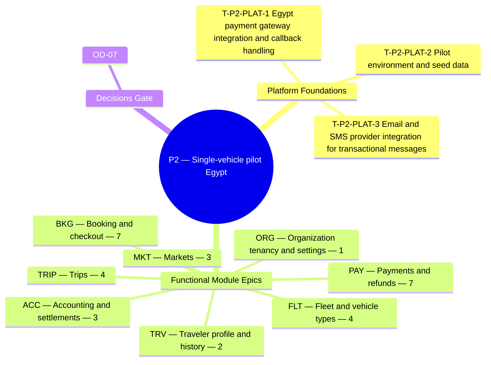

**Theme.** Single-vehicle pilot (Egypt) — trip creation, traveler booking, payment in EGP, admin basics

**Definition of done.** One pilot organization sells one trip to real travelers with real payments. *([BRD section 3.3](/en/docs/brd#33-delivery-phases))*

**34 delivery tasks** (**31** functional tasks: **30** Must, **1** Should, **0** Could + **3** cross-cutting platform foundation tasks) across **8** SRS modules. Every task below carries its complete specification, implementation deliverables, acceptance criteria, affected PostgreSQL tables, and cross-specification links across BRD, SRS, ERD, Plan, Workflows, User Flows, Architecture, Design, End-to-End Lifecycle, and Recommendations.

**Data model.** [ERD conventions](/en/docs/erd), [Access Control & RLS](/en/docs/erd/acl), and the [lookup catalog](/en/docs/erd/reference) apply to every table touched in this phase.

<MindmapBlock title="P2 Scope Mindmap — Single-vehicle pilot (Egypt)" caption="Breakdown of platform foundations, module epics (34 tasks), and milestone gates for P2." trace={{"brd":[{"label":"BRD §3.3 Phases","href":"/en/docs/brd#33-delivery-phases"}],"srs":[{"label":"SRS Traceability","href":"/en/docs/srs/traceability"}],"erd":[{"label":"ERD Overview","href":"/en/docs/erd"}],"plan":[{"label":"Milestones","href":"/en/docs/plan/milestones"},{"label":"Build Guide","href":"/en/docs/plan/build-guide"}],"workflows":[{"label":"Workflow Coverage","href":"/en/docs/workflows/coverage"}],"architecture":[{"label":"Architecture","href":"/en/docs/architecture"}],"design":[{"label":"Design System","href":"/en/docs/design"}],"system":[{"label":"End-to-End Lifecycle","href":"/en/docs/system/lifecycle"}],"recommendations":[{"label":"Open Decisions","href":"/en/docs/recommendations/open-decisions"}]}}>

</MindmapBlock>

## Quick-jump task index

| Task | Module | Reference | Priority |
|---|---|---|---|
| [T-P2-PLAT-1 — Egypt payment gateway integration and callback handling](#t-p2-plat-1) | `PLAT` | [NFR-AVL-03](/en/docs/srs/quality#83-availability-nfr-avl) | Must |
| [T-P2-PLAT-2 — Pilot environment and seed data](#t-p2-plat-2) | `PLAT` | [NFR-I18N](/en/docs/srs/quality#87-internationalization-nfr-i18n) | Must |
| [T-P2-PLAT-3 — Email and SMS provider integration for transactional messages](#t-p2-plat-3) | `PLAT` | [NFR-I18N](/en/docs/srs/quality#87-internationalization-nfr-i18n) | Must |
| [T-P2-ORG-1 — Fleet registration](#t-p2-org-1) | `ORG` | [FR-ORG-04](/en/docs/srs/requirements/org#fr-org-04--fleet-registration) | Must |
| [T-P2-TRIP-1 — Trip creation wizard](#t-p2-trip-1) | `TRIP` | [FR-TRIP-01](/en/docs/srs/requirements/trip#fr-trip-01--trip-creation-wizard) | Must |
| [T-P2-TRIP-2 — Draft, public and targeted publishing](#t-p2-trip-2) | `TRIP` | [FR-TRIP-02](/en/docs/srs/requirements/trip#fr-trip-02--draft-public-and-targeted-publishing) | Must |
| [T-P2-TRIP-3 — Trip lifecycle](#t-p2-trip-3) | `TRIP` | [FR-TRIP-05](/en/docs/srs/requirements/trip#fr-trip-05--trip-lifecycle) | Must |
| [T-P2-TRIP-4 — Changes that affect confirmed bookings](#t-p2-trip-4) | `TRIP` | [FR-TRIP-06](/en/docs/srs/requirements/trip#fr-trip-06--changes-that-affect-confirmed-bookings) | Must |
| [T-P2-FLT-1 — Reusable vehicle types](#t-p2-flt-1) | `FLT` | [FR-FLT-01](/en/docs/srs/requirements/flt#fr-flt-01--reusable-vehicle-types) | Must |
| [T-P2-FLT-2 — Vehicle registry](#t-p2-flt-2) | `FLT` | [FR-FLT-02](/en/docs/srs/requirements/flt#fr-flt-02--vehicle-registry) | Must |
| [T-P2-FLT-3 — Seat map from vehicle type](#t-p2-flt-3) | `FLT` | [FR-FLT-04](/en/docs/srs/requirements/flt#fr-flt-04--seat-map-from-vehicle-type) | Must |
| [T-P2-FLT-4 — Archiving vehicle types](#t-p2-flt-4) | `FLT` | [FR-FLT-06](/en/docs/srs/requirements/flt#fr-flt-06--archiving-vehicle-types) | Should |
| [T-P2-BKG-1 — Booking composition](#t-p2-bkg-1) | `BKG` | [FR-BKG-01](/en/docs/srs/requirements/bkg#fr-bkg-01--booking-composition) | Must |
| [T-P2-BKG-2 — Checkout handoff](#t-p2-bkg-2) | `BKG` | [FR-BKG-02](/en/docs/srs/requirements/bkg#fr-bkg-02--checkout-handoff) | Must |
| [T-P2-BKG-3 — Retry without losing the cart](#t-p2-bkg-3) | `BKG` | [FR-BKG-03](/en/docs/srs/requirements/bkg#fr-bkg-03--retry-without-losing-the-cart) | Must |
| [T-P2-BKG-4 — Traveler cancellation and refund](#t-p2-bkg-4) | `BKG` | [FR-BKG-04](/en/docs/srs/requirements/bkg#fr-bkg-04--traveler-cancellation-and-refund) | Must |
| [T-P2-BKG-5 — Receipts and invoices](#t-p2-bkg-5) | `BKG` | [FR-BKG-05](/en/docs/srs/requirements/bkg#fr-bkg-05--receipts-and-invoices) | Must |
| [T-P2-BKG-6 — Organization cancellation of a trip](#t-p2-bkg-6) | `BKG` | [FR-BKG-06](/en/docs/srs/requirements/bkg#fr-bkg-06--organization-cancellation-of-a-trip) | Must |
| [T-P2-BKG-7 — Booking states](#t-p2-bkg-7) | `BKG` | [FR-BKG-07](/en/docs/srs/requirements/bkg#fr-bkg-07--booking-states) | Must |
| [T-P2-PAY-1 — Payment outcomes](#t-p2-pay-1) | `PAY` | [FR-PAY-01](/en/docs/srs/requirements/pay#fr-pay-01--payment-outcomes) | Must |
| [T-P2-PAY-2 — Idempotent callbacks](#t-p2-pay-2) | `PAY` | [FR-PAY-02](/en/docs/srs/requirements/pay#fr-pay-02--idempotent-callbacks) | Must |
| [T-P2-PAY-3 — Refund execution](#t-p2-pay-3) | `PAY` | [FR-PAY-03](/en/docs/srs/requirements/pay#fr-pay-03--refund-execution) | Must |
| [T-P2-PAY-4 — Gateway reconciliation](#t-p2-pay-4) | `PAY` | [FR-PAY-05](/en/docs/srs/requirements/pay#fr-pay-05--gateway-reconciliation) | Must |
| [T-P2-PAY-5 — Payment methods per market](#t-p2-pay-5) | `PAY` | [FR-PAY-07](/en/docs/srs/requirements/pay#fr-pay-07--payment-methods-per-market) | Must |
| [T-P2-PAY-6 — Payment pending](#t-p2-pay-6) | `PAY` | [FR-PAY-08](/en/docs/srs/requirements/pay#fr-pay-08--payment-pending) | Must |
| [T-P2-PAY-7 — Fawry cash vouchers](#t-p2-pay-7) | `PAY` | [FR-PAY-09](/en/docs/srs/requirements/pay#fr-pay-09--fawry-cash-vouchers) | Must |
| [T-P2-ACC-1 — Double-entry ledger](#t-p2-acc-1) | `ACC` | [FR-ACC-01](/en/docs/srs/requirements/acc#fr-acc-01--double-entry-ledger) | Must |
| [T-P2-ACC-2 — Reconciled exports](#t-p2-acc-2) | `ACC` | [FR-ACC-07](/en/docs/srs/requirements/acc#fr-acc-07--reconciled-exports) | Must |
| [T-P2-ACC-3 — Daily reconciliation and finance digest](#t-p2-acc-3) | `ACC` | [FR-ACC-09](/en/docs/srs/requirements/acc#fr-acc-09--daily-reconciliation-and-finance-digest) | Must |
| [T-P2-TRV-1 — Trip visibility and early access](#t-p2-trv-1) | `TRV` | [FR-TRV-02](/en/docs/srs/requirements/trv#fr-trv-02--trip-visibility-and-early-access) | Must |
| [T-P2-TRV-2 — History and receipts by plan](#t-p2-trv-2) | `TRV` | [FR-TRV-03](/en/docs/srs/requirements/trv#fr-trv-03--history-and-receipts-by-plan) | Must |
| [T-P2-MKT-1 — Market configuration](#t-p2-mkt-1) | `MKT` | [FR-MKT-01](/en/docs/srs/requirements/mkt#fr-mkt-01--market-configuration) | Must |
| [T-P2-MKT-2 — Market from country](#t-p2-mkt-2) | `MKT` | [FR-MKT-02](/en/docs/srs/requirements/mkt#fr-mkt-02--market-from-country) | Must |
| [T-P2-MKT-3 — Rounding and display](#t-p2-mkt-3) | `MKT` | [FR-MKT-05](/en/docs/srs/requirements/mkt#fr-mkt-05--rounding-and-display) | Must |

## Cross-cutting

These platform-wide engineering tasks establish the runtime, database, integration, and observability foundations required to close this phase gate.

### T-P2-PLAT-1 — Egypt payment gateway integration and callback handling

<TaskCard id="T-P2-PLAT-1" title="Egypt payment gateway integration and callback handling" phase="P2" module="PLAT" priority="Must" kind="platform" surfaces={["API","Worker","Traveler App"]} tables={[]} trace={{"brd":[{"label":"BRD P2 Gate","href":"/en/docs/brd#33-delivery-phases"}],"srs":[{"label":"NFR-AVL-03","href":"/en/docs/srs/quality#83-availability-nfr-avl"}],"erd":[{"label":"Booking and payment","href":"/en/docs/erd/domains/booking-and-payment"},{"label":"Platform","href":"/en/docs/erd/domains/platform"},{"label":"ACL & RLS","href":"/en/docs/erd/acl"}],"plan":[{"label":"Milestones","href":"/en/docs/plan/milestones"},{"label":"Test Strategy","href":"/en/docs/plan/testing"}],"workflows":[{"label":"booking-payment","href":"/en/docs/workflows/booking-payment"}],"userFlows":[{"label":"Role Flows","href":"/en/docs/user-flows"}],"architecture":[{"label":"Architecture","href":"/en/docs/architecture#integrations"}],"design":[{"label":"Design System","href":"/en/docs/design#traveler-app"}],"system":[{"label":"STAGE-05","href":"/en/docs/system/lifecycle#stage-05"}],"recommendations":[{"label":"REC-PAY-04","href":"/en/docs/recommendations/architecture-and-ops#rec-pay-04"}]}}>

**Platform scope.** Integrate Paymob/Stripe cards and Fawry 48-hour cash vouchers for EGP minor units (piastres), with HMAC signature verification, `payment_events` deduplication, callback replay queues, and 1-5-10-15 minute active status polling.

**Implementation deliverables.**

- Gateway adapter interface supporting card checkout, Fawry reference generation, refund execution, and signed webhook ingestion (`FR-PAY-02`).
- Durable inbound callback queue ensuring zero confirmed payments are lost during transient outages (`NFR-AVL-03`).

**Acceptance & verification criteria.**

- Given the same gateway callback replayed 3 times, when received by `/webhooks/payments`, then booking confirmation and ledger posting execute exactly once.
- Given an unanswered card charge at 30 seconds, when the poller runs at 1, 5, and 10 minutes, then booking status resolves or escalates to admin at 15 minutes.

</TaskCard>

### T-P2-PLAT-2 — Pilot environment and seed data

<TaskCard id="T-P2-PLAT-2" title="Pilot environment and seed data" phase="P2" module="PLAT" priority="Must" kind="platform" surfaces={["Database","Admin Console","Organization Dashboard"]} tables={["markets","lookups","lookup_types"]} trace={{"brd":[{"label":"BRD P2 Gate","href":"/en/docs/brd#33-delivery-phases"}],"srs":[{"label":"NFR-I18N","href":"/en/docs/srs/quality#87-internationalization-nfr-i18n"}],"erd":[{"label":"Lookups and markets","href":"/en/docs/erd/domains/lookups-and-markets"},{"label":"Plans and subscriptions","href":"/en/docs/erd/domains/plans-and-subscriptions"},{"label":"markets","href":"/en/docs/erd/domains/lookups-and-markets#markets","detail":"table"},{"label":"lookups","href":"/en/docs/erd/domains/lookups-and-markets#lookups","detail":"table"},{"label":"lookup_types","href":"/en/docs/erd/domains/lookups-and-markets#lookup_types","detail":"table"},{"label":"ACL & RLS","href":"/en/docs/erd/acl"}],"plan":[{"label":"Milestones","href":"/en/docs/plan/milestones"},{"label":"Test Strategy","href":"/en/docs/plan/testing"}],"workflows":[{"label":"booking-payment","href":"/en/docs/workflows/booking-payment"}],"userFlows":[{"label":"Role Flows","href":"/en/docs/user-flows"}],"architecture":[{"label":"Architecture","href":"/en/docs/architecture#deployment-topology"}],"design":[{"label":"Design System","href":"/en/docs/design#rtl-and-localization"}],"system":[{"label":"STAGE-01","href":"/en/docs/system/lifecycle#stage-01"}],"recommendations":[{"label":"REC-OPS-12","href":"/en/docs/recommendations/architecture-and-ops#rec-ops-12"}]}}>

**Platform scope.** Bootstrap the Egypt (`EG` / `EGP` / `Africa/Cairo`) market configuration, canonical bilingual lookup catalogs (`lookup_types`, `lookups`), starter vehicle seat templates, and verified staging rehearsal scripts for the P2 pilot.

**Implementation deliverables.**

- Idempotent seed runner populating `lookup_types`, `lookups` (AR + EN labels), `markets` (`EG` active, `SA`/`AE` disabled until P5), and default plans.
- End-to-end smoke script rehearsing org approval -> single-bus trip publish -> EGP booking -> refund.

**Acceptance & verification criteria.**

- Given the seed script runs twice on an existing database, when completed, then no duplicate lookup rows or altered IDs are created.
- Given Egypt market configuration, when any trip price or receipt renders, then EGP currency and `Africa/Cairo` timestamps display with Western digits.

</TaskCard>

### T-P2-PLAT-3 — Email and SMS provider integration for transactional messages

<TaskCard id="T-P2-PLAT-3" title="Email and SMS provider integration for transactional messages" phase="P2" module="PLAT" priority="Must" kind="platform" surfaces={["Worker","Notifications Pipeline"]} tables={[]} trace={{"brd":[{"label":"BRD P2 Gate","href":"/en/docs/brd#33-delivery-phases"}],"srs":[{"label":"NFR-I18N","href":"/en/docs/srs/quality#87-internationalization-nfr-i18n"}],"erd":[{"label":"Platform","href":"/en/docs/erd/domains/platform"},{"label":"ACL & RLS","href":"/en/docs/erd/acl"}],"plan":[{"label":"Milestones","href":"/en/docs/plan/milestones"},{"label":"Test Strategy","href":"/en/docs/plan/testing"}],"workflows":[{"label":"notifications","href":"/en/docs/workflows/notifications"}],"userFlows":[{"label":"Role Flows","href":"/en/docs/user-flows"}],"architecture":[{"label":"Architecture","href":"/en/docs/architecture#integrations"}],"design":[{"label":"Design System","href":"/en/docs/design#notification-surfaces"}],"system":[{"label":"STAGE-07","href":"/en/docs/system/lifecycle#stage-07"}],"recommendations":[{"label":"REC-UX-11","href":"/en/docs/recommendations/architecture-and-ops#rec-ux-11"}]}}>

**Platform scope.** Connect primary and fallback MENA SMS/WhatsApp and transactional email providers behind the unified notification facade with delivery webhook tracking, OTP channel failover (`D-59`), and bounce suppression.

**Implementation deliverables.**

- Provider adapters with 3-attempt exponential backoff, per-event deduplication keys, and delivery state callbacks (`FR-NTF-05`, `FR-NTF-06`).
- Bilingual RTL/LTR HTML email & SMS templates for OTPs, booking confirmations, Fawry vouchers, and trip reminders.

**Acceptance & verification criteria.**

- Given 3 consecutive OTP SMS failures, when the user requests delivery, then the system offers the alternate verified channel (`BRL-20`).
- Given a non-urgent reminder generated at 02:00 recipient local time, when queued, then delivery holds until 07:00 local time.

</TaskCard>

## ORG — Organization tenancy and settings

**Data model.** [Finance](/en/docs/erd/domains/finance), [Organizations](/en/docs/erd/domains/organizations) — the data-model domains and tables this module's requirements read and write.

### T-P2-ORG-1 — Fleet registration

<TaskCard id="T-P2-ORG-1" title="Fleet registration" phase="P2" module="ORG" priority="Must" surfaces={["Organization Dashboard","Admin Console"]} tables={["organizations"]} trace={{"brd":[{"label":"BR-ORG-04","href":"/en/docs/brd/requirements#63-organizations-and-employees-org","detail":"P2"}],"srs":[{"label":"FR-ORG-04","href":"/en/docs/srs/requirements/org#fr-org-04--fleet-registration","detail":"Must"},{"label":"Quality NFRs","href":"/en/docs/srs/quality"}],"erd":[{"label":"Finance","href":"/en/docs/erd/domains/finance"},{"label":"Organizations","href":"/en/docs/erd/domains/organizations"},{"label":"organizations","href":"/en/docs/erd/domains/organizations#organizations","detail":"table"}],"plan":[{"label":"P2 Milestone","href":"/en/docs/plan/milestones"},{"label":"Testing Pyramid","href":"/en/docs/plan/testing"}],"workflows":[{"label":"applications","href":"/en/docs/workflows/applications"}],"userFlows":[{"label":"UF-ORG-23","href":"/en/docs/user-flows/organization#uf-org-23-fleet-mid-lifecycle"}],"architecture":[{"label":"Architecture","href":"/en/docs/architecture#data-architecture"}],"design":[{"label":"Design Surface","href":"/en/docs/design#organization-dashboard"}],"system":[{"label":"STAGE-02","href":"/en/docs/system/lifecycle#stage-02"}],"recommendations":[{"label":"REC-DATA-02","href":"/en/docs/recommendations/architecture-and-ops#rec-data-02"}]}}>

**Specification ([FR-ORG-04](/en/docs/srs/requirements/org#fr-org-04--fleet-registration)).** An organization shall register vehicles with plate, model, year, vehicle type, seats and registration status.

**Implementation deliverables.**

- **Domain & API logic:** Enforce PostgreSQL RLS tenant isolation (`app.current_organization_id`), workspace provisioning on approval, org-owned staff boundaries, and signed outbound webhooks.
- **Persistence & RLS:** Read/write operations on `organizations` enforcing base-column conventions, soft-delete filters, and tenant/role access control ([ACL](/en/docs/erd/acl)).
- **Verification & telemetry:** Automated unit/integration coverage mapped to `FR-ORG-04` acceptance scenarios ([Test Strategy](/en/docs/plan/testing)) with structured trace/audit emission.

**Acceptance criteria.**

- Given a vehicle with a seat count that differs from its type, when it is saved, then it is refused with the mismatch shown.

**Business trace & governing rules.**

- [BR-ORG-04](/en/docs/brd/requirements#63-organizations-and-employees-org): Organizations register their vehicles (plate, model, year, seats, registration status).

</TaskCard>

## TRIP — Trips

**Data model.** [Fleet and trips](/en/docs/erd/domains/fleet-and-trips) — the data-model domains and tables this module's requirements read and write.

### T-P2-TRIP-1 — Trip creation wizard

<TaskCard id="T-P2-TRIP-1" title="Trip creation wizard" phase="P2" module="TRIP" priority="Must" surfaces={["Organization Dashboard","Traveler App","Admin Console"]} tables={["trips"]} trace={{"brd":[{"label":"BR-TRIP-01","href":"/en/docs/brd/requirements#64-trips-programs-and-fleet-trip-prg-flt","detail":"P2"}],"srs":[{"label":"FR-TRIP-01","href":"/en/docs/srs/requirements/trip#fr-trip-01--trip-creation-wizard","detail":"Must"},{"label":"SM §7.1 Trip","href":"/en/docs/srs/state-machines#71-trip-lifecycle"},{"label":"Quality NFRs","href":"/en/docs/srs/quality"}],"erd":[{"label":"Fleet and trips","href":"/en/docs/erd/domains/fleet-and-trips"},{"label":"trips","href":"/en/docs/erd/domains/fleet-and-trips#trips","detail":"table"}],"plan":[{"label":"P2 Milestone","href":"/en/docs/plan/milestones"},{"label":"Testing Pyramid","href":"/en/docs/plan/testing"}],"workflows":[{"label":"trip-lifecycle","href":"/en/docs/workflows/trip-lifecycle"}],"userFlows":[{"label":"UF-ORG-06","href":"/en/docs/user-flows/organization#uf-org-06-create-a-trip-wizard"}],"architecture":[{"label":"Architecture","href":"/en/docs/architecture#service-model"}],"design":[{"label":"Design Surface","href":"/en/docs/design#organization-dashboard"}],"system":[{"label":"STAGE-04","href":"/en/docs/system/lifecycle#stage-04"}],"recommendations":[{"label":"REC-ARCH-01","href":"/en/docs/recommendations/architecture-and-ops#rec-arch-01"}]}}>

**Specification ([FR-TRIP-01](/en/docs/srs/requirements/trip#fr-trip-01--trip-creation-wizard)).** The organization shall create a trip through a wizard: basics, schedule and route, vehicles, staffing, programs, seating, pricing and capacity, publishing. Publishing is blocked until required steps are complete. Drafts save automatically.

**Implementation deliverables.**

- **Domain & API logic:** Implement multi-step trip authoring, Trip state-machine guards, capacity transitions, post-booking change remedies (7-day window), cancellation rules, and 30-day archival.
- **Persistence & RLS:** Read/write operations on `trips` enforcing base-column conventions, soft-delete filters, and tenant/role access control ([ACL](/en/docs/erd/acl)).
- **Verification & telemetry:** Automated unit/integration coverage mapped to `FR-TRIP-01` acceptance scenarios ([Test Strategy](/en/docs/plan/testing)) with structured trace/audit emission.

**Acceptance criteria.**

- Given the vehicles step is incomplete, when the organization publishes, then publishing is blocked and the step is named.

**Business trace & governing rules.**

- [BR-TRIP-01](/en/docs/brd/requirements#64-trips-programs-and-fleet-trip-prg-flt): Organizations create trips through a guided wizard: basics, schedule and route, vehicles, staffing, programs, seating, pricing and capacity, publishing.

</TaskCard>

### T-P2-TRIP-2 — Draft, public and targeted publishing

<TaskCard id="T-P2-TRIP-2" title="Draft, public and targeted publishing" phase="P2" module="TRIP" priority="Must" surfaces={["Organization Dashboard","Traveler App","Admin Console"]} tables={["trips"]} trace={{"brd":[{"label":"BR-TRIP-02","href":"/en/docs/brd/requirements#64-trips-programs-and-fleet-trip-prg-flt","detail":"P2"}],"srs":[{"label":"FR-TRIP-02","href":"/en/docs/srs/requirements/trip#fr-trip-02--draft-public-and-targeted-publishing","detail":"Must"},{"label":"SM §7.1 Trip","href":"/en/docs/srs/state-machines#71-trip-lifecycle"},{"label":"Quality NFRs","href":"/en/docs/srs/quality"}],"erd":[{"label":"Fleet and trips","href":"/en/docs/erd/domains/fleet-and-trips"},{"label":"trips","href":"/en/docs/erd/domains/fleet-and-trips#trips","detail":"table"}],"plan":[{"label":"P2 Milestone","href":"/en/docs/plan/milestones"},{"label":"Testing Pyramid","href":"/en/docs/plan/testing"}],"workflows":[{"label":"trip-lifecycle","href":"/en/docs/workflows/trip-lifecycle#timers-and-rules"}],"userFlows":[{"label":"UF-ORG-06","href":"/en/docs/user-flows/organization#uf-org-06-create-a-trip-wizard"},{"label":"UF-TRV-01","href":"/en/docs/user-flows/traveler#uf-trv-01-browse-as-a-visitor"}],"architecture":[{"label":"Architecture","href":"/en/docs/architecture#service-model"}],"design":[{"label":"Design Surface","href":"/en/docs/design#organization-dashboard"}],"system":[{"label":"STAGE-04","href":"/en/docs/system/lifecycle#stage-04"}],"recommendations":[{"label":"REC-ARCH-01","href":"/en/docs/recommendations/architecture-and-ops#rec-arch-01"}]}}>

**Specification ([FR-TRIP-02](/en/docs/srs/requirements/trip#fr-trip-02--draft-public-and-targeted-publishing)).** A trip shall be saved as a hidden draft, published publicly, or published to a target list of travelers.

**Implementation deliverables.**

- **Domain & API logic:** Implement multi-step trip authoring, Trip state-machine guards, capacity transitions, post-booking change remedies (7-day window), cancellation rules, and 30-day archival.
- **Persistence & RLS:** Read/write operations on `trips` enforcing base-column conventions, soft-delete filters, and tenant/role access control ([ACL](/en/docs/erd/acl)).
- **Verification & telemetry:** Automated unit/integration coverage mapped to `FR-TRIP-02` acceptance scenarios ([Test Strategy](/en/docs/plan/testing)) with structured trace/audit emission.

**Acceptance criteria.**

- Given a draft, when travelers search, then it is not shown.
- Given a targeted trip, when a traveler not on the list browses, then it is not shown.

**Business trace & governing rules.**

- [BR-TRIP-02](/en/docs/brd/requirements#64-trips-programs-and-fleet-trip-prg-flt): A trip can be saved as a hidden draft, published publicly, or published to targeted travelers only.

</TaskCard>

### T-P2-TRIP-3 — Trip lifecycle

<TaskCard id="T-P2-TRIP-3" title="Trip lifecycle" phase="P2" module="TRIP" priority="Must" surfaces={["Organization Dashboard","Traveler App","Admin Console"]} tables={["trips"]} trace={{"brd":[{"label":"BR-TRIP-02","href":"/en/docs/brd/requirements#64-trips-programs-and-fleet-trip-prg-flt","detail":"P2"},{"label":"BRL-07","href":"/en/docs/brd/requirements#7-business-rules","detail":"rule"},{"label":"BRL-30","href":"/en/docs/brd/requirements#7-business-rules","detail":"rule"}],"srs":[{"label":"FR-TRIP-05","href":"/en/docs/srs/requirements/trip#fr-trip-05--trip-lifecycle","detail":"Must"},{"label":"SM §7.1 Trip","href":"/en/docs/srs/state-machines#71-trip-lifecycle"},{"label":"Quality NFRs","href":"/en/docs/srs/quality"}],"erd":[{"label":"Fleet and trips","href":"/en/docs/erd/domains/fleet-and-trips"},{"label":"trips","href":"/en/docs/erd/domains/fleet-and-trips#trips","detail":"table"}],"plan":[{"label":"P2 Milestone","href":"/en/docs/plan/milestones"},{"label":"Testing Pyramid","href":"/en/docs/plan/testing"}],"workflows":[{"label":"trip-lifecycle","href":"/en/docs/workflows/trip-lifecycle"}],"userFlows":[{"label":"UF-ADM-14","href":"/en/docs/user-flows/admin#uf-adm-14-trip-oversight-and-audit-log"}],"architecture":[{"label":"Architecture","href":"/en/docs/architecture#service-model"}],"design":[{"label":"Design Surface","href":"/en/docs/design#organization-dashboard"}],"system":[{"label":"STAGE-06","href":"/en/docs/system/lifecycle#stage-06"}],"recommendations":[{"label":"REC-ARCH-01","href":"/en/docs/recommendations/architecture-and-ops#rec-arch-01"}]}}>

**Specification ([FR-TRIP-05](/en/docs/srs/requirements/trip#fr-trip-05--trip-lifecycle)).** A trip shall move only through the transitions in section 7.1. A trip In Progress cannot be cancelled (D-25, [OD-22](/en/docs/brd/compliance#11-open-decisions)).

**Implementation deliverables.**

- **Domain & API logic:** Implement multi-step trip authoring, Trip state-machine guards, capacity transitions, post-booking change remedies (7-day window), cancellation rules, and 30-day archival.
- **Persistence & RLS:** Read/write operations on `trips` enforcing base-column conventions, soft-delete filters, and tenant/role access control ([ACL](/en/docs/erd/acl)).
- **Verification & telemetry:** Automated unit/integration coverage mapped to `FR-TRIP-05` acceptance scenarios ([Test Strategy](/en/docs/plan/testing)) with structured trace/audit emission.

**Acceptance criteria.**

- Given a Draft trip, when In Progress is requested, then the transition is refused.

**Business trace & governing rules.**

- [BR-TRIP-02](/en/docs/brd/requirements#64-trips-programs-and-fleet-trip-prg-flt): A trip can be saved as a hidden draft, published publicly, or published to targeted travelers only.
- [BRL-07](/en/docs/brd/requirements#7-business-rules): A trip cannot move to Ready until every vehicle has a driver and a moderator and every platform deal is finalized.
- [BRL-30](/en/docs/brd/requirements#7-business-rules): When an organization cancels a trip, every confirmed booking is refunded in full and coupon redemptions are reversed (D-150). A trip that is In Progress cannot be cancelled; it is handled as an incident (D-25, [OD-22](/en/docs/brd/compliance#11-open-decisions)).

</TaskCard>

### T-P2-TRIP-4 — Changes that affect confirmed bookings

<TaskCard id="T-P2-TRIP-4" title="Changes that affect confirmed bookings" phase="P2" module="TRIP" priority="Must" surfaces={["Organization Dashboard","Traveler App","Admin Console"]} tables={["trips"]} trace={{"brd":[{"label":"BRL-24","href":"/en/docs/brd/requirements#7-business-rules","detail":"rule"}],"srs":[{"label":"FR-TRIP-06","href":"/en/docs/srs/requirements/trip#fr-trip-06--changes-that-affect-confirmed-bookings","detail":"Must"},{"label":"SM §7.1 Trip","href":"/en/docs/srs/state-machines#71-trip-lifecycle"},{"label":"Quality NFRs","href":"/en/docs/srs/quality"}],"erd":[{"label":"Fleet and trips","href":"/en/docs/erd/domains/fleet-and-trips"},{"label":"trips","href":"/en/docs/erd/domains/fleet-and-trips#trips","detail":"table"}],"plan":[{"label":"P2 Milestone","href":"/en/docs/plan/milestones"},{"label":"Testing Pyramid","href":"/en/docs/plan/testing"}],"workflows":[{"label":"refunds","href":"/en/docs/workflows/refunds#timers-and-rules"},{"label":"scheduled-jobs","href":"/en/docs/workflows/scheduled-jobs#countdowns-per-record-timers"},{"label":"trip-lifecycle","href":"/en/docs/workflows/trip-lifecycle#timers-and-rules"},{"label":"trip-lifecycle","href":"/en/docs/workflows/trip-lifecycle#stories"}],"userFlows":[{"label":"UF-ORG-10","href":"/en/docs/user-flows/organization#uf-org-10-change-a-trip-after-bookings"},{"label":"UF-TRV-07","href":"/en/docs/user-flows/traveler#uf-trv-07-choose-a-remedy-after-a-trip-change"}],"architecture":[{"label":"Architecture","href":"/en/docs/architecture#service-model"}],"design":[{"label":"Design Surface","href":"/en/docs/design#organization-dashboard"}],"system":[{"label":"STAGE-06","href":"/en/docs/system/lifecycle#stage-06"}],"recommendations":[{"label":"REC-ARCH-01","href":"/en/docs/recommendations/architecture-and-ops#rec-arch-01"}]}}>

**Specification ([FR-TRIP-06](/en/docs/srs/requirements/trip#fr-trip-06--changes-that-affect-confirmed-bookings)).** A change to programs, seat mode, vehicles or times that would break a confirmed booking shall notify each affected traveler and offer remedies (keep with the change, switch option, or cancel with full refund) before it takes effect. The traveler has 7 days to choose; then the case goes to admin (D-148). Vehicle or driver changes are notified within 1 hour (D-186).

**Implementation deliverables.**

- **Domain & API logic:** Implement multi-step trip authoring, Trip state-machine guards, capacity transitions, post-booking change remedies (7-day window), cancellation rules, and 30-day archival.
- **Persistence & RLS:** Read/write operations on `trips` enforcing base-column conventions, soft-delete filters, and tenant/role access control ([ACL](/en/docs/erd/acl)).
- **Verification & telemetry:** Automated unit/integration coverage mapped to `FR-TRIP-06` acceptance scenarios ([Test Strategy](/en/docs/plan/testing)) with structured trace/audit emission.

**Acceptance criteria.**

- Given a confirmed booking includes a program being removed, when the change is confirmed, then the traveler is notified and offered remedies before the removal applies.

**Business trace & governing rules.**

- [BRL-24](/en/docs/brd/requirements#7-business-rules): A trip's programs, seat mode or vehicles cannot be changed in a way that breaks a confirmed booking until the traveler is notified and offered a remedy. The traveler has 7 days to choose; then the case goes to admin (D-148).

</TaskCard>

## FLT — Fleet and vehicle types

**Data model.** [Fleet and trips](/en/docs/erd/domains/fleet-and-trips) — the data-model domains and tables this module's requirements read and write.

### T-P2-FLT-1 — Reusable vehicle types

<TaskCard id="T-P2-FLT-1" title="Reusable vehicle types" phase="P2" module="FLT" priority="Must" surfaces={["Organization Dashboard","Driver App"]} tables={[]} trace={{"brd":[{"label":"BR-FLT-01","href":"/en/docs/brd/requirements#64-trips-programs-and-fleet-trip-prg-flt","detail":"P2"}],"srs":[{"label":"FR-FLT-01","href":"/en/docs/srs/requirements/flt#fr-flt-01--reusable-vehicle-types","detail":"Must"},{"label":"Quality NFRs","href":"/en/docs/srs/quality"}],"erd":[{"label":"Fleet and trips","href":"/en/docs/erd/domains/fleet-and-trips"}],"plan":[{"label":"P2 Milestone","href":"/en/docs/plan/milestones"},{"label":"Testing Pyramid","href":"/en/docs/plan/testing"}],"workflows":[{"label":"trip-lifecycle","href":"/en/docs/workflows/trip-lifecycle"}],"userFlows":[{"label":"UF-ORG-04","href":"/en/docs/user-flows/organization#uf-org-04-fleet"}],"architecture":[{"label":"Architecture","href":"/en/docs/architecture#data-architecture"}],"design":[{"label":"Design Surface","href":"/en/docs/design#organization-dashboard"}],"system":[{"label":"STAGE-03","href":"/en/docs/system/lifecycle#stage-03"}],"recommendations":[{"label":"REC-BOOK-03","href":"/en/docs/recommendations/architecture-and-ops#rec-book-03"}]}}>

**Specification ([FR-FLT-01](/en/docs/srs/requirements/flt#fr-flt-01--reusable-vehicle-types)).** A vehicle type shall define a seat layout with labeled seats, reusable across trips.

**Implementation deliverables.**

- **Domain & API logic:** Manage reusable vehicle types, visual seat-grid geometry, multi-vehicle trip allocations, and vehicle reassignment safeguards.
- **Verification & telemetry:** Automated unit/integration coverage mapped to `FR-FLT-01` acceptance scenarios ([Test Strategy](/en/docs/plan/testing)) with structured trace/audit emission.

**Acceptance criteria.**

- Given a 48-seat type, when a new trip selects it, then the trip uses the same 48 labeled seats.

**Business trace & governing rules.**

- [BR-FLT-01](/en/docs/brd/requirements#64-trips-programs-and-fleet-trip-prg-flt): Vehicle types are reusable seat layouts with labeled seats.

</TaskCard>

### T-P2-FLT-2 — Vehicle registry

<TaskCard id="T-P2-FLT-2" title="Vehicle registry" phase="P2" module="FLT" priority="Must" surfaces={["Organization Dashboard","Driver App"]} tables={[]} trace={{"brd":[{"label":"BR-ORG-04","href":"/en/docs/brd/requirements#64-trips-programs-and-fleet-trip-prg-flt","detail":"P2"},{"label":"BR-FLT-01","href":"/en/docs/brd/requirements#64-trips-programs-and-fleet-trip-prg-flt","detail":"P2"}],"srs":[{"label":"FR-FLT-02","href":"/en/docs/srs/requirements/flt#fr-flt-02--vehicle-registry","detail":"Must"},{"label":"Quality NFRs","href":"/en/docs/srs/quality"}],"erd":[{"label":"Fleet and trips","href":"/en/docs/erd/domains/fleet-and-trips"}],"plan":[{"label":"P2 Milestone","href":"/en/docs/plan/milestones"},{"label":"Testing Pyramid","href":"/en/docs/plan/testing"}],"workflows":[{"label":"trip-lifecycle","href":"/en/docs/workflows/trip-lifecycle"}],"userFlows":[{"label":"UF-ORG-04","href":"/en/docs/user-flows/organization#uf-org-04-fleet"}],"architecture":[{"label":"Architecture","href":"/en/docs/architecture#data-architecture"}],"design":[{"label":"Design Surface","href":"/en/docs/design#organization-dashboard"}],"system":[{"label":"STAGE-03","href":"/en/docs/system/lifecycle#stage-03"}],"recommendations":[{"label":"REC-BOOK-03","href":"/en/docs/recommendations/architecture-and-ops#rec-book-03"}]}}>

**Specification ([FR-FLT-02](/en/docs/srs/requirements/flt#fr-flt-02--vehicle-registry)).** A vehicle shall use one vehicle type and its seat count shall match the type.

**Implementation deliverables.**

- **Domain & API logic:** Manage reusable vehicle types, visual seat-grid geometry, multi-vehicle trip allocations, and vehicle reassignment safeguards.
- **Verification & telemetry:** Automated unit/integration coverage mapped to `FR-FLT-02` acceptance scenarios ([Test Strategy](/en/docs/plan/testing)) with structured trace/audit emission.

**Acceptance criteria.**

- Given a 48-seat type and a vehicle saying 50, when saved, then it is refused.

**Business trace & governing rules.**

- [BR-ORG-04](/en/docs/brd/requirements#64-trips-programs-and-fleet-trip-prg-flt): Organizations register their vehicles (plate, model, year, seats, registration status).
- [BR-FLT-01](/en/docs/brd/requirements#64-trips-programs-and-fleet-trip-prg-flt): Vehicle types are reusable seat layouts with labeled seats.

</TaskCard>

### T-P2-FLT-3 — Seat map from vehicle type

<TaskCard id="T-P2-FLT-3" title="Seat map from vehicle type" phase="P2" module="FLT" priority="Must" surfaces={["Organization Dashboard","Driver App"]} tables={[]} trace={{"brd":[{"label":"BR-FLT-01","href":"/en/docs/brd/requirements#64-trips-programs-and-fleet-trip-prg-flt","detail":"P2"},{"label":"BR-SEAT-02","href":"/en/docs/brd/requirements#64-trips-programs-and-fleet-trip-prg-flt","detail":"P2"}],"srs":[{"label":"FR-FLT-04","href":"/en/docs/srs/requirements/flt#fr-flt-04--seat-map-from-vehicle-type","detail":"Must"},{"label":"Quality NFRs","href":"/en/docs/srs/quality"}],"erd":[{"label":"Fleet and trips","href":"/en/docs/erd/domains/fleet-and-trips"}],"plan":[{"label":"P2 Milestone","href":"/en/docs/plan/milestones"},{"label":"Testing Pyramid","href":"/en/docs/plan/testing"}],"workflows":[{"label":"trip-lifecycle","href":"/en/docs/workflows/trip-lifecycle"}],"userFlows":[{"label":"UF-ORG-23","href":"/en/docs/user-flows/organization#uf-org-23-fleet-mid-lifecycle"}],"architecture":[{"label":"Architecture","href":"/en/docs/architecture#data-architecture"}],"design":[{"label":"Design Surface","href":"/en/docs/design#organization-dashboard"}],"system":[{"label":"STAGE-03","href":"/en/docs/system/lifecycle#stage-03"}],"recommendations":[{"label":"REC-BOOK-03","href":"/en/docs/recommendations/architecture-and-ops#rec-book-03"}]}}>

**Specification ([FR-FLT-04](/en/docs/srs/requirements/flt#fr-flt-04--seat-map-from-vehicle-type)).** Each trip vehicle's seat map shall come from its vehicle type and show each seat's label and state.

**Implementation deliverables.**

- **Domain & API logic:** Manage reusable vehicle types, visual seat-grid geometry, multi-vehicle trip allocations, and vehicle reassignment safeguards.
- **Verification & telemetry:** Automated unit/integration coverage mapped to `FR-FLT-04` acceptance scenarios ([Test Strategy](/en/docs/plan/testing)) with structured trace/audit emission.

**Acceptance criteria.**

- Given seat 12B is reserved, when a traveler views the map, then 12B shows unavailable.

**Business trace & governing rules.**

- [BR-FLT-01](/en/docs/brd/requirements#64-trips-programs-and-fleet-trip-prg-flt): Vehicle types are reusable seat layouts with labeled seats.
- [BR-SEAT-02](/en/docs/brd/requirements#64-trips-programs-and-fleet-trip-prg-flt): With self-selection on, travelers see a live seat map where taken seats show as unavailable immediately.

</TaskCard>

### T-P2-FLT-4 — Archiving vehicle types

<TaskCard id="T-P2-FLT-4" title="Archiving vehicle types" phase="P2" module="FLT" priority="Should" surfaces={["Organization Dashboard","Driver App"]} tables={[]} trace={{"brd":[{"label":"BR-FLT-01","href":"/en/docs/brd/requirements#64-trips-programs-and-fleet-trip-prg-flt","detail":"P2"}],"srs":[{"label":"FR-FLT-06","href":"/en/docs/srs/requirements/flt#fr-flt-06--archiving-vehicle-types","detail":"Should"},{"label":"Quality NFRs","href":"/en/docs/srs/quality"}],"erd":[{"label":"Fleet and trips","href":"/en/docs/erd/domains/fleet-and-trips"}],"plan":[{"label":"P2 Milestone","href":"/en/docs/plan/milestones"},{"label":"Testing Pyramid","href":"/en/docs/plan/testing"}],"workflows":[{"label":"trip-lifecycle","href":"/en/docs/workflows/trip-lifecycle"}],"userFlows":[{"label":"UF-ORG-04","href":"/en/docs/user-flows/organization#uf-org-04-fleet"}],"architecture":[{"label":"Architecture","href":"/en/docs/architecture#data-architecture"}],"design":[{"label":"Design Surface","href":"/en/docs/design#organization-dashboard"}],"system":[{"label":"STAGE-03","href":"/en/docs/system/lifecycle#stage-03"}],"recommendations":[{"label":"REC-BOOK-03","href":"/en/docs/recommendations/architecture-and-ops#rec-book-03"}]}}>

**Specification ([FR-FLT-06](/en/docs/srs/requirements/flt#fr-flt-06--archiving-vehicle-types)).** An archived type shall not be offered for new trips; existing trips keep their layout.

**Implementation deliverables.**

- **Domain & API logic:** Manage reusable vehicle types, visual seat-grid geometry, multi-vehicle trip allocations, and vehicle reassignment safeguards.
- **Verification & telemetry:** Automated unit/integration coverage mapped to `FR-FLT-06` acceptance scenarios ([Test Strategy](/en/docs/plan/testing)) with structured trace/audit emission.

**Acceptance criteria.**

- Given an archived type, when a new trip is created, then it is not offered.

**Business trace & governing rules.**

- [BR-FLT-01](/en/docs/brd/requirements#64-trips-programs-and-fleet-trip-prg-flt): Vehicle types are reusable seat layouts with labeled seats.

</TaskCard>

## BKG — Booking and checkout

**Data model.** [Booking and payment](/en/docs/erd/domains/booking-and-payment), [Finance](/en/docs/erd/domains/finance) — the data-model domains and tables this module's requirements read and write.

### T-P2-BKG-1 — Booking composition

<TaskCard id="T-P2-BKG-1" title="Booking composition" phase="P2" module="BKG" priority="Must" surfaces={["Traveler App","Organization Dashboard","Admin Console"]} tables={["bookings"]} trace={{"brd":[{"label":"BR-BKG-01","href":"/en/docs/brd/requirements#67-booking-and-payment-bkg","detail":"P2"}],"srs":[{"label":"FR-BKG-01","href":"/en/docs/srs/requirements/bkg#fr-bkg-01--booking-composition","detail":"Must"},{"label":"SM §7.2 Booking","href":"/en/docs/srs/state-machines#72-booking"},{"label":"Quality NFRs","href":"/en/docs/srs/quality"}],"erd":[{"label":"Booking and payment","href":"/en/docs/erd/domains/booking-and-payment"},{"label":"Finance","href":"/en/docs/erd/domains/finance"},{"label":"bookings","href":"/en/docs/erd/domains/booking-and-payment#bookings","detail":"table"}],"plan":[{"label":"P2 Milestone","href":"/en/docs/plan/milestones"},{"label":"Testing Pyramid","href":"/en/docs/plan/testing"}],"workflows":[{"label":"booking-payment","href":"/en/docs/workflows/booking-payment"}],"userFlows":[{"label":"UF-TRV-03","href":"/en/docs/user-flows/traveler#uf-trv-03-book-a-trip"}],"architecture":[{"label":"Architecture","href":"/en/docs/architecture#service-model"}],"design":[{"label":"Design Surface","href":"/en/docs/design#traveler-app"}],"system":[{"label":"STAGE-05","href":"/en/docs/system/lifecycle#stage-05"}],"recommendations":[{"label":"REC-BOOK-03","href":"/en/docs/recommendations/architecture-and-ops#rec-book-03"}]}}>

**Specification ([FR-BKG-01](/en/docs/srs/requirements/bkg#fr-bkg-01--booking-composition)).** A booking shall hold the passengers (with a child flag), program selections, seats where allowed, at most one coupon unless stackable, an optional buyer tax number, and a payment method.

**Implementation deliverables.**

- **Domain & API logic:** Implement cart assembly, passenger details, price locking on hold, Booking state transitions, time-tiered cancellation (`BRL-12`), and QR boarding passes.
- **Persistence & RLS:** Read/write operations on `bookings` enforcing base-column conventions, soft-delete filters, and tenant/role access control ([ACL](/en/docs/erd/acl)).
- **Verification & telemetry:** Automated unit/integration coverage mapped to `FR-BKG-01` acceptance scenarios ([Test Strategy](/en/docs/plan/testing)) with structured trace/audit emission.

**Acceptance criteria.**

- Given one non-stackable coupon, when a second is entered, then it is refused and the first kept.

**Business trace & governing rules.**

- [BR-BKG-01](/en/docs/brd/requirements#67-booking-and-payment-bkg): A booking holds the passengers, chosen programs, seats where allowed, at most one coupon unless the coupon is stackable, and a payment method.

</TaskCard>

### T-P2-BKG-2 — Checkout handoff

<TaskCard id="T-P2-BKG-2" title="Checkout handoff" phase="P2" module="BKG" priority="Must" surfaces={["Traveler App","Organization Dashboard","Admin Console"]} tables={["bookings"]} trace={{"brd":[{"label":"BR-BKG-02","href":"/en/docs/brd/requirements#67-booking-and-payment-bkg","detail":"P2"}],"srs":[{"label":"FR-BKG-02","href":"/en/docs/srs/requirements/bkg#fr-bkg-02--checkout-handoff","detail":"Must"},{"label":"SM §7.2 Booking","href":"/en/docs/srs/state-machines#72-booking"},{"label":"Quality NFRs","href":"/en/docs/srs/quality"}],"erd":[{"label":"Booking and payment","href":"/en/docs/erd/domains/booking-and-payment"},{"label":"Finance","href":"/en/docs/erd/domains/finance"},{"label":"bookings","href":"/en/docs/erd/domains/booking-and-payment#bookings","detail":"table"}],"plan":[{"label":"P2 Milestone","href":"/en/docs/plan/milestones"},{"label":"Testing Pyramid","href":"/en/docs/plan/testing"}],"workflows":[{"label":"booking-payment","href":"/en/docs/workflows/booking-payment"}],"userFlows":[{"label":"UF-TRV-03","href":"/en/docs/user-flows/traveler#uf-trv-03-book-a-trip"}],"architecture":[{"label":"Architecture","href":"/en/docs/architecture#service-model"}],"design":[{"label":"Design Surface","href":"/en/docs/design#traveler-app"}],"system":[{"label":"STAGE-05","href":"/en/docs/system/lifecycle#stage-05"}],"recommendations":[{"label":"REC-BOOK-03","href":"/en/docs/recommendations/architecture-and-ops#rec-book-03"}]}}>

**Specification ([FR-BKG-02](/en/docs/srs/requirements/bkg#fr-bkg-02--checkout-handoff)).** Card details shall be entered only on the gateway page or SDK, using the methods of the trip's market ([FR-MKT-03](/en/docs/srs/requirements/mkt#fr-mkt-03--cross-market-browsing)). Card data never reaches Trips Enjoy.

**Implementation deliverables.**

- **Domain & API logic:** Implement cart assembly, passenger details, price locking on hold, Booking state transitions, time-tiered cancellation (`BRL-12`), and QR boarding passes.
- **Persistence & RLS:** Read/write operations on `bookings` enforcing base-column conventions, soft-delete filters, and tenant/role access control ([ACL](/en/docs/erd/acl)).
- **Verification & telemetry:** Automated unit/integration coverage mapped to `FR-BKG-02` acceptance scenarios ([Test Strategy](/en/docs/plan/testing)) with structured trace/audit emission.

**Acceptance criteria.**

- Given checkout reaches payment, when the traveler pays, then no card number, expiry or security code appears in platform logs or data stores.

**Business trace & governing rules.**

- [BR-BKG-02](/en/docs/brd/requirements#67-booking-and-payment-bkg): Travelers pay on the gateway's own page or SDK, with the methods of the organization's market. Card data never reaches Trips Enjoy.

</TaskCard>

### T-P2-BKG-3 — Retry without losing the cart

<TaskCard id="T-P2-BKG-3" title="Retry without losing the cart" phase="P2" module="BKG" priority="Must" surfaces={["Traveler App","Organization Dashboard","Admin Console"]} tables={["bookings"]} trace={{"brd":[{"label":"BR-BKG-03","href":"/en/docs/brd/requirements#67-booking-and-payment-bkg","detail":"P2"},{"label":"BRL-08","href":"/en/docs/brd/requirements#7-business-rules","detail":"rule"}],"srs":[{"label":"FR-BKG-03","href":"/en/docs/srs/requirements/bkg#fr-bkg-03--retry-without-losing-the-cart","detail":"Must"},{"label":"SM §7.2 Booking","href":"/en/docs/srs/state-machines#72-booking"},{"label":"Quality NFRs","href":"/en/docs/srs/quality"}],"erd":[{"label":"Booking and payment","href":"/en/docs/erd/domains/booking-and-payment"},{"label":"Finance","href":"/en/docs/erd/domains/finance"},{"label":"bookings","href":"/en/docs/erd/domains/booking-and-payment#bookings","detail":"table"}],"plan":[{"label":"P2 Milestone","href":"/en/docs/plan/milestones"},{"label":"Testing Pyramid","href":"/en/docs/plan/testing"}],"workflows":[{"label":"booking-payment","href":"/en/docs/workflows/booking-payment#timers-and-rules"},{"label":"scheduled-jobs","href":"/en/docs/workflows/scheduled-jobs#countdowns-per-record-timers"}],"userFlows":[{"label":"UF-TRV-03","href":"/en/docs/user-flows/traveler#uf-trv-03-book-a-trip"},{"label":"UF-TRV-15","href":"/en/docs/user-flows/traveler#uf-trv-15-payment-outcome-and-pending-resolution"}],"architecture":[{"label":"Architecture","href":"/en/docs/architecture#service-model"}],"design":[{"label":"Design Surface","href":"/en/docs/design#traveler-app"}],"system":[{"label":"STAGE-05","href":"/en/docs/system/lifecycle#stage-05"}],"recommendations":[{"label":"REC-BOOK-03","href":"/en/docs/recommendations/architecture-and-ops#rec-book-03"}]}}>

**Specification ([FR-BKG-03](/en/docs/srs/requirements/bkg#fr-bkg-03--retry-without-losing-the-cart)).** A failed payment shall be retryable while the hold lasts, up to 3 attempts per hold; after the third, the booking stays Payment Failed until the hold expires (D-197). A retry after the hold expires keeps the cart, re-checks the seats and starts a new 15-minute hold only if they are still free (D-191).

**Implementation deliverables.**

- **Domain & API logic:** Implement cart assembly, passenger details, price locking on hold, Booking state transitions, time-tiered cancellation (`BRL-12`), and QR boarding passes.
- **Persistence & RLS:** Read/write operations on `bookings` enforcing base-column conventions, soft-delete filters, and tenant/role access control ([ACL](/en/docs/erd/acl)).
- **Verification & telemetry:** Automated unit/integration coverage mapped to `FR-BKG-03` acceptance scenarios ([Test Strategy](/en/docs/plan/testing)) with structured trace/audit emission.

**Acceptance criteria.**

- Given payment failed 10 minutes into a hold, when the traveler retries, then cart and seats are kept for the remaining 5 minutes.
- Given the hold expired and seat 4A was taken meanwhile, when the traveler retries, then the cart is kept and the traveler is asked to pick another seat.

**Business trace & governing rules.**

- [BR-BKG-03](/en/docs/brd/requirements#67-booking-and-payment-bkg): A failed payment can be retried without losing the cart while the hold lasts, up to 3 attempts per hold (D-197). A retry after the hold expires re-checks the seats and starts a new hold only if they are free (D-191).
- [BRL-08](/en/docs/brd/requirements#7-business-rules): A seat hold lasts 15 minutes and is released automatically when it expires. Exception: a Fawry cash voucher holds seats for the voucher's 48-hour window (D-31, D-41).

</TaskCard>

### T-P2-BKG-4 — Traveler cancellation and refund

<TaskCard id="T-P2-BKG-4" title="Traveler cancellation and refund" phase="P2" module="BKG" priority="Must" surfaces={["Traveler App","Organization Dashboard","Admin Console"]} tables={["bookings"]} trace={{"brd":[{"label":"BR-BKG-04","href":"/en/docs/brd/requirements#67-booking-and-payment-bkg","detail":"P2"},{"label":"BRL-11","href":"/en/docs/brd/requirements#7-business-rules","detail":"rule"},{"label":"BRL-12","href":"/en/docs/brd/requirements#7-business-rules","detail":"rule"},{"label":"OD-07","href":"/en/docs/brd/compliance#11-open-decisions","detail":"Proposed"}],"srs":[{"label":"FR-BKG-04","href":"/en/docs/srs/requirements/bkg#fr-bkg-04--traveler-cancellation-and-refund","detail":"Must"},{"label":"SM §7.2 Booking","href":"/en/docs/srs/state-machines#72-booking"},{"label":"Quality NFRs","href":"/en/docs/srs/quality"}],"erd":[{"label":"Booking and payment","href":"/en/docs/erd/domains/booking-and-payment"},{"label":"Finance","href":"/en/docs/erd/domains/finance"},{"label":"bookings","href":"/en/docs/erd/domains/booking-and-payment#bookings","detail":"table"}],"plan":[{"label":"P2 Milestone","href":"/en/docs/plan/milestones"},{"label":"Testing Pyramid","href":"/en/docs/plan/testing"}],"workflows":[{"label":"refunds","href":"/en/docs/workflows/refunds#timers-and-rules"},{"label":"refunds","href":"/en/docs/workflows/refunds#stories"}],"userFlows":[{"label":"UF-ORG-09","href":"/en/docs/user-flows/organization#uf-org-09-manage-bookings-and-seats"},{"label":"UF-TRV-03","href":"/en/docs/user-flows/traveler#uf-trv-03-book-a-trip"},{"label":"UF-TRV-06","href":"/en/docs/user-flows/traveler#uf-trv-06-cancel-a-booking"}],"architecture":[{"label":"Architecture","href":"/en/docs/architecture#service-model"}],"design":[{"label":"Design Surface","href":"/en/docs/design#traveler-app"}],"system":[{"label":"STAGE-06","href":"/en/docs/system/lifecycle#stage-06"}],"recommendations":[{"label":"OD-07 Resolution","href":"/en/docs/recommendations/open-decisions#od-07"},{"label":"REC-BOOK-03","href":"/en/docs/recommendations/architecture-and-ops#rec-book-03"}]}}>

**Specification ([FR-BKG-04](/en/docs/srs/requirements/bkg#fr-bkg-04--traveler-cancellation-and-refund)).** A traveler shall cancel a confirmed booking before departure. The refund follows [BRL-12](/en/docs/brd/requirements#7-business-rules) (placeholder: 80 percent at 48 hours or more, 50 percent from 24 to under 48 hours, none under 24 hours). Requests after the cut-off go to the organization, which decides within 2 working days, then to admin (D-151). Cancellation is not available after departure or after check-in; those become disputes (D-152, D-153). The preview shows the refund amount before confirmation.

**Implementation deliverables.**

- **Domain & API logic:** Implement cart assembly, passenger details, price locking on hold, Booking state transitions, time-tiered cancellation (`BRL-12`), and QR boarding passes.
- **Persistence & RLS:** Read/write operations on `bookings` enforcing base-column conventions, soft-delete filters, and tenant/role access control ([ACL](/en/docs/erd/acl)).
- **Verification & telemetry:** Automated unit/integration coverage mapped to `FR-BKG-04` acceptance scenarios ([Test Strategy](/en/docs/plan/testing)) with structured trace/audit emission.

**Acceptance criteria.**

- Given cancellation 50 hours before departure, when confirmed, then 80 percent is refunded and the coupon redemption reversed.
- Given a checked-in passenger, when cancellation is attempted, then it is refused and a dispute is offered.

**Business trace & governing rules.**

- [BR-BKG-04](/en/docs/brd/requirements#67-booking-and-payment-bkg): Travelers can cancel a booking and receive a refund under the cancellation policy ([BRL-12](/en/docs/brd/requirements#7-business-rules)). Requests after the cut-off go to the organization, which decides within 2 working days, then to admin (D-151). No cancellation after departure or after check-in (D-152, D-153).
- [BRL-11](/en/docs/brd/requirements#7-business-rules): A refund reverses the coupon redemption and frees the traveler's per-user limit.
- [BRL-12](/en/docs/brd/requirements#7-business-rules): Cancellation refund depends on time before departure: 80 percent at 48 hours or more, 50 percent from 24 to under 48 hours, none under 24 hours (placeholder, D-07, [OD-07](/en/docs/brd/compliance#11-open-decisions)). All fees are refundable until non-refundable fees are set (D-156).
- [OD-07](/en/docs/brd/compliance#11-open-decisions) (Refund table and non-refundable fees — Proposed) → see [Recommended Resolution](/en/docs/recommendations/open-decisions#od-07).

</TaskCard>

### T-P2-BKG-5 — Receipts and invoices

<TaskCard id="T-P2-BKG-5" title="Receipts and invoices" phase="P2" module="BKG" priority="Must" surfaces={["Traveler App","Organization Dashboard","Admin Console"]} tables={["bookings","invoices"]} trace={{"brd":[{"label":"BR-BKG-05","href":"/en/docs/brd/requirements#67-booking-and-payment-bkg","detail":"P2"}],"srs":[{"label":"FR-BKG-05","href":"/en/docs/srs/requirements/bkg#fr-bkg-05--receipts-and-invoices","detail":"Must"},{"label":"SM §7.2 Booking","href":"/en/docs/srs/state-machines#72-booking"},{"label":"Quality NFRs","href":"/en/docs/srs/quality"}],"erd":[{"label":"Booking and payment","href":"/en/docs/erd/domains/booking-and-payment"},{"label":"Finance","href":"/en/docs/erd/domains/finance"},{"label":"bookings","href":"/en/docs/erd/domains/booking-and-payment#bookings","detail":"table"},{"label":"invoices","href":"/en/docs/erd/domains/finance#invoices","detail":"table"}],"plan":[{"label":"P2 Milestone","href":"/en/docs/plan/milestones"},{"label":"Testing Pyramid","href":"/en/docs/plan/testing"}],"workflows":[{"label":"booking-payment","href":"/en/docs/workflows/booking-payment"}],"userFlows":[{"label":"UF-TRV-03","href":"/en/docs/user-flows/traveler#uf-trv-03-book-a-trip"},{"label":"UF-TRV-05","href":"/en/docs/user-flows/traveler#uf-trv-05-manage-bookings"}],"architecture":[{"label":"Architecture","href":"/en/docs/architecture#service-model"}],"design":[{"label":"Design Surface","href":"/en/docs/design#traveler-app"}],"system":[{"label":"STAGE-05","href":"/en/docs/system/lifecycle#stage-05"}],"recommendations":[{"label":"REC-BOOK-03","href":"/en/docs/recommendations/architecture-and-ops#rec-book-03"}]}}>

**Specification ([FR-BKG-05](/en/docs/srs/requirements/bkg#fr-bkg-05--receipts-and-invoices)).** Each confirmed booking shall produce a receipt and an invoice ([FR-ORG-07](/en/docs/srs/requirements/org#fr-org-07--b2b-and-b2c-invoices)) visible in the traveler's booking history.

**Implementation deliverables.**

- **Domain & API logic:** Implement cart assembly, passenger details, price locking on hold, Booking state transitions, time-tiered cancellation (`BRL-12`), and QR boarding passes.
- **Persistence & RLS:** Read/write operations on `bookings`, `invoices` enforcing base-column conventions, soft-delete filters, and tenant/role access control ([ACL](/en/docs/erd/acl)).
- **Verification & telemetry:** Automated unit/integration coverage mapped to `FR-BKG-05` acceptance scenarios ([Test Strategy](/en/docs/plan/testing)) with structured trace/audit emission.

**Acceptance criteria.**

- Given a booking becomes Confirmed, when the payment is recorded, then receipt and invoice are visible.

**Business trace & governing rules.**

- [BR-BKG-05](/en/docs/brd/requirements#67-booking-and-payment-bkg): Every confirmed booking yields a receipt and an invoice the traveler can view. A traveler who enters a tax number at checkout gets a B2B invoice ([BRL-28](/en/docs/brd/requirements#7-business-rules)).

</TaskCard>

### T-P2-BKG-6 — Organization cancellation of a trip

<TaskCard id="T-P2-BKG-6" title="Organization cancellation of a trip" phase="P2" module="BKG" priority="Must" surfaces={["Traveler App","Organization Dashboard","Admin Console"]} tables={["bookings"]} trace={{"brd":[{"label":"BR-BKG-04","href":"/en/docs/brd/requirements#67-booking-and-payment-bkg","detail":"P2"},{"label":"BRL-24","href":"/en/docs/brd/requirements#7-business-rules","detail":"rule"},{"label":"BRL-30","href":"/en/docs/brd/requirements#7-business-rules","detail":"rule"}],"srs":[{"label":"FR-BKG-06","href":"/en/docs/srs/requirements/bkg#fr-bkg-06--organization-cancellation-of-a-trip","detail":"Must"},{"label":"SM §7.2 Booking","href":"/en/docs/srs/state-machines#72-booking"},{"label":"Quality NFRs","href":"/en/docs/srs/quality"}],"erd":[{"label":"Booking and payment","href":"/en/docs/erd/domains/booking-and-payment"},{"label":"Finance","href":"/en/docs/erd/domains/finance"},{"label":"bookings","href":"/en/docs/erd/domains/booking-and-payment#bookings","detail":"table"}],"plan":[{"label":"P2 Milestone","href":"/en/docs/plan/milestones"},{"label":"Testing Pyramid","href":"/en/docs/plan/testing"}],"workflows":[{"label":"refunds","href":"/en/docs/workflows/refunds#timers-and-rules"},{"label":"trip-lifecycle","href":"/en/docs/workflows/trip-lifecycle#timers-and-rules"}],"userFlows":[{"label":"UF-ORG-11","href":"/en/docs/user-flows/organization#uf-org-11-cancel-a-trip"}],"architecture":[{"label":"Architecture","href":"/en/docs/architecture#service-model"}],"design":[{"label":"Design Surface","href":"/en/docs/design#traveler-app"}],"system":[{"label":"STAGE-06","href":"/en/docs/system/lifecycle#stage-06"}],"recommendations":[{"label":"REC-BOOK-03","href":"/en/docs/recommendations/architecture-and-ops#rec-book-03"}]}}>

**Specification ([FR-BKG-06](/en/docs/srs/requirements/bkg#fr-bkg-06--organization-cancellation-of-a-trip)).** When an organization cancels a trip, every confirmed booking shall move to Cancelled and be refunded in full, with coupon redemptions reversed (D-150, [BRL-30](/en/docs/brd/requirements#7-business-rules)).

**Implementation deliverables.**

- **Domain & API logic:** Implement cart assembly, passenger details, price locking on hold, Booking state transitions, time-tiered cancellation (`BRL-12`), and QR boarding passes.
- **Persistence & RLS:** Read/write operations on `bookings` enforcing base-column conventions, soft-delete filters, and tenant/role access control ([ACL](/en/docs/erd/acl)).
- **Verification & telemetry:** Automated unit/integration coverage mapped to `FR-BKG-06` acceptance scenarios ([Test Strategy](/en/docs/plan/testing)) with structured trace/audit emission.

**Acceptance criteria.**

- Given a trip with 40 confirmed bookings is cancelled, when saved, then 40 full refunds are queued.

**Business trace & governing rules.**

- [BR-BKG-04](/en/docs/brd/requirements#67-booking-and-payment-bkg): Travelers can cancel a booking and receive a refund under the cancellation policy ([BRL-12](/en/docs/brd/requirements#7-business-rules)). Requests after the cut-off go to the organization, which decides within 2 working days, then to admin (D-151). No cancellation after departure or after check-in (D-152, D-153).
- [BRL-24](/en/docs/brd/requirements#7-business-rules): A trip's programs, seat mode or vehicles cannot be changed in a way that breaks a confirmed booking until the traveler is notified and offered a remedy. The traveler has 7 days to choose; then the case goes to admin (D-148).
- [BRL-30](/en/docs/brd/requirements#7-business-rules): When an organization cancels a trip, every confirmed booking is refunded in full and coupon redemptions are reversed (D-150). A trip that is In Progress cannot be cancelled; it is handled as an incident (D-25, [OD-22](/en/docs/brd/compliance#11-open-decisions)).

</TaskCard>

### T-P2-BKG-7 — Booking states

<TaskCard id="T-P2-BKG-7" title="Booking states" phase="P2" module="BKG" priority="Must" surfaces={["Traveler App","Organization Dashboard","Admin Console"]} tables={["bookings"]} trace={{"brd":[{"label":"BR-BKG-03","href":"/en/docs/brd/requirements#67-booking-and-payment-bkg","detail":"P2"}],"srs":[{"label":"FR-BKG-07","href":"/en/docs/srs/requirements/bkg#fr-bkg-07--booking-states","detail":"Must"},{"label":"SM §7.2 Booking","href":"/en/docs/srs/state-machines#72-booking"},{"label":"Quality NFRs","href":"/en/docs/srs/quality"}],"erd":[{"label":"Booking and payment","href":"/en/docs/erd/domains/booking-and-payment"},{"label":"Finance","href":"/en/docs/erd/domains/finance"},{"label":"bookings","href":"/en/docs/erd/domains/booking-and-payment#bookings","detail":"table"}],"plan":[{"label":"P2 Milestone","href":"/en/docs/plan/milestones"},{"label":"Testing Pyramid","href":"/en/docs/plan/testing"}],"workflows":[{"label":"booking-payment","href":"/en/docs/workflows/booking-payment#timers-and-rules"}],"userFlows":[{"label":"traveler","href":"/en/docs/user-flows/traveler"}],"architecture":[{"label":"Architecture","href":"/en/docs/architecture#service-model"}],"design":[{"label":"Design Surface","href":"/en/docs/design#traveler-app"}],"system":[{"label":"STAGE-05","href":"/en/docs/system/lifecycle#stage-05"}],"recommendations":[{"label":"REC-BOOK-03","href":"/en/docs/recommendations/architecture-and-ops#rec-book-03"}]}}>

**Specification ([FR-BKG-07](/en/docs/srs/requirements/bkg#fr-bkg-07--booking-states)).** Bookings shall move only through the states in section 7.2.

**Implementation deliverables.**

- **Domain & API logic:** Implement cart assembly, passenger details, price locking on hold, Booking state transitions, time-tiered cancellation (`BRL-12`), and QR boarding passes.
- **Persistence & RLS:** Read/write operations on `bookings` enforcing base-column conventions, soft-delete filters, and tenant/role access control ([ACL](/en/docs/erd/acl)).
- **Verification & telemetry:** Automated unit/integration coverage mapped to `FR-BKG-07` acceptance scenarios ([Test Strategy](/en/docs/plan/testing)) with structured trace/audit emission.

**Acceptance criteria.**

- Given a booking in Cart, when Checked In is set, then it is refused.

**Business trace & governing rules.**

- [BR-BKG-03](/en/docs/brd/requirements#67-booking-and-payment-bkg): A failed payment can be retried without losing the cart while the hold lasts, up to 3 attempts per hold (D-197). A retry after the hold expires re-checks the seats and starts a new hold only if they are free (D-191).

</TaskCard>

## PAY — Payments and refunds

**Data model.** [Booking and payment](/en/docs/erd/domains/booking-and-payment), [Finance](/en/docs/erd/domains/finance) — the data-model domains and tables this module's requirements read and write.

### T-P2-PAY-1 — Payment outcomes

<TaskCard id="T-P2-PAY-1" title="Payment outcomes" phase="P2" module="PAY" priority="Must" surfaces={["Traveler App","Organization Dashboard","Admin Console"]} tables={["trip_seats"]} trace={{"brd":[{"label":"BR-BKG-02","href":"/en/docs/brd/requirements#67-booking-and-payment-bkg","detail":"P2"},{"label":"BRL-18","href":"/en/docs/brd/requirements#7-business-rules","detail":"rule"}],"srs":[{"label":"FR-PAY-01","href":"/en/docs/srs/requirements/pay#fr-pay-01--payment-outcomes","detail":"Must"},{"label":"SM §7.2 Booking","href":"/en/docs/srs/state-machines#72-booking"},{"label":"Quality NFRs","href":"/en/docs/srs/quality"}],"erd":[{"label":"Booking and payment","href":"/en/docs/erd/domains/booking-and-payment"},{"label":"Finance","href":"/en/docs/erd/domains/finance"},{"label":"trip_seats","href":"/en/docs/erd/domains/booking-and-payment#trip_seats","detail":"table"}],"plan":[{"label":"P2 Milestone","href":"/en/docs/plan/milestones"},{"label":"Testing Pyramid","href":"/en/docs/plan/testing"}],"workflows":[{"label":"booking-payment","href":"/en/docs/workflows/booking-payment#timers-and-rules"}],"userFlows":[{"label":"UF-TRV-15","href":"/en/docs/user-flows/traveler#uf-trv-15-payment-outcome-and-pending-resolution"}],"architecture":[{"label":"Architecture","href":"/en/docs/architecture#integrations"}],"design":[{"label":"Design Surface","href":"/en/docs/design#traveler-app"}],"system":[{"label":"STAGE-05","href":"/en/docs/system/lifecycle#stage-05"}],"recommendations":[{"label":"REC-PAY-04","href":"/en/docs/recommendations/architecture-and-ops#rec-pay-04"}]}}>

**Specification ([FR-PAY-01](/en/docs/srs/requirements/pay#fr-pay-01--payment-outcomes)).** The platform shall record each gateway result with its reference. Success moves the booking to Confirmed and posts to the ledger; failure moves it to Payment Failed.

**Implementation deliverables.**

- **Domain & API logic:** Wire multi-gateway MENA payment adapters (Stripe, Paymob/Tap, Fawry 48h vouchers), idempotent signed callbacks, 1-5-10-15m status polling, and automated refunds.
- **Persistence & RLS:** Read/write operations on `trip_seats` enforcing base-column conventions, soft-delete filters, and tenant/role access control ([ACL](/en/docs/erd/acl)).
- **Verification & telemetry:** Automated unit/integration coverage mapped to `FR-PAY-01` acceptance scenarios ([Test Strategy](/en/docs/plan/testing)) with structured trace/audit emission.

**Acceptance criteria.**

- Given a success callback, when processed, then the booking is Confirmed and one payment transaction exists in the ledger.

**Business trace & governing rules.**

- [BR-BKG-02](/en/docs/brd/requirements#67-booking-and-payment-bkg): Travelers pay on the gateway's own page or SDK, with the methods of the organization's market. Card data never reaches Trips Enjoy.
- [BRL-18](/en/docs/brd/requirements#7-business-rules): Every financial event (booking, refund, coupon, subscription charge, payout, deal cost, commission, invoice) is written to a double-entry ledger.

</TaskCard>

### T-P2-PAY-2 — Idempotent callbacks

<TaskCard id="T-P2-PAY-2" title="Idempotent callbacks" phase="P2" module="PAY" priority="Must" surfaces={["Traveler App","Organization Dashboard","Admin Console"]} tables={["trip_seats"]} trace={{"brd":[{"label":"BR-BKG-02","href":"/en/docs/brd/requirements#67-booking-and-payment-bkg","detail":"P2"},{"label":"BRL-18","href":"/en/docs/brd/requirements#7-business-rules","detail":"rule"}],"srs":[{"label":"FR-PAY-02","href":"/en/docs/srs/requirements/pay#fr-pay-02--idempotent-callbacks","detail":"Must"},{"label":"SM §7.2 Booking","href":"/en/docs/srs/state-machines#72-booking"},{"label":"Quality NFRs","href":"/en/docs/srs/quality"}],"erd":[{"label":"Booking and payment","href":"/en/docs/erd/domains/booking-and-payment"},{"label":"Finance","href":"/en/docs/erd/domains/finance"},{"label":"trip_seats","href":"/en/docs/erd/domains/booking-and-payment#trip_seats","detail":"table"}],"plan":[{"label":"P2 Milestone","href":"/en/docs/plan/milestones"},{"label":"Testing Pyramid","href":"/en/docs/plan/testing"}],"workflows":[{"label":"booking-payment","href":"/en/docs/workflows/booking-payment#timers-and-rules"},{"label":"scheduled-jobs","href":"/en/docs/workflows/scheduled-jobs#retry-schedules-per-failure-chasing"}],"userFlows":[{"label":"UF-TRV-15","href":"/en/docs/user-flows/traveler#uf-trv-15-payment-outcome-and-pending-resolution"}],"architecture":[{"label":"Architecture","href":"/en/docs/architecture#integrations"}],"design":[{"label":"Design Surface","href":"/en/docs/design#traveler-app"}],"system":[{"label":"STAGE-05","href":"/en/docs/system/lifecycle#stage-05"}],"recommendations":[{"label":"REC-PAY-04","href":"/en/docs/recommendations/architecture-and-ops#rec-pay-04"}]}}>

**Specification ([FR-PAY-02](/en/docs/srs/requirements/pay#fr-pay-02--idempotent-callbacks)).** Callbacks shall be verified and processed at most once per gateway event identifier.

**Implementation deliverables.**

- **Domain & API logic:** Wire multi-gateway MENA payment adapters (Stripe, Paymob/Tap, Fawry 48h vouchers), idempotent signed callbacks, 1-5-10-15m status polling, and automated refunds.
- **Persistence & RLS:** Read/write operations on `trip_seats` enforcing base-column conventions, soft-delete filters, and tenant/role access control ([ACL](/en/docs/erd/acl)).
- **Verification & telemetry:** Automated unit/integration coverage mapped to `FR-PAY-02` acceptance scenarios ([Test Strategy](/en/docs/plan/testing)) with structured trace/audit emission.

**Acceptance criteria.**

- Given the same success callback twice, when both are processed, then one payment entry exists.

**Business trace & governing rules.**

- [BR-BKG-02](/en/docs/brd/requirements#67-booking-and-payment-bkg): Travelers pay on the gateway's own page or SDK, with the methods of the organization's market. Card data never reaches Trips Enjoy.
- [BRL-18](/en/docs/brd/requirements#7-business-rules): Every financial event (booking, refund, coupon, subscription charge, payout, deal cost, commission, invoice) is written to a double-entry ledger.

</TaskCard>

### T-P2-PAY-3 — Refund execution

<TaskCard id="T-P2-PAY-3" title="Refund execution" phase="P2" module="PAY" priority="Must" surfaces={["Traveler App","Organization Dashboard","Admin Console"]} tables={["trip_seats"]} trace={{"brd":[{"label":"BR-BKG-04","href":"/en/docs/brd/requirements#67-booking-and-payment-bkg","detail":"P2"},{"label":"BRL-18","href":"/en/docs/brd/requirements#7-business-rules","detail":"rule"}],"srs":[{"label":"FR-PAY-03","href":"/en/docs/srs/requirements/pay#fr-pay-03--refund-execution","detail":"Must"},{"label":"SM §7.2 Booking","href":"/en/docs/srs/state-machines#72-booking"},{"label":"Quality NFRs","href":"/en/docs/srs/quality"}],"erd":[{"label":"Booking and payment","href":"/en/docs/erd/domains/booking-and-payment"},{"label":"Finance","href":"/en/docs/erd/domains/finance"},{"label":"trip_seats","href":"/en/docs/erd/domains/booking-and-payment#trip_seats","detail":"table"}],"plan":[{"label":"P2 Milestone","href":"/en/docs/plan/milestones"},{"label":"Testing Pyramid","href":"/en/docs/plan/testing"}],"workflows":[{"label":"refunds","href":"/en/docs/workflows/refunds#timers-and-rules"},{"label":"refunds","href":"/en/docs/workflows/refunds#stories"},{"label":"scheduled-jobs","href":"/en/docs/workflows/scheduled-jobs#retry-schedules-per-failure-chasing"}],"userFlows":[{"label":"UF-TRV-06","href":"/en/docs/user-flows/traveler#uf-trv-06-cancel-a-booking"}],"architecture":[{"label":"Architecture","href":"/en/docs/architecture#integrations"}],"design":[{"label":"Design Surface","href":"/en/docs/design#traveler-app"}],"system":[{"label":"STAGE-06","href":"/en/docs/system/lifecycle#stage-06"}],"recommendations":[{"label":"REC-PAY-04","href":"/en/docs/recommendations/architecture-and-ops#rec-pay-04"}]}}>

**Specification ([FR-PAY-03](/en/docs/srs/requirements/pay#fr-pay-03--refund-execution)).** An approved refund shall be sent to the gateway within 2 working days and shown as "refund in progress". It is Refunded only after the gateway confirms; the ledger reverses revenue, commission and fees then. Failed refunds retry 3 times, then stay Refund Pending for finance review (D-149, D-35, D-322).

**Implementation deliverables.**

- **Domain & API logic:** Wire multi-gateway MENA payment adapters (Stripe, Paymob/Tap, Fawry 48h vouchers), idempotent signed callbacks, 1-5-10-15m status polling, and automated refunds.
- **Persistence & RLS:** Read/write operations on `trip_seats` enforcing base-column conventions, soft-delete filters, and tenant/role access control ([ACL](/en/docs/erd/acl)).
- **Verification & telemetry:** Automated unit/integration coverage mapped to `FR-PAY-03` acceptance scenarios ([Test Strategy](/en/docs/plan/testing)) with structured trace/audit emission.

**Acceptance criteria.**

- Given a sent refund not yet confirmed, when the traveler views the booking, then it shows Refund Pending and no reversal is posted.

**Business trace & governing rules.**

- [BR-BKG-04](/en/docs/brd/requirements#67-booking-and-payment-bkg): Travelers can cancel a booking and receive a refund under the cancellation policy ([BRL-12](/en/docs/brd/requirements#7-business-rules)). Requests after the cut-off go to the organization, which decides within 2 working days, then to admin (D-151). No cancellation after departure or after check-in (D-152, D-153).
- [BRL-18](/en/docs/brd/requirements#7-business-rules): Every financial event (booking, refund, coupon, subscription charge, payout, deal cost, commission, invoice) is written to a double-entry ledger.

</TaskCard>

### T-P2-PAY-4 — Gateway reconciliation

<TaskCard id="T-P2-PAY-4" title="Gateway reconciliation" phase="P2" module="PAY" priority="Must" surfaces={["Traveler App","Organization Dashboard","Admin Console"]} tables={["trip_seats","invoices"]} trace={{"brd":[{"label":"BR-ACC-05","href":"/en/docs/brd/requirements#67-booking-and-payment-bkg","detail":"P2"}],"srs":[{"label":"FR-PAY-05","href":"/en/docs/srs/requirements/pay#fr-pay-05--gateway-reconciliation","detail":"Must"},{"label":"SM §7.2 Booking","href":"/en/docs/srs/state-machines#72-booking"},{"label":"Quality NFRs","href":"/en/docs/srs/quality"}],"erd":[{"label":"Booking and payment","href":"/en/docs/erd/domains/booking-and-payment"},{"label":"Finance","href":"/en/docs/erd/domains/finance"},{"label":"trip_seats","href":"/en/docs/erd/domains/booking-and-payment#trip_seats","detail":"table"},{"label":"invoices","href":"/en/docs/erd/domains/finance#invoices","detail":"table"}],"plan":[{"label":"P2 Milestone","href":"/en/docs/plan/milestones"},{"label":"Testing Pyramid","href":"/en/docs/plan/testing"}],"workflows":[{"label":"money","href":"/en/docs/workflows/money#timers-and-rules"},{"label":"scheduled-jobs","href":"/en/docs/workflows/scheduled-jobs#daily"}],"userFlows":[{"label":"traveler","href":"/en/docs/user-flows/traveler"}],"architecture":[{"label":"Architecture","href":"/en/docs/architecture#integrations"}],"design":[{"label":"Design Surface","href":"/en/docs/design#traveler-app"}],"system":[{"label":"STAGE-05","href":"/en/docs/system/lifecycle#stage-05"}],"recommendations":[{"label":"REC-PAY-04","href":"/en/docs/recommendations/architecture-and-ops#rec-pay-04"}]}}>

**Specification ([FR-PAY-05](/en/docs/srs/requirements/pay#fr-pay-05--gateway-reconciliation)).** The platform shall compare gateway settlement reports with the ledger daily and list each difference as an exception (D-29).

**Implementation deliverables.**

- **Domain & API logic:** Wire multi-gateway MENA payment adapters (Stripe, Paymob/Tap, Fawry 48h vouchers), idempotent signed callbacks, 1-5-10-15m status polling, and automated refunds.
- **Persistence & RLS:** Read/write operations on `trip_seats`, `invoices` enforcing base-column conventions, soft-delete filters, and tenant/role access control ([ACL](/en/docs/erd/acl)).
- **Verification & telemetry:** Automated unit/integration coverage mapped to `FR-PAY-05` acceptance scenarios ([Test Strategy](/en/docs/plan/testing)) with structured trace/audit emission.

**Acceptance criteria.**

- Given a gateway payment missing from the ledger, when reconciliation runs, then it is listed as an exception.

**Business trace & governing rules.**

- [BR-ACC-05](/en/docs/brd/requirements#67-booking-and-payment-bkg): Every financial event is recorded in a double-entry ledger and reconciled daily with gateway records (D-29).

</TaskCard>

### T-P2-PAY-5 — Payment methods per market

<TaskCard id="T-P2-PAY-5" title="Payment methods per market" phase="P2" module="PAY" priority="Must" surfaces={["Traveler App","Organization Dashboard","Admin Console"]} tables={["trip_seats"]} trace={{"brd":[{"label":"BR-BKG-02","href":"/en/docs/brd/requirements#67-booking-and-payment-bkg","detail":"P2"},{"label":"BR-MKT-01","href":"/en/docs/brd/requirements#67-booking-and-payment-bkg","detail":"P2"}],"srs":[{"label":"FR-PAY-07","href":"/en/docs/srs/requirements/pay#fr-pay-07--payment-methods-per-market","detail":"Must"},{"label":"SM §7.2 Booking","href":"/en/docs/srs/state-machines#72-booking"},{"label":"Quality NFRs","href":"/en/docs/srs/quality"}],"erd":[{"label":"Booking and payment","href":"/en/docs/erd/domains/booking-and-payment"},{"label":"Finance","href":"/en/docs/erd/domains/finance"},{"label":"trip_seats","href":"/en/docs/erd/domains/booking-and-payment#trip_seats","detail":"table"}],"plan":[{"label":"P2 Milestone","href":"/en/docs/plan/milestones"},{"label":"Testing Pyramid","href":"/en/docs/plan/testing"}],"workflows":[{"label":"booking-payment","href":"/en/docs/workflows/booking-payment"}],"userFlows":[{"label":"UF-TRV-03","href":"/en/docs/user-flows/traveler#uf-trv-03-book-a-trip"}],"architecture":[{"label":"Architecture","href":"/en/docs/architecture#integrations"}],"design":[{"label":"Design Surface","href":"/en/docs/design#traveler-app"}],"system":[{"label":"STAGE-05","href":"/en/docs/system/lifecycle#stage-05"}],"recommendations":[{"label":"REC-PAY-04","href":"/en/docs/recommendations/architecture-and-ops#rec-pay-04"}]}}>

**Specification ([FR-PAY-07](/en/docs/srs/requirements/pay#fr-pay-07--payment-methods-per-market)).** Checkout shall offer the methods configured for the trip's market: in Egypt, Stripe cards and wallets, Paymob or Tap local cards, and Fawry cash; Gulf methods are confirmed at launch ([OD-11](/en/docs/brd/compliance#11-open-decisions)).

**Implementation deliverables.**

- **Domain & API logic:** Wire multi-gateway MENA payment adapters (Stripe, Paymob/Tap, Fawry 48h vouchers), idempotent signed callbacks, 1-5-10-15m status polling, and automated refunds.
- **Persistence & RLS:** Read/write operations on `trip_seats` enforcing base-column conventions, soft-delete filters, and tenant/role access control ([ACL](/en/docs/erd/acl)).
- **Verification & telemetry:** Automated unit/integration coverage mapped to `FR-PAY-07` acceptance scenarios ([Test Strategy](/en/docs/plan/testing)) with structured trace/audit emission.

**Acceptance criteria.**

- Given an Egyptian trip, when the traveler reaches payment, then the Fawry cash option is offered.

**Business trace & governing rules.**

- [BR-BKG-02](/en/docs/brd/requirements#67-booking-and-payment-bkg): Travelers pay on the gateway's own page or SDK, with the methods of the organization's market. Card data never reaches Trips Enjoy.
- [BR-MKT-01](/en/docs/brd/requirements#67-booking-and-payment-bkg): Admin configures each market: currency, enabled payment methods and gateways, tax rules and invoice format, default time zone, and plan prices.

</TaskCard>

### T-P2-PAY-6 — Payment pending

<TaskCard id="T-P2-PAY-6" title="Payment pending" phase="P2" module="PAY" priority="Must" surfaces={["Traveler App","Organization Dashboard","Admin Console"]} tables={["trip_seats","invoices"]} trace={{"brd":[{"label":"BR-BKG-02","href":"/en/docs/brd/requirements#67-booking-and-payment-bkg","detail":"P2"}],"srs":[{"label":"FR-PAY-08","href":"/en/docs/srs/requirements/pay#fr-pay-08--payment-pending","detail":"Must"},{"label":"SM §7.2 Booking","href":"/en/docs/srs/state-machines#72-booking"},{"label":"Quality NFRs","href":"/en/docs/srs/quality"}],"erd":[{"label":"Booking and payment","href":"/en/docs/erd/domains/booking-and-payment"},{"label":"Finance","href":"/en/docs/erd/domains/finance"},{"label":"trip_seats","href":"/en/docs/erd/domains/booking-and-payment#trip_seats","detail":"table"},{"label":"invoices","href":"/en/docs/erd/domains/finance#invoices","detail":"table"}],"plan":[{"label":"P2 Milestone","href":"/en/docs/plan/milestones"},{"label":"Testing Pyramid","href":"/en/docs/plan/testing"}],"workflows":[{"label":"booking-payment","href":"/en/docs/workflows/booking-payment#timers-and-rules"},{"label":"booking-payment","href":"/en/docs/workflows/booking-payment#stories"},{"label":"scheduled-jobs","href":"/en/docs/workflows/scheduled-jobs#countdowns-per-record-timers"}],"userFlows":[{"label":"UF-ADM-12","href":"/en/docs/user-flows/admin#uf-adm-12-payment-escalations"},{"label":"UF-TRV-03","href":"/en/docs/user-flows/traveler#uf-trv-03-book-a-trip"},{"label":"UF-TRV-15","href":"/en/docs/user-flows/traveler#uf-trv-15-payment-outcome-and-pending-resolution"}],"architecture":[{"label":"Architecture","href":"/en/docs/architecture#integrations"}],"design":[{"label":"Design Surface","href":"/en/docs/design#traveler-app"}],"system":[{"label":"STAGE-05","href":"/en/docs/system/lifecycle#stage-05"}],"recommendations":[{"label":"REC-PAY-04","href":"/en/docs/recommendations/architecture-and-ops#rec-pay-04"}]}}>

**Specification ([FR-PAY-08](/en/docs/srs/requirements/pay#fr-pay-08--payment-pending)).** If the gateway does not answer within 30 seconds, the booking shall stay Payment Pending with a "confirming payment" message. The platform checks status at 1, 5 and 10 minutes and escalates to admin at 15 minutes. Seats stay held while pending (D-30, D-201).

**Implementation deliverables.**

- **Domain & API logic:** Wire multi-gateway MENA payment adapters (Stripe, Paymob/Tap, Fawry 48h vouchers), idempotent signed callbacks, 1-5-10-15m status polling, and automated refunds.
- **Persistence & RLS:** Read/write operations on `trip_seats`, `invoices` enforcing base-column conventions, soft-delete filters, and tenant/role access control ([ACL](/en/docs/erd/acl)).
- **Verification & telemetry:** Automated unit/integration coverage mapped to `FR-PAY-08` acceptance scenarios ([Test Strategy](/en/docs/plan/testing)) with structured trace/audit emission.

**Acceptance criteria.**

- Given a gateway timeout, when 15 minutes pass with no result, then the case appears in the admin queue and the traveler is told the payment is being checked.

**Business trace & governing rules.**

- [BR-BKG-02](/en/docs/brd/requirements#67-booking-and-payment-bkg): Travelers pay on the gateway's own page or SDK, with the methods of the organization's market. Card data never reaches Trips Enjoy.

</TaskCard>

### T-P2-PAY-7 — Fawry cash vouchers

<TaskCard id="T-P2-PAY-7" title="Fawry cash vouchers" phase="P2" module="PAY" priority="Must" surfaces={["Traveler App","Organization Dashboard","Admin Console"]} tables={["trip_seats","invoices"]} trace={{"brd":[{"label":"BR-BKG-02","href":"/en/docs/brd/requirements#67-booking-and-payment-bkg","detail":"P2"},{"label":"BRL-08","href":"/en/docs/brd/requirements#7-business-rules","detail":"rule"}],"srs":[{"label":"FR-PAY-09","href":"/en/docs/srs/requirements/pay#fr-pay-09--fawry-cash-vouchers","detail":"Must"},{"label":"SM §7.2 Booking","href":"/en/docs/srs/state-machines#72-booking"},{"label":"Quality NFRs","href":"/en/docs/srs/quality"}],"erd":[{"label":"Booking and payment","href":"/en/docs/erd/domains/booking-and-payment"},{"label":"Finance","href":"/en/docs/erd/domains/finance"},{"label":"trip_seats","href":"/en/docs/erd/domains/booking-and-payment#trip_seats","detail":"table"},{"label":"invoices","href":"/en/docs/erd/domains/finance#invoices","detail":"table"}],"plan":[{"label":"P2 Milestone","href":"/en/docs/plan/milestones"},{"label":"Testing Pyramid","href":"/en/docs/plan/testing"}],"workflows":[{"label":"booking-payment","href":"/en/docs/workflows/booking-payment#timers-and-rules"},{"label":"booking-payment","href":"/en/docs/workflows/booking-payment#stories"},{"label":"scheduled-jobs","href":"/en/docs/workflows/scheduled-jobs#countdowns-per-record-timers"}],"userFlows":[{"label":"UF-TRV-03","href":"/en/docs/user-flows/traveler#uf-trv-03-book-a-trip"}],"architecture":[{"label":"Architecture","href":"/en/docs/architecture#integrations"}],"design":[{"label":"Design Surface","href":"/en/docs/design#traveler-app"}],"system":[{"label":"STAGE-05","href":"/en/docs/system/lifecycle#stage-05"}],"recommendations":[{"label":"REC-PAY-04","href":"/en/docs/recommendations/architecture-and-ops#rec-pay-04"}]}}>

**Specification ([FR-PAY-09](/en/docs/srs/requirements/pay#fr-pay-09--fawry-cash-vouchers)).** Choosing Fawry shall issue a voucher valid 48 hours and hold the seats for that window. An unpaid voucher expires and releases the seats (D-31, D-41).

**Implementation deliverables.**

- **Domain & API logic:** Wire multi-gateway MENA payment adapters (Stripe, Paymob/Tap, Fawry 48h vouchers), idempotent signed callbacks, 1-5-10-15m status polling, and automated refunds.
- **Persistence & RLS:** Read/write operations on `trip_seats`, `invoices` enforcing base-column conventions, soft-delete filters, and tenant/role access control ([ACL](/en/docs/erd/acl)).
- **Verification & telemetry:** Automated unit/integration coverage mapped to `FR-PAY-09` acceptance scenarios ([Test Strategy](/en/docs/plan/testing)) with structured trace/audit emission.

**Acceptance criteria.**

- Given an unpaid voucher at 48 hours, when it expires, then the seats return to Available and the traveler is notified.

**Business trace & governing rules.**

- [BR-BKG-02](/en/docs/brd/requirements#67-booking-and-payment-bkg): Travelers pay on the gateway's own page or SDK, with the methods of the organization's market. Card data never reaches Trips Enjoy.
- [BRL-08](/en/docs/brd/requirements#7-business-rules): A seat hold lasts 15 minutes and is released automatically when it expires. Exception: a Fawry cash voucher holds seats for the voucher's 48-hour window (D-31, D-41).

</TaskCard>

## ACC — Accounting and settlements

**Data model.** [Finance](/en/docs/erd/domains/finance) — the data-model domains and tables this module's requirements read and write.

### T-P2-ACC-1 — Double-entry ledger

<TaskCard id="T-P2-ACC-1" title="Double-entry ledger" phase="P2" module="ACC" priority="Must" surfaces={["Organization Dashboard","Driver App","Photographer Studio","Admin Console"]} tables={["invoices"]} trace={{"brd":[{"label":"BR-ACC-05","href":"/en/docs/brd/requirements#614-accounting-invoices-and-settlements-acc","detail":"P2"},{"label":"BRL-18","href":"/en/docs/brd/requirements#7-business-rules","detail":"rule"}],"srs":[{"label":"FR-ACC-01","href":"/en/docs/srs/requirements/acc#fr-acc-01--double-entry-ledger","detail":"Must"},{"label":"SM §7.9 Settlement","href":"/en/docs/srs/state-machines#79-settlement"},{"label":"Quality NFRs","href":"/en/docs/srs/quality"}],"erd":[{"label":"Finance","href":"/en/docs/erd/domains/finance"},{"label":"invoices","href":"/en/docs/erd/domains/finance#invoices","detail":"table"}],"plan":[{"label":"P2 Milestone","href":"/en/docs/plan/milestones"},{"label":"Testing Pyramid","href":"/en/docs/plan/testing"}],"workflows":[{"label":"money","href":"/en/docs/workflows/money#timers-and-rules"}],"userFlows":[{"label":"organization","href":"/en/docs/user-flows/organization"}],"architecture":[{"label":"Architecture","href":"/en/docs/architecture#data-architecture"}],"design":[{"label":"Design Surface","href":"/en/docs/design#organization-dashboard"}],"system":[{"label":"STAGE-08","href":"/en/docs/system/lifecycle#stage-08"}],"recommendations":[{"label":"REC-FIN-10","href":"/en/docs/recommendations/architecture-and-ops#rec-fin-10"}]}}>

**Specification ([FR-ACC-01](/en/docs/srs/requirements/acc#fr-acc-01--double-entry-ledger)).** Every financial event shall be written as a balanced ledger transaction.

**Implementation deliverables.**

- **Domain & API logic:** Enforce balanced double-entry `ledger_entries` (`BRL-18`), B2B/B2C tax invoices & credit notes (`BRL-28`), weekly Monday payouts, daily gateway reconciliation, and per-trip settlements.
- **Persistence & RLS:** Read/write operations on `invoices` enforcing base-column conventions, soft-delete filters, and tenant/role access control ([ACL](/en/docs/erd/acl)).
- **Verification & telemetry:** Automated unit/integration coverage mapped to `FR-ACC-01` acceptance scenarios ([Test Strategy](/en/docs/plan/testing)) with structured trace/audit emission.

**Acceptance criteria.**

- Given a confirmed booking, when the ledger is checked, then its entries balance to zero.

**Business trace & governing rules.**

- [BR-ACC-05](/en/docs/brd/requirements#614-accounting-invoices-and-settlements-acc): Every financial event is recorded in a double-entry ledger and reconciled daily with gateway records (D-29).
- [BRL-18](/en/docs/brd/requirements#7-business-rules): Every financial event (booking, refund, coupon, subscription charge, payout, deal cost, commission, invoice) is written to a double-entry ledger.

</TaskCard>

### T-P2-ACC-2 — Reconciled exports

<TaskCard id="T-P2-ACC-2" title="Reconciled exports" phase="P2" module="ACC" priority="Must" surfaces={["Organization Dashboard","Driver App","Photographer Studio","Admin Console"]} tables={["invoices"]} trace={{"brd":[{"label":"BR-ACC-05","href":"/en/docs/brd/requirements#614-accounting-invoices-and-settlements-acc","detail":"P2"},{"label":"BRL-18","href":"/en/docs/brd/requirements#7-business-rules","detail":"rule"}],"srs":[{"label":"FR-ACC-07","href":"/en/docs/srs/requirements/acc#fr-acc-07--reconciled-exports","detail":"Must"},{"label":"SM §7.9 Settlement","href":"/en/docs/srs/state-machines#79-settlement"},{"label":"Quality NFRs","href":"/en/docs/srs/quality"}],"erd":[{"label":"Finance","href":"/en/docs/erd/domains/finance"},{"label":"invoices","href":"/en/docs/erd/domains/finance#invoices","detail":"table"}],"plan":[{"label":"P2 Milestone","href":"/en/docs/plan/milestones"},{"label":"Testing Pyramid","href":"/en/docs/plan/testing"}],"workflows":[{"label":"money","href":"/en/docs/workflows/money"}],"userFlows":[{"label":"UF-ORG-15","href":"/en/docs/user-flows/organization#uf-org-15-accounting-and-settlements"}],"architecture":[{"label":"Architecture","href":"/en/docs/architecture#data-architecture"}],"design":[{"label":"Design Surface","href":"/en/docs/design#organization-dashboard"}],"system":[{"label":"STAGE-08","href":"/en/docs/system/lifecycle#stage-08"}],"recommendations":[{"label":"REC-FIN-10","href":"/en/docs/recommendations/architecture-and-ops#rec-fin-10"}]}}>

**Specification ([FR-ACC-07](/en/docs/srs/requirements/acc#fr-acc-07--reconciled-exports)).** Every export shall match the ledger for the same period and filters.

**Implementation deliverables.**

- **Domain & API logic:** Enforce balanced double-entry `ledger_entries` (`BRL-18`), B2B/B2C tax invoices & credit notes (`BRL-28`), weekly Monday payouts, daily gateway reconciliation, and per-trip settlements.
- **Persistence & RLS:** Read/write operations on `invoices` enforcing base-column conventions, soft-delete filters, and tenant/role access control ([ACL](/en/docs/erd/acl)).
- **Verification & telemetry:** Automated unit/integration coverage mapped to `FR-ACC-07` acceptance scenarios ([Test Strategy](/en/docs/plan/testing)) with structured trace/audit emission.

**Acceptance criteria.**

- Given a monthly revenue export, when compared with the ledger, then totals match.

**Business trace & governing rules.**

- [BR-ACC-05](/en/docs/brd/requirements#614-accounting-invoices-and-settlements-acc): Every financial event is recorded in a double-entry ledger and reconciled daily with gateway records (D-29).
- [BRL-18](/en/docs/brd/requirements#7-business-rules): Every financial event (booking, refund, coupon, subscription charge, payout, deal cost, commission, invoice) is written to a double-entry ledger.

</TaskCard>

### T-P2-ACC-3 — Daily reconciliation and finance digest

<TaskCard id="T-P2-ACC-3" title="Daily reconciliation and finance digest" phase="P2" module="ACC" priority="Must" surfaces={["Organization Dashboard","Driver App","Photographer Studio","Admin Console"]} tables={["invoices"]} trace={{"brd":[{"label":"BR-ACC-05","href":"/en/docs/brd/requirements#614-accounting-invoices-and-settlements-acc","detail":"P2"}],"srs":[{"label":"FR-ACC-09","href":"/en/docs/srs/requirements/acc#fr-acc-09--daily-reconciliation-and-finance-digest","detail":"Must"},{"label":"SM §7.9 Settlement","href":"/en/docs/srs/state-machines#79-settlement"},{"label":"Quality NFRs","href":"/en/docs/srs/quality"}],"erd":[{"label":"Finance","href":"/en/docs/erd/domains/finance"},{"label":"invoices","href":"/en/docs/erd/domains/finance#invoices","detail":"table"}],"plan":[{"label":"P2 Milestone","href":"/en/docs/plan/milestones"},{"label":"Testing Pyramid","href":"/en/docs/plan/testing"}],"workflows":[{"label":"money","href":"/en/docs/workflows/money#timers-and-rules"},{"label":"money","href":"/en/docs/workflows/money#stories"},{"label":"scheduled-jobs","href":"/en/docs/workflows/scheduled-jobs#daily"}],"userFlows":[{"label":"UF-ADM-11","href":"/en/docs/user-flows/admin#uf-adm-11-finance-operations"}],"architecture":[{"label":"Architecture","href":"/en/docs/architecture#data-architecture"}],"design":[{"label":"Design Surface","href":"/en/docs/design#organization-dashboard"}],"system":[{"label":"STAGE-08","href":"/en/docs/system/lifecycle#stage-08"}],"recommendations":[{"label":"REC-FIN-10","href":"/en/docs/recommendations/architecture-and-ops#rec-fin-10"}]}}>

**Specification ([FR-ACC-09](/en/docs/srs/requirements/acc#fr-acc-09--daily-reconciliation-and-finance-digest)).** Reconciliation shall run daily ([FR-PAY-05](/en/docs/srs/requirements/pay#fr-pay-05--gateway-reconciliation)). A finance exceptions digest goes out daily at 08:00 Cairo time (D-176). Dashboards warn when data is more than 26 hours old (D-250).

**Implementation deliverables.**

- **Domain & API logic:** Enforce balanced double-entry `ledger_entries` (`BRL-18`), B2B/B2C tax invoices & credit notes (`BRL-28`), weekly Monday payouts, daily gateway reconciliation, and per-trip settlements.
- **Persistence & RLS:** Read/write operations on `invoices` enforcing base-column conventions, soft-delete filters, and tenant/role access control ([ACL](/en/docs/erd/acl)).
- **Verification & telemetry:** Automated unit/integration coverage mapped to `FR-ACC-09` acceptance scenarios ([Test Strategy](/en/docs/plan/testing)) with structured trace/audit emission.

**Acceptance criteria.**

- Given reconciliation found 2 exceptions, when 08:00 Cairo arrives, then Finance admins get the digest listing both.

**Business trace & governing rules.**

- [BR-ACC-05](/en/docs/brd/requirements#614-accounting-invoices-and-settlements-acc): Every financial event is recorded in a double-entry ledger and reconciled daily with gateway records (D-29).

</TaskCard>

## TRV — Traveler profile and history

**Data model.** [Identity and access](/en/docs/erd/domains/identity-and-access) — the data-model domains and tables this module's requirements read and write.

### T-P2-TRV-1 — Trip visibility and early access

<TaskCard id="T-P2-TRV-1" title="Trip visibility and early access" phase="P2" module="TRV" priority="Must" surfaces={["Traveler App","Visitor Web"]} tables={["otp_challenges"]} trace={{"brd":[{"label":"BR-TRIP-02","href":"/en/docs/brd/requirements#61-accounts-and-access-auth","detail":"P2"}],"srs":[{"label":"FR-TRV-02","href":"/en/docs/srs/requirements/trv#fr-trv-02--trip-visibility-and-early-access","detail":"Must"},{"label":"Quality NFRs","href":"/en/docs/srs/quality"}],"erd":[{"label":"Identity and access","href":"/en/docs/erd/domains/identity-and-access"},{"label":"otp_challenges","href":"/en/docs/erd/domains/identity-and-access#otp_challenges","detail":"table"}],"plan":[{"label":"P2 Milestone","href":"/en/docs/plan/milestones"},{"label":"Testing Pyramid","href":"/en/docs/plan/testing"}],"workflows":[{"label":"trip-lifecycle","href":"/en/docs/workflows/trip-lifecycle#timers-and-rules"}],"userFlows":[{"label":"UF-TRV-01","href":"/en/docs/user-flows/traveler#uf-trv-01-browse-as-a-visitor"}],"architecture":[{"label":"Architecture","href":"/en/docs/architecture#service-model"}],"design":[{"label":"Design Surface","href":"/en/docs/design#traveler-app"}],"system":[{"label":"STAGE-05","href":"/en/docs/system/lifecycle#stage-05"}],"recommendations":[{"label":"REC-UX-11","href":"/en/docs/recommendations/architecture-and-ops#rec-ux-11"}]}}>

**Specification ([FR-TRV-02](/en/docs/srs/requirements/trv#fr-trv-02--trip-visibility-and-early-access)).** Travelers shall see public trips and trips targeted to them. VIP travelers see trips during the early-access window before others [OPEN: window, D-146, [OD-09](/en/docs/brd/compliance#11-open-decisions)].

**Implementation deliverables.**

- **Domain & API logic:** Build traveler discovery, search/filter catalog, saved companions, booking history, receipts/invoices view, Explorer/VIP plan management, and seamless supplier-role applications.
- **Persistence & RLS:** Read/write operations on `otp_challenges` enforcing base-column conventions, soft-delete filters, and tenant/role access control ([ACL](/en/docs/erd/acl)).
- **Verification & telemetry:** Automated unit/integration coverage mapped to `FR-TRV-02` acceptance scenarios ([Test Strategy](/en/docs/plan/testing)) with structured trace/audit emission.

**Acceptance criteria.**

- Given an early-access window, when a Free traveler browses, then the trip is hidden until the window closes.

**Business trace & governing rules.**

- [BR-TRIP-02](/en/docs/brd/requirements#61-accounts-and-access-auth): A trip can be saved as a hidden draft, published publicly, or published to targeted travelers only.

</TaskCard>

### T-P2-TRV-2 — History and receipts by plan

<TaskCard id="T-P2-TRV-2" title="History and receipts by plan" phase="P2" module="TRV" priority="Must" surfaces={["Traveler App","Visitor Web"]} tables={["otp_challenges"]} trace={{"brd":[{"label":"BR-BKG-05","href":"/en/docs/brd/requirements#61-accounts-and-access-auth","detail":"P2"},{"label":"BR-SUB-02","href":"/en/docs/brd/requirements#61-accounts-and-access-auth","detail":"P2"}],"srs":[{"label":"FR-TRV-03","href":"/en/docs/srs/requirements/trv#fr-trv-03--history-and-receipts-by-plan","detail":"Must"},{"label":"Quality NFRs","href":"/en/docs/srs/quality"}],"erd":[{"label":"Identity and access","href":"/en/docs/erd/domains/identity-and-access"},{"label":"otp_challenges","href":"/en/docs/erd/domains/identity-and-access#otp_challenges","detail":"table"}],"plan":[{"label":"P2 Milestone","href":"/en/docs/plan/milestones"},{"label":"Testing Pyramid","href":"/en/docs/plan/testing"}],"workflows":[{"label":"booking-payment","href":"/en/docs/workflows/booking-payment"}],"userFlows":[{"label":"UF-TRV-05","href":"/en/docs/user-flows/traveler#uf-trv-05-manage-bookings"}],"architecture":[{"label":"Architecture","href":"/en/docs/architecture#service-model"}],"design":[{"label":"Design Surface","href":"/en/docs/design#traveler-app"}],"system":[{"label":"STAGE-05","href":"/en/docs/system/lifecycle#stage-05"}],"recommendations":[{"label":"REC-UX-11","href":"/en/docs/recommendations/architecture-and-ops#rec-ux-11"}]}}>

**Specification ([FR-TRV-03](/en/docs/srs/requirements/trv#fr-trv-03--history-and-receipts-by-plan)).** History and receipts shall follow the plan: basic (12 months, proposed) on Free, full on Explorer, full with export on VIP.

**Implementation deliverables.**

- **Domain & API logic:** Build traveler discovery, search/filter catalog, saved companions, booking history, receipts/invoices view, Explorer/VIP plan management, and seamless supplier-role applications.
- **Persistence & RLS:** Read/write operations on `otp_challenges` enforcing base-column conventions, soft-delete filters, and tenant/role access control ([ACL](/en/docs/erd/acl)).
- **Verification & telemetry:** Automated unit/integration coverage mapped to `FR-TRV-03` acceptance scenarios ([Test Strategy](/en/docs/plan/testing)) with structured trace/audit emission.

**Acceptance criteria.**

- Given a Free traveler, when a receipt opens, then export is not offered.

**Business trace & governing rules.**

- [BR-BKG-05](/en/docs/brd/requirements#61-accounts-and-access-auth): Every confirmed booking yields a receipt and an invoice the traveler can view. A traveler who enters a tax number at checkout gets a B2B invoice ([BRL-28](/en/docs/brd/requirements#7-business-rules)).
- [BR-SUB-02](/en/docs/brd/requirements#61-accounts-and-access-auth): Plan limits and features are enforced automatically. A blocked action shows an upgrade prompt. Every non-traveler role needs an active plan to use the app ([BRL-02](/en/docs/brd/requirements#7-business-rules)).

</TaskCard>

## MKT — Markets

**Data model.** [Lookups and markets](/en/docs/erd/domains/lookups-and-markets) — the data-model domains and tables this module's requirements read and write.

### T-P2-MKT-1 — Market configuration

<TaskCard id="T-P2-MKT-1" title="Market configuration" phase="P2" module="MKT" priority="Must" surfaces={["Visitor Web","Traveler App","Organization Dashboard","Admin Console"]} tables={["markets"]} trace={{"brd":[{"label":"BR-MKT-01","href":"/en/docs/brd/requirements#616-markets-mkt","detail":"P2"}],"srs":[{"label":"FR-MKT-01","href":"/en/docs/srs/requirements/mkt#fr-mkt-01--market-configuration","detail":"Must"},{"label":"Quality NFRs","href":"/en/docs/srs/quality"}],"erd":[{"label":"Lookups and markets","href":"/en/docs/erd/domains/lookups-and-markets"},{"label":"markets","href":"/en/docs/erd/domains/lookups-and-markets#markets","detail":"table"}],"plan":[{"label":"P2 Milestone","href":"/en/docs/plan/milestones"},{"label":"Testing Pyramid","href":"/en/docs/plan/testing"}],"workflows":[{"label":"money","href":"/en/docs/workflows/money"}],"userFlows":[{"label":"UF-ADM-13","href":"/en/docs/user-flows/admin#uf-adm-13-configuration"}],"architecture":[{"label":"Architecture","href":"/en/docs/architecture#data-architecture"}],"design":[{"label":"Design Surface","href":"/en/docs/design#rtl-and-localization"}],"system":[{"label":"STAGE-01","href":"/en/docs/system/lifecycle#stage-01"}],"recommendations":[{"label":"REC-TAX-05","href":"/en/docs/recommendations/architecture-and-ops#rec-tax-05"}]}}>

**Specification ([FR-MKT-01](/en/docs/srs/requirements/mkt#fr-mkt-01--market-configuration)).** Admins shall configure each market: currency, payment methods and gateways for bookings and for plans, tax rates and invoice rules, default time zone, commission rate (placeholder 10 percent), plan prices and status (draft, live, paused).

**Implementation deliverables.**

- **Domain & API logic:** Enforce country-driven market resolution (`BRL-27`: EGP, SAR, AED), explicit currency-labeled minor-unit amounts, allowed local payment gateways, VAT rules, and market activation switches.
- **Persistence & RLS:** Read/write operations on `markets` enforcing base-column conventions, soft-delete filters, and tenant/role access control ([ACL](/en/docs/erd/acl)).
- **Verification & telemetry:** Automated unit/integration coverage mapped to `FR-MKT-01` acceptance scenarios ([Test Strategy](/en/docs/plan/testing)) with structured trace/audit emission.

**Acceptance criteria.**

- Given the Egypt market, when an admin adds Fawry for bookings, then Egyptian checkouts offer it.

**Business trace & governing rules.**

- [BR-MKT-01](/en/docs/brd/requirements#616-markets-mkt): Admin configures each market: currency, enabled payment methods and gateways, tax rules and invoice format, default time zone, and plan prices.

</TaskCard>

### T-P2-MKT-2 — Market from country

<TaskCard id="T-P2-MKT-2" title="Market from country" phase="P2" module="MKT" priority="Must" surfaces={["Visitor Web","Traveler App","Organization Dashboard","Admin Console"]} tables={["markets"]} trace={{"brd":[{"label":"BR-MKT-02","href":"/en/docs/brd/requirements#616-markets-mkt","detail":"P2"},{"label":"BRL-27","href":"/en/docs/brd/requirements#7-business-rules","detail":"rule"}],"srs":[{"label":"FR-MKT-02","href":"/en/docs/srs/requirements/mkt#fr-mkt-02--market-from-country","detail":"Must"},{"label":"Quality NFRs","href":"/en/docs/srs/quality"}],"erd":[{"label":"Lookups and markets","href":"/en/docs/erd/domains/lookups-and-markets"},{"label":"markets","href":"/en/docs/erd/domains/lookups-and-markets#markets","detail":"table"}],"plan":[{"label":"P2 Milestone","href":"/en/docs/plan/milestones"},{"label":"Testing Pyramid","href":"/en/docs/plan/testing"}],"workflows":[{"label":"money","href":"/en/docs/workflows/money#timers-and-rules"}],"userFlows":[{"label":"admin","href":"/en/docs/user-flows/admin"}],"architecture":[{"label":"Architecture","href":"/en/docs/architecture#data-architecture"}],"design":[{"label":"Design Surface","href":"/en/docs/design#rtl-and-localization"}],"system":[{"label":"STAGE-01","href":"/en/docs/system/lifecycle#stage-01"}],"recommendations":[{"label":"REC-TAX-05","href":"/en/docs/recommendations/architecture-and-ops#rec-tax-05"}]}}>

**Specification ([FR-MKT-02](/en/docs/srs/requirements/mkt#fr-mkt-02--market-from-country)).** An account's market shall come from its registration country; an organization's market decides its trips' currency, methods and tax rules ([BRL-27](/en/docs/brd/requirements#7-business-rules)). Changing an organization's country after approval requires admin action.

**Implementation deliverables.**

- **Domain & API logic:** Enforce country-driven market resolution (`BRL-27`: EGP, SAR, AED), explicit currency-labeled minor-unit amounts, allowed local payment gateways, VAT rules, and market activation switches.
- **Persistence & RLS:** Read/write operations on `markets` enforcing base-column conventions, soft-delete filters, and tenant/role access control ([ACL](/en/docs/erd/acl)).
- **Verification & telemetry:** Automated unit/integration coverage mapped to `FR-MKT-02` acceptance scenarios ([Test Strategy](/en/docs/plan/testing)) with structured trace/audit emission.

**Acceptance criteria.**

- Given an organization registered in Egypt, when it creates a trip, then the trip's currency is EGP.

**Business trace & governing rules.**

- [BR-MKT-02](/en/docs/brd/requirements#616-markets-mkt): An account's market is set from the country it registered with. An organization's market decides the currency, payment methods and tax rules of its trips.
- [BRL-27](/en/docs/brd/requirements#7-business-rules): Market values (currency, payment methods, tax and invoicing rules, default time zone) follow the country: the organization's country for its trips and invoices, and the account's country for its own plan.

</TaskCard>

### T-P2-MKT-3 — Rounding and display

<TaskCard id="T-P2-MKT-3" title="Rounding and display" phase="P2" module="MKT" priority="Must" surfaces={["Visitor Web","Traveler App","Organization Dashboard","Admin Console"]} tables={["markets"]} trace={{"brd":[{"label":"BR-MKT-01","href":"/en/docs/brd/requirements#616-markets-mkt","detail":"P2"}],"srs":[{"label":"FR-MKT-05","href":"/en/docs/srs/requirements/mkt#fr-mkt-05--rounding-and-display","detail":"Must"},{"label":"Quality NFRs","href":"/en/docs/srs/quality"}],"erd":[{"label":"Lookups and markets","href":"/en/docs/erd/domains/lookups-and-markets"},{"label":"markets","href":"/en/docs/erd/domains/lookups-and-markets#markets","detail":"table"}],"plan":[{"label":"P2 Milestone","href":"/en/docs/plan/milestones"},{"label":"Testing Pyramid","href":"/en/docs/plan/testing"}],"workflows":[{"label":"money","href":"/en/docs/workflows/money#timers-and-rules"}],"userFlows":[{"label":"admin","href":"/en/docs/user-flows/admin"}],"architecture":[{"label":"Architecture","href":"/en/docs/architecture#data-architecture"}],"design":[{"label":"Design Surface","href":"/en/docs/design#rtl-and-localization"}],"system":[{"label":"STAGE-01","href":"/en/docs/system/lifecycle#stage-01"}],"recommendations":[{"label":"REC-TAX-05","href":"/en/docs/recommendations/architecture-and-ops#rec-tax-05"}]}}>

**Specification ([FR-MKT-05](/en/docs/srs/requirements/mkt#fr-mkt-05--rounding-and-display)).** Amounts shall be computed in minor units, rounded half up per line, with totals as the sum of rounded lines (D-157), and displayed with the currency code and Western digits.

**Implementation deliverables.**

- **Domain & API logic:** Enforce country-driven market resolution (`BRL-27`: EGP, SAR, AED), explicit currency-labeled minor-unit amounts, allowed local payment gateways, VAT rules, and market activation switches.
- **Persistence & RLS:** Read/write operations on `markets` enforcing base-column conventions, soft-delete filters, and tenant/role access control ([ACL](/en/docs/erd/acl)).
- **Verification & telemetry:** Automated unit/integration coverage mapped to `FR-MKT-05` acceptance scenarios ([Test Strategy](/en/docs/plan/testing)) with structured trace/audit emission.

**Acceptance criteria.**

- Given three lines of 33.335 EGP, when totaled, then each line rounds to 33.34 and the total is 100.02.

**Business trace & governing rules.**

- [BR-MKT-01](/en/docs/brd/requirements#616-markets-mkt): Admin configures each market: currency, enabled payment methods and gateways, tax rules and invoice format, default time zone, and plan prices.

</TaskCard>

## Decisions to close

These open decisions are cited by this phase's requirements — confirm or adopt each recommended resolution before starting the phase:

| ID | Topic | Current Status | Owner | Recommended Resolution |
|---|---|---|---|---|
| [OD-07](/en/docs/brd/compliance#11-open-decisions) | Refund table and non-refundable fees | Proposed | Operations | [Resolve OD-07](/en/docs/recommendations/open-decisions#od-07) |

