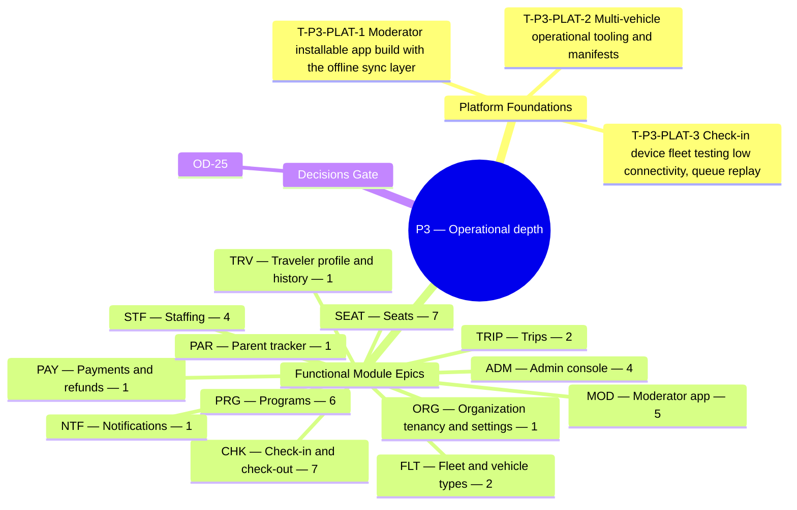

**Theme.** Operational depth — multi-vehicle trips, programs, seat modes, moderator app, check-in

**Definition of done.** A three-bus trip with about 120 passengers runs end to end. *([BRD section 3.3](/en/docs/brd#33-delivery-phases))*

**45 delivery tasks** (**42** functional tasks: **39** Must, **3** Should, **0** Could + **3** cross-cutting platform foundation tasks) across **13** SRS modules. Every task below carries its complete specification, implementation deliverables, acceptance criteria, affected PostgreSQL tables, and cross-specification links across BRD, SRS, ERD, Plan, Workflows, User Flows, Architecture, Design, End-to-End Lifecycle, and Recommendations.

**Data model.** [ERD conventions](/en/docs/erd), [Access Control & RLS](/en/docs/erd/acl), and the [lookup catalog](/en/docs/erd/reference) apply to every table touched in this phase.

<MindmapBlock title="P3 Scope Mindmap — Operational depth" caption="Breakdown of platform foundations, module epics (45 tasks), and milestone gates for P3." trace={{"brd":[{"label":"BRD §3.3 Phases","href":"/en/docs/brd#33-delivery-phases"}],"srs":[{"label":"SRS Traceability","href":"/en/docs/srs/traceability"}],"erd":[{"label":"ERD Overview","href":"/en/docs/erd"}],"plan":[{"label":"Milestones","href":"/en/docs/plan/milestones"},{"label":"Build Guide","href":"/en/docs/plan/build-guide"}],"workflows":[{"label":"Workflow Coverage","href":"/en/docs/workflows/coverage"}],"architecture":[{"label":"Architecture","href":"/en/docs/architecture"}],"design":[{"label":"Design System","href":"/en/docs/design"}],"system":[{"label":"End-to-End Lifecycle","href":"/en/docs/system/lifecycle"}],"recommendations":[{"label":"Open Decisions","href":"/en/docs/recommendations/open-decisions"}]}}>

</MindmapBlock>

## Quick-jump task index

| Task | Module | Reference | Priority |
|---|---|---|---|
| [T-P3-PLAT-1 — Moderator installable app build with the offline sync layer](#t-p3-plat-1) | `PLAT` | [NFR-PERF](/en/docs/srs/quality#81-performance-nfr-perf) | Must |
| [T-P3-PLAT-2 — Multi-vehicle operational tooling and manifests](#t-p3-plat-2) | `PLAT` | [NFR-SCL](/en/docs/srs/quality#84-scalability-nfr-scl) | Must |
| [T-P3-PLAT-3 — Check-in device fleet testing (low connectivity, queue replay)](#t-p3-plat-3) | `PLAT` | [NFR-PERF](/en/docs/srs/quality#81-performance-nfr-perf) | Must |
| [T-P3-ORG-1 — Seat self-selection setting](#t-p3-org-1) | `ORG` | [FR-ORG-05](/en/docs/srs/requirements/org#fr-org-05--seat-self-selection-setting) | Must |
| [T-P3-TRIP-1 — Multi-vehicle trips](#t-p3-trip-1) | `TRIP` | [FR-TRIP-03](/en/docs/srs/requirements/trip#fr-trip-03--multi-vehicle-trips) | Must |
| [T-P3-TRIP-2 — Program changes until departure](#t-p3-trip-2) | `TRIP` | [FR-TRIP-04](/en/docs/srs/requirements/trip#fr-trip-04--program-changes-until-departure) | Must |
| [T-P3-PRG-1 — Pricing models](#t-p3-prg-1) | `PRG` | [FR-PRG-01](/en/docs/srs/requirements/prg#fr-prg-01--pricing-models) | Must |
| [T-P3-PRG-2 — Program types](#t-p3-prg-2) | `PRG` | [FR-PRG-02](/en/docs/srs/requirements/prg#fr-prg-02--program-types) | Must |
| [T-P3-PRG-3 — Live booking summary](#t-p3-prg-3) | `PRG` | [FR-PRG-03](/en/docs/srs/requirements/prg#fr-prg-03--live-booking-summary) | Must |
| [T-P3-PRG-4 — Enrollment report](#t-p3-prg-4) | `PRG` | [FR-PRG-04](/en/docs/srs/requirements/prg#fr-prg-04--enrollment-report) | Must |
| [T-P3-PRG-5 — Program capacity](#t-p3-prg-5) | `PRG` | [FR-PRG-05](/en/docs/srs/requirements/prg#fr-prg-05--program-capacity) | Must |
| [T-P3-PRG-6 — Program count limit](#t-p3-prg-6) | `PRG` | [FR-PRG-06](/en/docs/srs/requirements/prg#fr-prg-06--program-count-limit) | Must |
| [T-P3-FLT-1 — Vehicle limit per trip](#t-p3-flt-1) | `FLT` | [FR-FLT-03](/en/docs/srs/requirements/flt#fr-flt-03--vehicle-limit-per-trip) | Must |
| [T-P3-FLT-2 — Vehicle removal after bookings](#t-p3-flt-2) | `FLT` | [FR-FLT-05](/en/docs/srs/requirements/flt#fr-flt-05--vehicle-removal-after-bookings) | Must |
| [T-P3-STF-1 — Driver tracks](#t-p3-stf-1) | `STF` | [FR-STF-01](/en/docs/srs/requirements/stf#fr-stf-01--driver-tracks) | Must |
| [T-P3-STF-2 — Ready gate](#t-p3-stf-2) | `STF` | [FR-STF-03](/en/docs/srs/requirements/stf#fr-stf-03--ready-gate) | Must |
| [T-P3-STF-3 — Moderator assignment](#t-p3-stf-3) | `STF` | [FR-STF-05](/en/docs/srs/requirements/stf#fr-stf-05--moderator-assignment) | Must |
| [T-P3-STF-4 — Reassignment deadline](#t-p3-stf-4) | `STF` | [FR-STF-07](/en/docs/srs/requirements/stf#fr-stf-07--reassignment-deadline) | Must |
| [T-P3-SEAT-1 — Company-assigned by default](#t-p3-seat-1) | `SEAT` | [FR-SEAT-01](/en/docs/srs/requirements/seat#fr-seat-01--company-assigned-by-default) | Must |
| [T-P3-SEAT-2 — Live seat map](#t-p3-seat-2) | `SEAT` | [FR-SEAT-02](/en/docs/srs/requirements/seat#fr-seat-02--live-seat-map) | Must |
| [T-P3-SEAT-3 — Priority window](#t-p3-seat-3) | `SEAT` | [FR-SEAT-03](/en/docs/srs/requirements/seat#fr-seat-03--priority-window) | Should |
| [T-P3-SEAT-4 — Seat hold](#t-p3-seat-4) | `SEAT` | [FR-SEAT-04](/en/docs/srs/requirements/seat#fr-seat-04--seat-hold) | Must |
| [T-P3-SEAT-5 — Seat states](#t-p3-seat-5) | `SEAT` | [FR-SEAT-05](/en/docs/srs/requirements/seat#fr-seat-05--seat-states) | Must |
| [T-P3-SEAT-6 — Staff seat assignment](#t-p3-seat-6) | `SEAT` | [FR-SEAT-06](/en/docs/srs/requirements/seat#fr-seat-06--staff-seat-assignment) | Must |
| [T-P3-SEAT-7 — Self-selection by plan](#t-p3-seat-7) | `SEAT` | [FR-SEAT-07](/en/docs/srs/requirements/seat#fr-seat-07--self-selection-by-plan) | Must |
| [T-P3-PAY-1 — Refunds outside policy](#t-p3-pay-1) | `PAY` | [FR-PAY-04](/en/docs/srs/requirements/pay#fr-pay-04--refunds-outside-policy) | Must |
| [T-P3-CHK-1 — Check-in at boarding](#t-p3-chk-1) | `CHK` | [FR-CHK-01](/en/docs/srs/requirements/chk#fr-chk-01--check-in-at-boarding) | Must |
| [T-P3-CHK-2 — Vehicle match](#t-p3-chk-2) | `CHK` | [FR-CHK-02](/en/docs/srs/requirements/chk#fr-chk-02--vehicle-match) | Must |
| [T-P3-CHK-3 — Event record](#t-p3-chk-3) | `CHK` | [FR-CHK-03](/en/docs/srs/requirements/chk#fr-chk-03--event-record) | Must |
| [T-P3-CHK-4 — Check-out at stops](#t-p3-chk-4) | `CHK` | [FR-CHK-04](/en/docs/srs/requirements/chk#fr-chk-04--check-out-at-stops) | Must |
| [T-P3-CHK-5 — Offline queue](#t-p3-chk-5) | `CHK` | [FR-CHK-05](/en/docs/srs/requirements/chk#fr-chk-05--offline-queue) | Must |
| [T-P3-CHK-6 — Incident reporting](#t-p3-chk-6) | `CHK` | [FR-CHK-06](/en/docs/srs/requirements/chk#fr-chk-06--incident-reporting) | Should |
| [T-P3-CHK-7 — Occupancy](#t-p3-chk-7) | `CHK` | [FR-CHK-07](/en/docs/srs/requirements/chk#fr-chk-07--occupancy) | Must |
| [T-P3-MOD-1 — Vehicle-scoped access](#t-p3-mod-1) | `MOD` | [FR-MOD-01](/en/docs/srs/requirements/mod#fr-mod-01--vehicle-scoped-access) | Must |
| [T-P3-MOD-2 — End-of-trip report](#t-p3-mod-2) | `MOD` | [FR-MOD-02](/en/docs/srs/requirements/mod#fr-mod-02--end-of-trip-report) | Must |
| [T-P3-MOD-3 — Access revocation](#t-p3-mod-3) | `MOD` | [FR-MOD-03](/en/docs/srs/requirements/mod#fr-mod-03--access-revocation) | Must |
| [T-P3-MOD-4 — Installable app](#t-p3-mod-4) | `MOD` | [FR-MOD-04](/en/docs/srs/requirements/mod#fr-mod-04--installable-app) | Must |
| [T-P3-MOD-5 — Report lock](#t-p3-mod-5) | `MOD` | [FR-MOD-06](/en/docs/srs/requirements/mod#fr-mod-06--report-lock) | Must |
| [T-P3-PAR-1 — Child-safety reporting](#t-p3-par-1) | `PAR` | [FR-PAR-07](/en/docs/srs/requirements/par#fr-par-07--child-safety-reporting) | Must |
| [T-P3-ADM-1 — Dispute outcomes and refunds](#t-p3-adm-1) | `ADM` | [FR-ADM-04](/en/docs/srs/requirements/adm#fr-adm-04--dispute-outcomes-and-refunds) | Must |
| [T-P3-ADM-2 — Dispute handling](#t-p3-adm-2) | `ADM` | [FR-ADM-08](/en/docs/srs/requirements/adm#fr-adm-08--dispute-handling) | Must |
| [T-P3-ADM-3 — Audit event record](#t-p3-adm-3) | `ADM` | [FR-ADM-10](/en/docs/srs/requirements/adm#fr-adm-10--audit-event-record) | Must |
| [T-P3-ADM-4 — Audit query view](#t-p3-adm-4) | `ADM` | [FR-ADM-11](/en/docs/srs/requirements/adm#fr-adm-11--audit-query-view) | Must |
| [T-P3-NTF-1 — Quiet hours](#t-p3-ntf-1) | `NTF` | [FR-NTF-03](/en/docs/srs/requirements/ntf#fr-ntf-03--quiet-hours) | Should |
| [T-P3-TRV-1 — Program discounts](#t-p3-trv-1) | `TRV` | [FR-TRV-04](/en/docs/srs/requirements/trv#fr-trv-04--program-discounts) | Must |

## Cross-cutting

These platform-wide engineering tasks establish the runtime, database, integration, and observability foundations required to close this phase gate.

### T-P3-PLAT-1 — Moderator installable app build with the offline sync layer

<TaskCard id="T-P3-PLAT-1" title="Moderator installable app build with the offline sync layer" phase="P3" module="PLAT" priority="Must" kind="platform" surfaces={["Moderator App","API"]} tables={["checkin_events","trip_vehicles","bookings"]} trace={{"brd":[{"label":"BRD P3 Gate","href":"/en/docs/brd#33-delivery-phases"}],"srs":[{"label":"NFR-PERF","href":"/en/docs/srs/quality#81-performance-nfr-perf"}],"erd":[{"label":"Operations","href":"/en/docs/erd/domains/operations"},{"label":"Booking and payment","href":"/en/docs/erd/domains/booking-and-payment"},{"label":"checkin_events","href":"/en/docs/erd/domains/operations#checkin_events","detail":"table"},{"label":"trip_vehicles","href":"/en/docs/erd/domains/fleet-and-trips#trip_vehicles","detail":"table"},{"label":"bookings","href":"/en/docs/erd/domains/booking-and-payment#bookings","detail":"table"},{"label":"ACL & RLS","href":"/en/docs/erd/acl"}],"plan":[{"label":"Milestones","href":"/en/docs/plan/milestones"},{"label":"Test Strategy","href":"/en/docs/plan/testing"}],"workflows":[{"label":"trip-day","href":"/en/docs/workflows/trip-day"}],"userFlows":[{"label":"Role Flows","href":"/en/docs/user-flows"}],"architecture":[{"label":"Architecture","href":"/en/docs/architecture#data-architecture"}],"design":[{"label":"Design System","href":"/en/docs/design#moderator-app"}],"system":[{"label":"STAGE-07","href":"/en/docs/system/lifecycle#stage-07"}],"recommendations":[{"label":"REC-OFF-06","href":"/en/docs/recommendations/architecture-and-ops#rec-off-06"}]}}>

**Platform scope.** Ship the installable Moderator Progressive Web App (`D-86`) with Service Worker asset caching, encrypted IndexedDB passenger manifest pre-fetch, offline check-in/out event queue, and automatic background replay on reconnect.

**Implementation deliverables.**

- PWA manifest, Service Worker precache, and IndexedDB store holding assigned vehicle passenger QR tokens and offline scan queue.
- Batch sync endpoint `/api/v1/checkins/sync` deduplicating by `client_event_uuid` and preserving original boarding `occurred_at` timestamps (`FR-CHK-05`).

**Acceptance & verification criteria.**

- Given airplane mode on the moderator phone, when 40 passengers scan QR codes, then boarding feedback is instant (`<200ms`) and queued locally.
- Given connectivity returns, when background sync runs, then all 40 events persist on the server within 60 seconds (`OBJ-02`).

</TaskCard>

### T-P3-PLAT-2 — Multi-vehicle operational tooling and manifests

<TaskCard id="T-P3-PLAT-2" title="Multi-vehicle operational tooling and manifests" phase="P3" module="PLAT" priority="Must" kind="platform" surfaces={["Organization Dashboard","Moderator App"]} tables={["trips","trip_vehicles","trip_seats","trip_staff_assignments"]} trace={{"brd":[{"label":"BRD P3 Gate","href":"/en/docs/brd#33-delivery-phases"}],"srs":[{"label":"NFR-SCL","href":"/en/docs/srs/quality#84-scalability-nfr-scl"}],"erd":[{"label":"Fleet and trips","href":"/en/docs/erd/domains/fleet-and-trips"},{"label":"Operations","href":"/en/docs/erd/domains/operations"},{"label":"trips","href":"/en/docs/erd/domains/fleet-and-trips#trips","detail":"table"},{"label":"trip_vehicles","href":"/en/docs/erd/domains/fleet-and-trips#trip_vehicles","detail":"table"},{"label":"trip_seats","href":"/en/docs/erd/domains/booking-and-payment#trip_seats","detail":"table"},{"label":"trip_staff_assignments","href":"/en/docs/erd/domains/fleet-and-trips#trip_staff_assignments","detail":"table"},{"label":"ACL & RLS","href":"/en/docs/erd/acl"}],"plan":[{"label":"Milestones","href":"/en/docs/plan/milestones"},{"label":"Test Strategy","href":"/en/docs/plan/testing"}],"workflows":[{"label":"trip-day","href":"/en/docs/workflows/trip-day"}],"userFlows":[{"label":"Role Flows","href":"/en/docs/user-flows"}],"architecture":[{"label":"Architecture","href":"/en/docs/architecture#data-architecture"}],"design":[{"label":"Design System","href":"/en/docs/design#organization-dashboard"}],"system":[{"label":"STAGE-07","href":"/en/docs/system/lifecycle#stage-07"}],"recommendations":[{"label":"REC-OPS-12","href":"/en/docs/recommendations/architecture-and-ops#rec-ops-12"}]}}>

**Platform scope.** Provide live multi-vehicle command boards, printable/offline bilingual vehicle manifests, cross-vehicle headcount reconciliation, and TimescaleDB `checkin_events` hypertable partitioning.

**Implementation deliverables.**

- TimescaleDB hypertable setup on `checkin_events(occurred_at)` with 1-year retention policy (`DAT`, BRD §8.5).
- Multi-bus operations dashboard aggregating per-vehicle Checked-In / Missing / Checked-Out counts in real time.

**Acceptance & verification criteria.**

- Given a 3-bus, 120-passenger trip, when Bus 2 completes boarding while Bus 1 and Bus 3 are still boarding, then each vehicle state and headcount updates independently.

</TaskCard>

### T-P3-PLAT-3 — Check-in device fleet testing (low connectivity, queue replay)

<TaskCard id="T-P3-PLAT-3" title="Check-in device fleet testing (low connectivity, queue replay)" phase="P3" module="PLAT" priority="Must" kind="platform" surfaces={["Moderator App","API"]} tables={["checkin_events"]} trace={{"brd":[{"label":"BRD P3 Gate","href":"/en/docs/brd#33-delivery-phases"}],"srs":[{"label":"NFR-PERF","href":"/en/docs/srs/quality#81-performance-nfr-perf"}],"erd":[{"label":"Operations","href":"/en/docs/erd/domains/operations"},{"label":"checkin_events","href":"/en/docs/erd/domains/operations#checkin_events","detail":"table"},{"label":"ACL & RLS","href":"/en/docs/erd/acl"}],"plan":[{"label":"Milestones","href":"/en/docs/plan/milestones"},{"label":"Test Strategy","href":"/en/docs/plan/testing"}],"workflows":[{"label":"trip-day","href":"/en/docs/workflows/trip-day"}],"userFlows":[{"label":"Role Flows","href":"/en/docs/user-flows"}],"architecture":[{"label":"Architecture","href":"/en/docs/architecture#quality-attributes"}],"design":[{"label":"Design System","href":"/en/docs/design#moderator-app"}],"system":[{"label":"STAGE-07","href":"/en/docs/system/lifecycle#stage-07"}],"recommendations":[{"label":"REC-OFF-06","href":"/en/docs/recommendations/architecture-and-ops#rec-off-06"}]}}>

**Platform scope.** Execute automated chaos/network-throttling rehearsals simulating 3 simultaneous moderators scanning 120 passengers under packet loss, clock skew, duplicate scans, and mid-trip offline reconnects.

**Implementation deliverables.**

- Playwright/k6 3-bus simulation suite asserting zero lost scans, zero duplicate check-in rows, and `<60s` drain time on 3G reconnect.
- Pre-P3 Child-Safety escalation runbook verification (`OPEN-03` / `D-68`).

**Acceptance & verification criteria.**

- Given 50% simulated packet loss and duplicate batch retries, when 120 boarding scans replay, then `checkin_events` records exactly 120 unique events in chronological order.

</TaskCard>

## ORG — Organization tenancy and settings

**Data model.** [Finance](/en/docs/erd/domains/finance), [Organizations](/en/docs/erd/domains/organizations) — the data-model domains and tables this module's requirements read and write.

### T-P3-ORG-1 — Seat self-selection setting

<TaskCard id="T-P3-ORG-1" title="Seat self-selection setting" phase="P3" module="ORG" priority="Must" surfaces={["Organization Dashboard","Admin Console"]} tables={["organizations"]} trace={{"brd":[{"label":"BR-ORG-05","href":"/en/docs/brd/requirements#63-organizations-and-employees-org","detail":"P3"},{"label":"BR-SEAT-01","href":"/en/docs/brd/requirements#63-organizations-and-employees-org","detail":"P3"}],"srs":[{"label":"FR-ORG-05","href":"/en/docs/srs/requirements/org#fr-org-05--seat-self-selection-setting","detail":"Must"},{"label":"Quality NFRs","href":"/en/docs/srs/quality"}],"erd":[{"label":"Finance","href":"/en/docs/erd/domains/finance"},{"label":"Organizations","href":"/en/docs/erd/domains/organizations"},{"label":"organizations","href":"/en/docs/erd/domains/organizations#organizations","detail":"table"}],"plan":[{"label":"P3 Milestone","href":"/en/docs/plan/milestones"},{"label":"Testing Pyramid","href":"/en/docs/plan/testing"}],"workflows":[{"label":"applications","href":"/en/docs/workflows/applications"}],"userFlows":[{"label":"UF-ORG-06","href":"/en/docs/user-flows/organization#uf-org-06-create-a-trip-wizard"}],"architecture":[{"label":"Architecture","href":"/en/docs/architecture#data-architecture"}],"design":[{"label":"Design Surface","href":"/en/docs/design#organization-dashboard"}],"system":[{"label":"STAGE-02","href":"/en/docs/system/lifecycle#stage-02"}],"recommendations":[{"label":"REC-DATA-02","href":"/en/docs/recommendations/architecture-and-ops#rec-data-02"}]}}>

**Specification ([FR-ORG-05](/en/docs/srs/requirements/org#fr-org-05--seat-self-selection-setting)).** An organization shall enable or disable traveler seat self-selection per trip or as an account default, only on plans that include it.

**Implementation deliverables.**

- **Domain & API logic:** Enforce PostgreSQL RLS tenant isolation (`app.current_organization_id`), workspace provisioning on approval, org-owned staff boundaries, and signed outbound webhooks.
- **Persistence & RLS:** Read/write operations on `organizations` enforcing base-column conventions, soft-delete filters, and tenant/role access control ([ACL](/en/docs/erd/acl)).
- **Verification & telemetry:** Automated unit/integration coverage mapped to `FR-ORG-05` acceptance scenarios ([Test Strategy](/en/docs/plan/testing)) with structured trace/audit emission.

**Acceptance criteria.**

- Given a Starter organization, when it tries to enable self-selection, then the action is blocked with an upgrade prompt.

**Business trace & governing rules.**

- [BR-ORG-05](/en/docs/brd/requirements#63-organizations-and-employees-org): Organizations choose whether travelers can pick their own seats, per trip or for the account, where the plan allows.
- [BR-SEAT-01](/en/docs/brd/requirements#63-organizations-and-employees-org): Seating is company-assigned by default. Self-selection is available only on Growth and Enterprise and only where the organization enables it.

</TaskCard>

## TRIP — Trips

**Data model.** [Fleet and trips](/en/docs/erd/domains/fleet-and-trips) — the data-model domains and tables this module's requirements read and write.

### T-P3-TRIP-1 — Multi-vehicle trips

<TaskCard id="T-P3-TRIP-1" title="Multi-vehicle trips" phase="P3" module="TRIP" priority="Must" surfaces={["Organization Dashboard","Traveler App","Admin Console"]} tables={["trips","trip_vehicles"]} trace={{"brd":[{"label":"BR-TRIP-03","href":"/en/docs/brd/requirements#64-trips-programs-and-fleet-trip-prg-flt","detail":"P3"},{"label":"BRL-07","href":"/en/docs/brd/requirements#7-business-rules","detail":"rule"}],"srs":[{"label":"FR-TRIP-03","href":"/en/docs/srs/requirements/trip#fr-trip-03--multi-vehicle-trips","detail":"Must"},{"label":"SM §7.1 Trip","href":"/en/docs/srs/state-machines#71-trip-lifecycle"},{"label":"Quality NFRs","href":"/en/docs/srs/quality"}],"erd":[{"label":"Fleet and trips","href":"/en/docs/erd/domains/fleet-and-trips"},{"label":"trips","href":"/en/docs/erd/domains/fleet-and-trips#trips","detail":"table"},{"label":"trip_vehicles","href":"/en/docs/erd/domains/fleet-and-trips#trip_vehicles","detail":"table"}],"plan":[{"label":"P3 Milestone","href":"/en/docs/plan/milestones"},{"label":"Testing Pyramid","href":"/en/docs/plan/testing"}],"workflows":[{"label":"trip-lifecycle","href":"/en/docs/workflows/trip-lifecycle"}],"userFlows":[{"label":"UF-ORG-06","href":"/en/docs/user-flows/organization#uf-org-06-create-a-trip-wizard"}],"architecture":[{"label":"Architecture","href":"/en/docs/architecture#service-model"}],"design":[{"label":"Design Surface","href":"/en/docs/design#organization-dashboard"}],"system":[{"label":"STAGE-04","href":"/en/docs/system/lifecycle#stage-04"}],"recommendations":[{"label":"REC-ARCH-01","href":"/en/docs/recommendations/architecture-and-ops#rec-arch-01"}]}}>

**Specification ([FR-TRIP-03](/en/docs/srs/requirements/trip#fr-trip-03--multi-vehicle-trips)).** A trip shall support several vehicles, each with one vehicle type, one driver and one moderator, up to the plan's vehicle limit.

**Implementation deliverables.**

- **Domain & API logic:** Implement multi-step trip authoring, Trip state-machine guards, capacity transitions, post-booking change remedies (7-day window), cancellation rules, and 30-day archival.
- **Persistence & RLS:** Read/write operations on `trips`, `trip_vehicles` enforcing base-column conventions, soft-delete filters, and tenant/role access control ([ACL](/en/docs/erd/acl)).
- **Verification & telemetry:** Automated unit/integration coverage mapped to `FR-TRIP-03` acceptance scenarios ([Test Strategy](/en/docs/plan/testing)) with structured trace/audit emission.

**Acceptance criteria.**

- Given a vehicle with no moderator, when Ready is requested, then it is refused and the vehicle is named.

**Business trace & governing rules.**

- [BR-TRIP-03](/en/docs/brd/requirements#64-trips-programs-and-fleet-trip-prg-flt): A trip can run several vehicles at once, each with one vehicle type, one driver and one moderator. The vehicle count follows the plan.

</TaskCard>

### T-P3-TRIP-2 — Program changes until departure

<TaskCard id="T-P3-TRIP-2" title="Program changes until departure" phase="P3" module="TRIP" priority="Must" surfaces={["Organization Dashboard","Traveler App","Admin Console"]} tables={["trips"]} trace={{"brd":[{"label":"BR-TRIP-04","href":"/en/docs/brd/requirements#64-trips-programs-and-fleet-trip-prg-flt","detail":"P3"}],"srs":[{"label":"FR-TRIP-04","href":"/en/docs/srs/requirements/trip#fr-trip-04--program-changes-until-departure","detail":"Must"},{"label":"SM §7.1 Trip","href":"/en/docs/srs/state-machines#71-trip-lifecycle"},{"label":"Quality NFRs","href":"/en/docs/srs/quality"}],"erd":[{"label":"Fleet and trips","href":"/en/docs/erd/domains/fleet-and-trips"},{"label":"trips","href":"/en/docs/erd/domains/fleet-and-trips#trips","detail":"table"}],"plan":[{"label":"P3 Milestone","href":"/en/docs/plan/milestones"},{"label":"Testing Pyramid","href":"/en/docs/plan/testing"}],"workflows":[{"label":"trip-lifecycle","href":"/en/docs/workflows/trip-lifecycle#timers-and-rules"}],"userFlows":[{"label":"organization","href":"/en/docs/user-flows/organization"}],"architecture":[{"label":"Architecture","href":"/en/docs/architecture#service-model"}],"design":[{"label":"Design Surface","href":"/en/docs/design#organization-dashboard"}],"system":[{"label":"STAGE-04","href":"/en/docs/system/lifecycle#stage-04"}],"recommendations":[{"label":"REC-ARCH-01","href":"/en/docs/recommendations/architecture-and-ops#rec-arch-01"}]}}>

**Specification ([FR-TRIP-04](/en/docs/srs/requirements/trip#fr-trip-04--program-changes-until-departure)).** Programs shall be addable, editable and removable until the trip starts, subject to [FR-TRIP-06](/en/docs/srs/requirements/trip#fr-trip-06--changes-that-affect-confirmed-bookings).

**Implementation deliverables.**

- **Domain & API logic:** Implement multi-step trip authoring, Trip state-machine guards, capacity transitions, post-booking change remedies (7-day window), cancellation rules, and 30-day archival.
- **Persistence & RLS:** Read/write operations on `trips` enforcing base-column conventions, soft-delete filters, and tenant/role access control ([ACL](/en/docs/erd/acl)).
- **Verification & telemetry:** Automated unit/integration coverage mapped to `FR-TRIP-04` acceptance scenarios ([Test Strategy](/en/docs/plan/testing)) with structured trace/audit emission.

**Acceptance criteria.**

- Given the trip has started, when a program is added, then the request is refused.

**Business trace & governing rules.**

- [BR-TRIP-04](/en/docs/brd/requirements#64-trips-programs-and-fleet-trip-prg-flt): Programs can be added, edited and removed until the trip starts.

</TaskCard>

## PRG — Programs

**Data model.** [Fleet and trips](/en/docs/erd/domains/fleet-and-trips) — the data-model domains and tables this module's requirements read and write.

### T-P3-PRG-1 — Pricing models

<TaskCard id="T-P3-PRG-1" title="Pricing models" phase="P3" module="PRG" priority="Must" surfaces={["Organization Dashboard","Traveler App","Moderator App"]} tables={["programs"]} trace={{"brd":[{"label":"BR-PRG-01","href":"/en/docs/brd/requirements#64-trips-programs-and-fleet-trip-prg-flt","detail":"P3"}],"srs":[{"label":"FR-PRG-01","href":"/en/docs/srs/requirements/prg#fr-prg-01--pricing-models","detail":"Must"},{"label":"Quality NFRs","href":"/en/docs/srs/quality"}],"erd":[{"label":"Fleet and trips","href":"/en/docs/erd/domains/fleet-and-trips"},{"label":"programs","href":"/en/docs/erd/domains/fleet-and-trips#programs","detail":"table"}],"plan":[{"label":"P3 Milestone","href":"/en/docs/plan/milestones"},{"label":"Testing Pyramid","href":"/en/docs/plan/testing"}],"workflows":[{"label":"trip-lifecycle","href":"/en/docs/workflows/trip-lifecycle"}],"userFlows":[{"label":"UF-ORG-06","href":"/en/docs/user-flows/organization#uf-org-06-create-a-trip-wizard"}],"architecture":[{"label":"Architecture","href":"/en/docs/architecture#service-model"}],"design":[{"label":"Design Surface","href":"/en/docs/design#organization-dashboard"}],"system":[{"label":"STAGE-04","href":"/en/docs/system/lifecycle#stage-04"}],"recommendations":[{"label":"REC-BOOK-03","href":"/en/docs/recommendations/architecture-and-ops#rec-book-03"}]}}>

**Specification ([FR-PRG-01](/en/docs/srs/requirements/prg#fr-prg-01--pricing-models)).** Each program shall have exactly one pricing model: free, per person, by quantity, per group or tiered.

**Implementation deliverables.**

- **Domain & API logic:** Build required/optional trip programs, standalone vs bundled pricing, per-program capacity locks, and moderator enrollment manifests.
- **Persistence & RLS:** Read/write operations on `programs` enforcing base-column conventions, soft-delete filters, and tenant/role access control ([ACL](/en/docs/erd/acl)).
- **Verification & telemetry:** Automated unit/integration coverage mapped to `FR-PRG-01` acceptance scenarios ([Test Strategy](/en/docs/plan/testing)) with structured trace/audit emission.

**Acceptance criteria.**

- Given a program with two pricing models, when saved, then it is refused.

**Business trace & governing rules.**

- [BR-PRG-01](/en/docs/brd/requirements#64-trips-programs-and-fleet-trip-prg-flt): Each program has one pricing model: free, per person, by quantity, per group, or tiered. Program count follows the plan.

</TaskCard>

### T-P3-PRG-2 — Program types

<TaskCard id="T-P3-PRG-2" title="Program types" phase="P3" module="PRG" priority="Must" surfaces={["Organization Dashboard","Traveler App","Moderator App"]} tables={["programs"]} trace={{"brd":[{"label":"BR-PRG-02","href":"/en/docs/brd/requirements#64-trips-programs-and-fleet-trip-prg-flt","detail":"P3"}],"srs":[{"label":"FR-PRG-02","href":"/en/docs/srs/requirements/prg#fr-prg-02--program-types","detail":"Must"},{"label":"Quality NFRs","href":"/en/docs/srs/quality"}],"erd":[{"label":"Fleet and trips","href":"/en/docs/erd/domains/fleet-and-trips"},{"label":"programs","href":"/en/docs/erd/domains/fleet-and-trips#programs","detail":"table"}],"plan":[{"label":"P3 Milestone","href":"/en/docs/plan/milestones"},{"label":"Testing Pyramid","href":"/en/docs/plan/testing"}],"workflows":[{"label":"trip-lifecycle","href":"/en/docs/workflows/trip-lifecycle"}],"userFlows":[{"label":"UF-ORG-06","href":"/en/docs/user-flows/organization#uf-org-06-create-a-trip-wizard"},{"label":"UF-TRV-03","href":"/en/docs/user-flows/traveler#uf-trv-03-book-a-trip"}],"architecture":[{"label":"Architecture","href":"/en/docs/architecture#service-model"}],"design":[{"label":"Design Surface","href":"/en/docs/design#organization-dashboard"}],"system":[{"label":"STAGE-04","href":"/en/docs/system/lifecycle#stage-04"}],"recommendations":[{"label":"REC-BOOK-03","href":"/en/docs/recommendations/architecture-and-ops#rec-book-03"}]}}>

**Specification ([FR-PRG-02](/en/docs/srs/requirements/prg#fr-prg-02--program-types)).** A program shall be optional, pre-required (auto-included, not removable), capacity-limited or VIP-only.

**Implementation deliverables.**

- **Domain & API logic:** Build required/optional trip programs, standalone vs bundled pricing, per-program capacity locks, and moderator enrollment manifests.
- **Persistence & RLS:** Read/write operations on `programs` enforcing base-column conventions, soft-delete filters, and tenant/role access control ([ACL](/en/docs/erd/acl)).
- **Verification & telemetry:** Automated unit/integration coverage mapped to `FR-PRG-02` acceptance scenarios ([Test Strategy](/en/docs/plan/testing)) with structured trace/audit emission.

**Acceptance criteria.**

- Given a pre-required program, when a traveler books, then it is included and cannot be removed.
- Given a VIP-only program, when a Free or Explorer traveler opens it, then it is locked with an upgrade prompt.

**Business trace & governing rules.**

- [BR-PRG-02](/en/docs/brd/requirements#64-trips-programs-and-fleet-trip-prg-flt): A program can be optional, pre-required (auto-included), capacity-limited or VIP-only.

</TaskCard>

### T-P3-PRG-3 — Live booking summary

<TaskCard id="T-P3-PRG-3" title="Live booking summary" phase="P3" module="PRG" priority="Must" surfaces={["Organization Dashboard","Traveler App","Moderator App"]} tables={["programs"]} trace={{"brd":[{"label":"BR-PRG-03","href":"/en/docs/brd/requirements#64-trips-programs-and-fleet-trip-prg-flt","detail":"P3"}],"srs":[{"label":"FR-PRG-03","href":"/en/docs/srs/requirements/prg#fr-prg-03--live-booking-summary","detail":"Must"},{"label":"Quality NFRs","href":"/en/docs/srs/quality"}],"erd":[{"label":"Fleet and trips","href":"/en/docs/erd/domains/fleet-and-trips"},{"label":"programs","href":"/en/docs/erd/domains/fleet-and-trips#programs","detail":"table"}],"plan":[{"label":"P3 Milestone","href":"/en/docs/plan/milestones"},{"label":"Testing Pyramid","href":"/en/docs/plan/testing"}],"workflows":[{"label":"trip-lifecycle","href":"/en/docs/workflows/trip-lifecycle"}],"userFlows":[{"label":"UF-ORG-06","href":"/en/docs/user-flows/organization#uf-org-06-create-a-trip-wizard"},{"label":"UF-TRV-03","href":"/en/docs/user-flows/traveler#uf-trv-03-book-a-trip"}],"architecture":[{"label":"Architecture","href":"/en/docs/architecture#service-model"}],"design":[{"label":"Design Surface","href":"/en/docs/design#organization-dashboard"}],"system":[{"label":"STAGE-04","href":"/en/docs/system/lifecycle#stage-04"}],"recommendations":[{"label":"REC-BOOK-03","href":"/en/docs/recommendations/architecture-and-ops#rec-book-03"}]}}>

**Specification ([FR-PRG-03](/en/docs/srs/requirements/prg#fr-prg-03--live-booking-summary)).** The booking summary shall update the total as programs and quantities change, before the next step, including the plan's program discount.

**Implementation deliverables.**

- **Domain & API logic:** Build required/optional trip programs, standalone vs bundled pricing, per-program capacity locks, and moderator enrollment manifests.
- **Persistence & RLS:** Read/write operations on `programs` enforcing base-column conventions, soft-delete filters, and tenant/role access control ([ACL](/en/docs/erd/acl)).
- **Verification & telemetry:** Automated unit/integration coverage mapped to `FR-PRG-03` acceptance scenarios ([Test Strategy](/en/docs/plan/testing)) with structured trace/audit emission.

**Acceptance criteria.**

- Given a per-person program for two passengers, when added, then the total rises by price times two before the next step.

**Business trace & governing rules.**

- [BR-PRG-03](/en/docs/brd/requirements#64-trips-programs-and-fleet-trip-prg-flt): Travelers see a live booking total as they add or remove programs, including their plan's program discount.

</TaskCard>

### T-P3-PRG-4 — Enrollment report

<TaskCard id="T-P3-PRG-4" title="Enrollment report" phase="P3" module="PRG" priority="Must" surfaces={["Organization Dashboard","Traveler App","Moderator App"]} tables={["programs"]} trace={{"brd":[{"label":"BR-PRG-04","href":"/en/docs/brd/requirements#64-trips-programs-and-fleet-trip-prg-flt","detail":"P3"},{"label":"OD-25","href":"/en/docs/brd/compliance#11-open-decisions","detail":"Decided"}],"srs":[{"label":"FR-PRG-04","href":"/en/docs/srs/requirements/prg#fr-prg-04--enrollment-report","detail":"Must"},{"label":"Quality NFRs","href":"/en/docs/srs/quality"}],"erd":[{"label":"Fleet and trips","href":"/en/docs/erd/domains/fleet-and-trips"},{"label":"programs","href":"/en/docs/erd/domains/fleet-and-trips#programs","detail":"table"}],"plan":[{"label":"P3 Milestone","href":"/en/docs/plan/milestones"},{"label":"Testing Pyramid","href":"/en/docs/plan/testing"}],"workflows":[{"label":"trip-lifecycle","href":"/en/docs/workflows/trip-lifecycle"}],"userFlows":[{"label":"UF-ORG-06","href":"/en/docs/user-flows/organization#uf-org-06-create-a-trip-wizard"}],"architecture":[{"label":"Architecture","href":"/en/docs/architecture#service-model"}],"design":[{"label":"Design Surface","href":"/en/docs/design#organization-dashboard"}],"system":[{"label":"STAGE-04","href":"/en/docs/system/lifecycle#stage-04"}],"recommendations":[{"label":"OD-25 Resolution","href":"/en/docs/recommendations/open-decisions#od-25--plan-gate-on-program-enrollment-reports"},{"label":"REC-BOOK-03","href":"/en/docs/recommendations/architecture-and-ops#rec-book-03"}]}}>

**Specification ([FR-PRG-04](/en/docs/srs/requirements/prg#fr-prg-04--enrollment-report)).** An organization shall see per program who chose it, quantities and revenue. No plan gate until [OD-25](/en/docs/brd/compliance#11-open-decisions) is decided.

**Implementation deliverables.**

- **Domain & API logic:** Build required/optional trip programs, standalone vs bundled pricing, per-program capacity locks, and moderator enrollment manifests.
- **Persistence & RLS:** Read/write operations on `programs` enforcing base-column conventions, soft-delete filters, and tenant/role access control ([ACL](/en/docs/erd/acl)).
- **Verification & telemetry:** Automated unit/integration coverage mapped to `FR-PRG-04` acceptance scenarios ([Test Strategy](/en/docs/plan/testing)) with structured trace/audit emission.

**Acceptance criteria.**

- Given quantities 2 and 3 on one program, when the report opens, then both rows and a total of 5 show.

**Business trace & governing rules.**

- [BR-PRG-04](/en/docs/brd/requirements#64-trips-programs-and-fleet-trip-prg-flt): Organizations see who chose each program, quantities and revenue. Report depth by plan is [OD-25](/en/docs/brd/compliance#11-open-decisions).
- [OD-25](/en/docs/brd/compliance#11-open-decisions) (Plan gate on program enrollment report — Decided) → see [Recommended Resolution](/en/docs/recommendations/open-decisions#od-25--plan-gate-on-program-enrollment-reports).

</TaskCard>

### T-P3-PRG-5 — Program capacity

<TaskCard id="T-P3-PRG-5" title="Program capacity" phase="P3" module="PRG" priority="Must" surfaces={["Organization Dashboard","Traveler App","Moderator App"]} tables={["programs"]} trace={{"brd":[{"label":"BR-PRG-02","href":"/en/docs/brd/requirements#64-trips-programs-and-fleet-trip-prg-flt","detail":"P3"}],"srs":[{"label":"FR-PRG-05","href":"/en/docs/srs/requirements/prg#fr-prg-05--program-capacity","detail":"Must"},{"label":"Quality NFRs","href":"/en/docs/srs/quality"}],"erd":[{"label":"Fleet and trips","href":"/en/docs/erd/domains/fleet-and-trips"},{"label":"programs","href":"/en/docs/erd/domains/fleet-and-trips#programs","detail":"table"}],"plan":[{"label":"P3 Milestone","href":"/en/docs/plan/milestones"},{"label":"Testing Pyramid","href":"/en/docs/plan/testing"}],"workflows":[{"label":"trip-lifecycle","href":"/en/docs/workflows/trip-lifecycle"}],"userFlows":[{"label":"UF-ORG-06","href":"/en/docs/user-flows/organization#uf-org-06-create-a-trip-wizard"}],"architecture":[{"label":"Architecture","href":"/en/docs/architecture#service-model"}],"design":[{"label":"Design Surface","href":"/en/docs/design#organization-dashboard"}],"system":[{"label":"STAGE-04","href":"/en/docs/system/lifecycle#stage-04"}],"recommendations":[{"label":"REC-BOOK-03","href":"/en/docs/recommendations/architecture-and-ops#rec-book-03"}]}}>

**Specification ([FR-PRG-05](/en/docs/srs/requirements/prg#fr-prg-05--program-capacity)).** A capacity-limited program shall stop accepting selections at its cap and show as unavailable.

**Implementation deliverables.**

- **Domain & API logic:** Build required/optional trip programs, standalone vs bundled pricing, per-program capacity locks, and moderator enrollment manifests.
- **Persistence & RLS:** Read/write operations on `programs` enforcing base-column conventions, soft-delete filters, and tenant/role access control ([ACL](/en/docs/erd/acl)).
- **Verification & telemetry:** Automated unit/integration coverage mapped to `FR-PRG-05` acceptance scenarios ([Test Strategy](/en/docs/plan/testing)) with structured trace/audit emission.

**Acceptance criteria.**

- Given a cap of 20 with 20 selections, when a 21st traveler opens it, then it is unavailable.

**Business trace & governing rules.**

- [BR-PRG-02](/en/docs/brd/requirements#64-trips-programs-and-fleet-trip-prg-flt): A program can be optional, pre-required (auto-included), capacity-limited or VIP-only.

</TaskCard>

### T-P3-PRG-6 — Program count limit

<TaskCard id="T-P3-PRG-6" title="Program count limit" phase="P3" module="PRG" priority="Must" surfaces={["Organization Dashboard","Traveler App","Moderator App"]} tables={["programs"]} trace={{"brd":[{"label":"BR-SUB-02","href":"/en/docs/brd/requirements#64-trips-programs-and-fleet-trip-prg-flt","detail":"P3"},{"label":"BR-PRG-01","href":"/en/docs/brd/requirements#64-trips-programs-and-fleet-trip-prg-flt","detail":"P3"}],"srs":[{"label":"FR-PRG-06","href":"/en/docs/srs/requirements/prg#fr-prg-06--program-count-limit","detail":"Must"},{"label":"Quality NFRs","href":"/en/docs/srs/quality"}],"erd":[{"label":"Fleet and trips","href":"/en/docs/erd/domains/fleet-and-trips"},{"label":"programs","href":"/en/docs/erd/domains/fleet-and-trips#programs","detail":"table"}],"plan":[{"label":"P3 Milestone","href":"/en/docs/plan/milestones"},{"label":"Testing Pyramid","href":"/en/docs/plan/testing"}],"workflows":[{"label":"trip-lifecycle","href":"/en/docs/workflows/trip-lifecycle"}],"userFlows":[{"label":"UF-ORG-06","href":"/en/docs/user-flows/organization#uf-org-06-create-a-trip-wizard"}],"architecture":[{"label":"Architecture","href":"/en/docs/architecture#service-model"}],"design":[{"label":"Design Surface","href":"/en/docs/design#organization-dashboard"}],"system":[{"label":"STAGE-04","href":"/en/docs/system/lifecycle#stage-04"}],"recommendations":[{"label":"REC-BOOK-03","href":"/en/docs/recommendations/architecture-and-ops#rec-book-03"}]}}>

**Specification ([FR-PRG-06](/en/docs/srs/requirements/prg#fr-prg-06--program-count-limit)).** Programs per trip shall not exceed the plan limit (Starter 3, Growth 15, Enterprise unlimited).

**Implementation deliverables.**

- **Domain & API logic:** Build required/optional trip programs, standalone vs bundled pricing, per-program capacity locks, and moderator enrollment manifests.
- **Persistence & RLS:** Read/write operations on `programs` enforcing base-column conventions, soft-delete filters, and tenant/role access control ([ACL](/en/docs/erd/acl)).
- **Verification & telemetry:** Automated unit/integration coverage mapped to `FR-PRG-06` acceptance scenarios ([Test Strategy](/en/docs/plan/testing)) with structured trace/audit emission.

**Acceptance criteria.**

- Given a Starter trip with 3 programs, when a fourth is added, then it is blocked with an upgrade prompt.

**Business trace & governing rules.**

- [BR-SUB-02](/en/docs/brd/requirements#64-trips-programs-and-fleet-trip-prg-flt): Plan limits and features are enforced automatically. A blocked action shows an upgrade prompt. Every non-traveler role needs an active plan to use the app ([BRL-02](/en/docs/brd/requirements#7-business-rules)).
- [BR-PRG-01](/en/docs/brd/requirements#64-trips-programs-and-fleet-trip-prg-flt): Each program has one pricing model: free, per person, by quantity, per group, or tiered. Program count follows the plan.

</TaskCard>

## FLT — Fleet and vehicle types

**Data model.** [Fleet and trips](/en/docs/erd/domains/fleet-and-trips) — the data-model domains and tables this module's requirements read and write.

### T-P3-FLT-1 — Vehicle limit per trip

<TaskCard id="T-P3-FLT-1" title="Vehicle limit per trip" phase="P3" module="FLT" priority="Must" surfaces={["Organization Dashboard","Driver App"]} tables={[]} trace={{"brd":[{"label":"BR-TRIP-03","href":"/en/docs/brd/requirements#64-trips-programs-and-fleet-trip-prg-flt","detail":"P3"},{"label":"BR-SUB-02","href":"/en/docs/brd/requirements#64-trips-programs-and-fleet-trip-prg-flt","detail":"P3"}],"srs":[{"label":"FR-FLT-03","href":"/en/docs/srs/requirements/flt#fr-flt-03--vehicle-limit-per-trip","detail":"Must"},{"label":"Quality NFRs","href":"/en/docs/srs/quality"}],"erd":[{"label":"Fleet and trips","href":"/en/docs/erd/domains/fleet-and-trips"}],"plan":[{"label":"P3 Milestone","href":"/en/docs/plan/milestones"},{"label":"Testing Pyramid","href":"/en/docs/plan/testing"}],"workflows":[{"label":"trip-lifecycle","href":"/en/docs/workflows/trip-lifecycle"}],"userFlows":[{"label":"UF-ORG-23","href":"/en/docs/user-flows/organization#uf-org-23-fleet-mid-lifecycle"}],"architecture":[{"label":"Architecture","href":"/en/docs/architecture#data-architecture"}],"design":[{"label":"Design Surface","href":"/en/docs/design#organization-dashboard"}],"system":[{"label":"STAGE-03","href":"/en/docs/system/lifecycle#stage-03"}],"recommendations":[{"label":"REC-BOOK-03","href":"/en/docs/recommendations/architecture-and-ops#rec-book-03"}]}}>

**Specification ([FR-FLT-03](/en/docs/srs/requirements/flt#fr-flt-03--vehicle-limit-per-trip)).** Vehicles per trip shall not exceed the plan limit (Starter 2, Growth 10, Enterprise unlimited).

**Implementation deliverables.**

- **Domain & API logic:** Manage reusable vehicle types, visual seat-grid geometry, multi-vehicle trip allocations, and vehicle reassignment safeguards.
- **Verification & telemetry:** Automated unit/integration coverage mapped to `FR-FLT-03` acceptance scenarios ([Test Strategy](/en/docs/plan/testing)) with structured trace/audit emission.

**Acceptance criteria.**

- Given a Starter trip with 2 vehicles, when a third is added, then it is blocked with an upgrade prompt.

**Business trace & governing rules.**

- [BR-TRIP-03](/en/docs/brd/requirements#64-trips-programs-and-fleet-trip-prg-flt): A trip can run several vehicles at once, each with one vehicle type, one driver and one moderator. The vehicle count follows the plan.
- [BR-SUB-02](/en/docs/brd/requirements#64-trips-programs-and-fleet-trip-prg-flt): Plan limits and features are enforced automatically. A blocked action shows an upgrade prompt. Every non-traveler role needs an active plan to use the app ([BRL-02](/en/docs/brd/requirements#7-business-rules)).

</TaskCard>

### T-P3-FLT-2 — Vehicle removal after bookings

<TaskCard id="T-P3-FLT-2" title="Vehicle removal after bookings" phase="P3" module="FLT" priority="Must" surfaces={["Organization Dashboard","Driver App"]} tables={[]} trace={{"brd":[{"label":"BR-TRIP-03","href":"/en/docs/brd/requirements#64-trips-programs-and-fleet-trip-prg-flt","detail":"P3"},{"label":"BRL-24","href":"/en/docs/brd/requirements#7-business-rules","detail":"rule"}],"srs":[{"label":"FR-FLT-05","href":"/en/docs/srs/requirements/flt#fr-flt-05--vehicle-removal-after-bookings","detail":"Must"},{"label":"Quality NFRs","href":"/en/docs/srs/quality"}],"erd":[{"label":"Fleet and trips","href":"/en/docs/erd/domains/fleet-and-trips"}],"plan":[{"label":"P3 Milestone","href":"/en/docs/plan/milestones"},{"label":"Testing Pyramid","href":"/en/docs/plan/testing"}],"workflows":[{"label":"trip-lifecycle","href":"/en/docs/workflows/trip-lifecycle"}],"userFlows":[{"label":"UF-ORG-23","href":"/en/docs/user-flows/organization#uf-org-23-fleet-mid-lifecycle"}],"architecture":[{"label":"Architecture","href":"/en/docs/architecture#data-architecture"}],"design":[{"label":"Design Surface","href":"/en/docs/design#organization-dashboard"}],"system":[{"label":"STAGE-03","href":"/en/docs/system/lifecycle#stage-03"}],"recommendations":[{"label":"REC-BOOK-03","href":"/en/docs/recommendations/architecture-and-ops#rec-book-03"}]}}>

**Specification ([FR-FLT-05](/en/docs/srs/requirements/flt#fr-flt-05--vehicle-removal-after-bookings)).** A vehicle with confirmed bookings shall not be removed until those bookings are reassigned or resolved under [FR-TRIP-06](/en/docs/srs/requirements/trip#fr-trip-06--changes-that-affect-confirmed-bookings).

**Implementation deliverables.**

- **Domain & API logic:** Manage reusable vehicle types, visual seat-grid geometry, multi-vehicle trip allocations, and vehicle reassignment safeguards.
- **Verification & telemetry:** Automated unit/integration coverage mapped to `FR-FLT-05` acceptance scenarios ([Test Strategy](/en/docs/plan/testing)) with structured trace/audit emission.

**Acceptance criteria.**

- Given a vehicle with confirmed bookings, when removal is attempted, then it is refused with the count shown.

**Business trace & governing rules.**

- [BR-TRIP-03](/en/docs/brd/requirements#64-trips-programs-and-fleet-trip-prg-flt): A trip can run several vehicles at once, each with one vehicle type, one driver and one moderator. The vehicle count follows the plan.

</TaskCard>

## STF — Staffing

**Data model.** [Fleet and trips](/en/docs/erd/domains/fleet-and-trips) — the data-model domains and tables this module's requirements read and write.

### T-P3-STF-1 — Driver tracks

<TaskCard id="T-P3-STF-1" title="Driver tracks" phase="P3" module="STF" priority="Must" surfaces={["Organization Dashboard","Driver App","Photographer Studio","Moderator App"]} tables={["trip_staff_assignments"]} trace={{"brd":[{"label":"BR-STF-01","href":"/en/docs/brd/requirements#65-staffing-and-deals-stf","detail":"P3"}],"srs":[{"label":"FR-STF-01","href":"/en/docs/srs/requirements/stf#fr-stf-01--driver-tracks","detail":"Must"},{"label":"Quality NFRs","href":"/en/docs/srs/quality"}],"erd":[{"label":"Fleet and trips","href":"/en/docs/erd/domains/fleet-and-trips"},{"label":"trip_staff_assignments","href":"/en/docs/erd/domains/fleet-and-trips#trip_staff_assignments","detail":"table"}],"plan":[{"label":"P3 Milestone","href":"/en/docs/plan/milestones"},{"label":"Testing Pyramid","href":"/en/docs/plan/testing"}],"workflows":[{"label":"trip-lifecycle","href":"/en/docs/workflows/trip-lifecycle#timers-and-rules"}],"userFlows":[{"label":"organization","href":"/en/docs/user-flows/organization"}],"architecture":[{"label":"Architecture","href":"/en/docs/architecture#service-model"}],"design":[{"label":"Design Surface","href":"/en/docs/design#organization-dashboard"}],"system":[{"label":"STAGE-03","href":"/en/docs/system/lifecycle#stage-03"}],"recommendations":[{"label":"REC-ARCH-01","href":"/en/docs/recommendations/architecture-and-ops#rec-arch-01"}]}}>

**Specification ([FR-STF-01](/en/docs/srs/requirements/stf#fr-stf-01--driver-tracks)).** Each vehicle shall be driven by an organization-owned driver or by a platform driver through a finalized deal.

**Implementation deliverables.**

- **Domain & API logic:** Enforce per-vehicle driver and moderator readiness (`BRL-07`), schedule conflict detection, and emergency supplier replacement flows.
- **Persistence & RLS:** Read/write operations on `trip_staff_assignments` enforcing base-column conventions, soft-delete filters, and tenant/role access control ([ACL](/en/docs/erd/acl)).
- **Verification & telemetry:** Automated unit/integration coverage mapped to `FR-STF-01` acceptance scenarios ([Test Strategy](/en/docs/plan/testing)) with structured trace/audit emission.

**Acceptance criteria.**

- Given a vehicle being staffed, when a driver is chosen, then only these two options are offered.

**Business trace & governing rules.**

- [BR-STF-01](/en/docs/brd/requirements#65-staffing-and-deals-stf): Each vehicle is driven either by an organization-owned driver or by a platform driver hired through a deal.

</TaskCard>

### T-P3-STF-2 — Ready gate

<TaskCard id="T-P3-STF-2" title="Ready gate" phase="P3" module="STF" priority="Must" surfaces={["Organization Dashboard","Driver App","Photographer Studio","Moderator App"]} tables={["trip_staff_assignments"]} trace={{"brd":[{"label":"BR-STF-05","href":"/en/docs/brd/requirements#65-staffing-and-deals-stf","detail":"P3"},{"label":"BRL-07","href":"/en/docs/brd/requirements#7-business-rules","detail":"rule"}],"srs":[{"label":"FR-STF-03","href":"/en/docs/srs/requirements/stf#fr-stf-03--ready-gate","detail":"Must"},{"label":"Quality NFRs","href":"/en/docs/srs/quality"}],"erd":[{"label":"Fleet and trips","href":"/en/docs/erd/domains/fleet-and-trips"},{"label":"trip_staff_assignments","href":"/en/docs/erd/domains/fleet-and-trips#trip_staff_assignments","detail":"table"}],"plan":[{"label":"P3 Milestone","href":"/en/docs/plan/milestones"},{"label":"Testing Pyramid","href":"/en/docs/plan/testing"}],"workflows":[{"label":"trip-lifecycle","href":"/en/docs/workflows/trip-lifecycle#timers-and-rules"}],"userFlows":[{"label":"UF-ORG-08","href":"/en/docs/user-flows/organization#uf-org-08-move-a-trip-to-ready"}],"architecture":[{"label":"Architecture","href":"/en/docs/architecture#service-model"}],"design":[{"label":"Design Surface","href":"/en/docs/design#organization-dashboard"}],"system":[{"label":"STAGE-03","href":"/en/docs/system/lifecycle#stage-03"}],"recommendations":[{"label":"REC-ARCH-01","href":"/en/docs/recommendations/architecture-and-ops#rec-arch-01"}]}}>

**Specification ([FR-STF-03](/en/docs/srs/requirements/stf#fr-stf-03--ready-gate)).** A trip shall not move to Ready until every vehicle has a confirmed driver and moderator and every platform deal is finalized. The system lists each gap.

**Implementation deliverables.**

- **Domain & API logic:** Enforce per-vehicle driver and moderator readiness (`BRL-07`), schedule conflict detection, and emergency supplier replacement flows.
- **Persistence & RLS:** Read/write operations on `trip_staff_assignments` enforcing base-column conventions, soft-delete filters, and tenant/role access control ([ACL](/en/docs/erd/acl)).
- **Verification & telemetry:** Automated unit/integration coverage mapped to `FR-STF-03` acceptance scenarios ([Test Strategy](/en/docs/plan/testing)) with structured trace/audit emission.

**Acceptance criteria.**

- Given vehicle 3 has no moderator, when Ready is requested, then it is refused and vehicle 3 is listed.

**Business trace & governing rules.**

- [BR-STF-05](/en/docs/brd/requirements#65-staffing-and-deals-stf): A trip is Ready only when every vehicle has a confirmed driver and moderator and every platform deal is finalized.

</TaskCard>

### T-P3-STF-3 — Moderator assignment

<TaskCard id="T-P3-STF-3" title="Moderator assignment" phase="P3" module="STF" priority="Must" surfaces={["Organization Dashboard","Driver App","Photographer Studio","Moderator App"]} tables={["trip_staff_assignments"]} trace={{"brd":[{"label":"BR-STF-05","href":"/en/docs/brd/requirements#65-staffing-and-deals-stf","detail":"P3"},{"label":"BR-CHK-04","href":"/en/docs/brd/requirements#65-staffing-and-deals-stf","detail":"P3"}],"srs":[{"label":"FR-STF-05","href":"/en/docs/srs/requirements/stf#fr-stf-05--moderator-assignment","detail":"Must"},{"label":"Quality NFRs","href":"/en/docs/srs/quality"}],"erd":[{"label":"Fleet and trips","href":"/en/docs/erd/domains/fleet-and-trips"},{"label":"trip_staff_assignments","href":"/en/docs/erd/domains/fleet-and-trips#trip_staff_assignments","detail":"table"}],"plan":[{"label":"P3 Milestone","href":"/en/docs/plan/milestones"},{"label":"Testing Pyramid","href":"/en/docs/plan/testing"}],"workflows":[{"label":"trip-day","href":"/en/docs/workflows/trip-day#timers-and-rules"}],"userFlows":[{"label":"organization","href":"/en/docs/user-flows/organization"}],"architecture":[{"label":"Architecture","href":"/en/docs/architecture#service-model"}],"design":[{"label":"Design Surface","href":"/en/docs/design#organization-dashboard"}],"system":[{"label":"STAGE-03","href":"/en/docs/system/lifecycle#stage-03"}],"recommendations":[{"label":"REC-ARCH-01","href":"/en/docs/recommendations/architecture-and-ops#rec-arch-01"}]}}>

**Specification ([FR-STF-05](/en/docs/srs/requirements/stf#fr-stf-05--moderator-assignment)).** The organization shall assign one moderator per vehicle, with a phone number (D-107). Access is limited to that vehicle on that trip until 24 hours after the trip ends.

**Implementation deliverables.**

- **Domain & API logic:** Enforce per-vehicle driver and moderator readiness (`BRL-07`), schedule conflict detection, and emergency supplier replacement flows.
- **Persistence & RLS:** Read/write operations on `trip_staff_assignments` enforcing base-column conventions, soft-delete filters, and tenant/role access control ([ACL](/en/docs/erd/acl)).
- **Verification & telemetry:** Automated unit/integration coverage mapped to `FR-STF-05` acceptance scenarios ([Test Strategy](/en/docs/plan/testing)) with structured trace/audit emission.

**Acceptance criteria.**

- Given moderator A on vehicle 1, when A opens the app, then only vehicle 1 shows.

**Business trace & governing rules.**

- [BR-STF-05](/en/docs/brd/requirements#65-staffing-and-deals-stf): A trip is Ready only when every vehicle has a confirmed driver and moderator and every platform deal is finalized.
- [BR-CHK-04](/en/docs/brd/requirements#65-staffing-and-deals-stf): A moderator sees and acts on their assigned vehicle only.

</TaskCard>

### T-P3-STF-4 — Reassignment deadline

<TaskCard id="T-P3-STF-4" title="Reassignment deadline" phase="P3" module="STF" priority="Must" surfaces={["Organization Dashboard","Driver App","Photographer Studio","Moderator App"]} tables={["trip_staff_assignments"]} trace={{"brd":[{"label":"BR-STF-05","href":"/en/docs/brd/requirements#65-staffing-and-deals-stf","detail":"P3"},{"label":"BRL-17","href":"/en/docs/brd/requirements#7-business-rules","detail":"rule"}],"srs":[{"label":"FR-STF-07","href":"/en/docs/srs/requirements/stf#fr-stf-07--reassignment-deadline","detail":"Must"},{"label":"Quality NFRs","href":"/en/docs/srs/quality"}],"erd":[{"label":"Fleet and trips","href":"/en/docs/erd/domains/fleet-and-trips"},{"label":"trip_staff_assignments","href":"/en/docs/erd/domains/fleet-and-trips#trip_staff_assignments","detail":"table"}],"plan":[{"label":"P3 Milestone","href":"/en/docs/plan/milestones"},{"label":"Testing Pyramid","href":"/en/docs/plan/testing"}],"workflows":[{"label":"scheduled-jobs","href":"/en/docs/workflows/scheduled-jobs#countdowns-per-record-timers"}],"userFlows":[{"label":"UF-ORG-08","href":"/en/docs/user-flows/organization#uf-org-08-move-a-trip-to-ready"}],"architecture":[{"label":"Architecture","href":"/en/docs/architecture#service-model"}],"design":[{"label":"Design Surface","href":"/en/docs/design#organization-dashboard"}],"system":[{"label":"STAGE-03","href":"/en/docs/system/lifecycle#stage-03"}],"recommendations":[{"label":"REC-ARCH-01","href":"/en/docs/recommendations/architecture-and-ops#rec-arch-01"}]}}>

**Specification ([FR-STF-07](/en/docs/srs/requirements/stf#fr-stf-07--reassignment-deadline)).** When a supplier drops out or is paused, the organization shall be able to reassign until 24 hours before departure; after that the trip shows "driver needed" and operations is alerted. A staffing-gap email goes out 48 hours before departure (D-185, D-187).

**Implementation deliverables.**

- **Domain & API logic:** Enforce per-vehicle driver and moderator readiness (`BRL-07`), schedule conflict detection, and emergency supplier replacement flows.
- **Persistence & RLS:** Read/write operations on `trip_staff_assignments` enforcing base-column conventions, soft-delete filters, and tenant/role access control ([ACL](/en/docs/erd/acl)).
- **Verification & telemetry:** Automated unit/integration coverage mapped to `FR-STF-07` acceptance scenarios ([Test Strategy](/en/docs/plan/testing)) with structured trace/audit emission.

**Acceptance criteria.**

- Given a vehicle without a driver 48 hours before departure, when the job runs, then the organization is emailed about the gap.

**Business trace & governing rules.**

- [BR-STF-05](/en/docs/brd/requirements#65-staffing-and-deals-stf): A trip is Ready only when every vehicle has a confirmed driver and moderator and every platform deal is finalized.

</TaskCard>

## SEAT — Seats

**Data model.** [Booking and payment](/en/docs/erd/domains/booking-and-payment) — the data-model domains and tables this module's requirements read and write.

### T-P3-SEAT-1 — Company-assigned by default

<TaskCard id="T-P3-SEAT-1" title="Company-assigned by default" phase="P3" module="SEAT" priority="Must" surfaces={["Traveler App","Organization Dashboard"]} tables={["trip_seats"]} trace={{"brd":[{"label":"BR-SEAT-01","href":"/en/docs/brd/requirements#66-seats-seat","detail":"P3"}],"srs":[{"label":"FR-SEAT-01","href":"/en/docs/srs/requirements/seat#fr-seat-01--company-assigned-by-default","detail":"Must"},{"label":"SM §7.3 Seat","href":"/en/docs/srs/state-machines#73-seat"},{"label":"Quality NFRs","href":"/en/docs/srs/quality"}],"erd":[{"label":"Booking and payment","href":"/en/docs/erd/domains/booking-and-payment"},{"label":"trip_seats","href":"/en/docs/erd/domains/booking-and-payment#trip_seats","detail":"table"}],"plan":[{"label":"P3 Milestone","href":"/en/docs/plan/milestones"},{"label":"Testing Pyramid","href":"/en/docs/plan/testing"}],"workflows":[{"label":"booking-payment","href":"/en/docs/workflows/booking-payment#timers-and-rules"}],"userFlows":[{"label":"UF-ORG-23","href":"/en/docs/user-flows/organization#uf-org-23-fleet-mid-lifecycle"}],"architecture":[{"label":"Architecture","href":"/en/docs/architecture#service-model"}],"design":[{"label":"Design Surface","href":"/en/docs/design#accessibility"}],"system":[{"label":"STAGE-05","href":"/en/docs/system/lifecycle#stage-05"}],"recommendations":[{"label":"REC-BOOK-03","href":"/en/docs/recommendations/architecture-and-ops#rec-book-03"}]}}>

**Specification ([FR-SEAT-01](/en/docs/srs/requirements/seat#fr-seat-01--company-assigned-by-default)).** Every vehicle shall use company-assigned seating unless self-selection is on for the trip.

**Implementation deliverables.**

- **Domain & API logic:** Deliver real-time seat maps (`<500ms` broadcast), accessible list alternative (`NFR-A11Y`), atomic 15-minute Redis/Postgres seat holds, and VIP priority windows.
- **Persistence & RLS:** Read/write operations on `trip_seats` enforcing base-column conventions, soft-delete filters, and tenant/role access control ([ACL](/en/docs/erd/acl)).
- **Verification & telemetry:** Automated unit/integration coverage mapped to `FR-SEAT-01` acceptance scenarios ([Test Strategy](/en/docs/plan/testing)) with structured trace/audit emission.

**Acceptance criteria.**

- Given self-selection off, when a traveler books, then no seat picker shows and the booking shows "seat assigned later".

**Business trace & governing rules.**

- [BR-SEAT-01](/en/docs/brd/requirements#66-seats-seat): Seating is company-assigned by default. Self-selection is available only on Growth and Enterprise and only where the organization enables it.

</TaskCard>

### T-P3-SEAT-2 — Live seat map

<TaskCard id="T-P3-SEAT-2" title="Live seat map" phase="P3" module="SEAT" priority="Must" surfaces={["Traveler App","Organization Dashboard"]} tables={["trip_seats"]} trace={{"brd":[{"label":"BR-SEAT-02","href":"/en/docs/brd/requirements#66-seats-seat","detail":"P3"}],"srs":[{"label":"FR-SEAT-02","href":"/en/docs/srs/requirements/seat#fr-seat-02--live-seat-map","detail":"Must"},{"label":"SM §7.3 Seat","href":"/en/docs/srs/state-machines#73-seat"},{"label":"Quality NFRs","href":"/en/docs/srs/quality"}],"erd":[{"label":"Booking and payment","href":"/en/docs/erd/domains/booking-and-payment"},{"label":"trip_seats","href":"/en/docs/erd/domains/booking-and-payment#trip_seats","detail":"table"}],"plan":[{"label":"P3 Milestone","href":"/en/docs/plan/milestones"},{"label":"Testing Pyramid","href":"/en/docs/plan/testing"}],"workflows":[{"label":"scheduled-jobs","href":"/en/docs/workflows/scheduled-jobs#continuous-pipelines"},{"label":"trip-day","href":"/en/docs/workflows/trip-day#timers-and-rules"}],"userFlows":[{"label":"UF-TRV-03","href":"/en/docs/user-flows/traveler#uf-trv-03-book-a-trip"}],"architecture":[{"label":"Architecture","href":"/en/docs/architecture#service-model"}],"design":[{"label":"Design Surface","href":"/en/docs/design#accessibility"}],"system":[{"label":"STAGE-05","href":"/en/docs/system/lifecycle#stage-05"}],"recommendations":[{"label":"REC-BOOK-03","href":"/en/docs/recommendations/architecture-and-ops#rec-book-03"}]}}>

**Specification ([FR-SEAT-02](/en/docs/srs/requirements/seat#fr-seat-02--live-seat-map)).** With self-selection on, the map shall show each seat's state and update within 500 ms when another traveler takes or releases a seat. A list view is available for screen readers.

**Implementation deliverables.**

- **Domain & API logic:** Deliver real-time seat maps (`<500ms` broadcast), accessible list alternative (`NFR-A11Y`), atomic 15-minute Redis/Postgres seat holds, and VIP priority windows.
- **Persistence & RLS:** Read/write operations on `trip_seats` enforcing base-column conventions, soft-delete filters, and tenant/role access control ([ACL](/en/docs/erd/acl)).
- **Verification & telemetry:** Automated unit/integration coverage mapped to `FR-SEAT-02` acceptance scenarios ([Test Strategy](/en/docs/plan/testing)) with structured trace/audit emission.

**Acceptance criteria.**

- Given two viewers, when one holds 7A, then the other sees 7A unavailable within 500 ms.

**Business trace & governing rules.**

- [BR-SEAT-02](/en/docs/brd/requirements#66-seats-seat): With self-selection on, travelers see a live seat map where taken seats show as unavailable immediately.

</TaskCard>

### T-P3-SEAT-3 — Priority window

<TaskCard id="T-P3-SEAT-3" title="Priority window" phase="P3" module="SEAT" priority="Should" surfaces={["Traveler App","Organization Dashboard"]} tables={["trip_seats"]} trace={{"brd":[{"label":"BR-SEAT-03","href":"/en/docs/brd/requirements#66-seats-seat","detail":"P3"}],"srs":[{"label":"FR-SEAT-03","href":"/en/docs/srs/requirements/seat#fr-seat-03--priority-window","detail":"Should"},{"label":"SM §7.3 Seat","href":"/en/docs/srs/state-machines#73-seat"},{"label":"Quality NFRs","href":"/en/docs/srs/quality"}],"erd":[{"label":"Booking and payment","href":"/en/docs/erd/domains/booking-and-payment"},{"label":"trip_seats","href":"/en/docs/erd/domains/booking-and-payment#trip_seats","detail":"table"}],"plan":[{"label":"P3 Milestone","href":"/en/docs/plan/milestones"},{"label":"Testing Pyramid","href":"/en/docs/plan/testing"}],"workflows":[{"label":"booking-payment","href":"/en/docs/workflows/booking-payment"}],"userFlows":[{"label":"UF-TRV-03","href":"/en/docs/user-flows/traveler#uf-trv-03-book-a-trip"}],"architecture":[{"label":"Architecture","href":"/en/docs/architecture#service-model"}],"design":[{"label":"Design Surface","href":"/en/docs/design#accessibility"}],"system":[{"label":"STAGE-05","href":"/en/docs/system/lifecycle#stage-05"}],"recommendations":[{"label":"REC-BOOK-03","href":"/en/docs/recommendations/architecture-and-ops#rec-book-03"}]}}>

**Specification ([FR-SEAT-03](/en/docs/srs/requirements/seat#fr-seat-03--priority-window)).** Explorer and VIP travelers shall get a priority window for seat selection before others [OPEN: window length, D-316, [OD-08](/en/docs/brd/compliance#11-open-decisions)].

**Implementation deliverables.**

- **Domain & API logic:** Deliver real-time seat maps (`<500ms` broadcast), accessible list alternative (`NFR-A11Y`), atomic 15-minute Redis/Postgres seat holds, and VIP priority windows.
- **Persistence & RLS:** Read/write operations on `trip_seats` enforcing base-column conventions, soft-delete filters, and tenant/role access control ([ACL](/en/docs/erd/acl)).
- **Verification & telemetry:** Automated unit/integration coverage mapped to `FR-SEAT-03` acceptance scenarios ([Test Strategy](/en/docs/plan/testing)) with structured trace/audit emission.

**Acceptance criteria.**

- Given the window is open, when a Free traveler opens the map, then selection is disabled until the window closes.

**Business trace & governing rules.**

- [BR-SEAT-03](/en/docs/brd/requirements#66-seats-seat): Explorer and VIP travelers get a priority window for seat selection (length [OPEN: D-316]).

</TaskCard>

### T-P3-SEAT-4 — Seat hold

<TaskCard id="T-P3-SEAT-4" title="Seat hold" phase="P3" module="SEAT" priority="Must" surfaces={["Traveler App","Organization Dashboard"]} tables={["trip_seats"]} trace={{"brd":[{"label":"BR-SEAT-04","href":"/en/docs/brd/requirements#66-seats-seat","detail":"P3"},{"label":"BRL-08","href":"/en/docs/brd/requirements#7-business-rules","detail":"rule"}],"srs":[{"label":"FR-SEAT-04","href":"/en/docs/srs/requirements/seat#fr-seat-04--seat-hold","detail":"Must"},{"label":"SM §7.3 Seat","href":"/en/docs/srs/state-machines#73-seat"},{"label":"Quality NFRs","href":"/en/docs/srs/quality"}],"erd":[{"label":"Booking and payment","href":"/en/docs/erd/domains/booking-and-payment"},{"label":"trip_seats","href":"/en/docs/erd/domains/booking-and-payment#trip_seats","detail":"table"}],"plan":[{"label":"P3 Milestone","href":"/en/docs/plan/milestones"},{"label":"Testing Pyramid","href":"/en/docs/plan/testing"}],"workflows":[{"label":"booking-payment","href":"/en/docs/workflows/booking-payment#timers-and-rules"},{"label":"booking-payment","href":"/en/docs/workflows/booking-payment#stories"},{"label":"scheduled-jobs","href":"/en/docs/workflows/scheduled-jobs#countdowns-per-record-timers"}],"userFlows":[{"label":"UF-TRV-03","href":"/en/docs/user-flows/traveler#uf-trv-03-book-a-trip"}],"architecture":[{"label":"Architecture","href":"/en/docs/architecture#service-model"}],"design":[{"label":"Design Surface","href":"/en/docs/design#accessibility"}],"system":[{"label":"STAGE-05","href":"/en/docs/system/lifecycle#stage-05"}],"recommendations":[{"label":"REC-BOOK-03","href":"/en/docs/recommendations/architecture-and-ops#rec-book-03"}]}}>

**Specification ([FR-SEAT-04](/en/docs/srs/requirements/seat#fr-seat-04--seat-hold)).** A seat selected at checkout shall be held for 15 minutes and released automatically when the hold expires or payment does not complete. The price is locked when the hold starts (D-192).

**Implementation deliverables.**

- **Domain & API logic:** Deliver real-time seat maps (`<500ms` broadcast), accessible list alternative (`NFR-A11Y`), atomic 15-minute Redis/Postgres seat holds, and VIP priority windows.
- **Persistence & RLS:** Read/write operations on `trip_seats` enforcing base-column conventions, soft-delete filters, and tenant/role access control ([ACL](/en/docs/erd/acl)).
- **Verification & telemetry:** Automated unit/integration coverage mapped to `FR-SEAT-04` acceptance scenarios ([Test Strategy](/en/docs/plan/testing)) with structured trace/audit emission.

**Acceptance criteria.**

- Given a hold with no completed payment after 15 minutes, when it expires, then the seat returns to Available.

**Business trace & governing rules.**

- [BR-SEAT-04](/en/docs/brd/requirements#66-seats-seat): A seat chosen at checkout is held for 15 minutes and released automatically if payment does not complete.

</TaskCard>

### T-P3-SEAT-5 — Seat states

<TaskCard id="T-P3-SEAT-5" title="Seat states" phase="P3" module="SEAT" priority="Must" surfaces={["Traveler App","Organization Dashboard"]} tables={["trip_seats"]} trace={{"brd":[{"label":"BR-SEAT-04","href":"/en/docs/brd/requirements#66-seats-seat","detail":"P3"},{"label":"BR-CHK-03","href":"/en/docs/brd/requirements#66-seats-seat","detail":"P3"}],"srs":[{"label":"FR-SEAT-05","href":"/en/docs/srs/requirements/seat#fr-seat-05--seat-states","detail":"Must"},{"label":"SM §7.3 Seat","href":"/en/docs/srs/state-machines#73-seat"},{"label":"Quality NFRs","href":"/en/docs/srs/quality"}],"erd":[{"label":"Booking and payment","href":"/en/docs/erd/domains/booking-and-payment"},{"label":"trip_seats","href":"/en/docs/erd/domains/booking-and-payment#trip_seats","detail":"table"}],"plan":[{"label":"P3 Milestone","href":"/en/docs/plan/milestones"},{"label":"Testing Pyramid","href":"/en/docs/plan/testing"}],"workflows":[{"label":"booking-payment","href":"/en/docs/workflows/booking-payment#timers-and-rules"}],"userFlows":[{"label":"traveler","href":"/en/docs/user-flows/traveler"}],"architecture":[{"label":"Architecture","href":"/en/docs/architecture#service-model"}],"design":[{"label":"Design Surface","href":"/en/docs/design#accessibility"}],"system":[{"label":"STAGE-05","href":"/en/docs/system/lifecycle#stage-05"}],"recommendations":[{"label":"REC-BOOK-03","href":"/en/docs/recommendations/architecture-and-ops#rec-book-03"}]}}>

**Specification ([FR-SEAT-05](/en/docs/srs/requirements/seat#fr-seat-05--seat-states)).** Seats shall move only through the states in section 7.3.

**Implementation deliverables.**

- **Domain & API logic:** Deliver real-time seat maps (`<500ms` broadcast), accessible list alternative (`NFR-A11Y`), atomic 15-minute Redis/Postgres seat holds, and VIP priority windows.
- **Persistence & RLS:** Read/write operations on `trip_seats` enforcing base-column conventions, soft-delete filters, and tenant/role access control ([ACL](/en/docs/erd/acl)).
- **Verification & telemetry:** Automated unit/integration coverage mapped to `FR-SEAT-05` acceptance scenarios ([Test Strategy](/en/docs/plan/testing)) with structured trace/audit emission.

**Acceptance criteria.**

- Given a Checked In seat, when a change is attempted, then it is refused.

**Business trace & governing rules.**

- [BR-SEAT-04](/en/docs/brd/requirements#66-seats-seat): A seat chosen at checkout is held for 15 minutes and released automatically if payment does not complete.
- [BR-CHK-03](/en/docs/brd/requirements#66-seats-seat): Every check-in and check-out records time, moderator, vehicle and location where permitted, and reaches the platform within 60 seconds, including after short connection loss.

</TaskCard>

### T-P3-SEAT-6 — Staff seat assignment

<TaskCard id="T-P3-SEAT-6" title="Staff seat assignment" phase="P3" module="SEAT" priority="Must" surfaces={["Traveler App","Organization Dashboard"]} tables={["trip_seats"]} trace={{"brd":[{"label":"BR-SEAT-01","href":"/en/docs/brd/requirements#66-seats-seat","detail":"P3"}],"srs":[{"label":"FR-SEAT-06","href":"/en/docs/srs/requirements/seat#fr-seat-06--staff-seat-assignment","detail":"Must"},{"label":"SM §7.3 Seat","href":"/en/docs/srs/state-machines#73-seat"},{"label":"Quality NFRs","href":"/en/docs/srs/quality"}],"erd":[{"label":"Booking and payment","href":"/en/docs/erd/domains/booking-and-payment"},{"label":"trip_seats","href":"/en/docs/erd/domains/booking-and-payment#trip_seats","detail":"table"}],"plan":[{"label":"P3 Milestone","href":"/en/docs/plan/milestones"},{"label":"Testing Pyramid","href":"/en/docs/plan/testing"}],"workflows":[{"label":"booking-payment","href":"/en/docs/workflows/booking-payment"}],"userFlows":[{"label":"UF-ORG-09","href":"/en/docs/user-flows/organization#uf-org-09-manage-bookings-and-seats"}],"architecture":[{"label":"Architecture","href":"/en/docs/architecture#service-model"}],"design":[{"label":"Design Surface","href":"/en/docs/design#accessibility"}],"system":[{"label":"STAGE-05","href":"/en/docs/system/lifecycle#stage-05"}],"recommendations":[{"label":"REC-BOOK-03","href":"/en/docs/recommendations/architecture-and-ops#rec-book-03"}]}}>

**Specification ([FR-SEAT-06](/en/docs/srs/requirements/seat#fr-seat-06--staff-seat-assignment)).** In company-assigned mode, employees with the operations permission shall assign and reassign seats. A reserved seat cannot be given to a second passenger.

**Implementation deliverables.**

- **Domain & API logic:** Deliver real-time seat maps (`<500ms` broadcast), accessible list alternative (`NFR-A11Y`), atomic 15-minute Redis/Postgres seat holds, and VIP priority windows.
- **Persistence & RLS:** Read/write operations on `trip_seats` enforcing base-column conventions, soft-delete filters, and tenant/role access control ([ACL](/en/docs/erd/acl)).
- **Verification & telemetry:** Automated unit/integration coverage mapped to `FR-SEAT-06` acceptance scenarios ([Test Strategy](/en/docs/plan/testing)) with structured trace/audit emission.

**Acceptance criteria.**

- Given 9C reserved for one passenger, when assigned to another, then it is refused as a conflict.

**Business trace & governing rules.**

- [BR-SEAT-01](/en/docs/brd/requirements#66-seats-seat): Seating is company-assigned by default. Self-selection is available only on Growth and Enterprise and only where the organization enables it.

</TaskCard>

### T-P3-SEAT-7 — Self-selection by plan

<TaskCard id="T-P3-SEAT-7" title="Self-selection by plan" phase="P3" module="SEAT" priority="Must" surfaces={["Traveler App","Organization Dashboard"]} tables={["trip_seats"]} trace={{"brd":[{"label":"BR-SEAT-01","href":"/en/docs/brd/requirements#66-seats-seat","detail":"P3"},{"label":"BR-ORG-05","href":"/en/docs/brd/requirements#66-seats-seat","detail":"P3"}],"srs":[{"label":"FR-SEAT-07","href":"/en/docs/srs/requirements/seat#fr-seat-07--self-selection-by-plan","detail":"Must"},{"label":"SM §7.3 Seat","href":"/en/docs/srs/state-machines#73-seat"},{"label":"Quality NFRs","href":"/en/docs/srs/quality"}],"erd":[{"label":"Booking and payment","href":"/en/docs/erd/domains/booking-and-payment"},{"label":"trip_seats","href":"/en/docs/erd/domains/booking-and-payment#trip_seats","detail":"table"}],"plan":[{"label":"P3 Milestone","href":"/en/docs/plan/milestones"},{"label":"Testing Pyramid","href":"/en/docs/plan/testing"}],"workflows":[{"label":"booking-payment","href":"/en/docs/workflows/booking-payment#timers-and-rules"}],"userFlows":[{"label":"UF-ORG-06","href":"/en/docs/user-flows/organization#uf-org-06-create-a-trip-wizard"}],"architecture":[{"label":"Architecture","href":"/en/docs/architecture#service-model"}],"design":[{"label":"Design Surface","href":"/en/docs/design#accessibility"}],"system":[{"label":"STAGE-05","href":"/en/docs/system/lifecycle#stage-05"}],"recommendations":[{"label":"REC-BOOK-03","href":"/en/docs/recommendations/architecture-and-ops#rec-book-03"}]}}>

**Specification ([FR-SEAT-07](/en/docs/srs/requirements/seat#fr-seat-07--self-selection-by-plan)).** Self-selection shall be available only on Growth and Enterprise.

**Implementation deliverables.**

- **Domain & API logic:** Deliver real-time seat maps (`<500ms` broadcast), accessible list alternative (`NFR-A11Y`), atomic 15-minute Redis/Postgres seat holds, and VIP priority windows.
- **Persistence & RLS:** Read/write operations on `trip_seats` enforcing base-column conventions, soft-delete filters, and tenant/role access control ([ACL](/en/docs/erd/acl)).
- **Verification & telemetry:** Automated unit/integration coverage mapped to `FR-SEAT-07` acceptance scenarios ([Test Strategy](/en/docs/plan/testing)) with structured trace/audit emission.

**Acceptance criteria.**

- Given a Starter organization, when it views the setting, then it is locked with an upgrade prompt.

**Business trace & governing rules.**

- [BR-SEAT-01](/en/docs/brd/requirements#66-seats-seat): Seating is company-assigned by default. Self-selection is available only on Growth and Enterprise and only where the organization enables it.
- [BR-ORG-05](/en/docs/brd/requirements#66-seats-seat): Organizations choose whether travelers can pick their own seats, per trip or for the account, where the plan allows.

</TaskCard>

## PAY — Payments and refunds

**Data model.** [Booking and payment](/en/docs/erd/domains/booking-and-payment), [Finance](/en/docs/erd/domains/finance) — the data-model domains and tables this module's requirements read and write.

### T-P3-PAY-1 — Refunds outside policy

<TaskCard id="T-P3-PAY-1" title="Refunds outside policy" phase="P3" module="PAY" priority="Must" surfaces={["Traveler App","Organization Dashboard","Admin Console"]} tables={["trip_seats"]} trace={{"brd":[{"label":"BR-ADM-04","href":"/en/docs/brd/requirements#67-booking-and-payment-bkg","detail":"P3"},{"label":"BRL-19","href":"/en/docs/brd/requirements#7-business-rules","detail":"rule"}],"srs":[{"label":"FR-PAY-04","href":"/en/docs/srs/requirements/pay#fr-pay-04--refunds-outside-policy","detail":"Must"},{"label":"SM §7.2 Booking","href":"/en/docs/srs/state-machines#72-booking"},{"label":"Quality NFRs","href":"/en/docs/srs/quality"}],"erd":[{"label":"Booking and payment","href":"/en/docs/erd/domains/booking-and-payment"},{"label":"Finance","href":"/en/docs/erd/domains/finance"},{"label":"trip_seats","href":"/en/docs/erd/domains/booking-and-payment#trip_seats","detail":"table"}],"plan":[{"label":"P3 Milestone","href":"/en/docs/plan/milestones"},{"label":"Testing Pyramid","href":"/en/docs/plan/testing"}],"workflows":[{"label":"refunds","href":"/en/docs/workflows/refunds#timers-and-rules"}],"userFlows":[{"label":"UF-ADM-10","href":"/en/docs/user-flows/admin#uf-adm-10-disputes"},{"label":"UF-ADM-16","href":"/en/docs/user-flows/admin#uf-adm-16-out-of-policy-refund"}],"architecture":[{"label":"Architecture","href":"/en/docs/architecture#integrations"}],"design":[{"label":"Design Surface","href":"/en/docs/design#traveler-app"}],"system":[{"label":"STAGE-06","href":"/en/docs/system/lifecycle#stage-06"}],"recommendations":[{"label":"REC-PAY-04","href":"/en/docs/recommendations/architecture-and-ops#rec-pay-04"}]}}>

**Specification ([FR-PAY-04](/en/docs/srs/requirements/pay#fr-pay-04--refunds-outside-policy)).** Refunds outside the policy shall be issued by an admin with a reason recorded in the audit log.

**Implementation deliverables.**

- **Domain & API logic:** Wire the registry's gateway adapters (stub gateway and PayPal), idempotent signed callbacks, 1-5-10-15m status polling, and automated refunds.
- **Persistence & RLS:** Read/write operations on `trip_seats` enforcing base-column conventions, soft-delete filters, and tenant/role access control ([ACL](/en/docs/erd/acl)).
- **Verification & telemetry:** Automated unit/integration coverage mapped to `FR-PAY-04` acceptance scenarios ([Test Strategy](/en/docs/plan/testing)) with structured trace/audit emission.

**Acceptance criteria.**

- Given an out-of-policy refund, when saved, then reason and admin are audited.

**Business trace & governing rules.**

- [BR-ADM-04](/en/docs/brd/requirements#67-booking-and-payment-bkg): Admin records disputes, decides outcomes and issues refunds, including refunds outside policy with a reason.

</TaskCard>

## CHK — Check-in and check-out

**Data model.** [Operations](/en/docs/erd/domains/operations) — the data-model domains and tables this module's requirements read and write.

### T-P3-CHK-1 — Check-in at boarding

<TaskCard id="T-P3-CHK-1" title="Check-in at boarding" phase="P3" module="CHK" priority="Must" surfaces={["Moderator App","Organization Dashboard"]} tables={["checkin_events"]} trace={{"brd":[{"label":"BR-CHK-01","href":"/en/docs/brd/requirements#69-check-in-moderators-and-tracking-chk-mod-trk","detail":"P3"}],"srs":[{"label":"FR-CHK-01","href":"/en/docs/srs/requirements/chk#fr-chk-01--check-in-at-boarding","detail":"Must"},{"label":"Quality NFRs","href":"/en/docs/srs/quality"}],"erd":[{"label":"Operations","href":"/en/docs/erd/domains/operations"},{"label":"checkin_events","href":"/en/docs/erd/domains/operations#checkin_events","detail":"table"}],"plan":[{"label":"P3 Milestone","href":"/en/docs/plan/milestones"},{"label":"Testing Pyramid","href":"/en/docs/plan/testing"}],"workflows":[{"label":"trip-day","href":"/en/docs/workflows/trip-day"}],"userFlows":[{"label":"UF-MOD-04","href":"/en/docs/user-flows/moderator#uf-mod-04-check-in-a-passenger"}],"architecture":[{"label":"Architecture","href":"/en/docs/architecture#data-architecture"}],"design":[{"label":"Design Surface","href":"/en/docs/design#moderator-app"}],"system":[{"label":"STAGE-07","href":"/en/docs/system/lifecycle#stage-07"}],"recommendations":[{"label":"REC-OFF-06","href":"/en/docs/recommendations/architecture-and-ops#rec-off-06"}]}}>

**Specification ([FR-CHK-01](/en/docs/srs/requirements/chk#fr-chk-01--check-in-at-boarding)).** The moderator shall check each passenger in by scanning the booking code or searching the manifest.

**Implementation deliverables.**

- **Domain & API logic:** Implement QR & manual boarding check-in/out, wrong-bus rejection, IndexedDB offline queue with original client timestamps, idempotent replay within 60s, and TimescaleDB ingestion.
- **Persistence & RLS:** Read/write operations on `checkin_events` enforcing base-column conventions, soft-delete filters, and tenant/role access control ([ACL](/en/docs/erd/acl)).
- **Verification & telemetry:** Automated unit/integration coverage mapped to `FR-CHK-01` acceptance scenarios ([Test Strategy](/en/docs/plan/testing)) with structured trace/audit emission.

**Acceptance criteria.**

- Given passenger P on vehicle 2, when moderator 2 checks P in, then the event is recorded and P shows on board.

**Business trace & governing rules.**

- [BR-CHK-01](/en/docs/brd/requirements#69-check-in-moderators-and-tracking-chk-mod-trk): Moderators check each passenger in at boarding and out at each stop and at the destination.

</TaskCard>

### T-P3-CHK-2 — Vehicle match

<TaskCard id="T-P3-CHK-2" title="Vehicle match" phase="P3" module="CHK" priority="Must" surfaces={["Moderator App","Organization Dashboard"]} tables={["checkin_events"]} trace={{"brd":[{"label":"BR-CHK-02","href":"/en/docs/brd/requirements#69-check-in-moderators-and-tracking-chk-mod-trk","detail":"P3"},{"label":"BRL-09","href":"/en/docs/brd/requirements#7-business-rules","detail":"rule"}],"srs":[{"label":"FR-CHK-02","href":"/en/docs/srs/requirements/chk#fr-chk-02--vehicle-match","detail":"Must"},{"label":"Quality NFRs","href":"/en/docs/srs/quality"}],"erd":[{"label":"Operations","href":"/en/docs/erd/domains/operations"},{"label":"checkin_events","href":"/en/docs/erd/domains/operations#checkin_events","detail":"table"}],"plan":[{"label":"P3 Milestone","href":"/en/docs/plan/milestones"},{"label":"Testing Pyramid","href":"/en/docs/plan/testing"}],"workflows":[{"label":"trip-day","href":"/en/docs/workflows/trip-day"}],"userFlows":[{"label":"UF-MOD-04","href":"/en/docs/user-flows/moderator#uf-mod-04-check-in-a-passenger"}],"architecture":[{"label":"Architecture","href":"/en/docs/architecture#data-architecture"}],"design":[{"label":"Design Surface","href":"/en/docs/design#moderator-app"}],"system":[{"label":"STAGE-07","href":"/en/docs/system/lifecycle#stage-07"}],"recommendations":[{"label":"REC-OFF-06","href":"/en/docs/recommendations/architecture-and-ops#rec-off-06"}]}}>

**Specification ([FR-CHK-02](/en/docs/srs/requirements/chk#fr-chk-02--vehicle-match)).** A check-in shall be accepted only for the passenger's assigned vehicle. Otherwise the app names the correct vehicle number only, without other names or moderators.

**Implementation deliverables.**

- **Domain & API logic:** Implement QR & manual boarding check-in/out, wrong-bus rejection, IndexedDB offline queue with original client timestamps, idempotent replay within 60s, and TimescaleDB ingestion.
- **Persistence & RLS:** Read/write operations on `checkin_events` enforcing base-column conventions, soft-delete filters, and tenant/role access control ([ACL](/en/docs/erd/acl)).
- **Verification & telemetry:** Automated unit/integration coverage mapped to `FR-CHK-02` acceptance scenarios ([Test Strategy](/en/docs/plan/testing)) with structured trace/audit emission.

**Acceptance criteria.**

- Given P is on vehicle 2, when moderator 1 scans P, then it is refused and "vehicle 2" is shown.

**Business trace & governing rules.**

- [BR-CHK-02](/en/docs/brd/requirements#69-check-in-moderators-and-tracking-chk-mod-trk): A passenger can be checked in only to the vehicle they are assigned to.

</TaskCard>

### T-P3-CHK-3 — Event record

<TaskCard id="T-P3-CHK-3" title="Event record" phase="P3" module="CHK" priority="Must" surfaces={["Moderator App","Organization Dashboard"]} tables={["checkin_events"]} trace={{"brd":[{"label":"BR-CHK-03","href":"/en/docs/brd/requirements#69-check-in-moderators-and-tracking-chk-mod-trk","detail":"P3"}],"srs":[{"label":"FR-CHK-03","href":"/en/docs/srs/requirements/chk#fr-chk-03--event-record","detail":"Must"},{"label":"Quality NFRs","href":"/en/docs/srs/quality"}],"erd":[{"label":"Operations","href":"/en/docs/erd/domains/operations"},{"label":"checkin_events","href":"/en/docs/erd/domains/operations#checkin_events","detail":"table"}],"plan":[{"label":"P3 Milestone","href":"/en/docs/plan/milestones"},{"label":"Testing Pyramid","href":"/en/docs/plan/testing"}],"workflows":[{"label":"scheduled-jobs","href":"/en/docs/workflows/scheduled-jobs#continuous-pipelines"},{"label":"trip-day","href":"/en/docs/workflows/trip-day#timers-and-rules"}],"userFlows":[{"label":"UF-MOD-04","href":"/en/docs/user-flows/moderator#uf-mod-04-check-in-a-passenger"}],"architecture":[{"label":"Architecture","href":"/en/docs/architecture#data-architecture"}],"design":[{"label":"Design Surface","href":"/en/docs/design#moderator-app"}],"system":[{"label":"STAGE-07","href":"/en/docs/system/lifecycle#stage-07"}],"recommendations":[{"label":"REC-OFF-06","href":"/en/docs/recommendations/architecture-and-ops#rec-off-06"}]}}>

**Specification ([FR-CHK-03](/en/docs/srs/requirements/chk#fr-chk-03--event-record)).** Each event shall store event time, server receipt time, moderator, vehicle, stop and location where permitted, and appear in the passenger movement log.

**Implementation deliverables.**

- **Domain & API logic:** Implement QR & manual boarding check-in/out, wrong-bus rejection, IndexedDB offline queue with original client timestamps, idempotent replay within 60s, and TimescaleDB ingestion.
- **Persistence & RLS:** Read/write operations on `checkin_events` enforcing base-column conventions, soft-delete filters, and tenant/role access control ([ACL](/en/docs/erd/acl)).
- **Verification & telemetry:** Automated unit/integration coverage mapped to `FR-CHK-03` acceptance scenarios ([Test Strategy](/en/docs/plan/testing)) with structured trace/audit emission.

**Acceptance criteria.**

- Given a check-in, when the log is read, then it shows time, moderator, vehicle and location if permitted.

**Business trace & governing rules.**

- [BR-CHK-03](/en/docs/brd/requirements#69-check-in-moderators-and-tracking-chk-mod-trk): Every check-in and check-out records time, moderator, vehicle and location where permitted, and reaches the platform within 60 seconds, including after short connection loss.

</TaskCard>

### T-P3-CHK-4 — Check-out at stops

<TaskCard id="T-P3-CHK-4" title="Check-out at stops" phase="P3" module="CHK" priority="Must" surfaces={["Moderator App","Organization Dashboard"]} tables={["checkin_events"]} trace={{"brd":[{"label":"BR-CHK-01","href":"/en/docs/brd/requirements#69-check-in-moderators-and-tracking-chk-mod-trk","detail":"P3"}],"srs":[{"label":"FR-CHK-04","href":"/en/docs/srs/requirements/chk#fr-chk-04--check-out-at-stops","detail":"Must"},{"label":"Quality NFRs","href":"/en/docs/srs/quality"}],"erd":[{"label":"Operations","href":"/en/docs/erd/domains/operations"},{"label":"checkin_events","href":"/en/docs/erd/domains/operations#checkin_events","detail":"table"}],"plan":[{"label":"P3 Milestone","href":"/en/docs/plan/milestones"},{"label":"Testing Pyramid","href":"/en/docs/plan/testing"}],"workflows":[{"label":"trip-day","href":"/en/docs/workflows/trip-day#timers-and-rules"}],"userFlows":[{"label":"UF-MOD-05","href":"/en/docs/user-flows/moderator#uf-mod-05-check-out-at-a-stop-or-destination"}],"architecture":[{"label":"Architecture","href":"/en/docs/architecture#data-architecture"}],"design":[{"label":"Design Surface","href":"/en/docs/design#moderator-app"}],"system":[{"label":"STAGE-07","href":"/en/docs/system/lifecycle#stage-07"}],"recommendations":[{"label":"REC-OFF-06","href":"/en/docs/recommendations/architecture-and-ops#rec-off-06"}]}}>

**Specification ([FR-CHK-04](/en/docs/srs/requirements/chk#fr-chk-04--check-out-at-stops)).** The moderator shall check passengers out at stops and the destination. A passenger checked out at an intermediate stop can be checked in again on the same vehicle (proposed, workflows 16.2).

**Implementation deliverables.**

- **Domain & API logic:** Implement QR & manual boarding check-in/out, wrong-bus rejection, IndexedDB offline queue with original client timestamps, idempotent replay within 60s, and TimescaleDB ingestion.
- **Persistence & RLS:** Read/write operations on `checkin_events` enforcing base-column conventions, soft-delete filters, and tenant/role access control ([ACL](/en/docs/erd/acl)).
- **Verification & telemetry:** Automated unit/integration coverage mapped to `FR-CHK-04` acceptance scenarios ([Test Strategy](/en/docs/plan/testing)) with structured trace/audit emission.

**Acceptance criteria.**

- Given P checked out at stop 3, when P re-boards, then a new check-in is accepted on the same vehicle.

**Business trace & governing rules.**

- [BR-CHK-01](/en/docs/brd/requirements#69-check-in-moderators-and-tracking-chk-mod-trk): Moderators check each passenger in at boarding and out at each stop and at the destination.

</TaskCard>

### T-P3-CHK-5 — Offline queue

<TaskCard id="T-P3-CHK-5" title="Offline queue" phase="P3" module="CHK" priority="Must" surfaces={["Moderator App","Organization Dashboard"]} tables={["checkin_events"]} trace={{"brd":[{"label":"BR-CHK-03","href":"/en/docs/brd/requirements#69-check-in-moderators-and-tracking-chk-mod-trk","detail":"P3"}],"srs":[{"label":"FR-CHK-05","href":"/en/docs/srs/requirements/chk#fr-chk-05--offline-queue","detail":"Must"},{"label":"Quality NFRs","href":"/en/docs/srs/quality"}],"erd":[{"label":"Operations","href":"/en/docs/erd/domains/operations"},{"label":"checkin_events","href":"/en/docs/erd/domains/operations#checkin_events","detail":"table"}],"plan":[{"label":"P3 Milestone","href":"/en/docs/plan/milestones"},{"label":"Testing Pyramid","href":"/en/docs/plan/testing"}],"workflows":[{"label":"scheduled-jobs","href":"/en/docs/workflows/scheduled-jobs#retry-schedules-per-failure-chasing"},{"label":"trip-day","href":"/en/docs/workflows/trip-day#timers-and-rules"},{"label":"trip-day","href":"/en/docs/workflows/trip-day#stories"}],"userFlows":[{"label":"UF-MOD-06","href":"/en/docs/user-flows/moderator#uf-mod-06-offline-queue"}],"architecture":[{"label":"Architecture","href":"/en/docs/architecture#data-architecture"}],"design":[{"label":"Design Surface","href":"/en/docs/design#moderator-app"}],"system":[{"label":"STAGE-07","href":"/en/docs/system/lifecycle#stage-07"}],"recommendations":[{"label":"REC-OFF-06","href":"/en/docs/recommendations/architecture-and-ops#rec-off-06"}]}}>

**Specification ([FR-CHK-05](/en/docs/srs/requirements/chk#fr-chk-05--offline-queue)).** Without connection, events shall queue on the device (up to 1,000; warning at 800), retry every 30 seconds, and reach the server in order with original timestamps (D-117). Duplicate replays are ignored by client event ID.

**Implementation deliverables.**

- **Domain & API logic:** Implement QR & manual boarding check-in/out, wrong-bus rejection, IndexedDB offline queue with original client timestamps, idempotent replay within 60s, and TimescaleDB ingestion.
- **Persistence & RLS:** Read/write operations on `checkin_events` enforcing base-column conventions, soft-delete filters, and tenant/role access control ([ACL](/en/docs/erd/acl)).
- **Verification & telemetry:** Automated unit/integration coverage mapped to `FR-CHK-05` acceptance scenarios ([Test Strategy](/en/docs/plan/testing)) with structured trace/audit emission.

**Acceptance criteria.**

- Given 3 minutes offline and five check-ins, when the connection returns, then five events arrive in order with original times.

**Business trace & governing rules.**

- [BR-CHK-03](/en/docs/brd/requirements#69-check-in-moderators-and-tracking-chk-mod-trk): Every check-in and check-out records time, moderator, vehicle and location where permitted, and reaches the platform within 60 seconds, including after short connection loss.

</TaskCard>

### T-P3-CHK-6 — Incident reporting

<TaskCard id="T-P3-CHK-6" title="Incident reporting" phase="P3" module="CHK" priority="Should" surfaces={["Moderator App","Organization Dashboard"]} tables={["checkin_events"]} trace={{"brd":[{"label":"BR-CHK-05","href":"/en/docs/brd/requirements#69-check-in-moderators-and-tracking-chk-mod-trk","detail":"P3"}],"srs":[{"label":"FR-CHK-06","href":"/en/docs/srs/requirements/chk#fr-chk-06--incident-reporting","detail":"Should"},{"label":"Quality NFRs","href":"/en/docs/srs/quality"}],"erd":[{"label":"Operations","href":"/en/docs/erd/domains/operations"},{"label":"checkin_events","href":"/en/docs/erd/domains/operations#checkin_events","detail":"table"}],"plan":[{"label":"P3 Milestone","href":"/en/docs/plan/milestones"},{"label":"Testing Pyramid","href":"/en/docs/plan/testing"}],"workflows":[{"label":"trip-day","href":"/en/docs/workflows/trip-day"}],"userFlows":[{"label":"UF-MOD-07","href":"/en/docs/user-flows/moderator#uf-mod-07-report-an-incident"},{"label":"UF-ORG-12","href":"/en/docs/user-flows/organization#uf-org-12-live-operations"}],"architecture":[{"label":"Architecture","href":"/en/docs/architecture#data-architecture"}],"design":[{"label":"Design Surface","href":"/en/docs/design#moderator-app"}],"system":[{"label":"STAGE-07","href":"/en/docs/system/lifecycle#stage-07"}],"recommendations":[{"label":"REC-OFF-06","href":"/en/docs/recommendations/architecture-and-ops#rec-off-06"}]}}>

**Specification ([FR-CHK-06](/en/docs/srs/requirements/chk#fr-chk-06--incident-reporting)).** Moderators shall report incidents with a category (safety, medical, vehicle fault, lost traveler, conduct, other; D-331), description, photo and location. Reports reach the organization's operations view in real time.

**Implementation deliverables.**

- **Domain & API logic:** Implement QR & manual boarding check-in/out, wrong-bus rejection, IndexedDB offline queue with original client timestamps, idempotent replay within 60s, and TimescaleDB ingestion.
- **Persistence & RLS:** Read/write operations on `checkin_events` enforcing base-column conventions, soft-delete filters, and tenant/role access control ([ACL](/en/docs/erd/acl)).
- **Verification & telemetry:** Automated unit/integration coverage mapped to `FR-CHK-06` acceptance scenarios ([Test Strategy](/en/docs/plan/testing)) with structured trace/audit emission.

**Acceptance criteria.**

- Given an incident is submitted, when saved, then an operations user sees it without refreshing.

**Business trace & governing rules.**

- [BR-CHK-05](/en/docs/brd/requirements#69-check-in-moderators-and-tracking-chk-mod-trk): Moderators, parents and staff can report incidents and child-safety concerns, which reach the organization's operations team at once. Incident categories: safety, medical, vehicle fault, lost traveler, conduct, other (D-331).

</TaskCard>

### T-P3-CHK-7 — Occupancy

<TaskCard id="T-P3-CHK-7" title="Occupancy" phase="P3" module="CHK" priority="Must" surfaces={["Moderator App","Organization Dashboard"]} tables={["checkin_events"]} trace={{"brd":[{"label":"BR-CHK-01","href":"/en/docs/brd/requirements#69-check-in-moderators-and-tracking-chk-mod-trk","detail":"P3"},{"label":"BR-TRK-01","href":"/en/docs/brd/requirements#69-check-in-moderators-and-tracking-chk-mod-trk","detail":"P3"}],"srs":[{"label":"FR-CHK-07","href":"/en/docs/srs/requirements/chk#fr-chk-07--occupancy","detail":"Must"},{"label":"Quality NFRs","href":"/en/docs/srs/quality"}],"erd":[{"label":"Operations","href":"/en/docs/erd/domains/operations"},{"label":"checkin_events","href":"/en/docs/erd/domains/operations#checkin_events","detail":"table"}],"plan":[{"label":"P3 Milestone","href":"/en/docs/plan/milestones"},{"label":"Testing Pyramid","href":"/en/docs/plan/testing"}],"workflows":[{"label":"trip-day","href":"/en/docs/workflows/trip-day#timers-and-rules"}],"userFlows":[{"label":"UF-MOD-03","href":"/en/docs/user-flows/moderator#uf-mod-03-vehicle-home-and-manifest"},{"label":"UF-ORG-12","href":"/en/docs/user-flows/organization#uf-org-12-live-operations"}],"architecture":[{"label":"Architecture","href":"/en/docs/architecture#data-architecture"}],"design":[{"label":"Design Surface","href":"/en/docs/design#moderator-app"}],"system":[{"label":"STAGE-07","href":"/en/docs/system/lifecycle#stage-07"}],"recommendations":[{"label":"REC-OFF-06","href":"/en/docs/recommendations/architecture-and-ops#rec-off-06"}]}}>

**Specification ([FR-CHK-07](/en/docs/srs/requirements/chk#fr-chk-07--occupancy)).** Each vehicle shall show checked-in passengers against seats, updated in real time.

**Implementation deliverables.**

- **Domain & API logic:** Implement QR & manual boarding check-in/out, wrong-bus rejection, IndexedDB offline queue with original client timestamps, idempotent replay within 60s, and TimescaleDB ingestion.
- **Persistence & RLS:** Read/write operations on `checkin_events` enforcing base-column conventions, soft-delete filters, and tenant/role access control ([ACL](/en/docs/erd/acl)).
- **Verification & telemetry:** Automated unit/integration coverage mapped to `FR-CHK-07` acceptance scenarios ([Test Strategy](/en/docs/plan/testing)) with structured trace/audit emission.

**Acceptance criteria.**

- Given 40 of 48 checked in, when operations opens the trip, then vehicle 2 shows 40 of 48.

**Business trace & governing rules.**

- [BR-CHK-01](/en/docs/brd/requirements#69-check-in-moderators-and-tracking-chk-mod-trk): Moderators check each passenger in at boarding and out at each stop and at the destination.
- [BR-TRK-01](/en/docs/brd/requirements#69-check-in-moderators-and-tracking-chk-mod-trk): Operations staff see each vehicle's live location and which vehicle each passenger is in. Travelers never see the live vehicle position ([BRL-29](/en/docs/brd/requirements#7-business-rules)).

</TaskCard>

## MOD — Moderator app

**Data model.** [Operations](/en/docs/erd/domains/operations) — the data-model domains and tables this module's requirements read and write.

### T-P3-MOD-1 — Vehicle-scoped access

<TaskCard id="T-P3-MOD-1" title="Vehicle-scoped access" phase="P3" module="MOD" priority="Must" surfaces={["Moderator App","Organization Dashboard"]} tables={["checkin_events"]} trace={{"brd":[{"label":"BR-CHK-04","href":"/en/docs/brd/requirements#69-check-in-moderators-and-tracking-chk-mod-trk","detail":"P3"}],"srs":[{"label":"FR-MOD-01","href":"/en/docs/srs/requirements/mod#fr-mod-01--vehicle-scoped-access","detail":"Must"},{"label":"Quality NFRs","href":"/en/docs/srs/quality"}],"erd":[{"label":"Operations","href":"/en/docs/erd/domains/operations"},{"label":"checkin_events","href":"/en/docs/erd/domains/operations#checkin_events","detail":"table"}],"plan":[{"label":"P3 Milestone","href":"/en/docs/plan/milestones"},{"label":"Testing Pyramid","href":"/en/docs/plan/testing"}],"workflows":[{"label":"trip-day","href":"/en/docs/workflows/trip-day"}],"userFlows":[{"label":"UF-MOD-03","href":"/en/docs/user-flows/moderator#uf-mod-03-vehicle-home-and-manifest"}],"architecture":[{"label":"Architecture","href":"/en/docs/architecture#service-model"}],"design":[{"label":"Design Surface","href":"/en/docs/design#moderator-app"}],"system":[{"label":"STAGE-07","href":"/en/docs/system/lifecycle#stage-07"}],"recommendations":[{"label":"REC-OFF-06","href":"/en/docs/recommendations/architecture-and-ops#rec-off-06"}]}}>

**Specification ([FR-MOD-01](/en/docs/srs/requirements/mod#fr-mod-01--vehicle-scoped-access)).** A moderator shall see and act only on the assigned vehicle.

**Implementation deliverables.**

- **Domain & API logic:** Deliver installable Moderator PWA, time-boxed staff-code sign-in, vehicle passenger manifests, structured incident reporting, and mandatory end-of-trip completion reports.
- **Persistence & RLS:** Read/write operations on `checkin_events` enforcing base-column conventions, soft-delete filters, and tenant/role access control ([ACL](/en/docs/erd/acl)).
- **Verification & telemetry:** Automated unit/integration coverage mapped to `FR-MOD-01` acceptance scenarios ([Test Strategy](/en/docs/plan/testing)) with structured trace/audit emission.

**Acceptance criteria.**

- Given moderator A on vehicle 1 calls check-in for vehicle 2, when processed, then it is refused as forbidden.

**Business trace & governing rules.**

- [BR-CHK-04](/en/docs/brd/requirements#69-check-in-moderators-and-tracking-chk-mod-trk): A moderator sees and acts on their assigned vehicle only.

</TaskCard>

### T-P3-MOD-2 — End-of-trip report

<TaskCard id="T-P3-MOD-2" title="End-of-trip report" phase="P3" module="MOD" priority="Must" surfaces={["Moderator App","Organization Dashboard"]} tables={["checkin_events"]} trace={{"brd":[{"label":"BR-MOD-01","href":"/en/docs/brd/requirements#69-check-in-moderators-and-tracking-chk-mod-trk","detail":"P3"}],"srs":[{"label":"FR-MOD-02","href":"/en/docs/srs/requirements/mod#fr-mod-02--end-of-trip-report","detail":"Must"},{"label":"Quality NFRs","href":"/en/docs/srs/quality"}],"erd":[{"label":"Operations","href":"/en/docs/erd/domains/operations"},{"label":"checkin_events","href":"/en/docs/erd/domains/operations#checkin_events","detail":"table"}],"plan":[{"label":"P3 Milestone","href":"/en/docs/plan/milestones"},{"label":"Testing Pyramid","href":"/en/docs/plan/testing"}],"workflows":[{"label":"trip-day","href":"/en/docs/workflows/trip-day#timers-and-rules"}],"userFlows":[{"label":"UF-MOD-08","href":"/en/docs/user-flows/moderator#uf-mod-08-end-of-trip-report-and-access-end"}],"architecture":[{"label":"Architecture","href":"/en/docs/architecture#service-model"}],"design":[{"label":"Design Surface","href":"/en/docs/design#moderator-app"}],"system":[{"label":"STAGE-07","href":"/en/docs/system/lifecycle#stage-07"}],"recommendations":[{"label":"REC-OFF-06","href":"/en/docs/recommendations/architecture-and-ops#rec-off-06"}]}}>

**Specification ([FR-MOD-02](/en/docs/srs/requirements/mod#fr-mod-02--end-of-trip-report)).** The moderator shall submit a report with the final headcount; a headcount that differs from the checked-in count requires a reason.

**Implementation deliverables.**

- **Domain & API logic:** Deliver installable Moderator PWA, time-boxed staff-code sign-in, vehicle passenger manifests, structured incident reporting, and mandatory end-of-trip completion reports.
- **Persistence & RLS:** Read/write operations on `checkin_events` enforcing base-column conventions, soft-delete filters, and tenant/role access control ([ACL](/en/docs/erd/acl)).
- **Verification & telemetry:** Automated unit/integration coverage mapped to `FR-MOD-02` acceptance scenarios ([Test Strategy](/en/docs/plan/testing)) with structured trace/audit emission.

**Acceptance criteria.**

- Given 47 checked in and 46 entered without a reason, when submitted, then it is refused.

**Business trace & governing rules.**

- [BR-MOD-01](/en/docs/brd/requirements#69-check-in-moderators-and-tracking-chk-mod-trk): At the end of the trip each moderator submits a report with the final headcount; a mismatch needs a reason.

</TaskCard>

### T-P3-MOD-3 — Access revocation

<TaskCard id="T-P3-MOD-3" title="Access revocation" phase="P3" module="MOD" priority="Must" surfaces={["Moderator App","Organization Dashboard"]} tables={["checkin_events"]} trace={{"brd":[{"label":"BR-CHK-04","href":"/en/docs/brd/requirements#69-check-in-moderators-and-tracking-chk-mod-trk","detail":"P3"},{"label":"BRL-09","href":"/en/docs/brd/requirements#7-business-rules","detail":"rule"}],"srs":[{"label":"FR-MOD-03","href":"/en/docs/srs/requirements/mod#fr-mod-03--access-revocation","detail":"Must"},{"label":"Quality NFRs","href":"/en/docs/srs/quality"}],"erd":[{"label":"Operations","href":"/en/docs/erd/domains/operations"},{"label":"checkin_events","href":"/en/docs/erd/domains/operations#checkin_events","detail":"table"}],"plan":[{"label":"P3 Milestone","href":"/en/docs/plan/milestones"},{"label":"Testing Pyramid","href":"/en/docs/plan/testing"}],"workflows":[{"label":"trip-day","href":"/en/docs/workflows/trip-day#timers-and-rules"},{"label":"trip-day","href":"/en/docs/workflows/trip-day#stories"}],"userFlows":[{"label":"UF-MOD-08","href":"/en/docs/user-flows/moderator#uf-mod-08-end-of-trip-report-and-access-end"}],"architecture":[{"label":"Architecture","href":"/en/docs/architecture#service-model"}],"design":[{"label":"Design Surface","href":"/en/docs/design#moderator-app"}],"system":[{"label":"STAGE-07","href":"/en/docs/system/lifecycle#stage-07"}],"recommendations":[{"label":"REC-OFF-06","href":"/en/docs/recommendations/architecture-and-ops#rec-off-06"}]}}>

**Specification ([FR-MOD-03](/en/docs/srs/requirements/mod#fr-mod-03--access-revocation)).** Replacing a moderator, or 24 hours after the trip ends, shall end access at once and show an access-ended screen.

**Implementation deliverables.**

- **Domain & API logic:** Deliver installable Moderator PWA, time-boxed staff-code sign-in, vehicle passenger manifests, structured incident reporting, and mandatory end-of-trip completion reports.
- **Persistence & RLS:** Read/write operations on `checkin_events` enforcing base-column conventions, soft-delete filters, and tenant/role access control ([ACL](/en/docs/erd/acl)).
- **Verification & telemetry:** Automated unit/integration coverage mapped to `FR-MOD-03` acceptance scenarios ([Test Strategy](/en/docs/plan/testing)) with structured trace/audit emission.

**Acceptance criteria.**

- Given A is replaced on vehicle 1, when saved, then A's session shows access ended and A's requests are refused.

**Business trace & governing rules.**

- [BR-CHK-04](/en/docs/brd/requirements#69-check-in-moderators-and-tracking-chk-mod-trk): A moderator sees and acts on their assigned vehicle only.

</TaskCard>

### T-P3-MOD-4 — Installable app

<TaskCard id="T-P3-MOD-4" title="Installable app" phase="P3" module="MOD" priority="Must" surfaces={["Moderator App","Organization Dashboard"]} tables={["checkin_events"]} trace={{"brd":[{"label":"BR-CHK-03","href":"/en/docs/brd/requirements#69-check-in-moderators-and-tracking-chk-mod-trk","detail":"P3"}],"srs":[{"label":"FR-MOD-04","href":"/en/docs/srs/requirements/mod#fr-mod-04--installable-app","detail":"Must"},{"label":"Quality NFRs","href":"/en/docs/srs/quality"}],"erd":[{"label":"Operations","href":"/en/docs/erd/domains/operations"},{"label":"checkin_events","href":"/en/docs/erd/domains/operations#checkin_events","detail":"table"}],"plan":[{"label":"P3 Milestone","href":"/en/docs/plan/milestones"},{"label":"Testing Pyramid","href":"/en/docs/plan/testing"}],"workflows":[{"label":"trip-day","href":"/en/docs/workflows/trip-day"}],"userFlows":[{"label":"UF-MOD-01","href":"/en/docs/user-flows/moderator#uf-mod-01-install-and-first-open"}],"architecture":[{"label":"Architecture","href":"/en/docs/architecture#service-model"}],"design":[{"label":"Design Surface","href":"/en/docs/design#moderator-app"}],"system":[{"label":"STAGE-07","href":"/en/docs/system/lifecycle#stage-07"}],"recommendations":[{"label":"REC-OFF-06","href":"/en/docs/recommendations/architecture-and-ops#rec-off-06"}]}}>

**Specification ([FR-MOD-04](/en/docs/srs/requirements/mod#fr-mod-04--installable-app)).** The moderator app shall be an installable web app that opens to the vehicle view.

**Implementation deliverables.**

- **Domain & API logic:** Deliver installable Moderator PWA, time-boxed staff-code sign-in, vehicle passenger manifests, structured incident reporting, and mandatory end-of-trip completion reports.
- **Persistence & RLS:** Read/write operations on `checkin_events` enforcing base-column conventions, soft-delete filters, and tenant/role access control ([ACL](/en/docs/erd/acl)).
- **Verification & telemetry:** Automated unit/integration coverage mapped to `FR-MOD-04` acceptance scenarios ([Test Strategy](/en/docs/plan/testing)) with structured trace/audit emission.

**Acceptance criteria.**

- Given the app is added to the home screen, when opened, then it opens to the vehicle view.

**Business trace & governing rules.**

- [BR-CHK-03](/en/docs/brd/requirements#69-check-in-moderators-and-tracking-chk-mod-trk): Every check-in and check-out records time, moderator, vehicle and location where permitted, and reaches the platform within 60 seconds, including after short connection loss.

</TaskCard>

### T-P3-MOD-5 — Report lock

<TaskCard id="T-P3-MOD-5" title="Report lock" phase="P3" module="MOD" priority="Must" surfaces={["Moderator App","Organization Dashboard"]} tables={["checkin_events"]} trace={{"brd":[{"label":"BR-MOD-01","href":"/en/docs/brd/requirements#69-check-in-moderators-and-tracking-chk-mod-trk","detail":"P3"}],"srs":[{"label":"FR-MOD-06","href":"/en/docs/srs/requirements/mod#fr-mod-06--report-lock","detail":"Must"},{"label":"Quality NFRs","href":"/en/docs/srs/quality"}],"erd":[{"label":"Operations","href":"/en/docs/erd/domains/operations"},{"label":"checkin_events","href":"/en/docs/erd/domains/operations#checkin_events","detail":"table"}],"plan":[{"label":"P3 Milestone","href":"/en/docs/plan/milestones"},{"label":"Testing Pyramid","href":"/en/docs/plan/testing"}],"workflows":[{"label":"trip-day","href":"/en/docs/workflows/trip-day#timers-and-rules"}],"userFlows":[{"label":"UF-MOD-08","href":"/en/docs/user-flows/moderator#uf-mod-08-end-of-trip-report-and-access-end"},{"label":"UF-ORG-12","href":"/en/docs/user-flows/organization#uf-org-12-live-operations"}],"architecture":[{"label":"Architecture","href":"/en/docs/architecture#service-model"}],"design":[{"label":"Design Surface","href":"/en/docs/design#moderator-app"}],"system":[{"label":"STAGE-07","href":"/en/docs/system/lifecycle#stage-07"}],"recommendations":[{"label":"REC-OFF-06","href":"/en/docs/recommendations/architecture-and-ops#rec-off-06"}]}}>

**Specification ([FR-MOD-06](/en/docs/srs/requirements/mod#fr-mod-06--report-lock)).** A submitted report shall be read-only for the moderator; the organization can add a note.

**Implementation deliverables.**

- **Domain & API logic:** Deliver installable Moderator PWA, time-boxed staff-code sign-in, vehicle passenger manifests, structured incident reporting, and mandatory end-of-trip completion reports.
- **Persistence & RLS:** Read/write operations on `checkin_events` enforcing base-column conventions, soft-delete filters, and tenant/role access control ([ACL](/en/docs/erd/acl)).
- **Verification & telemetry:** Automated unit/integration coverage mapped to `FR-MOD-06` acceptance scenarios ([Test Strategy](/en/docs/plan/testing)) with structured trace/audit emission.

**Acceptance criteria.**

- Given a submitted report, when the moderator edits it, then it is refused.

**Business trace & governing rules.**

- [BR-MOD-01](/en/docs/brd/requirements#69-check-in-moderators-and-tracking-chk-mod-trk): At the end of the trip each moderator submits a report with the final headcount; a mismatch needs a reason.

</TaskCard>

## PAR — Parent tracker

**Data model.** [Operations](/en/docs/erd/domains/operations), [Platform](/en/docs/erd/domains/platform) — the data-model domains and tables this module's requirements read and write.

### T-P3-PAR-1 — Child-safety reporting

<TaskCard id="T-P3-PAR-1" title="Child-safety reporting" phase="P3" module="PAR" priority="Must" surfaces={["Parent Tracker","Traveler App"]} tables={["child_links"]} trace={{"brd":[{"label":"BR-CHK-05","href":"/en/docs/brd/requirements#610-parents-and-children-par","detail":"P3"},{"label":"BR-PAR-01","href":"/en/docs/brd/requirements#610-parents-and-children-par","detail":"P3"}],"srs":[{"label":"FR-PAR-07","href":"/en/docs/srs/requirements/par#fr-par-07--child-safety-reporting","detail":"Must"},{"label":"Quality NFRs","href":"/en/docs/srs/quality"}],"erd":[{"label":"Operations","href":"/en/docs/erd/domains/operations"},{"label":"Platform","href":"/en/docs/erd/domains/platform"},{"label":"child_links","href":"/en/docs/erd/domains/operations#child_links","detail":"table"}],"plan":[{"label":"P3 Milestone","href":"/en/docs/plan/milestones"},{"label":"Testing Pyramid","href":"/en/docs/plan/testing"}],"workflows":[{"label":"trip-day","href":"/en/docs/workflows/trip-day"}],"userFlows":[{"label":"UF-ORG-19","href":"/en/docs/user-flows/organization#uf-org-19-child-safety-reports"},{"label":"UF-PAR-05","href":"/en/docs/user-flows/parent#uf-par-05-report-a-child-safety-concern"}],"architecture":[{"label":"Architecture","href":"/en/docs/architecture#data-architecture"}],"design":[{"label":"Design Surface","href":"/en/docs/design#parent-tracker"}],"system":[{"label":"STAGE-07","href":"/en/docs/system/lifecycle#stage-07"}],"recommendations":[{"label":"REC-SEC-09","href":"/en/docs/recommendations/architecture-and-ops#rec-sec-09"}]}}>

**Specification ([FR-PAR-07](/en/docs/srs/requirements/par#fr-par-07--child-safety-reporting)).** Parents and organization staff shall report a child-safety concern, creating a case routed to the configured escalation contact [OPEN: contacts and procedure, D-68].

**Implementation deliverables.**

- **Domain & API logic:** Enforce booking-bound child linking with guardianship declaration, dual-plan eligibility gates (`OD-05`), zero child-data marketing leakage, and automatic link expiry.
- **Persistence & RLS:** Read/write operations on `child_links` enforcing base-column conventions, soft-delete filters, and tenant/role access control ([ACL](/en/docs/erd/acl)).
- **Verification & telemetry:** Automated unit/integration coverage mapped to `FR-PAR-07` acceptance scenarios ([Test Strategy](/en/docs/plan/testing)) with structured trace/audit emission.

**Acceptance criteria.**

- Given a parent report, when saved, then a case exists and the escalation contact is notified.

**Business trace & governing rules.**

- [BR-CHK-05](/en/docs/brd/requirements#610-parents-and-children-par): Moderators, parents and staff can report incidents and child-safety concerns, which reach the organization's operations team at once. Incident categories: safety, medical, vehicle fault, lost traveler, conduct, other (D-331).
- [BR-PAR-01](/en/docs/brd/requirements#610-parents-and-children-par): Parents see only their own linked children: vehicle, seat, check-in status and programs. Child data is never used for marketing, advertising or model training.

</TaskCard>

## ADM — Admin console

**Data model.** [Finance](/en/docs/erd/domains/finance), [Platform](/en/docs/erd/domains/platform) — the data-model domains and tables this module's requirements read and write.

### T-P3-ADM-1 — Dispute outcomes and refunds

<TaskCard id="T-P3-ADM-1" title="Dispute outcomes and refunds" phase="P3" module="ADM" priority="Must" surfaces={["Admin Console"]} tables={["invoices"]} trace={{"brd":[{"label":"BR-ADM-04","href":"/en/docs/brd/requirements#615-platform-administration-adm","detail":"P3"},{"label":"BRL-11","href":"/en/docs/brd/requirements#7-business-rules","detail":"rule"}],"srs":[{"label":"FR-ADM-04","href":"/en/docs/srs/requirements/adm#fr-adm-04--dispute-outcomes-and-refunds","detail":"Must"},{"label":"SM §7.10 Dispute","href":"/en/docs/srs/state-machines#710-dispute"},{"label":"Quality NFRs","href":"/en/docs/srs/quality"}],"erd":[{"label":"Finance","href":"/en/docs/erd/domains/finance"},{"label":"Platform","href":"/en/docs/erd/domains/platform"},{"label":"invoices","href":"/en/docs/erd/domains/finance#invoices","detail":"table"}],"plan":[{"label":"P3 Milestone","href":"/en/docs/plan/milestones"},{"label":"Testing Pyramid","href":"/en/docs/plan/testing"}],"workflows":[{"label":"applications","href":"/en/docs/workflows/applications"}],"userFlows":[{"label":"UF-ADM-10","href":"/en/docs/user-flows/admin#uf-adm-10-disputes"},{"label":"UF-ADM-16","href":"/en/docs/user-flows/admin#uf-adm-16-out-of-policy-refund"}],"architecture":[{"label":"Architecture","href":"/en/docs/architecture#quality-attributes"}],"design":[{"label":"Design Surface","href":"/en/docs/design#admin-console"}],"system":[{"label":"STAGE-08","href":"/en/docs/system/lifecycle#stage-08"}],"recommendations":[{"label":"REC-SEC-09","href":"/en/docs/recommendations/architecture-and-ops#rec-sec-09"}]}}>

**Specification ([FR-ADM-04](/en/docs/srs/requirements/adm#fr-adm-04--dispute-outcomes-and-refunds)).** Admins shall record disputes, decide outcomes and issue refunds from the dispute, within or outside policy ([FR-PAY-04](/en/docs/srs/requirements/pay#fr-pay-04--refunds-outside-policy)).

**Implementation deliverables.**

- **Domain & API logic:** Deliver Admin Console RBAC (Super Admin, Operations, Finance), dual-admin safety reinstatement (`D-233`), runtime platform configuration, dispute resolution, and immutable `audit_events`.
- **Persistence & RLS:** Read/write operations on `invoices` enforcing base-column conventions, soft-delete filters, and tenant/role access control ([ACL](/en/docs/erd/acl)).
- **Verification & telemetry:** Automated unit/integration coverage mapped to `FR-ADM-04` acceptance scenarios ([Test Strategy](/en/docs/plan/testing)) with structured trace/audit emission.

**Acceptance criteria.**

- Given a dispute resolved with a refund, when saved, then the refund links to the dispute and the booking.

**Business trace & governing rules.**

- [BR-ADM-04](/en/docs/brd/requirements#615-platform-administration-adm): Admin records disputes, decides outcomes and issues refunds, including refunds outside policy with a reason.

</TaskCard>

### T-P3-ADM-2 — Dispute handling

<TaskCard id="T-P3-ADM-2" title="Dispute handling" phase="P3" module="ADM" priority="Must" surfaces={["Admin Console"]} tables={["invoices"]} trace={{"brd":[{"label":"BR-ADM-07","href":"/en/docs/brd/requirements#615-platform-administration-adm","detail":"P3"}],"srs":[{"label":"FR-ADM-08","href":"/en/docs/srs/requirements/adm#fr-adm-08--dispute-handling","detail":"Must"},{"label":"SM §7.10 Dispute","href":"/en/docs/srs/state-machines#710-dispute"},{"label":"Quality NFRs","href":"/en/docs/srs/quality"}],"erd":[{"label":"Finance","href":"/en/docs/erd/domains/finance"},{"label":"Platform","href":"/en/docs/erd/domains/platform"},{"label":"invoices","href":"/en/docs/erd/domains/finance#invoices","detail":"table"}],"plan":[{"label":"P3 Milestone","href":"/en/docs/plan/milestones"},{"label":"Testing Pyramid","href":"/en/docs/plan/testing"}],"workflows":[{"label":"scheduled-jobs","href":"/en/docs/workflows/scheduled-jobs#countdowns-per-record-timers"}],"userFlows":[{"label":"UF-ADM-10","href":"/en/docs/user-flows/admin#uf-adm-10-disputes"},{"label":"UF-TRV-14","href":"/en/docs/user-flows/traveler#uf-trv-14-open-a-dispute"}],"architecture":[{"label":"Architecture","href":"/en/docs/architecture#quality-attributes"}],"design":[{"label":"Design Surface","href":"/en/docs/design#admin-console"}],"system":[{"label":"STAGE-08","href":"/en/docs/system/lifecycle#stage-08"}],"recommendations":[{"label":"REC-SEC-09","href":"/en/docs/recommendations/architecture-and-ops#rec-sec-09"}]}}>

**Specification ([FR-ADM-08](/en/docs/srs/requirements/adm#fr-adm-08--dispute-handling)).** Disputes shall have a type (booking, payment, refund, supplier conduct, organization conduct, other) and the states in section 7.10. They are acknowledged within 2 working days and resolved within 10; information requests are answered within 5 working days. Up to 5 files of 10 MB can be attached (D-32, D-254, D-256, D-259).

**Implementation deliverables.**

- **Domain & API logic:** Deliver Admin Console RBAC (Super Admin, Operations, Finance), dual-admin safety reinstatement (`D-233`), runtime platform configuration, dispute resolution, and immutable `audit_events`.
- **Persistence & RLS:** Read/write operations on `invoices` enforcing base-column conventions, soft-delete filters, and tenant/role access control ([ACL](/en/docs/erd/acl)).
- **Verification & telemetry:** Automated unit/integration coverage mapped to `FR-ADM-08` acceptance scenarios ([Test Strategy](/en/docs/plan/testing)) with structured trace/audit emission.

**Acceptance criteria.**

- Given a dispute open for 3 working days without acknowledgment, when the queue opens, then it is flagged overdue.

**Business trace & governing rules.**

- [BR-ADM-07](/en/docs/brd/requirements#615-platform-administration-adm): Disputes are acknowledged within 2 working days and resolved within 10 working days; information requests are answered within 5 working days. Types: booking, payment, refund, supplier conduct, organization conduct, other (D-32, D-254).

</TaskCard>

### T-P3-ADM-3 — Audit event record

<TaskCard id="T-P3-ADM-3" title="Audit event record" phase="P3" module="ADM" priority="Must" surfaces={["Admin Console"]} tables={["audit_events"]} trace={{"brd":[{"label":"BR-ADM-08","href":"/en/docs/brd/requirements#615-platform-administration-adm","detail":"P3"},{"label":"BRL-19","href":"/en/docs/brd/requirements#7-business-rules","detail":"rule"}],"srs":[{"label":"FR-ADM-10","href":"/en/docs/srs/requirements/adm#fr-adm-10--audit-event-record","detail":"Must"},{"label":"SM §7.10 Dispute","href":"/en/docs/srs/state-machines#710-dispute"},{"label":"Quality NFRs","href":"/en/docs/srs/quality"}],"erd":[{"label":"Finance","href":"/en/docs/erd/domains/finance"},{"label":"Platform","href":"/en/docs/erd/domains/platform"},{"label":"audit_events","href":"/en/docs/erd/domains/platform#audit_events","detail":"table"}],"plan":[{"label":"P3 Milestone","href":"/en/docs/plan/milestones"},{"label":"Testing Pyramid","href":"/en/docs/plan/testing"}],"workflows":[{"label":"applications","href":"/en/docs/workflows/applications"}],"userFlows":[{"label":"UF-ADM-15","href":"/en/docs/user-flows/admin#uf-adm-15-platform-analytics-and-audit"}],"architecture":[{"label":"Architecture","href":"/en/docs/architecture#quality-attributes"}],"design":[{"label":"Design Surface","href":"/en/docs/design#admin-console"}],"system":[{"label":"STAGE-08","href":"/en/docs/system/lifecycle#stage-08"}],"recommendations":[{"label":"REC-SEC-09","href":"/en/docs/recommendations/architecture-and-ops#rec-sec-09"}]}}>

**Specification ([FR-ADM-10](/en/docs/srs/requirements/adm#fr-adm-10--audit-event-record)).** Every admin, finance and sensitive action shall be written to an audit event record capturing who acted, what changed, when it happened and the before and after values. The record is immutable and append-only: no role can edit or delete it.

**Implementation deliverables.**

- **Domain & API logic:** Deliver Admin Console RBAC (Super Admin, Operations, Finance), dual-admin safety reinstatement (`D-233`), runtime platform configuration, dispute resolution, and immutable `audit_events`.
- **Persistence & RLS:** Read/write operations on `audit_events` enforcing base-column conventions, soft-delete filters, and tenant/role access control ([ACL](/en/docs/erd/acl)).
- **Verification & telemetry:** Automated unit/integration coverage mapped to `FR-ADM-10` acceptance scenarios ([Test Strategy](/en/docs/plan/testing)) with structured trace/audit emission.

**Acceptance criteria.**

- Given a refund issued by an admin, when it completes, then the audit record carries the actor, action, entity, before and after values.
- Given an audit record, when any role attempts to edit or delete it, then the change is refused.

**Business trace & governing rules.**

- [BR-ADM-08](/en/docs/brd/requirements#615-platform-administration-adm): Admin, finance and sensitive actions are written to an immutable, append-only audit trail no one can edit ([BRL-19](/en/docs/brd/requirements#7-business-rules)).

</TaskCard>

### T-P3-ADM-4 — Audit query view

<TaskCard id="T-P3-ADM-4" title="Audit query view" phase="P3" module="ADM" priority="Must" surfaces={["Admin Console"]} tables={["invoices","audit_events"]} trace={{"brd":[{"label":"BR-ADM-09","href":"/en/docs/brd/requirements#615-platform-administration-adm","detail":"P3"}],"srs":[{"label":"FR-ADM-11","href":"/en/docs/srs/requirements/adm#fr-adm-11--audit-query-view","detail":"Must"},{"label":"SM §7.10 Dispute","href":"/en/docs/srs/state-machines#710-dispute"},{"label":"Quality NFRs","href":"/en/docs/srs/quality"}],"erd":[{"label":"Finance","href":"/en/docs/erd/domains/finance"},{"label":"Platform","href":"/en/docs/erd/domains/platform"},{"label":"invoices","href":"/en/docs/erd/domains/finance#invoices","detail":"table"},{"label":"audit_events","href":"/en/docs/erd/domains/platform#audit_events","detail":"table"}],"plan":[{"label":"P3 Milestone","href":"/en/docs/plan/milestones"},{"label":"Testing Pyramid","href":"/en/docs/plan/testing"}],"workflows":[{"label":"applications","href":"/en/docs/workflows/applications"}],"userFlows":[{"label":"UF-ADM-15","href":"/en/docs/user-flows/admin#uf-adm-15-platform-analytics-and-audit"}],"architecture":[{"label":"Architecture","href":"/en/docs/architecture#quality-attributes"}],"design":[{"label":"Design Surface","href":"/en/docs/design#admin-console"}],"system":[{"label":"STAGE-08","href":"/en/docs/system/lifecycle#stage-08"}],"recommendations":[{"label":"REC-SEC-09","href":"/en/docs/recommendations/architecture-and-ops#rec-sec-09"}]}}>

**Specification ([FR-ADM-11](/en/docs/srs/requirements/adm#fr-adm-11--audit-query-view)).** Admins shall query audit records with filters for actor, action, entity, organization and time range, and export the filtered result. Retention follows [BR-ADM-09](/en/docs/brd/requirements#615-platform-administration-adm): 7 years.

**Implementation deliverables.**

- **Domain & API logic:** Deliver Admin Console RBAC (Super Admin, Operations, Finance), dual-admin safety reinstatement (`D-233`), runtime platform configuration, dispute resolution, and immutable `audit_events`.
- **Persistence & RLS:** Read/write operations on `invoices`, `audit_events` enforcing base-column conventions, soft-delete filters, and tenant/role access control ([ACL](/en/docs/erd/acl)).
- **Verification & telemetry:** Automated unit/integration coverage mapped to `FR-ADM-11` acceptance scenarios ([Test Strategy](/en/docs/plan/testing)) with structured trace/audit emission.

**Acceptance criteria.**

- Given an admin filters audit records by entity and time range, when the query runs, then only matching records return.
- Given a filtered result, when the admin exports it, then the export carries the same records and filters.

**Business trace & governing rules.**

- [BR-ADM-09](/en/docs/brd/requirements#615-platform-administration-adm): Audit records are kept 7 years and exportable by admins.

</TaskCard>

## NTF — Notifications

**Data model.** [Platform](/en/docs/erd/domains/platform) — the data-model domains and tables this module's requirements read and write.

### T-P3-NTF-1 — Quiet hours

<TaskCard id="T-P3-NTF-1" title="Quiet hours" phase="P3" module="NTF" priority="Should" surfaces={["Traveler App","Organization Dashboard","Driver App","Photographer Studio","Moderator App"]} tables={[]} trace={{"brd":[{"label":"BR-NTF-03","href":"/en/docs/brd/requirements#612-notifications-ntf","detail":"P3"}],"srs":[{"label":"FR-NTF-03","href":"/en/docs/srs/requirements/ntf#fr-ntf-03--quiet-hours","detail":"Should"},{"label":"Quality NFRs","href":"/en/docs/srs/quality"}],"erd":[{"label":"Platform","href":"/en/docs/erd/domains/platform"}],"plan":[{"label":"P3 Milestone","href":"/en/docs/plan/milestones"},{"label":"Testing Pyramid","href":"/en/docs/plan/testing"}],"workflows":[{"label":"notifications","href":"/en/docs/workflows/notifications#timers-and-rules"},{"label":"notifications","href":"/en/docs/workflows/notifications#stories"},{"label":"scheduled-jobs","href":"/en/docs/workflows/scheduled-jobs#daily"}],"userFlows":[{"label":"UF-SHR-15","href":"/en/docs/user-flows/shared#uf-shr-15-notification-delivery-and-quiet-hours"}],"architecture":[{"label":"Architecture","href":"/en/docs/architecture#integrations"}],"design":[{"label":"Design Surface","href":"/en/docs/design#notification-surfaces"}],"system":[{"label":"STAGE-07","href":"/en/docs/system/lifecycle#stage-07"}],"recommendations":[{"label":"REC-ARCH-01","href":"/en/docs/recommendations/architecture-and-ops#rec-arch-01"}]}}>

**Specification ([FR-NTF-03](/en/docs/srs/requirements/ntf#fr-ntf-03--quiet-hours)).** SMS and push shall not be sent between 22:00 and 07:00 recipient local time unless urgent (D-289 list). Deferred messages go at 07:00; trip-day events older than 2 hours are dropped (D-290).

**Implementation deliverables.**

- **Domain & API logic:** Implement unified notification pipeline across email/SMS/WhatsApp/push/in-app, versioned AR/EN templates, recipient-local quiet hours (until 07:00), idempotent deduplication, and 3-retry backoff.
- **Verification & telemetry:** Automated unit/integration coverage mapped to `FR-NTF-03` acceptance scenarios ([Test Strategy](/en/docs/plan/testing)) with structured trace/audit emission.

**Acceptance criteria.**

- Given a non-urgent push due at 22:30, when processed, then it is sent at 07:00.

**Business trace & governing rules.**

- [BR-NTF-03](/en/docs/brd/requirements#612-notifications-ntf): SMS and push respect quiet hours 22:00 to 07:00 local time, except urgent messages; deferred messages go at 07:00, and trip-day events older than 2 hours are dropped (D-290).

</TaskCard>

## TRV — Traveler profile and history

**Data model.** [Identity and access](/en/docs/erd/domains/identity-and-access) — the data-model domains and tables this module's requirements read and write.

### T-P3-TRV-1 — Program discounts

<TaskCard id="T-P3-TRV-1" title="Program discounts" phase="P3" module="TRV" priority="Must" surfaces={["Traveler App","Visitor Web"]} tables={["otp_challenges"]} trace={{"brd":[{"label":"BR-PRG-03","href":"/en/docs/brd/requirements#61-accounts-and-access-auth","detail":"P3"}],"srs":[{"label":"FR-TRV-04","href":"/en/docs/srs/requirements/trv#fr-trv-04--program-discounts","detail":"Must"},{"label":"Quality NFRs","href":"/en/docs/srs/quality"}],"erd":[{"label":"Identity and access","href":"/en/docs/erd/domains/identity-and-access"},{"label":"otp_challenges","href":"/en/docs/erd/domains/identity-and-access#otp_challenges","detail":"table"}],"plan":[{"label":"P3 Milestone","href":"/en/docs/plan/milestones"},{"label":"Testing Pyramid","href":"/en/docs/plan/testing"}],"workflows":[{"label":"booking-payment","href":"/en/docs/workflows/booking-payment#timers-and-rules"}],"userFlows":[{"label":"traveler","href":"/en/docs/user-flows/traveler"}],"architecture":[{"label":"Architecture","href":"/en/docs/architecture#service-model"}],"design":[{"label":"Design Surface","href":"/en/docs/design#traveler-app"}],"system":[{"label":"STAGE-05","href":"/en/docs/system/lifecycle#stage-05"}],"recommendations":[{"label":"REC-UX-11","href":"/en/docs/recommendations/architecture-and-ops#rec-ux-11"}]}}>

**Specification ([FR-TRV-04](/en/docs/srs/requirements/trv#fr-trv-04--program-discounts)).** Explorer travelers get 5 percent and VIP 10 percent off program prices; base trip prices are not discounted.

**Implementation deliverables.**

- **Domain & API logic:** Build traveler discovery, search/filter catalog, saved companions, booking history, receipts/invoices view, Explorer/VIP plan management, and seamless supplier-role applications.
- **Persistence & RLS:** Read/write operations on `otp_challenges` enforcing base-column conventions, soft-delete filters, and tenant/role access control ([ACL](/en/docs/erd/acl)).
- **Verification & telemetry:** Automated unit/integration coverage mapped to `FR-TRV-04` acceptance scenarios ([Test Strategy](/en/docs/plan/testing)) with structured trace/audit emission.

**Acceptance criteria.**

- Given VIP and a program of 200 EGP, when the summary shows, then the line is 180 EGP.

**Business trace & governing rules.**

- [BR-PRG-03](/en/docs/brd/requirements#61-accounts-and-access-auth): Travelers see a live booking total as they add or remove programs, including their plan's program discount.

</TaskCard>

## Decisions to close

These open decisions are cited by this phase's requirements — confirm or adopt each recommended resolution before starting the phase:

| ID | Topic | Current Status | Owner | Recommended Resolution |
|---|---|---|---|---|
| [OD-25](/en/docs/brd/compliance#11-open-decisions) | Plan gate on program enrollment report | Decided | Product | [Resolve OD-25](/en/docs/recommendations/open-decisions#od-25--plan-gate-on-program-enrollment-reports) |

