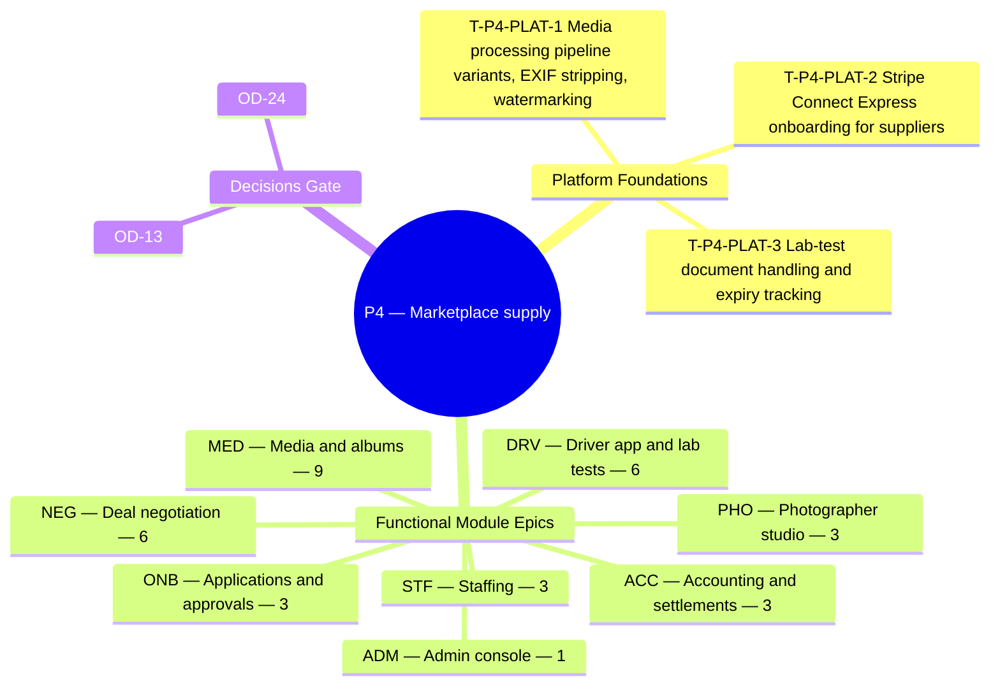

**Theme.** Marketplace supply — platform drivers and photographers, lab tests, negotiation, media

**Definition of done.** Organizations book platform suppliers through deals and deliver albums with all privacy modes. *([BRD section 3.3](/en/docs/brd#33-delivery-phases))*

**37 delivery tasks** (**34** functional tasks: **33** Must, **1** Should, **0** Could + **3** cross-cutting platform foundation tasks) across **8** SRS modules. Every task below carries its complete specification, implementation deliverables, acceptance criteria, affected PostgreSQL tables, and cross-specification links across BRD, SRS, ERD, Plan, Workflows, User Flows, Architecture, Design, End-to-End Lifecycle, and Recommendations.

**Data model.** [ERD conventions](/en/docs/erd), [Access Control & RLS](/en/docs/erd/acl), and the [lookup catalog](/en/docs/erd/reference) apply to every table touched in this phase.

<MindmapBlock title="P4 Scope Mindmap — Marketplace supply" caption="Breakdown of platform foundations, module epics (37 tasks), and milestone gates for P4." trace={{"brd":[{"label":"BRD §3.3 Phases","href":"/en/docs/brd#33-delivery-phases"}],"srs":[{"label":"SRS Traceability","href":"/en/docs/srs/traceability"}],"erd":[{"label":"ERD Overview","href":"/en/docs/erd"}],"plan":[{"label":"Milestones","href":"/en/docs/plan/milestones"},{"label":"Build Guide","href":"/en/docs/plan/build-guide"}],"workflows":[{"label":"Workflow Coverage","href":"/en/docs/workflows/coverage"}],"architecture":[{"label":"Architecture","href":"/en/docs/architecture"}],"design":[{"label":"Design System","href":"/en/docs/design"}],"system":[{"label":"End-to-End Lifecycle","href":"/en/docs/system/lifecycle"}],"recommendations":[{"label":"Open Decisions","href":"/en/docs/recommendations/open-decisions"}]}}>

</MindmapBlock>

## Quick-jump task index

| Task | Module | Reference | Priority |
|---|---|---|---|
| [T-P4-PLAT-1 — Media processing pipeline: variants, EXIF stripping, watermarking](#t-p4-plat-1) | `PLAT` | [NFR-SEC](/en/docs/srs/quality#82-security-nfr-sec) | Must |
| [T-P4-PLAT-2 — Stripe Connect Express onboarding for suppliers](#t-p4-plat-2) | `PLAT` | [NFR-SEC](/en/docs/srs/quality#82-security-nfr-sec) | Must |
| [T-P4-PLAT-3 — Lab-test document handling and expiry tracking](#t-p4-plat-3) | `PLAT` | [NFR-COM](/en/docs/srs/quality#810-compliance-nfr-com) | Must |
| [T-P4-ONB-1 — Photographer portfolio minimum](#t-p4-onb-1) | `ONB` | [FR-ONB-06](/en/docs/srs/requirements/onb#fr-onb-06--photographer-portfolio-minimum) | Must |
| [T-P4-ONB-2 — Driver vehicle and insurance details](#t-p4-onb-2) | `ONB` | [FR-ONB-07](/en/docs/srs/requirements/onb#fr-onb-07--driver-vehicle-and-insurance-details) | Must |
| [T-P4-ONB-3 — Lab consent and initial result](#t-p4-onb-3) | `ONB` | [FR-ONB-08](/en/docs/srs/requirements/onb#fr-onb-08--lab-consent-and-initial-result) | Must |
| [T-P4-STF-1 — Photographer tracks](#t-p4-stf-1) | `STF` | [FR-STF-02](/en/docs/srs/requirements/stf#fr-stf-02--photographer-tracks) | Must |
| [T-P4-STF-2 — Assignment after finalized deal](#t-p4-stf-2) | `STF` | [FR-STF-04](/en/docs/srs/requirements/stf#fr-stf-04--assignment-after-finalized-deal) | Must |
| [T-P4-STF-3 — Deal request visibility](#t-p4-stf-3) | `STF` | [FR-STF-06](/en/docs/srs/requirements/stf#fr-stf-06--deal-request-visibility) | Must |
| [T-P4-NEG-1 — Deal proposal](#t-p4-neg-1) | `NEG` | [FR-NEG-01](/en/docs/srs/requirements/neg#fr-neg-01--deal-proposal) | Must |
| [T-P4-NEG-2 — Counter-offers and expiry](#t-p4-neg-2) | `NEG` | [FR-NEG-02](/en/docs/srs/requirements/neg#fr-neg-02--counter-offers-and-expiry) | Must |
| [T-P4-NEG-3 — Mutual acceptance](#t-p4-neg-3) | `NEG` | [FR-NEG-03](/en/docs/srs/requirements/neg#fr-neg-03--mutual-acceptance) | Must |
| [T-P4-NEG-4 — Rejection](#t-p4-neg-4) | `NEG` | [FR-NEG-04](/en/docs/srs/requirements/neg#fr-neg-04--rejection) | Must |
| [T-P4-NEG-5 — Finalization](#t-p4-neg-5) | `NEG` | [FR-NEG-05](/en/docs/srs/requirements/neg#fr-neg-05--finalization) | Must |
| [T-P4-NEG-6 — Negotiation by plan](#t-p4-neg-6) | `NEG` | [FR-NEG-07](/en/docs/srs/requirements/neg#fr-neg-07--negotiation-by-plan) | Must |
| [T-P4-MED-1 — Album creation window](#t-p4-med-1) | `MED` | [FR-MED-01](/en/docs/srs/requirements/med#fr-med-01--album-creation-window) | Must |
| [T-P4-MED-2 — Resumable batch upload](#t-p4-med-2) | `MED` | [FR-MED-02](/en/docs/srs/requirements/med#fr-med-02--resumable-batch-upload) | Must |
| [T-P4-MED-3 — Privacy modes by plan](#t-p4-med-3) | `MED` | [FR-MED-03](/en/docs/srs/requirements/med#fr-med-03--privacy-modes-by-plan) | Must |
| [T-P4-MED-4 — Shared links](#t-p4-med-4) | `MED` | [FR-MED-04](/en/docs/srs/requirements/med#fr-med-04--shared-links) | Must |
| [T-P4-MED-5 — Selected-user access](#t-p4-med-5) | `MED` | [FR-MED-05](/en/docs/srs/requirements/med#fr-med-05--selected-user-access) | Must |
| [T-P4-MED-6 — Watermarking](#t-p4-med-6) | `MED` | [FR-MED-06](/en/docs/srs/requirements/med#fr-med-06--watermarking) | Should |
| [T-P4-MED-7 — Traveler access and download](#t-p4-med-7) | `MED` | [FR-MED-07](/en/docs/srs/requirements/med#fr-med-07--traveler-access-and-download) | Must |
| [T-P4-MED-8 — Albums per trip by plan](#t-p4-med-8) | `MED` | [FR-MED-08](/en/docs/srs/requirements/med#fr-med-08--albums-per-trip-by-plan) | Must |
| [T-P4-MED-9 — File lifecycle and orphan cleanup](#t-p4-med-9) | `MED` | [FR-MED-09](/en/docs/srs/requirements/med#fr-med-09--file-lifecycle-and-orphan-cleanup) | Must |
| [T-P4-PHO-1 — Portfolio](#t-p4-pho-1) | `PHO` | [FR-PHO-01](/en/docs/srs/requirements/pho#fr-pho-01--portfolio) | Must |
| [T-P4-PHO-2 — Rates and availability](#t-p4-pho-2) | `PHO` | [FR-PHO-02](/en/docs/srs/requirements/pho#fr-pho-02--rates-and-availability) | Must |
| [T-P4-PHO-3 — Earnings](#t-p4-pho-3) | `PHO` | [FR-PHO-03](/en/docs/srs/requirements/pho#fr-pho-03--earnings) | Must |
| [T-P4-DRV-1 — Deal responses](#t-p4-drv-1) | `DRV` | [FR-DRV-02](/en/docs/srs/requirements/drv#fr-drv-02--deal-responses) | Must |
| [T-P4-DRV-2 — Lab-test pause](#t-p4-drv-2) | `DRV` | [FR-DRV-03](/en/docs/srs/requirements/drv#fr-drv-03--lab-test-pause) | Must |
| [T-P4-DRV-3 — Lab deadline and result](#t-p4-drv-3) | `DRV` | [FR-DRV-04](/en/docs/srs/requirements/drv#fr-drv-04--lab-deadline-and-result) | Must |
| [T-P4-DRV-4 — Admin validation](#t-p4-drv-4) | `DRV` | [FR-DRV-05](/en/docs/srs/requirements/drv#fr-drv-05--admin-validation) | Must |
| [T-P4-DRV-5 — Earnings and payouts](#t-p4-drv-5) | `DRV` | [FR-DRV-07](/en/docs/srs/requirements/drv#fr-drv-07--earnings-and-payouts) | Must |
| [T-P4-DRV-6 — Driver availability](#t-p4-drv-6) | `DRV` | [FR-DRV-08](/en/docs/srs/requirements/drv#fr-drv-08--driver-availability) | Must |
| [T-P4-ADM-1 — Lab-test requests](#t-p4-adm-1) | `ADM` | [FR-ADM-09](/en/docs/srs/requirements/adm#fr-adm-09--lab-test-requests) | Must |
| [T-P4-ACC-1 — Supplier earnings and payouts](#t-p4-acc-1) | `ACC` | [FR-ACC-03](/en/docs/srs/requirements/acc#fr-acc-03--supplier-earnings-and-payouts) | Must |
| [T-P4-ACC-2 — Settlements](#t-p4-acc-2) | `ACC` | [FR-ACC-05](/en/docs/srs/requirements/acc#fr-acc-05--settlements) | Must |
| [T-P4-ACC-3 — Archive after settlement](#t-p4-acc-3) | `ACC` | [FR-ACC-10](/en/docs/srs/requirements/acc#fr-acc-10--archive-after-settlement) | Must |

## Cross-cutting

These platform-wide engineering tasks establish the runtime, database, integration, and observability foundations required to close this phase gate.

### T-P4-PLAT-1 — Media processing pipeline: variants, EXIF stripping, watermarking

<TaskCard id="T-P4-PLAT-1" title="Media processing pipeline: variants, EXIF stripping, watermarking" phase="P4" module="PLAT" priority="Must" kind="platform" surfaces={["Object Storage","Worker","CDN","Photographer Studio"]} tables={[]} trace={{"brd":[{"label":"BRD P4 Gate","href":"/en/docs/brd#33-delivery-phases"}],"srs":[{"label":"NFR-SEC","href":"/en/docs/srs/quality#82-security-nfr-sec"}],"erd":[{"label":"Media","href":"/en/docs/erd/domains/media"},{"label":"ACL & RLS","href":"/en/docs/erd/acl"}],"plan":[{"label":"Milestones","href":"/en/docs/plan/milestones"},{"label":"Test Strategy","href":"/en/docs/plan/testing"}],"workflows":[{"label":"media","href":"/en/docs/workflows/media"}],"userFlows":[{"label":"Role Flows","href":"/en/docs/user-flows"}],"architecture":[{"label":"Architecture","href":"/en/docs/architecture#integrations"}],"design":[{"label":"Design System","href":"/en/docs/design#photographer-app"}],"system":[{"label":"STAGE-08","href":"/en/docs/system/lifecycle#stage-08"}],"recommendations":[{"label":"REC-MED-08","href":"/en/docs/recommendations/architecture-and-ops#rec-med-08"}]}}>

**Platform scope.** Build the isolated worker pool for multipart S3-compatible uploads, mandatory GPS/camera EXIF stripping on every photo, WebP/AVIF thumbnail & preview generation, watermarking, signed CDN delivery, and the 24-hour unlinked file reaper (`BRL-31`).

**Implementation deliverables.**

- Resumable multipart upload presigner + `libvips` worker generating thumbnail/preview/watermarked variants off the API event loop.
- Signed short-lived CDN URLs enforcing Public-on-Trip, Group-PIN, and Individual-Only album privacy modes (`FR-MED-03`).

**Acceptance & verification criteria.**

- Given a raw JPEG containing GPS EXIF tags uploaded to an album, when processing completes, then all served variants have EXIF metadata stripped.
- Given an uploaded file never attached to an entity, when 24 hours elapse, then the reaper deletes the source object and all derived variants (`BRL-31`).

</TaskCard>

### T-P4-PLAT-2 — Stripe Connect Express onboarding for suppliers

<TaskCard id="T-P4-PLAT-2" title="Stripe Connect Express onboarding for suppliers" phase="P4" module="PLAT" priority="Must" kind="platform" surfaces={["Driver App","Photographer Studio","Admin Console"]} tables={[]} trace={{"brd":[{"label":"BRD P4 Gate","href":"/en/docs/brd#33-delivery-phases"}],"srs":[{"label":"NFR-SEC","href":"/en/docs/srs/quality#82-security-nfr-sec"}],"erd":[{"label":"Suppliers","href":"/en/docs/erd/domains/suppliers"},{"label":"Finance","href":"/en/docs/erd/domains/finance"},{"label":"ACL & RLS","href":"/en/docs/erd/acl"}],"plan":[{"label":"Milestones","href":"/en/docs/plan/milestones"},{"label":"Test Strategy","href":"/en/docs/plan/testing"}],"workflows":[{"label":"money","href":"/en/docs/workflows/money"}],"userFlows":[{"label":"Role Flows","href":"/en/docs/user-flows"}],"architecture":[{"label":"Architecture","href":"/en/docs/architecture#integrations"}],"design":[{"label":"Design System","href":"/en/docs/design#driver-app"}],"system":[{"label":"STAGE-08","href":"/en/docs/system/lifecycle#stage-08"}],"recommendations":[{"label":"REC-FIN-10","href":"/en/docs/recommendations/architecture-and-ops#rec-fin-10"}]}}>

**Platform scope.** Integrate Stripe Connect Express (plus local MENA bank payout rails where Connect is unavailable) for platform drivers and photographers, tracking KYC verification status, payout holds, and automated weekly Monday 06:00 settlement disbursements.

**Implementation deliverables.**

- Hosted onboarding link flow, account-status webhook sync, and `payout_accounts` readiness checks before deal acceptance.
- Idempotent weekly payout runner posting balanced double-entry `ledger_entries` (`BRL-18`).

**Acceptance & verification criteria.**

- Given a supplier with a paused lab-test or unverified payout account, when Monday payout runs, then completed-trip earnings follow `BRL-17` hold/release rules accurately.

</TaskCard>

### T-P4-PLAT-3 — Lab-test document handling and expiry tracking

<TaskCard id="T-P4-PLAT-3" title="Lab-test document handling and expiry tracking" phase="P4" module="PLAT" priority="Must" kind="platform" surfaces={["Admin Console","Driver App","Object Storage"]} tables={["lab_tests","driver_profiles","audit_events"]} trace={{"brd":[{"label":"BRD P4 Gate","href":"/en/docs/brd#33-delivery-phases"}],"srs":[{"label":"NFR-COM","href":"/en/docs/srs/quality#810-compliance-nfr-com"}],"erd":[{"label":"Suppliers","href":"/en/docs/erd/domains/suppliers"},{"label":"Platform","href":"/en/docs/erd/domains/platform"},{"label":"lab_tests","href":"/en/docs/erd/domains/suppliers#lab_tests","detail":"table"},{"label":"driver_profiles","href":"/en/docs/erd/domains/suppliers#driver_profiles","detail":"table"},{"label":"audit_events","href":"/en/docs/erd/domains/platform#audit_events","detail":"table"},{"label":"ACL & RLS","href":"/en/docs/erd/acl"}],"plan":[{"label":"Milestones","href":"/en/docs/plan/milestones"},{"label":"Test Strategy","href":"/en/docs/plan/testing"}],"workflows":[{"label":"scheduled-jobs","href":"/en/docs/workflows/scheduled-jobs"}],"userFlows":[{"label":"Role Flows","href":"/en/docs/user-flows"}],"architecture":[{"label":"Architecture","href":"/en/docs/architecture#data-architecture"}],"design":[{"label":"Design System","href":"/en/docs/design#admin-console"}],"system":[{"label":"STAGE-02","href":"/en/docs/system/lifecycle#stage-02"}],"recommendations":[{"label":"REC-SEC-09","href":"/en/docs/recommendations/architecture-and-ops#rec-sec-09"}]}}>

**Platform scope.** Build KMS-encrypted storage, admin-only access controls, market legal-review feature switches (BRD §8.2), configurable 1–7 day deadlines (default 3 days, `BRL-16`), and daily deadline/30-day-closure sweeps for driver lab tests.

**Implementation deliverables.**

- Encrypted private bucket path + admin-only RLS/ACL check logging every document view in `audit_events`.
- Daily scheduler enforcing 3-day missed-deadline suspension and 30-day account closure (`BRL-16`).

**Acceptance & verification criteria.**

- Given a market without signed legal review enabled, when an admin attempts to request a lab test in that market, then the action is blocked.
- Given an organization owner viewing an assigned platform driver, when inspecting the profile, then identity and lab-result files are never exposed.

</TaskCard>

## ONB — Applications and approvals

**Data model.** [Applications](/en/docs/erd/domains/applications), [Suppliers](/en/docs/erd/domains/suppliers) — the data-model domains and tables this module's requirements read and write.

### T-P4-ONB-1 — Photographer portfolio minimum

<TaskCard id="T-P4-ONB-1" title="Photographer portfolio minimum" phase="P4" module="ONB" priority="Must" surfaces={["Visitor Web","Driver App","Photographer Studio","Admin Console"]} tables={["applications"]} trace={{"brd":[{"label":"BR-ONB-06","href":"/en/docs/brd/requirements#62-applications-and-approvals-onb","detail":"P4"}],"srs":[{"label":"FR-ONB-06","href":"/en/docs/srs/requirements/onb#fr-onb-06--photographer-portfolio-minimum","detail":"Must"},{"label":"SM §7.5 Application","href":"/en/docs/srs/state-machines#75-application"},{"label":"Quality NFRs","href":"/en/docs/srs/quality"}],"erd":[{"label":"Applications","href":"/en/docs/erd/domains/applications"},{"label":"Suppliers","href":"/en/docs/erd/domains/suppliers"},{"label":"applications","href":"/en/docs/erd/domains/applications#applications","detail":"table"}],"plan":[{"label":"P4 Milestone","href":"/en/docs/plan/milestones"},{"label":"Testing Pyramid","href":"/en/docs/plan/testing"}],"workflows":[{"label":"applications","href":"/en/docs/workflows/applications"}],"userFlows":[{"label":"UF-PHO-01","href":"/en/docs/user-flows/photographer#uf-pho-01-register-and-apply"}],"architecture":[{"label":"Architecture","href":"/en/docs/architecture#service-model"}],"design":[{"label":"Design Surface","href":"/en/docs/design#admin-console"}],"system":[{"label":"STAGE-02","href":"/en/docs/system/lifecycle#stage-02"}],"recommendations":[{"label":"REC-ARCH-01","href":"/en/docs/recommendations/architecture-and-ops#rec-arch-01"}]}}>

**Specification ([FR-ONB-06](/en/docs/srs/requirements/onb#fr-onb-06--photographer-portfolio-minimum)).** A photographer application shall require at least 8 portfolio photos (JPEG, PNG or HEIC, 25 MB each, D-81).

**Implementation deliverables.**

- **Domain & API logic:** Build the onboarding state machine, admin review queue, 2-working-day SLA timers, changes-requested extensions, and appeal workflows.
- **Persistence & RLS:** Read/write operations on `applications` enforcing base-column conventions, soft-delete filters, and tenant/role access control ([ACL](/en/docs/erd/acl)).
- **Verification & telemetry:** Automated unit/integration coverage mapped to `FR-ONB-06` acceptance scenarios ([Test Strategy](/en/docs/plan/testing)) with structured trace/audit emission.

**Acceptance criteria.**

- Given 7 uploaded photos, when the photographer submits, then submission is refused and the required count is shown.

**Business trace & governing rules.**

- [BR-ONB-06](/en/docs/brd/requirements#62-applications-and-approvals-onb): Photographer applications include at least 8 portfolio photos.

</TaskCard>

### T-P4-ONB-2 — Driver vehicle and insurance details

<TaskCard id="T-P4-ONB-2" title="Driver vehicle and insurance details" phase="P4" module="ONB" priority="Must" surfaces={["Visitor Web","Driver App","Photographer Studio","Admin Console"]} tables={["applications","driver_profiles"]} trace={{"brd":[{"label":"BR-ONB-07","href":"/en/docs/brd/requirements#62-applications-and-approvals-onb","detail":"P4"}],"srs":[{"label":"FR-ONB-07","href":"/en/docs/srs/requirements/onb#fr-onb-07--driver-vehicle-and-insurance-details","detail":"Must"},{"label":"SM §7.5 Application","href":"/en/docs/srs/state-machines#75-application"},{"label":"Quality NFRs","href":"/en/docs/srs/quality"}],"erd":[{"label":"Applications","href":"/en/docs/erd/domains/applications"},{"label":"Suppliers","href":"/en/docs/erd/domains/suppliers"},{"label":"applications","href":"/en/docs/erd/domains/applications#applications","detail":"table"},{"label":"driver_profiles","href":"/en/docs/erd/domains/suppliers#driver_profiles","detail":"table"}],"plan":[{"label":"P4 Milestone","href":"/en/docs/plan/milestones"},{"label":"Testing Pyramid","href":"/en/docs/plan/testing"}],"workflows":[{"label":"applications","href":"/en/docs/workflows/applications#timers-and-rules"}],"userFlows":[{"label":"UF-DRV-01","href":"/en/docs/user-flows/driver#uf-drv-01-register-and-apply"}],"architecture":[{"label":"Architecture","href":"/en/docs/architecture#service-model"}],"design":[{"label":"Design Surface","href":"/en/docs/design#admin-console"}],"system":[{"label":"STAGE-02","href":"/en/docs/system/lifecycle#stage-02"}],"recommendations":[{"label":"REC-ARCH-01","href":"/en/docs/recommendations/architecture-and-ops#rec-arch-01"}]}}>

**Specification ([FR-ONB-07](/en/docs/srs/requirements/onb#fr-onb-07--driver-vehicle-and-insurance-details)).** A driver using their own vehicle shall give plate, model, year, seat count, registration and insurance valid for at least 3 more months. Documents are PDF, JPG or PNG up to 10 MB (D-80).

**Implementation deliverables.**

- **Domain & API logic:** Build the onboarding state machine, admin review queue, 2-working-day SLA timers, changes-requested extensions, and appeal workflows.
- **Persistence & RLS:** Read/write operations on `applications`, `driver_profiles` enforcing base-column conventions, soft-delete filters, and tenant/role access control ([ACL](/en/docs/erd/acl)).
- **Verification & telemetry:** Automated unit/integration coverage mapped to `FR-ONB-07` acceptance scenarios ([Test Strategy](/en/docs/plan/testing)) with structured trace/audit emission.

**Acceptance criteria.**

- Given insurance expiring in 2 months, when the driver submits, then submission is refused with the minimum shown.

**Business trace & governing rules.**

- [BR-ONB-07](/en/docs/brd/requirements#62-applications-and-approvals-onb): Drivers using their own vehicle give plate, model, year, seat count, registration and insurance valid for at least 3 more months.

</TaskCard>

### T-P4-ONB-3 — Lab consent and initial result

<TaskCard id="T-P4-ONB-3" title="Lab consent and initial result" phase="P4" module="ONB" priority="Must" surfaces={["Visitor Web","Driver App","Photographer Studio","Admin Console"]} tables={["applications"]} trace={{"brd":[{"label":"BR-ONB-08","href":"/en/docs/brd/requirements#62-applications-and-approvals-onb","detail":"P4"}],"srs":[{"label":"FR-ONB-08","href":"/en/docs/srs/requirements/onb#fr-onb-08--lab-consent-and-initial-result","detail":"Must"},{"label":"SM §7.5 Application","href":"/en/docs/srs/state-machines#75-application"},{"label":"Quality NFRs","href":"/en/docs/srs/quality"}],"erd":[{"label":"Applications","href":"/en/docs/erd/domains/applications"},{"label":"Suppliers","href":"/en/docs/erd/domains/suppliers"},{"label":"applications","href":"/en/docs/erd/domains/applications#applications","detail":"table"}],"plan":[{"label":"P4 Milestone","href":"/en/docs/plan/milestones"},{"label":"Testing Pyramid","href":"/en/docs/plan/testing"}],"workflows":[{"label":"applications","href":"/en/docs/workflows/applications#timers-and-rules"}],"userFlows":[{"label":"UF-DRV-01","href":"/en/docs/user-flows/driver#uf-drv-01-register-and-apply"}],"architecture":[{"label":"Architecture","href":"/en/docs/architecture#service-model"}],"design":[{"label":"Design Surface","href":"/en/docs/design#admin-console"}],"system":[{"label":"STAGE-02","href":"/en/docs/system/lifecycle#stage-02"}],"recommendations":[{"label":"REC-ARCH-01","href":"/en/docs/recommendations/architecture-and-ops#rec-arch-01"}]}}>

**Specification ([FR-ONB-08](/en/docs/srs/requirements/onb#fr-onb-08--lab-consent-and-initial-result)).** A driver application shall record consent to lab tests ([NFR-DAT-05](/en/docs/srs/quality#85-data-nfr-dat)) and include an initial lab result dated within the last 30 days.

**Implementation deliverables.**

- **Domain & API logic:** Build the onboarding state machine, admin review queue, 2-working-day SLA timers, changes-requested extensions, and appeal workflows.
- **Persistence & RLS:** Read/write operations on `applications` enforcing base-column conventions, soft-delete filters, and tenant/role access control ([ACL](/en/docs/erd/acl)).
- **Verification & telemetry:** Automated unit/integration coverage mapped to `FR-ONB-08` acceptance scenarios ([Test Strategy](/en/docs/plan/testing)) with structured trace/audit emission.

**Acceptance criteria.**

- Given a lab result dated 31 days before submission, when the driver submits, then submission is refused.

**Business trace & governing rules.**

- [BR-ONB-08](/en/docs/brd/requirements#62-applications-and-approvals-onb): Driver applications record consent to lab tests and include an initial lab result dated within the last 30 days.

</TaskCard>

## STF — Staffing

**Data model.** [Fleet and trips](/en/docs/erd/domains/fleet-and-trips) — the data-model domains and tables this module's requirements read and write.

### T-P4-STF-1 — Photographer tracks

<TaskCard id="T-P4-STF-1" title="Photographer tracks" phase="P4" module="STF" priority="Must" surfaces={["Organization Dashboard","Driver App","Photographer Studio","Moderator App"]} tables={["trip_staff_assignments"]} trace={{"brd":[{"label":"BR-STF-02","href":"/en/docs/brd/requirements#65-staffing-and-deals-stf","detail":"P4"}],"srs":[{"label":"FR-STF-02","href":"/en/docs/srs/requirements/stf#fr-stf-02--photographer-tracks","detail":"Must"},{"label":"Quality NFRs","href":"/en/docs/srs/quality"}],"erd":[{"label":"Fleet and trips","href":"/en/docs/erd/domains/fleet-and-trips"},{"label":"trip_staff_assignments","href":"/en/docs/erd/domains/fleet-and-trips#trip_staff_assignments","detail":"table"}],"plan":[{"label":"P4 Milestone","href":"/en/docs/plan/milestones"},{"label":"Testing Pyramid","href":"/en/docs/plan/testing"}],"workflows":[{"label":"trip-lifecycle","href":"/en/docs/workflows/trip-lifecycle"}],"userFlows":[{"label":"UF-PHO-03","href":"/en/docs/user-flows/photographer#uf-pho-03-respond-to-a-deal"}],"architecture":[{"label":"Architecture","href":"/en/docs/architecture#service-model"}],"design":[{"label":"Design Surface","href":"/en/docs/design#organization-dashboard"}],"system":[{"label":"STAGE-03","href":"/en/docs/system/lifecycle#stage-03"}],"recommendations":[{"label":"REC-ARCH-01","href":"/en/docs/recommendations/architecture-and-ops#rec-arch-01"}]}}>

**Specification ([FR-STF-02](/en/docs/srs/requirements/stf#fr-stf-02--photographer-tracks)).** A trip's photographer shall be organization-owned or a platform photographer through a finalized deal.

**Implementation deliverables.**

- **Domain & API logic:** Enforce per-vehicle driver and moderator readiness (`BRL-07`), schedule conflict detection, and emergency supplier replacement flows.
- **Persistence & RLS:** Read/write operations on `trip_staff_assignments` enforcing base-column conventions, soft-delete filters, and tenant/role access control ([ACL](/en/docs/erd/acl)).
- **Verification & telemetry:** Automated unit/integration coverage mapped to `FR-STF-02` acceptance scenarios ([Test Strategy](/en/docs/plan/testing)) with structured trace/audit emission.

**Acceptance criteria.**

- Given a platform photographer is chosen, when the organization proceeds, then a deal starts and no assignment is made until it is finalized.

**Business trace & governing rules.**

- [BR-STF-02](/en/docs/brd/requirements#65-staffing-and-deals-stf): A trip's photographer is either organization-owned or a platform photographer hired through a deal.

</TaskCard>

### T-P4-STF-2 — Assignment after finalized deal

<TaskCard id="T-P4-STF-2" title="Assignment after finalized deal" phase="P4" module="STF" priority="Must" surfaces={["Organization Dashboard","Driver App","Photographer Studio","Moderator App"]} tables={["trip_staff_assignments"]} trace={{"brd":[{"label":"BR-STF-04","href":"/en/docs/brd/requirements#65-staffing-and-deals-stf","detail":"P4"},{"label":"BRL-04","href":"/en/docs/brd/requirements#7-business-rules","detail":"rule"}],"srs":[{"label":"FR-STF-04","href":"/en/docs/srs/requirements/stf#fr-stf-04--assignment-after-finalized-deal","detail":"Must"},{"label":"Quality NFRs","href":"/en/docs/srs/quality"}],"erd":[{"label":"Fleet and trips","href":"/en/docs/erd/domains/fleet-and-trips"},{"label":"trip_staff_assignments","href":"/en/docs/erd/domains/fleet-and-trips#trip_staff_assignments","detail":"table"}],"plan":[{"label":"P4 Milestone","href":"/en/docs/plan/milestones"},{"label":"Testing Pyramid","href":"/en/docs/plan/testing"}],"workflows":[{"label":"trip-lifecycle","href":"/en/docs/workflows/trip-lifecycle#timers-and-rules"}],"userFlows":[{"label":"organization","href":"/en/docs/user-flows/organization"}],"architecture":[{"label":"Architecture","href":"/en/docs/architecture#service-model"}],"design":[{"label":"Design Surface","href":"/en/docs/design#organization-dashboard"}],"system":[{"label":"STAGE-03","href":"/en/docs/system/lifecycle#stage-03"}],"recommendations":[{"label":"REC-ARCH-01","href":"/en/docs/recommendations/architecture-and-ops#rec-arch-01"}]}}>

**Specification ([FR-STF-04](/en/docs/srs/requirements/stf#fr-stf-04--assignment-after-finalized-deal)).** A platform supplier shall be assigned only after both parties accept the same terms.

**Implementation deliverables.**

- **Domain & API logic:** Enforce per-vehicle driver and moderator readiness (`BRL-07`), schedule conflict detection, and emergency supplier replacement flows.
- **Persistence & RLS:** Read/write operations on `trip_staff_assignments` enforcing base-column conventions, soft-delete filters, and tenant/role access control ([ACL](/en/docs/erd/acl)).
- **Verification & telemetry:** Automated unit/integration coverage mapped to `FR-STF-04` acceptance scenarios ([Test Strategy](/en/docs/plan/testing)) with structured trace/audit emission.

**Acceptance criteria.**

- Given a deal in Countered by Provider, when assignment is attempted, then it is refused.

**Business trace & governing rules.**

- [BR-STF-04](/en/docs/brd/requirements#65-staffing-and-deals-stf): A platform supplier is assigned only after both parties accept the same terms.
- [BRL-04](/en/docs/brd/requirements#7-business-rules): A platform driver or photographer is assigned only after a finalized deal accepted by both parties.

</TaskCard>

### T-P4-STF-3 — Deal request visibility

<TaskCard id="T-P4-STF-3" title="Deal request visibility" phase="P4" module="STF" priority="Must" surfaces={["Organization Dashboard","Driver App","Photographer Studio","Moderator App"]} tables={["trip_staff_assignments"]} trace={{"brd":[{"label":"BR-STF-06","href":"/en/docs/brd/requirements#65-staffing-and-deals-stf","detail":"P4"}],"srs":[{"label":"FR-STF-06","href":"/en/docs/srs/requirements/stf#fr-stf-06--deal-request-visibility","detail":"Must"},{"label":"Quality NFRs","href":"/en/docs/srs/quality"}],"erd":[{"label":"Fleet and trips","href":"/en/docs/erd/domains/fleet-and-trips"},{"label":"trip_staff_assignments","href":"/en/docs/erd/domains/fleet-and-trips#trip_staff_assignments","detail":"table"}],"plan":[{"label":"P4 Milestone","href":"/en/docs/plan/milestones"},{"label":"Testing Pyramid","href":"/en/docs/plan/testing"}],"workflows":[{"label":"trip-lifecycle","href":"/en/docs/workflows/trip-lifecycle"}],"userFlows":[{"label":"UF-DRV-03","href":"/en/docs/user-flows/driver#uf-drv-03-respond-to-a-deal"}],"architecture":[{"label":"Architecture","href":"/en/docs/architecture#service-model"}],"design":[{"label":"Design Surface","href":"/en/docs/design#organization-dashboard"}],"system":[{"label":"STAGE-03","href":"/en/docs/system/lifecycle#stage-03"}],"recommendations":[{"label":"REC-ARCH-01","href":"/en/docs/recommendations/architecture-and-ops#rec-arch-01"}]}}>

**Specification ([FR-STF-06](/en/docs/srs/requirements/stf#fr-stf-06--deal-request-visibility)).** A supplier shall see trip, route, date, vehicle and pay before responding.

**Implementation deliverables.**

- **Domain & API logic:** Enforce per-vehicle driver and moderator readiness (`BRL-07`), schedule conflict detection, and emergency supplier replacement flows.
- **Persistence & RLS:** Read/write operations on `trip_staff_assignments` enforcing base-column conventions, soft-delete filters, and tenant/role access control ([ACL](/en/docs/erd/acl)).
- **Verification & telemetry:** Automated unit/integration coverage mapped to `FR-STF-06` acceptance scenarios ([Test Strategy](/en/docs/plan/testing)) with structured trace/audit emission.

**Acceptance criteria.**

- Given an open deal request, when the supplier opens it, then those details show before accept or counter is enabled.

**Business trace & governing rules.**

- [BR-STF-06](/en/docs/brd/requirements#65-staffing-and-deals-stf): Suppliers see trip, route, date and pay before they respond to a deal.

</TaskCard>

## NEG — Deal negotiation

**Data model.** [Deals](/en/docs/erd/domains/deals) — the data-model domains and tables this module's requirements read and write.

### T-P4-NEG-1 — Deal proposal

<TaskCard id="T-P4-NEG-1" title="Deal proposal" phase="P4" module="NEG" priority="Must" surfaces={["Organization Dashboard","Driver App","Photographer Studio"]} tables={["deals"]} trace={{"brd":[{"label":"BR-STF-03","href":"/en/docs/brd/requirements#65-staffing-and-deals-stf","detail":"P4"}],"srs":[{"label":"FR-NEG-01","href":"/en/docs/srs/requirements/neg#fr-neg-01--deal-proposal","detail":"Must"},{"label":"SM §7.4 Deal","href":"/en/docs/srs/state-machines#74-deal"},{"label":"Quality NFRs","href":"/en/docs/srs/quality"}],"erd":[{"label":"Deals","href":"/en/docs/erd/domains/deals"},{"label":"deals","href":"/en/docs/erd/domains/deals#deals","detail":"table"}],"plan":[{"label":"P4 Milestone","href":"/en/docs/plan/milestones"},{"label":"Testing Pyramid","href":"/en/docs/plan/testing"}],"workflows":[{"label":"trip-lifecycle","href":"/en/docs/workflows/trip-lifecycle"}],"userFlows":[{"label":"UF-DRV-03","href":"/en/docs/user-flows/driver#uf-drv-03-respond-to-a-deal"},{"label":"UF-ORG-07","href":"/en/docs/user-flows/organization#uf-org-07-hire-a-platform-supplier-deal"},{"label":"UF-PHO-03","href":"/en/docs/user-flows/photographer#uf-pho-03-respond-to-a-deal"}],"architecture":[{"label":"Architecture","href":"/en/docs/architecture#service-model"}],"design":[{"label":"Design Surface","href":"/en/docs/design#driver-app"}],"system":[{"label":"STAGE-03","href":"/en/docs/system/lifecycle#stage-03"}],"recommendations":[{"label":"REC-FIN-10","href":"/en/docs/recommendations/architecture-and-ops#rec-fin-10"}]}}>

**Specification ([FR-NEG-01](/en/docs/srs/requirements/neg#fr-neg-01--deal-proposal)).** Either party shall propose a price for a specific vehicle or trip.

**Implementation deliverables.**

- **Domain & API logic:** Implement Deal state-machine transitions, counter-offer history, 72-hour auto-expiry (`BRL-26`), dual-party price lock, and cancellation fee rules.
- **Persistence & RLS:** Read/write operations on `deals` enforcing base-column conventions, soft-delete filters, and tenant/role access control ([ACL](/en/docs/erd/acl)).
- **Verification & telemetry:** Automated unit/integration coverage mapped to `FR-NEG-01` acceptance scenarios ([Test Strategy](/en/docs/plan/testing)) with structured trace/audit emission.

**Acceptance criteria.**

- Given an organization proposes for vehicle 2, when saved, then the supplier receives the request with the price.

**Business trace & governing rules.**

- [BR-STF-03](/en/docs/brd/requirements#65-staffing-and-deals-stf): Organizations and platform suppliers negotiate the price of a deal: either side proposes, counters or rejects, with no round limit. An offer expires 72 hours after the last counter ([BRL-26](/en/docs/brd/requirements#7-business-rules)). Platform suppliers are available only on plans that include them.

</TaskCard>

### T-P4-NEG-2 — Counter-offers and expiry

<TaskCard id="T-P4-NEG-2" title="Counter-offers and expiry" phase="P4" module="NEG" priority="Must" surfaces={["Organization Dashboard","Driver App","Photographer Studio"]} tables={["deals"]} trace={{"brd":[{"label":"BR-STF-03","href":"/en/docs/brd/requirements#65-staffing-and-deals-stf","detail":"P4"},{"label":"BRL-26","href":"/en/docs/brd/requirements#7-business-rules","detail":"rule"},{"label":"OD-13","href":"/en/docs/brd/compliance#11-open-decisions","detail":"Decided"}],"srs":[{"label":"FR-NEG-02","href":"/en/docs/srs/requirements/neg#fr-neg-02--counter-offers-and-expiry","detail":"Must"},{"label":"SM §7.4 Deal","href":"/en/docs/srs/state-machines#74-deal"},{"label":"Quality NFRs","href":"/en/docs/srs/quality"}],"erd":[{"label":"Deals","href":"/en/docs/erd/domains/deals"},{"label":"deals","href":"/en/docs/erd/domains/deals#deals","detail":"table"}],"plan":[{"label":"P4 Milestone","href":"/en/docs/plan/milestones"},{"label":"Testing Pyramid","href":"/en/docs/plan/testing"}],"workflows":[{"label":"scheduled-jobs","href":"/en/docs/workflows/scheduled-jobs#countdowns-per-record-timers"}],"userFlows":[{"label":"UF-DRV-03","href":"/en/docs/user-flows/driver#uf-drv-03-respond-to-a-deal"},{"label":"UF-ORG-07","href":"/en/docs/user-flows/organization#uf-org-07-hire-a-platform-supplier-deal"},{"label":"UF-PHO-03","href":"/en/docs/user-flows/photographer#uf-pho-03-respond-to-a-deal"}],"architecture":[{"label":"Architecture","href":"/en/docs/architecture#service-model"}],"design":[{"label":"Design Surface","href":"/en/docs/design#driver-app"}],"system":[{"label":"STAGE-03","href":"/en/docs/system/lifecycle#stage-03"}],"recommendations":[{"label":"OD-13 Resolution","href":"/en/docs/recommendations/open-decisions#od-13"},{"label":"REC-FIN-10","href":"/en/docs/recommendations/architecture-and-ops#rec-fin-10"}]}}>

**Specification ([FR-NEG-02](/en/docs/srs/requirements/neg#fr-neg-02--counter-offers-and-expiry)).** Either party shall counter with no round limit. An offer expires 72 hours after the last counter; the deal then ends as Rejected with reason expired ([BRL-26](/en/docs/brd/requirements#7-business-rules)).

**Implementation deliverables.**

- **Domain & API logic:** Implement Deal state-machine transitions, counter-offer history, 72-hour auto-expiry (`BRL-26`), dual-party price lock, and cancellation fee rules.
- **Persistence & RLS:** Read/write operations on `deals` enforcing base-column conventions, soft-delete filters, and tenant/role access control ([ACL](/en/docs/erd/acl)).
- **Verification & telemetry:** Automated unit/integration coverage mapped to `FR-NEG-02` acceptance scenarios ([Test Strategy](/en/docs/plan/testing)) with structured trace/audit emission.

**Acceptance criteria.**

- Given a supplier counter, when saved, then the state is Countered by Provider and the organization is notified.
- Given 72 hours since the last counter with no response, when the job runs, then the deal is Rejected with reason expired.

**Business trace & governing rules.**

- [BR-STF-03](/en/docs/brd/requirements#65-staffing-and-deals-stf): Organizations and platform suppliers negotiate the price of a deal: either side proposes, counters or rejects, with no round limit. An offer expires 72 hours after the last counter ([BRL-26](/en/docs/brd/requirements#7-business-rules)). Platform suppliers are available only on plans that include them.
- [BRL-26](/en/docs/brd/requirements#7-business-rules): A deal offer expires 72 hours after the last counter-offer and the deal ends as Rejected with reason "expired" (D-14).
- [OD-13](/en/docs/brd/compliance#11-open-decisions) (Negotiation limit and expiry — Decided) → see [Recommended Resolution](/en/docs/recommendations/open-decisions#od-13).

</TaskCard>

### T-P4-NEG-3 — Mutual acceptance

<TaskCard id="T-P4-NEG-3" title="Mutual acceptance" phase="P4" module="NEG" priority="Must" surfaces={["Organization Dashboard","Driver App","Photographer Studio"]} tables={["deals"]} trace={{"brd":[{"label":"BR-STF-03","href":"/en/docs/brd/requirements#65-staffing-and-deals-stf","detail":"P4"},{"label":"BRL-04","href":"/en/docs/brd/requirements#7-business-rules","detail":"rule"}],"srs":[{"label":"FR-NEG-03","href":"/en/docs/srs/requirements/neg#fr-neg-03--mutual-acceptance","detail":"Must"},{"label":"SM §7.4 Deal","href":"/en/docs/srs/state-machines#74-deal"},{"label":"Quality NFRs","href":"/en/docs/srs/quality"}],"erd":[{"label":"Deals","href":"/en/docs/erd/domains/deals"},{"label":"deals","href":"/en/docs/erd/domains/deals#deals","detail":"table"}],"plan":[{"label":"P4 Milestone","href":"/en/docs/plan/milestones"},{"label":"Testing Pyramid","href":"/en/docs/plan/testing"}],"workflows":[{"label":"trip-lifecycle","href":"/en/docs/workflows/trip-lifecycle"}],"userFlows":[{"label":"UF-DRV-03","href":"/en/docs/user-flows/driver#uf-drv-03-respond-to-a-deal"},{"label":"UF-ORG-07","href":"/en/docs/user-flows/organization#uf-org-07-hire-a-platform-supplier-deal"},{"label":"UF-PHO-03","href":"/en/docs/user-flows/photographer#uf-pho-03-respond-to-a-deal"}],"architecture":[{"label":"Architecture","href":"/en/docs/architecture#service-model"}],"design":[{"label":"Design Surface","href":"/en/docs/design#driver-app"}],"system":[{"label":"STAGE-03","href":"/en/docs/system/lifecycle#stage-03"}],"recommendations":[{"label":"REC-FIN-10","href":"/en/docs/recommendations/architecture-and-ops#rec-fin-10"}]}}>

**Specification ([FR-NEG-03](/en/docs/srs/requirements/neg#fr-neg-03--mutual-acceptance)).** A deal shall be finalized only when both parties accept the same terms. A counter after an acceptance voids that acceptance.

**Implementation deliverables.**

- **Domain & API logic:** Implement Deal state-machine transitions, counter-offer history, 72-hour auto-expiry (`BRL-26`), dual-party price lock, and cancellation fee rules.
- **Persistence & RLS:** Read/write operations on `deals` enforcing base-column conventions, soft-delete filters, and tenant/role access control ([ACL](/en/docs/erd/acl)).
- **Verification & telemetry:** Automated unit/integration coverage mapped to `FR-NEG-03` acceptance scenarios ([Test Strategy](/en/docs/plan/testing)) with structured trace/audit emission.

**Acceptance criteria.**

- Given the supplier accepted, when the organization counters, then the acceptance is void and the state is Countered by Organization.

**Business trace & governing rules.**

- [BR-STF-03](/en/docs/brd/requirements#65-staffing-and-deals-stf): Organizations and platform suppliers negotiate the price of a deal: either side proposes, counters or rejects, with no round limit. An offer expires 72 hours after the last counter ([BRL-26](/en/docs/brd/requirements#7-business-rules)). Platform suppliers are available only on plans that include them.
- [BRL-04](/en/docs/brd/requirements#7-business-rules): A platform driver or photographer is assigned only after a finalized deal accepted by both parties.

</TaskCard>

### T-P4-NEG-4 — Rejection

<TaskCard id="T-P4-NEG-4" title="Rejection" phase="P4" module="NEG" priority="Must" surfaces={["Organization Dashboard","Driver App","Photographer Studio"]} tables={["deals"]} trace={{"brd":[{"label":"BR-STF-03","href":"/en/docs/brd/requirements#65-staffing-and-deals-stf","detail":"P4"}],"srs":[{"label":"FR-NEG-04","href":"/en/docs/srs/requirements/neg#fr-neg-04--rejection","detail":"Must"},{"label":"SM §7.4 Deal","href":"/en/docs/srs/state-machines#74-deal"},{"label":"Quality NFRs","href":"/en/docs/srs/quality"}],"erd":[{"label":"Deals","href":"/en/docs/erd/domains/deals"},{"label":"deals","href":"/en/docs/erd/domains/deals#deals","detail":"table"}],"plan":[{"label":"P4 Milestone","href":"/en/docs/plan/milestones"},{"label":"Testing Pyramid","href":"/en/docs/plan/testing"}],"workflows":[{"label":"trip-lifecycle","href":"/en/docs/workflows/trip-lifecycle"}],"userFlows":[{"label":"UF-DRV-03","href":"/en/docs/user-flows/driver#uf-drv-03-respond-to-a-deal"},{"label":"UF-ORG-07","href":"/en/docs/user-flows/organization#uf-org-07-hire-a-platform-supplier-deal"},{"label":"UF-PHO-03","href":"/en/docs/user-flows/photographer#uf-pho-03-respond-to-a-deal"}],"architecture":[{"label":"Architecture","href":"/en/docs/architecture#service-model"}],"design":[{"label":"Design Surface","href":"/en/docs/design#driver-app"}],"system":[{"label":"STAGE-03","href":"/en/docs/system/lifecycle#stage-03"}],"recommendations":[{"label":"REC-FIN-10","href":"/en/docs/recommendations/architecture-and-ops#rec-fin-10"}]}}>

**Specification ([FR-NEG-04](/en/docs/srs/requirements/neg#fr-neg-04--rejection)).** Either party shall reject a deal. The vehicle slot stays open for another supplier.

**Implementation deliverables.**

- **Domain & API logic:** Implement Deal state-machine transitions, counter-offer history, 72-hour auto-expiry (`BRL-26`), dual-party price lock, and cancellation fee rules.
- **Persistence & RLS:** Read/write operations on `deals` enforcing base-column conventions, soft-delete filters, and tenant/role access control ([ACL](/en/docs/erd/acl)).
- **Verification & telemetry:** Automated unit/integration coverage mapped to `FR-NEG-04` acceptance scenarios ([Test Strategy](/en/docs/plan/testing)) with structured trace/audit emission.

**Acceptance criteria.**

- Given a rejected deal, when saved, then the organization can start a new deal with a different supplier.

**Business trace & governing rules.**

- [BR-STF-03](/en/docs/brd/requirements#65-staffing-and-deals-stf): Organizations and platform suppliers negotiate the price of a deal: either side proposes, counters or rejects, with no round limit. An offer expires 72 hours after the last counter ([BRL-26](/en/docs/brd/requirements#7-business-rules)). Platform suppliers are available only on plans that include them.

</TaskCard>

### T-P4-NEG-5 — Finalization

<TaskCard id="T-P4-NEG-5" title="Finalization" phase="P4" module="NEG" priority="Must" surfaces={["Organization Dashboard","Driver App","Photographer Studio"]} tables={["deals"]} trace={{"brd":[{"label":"BR-STF-04","href":"/en/docs/brd/requirements#65-staffing-and-deals-stf","detail":"P4"},{"label":"BRL-18","href":"/en/docs/brd/requirements#7-business-rules","detail":"rule"}],"srs":[{"label":"FR-NEG-05","href":"/en/docs/srs/requirements/neg#fr-neg-05--finalization","detail":"Must"},{"label":"SM §7.4 Deal","href":"/en/docs/srs/state-machines#74-deal"},{"label":"Quality NFRs","href":"/en/docs/srs/quality"}],"erd":[{"label":"Deals","href":"/en/docs/erd/domains/deals"},{"label":"deals","href":"/en/docs/erd/domains/deals#deals","detail":"table"}],"plan":[{"label":"P4 Milestone","href":"/en/docs/plan/milestones"},{"label":"Testing Pyramid","href":"/en/docs/plan/testing"}],"workflows":[{"label":"money","href":"/en/docs/workflows/money#timers-and-rules"}],"userFlows":[{"label":"UF-ORG-07","href":"/en/docs/user-flows/organization#uf-org-07-hire-a-platform-supplier-deal"}],"architecture":[{"label":"Architecture","href":"/en/docs/architecture#service-model"}],"design":[{"label":"Design Surface","href":"/en/docs/design#driver-app"}],"system":[{"label":"STAGE-03","href":"/en/docs/system/lifecycle#stage-03"}],"recommendations":[{"label":"REC-FIN-10","href":"/en/docs/recommendations/architecture-and-ops#rec-fin-10"}]}}>

**Specification ([FR-NEG-05](/en/docs/srs/requirements/neg#fr-neg-05--finalization)).** A finalized deal shall assign the supplier and record the agreed amount as a deal cost in the ledger, with commission per [OD-15](/en/docs/brd/compliance#11-open-decisions) (placeholder 10 percent).

**Implementation deliverables.**

- **Domain & API logic:** Implement Deal state-machine transitions, counter-offer history, 72-hour auto-expiry (`BRL-26`), dual-party price lock, and cancellation fee rules.
- **Persistence & RLS:** Read/write operations on `deals` enforcing base-column conventions, soft-delete filters, and tenant/role access control ([ACL](/en/docs/erd/acl)).
- **Verification & telemetry:** Automated unit/integration coverage mapped to `FR-NEG-05` acceptance scenarios ([Test Strategy](/en/docs/plan/testing)) with structured trace/audit emission.

**Acceptance criteria.**

- Given a finalized deal, when saved, then the ledger holds one deal-cost transaction linked to the trip.

**Business trace & governing rules.**

- [BR-STF-04](/en/docs/brd/requirements#65-staffing-and-deals-stf): A platform supplier is assigned only after both parties accept the same terms.
- [BRL-18](/en/docs/brd/requirements#7-business-rules): Every financial event (booking, refund, coupon, subscription charge, payout, deal cost, commission, invoice) is written to a double-entry ledger.

</TaskCard>

### T-P4-NEG-6 — Negotiation by plan

<TaskCard id="T-P4-NEG-6" title="Negotiation by plan" phase="P4" module="NEG" priority="Must" surfaces={["Organization Dashboard","Driver App","Photographer Studio"]} tables={["deals"]} trace={{"brd":[{"label":"BR-SUB-02","href":"/en/docs/brd/requirements#65-staffing-and-deals-stf","detail":"P4"},{"label":"BR-STF-03","href":"/en/docs/brd/requirements#65-staffing-and-deals-stf","detail":"P4"}],"srs":[{"label":"FR-NEG-07","href":"/en/docs/srs/requirements/neg#fr-neg-07--negotiation-by-plan","detail":"Must"},{"label":"SM §7.4 Deal","href":"/en/docs/srs/state-machines#74-deal"},{"label":"Quality NFRs","href":"/en/docs/srs/quality"}],"erd":[{"label":"Deals","href":"/en/docs/erd/domains/deals"},{"label":"deals","href":"/en/docs/erd/domains/deals#deals","detail":"table"}],"plan":[{"label":"P4 Milestone","href":"/en/docs/plan/milestones"},{"label":"Testing Pyramid","href":"/en/docs/plan/testing"}],"workflows":[{"label":"trip-lifecycle","href":"/en/docs/workflows/trip-lifecycle"}],"userFlows":[{"label":"UF-ORG-07","href":"/en/docs/user-flows/organization#uf-org-07-hire-a-platform-supplier-deal"}],"architecture":[{"label":"Architecture","href":"/en/docs/architecture#service-model"}],"design":[{"label":"Design Surface","href":"/en/docs/design#driver-app"}],"system":[{"label":"STAGE-03","href":"/en/docs/system/lifecycle#stage-03"}],"recommendations":[{"label":"REC-FIN-10","href":"/en/docs/recommendations/architecture-and-ops#rec-fin-10"}]}}>

**Specification ([FR-NEG-07](/en/docs/srs/requirements/neg#fr-neg-07--negotiation-by-plan)).** Organizations shall negotiate with platform suppliers only on Growth and Enterprise. Platform suppliers negotiate on every tier.

**Implementation deliverables.**

- **Domain & API logic:** Implement Deal state-machine transitions, counter-offer history, 72-hour auto-expiry (`BRL-26`), dual-party price lock, and cancellation fee rules.
- **Persistence & RLS:** Read/write operations on `deals` enforcing base-column conventions, soft-delete filters, and tenant/role access control ([ACL](/en/docs/erd/acl)).
- **Verification & telemetry:** Automated unit/integration coverage mapped to `FR-NEG-07` acceptance scenarios ([Test Strategy](/en/docs/plan/testing)) with structured trace/audit emission.

**Acceptance criteria.**

- Given a Starter organization, when it starts a deal, then it is blocked with an upgrade prompt.

**Business trace & governing rules.**

- [BR-SUB-02](/en/docs/brd/requirements#65-staffing-and-deals-stf): Plan limits and features are enforced automatically. A blocked action shows an upgrade prompt. Every non-traveler role needs an active plan to use the app ([BRL-02](/en/docs/brd/requirements#7-business-rules)).
- [BR-STF-03](/en/docs/brd/requirements#65-staffing-and-deals-stf): Organizations and platform suppliers negotiate the price of a deal: either side proposes, counters or rejects, with no round limit. An offer expires 72 hours after the last counter ([BRL-26](/en/docs/brd/requirements#7-business-rules)). Platform suppliers are available only on plans that include them.

</TaskCard>

## MED — Media and albums

**Data model.** [Media](/en/docs/erd/domains/media) — the data-model domains and tables this module's requirements read and write.

### T-P4-MED-1 — Album creation window

<TaskCard id="T-P4-MED-1" title="Album creation window" phase="P4" module="MED" priority="Must" surfaces={["Photographer Studio","Organization Dashboard","Traveler App"]} tables={[]} trace={{"brd":[{"label":"BR-MED-01","href":"/en/docs/brd/requirements#611-media-and-photographers-med-pho","detail":"P4"}],"srs":[{"label":"FR-MED-01","href":"/en/docs/srs/requirements/med#fr-med-01--album-creation-window","detail":"Must"},{"label":"Quality NFRs","href":"/en/docs/srs/quality"}],"erd":[{"label":"Media","href":"/en/docs/erd/domains/media"}],"plan":[{"label":"P4 Milestone","href":"/en/docs/plan/milestones"},{"label":"Testing Pyramid","href":"/en/docs/plan/testing"}],"workflows":[{"label":"media","href":"/en/docs/workflows/media#timers-and-rules"},{"label":"media","href":"/en/docs/workflows/media#stories"},{"label":"scheduled-jobs","href":"/en/docs/workflows/scheduled-jobs#countdowns-per-record-timers"},{"label":"scheduled-jobs","href":"/en/docs/workflows/scheduled-jobs#archive-and-retention-jobs"}],"userFlows":[{"label":"UF-PHO-04","href":"/en/docs/user-flows/photographer#uf-pho-04-assigned-trip-brief"},{"label":"UF-PHO-05","href":"/en/docs/user-flows/photographer#uf-pho-05-create-and-upload-an-album"}],"architecture":[{"label":"Architecture","href":"/en/docs/architecture#integrations"}],"design":[{"label":"Design Surface","href":"/en/docs/design#photographer-app"}],"system":[{"label":"STAGE-08","href":"/en/docs/system/lifecycle#stage-08"}],"recommendations":[{"label":"REC-MED-08","href":"/en/docs/recommendations/architecture-and-ops#rec-med-08"}]}}>

**Specification ([FR-MED-01](/en/docs/srs/requirements/med#fr-med-01--album-creation-window)).** A photographer shall create albums for a trip only after it is Completed and within 14 days; albums archive 30 days after the window closes (D-267, D-268).

**Implementation deliverables.**

- **Domain & API logic:** Build object-storage media service, 24h orphan-file reaper (`BRL-31`), EXIF stripping, watermarking/variants, 3 album privacy modes, and takedown moderation.
- **Verification & telemetry:** Automated unit/integration coverage mapped to `FR-MED-01` acceptance scenarios ([Test Strategy](/en/docs/plan/testing)) with structured trace/audit emission.

**Acceptance criteria.**

- Given an In Progress trip, when an album is created, then it is refused.

**Business trace & governing rules.**

- [BR-MED-01](/en/docs/brd/requirements#611-media-and-photographers-med-pho): Photographers upload albums after the trip is Completed, within 14 days (D-267). Album count per trip follows the plan.

</TaskCard>

### T-P4-MED-2 — Resumable batch upload

<TaskCard id="T-P4-MED-2" title="Resumable batch upload" phase="P4" module="MED" priority="Must" surfaces={["Photographer Studio","Organization Dashboard","Traveler App"]} tables={[]} trace={{"brd":[{"label":"BR-MED-01","href":"/en/docs/brd/requirements#611-media-and-photographers-med-pho","detail":"P4"}],"srs":[{"label":"FR-MED-02","href":"/en/docs/srs/requirements/med#fr-med-02--resumable-batch-upload","detail":"Must"},{"label":"Quality NFRs","href":"/en/docs/srs/quality"}],"erd":[{"label":"Media","href":"/en/docs/erd/domains/media"}],"plan":[{"label":"P4 Milestone","href":"/en/docs/plan/milestones"},{"label":"Testing Pyramid","href":"/en/docs/plan/testing"}],"workflows":[{"label":"media","href":"/en/docs/workflows/media#timers-and-rules"},{"label":"media","href":"/en/docs/workflows/media#stories"},{"label":"scheduled-jobs","href":"/en/docs/workflows/scheduled-jobs#continuous-pipelines"}],"userFlows":[{"label":"UF-PHO-05","href":"/en/docs/user-flows/photographer#uf-pho-05-create-and-upload-an-album"}],"architecture":[{"label":"Architecture","href":"/en/docs/architecture#integrations"}],"design":[{"label":"Design Surface","href":"/en/docs/design#photographer-app"}],"system":[{"label":"STAGE-08","href":"/en/docs/system/lifecycle#stage-08"}],"recommendations":[{"label":"REC-MED-08","href":"/en/docs/recommendations/architecture-and-ops#rec-med-08"}]}}>

**Specification ([FR-MED-02](/en/docs/srs/requirements/med#fr-med-02--resumable-batch-upload)).** Photos shall upload directly to storage by presigned URL in batches; an interrupted batch resumes without re-uploading finished files. 95 percent of photos finish processing within 5 minutes (D-274).

**Implementation deliverables.**

- **Domain & API logic:** Build object-storage media service, 24h orphan-file reaper (`BRL-31`), EXIF stripping, watermarking/variants, 3 album privacy modes, and takedown moderation.
- **Verification & telemetry:** Automated unit/integration coverage mapped to `FR-MED-02` acceptance scenarios ([Test Strategy](/en/docs/plan/testing)) with structured trace/audit emission.

**Acceptance criteria.**

- Given 300 photos interrupted after 120, when resumed, then the 120 are not uploaded again.

**Business trace & governing rules.**

- [BR-MED-01](/en/docs/brd/requirements#611-media-and-photographers-med-pho): Photographers upload albums after the trip is Completed, within 14 days (D-267). Album count per trip follows the plan.

</TaskCard>

### T-P4-MED-3 — Privacy modes by plan

<TaskCard id="T-P4-MED-3" title="Privacy modes by plan" phase="P4" module="MED" priority="Must" surfaces={["Photographer Studio","Organization Dashboard","Traveler App"]} tables={[]} trace={{"brd":[{"label":"BR-MED-02","href":"/en/docs/brd/requirements#611-media-and-photographers-med-pho","detail":"P4"},{"label":"BR-SUB-02","href":"/en/docs/brd/requirements#611-media-and-photographers-med-pho","detail":"P4"}],"srs":[{"label":"FR-MED-03","href":"/en/docs/srs/requirements/med#fr-med-03--privacy-modes-by-plan","detail":"Must"},{"label":"Quality NFRs","href":"/en/docs/srs/quality"}],"erd":[{"label":"Media","href":"/en/docs/erd/domains/media"}],"plan":[{"label":"P4 Milestone","href":"/en/docs/plan/milestones"},{"label":"Testing Pyramid","href":"/en/docs/plan/testing"}],"workflows":[{"label":"media","href":"/en/docs/workflows/media"}],"userFlows":[{"label":"UF-PHO-06","href":"/en/docs/user-flows/photographer#uf-pho-06-privacy-and-sharing"}],"architecture":[{"label":"Architecture","href":"/en/docs/architecture#integrations"}],"design":[{"label":"Design Surface","href":"/en/docs/design#photographer-app"}],"system":[{"label":"STAGE-08","href":"/en/docs/system/lifecycle#stage-08"}],"recommendations":[{"label":"REC-MED-08","href":"/en/docs/recommendations/architecture-and-ops#rec-med-08"}]}}>

**Specification ([FR-MED-03](/en/docs/srs/requirements/med#fr-med-03--privacy-modes-by-plan)).** An album shall be public to trip participants, shared by link (Studio, Pro) or for selected users (Pro).

**Implementation deliverables.**

- **Domain & API logic:** Build object-storage media service, 24h orphan-file reaper (`BRL-31`), EXIF stripping, watermarking/variants, 3 album privacy modes, and takedown moderation.
- **Verification & telemetry:** Automated unit/integration coverage mapped to `FR-MED-03` acceptance scenarios ([Test Strategy](/en/docs/plan/testing)) with structured trace/audit emission.

**Acceptance criteria.**

- Given a Basic photographer, when privacy options show, then only public is offered.

**Business trace & governing rules.**

- [BR-MED-02](/en/docs/brd/requirements#611-media-and-photographers-med-pho): Albums use one of three privacy modes allowed by the photographer's plan: public to trip participants, shared link, or selected users.
- [BR-SUB-02](/en/docs/brd/requirements#611-media-and-photographers-med-pho): Plan limits and features are enforced automatically. A blocked action shows an upgrade prompt. Every non-traveler role needs an active plan to use the app ([BRL-02](/en/docs/brd/requirements#7-business-rules)).

</TaskCard>

### T-P4-MED-4 — Shared links

<TaskCard id="T-P4-MED-4" title="Shared links" phase="P4" module="MED" priority="Must" surfaces={["Photographer Studio","Organization Dashboard","Traveler App"]} tables={[]} trace={{"brd":[{"label":"BR-MED-02","href":"/en/docs/brd/requirements#611-media-and-photographers-med-pho","detail":"P4"}],"srs":[{"label":"FR-MED-04","href":"/en/docs/srs/requirements/med#fr-med-04--shared-links","detail":"Must"},{"label":"Quality NFRs","href":"/en/docs/srs/quality"}],"erd":[{"label":"Media","href":"/en/docs/erd/domains/media"}],"plan":[{"label":"P4 Milestone","href":"/en/docs/plan/milestones"},{"label":"Testing Pyramid","href":"/en/docs/plan/testing"}],"workflows":[{"label":"media","href":"/en/docs/workflows/media#timers-and-rules"},{"label":"media","href":"/en/docs/workflows/media#stories"}],"userFlows":[{"label":"UF-PHO-06","href":"/en/docs/user-flows/photographer#uf-pho-06-privacy-and-sharing"}],"architecture":[{"label":"Architecture","href":"/en/docs/architecture#integrations"}],"design":[{"label":"Design Surface","href":"/en/docs/design#photographer-app"}],"system":[{"label":"STAGE-08","href":"/en/docs/system/lifecycle#stage-08"}],"recommendations":[{"label":"REC-MED-08","href":"/en/docs/recommendations/architecture-and-ops#rec-med-08"}]}}>

**Specification ([FR-MED-04](/en/docs/srs/requirements/med#fr-med-04--shared-links)).** A shared link shall use a 32-character token and be revocable; a revoked link returns not found.

**Implementation deliverables.**

- **Domain & API logic:** Build object-storage media service, 24h orphan-file reaper (`BRL-31`), EXIF stripping, watermarking/variants, 3 album privacy modes, and takedown moderation.
- **Verification & telemetry:** Automated unit/integration coverage mapped to `FR-MED-04` acceptance scenarios ([Test Strategy](/en/docs/plan/testing)) with structured trace/audit emission.

**Acceptance criteria.**

- Given a revoked link, when opened, then the response is not found.

**Business trace & governing rules.**

- [BR-MED-02](/en/docs/brd/requirements#611-media-and-photographers-med-pho): Albums use one of three privacy modes allowed by the photographer's plan: public to trip participants, shared link, or selected users.

</TaskCard>

### T-P4-MED-5 — Selected-user access

<TaskCard id="T-P4-MED-5" title="Selected-user access" phase="P4" module="MED" priority="Must" surfaces={["Photographer Studio","Organization Dashboard","Traveler App"]} tables={[]} trace={{"brd":[{"label":"BR-MED-02","href":"/en/docs/brd/requirements#611-media-and-photographers-med-pho","detail":"P4"}],"srs":[{"label":"FR-MED-05","href":"/en/docs/srs/requirements/med#fr-med-05--selected-user-access","detail":"Must"},{"label":"Quality NFRs","href":"/en/docs/srs/quality"}],"erd":[{"label":"Media","href":"/en/docs/erd/domains/media"}],"plan":[{"label":"P4 Milestone","href":"/en/docs/plan/milestones"},{"label":"Testing Pyramid","href":"/en/docs/plan/testing"}],"workflows":[{"label":"media","href":"/en/docs/workflows/media"}],"userFlows":[{"label":"UF-PHO-06","href":"/en/docs/user-flows/photographer#uf-pho-06-privacy-and-sharing"},{"label":"UF-TRV-09","href":"/en/docs/user-flows/traveler#uf-trv-09-albums"}],"architecture":[{"label":"Architecture","href":"/en/docs/architecture#integrations"}],"design":[{"label":"Design Surface","href":"/en/docs/design#photographer-app"}],"system":[{"label":"STAGE-08","href":"/en/docs/system/lifecycle#stage-08"}],"recommendations":[{"label":"REC-MED-08","href":"/en/docs/recommendations/architecture-and-ops#rec-med-08"}]}}>

**Specification ([FR-MED-05](/en/docs/srs/requirements/med#fr-med-05--selected-user-access)).** A selected-users album shall be visible only to users on its list.

**Implementation deliverables.**

- **Domain & API logic:** Build object-storage media service, 24h orphan-file reaper (`BRL-31`), EXIF stripping, watermarking/variants, 3 album privacy modes, and takedown moderation.
- **Verification & telemetry:** Automated unit/integration coverage mapped to `FR-MED-05` acceptance scenarios ([Test Strategy](/en/docs/plan/testing)) with structured trace/audit emission.

**Acceptance criteria.**

- Given a traveler not on the list, when they open the trip's albums, then the album is not shown.

**Business trace & governing rules.**

- [BR-MED-02](/en/docs/brd/requirements#611-media-and-photographers-med-pho): Albums use one of three privacy modes allowed by the photographer's plan: public to trip participants, shared link, or selected users.

</TaskCard>

### T-P4-MED-6 — Watermarking

<TaskCard id="T-P4-MED-6" title="Watermarking" phase="P4" module="MED" priority="Should" surfaces={["Photographer Studio","Organization Dashboard","Traveler App"]} tables={[]} trace={{"brd":[{"label":"BR-MED-03","href":"/en/docs/brd/requirements#611-media-and-photographers-med-pho","detail":"P4"}],"srs":[{"label":"FR-MED-06","href":"/en/docs/srs/requirements/med#fr-med-06--watermarking","detail":"Should"},{"label":"Quality NFRs","href":"/en/docs/srs/quality"}],"erd":[{"label":"Media","href":"/en/docs/erd/domains/media"}],"plan":[{"label":"P4 Milestone","href":"/en/docs/plan/milestones"},{"label":"Testing Pyramid","href":"/en/docs/plan/testing"}],"workflows":[{"label":"media","href":"/en/docs/workflows/media#timers-and-rules"}],"userFlows":[{"label":"UF-PHO-07","href":"/en/docs/user-flows/photographer#uf-pho-07-watermark"}],"architecture":[{"label":"Architecture","href":"/en/docs/architecture#integrations"}],"design":[{"label":"Design Surface","href":"/en/docs/design#photographer-app"}],"system":[{"label":"STAGE-08","href":"/en/docs/system/lifecycle#stage-08"}],"recommendations":[{"label":"REC-MED-08","href":"/en/docs/recommendations/architecture-and-ops#rec-med-08"}]}}>

**Specification ([FR-MED-06](/en/docs/srs/requirements/med#fr-med-06--watermarking)).** Studio and Pro photographers shall watermark public copies at the bottom right, inset 3 percent of width, 30 percent opacity (D-275). Originals are unchanged.

**Implementation deliverables.**

- **Domain & API logic:** Build object-storage media service, 24h orphan-file reaper (`BRL-31`), EXIF stripping, watermarking/variants, 3 album privacy modes, and takedown moderation.
- **Verification & telemetry:** Automated unit/integration coverage mapped to `FR-MED-06` acceptance scenarios ([Test Strategy](/en/docs/plan/testing)) with structured trace/audit emission.

**Acceptance criteria.**

- Given watermarking on, when a traveler views a photo, then the watermarked copy is served.

**Business trace & governing rules.**

- [BR-MED-03](/en/docs/brd/requirements#611-media-and-photographers-med-pho): Studio and Pro photographers can watermark public copies (bottom right, inset 3 percent, 30 percent opacity, D-275).

</TaskCard>

### T-P4-MED-7 — Traveler access and download

<TaskCard id="T-P4-MED-7" title="Traveler access and download" phase="P4" module="MED" priority="Must" surfaces={["Photographer Studio","Organization Dashboard","Traveler App"]} tables={[]} trace={{"brd":[{"label":"BR-MED-04","href":"/en/docs/brd/requirements#611-media-and-photographers-med-pho","detail":"P4"}],"srs":[{"label":"FR-MED-07","href":"/en/docs/srs/requirements/med#fr-med-07--traveler-access-and-download","detail":"Must"},{"label":"Quality NFRs","href":"/en/docs/srs/quality"}],"erd":[{"label":"Media","href":"/en/docs/erd/domains/media"}],"plan":[{"label":"P4 Milestone","href":"/en/docs/plan/milestones"},{"label":"Testing Pyramid","href":"/en/docs/plan/testing"}],"workflows":[{"label":"media","href":"/en/docs/workflows/media"}],"userFlows":[{"label":"UF-PHO-06","href":"/en/docs/user-flows/photographer#uf-pho-06-privacy-and-sharing"},{"label":"UF-TRV-09","href":"/en/docs/user-flows/traveler#uf-trv-09-albums"}],"architecture":[{"label":"Architecture","href":"/en/docs/architecture#integrations"}],"design":[{"label":"Design Surface","href":"/en/docs/design#photographer-app"}],"system":[{"label":"STAGE-08","href":"/en/docs/system/lifecycle#stage-08"}],"recommendations":[{"label":"REC-MED-08","href":"/en/docs/recommendations/architecture-and-ops#rec-med-08"}]}}>

**Specification ([FR-MED-07](/en/docs/srs/requirements/med#fr-med-07--traveler-access-and-download)).** Signed-in travelers who took the trip shall view allowed albums. Public albums allow download of the watermarked or medium copy. Shared-link and selected-user albums show no download button. Downloads require sign-in and are logged (D-264, D-266).

**Implementation deliverables.**

- **Domain & API logic:** Build object-storage media service, 24h orphan-file reaper (`BRL-31`), EXIF stripping, watermarking/variants, 3 album privacy modes, and takedown moderation.
- **Verification & telemetry:** Automated unit/integration coverage mapped to `FR-MED-07` acceptance scenarios ([Test Strategy](/en/docs/plan/testing)) with structured trace/audit emission.

**Acceptance criteria.**

- Given a shared-link album, when opened, then no download button shows.

**Business trace & governing rules.**

- [BR-MED-04](/en/docs/brd/requirements#611-media-and-photographers-med-pho): Signed-in travelers who took the trip view the albums they are allowed to see. Public albums allow download of the watermarked or medium copy; shared-link and selected-user albums do not offer download (D-264, D-266).

</TaskCard>

### T-P4-MED-8 — Albums per trip by plan

<TaskCard id="T-P4-MED-8" title="Albums per trip by plan" phase="P4" module="MED" priority="Must" surfaces={["Photographer Studio","Organization Dashboard","Traveler App"]} tables={[]} trace={{"brd":[{"label":"BR-SUB-02","href":"/en/docs/brd/requirements#611-media-and-photographers-med-pho","detail":"P4"},{"label":"BR-MED-01","href":"/en/docs/brd/requirements#611-media-and-photographers-med-pho","detail":"P4"}],"srs":[{"label":"FR-MED-08","href":"/en/docs/srs/requirements/med#fr-med-08--albums-per-trip-by-plan","detail":"Must"},{"label":"Quality NFRs","href":"/en/docs/srs/quality"}],"erd":[{"label":"Media","href":"/en/docs/erd/domains/media"}],"plan":[{"label":"P4 Milestone","href":"/en/docs/plan/milestones"},{"label":"Testing Pyramid","href":"/en/docs/plan/testing"}],"workflows":[{"label":"media","href":"/en/docs/workflows/media#timers-and-rules"}],"userFlows":[{"label":"UF-PHO-05","href":"/en/docs/user-flows/photographer#uf-pho-05-create-and-upload-an-album"}],"architecture":[{"label":"Architecture","href":"/en/docs/architecture#integrations"}],"design":[{"label":"Design Surface","href":"/en/docs/design#photographer-app"}],"system":[{"label":"STAGE-08","href":"/en/docs/system/lifecycle#stage-08"}],"recommendations":[{"label":"REC-MED-08","href":"/en/docs/recommendations/architecture-and-ops#rec-med-08"}]}}>

**Specification ([FR-MED-08](/en/docs/srs/requirements/med#fr-med-08--albums-per-trip-by-plan)).** Albums per trip shall not exceed the plan limit (Basic 1, Studio 5, Pro unlimited).

**Implementation deliverables.**

- **Domain & API logic:** Build object-storage media service, 24h orphan-file reaper (`BRL-31`), EXIF stripping, watermarking/variants, 3 album privacy modes, and takedown moderation.
- **Verification & telemetry:** Automated unit/integration coverage mapped to `FR-MED-08` acceptance scenarios ([Test Strategy](/en/docs/plan/testing)) with structured trace/audit emission.

**Acceptance criteria.**

- Given a Basic photographer with one album, when creating a second, then it is blocked with an upgrade prompt.

**Business trace & governing rules.**

- [BR-SUB-02](/en/docs/brd/requirements#611-media-and-photographers-med-pho): Plan limits and features are enforced automatically. A blocked action shows an upgrade prompt. Every non-traveler role needs an active plan to use the app ([BRL-02](/en/docs/brd/requirements#7-business-rules)).
- [BR-MED-01](/en/docs/brd/requirements#611-media-and-photographers-med-pho): Photographers upload albums after the trip is Completed, within 14 days (D-267). Album count per trip follows the plan.

</TaskCard>

### T-P4-MED-9 — File lifecycle and orphan cleanup

<TaskCard id="T-P4-MED-9" title="File lifecycle and orphan cleanup" phase="P4" module="MED" priority="Must" surfaces={["Photographer Studio","Organization Dashboard","Traveler App"]} tables={[]} trace={{"brd":[{"label":"BR-MED-05","href":"/en/docs/brd/requirements#611-media-and-photographers-med-pho","detail":"P4"},{"label":"BRL-31","href":"/en/docs/brd/requirements#7-business-rules","detail":"rule"}],"srs":[{"label":"FR-MED-09","href":"/en/docs/srs/requirements/med#fr-med-09--file-lifecycle-and-orphan-cleanup","detail":"Must"},{"label":"Quality NFRs","href":"/en/docs/srs/quality"}],"erd":[{"label":"Media","href":"/en/docs/erd/domains/media"}],"plan":[{"label":"P4 Milestone","href":"/en/docs/plan/milestones"},{"label":"Testing Pyramid","href":"/en/docs/plan/testing"}],"workflows":[{"label":"media","href":"/en/docs/workflows/media"},{"label":"media","href":"/en/docs/workflows/media#timers-and-rules"},{"label":"scheduled-jobs","href":"/en/docs/workflows/scheduled-jobs#hourly"}],"userFlows":[{"label":"photographer","href":"/en/docs/user-flows/photographer"}],"architecture":[{"label":"Architecture","href":"/en/docs/architecture#integrations"}],"design":[{"label":"Design Surface","href":"/en/docs/design#photographer-app"}],"system":[{"label":"STAGE-08","href":"/en/docs/system/lifecycle#stage-08"}],"recommendations":[{"label":"REC-MED-08","href":"/en/docs/recommendations/architecture-and-ops#rec-med-08"}]}}>

**Specification ([FR-MED-09](/en/docs/srs/requirements/med#fr-med-09--file-lifecycle-and-orphan-cleanup)).** Media shall be the single file store for every domain's uploads (application documents, portfolio photos, album photos, and any other file). A file shall be linked to its owning entity before use, and a file that is not linked to any entity and not created by the system shall be deleted automatically, with its derived variants, 24 hours after upload ([BRL-31](/en/docs/brd/requirements#7-business-rules)).

**Implementation deliverables.**

- **Domain & API logic:** Build object-storage media service, 24h orphan-file reaper (`BRL-31`), EXIF stripping, watermarking/variants, 3 album privacy modes, and takedown moderation.
- **Verification & telemetry:** Automated unit/integration coverage mapped to `FR-MED-09` acceptance scenarios ([Test Strategy](/en/docs/plan/testing)) with structured trace/audit emission.

**Acceptance criteria.**

- Given a batch upload abandoned before its album was created, when 24 hours pass, then the files and their variants are gone.
- Given a system job created an export file, when 24 hours pass, then the file is still there.
- Given a file linked to a published album, when 24 hours pass, then the file is not deleted.

**Business trace & governing rules.**

- [BR-MED-05](/en/docs/brd/requirements#611-media-and-photographers-med-pho): Media is the platform's single file store for every domain's uploads (application documents, portfolio photos, album photos, and any other file). A file that is not linked to its owning entity and not created by the system is deleted automatically 24 hours after upload ([BRL-31](/en/docs/brd/requirements#7-business-rules)).
- [BRL-31](/en/docs/brd/requirements#7-business-rules): Media is the file store for the whole platform. A stored file is kept only while it is linked to its owning entity or created by the system; a file that is neither is deleted automatically, with its derived variants, 24 hours after upload.

</TaskCard>

## PHO — Photographer studio

**Data model.** [Suppliers](/en/docs/erd/domains/suppliers) — the data-model domains and tables this module's requirements read and write.

### T-P4-PHO-1 — Portfolio

<TaskCard id="T-P4-PHO-1" title="Portfolio" phase="P4" module="PHO" priority="Must" surfaces={["Photographer Studio","Organization Dashboard"]} tables={["driver_profiles"]} trace={{"brd":[{"label":"BR-PHO-01","href":"/en/docs/brd/requirements#611-media-and-photographers-med-pho","detail":"P4"},{"label":"BR-ONB-06","href":"/en/docs/brd/requirements#611-media-and-photographers-med-pho","detail":"P4"}],"srs":[{"label":"FR-PHO-01","href":"/en/docs/srs/requirements/pho#fr-pho-01--portfolio","detail":"Must"},{"label":"Quality NFRs","href":"/en/docs/srs/quality"}],"erd":[{"label":"Suppliers","href":"/en/docs/erd/domains/suppliers"},{"label":"driver_profiles","href":"/en/docs/erd/domains/suppliers#driver_profiles","detail":"table"}],"plan":[{"label":"P4 Milestone","href":"/en/docs/plan/milestones"},{"label":"Testing Pyramid","href":"/en/docs/plan/testing"}],"workflows":[{"label":"media","href":"/en/docs/workflows/media"}],"userFlows":[{"label":"UF-PHO-02","href":"/en/docs/user-flows/photographer#uf-pho-02-portfolio-profile-and-availability"}],"architecture":[{"label":"Architecture","href":"/en/docs/architecture#service-model"}],"design":[{"label":"Design Surface","href":"/en/docs/design#photographer-app"}],"system":[{"label":"STAGE-08","href":"/en/docs/system/lifecycle#stage-08"}],"recommendations":[{"label":"REC-MED-08","href":"/en/docs/recommendations/architecture-and-ops#rec-med-08"}]}}>

**Specification ([FR-PHO-01](/en/docs/srs/requirements/pho#fr-pho-01--portfolio)).** Photographers shall manage the portfolio within the plan allowance (Basic 10, Studio 50, Pro unlimited).

**Implementation deliverables.**

- **Domain & API logic:** Deliver responsive Photographer Studio, portfolio/rate management, deal inbox, 14-day post-trip resumable batch upload window, and delivery confirmation.
- **Persistence & RLS:** Read/write operations on `driver_profiles` enforcing base-column conventions, soft-delete filters, and tenant/role access control ([ACL](/en/docs/erd/acl)).
- **Verification & telemetry:** Automated unit/integration coverage mapped to `FR-PHO-01` acceptance scenarios ([Test Strategy](/en/docs/plan/testing)) with structured trace/audit emission.

**Acceptance criteria.**

- Given 10 images on Basic, when another is uploaded, then it is blocked with an upgrade prompt.

**Business trace & governing rules.**

- [BR-PHO-01](/en/docs/brd/requirements#611-media-and-photographers-med-pho): Photographers manage portfolio, rates and availability (dates and ranges, no weekly rules, D-89) and see earnings and payouts.
- [BR-ONB-06](/en/docs/brd/requirements#611-media-and-photographers-med-pho): Photographer applications include at least 8 portfolio photos.

</TaskCard>

### T-P4-PHO-2 — Rates and availability

<TaskCard id="T-P4-PHO-2" title="Rates and availability" phase="P4" module="PHO" priority="Must" surfaces={["Photographer Studio","Organization Dashboard"]} tables={["driver_profiles"]} trace={{"brd":[{"label":"BR-PHO-01","href":"/en/docs/brd/requirements#611-media-and-photographers-med-pho","detail":"P4"}],"srs":[{"label":"FR-PHO-02","href":"/en/docs/srs/requirements/pho#fr-pho-02--rates-and-availability","detail":"Must"},{"label":"Quality NFRs","href":"/en/docs/srs/quality"}],"erd":[{"label":"Suppliers","href":"/en/docs/erd/domains/suppliers"},{"label":"driver_profiles","href":"/en/docs/erd/domains/suppliers#driver_profiles","detail":"table"}],"plan":[{"label":"P4 Milestone","href":"/en/docs/plan/milestones"},{"label":"Testing Pyramid","href":"/en/docs/plan/testing"}],"workflows":[{"label":"media","href":"/en/docs/workflows/media"}],"userFlows":[{"label":"UF-PHO-02","href":"/en/docs/user-flows/photographer#uf-pho-02-portfolio-profile-and-availability"}],"architecture":[{"label":"Architecture","href":"/en/docs/architecture#service-model"}],"design":[{"label":"Design Surface","href":"/en/docs/design#photographer-app"}],"system":[{"label":"STAGE-08","href":"/en/docs/system/lifecycle#stage-08"}],"recommendations":[{"label":"REC-MED-08","href":"/en/docs/recommendations/architecture-and-ops#rec-med-08"}]}}>

**Specification ([FR-PHO-02](/en/docs/srs/requirements/pho#fr-pho-02--rates-and-availability)).** Photographers shall set rates and mark available or unavailable dates and ranges (no weekly rules, D-89). Deals for unavailable dates are refused.

**Implementation deliverables.**

- **Domain & API logic:** Deliver responsive Photographer Studio, portfolio/rate management, deal inbox, 14-day post-trip resumable batch upload window, and delivery confirmation.
- **Persistence & RLS:** Read/write operations on `driver_profiles` enforcing base-column conventions, soft-delete filters, and tenant/role access control ([ACL](/en/docs/erd/acl)).
- **Verification & telemetry:** Automated unit/integration coverage mapped to `FR-PHO-02` acceptance scenarios ([Test Strategy](/en/docs/plan/testing)) with structured trace/audit emission.

**Acceptance criteria.**

- Given a date marked unavailable, when an organization proposes a deal for it, then the proposal is refused.

**Business trace & governing rules.**

- [BR-PHO-01](/en/docs/brd/requirements#611-media-and-photographers-med-pho): Photographers manage portfolio, rates and availability (dates and ranges, no weekly rules, D-89) and see earnings and payouts.

</TaskCard>

### T-P4-PHO-3 — Earnings

<TaskCard id="T-P4-PHO-3" title="Earnings" phase="P4" module="PHO" priority="Must" surfaces={["Photographer Studio","Organization Dashboard"]} tables={["driver_profiles"]} trace={{"brd":[{"label":"BR-PHO-01","href":"/en/docs/brd/requirements#611-media-and-photographers-med-pho","detail":"P4"},{"label":"BR-ACC-03","href":"/en/docs/brd/requirements#611-media-and-photographers-med-pho","detail":"P4"}],"srs":[{"label":"FR-PHO-03","href":"/en/docs/srs/requirements/pho#fr-pho-03--earnings","detail":"Must"},{"label":"Quality NFRs","href":"/en/docs/srs/quality"}],"erd":[{"label":"Suppliers","href":"/en/docs/erd/domains/suppliers"},{"label":"driver_profiles","href":"/en/docs/erd/domains/suppliers#driver_profiles","detail":"table"}],"plan":[{"label":"P4 Milestone","href":"/en/docs/plan/milestones"},{"label":"Testing Pyramid","href":"/en/docs/plan/testing"}],"workflows":[{"label":"media","href":"/en/docs/workflows/media"}],"userFlows":[{"label":"UF-PHO-08","href":"/en/docs/user-flows/photographer#uf-pho-08-earnings-coupons-and-plan"}],"architecture":[{"label":"Architecture","href":"/en/docs/architecture#service-model"}],"design":[{"label":"Design Surface","href":"/en/docs/design#photographer-app"}],"system":[{"label":"STAGE-08","href":"/en/docs/system/lifecycle#stage-08"}],"recommendations":[{"label":"REC-MED-08","href":"/en/docs/recommendations/architecture-and-ops#rec-med-08"}]}}>

**Specification ([FR-PHO-03](/en/docs/srs/requirements/pho#fr-pho-03--earnings)).** Photographers shall see earnings, statements and payouts; commission shows as a ledger line without a printed rate until [OD-15](/en/docs/brd/compliance#11-open-decisions) is decided.

**Implementation deliverables.**

- **Domain & API logic:** Deliver responsive Photographer Studio, portfolio/rate management, deal inbox, 14-day post-trip resumable batch upload window, and delivery confirmation.
- **Persistence & RLS:** Read/write operations on `driver_profiles` enforcing base-column conventions, soft-delete filters, and tenant/role access control ([ACL](/en/docs/erd/acl)).
- **Verification & telemetry:** Automated unit/integration coverage mapped to `FR-PHO-03` acceptance scenarios ([Test Strategy](/en/docs/plan/testing)) with structured trace/audit emission.

**Acceptance criteria.**

- Given a payout was made, when earnings open, then it shows with amount and date.

**Business trace & governing rules.**

- [BR-PHO-01](/en/docs/brd/requirements#611-media-and-photographers-med-pho): Photographers manage portfolio, rates and availability (dates and ranges, no weekly rules, D-89) and see earnings and payouts.
- [BR-ACC-03](/en/docs/brd/requirements#611-media-and-photographers-med-pho): Suppliers see their earnings and receive weekly payouts. A negative balance is netted against the next payout in the same currency (D-173).

</TaskCard>

## DRV — Driver app and lab tests

**Data model.** [Suppliers](/en/docs/erd/domains/suppliers) — the data-model domains and tables this module's requirements read and write.

### T-P4-DRV-1 — Deal responses

<TaskCard id="T-P4-DRV-1" title="Deal responses" phase="P4" module="DRV" priority="Must" surfaces={["Driver App","Admin Console"]} tables={["lab_tests"]} trace={{"brd":[{"label":"BR-STF-06","href":"/en/docs/brd/requirements#65-staffing-and-deals-stf","detail":"P4"},{"label":"BR-STF-03","href":"/en/docs/brd/requirements#65-staffing-and-deals-stf","detail":"P4"}],"srs":[{"label":"FR-DRV-02","href":"/en/docs/srs/requirements/drv#fr-drv-02--deal-responses","detail":"Must"},{"label":"SM §7.8 Lab test","href":"/en/docs/srs/state-machines#78-lab-test"},{"label":"Quality NFRs","href":"/en/docs/srs/quality"}],"erd":[{"label":"Suppliers","href":"/en/docs/erd/domains/suppliers"},{"label":"lab_tests","href":"/en/docs/erd/domains/suppliers#lab_tests","detail":"table"}],"plan":[{"label":"P4 Milestone","href":"/en/docs/plan/milestones"},{"label":"Testing Pyramid","href":"/en/docs/plan/testing"}],"workflows":[{"label":"scheduled-jobs","href":"/en/docs/workflows/scheduled-jobs"}],"userFlows":[{"label":"UF-DRV-03","href":"/en/docs/user-flows/driver#uf-drv-03-respond-to-a-deal"}],"architecture":[{"label":"Architecture","href":"/en/docs/architecture#service-model"}],"design":[{"label":"Design Surface","href":"/en/docs/design#driver-app"}],"system":[{"label":"STAGE-02","href":"/en/docs/system/lifecycle#stage-02"}],"recommendations":[{"label":"REC-SEC-09","href":"/en/docs/recommendations/architecture-and-ops#rec-sec-09"}]}}>

**Specification ([FR-DRV-02](/en/docs/srs/requirements/drv#fr-drv-02--deal-responses)).** A platform driver shall accept, counter or reject deal requests after seeing trip, route, date, vehicle and pay.

**Implementation deliverables.**

- **Domain & API logic:** Build mobile Driver work area, assigned-vehicle execution, partner-lab drug/medical test state machine (`BRL-16`, `BRL-17`), instant trip unassignment on request, and deadline suspension.
- **Persistence & RLS:** Read/write operations on `lab_tests` enforcing base-column conventions, soft-delete filters, and tenant/role access control ([ACL](/en/docs/erd/acl)).
- **Verification & telemetry:** Automated unit/integration coverage mapped to `FR-DRV-02` acceptance scenarios ([Test Strategy](/en/docs/plan/testing)) with structured trace/audit emission.

**Acceptance criteria.**

- Given a counter, when sent, then the state is Countered by Provider and the organization is notified.

**Business trace & governing rules.**

- [BR-STF-06](/en/docs/brd/requirements#65-staffing-and-deals-stf): Suppliers see trip, route, date and pay before they respond to a deal.
- [BR-STF-03](/en/docs/brd/requirements#65-staffing-and-deals-stf): Organizations and platform suppliers negotiate the price of a deal: either side proposes, counters or rejects, with no round limit. An offer expires 72 hours after the last counter ([BRL-26](/en/docs/brd/requirements#7-business-rules)). Platform suppliers are available only on plans that include them.

</TaskCard>

### T-P4-DRV-2 — Lab-test pause

<TaskCard id="T-P4-DRV-2" title="Lab-test pause" phase="P4" module="DRV" priority="Must" surfaces={["Driver App","Admin Console"]} tables={["lab_tests"]} trace={{"brd":[{"label":"BR-ADM-03","href":"/en/docs/brd/requirements#65-staffing-and-deals-stf","detail":"P4"},{"label":"BRL-17","href":"/en/docs/brd/requirements#7-business-rules","detail":"rule"}],"srs":[{"label":"FR-DRV-03","href":"/en/docs/srs/requirements/drv#fr-drv-03--lab-test-pause","detail":"Must"},{"label":"SM §7.8 Lab test","href":"/en/docs/srs/state-machines#78-lab-test"},{"label":"Quality NFRs","href":"/en/docs/srs/quality"}],"erd":[{"label":"Suppliers","href":"/en/docs/erd/domains/suppliers"},{"label":"lab_tests","href":"/en/docs/erd/domains/suppliers#lab_tests","detail":"table"}],"plan":[{"label":"P4 Milestone","href":"/en/docs/plan/milestones"},{"label":"Testing Pyramid","href":"/en/docs/plan/testing"}],"workflows":[{"label":"scheduled-jobs","href":"/en/docs/workflows/scheduled-jobs"}],"userFlows":[{"label":"UF-ADM-06","href":"/en/docs/user-flows/admin#uf-adm-06-request-and-review-a-lab-test"},{"label":"UF-DRV-05","href":"/en/docs/user-flows/driver#uf-drv-05-lab-test-requested"},{"label":"UF-DRV-10","href":"/en/docs/user-flows/driver#uf-drv-10-support"}],"architecture":[{"label":"Architecture","href":"/en/docs/architecture#service-model"}],"design":[{"label":"Design Surface","href":"/en/docs/design#driver-app"}],"system":[{"label":"STAGE-02","href":"/en/docs/system/lifecycle#stage-02"}],"recommendations":[{"label":"REC-SEC-09","href":"/en/docs/recommendations/architecture-and-ops#rec-sec-09"}]}}>

**Specification ([FR-DRV-03](/en/docs/srs/requirements/drv#fr-drv-03--lab-test-pause)).** When a lab test is requested, the driver shall be paused at once. The app allows only: book the lab, upload the result, contact support, sign out. Open deals end with reason "provider paused"; upcoming assignments return to their organizers, who are notified to reassign.

**Implementation deliverables.**

- **Domain & API logic:** Build mobile Driver work area, assigned-vehicle execution, partner-lab drug/medical test state machine (`BRL-16`, `BRL-17`), instant trip unassignment on request, and deadline suspension.
- **Persistence & RLS:** Read/write operations on `lab_tests` enforcing base-column conventions, soft-delete filters, and tenant/role access control ([ACL](/en/docs/erd/acl)).
- **Verification & telemetry:** Automated unit/integration coverage mapped to `FR-DRV-03` acceptance scenarios ([Test Strategy](/en/docs/plan/testing)) with structured trace/audit emission.

**Acceptance criteria.**

- Given a requested test, when the driver opens the app, then only the four actions are available.

**Business trace & governing rules.**

- [BR-ADM-03](/en/docs/brd/requirements#65-staffing-and-deals-stf): Admin can require any approved driver to take a lab test at any time; the driver is paused until the result is accepted ([BRL-16](/en/docs/brd/requirements#7-business-rules), [BRL-17](/en/docs/brd/requirements#7-business-rules)). Lab tests apply to drivers only (D-98).
- [BRL-17](/en/docs/brd/requirements#7-business-rules): A driver whose lab test is requested is paused at once. Upcoming trips return to their organizers. Completed trips are paid; trips not yet completed are held (D-175).

</TaskCard>

### T-P4-DRV-3 — Lab deadline and result

<TaskCard id="T-P4-DRV-3" title="Lab deadline and result" phase="P4" module="DRV" priority="Must" surfaces={["Driver App","Admin Console"]} tables={["lab_tests"]} trace={{"brd":[{"label":"BR-ADM-03","href":"/en/docs/brd/requirements#65-staffing-and-deals-stf","detail":"P4"},{"label":"BRL-16","href":"/en/docs/brd/requirements#7-business-rules","detail":"rule"},{"label":"OD-24","href":"/en/docs/brd/compliance#11-open-decisions","detail":"Decided"}],"srs":[{"label":"FR-DRV-04","href":"/en/docs/srs/requirements/drv#fr-drv-04--lab-deadline-and-result","detail":"Must"},{"label":"SM §7.8 Lab test","href":"/en/docs/srs/state-machines#78-lab-test"},{"label":"Quality NFRs","href":"/en/docs/srs/quality"}],"erd":[{"label":"Suppliers","href":"/en/docs/erd/domains/suppliers"},{"label":"lab_tests","href":"/en/docs/erd/domains/suppliers#lab_tests","detail":"table"}],"plan":[{"label":"P4 Milestone","href":"/en/docs/plan/milestones"},{"label":"Testing Pyramid","href":"/en/docs/plan/testing"}],"workflows":[{"label":"scheduled-jobs","href":"/en/docs/workflows/scheduled-jobs#countdowns-per-record-timers"}],"userFlows":[{"label":"UF-ADM-06","href":"/en/docs/user-flows/admin#uf-adm-06-request-and-review-a-lab-test"},{"label":"UF-DRV-05","href":"/en/docs/user-flows/driver#uf-drv-05-lab-test-requested"}],"architecture":[{"label":"Architecture","href":"/en/docs/architecture#service-model"}],"design":[{"label":"Design Surface","href":"/en/docs/design#driver-app"}],"system":[{"label":"STAGE-02","href":"/en/docs/system/lifecycle#stage-02"}],"recommendations":[{"label":"OD-24 Resolution","href":"/en/docs/recommendations/open-decisions#od-24"},{"label":"REC-SEC-09","href":"/en/docs/recommendations/architecture-and-ops#rec-sec-09"}]}}>

**Specification ([FR-DRV-04](/en/docs/srs/requirements/drv#fr-drv-04--lab-deadline-and-result)).** The deadline shall default to 3 days from request; admins may set 1 to 7 days (D-21). Results come from the partner lab, or by driver upload as fallback.

**Implementation deliverables.**

- **Domain & API logic:** Build mobile Driver work area, assigned-vehicle execution, partner-lab drug/medical test state machine (`BRL-16`, `BRL-17`), instant trip unassignment on request, and deadline suspension.
- **Persistence & RLS:** Read/write operations on `lab_tests` enforcing base-column conventions, soft-delete filters, and tenant/role access control ([ACL](/en/docs/erd/acl)).
- **Verification & telemetry:** Automated unit/integration coverage mapped to `FR-DRV-04` acceptance scenarios ([Test Strategy](/en/docs/plan/testing)) with structured trace/audit emission.

**Acceptance criteria.**

- Given 3 days pass with no result, when the deadline passes, then the test is Missed and the driver suspended.

**Business trace & governing rules.**

- [BR-ADM-03](/en/docs/brd/requirements#65-staffing-and-deals-stf): Admin can require any approved driver to take a lab test at any time; the driver is paused until the result is accepted ([BRL-16](/en/docs/brd/requirements#7-business-rules), [BRL-17](/en/docs/brd/requirements#7-business-rules)). Lab tests apply to drivers only (D-98).
- [BRL-16](/en/docs/brd/requirements#7-business-rules): A lab test has a deadline of 3 days from request (admin may set 1 to 7 days, D-21). A missed deadline suspends the driver; a suspension longer than 30 days closes the driver account. A second failed result within 12 months closes the account (D-242).
- [OD-24](/en/docs/brd/compliance#11-open-decisions) (Lab-test deadline — Decided) → see [Recommended Resolution](/en/docs/recommendations/open-decisions#od-24).

</TaskCard>

### T-P4-DRV-4 — Admin validation

<TaskCard id="T-P4-DRV-4" title="Admin validation" phase="P4" module="DRV" priority="Must" surfaces={["Driver App","Admin Console"]} tables={["lab_tests"]} trace={{"brd":[{"label":"BR-ADM-03","href":"/en/docs/brd/requirements#65-staffing-and-deals-stf","detail":"P4"}],"srs":[{"label":"FR-DRV-05","href":"/en/docs/srs/requirements/drv#fr-drv-05--admin-validation","detail":"Must"},{"label":"SM §7.8 Lab test","href":"/en/docs/srs/state-machines#78-lab-test"},{"label":"Quality NFRs","href":"/en/docs/srs/quality"}],"erd":[{"label":"Suppliers","href":"/en/docs/erd/domains/suppliers"},{"label":"lab_tests","href":"/en/docs/erd/domains/suppliers#lab_tests","detail":"table"}],"plan":[{"label":"P4 Milestone","href":"/en/docs/plan/milestones"},{"label":"Testing Pyramid","href":"/en/docs/plan/testing"}],"workflows":[{"label":"scheduled-jobs","href":"/en/docs/workflows/scheduled-jobs"}],"userFlows":[{"label":"UF-ADM-06","href":"/en/docs/user-flows/admin#uf-adm-06-request-and-review-a-lab-test"},{"label":"UF-DRV-05","href":"/en/docs/user-flows/driver#uf-drv-05-lab-test-requested"}],"architecture":[{"label":"Architecture","href":"/en/docs/architecture#service-model"}],"design":[{"label":"Design Surface","href":"/en/docs/design#driver-app"}],"system":[{"label":"STAGE-02","href":"/en/docs/system/lifecycle#stage-02"}],"recommendations":[{"label":"REC-SEC-09","href":"/en/docs/recommendations/architecture-and-ops#rec-sec-09"}]}}>

**Specification ([FR-DRV-05](/en/docs/srs/requirements/drv#fr-drv-05--admin-validation)).** Admins shall mark each result Passed or Failed. Late results are reviewed within 2 working days (D-243). A pass unpauses the driver; lifting a suspension early needs a pass and a second admin (D-239). A failed driver stays paused; a second failure within 12 months closes the account (D-242).

**Implementation deliverables.**

- **Domain & API logic:** Build mobile Driver work area, assigned-vehicle execution, partner-lab drug/medical test state machine (`BRL-16`, `BRL-17`), instant trip unassignment on request, and deadline suspension.
- **Persistence & RLS:** Read/write operations on `lab_tests` enforcing base-column conventions, soft-delete filters, and tenant/role access control ([ACL](/en/docs/erd/acl)).
- **Verification & telemetry:** Automated unit/integration coverage mapped to `FR-DRV-05` acceptance scenarios ([Test Strategy](/en/docs/plan/testing)) with structured trace/audit emission.

**Acceptance criteria.**

- Given a Passed result, when saved, then the driver is unpaused and the change audited.
- Given a second failure within 12 months, when saved, then the driver account is closed.

**Business trace & governing rules.**

- [BR-ADM-03](/en/docs/brd/requirements#65-staffing-and-deals-stf): Admin can require any approved driver to take a lab test at any time; the driver is paused until the result is accepted ([BRL-16](/en/docs/brd/requirements#7-business-rules), [BRL-17](/en/docs/brd/requirements#7-business-rules)). Lab tests apply to drivers only (D-98).

</TaskCard>

### T-P4-DRV-5 — Earnings and payouts

<TaskCard id="T-P4-DRV-5" title="Earnings and payouts" phase="P4" module="DRV" priority="Must" surfaces={["Driver App","Admin Console"]} tables={["lab_tests"]} trace={{"brd":[{"label":"BR-ACC-03","href":"/en/docs/brd/requirements#65-staffing-and-deals-stf","detail":"P4"}],"srs":[{"label":"FR-DRV-07","href":"/en/docs/srs/requirements/drv#fr-drv-07--earnings-and-payouts","detail":"Must"},{"label":"SM §7.8 Lab test","href":"/en/docs/srs/state-machines#78-lab-test"},{"label":"Quality NFRs","href":"/en/docs/srs/quality"}],"erd":[{"label":"Suppliers","href":"/en/docs/erd/domains/suppliers"},{"label":"lab_tests","href":"/en/docs/erd/domains/suppliers#lab_tests","detail":"table"}],"plan":[{"label":"P4 Milestone","href":"/en/docs/plan/milestones"},{"label":"Testing Pyramid","href":"/en/docs/plan/testing"}],"workflows":[{"label":"scheduled-jobs","href":"/en/docs/workflows/scheduled-jobs"}],"userFlows":[{"label":"UF-DRV-06","href":"/en/docs/user-flows/driver#uf-drv-06-earnings-and-payouts"}],"architecture":[{"label":"Architecture","href":"/en/docs/architecture#service-model"}],"design":[{"label":"Design Surface","href":"/en/docs/design#driver-app"}],"system":[{"label":"STAGE-02","href":"/en/docs/system/lifecycle#stage-02"}],"recommendations":[{"label":"REC-SEC-09","href":"/en/docs/recommendations/architecture-and-ops#rec-sec-09"}]}}>

**Specification ([FR-DRV-07](/en/docs/srs/requirements/drv#fr-drv-07--earnings-and-payouts)).** Drivers shall see earnings and receive weekly payouts on Mondays at 06:00. While paused, completed trips are paid and uncompleted trips are held (D-28, D-175).

**Implementation deliverables.**

- **Domain & API logic:** Build mobile Driver work area, assigned-vehicle execution, partner-lab drug/medical test state machine (`BRL-16`, `BRL-17`), instant trip unassignment on request, and deadline suspension.
- **Persistence & RLS:** Read/write operations on `lab_tests` enforcing base-column conventions, soft-delete filters, and tenant/role access control ([ACL](/en/docs/erd/acl)).
- **Verification & telemetry:** Automated unit/integration coverage mapped to `FR-DRV-07` acceptance scenarios ([Test Strategy](/en/docs/plan/testing)) with structured trace/audit emission.

**Acceptance criteria.**

- Given a weekly run, when it completes, then the week's payout shows in earnings.

**Business trace & governing rules.**

- [BR-ACC-03](/en/docs/brd/requirements#65-staffing-and-deals-stf): Suppliers see their earnings and receive weekly payouts. A negative balance is netted against the next payout in the same currency (D-173).

</TaskCard>

### T-P4-DRV-6 — Driver availability

<TaskCard id="T-P4-DRV-6" title="Driver availability" phase="P4" module="DRV" priority="Must" surfaces={["Driver App","Admin Console"]} tables={["lab_tests"]} trace={{"brd":[{"label":"BR-STF-06","href":"/en/docs/brd/requirements#65-staffing-and-deals-stf","detail":"P4"}],"srs":[{"label":"FR-DRV-08","href":"/en/docs/srs/requirements/drv#fr-drv-08--driver-availability","detail":"Must"},{"label":"SM §7.8 Lab test","href":"/en/docs/srs/state-machines#78-lab-test"},{"label":"Quality NFRs","href":"/en/docs/srs/quality"}],"erd":[{"label":"Suppliers","href":"/en/docs/erd/domains/suppliers"},{"label":"lab_tests","href":"/en/docs/erd/domains/suppliers#lab_tests","detail":"table"}],"plan":[{"label":"P4 Milestone","href":"/en/docs/plan/milestones"},{"label":"Testing Pyramid","href":"/en/docs/plan/testing"}],"workflows":[{"label":"scheduled-jobs","href":"/en/docs/workflows/scheduled-jobs"}],"userFlows":[{"label":"UF-DRV-02","href":"/en/docs/user-flows/driver#uf-drv-02-set-availability-and-profile"}],"architecture":[{"label":"Architecture","href":"/en/docs/architecture#service-model"}],"design":[{"label":"Design Surface","href":"/en/docs/design#driver-app"}],"system":[{"label":"STAGE-02","href":"/en/docs/system/lifecycle#stage-02"}],"recommendations":[{"label":"REC-SEC-09","href":"/en/docs/recommendations/architecture-and-ops#rec-sec-09"}]}}>

**Specification ([FR-DRV-08](/en/docs/srs/requirements/drv#fr-drv-08--driver-availability)).** Drivers shall mark available or unavailable dates and ranges (no weekly rules, D-89); deals that conflict with an existing assignment show a conflict.

**Implementation deliverables.**

- **Domain & API logic:** Build mobile Driver work area, assigned-vehicle execution, partner-lab drug/medical test state machine (`BRL-16`, `BRL-17`), instant trip unassignment on request, and deadline suspension.
- **Persistence & RLS:** Read/write operations on `lab_tests` enforcing base-column conventions, soft-delete filters, and tenant/role access control ([ACL](/en/docs/erd/acl)).
- **Verification & telemetry:** Automated unit/integration coverage mapped to `FR-DRV-08` acceptance scenarios ([Test Strategy](/en/docs/plan/testing)) with structured trace/audit emission.

**Acceptance criteria.**

- Given an existing assignment on 10 March, when another deal for that date is opened, then a conflict warning shows.

**Business trace & governing rules.**

- [BR-STF-06](/en/docs/brd/requirements#65-staffing-and-deals-stf): Suppliers see trip, route, date and pay before they respond to a deal.

</TaskCard>

## ADM — Admin console

**Data model.** [Finance](/en/docs/erd/domains/finance), [Platform](/en/docs/erd/domains/platform) — the data-model domains and tables this module's requirements read and write.

### T-P4-ADM-1 — Lab-test requests

<TaskCard id="T-P4-ADM-1" title="Lab-test requests" phase="P4" module="ADM" priority="Must" surfaces={["Admin Console"]} tables={["invoices","audit_events"]} trace={{"brd":[{"label":"BR-ADM-03","href":"/en/docs/brd/requirements#615-platform-administration-adm","detail":"P4"}],"srs":[{"label":"FR-ADM-09","href":"/en/docs/srs/requirements/adm#fr-adm-09--lab-test-requests","detail":"Must"},{"label":"SM §7.10 Dispute","href":"/en/docs/srs/state-machines#710-dispute"},{"label":"Quality NFRs","href":"/en/docs/srs/quality"}],"erd":[{"label":"Finance","href":"/en/docs/erd/domains/finance"},{"label":"Platform","href":"/en/docs/erd/domains/platform"},{"label":"invoices","href":"/en/docs/erd/domains/finance#invoices","detail":"table"},{"label":"audit_events","href":"/en/docs/erd/domains/platform#audit_events","detail":"table"}],"plan":[{"label":"P4 Milestone","href":"/en/docs/plan/milestones"},{"label":"Testing Pyramid","href":"/en/docs/plan/testing"}],"workflows":[{"label":"applications","href":"/en/docs/workflows/applications"}],"userFlows":[{"label":"UF-ADM-06","href":"/en/docs/user-flows/admin#uf-adm-06-request-and-review-a-lab-test"}],"architecture":[{"label":"Architecture","href":"/en/docs/architecture#quality-attributes"}],"design":[{"label":"Design Surface","href":"/en/docs/design#admin-console"}],"system":[{"label":"STAGE-08","href":"/en/docs/system/lifecycle#stage-08"}],"recommendations":[{"label":"REC-SEC-09","href":"/en/docs/recommendations/architecture-and-ops#rec-sec-09"}]}}>

**Specification ([FR-ADM-09](/en/docs/srs/requirements/adm#fr-adm-09--lab-test-requests)).** Admins shall request a lab test for any approved driver at any time, choose the test type and deadline, and see all tests by state and deadline. Lab tests do not apply to photographers (D-98).

**Implementation deliverables.**

- **Domain & API logic:** Deliver Admin Console RBAC (Super Admin, Operations, Finance), dual-admin safety reinstatement (`D-233`), runtime platform configuration, dispute resolution, and immutable `audit_events`.
- **Persistence & RLS:** Read/write operations on `invoices`, `audit_events` enforcing base-column conventions, soft-delete filters, and tenant/role access control ([ACL](/en/docs/erd/acl)).
- **Verification & telemetry:** Automated unit/integration coverage mapped to `FR-ADM-09` acceptance scenarios ([Test Strategy](/en/docs/plan/testing)) with structured trace/audit emission.

**Acceptance criteria.**

- Given an approved driver, when an admin requests a test, then the driver is paused and the test shows in the queue with its deadline.

**Business trace & governing rules.**

- [BR-ADM-03](/en/docs/brd/requirements#615-platform-administration-adm): Admin can require any approved driver to take a lab test at any time; the driver is paused until the result is accepted ([BRL-16](/en/docs/brd/requirements#7-business-rules), [BRL-17](/en/docs/brd/requirements#7-business-rules)). Lab tests apply to drivers only (D-98).

</TaskCard>

## ACC — Accounting and settlements

**Data model.** [Finance](/en/docs/erd/domains/finance) — the data-model domains and tables this module's requirements read and write.

### T-P4-ACC-1 — Supplier earnings and payouts

<TaskCard id="T-P4-ACC-1" title="Supplier earnings and payouts" phase="P4" module="ACC" priority="Must" surfaces={["Organization Dashboard","Driver App","Photographer Studio","Admin Console"]} tables={["invoices"]} trace={{"brd":[{"label":"BR-ACC-03","href":"/en/docs/brd/requirements#614-accounting-invoices-and-settlements-acc","detail":"P4"}],"srs":[{"label":"FR-ACC-03","href":"/en/docs/srs/requirements/acc#fr-acc-03--supplier-earnings-and-payouts","detail":"Must"},{"label":"SM §7.9 Settlement","href":"/en/docs/srs/state-machines#79-settlement"},{"label":"Quality NFRs","href":"/en/docs/srs/quality"}],"erd":[{"label":"Finance","href":"/en/docs/erd/domains/finance"},{"label":"invoices","href":"/en/docs/erd/domains/finance#invoices","detail":"table"}],"plan":[{"label":"P4 Milestone","href":"/en/docs/plan/milestones"},{"label":"Testing Pyramid","href":"/en/docs/plan/testing"}],"workflows":[{"label":"money","href":"/en/docs/workflows/money#timers-and-rules"},{"label":"money","href":"/en/docs/workflows/money#stories"},{"label":"scheduled-jobs","href":"/en/docs/workflows/scheduled-jobs#weekly"}],"userFlows":[{"label":"UF-ADM-11","href":"/en/docs/user-flows/admin#uf-adm-11-finance-operations"},{"label":"UF-DRV-06","href":"/en/docs/user-flows/driver#uf-drv-06-earnings-and-payouts"}],"architecture":[{"label":"Architecture","href":"/en/docs/architecture#data-architecture"}],"design":[{"label":"Design Surface","href":"/en/docs/design#organization-dashboard"}],"system":[{"label":"STAGE-08","href":"/en/docs/system/lifecycle#stage-08"}],"recommendations":[{"label":"REC-FIN-10","href":"/en/docs/recommendations/architecture-and-ops#rec-fin-10"}]}}>

**Specification ([FR-ACC-03](/en/docs/srs/requirements/acc#fr-acc-03--supplier-earnings-and-payouts)).** The platform shall compute supplier earnings and create weekly payout runs on Mondays at 06:00 (D-28). A negative balance is netted against the next payout in the same currency, and no payout runs while it is negative (D-173).

**Implementation deliverables.**

- **Domain & API logic:** Enforce balanced double-entry `ledger_entries` (`BRL-18`), B2B/B2C tax invoices & credit notes (`BRL-28`), weekly Monday payouts, daily gateway reconciliation, and per-trip settlements.
- **Persistence & RLS:** Read/write operations on `invoices` enforcing base-column conventions, soft-delete filters, and tenant/role access control ([ACL](/en/docs/erd/acl)).
- **Verification & telemetry:** Automated unit/integration coverage mapped to `FR-ACC-03` acceptance scenarios ([Test Strategy](/en/docs/plan/testing)) with structured trace/audit emission.

**Acceptance criteria.**

- Given a supplier with a negative balance, when the run executes, then no payout is made and the balance carries forward.

**Business trace & governing rules.**

- [BR-ACC-03](/en/docs/brd/requirements#614-accounting-invoices-and-settlements-acc): Suppliers see their earnings and receive weekly payouts. A negative balance is netted against the next payout in the same currency (D-173).

</TaskCard>

### T-P4-ACC-2 — Settlements

<TaskCard id="T-P4-ACC-2" title="Settlements" phase="P4" module="ACC" priority="Must" surfaces={["Organization Dashboard","Driver App","Photographer Studio","Admin Console"]} tables={["invoices"]} trace={{"brd":[{"label":"BR-ACC-06","href":"/en/docs/brd/requirements#614-accounting-invoices-and-settlements-acc","detail":"P4"}],"srs":[{"label":"FR-ACC-05","href":"/en/docs/srs/requirements/acc#fr-acc-05--settlements","detail":"Must"},{"label":"SM §7.9 Settlement","href":"/en/docs/srs/state-machines#79-settlement"},{"label":"Quality NFRs","href":"/en/docs/srs/quality"}],"erd":[{"label":"Finance","href":"/en/docs/erd/domains/finance"},{"label":"invoices","href":"/en/docs/erd/domains/finance#invoices","detail":"table"}],"plan":[{"label":"P4 Milestone","href":"/en/docs/plan/milestones"},{"label":"Testing Pyramid","href":"/en/docs/plan/testing"}],"workflows":[{"label":"money","href":"/en/docs/workflows/money#timers-and-rules"}],"userFlows":[{"label":"UF-ADM-11","href":"/en/docs/user-flows/admin#uf-adm-11-finance-operations"},{"label":"UF-ORG-15","href":"/en/docs/user-flows/organization#uf-org-15-accounting-and-settlements"}],"architecture":[{"label":"Architecture","href":"/en/docs/architecture#data-architecture"}],"design":[{"label":"Design Surface","href":"/en/docs/design#organization-dashboard"}],"system":[{"label":"STAGE-08","href":"/en/docs/system/lifecycle#stage-08"}],"recommendations":[{"label":"REC-FIN-10","href":"/en/docs/recommendations/architecture-and-ops#rec-fin-10"}]}}>

**Specification ([FR-ACC-05](/en/docs/srs/requirements/acc#fr-acc-05--settlements)).** A settlement shall open when a trip is Completed and close when every payout is made and no dispute is open (D-174). Each line names the paying party, receiving party, reason and amount.

**Implementation deliverables.**

- **Domain & API logic:** Enforce balanced double-entry `ledger_entries` (`BRL-18`), B2B/B2C tax invoices & credit notes (`BRL-28`), weekly Monday payouts, daily gateway reconciliation, and per-trip settlements.
- **Persistence & RLS:** Read/write operations on `invoices` enforcing base-column conventions, soft-delete filters, and tenant/role access control ([ACL](/en/docs/erd/acl)).
- **Verification & telemetry:** Automated unit/integration coverage mapped to `FR-ACC-05` acceptance scenarios ([Test Strategy](/en/docs/plan/testing)) with structured trace/audit emission.

**Acceptance criteria.**

- Given a completed trip with an open dispute, when all payouts are made, then the settlement stays open until the dispute closes.

**Business trace & governing rules.**

- [BR-ACC-06](/en/docs/brd/requirements#614-accounting-invoices-and-settlements-acc): The platform records amounts owed between the platform, organizations and suppliers per trip and tracks each settlement to completion. A settlement opens when the trip is Completed and closes when every payout is made and no dispute is open (D-174).

</TaskCard>

### T-P4-ACC-3 — Archive after settlement

<TaskCard id="T-P4-ACC-3" title="Archive after settlement" phase="P4" module="ACC" priority="Must" surfaces={["Organization Dashboard","Driver App","Photographer Studio","Admin Console"]} tables={["invoices"]} trace={{"brd":[{"label":"BR-ACC-06","href":"/en/docs/brd/requirements#614-accounting-invoices-and-settlements-acc","detail":"P4"},{"label":"BRL-25","href":"/en/docs/brd/requirements#7-business-rules","detail":"rule"}],"srs":[{"label":"FR-ACC-10","href":"/en/docs/srs/requirements/acc#fr-acc-10--archive-after-settlement","detail":"Must"},{"label":"SM §7.9 Settlement","href":"/en/docs/srs/state-machines#79-settlement"},{"label":"Quality NFRs","href":"/en/docs/srs/quality"}],"erd":[{"label":"Finance","href":"/en/docs/erd/domains/finance"},{"label":"invoices","href":"/en/docs/erd/domains/finance#invoices","detail":"table"}],"plan":[{"label":"P4 Milestone","href":"/en/docs/plan/milestones"},{"label":"Testing Pyramid","href":"/en/docs/plan/testing"}],"workflows":[{"label":"scheduled-jobs","href":"/en/docs/workflows/scheduled-jobs#archive-and-retention-jobs"},{"label":"trip-lifecycle","href":"/en/docs/workflows/trip-lifecycle#timers-and-rules"},{"label":"trip-lifecycle","href":"/en/docs/workflows/trip-lifecycle#stories"}],"userFlows":[{"label":"organization","href":"/en/docs/user-flows/organization"}],"architecture":[{"label":"Architecture","href":"/en/docs/architecture#data-architecture"}],"design":[{"label":"Design Surface","href":"/en/docs/design#organization-dashboard"}],"system":[{"label":"STAGE-08","href":"/en/docs/system/lifecycle#stage-08"}],"recommendations":[{"label":"REC-FIN-10","href":"/en/docs/recommendations/architecture-and-ops#rec-fin-10"}]}}>

**Specification ([FR-ACC-10](/en/docs/srs/requirements/acc#fr-acc-10--archive-after-settlement)).** A trip shall archive 30 days after Completed, and only once its settlement is closed ([BRL-25](/en/docs/brd/requirements#7-business-rules)).

**Implementation deliverables.**

- **Domain & API logic:** Enforce balanced double-entry `ledger_entries` (`BRL-18`), B2B/B2C tax invoices & credit notes (`BRL-28`), weekly Monday payouts, daily gateway reconciliation, and per-trip settlements.
- **Persistence & RLS:** Read/write operations on `invoices` enforcing base-column conventions, soft-delete filters, and tenant/role access control ([ACL](/en/docs/erd/acl)).
- **Verification & telemetry:** Automated unit/integration coverage mapped to `FR-ACC-10` acceptance scenarios ([Test Strategy](/en/docs/plan/testing)) with structured trace/audit emission.

**Acceptance criteria.**

- Given a trip completed 40 days ago with an open settlement, when the archive job runs, then the trip is not archived.

**Business trace & governing rules.**

- [BR-ACC-06](/en/docs/brd/requirements#614-accounting-invoices-and-settlements-acc): The platform records amounts owed between the platform, organizations and suppliers per trip and tracks each settlement to completion. A settlement opens when the trip is Completed and closes when every payout is made and no dispute is open (D-174).
- [BRL-25](/en/docs/brd/requirements#7-business-rules): A trip is archived 30 days after Completed, and only once its settlement is closed (D-26).

</TaskCard>

## Decisions to close

These open decisions are cited by this phase's requirements — confirm or adopt each recommended resolution before starting the phase:

| ID | Topic | Current Status | Owner | Recommended Resolution |
|---|---|---|---|---|
| [OD-13](/en/docs/brd/compliance#11-open-decisions) | Negotiation limit and expiry | Decided | Product | [Resolve OD-13](/en/docs/recommendations/open-decisions#od-13) |
| [OD-24](/en/docs/brd/compliance#11-open-decisions) | Lab-test deadline | Decided | Operations | [Resolve OD-24](/en/docs/recommendations/open-decisions#od-24) |

