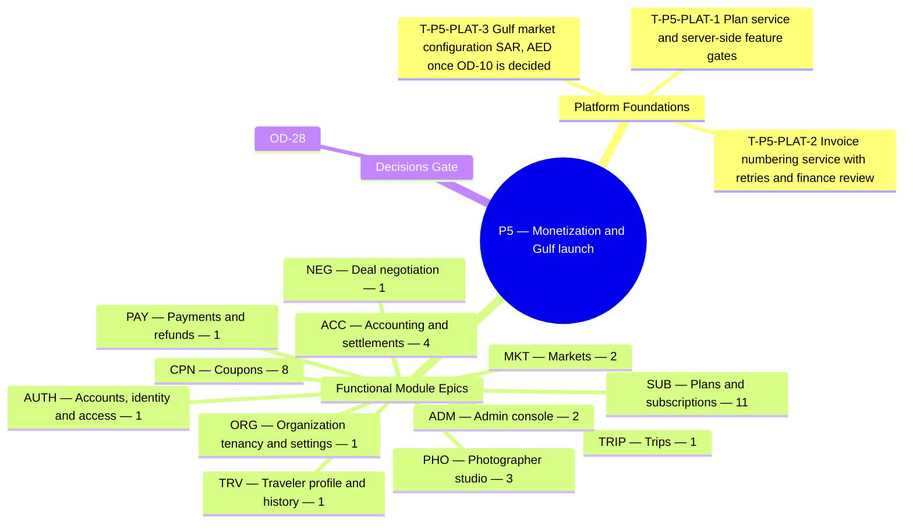

**Theme.** Monetization and Gulf launch — plans for all roles, feature gates, coupons, full accounting, invoices; Saudi Arabia (SAR) and UAE (AED)

**Definition of done.** Recurring revenue is measurable, limits are enforced, and the Gulf markets are live once OD-10 is decided. *([BRD section 3.3](/en/docs/brd#33-delivery-phases))*

**39 delivery tasks** (**36** functional tasks: **33** Must, **3** Should, **0** Could + **3** cross-cutting platform foundation tasks) across **12** SRS modules. Every task below carries its complete specification, implementation deliverables, acceptance criteria, affected PostgreSQL tables, and cross-specification links across BRD, SRS, ERD, Plan, Workflows, User Flows, Architecture, Design, End-to-End Lifecycle, and Recommendations.

**Data model.** [ERD conventions](/en/docs/erd), [Access Control & RLS](/en/docs/erd/acl), and the [lookup catalog](/en/docs/erd/reference) apply to every table touched in this phase.

<MindmapBlock title="P5 Scope Mindmap — Monetization and Gulf launch" caption="Breakdown of platform foundations, module epics (39 tasks), and milestone gates for P5." trace={{"brd":[{"label":"BRD §3.3 Phases","href":"/en/docs/brd#33-delivery-phases"}],"srs":[{"label":"SRS Traceability","href":"/en/docs/srs/traceability"}],"erd":[{"label":"ERD Overview","href":"/en/docs/erd"}],"plan":[{"label":"Milestones","href":"/en/docs/plan/milestones"},{"label":"Build Guide","href":"/en/docs/plan/build-guide"}],"workflows":[{"label":"Workflow Coverage","href":"/en/docs/workflows/coverage"}],"architecture":[{"label":"Architecture","href":"/en/docs/architecture"}],"design":[{"label":"Design System","href":"/en/docs/design"}],"system":[{"label":"End-to-End Lifecycle","href":"/en/docs/system/lifecycle"}],"recommendations":[{"label":"Open Decisions","href":"/en/docs/recommendations/open-decisions"}]}}>

</MindmapBlock>

## Quick-jump task index

| Task | Module | Reference | Priority |
|---|---|---|---|
| [T-P5-PLAT-1 — Plan service and server-side feature gates](#t-p5-plat-1) | `PLAT` | [NFR-AVL](/en/docs/srs/quality#83-availability-nfr-avl) | Must |
| [T-P5-PLAT-2 — Invoice numbering service with retries and finance review](#t-p5-plat-2) | `PLAT` | [NFR-COM](/en/docs/srs/quality#810-compliance-nfr-com) | Must |
| [T-P5-PLAT-3 — Gulf market configuration (SAR, AED) once OD-10 is decided](#t-p5-plat-3) | `PLAT` | [NFR-DAT-04](/en/docs/srs/quality#85-data-nfr-dat), [NFR-I18N](/en/docs/srs/quality#87-internationalization-nfr-i18n) | Must |
| [T-P5-AUTH-1 — Account deletion with a 30-day grace period](#t-p5-auth-1) | `AUTH` | [FR-AUTH-09](/en/docs/srs/requirements/auth#fr-auth-09--account-deletion-with-a-30-day-grace-period) | Must |
| [T-P5-ORG-1 — B2B and B2C invoices](#t-p5-org-1) | `ORG` | [FR-ORG-07](/en/docs/srs/requirements/org#fr-org-07--b2b-and-b2c-invoices) | Must |
| [T-P5-TRIP-1 — Active trip limit](#t-p5-trip-1) | `TRIP` | [FR-TRIP-07](/en/docs/srs/requirements/trip#fr-trip-07--active-trip-limit) | Must |
| [T-P5-NEG-1 — Deal audit](#t-p5-neg-1) | `NEG` | [FR-NEG-06](/en/docs/srs/requirements/neg#fr-neg-06--deal-audit) | Must |
| [T-P5-PAY-1 — Subscription charges and dunning](#t-p5-pay-1) | `PAY` | [FR-PAY-06](/en/docs/srs/requirements/pay#fr-pay-06--subscription-charges-and-dunning) | Must |
| [T-P5-CPN-1 — Creator scope](#t-p5-cpn-1) | `CPN` | [FR-CPN-01](/en/docs/srs/requirements/cpn#fr-cpn-01--creator-scope) | Must |
| [T-P5-CPN-2 — Cross-entity rejection](#t-p5-cpn-2) | `CPN` | [FR-CPN-02](/en/docs/srs/requirements/cpn#fr-cpn-02--cross-entity-rejection) | Must |
| [T-P5-CPN-3 — Real-time validation](#t-p5-cpn-3) | `CPN` | [FR-CPN-03](/en/docs/srs/requirements/cpn#fr-cpn-03--real-time-validation) | Must |
| [T-P5-CPN-4 — Coupon types](#t-p5-cpn-4) | `CPN` | [FR-CPN-04](/en/docs/srs/requirements/cpn#fr-cpn-04--coupon-types) | Must |
| [T-P5-CPN-5 — Lifecycle and controls](#t-p5-cpn-5) | `CPN` | [FR-CPN-05](/en/docs/srs/requirements/cpn#fr-cpn-05--lifecycle-and-controls) | Must |
| [T-P5-CPN-6 — Redemption and reversal](#t-p5-cpn-6) | `CPN` | [FR-CPN-06](/en/docs/srs/requirements/cpn#fr-cpn-06--redemption-and-reversal) | Must |
| [T-P5-CPN-7 — Analytics and abuse flags](#t-p5-cpn-7) | `CPN` | [FR-CPN-07](/en/docs/srs/requirements/cpn#fr-cpn-07--analytics-and-abuse-flags) | Must |
| [T-P5-CPN-8 — Coupon count by plan](#t-p5-cpn-8) | `CPN` | [FR-CPN-08](/en/docs/srs/requirements/cpn#fr-cpn-08--coupon-count-by-plan) | Must |
| [T-P5-SUB-1 — Plan catalog](#t-p5-sub-1) | `SUB` | [FR-SUB-01](/en/docs/srs/requirements/sub#fr-sub-01--plan-catalog) | Must |
| [T-P5-SUB-2 — Feature gates](#t-p5-sub-2) | `SUB` | [FR-SUB-02](/en/docs/srs/requirements/sub#fr-sub-02--feature-gates) | Must |
| [T-P5-SUB-3 — Grace period](#t-p5-sub-3) | `SUB` | [FR-SUB-03](/en/docs/srs/requirements/sub#fr-sub-03--grace-period) | Must |
| [T-P5-SUB-4 — Upgrade, downgrade and cancellation](#t-p5-sub-4) | `SUB` | [FR-SUB-04](/en/docs/srs/requirements/sub#fr-sub-04--upgrade-downgrade-and-cancellation) | Must |
| [T-P5-SUB-5 — Admin overrides](#t-p5-sub-5) | `SUB` | [FR-SUB-05](/en/docs/srs/requirements/sub#fr-sub-05--admin-overrides) | Must |
| [T-P5-SUB-6 — Revenue reporting](#t-p5-sub-6) | `SUB` | [FR-SUB-06](/en/docs/srs/requirements/sub#fr-sub-06--revenue-reporting) | Must |
| [T-P5-SUB-7 — Trials](#t-p5-sub-7) | `SUB` | [FR-SUB-07](/en/docs/srs/requirements/sub#fr-sub-07--trials) | Must |
| [T-P5-SUB-8 — Dunning](#t-p5-sub-8) | `SUB` | [FR-SUB-08](/en/docs/srs/requirements/sub#fr-sub-08--dunning) | Must |
| [T-P5-SUB-9 — Limits after a downgrade](#t-p5-sub-9) | `SUB` | [FR-SUB-09](/en/docs/srs/requirements/sub#fr-sub-09--limits-after-a-downgrade) | Must |
| [T-P5-SUB-10 — Counter reset](#t-p5-sub-10) | `SUB` | [FR-SUB-10](/en/docs/srs/requirements/sub#fr-sub-10--counter-reset) | Must |
| [T-P5-SUB-11 — Plan service failure](#t-p5-sub-11) | `SUB` | [FR-SUB-11](/en/docs/srs/requirements/sub#fr-sub-11--plan-service-failure) | Must |
| [T-P5-PHO-1 — Active bookings by plan](#t-p5-pho-1) | `PHO` | [FR-PHO-04](/en/docs/srs/requirements/pho#fr-pho-04--active-bookings-by-plan) | Must |
| [T-P5-PHO-2 — Photographer coupons](#t-p5-pho-2) | `PHO` | [FR-PHO-05](/en/docs/srs/requirements/pho#fr-pho-05--photographer-coupons) | Must |
| [T-P5-PHO-3 — Visibility and badge](#t-p5-pho-3) | `PHO` | [FR-PHO-06](/en/docs/srs/requirements/pho#fr-pho-06--visibility-and-badge) | Should |
| [T-P5-ADM-1 — Platform-wide coupons](#t-p5-adm-1) | `ADM` | [FR-ADM-06](/en/docs/srs/requirements/adm#fr-adm-06--platform-wide-coupons) | Must |
| [T-P5-ADM-2 — Abuse flags](#t-p5-adm-2) | `ADM` | [FR-ADM-07](/en/docs/srs/requirements/adm#fr-adm-07--abuse-flags) | Should |
| [T-P5-ACC-1 — Organization accounting per trip](#t-p5-acc-1) | `ACC` | [FR-ACC-02](/en/docs/srs/requirements/acc#fr-acc-02--organization-accounting-per-trip) | Must |
| [T-P5-ACC-2 — Platform financial view](#t-p5-acc-2) | `ACC` | [FR-ACC-04](/en/docs/srs/requirements/acc#fr-acc-04--platform-financial-view) | Must |
| [T-P5-ACC-3 — Exports by plan](#t-p5-acc-3) | `ACC` | [FR-ACC-06](/en/docs/srs/requirements/acc#fr-acc-06--exports-by-plan) | Must |
| [T-P5-ACC-4 — Invoices across all parties](#t-p5-acc-4) | `ACC` | [FR-ACC-08](/en/docs/srs/requirements/acc#fr-acc-08--invoices-across-all-parties) | Must |
| [T-P5-TRV-1 — Data copy and deletion](#t-p5-trv-1) | `TRV` | [FR-TRV-07](/en/docs/srs/requirements/trv#fr-trv-07--data-copy-and-deletion) | Must |
| [T-P5-MKT-1 — Cross-market browsing](#t-p5-mkt-1) | `MKT` | [FR-MKT-03](/en/docs/srs/requirements/mkt#fr-mkt-03--cross-market-browsing) | Must |
| [T-P5-MKT-2 — Market switch](#t-p5-mkt-2) | `MKT` | [FR-MKT-04](/en/docs/srs/requirements/mkt#fr-mkt-04--market-switch) | Should |

## Cross-cutting

These platform-wide engineering tasks establish the runtime, database, integration, and observability foundations required to close this phase gate.

### T-P5-PLAT-1 — Plan service and server-side feature gates

<TaskCard id="T-P5-PLAT-1" title="Plan service and server-side feature gates" phase="P5" module="PLAT" priority="Must" kind="platform" surfaces={["API Middleware","Redis","Organization Dashboard","Traveler App"]} tables={["subscriptions"]} trace={{"brd":[{"label":"BRD P5 Gate","href":"/en/docs/brd#33-delivery-phases"}],"srs":[{"label":"NFR-AVL","href":"/en/docs/srs/quality#83-availability-nfr-avl"}],"erd":[{"label":"Plans and subscriptions","href":"/en/docs/erd/domains/plans-and-subscriptions"},{"label":"subscriptions","href":"/en/docs/erd/domains/plans-and-subscriptions#subscriptions","detail":"table"},{"label":"ACL & RLS","href":"/en/docs/erd/acl"}],"plan":[{"label":"Milestones","href":"/en/docs/plan/milestones"},{"label":"Test Strategy","href":"/en/docs/plan/testing"}],"workflows":[{"label":"subscriptions","href":"/en/docs/workflows/subscriptions"}],"userFlows":[{"label":"Role Flows","href":"/en/docs/user-flows"}],"architecture":[{"label":"Architecture","href":"/en/docs/architecture#service-model"}],"design":[{"label":"Design System","href":"/en/docs/design#organization-dashboard"}],"system":[{"label":"STAGE-02","href":"/en/docs/system/lifecycle#stage-02"}],"recommendations":[{"label":"REC-FIN-10","href":"/en/docs/recommendations/architecture-and-ops#rec-fin-10"}]}}>

**Platform scope.** Deploy the centralized entitlement & quota engine evaluating active subscriptions, plan allowances, admin overrides, 7-day dunning grace (`BRL-14`), and monthly counter resets—failing closed on mutation gates while keeping confirmed trip operations safe (`FR-SUB-11`, `OD-29`).

**Implementation deliverables.**

- Declarative server-side `@RequireEntitlement(...)` guard enforcing quotas atomically with zero reliance on client-side UI hiding.
- Dunning retry job on days 1, 3, 5, and 7 plus monthly usage counter reset cron (`FR-SUB-10`).

**Acceptance & verification criteria.**

- Given the plan evaluation cache/service is unreachable, when a gated mutation is requested, then the API fails closed (`FR-SUB-11`) without dropping active trip check-ins.

</TaskCard>

### T-P5-PLAT-2 — Invoice numbering service with retries and finance review

<TaskCard id="T-P5-PLAT-2" title="Invoice numbering service with retries and finance review" phase="P5" module="PLAT" priority="Must" kind="platform" surfaces={["Worker","Finance Module","Admin Console"]} tables={["invoices"]} trace={{"brd":[{"label":"BRD P5 Gate","href":"/en/docs/brd#33-delivery-phases"}],"srs":[{"label":"NFR-COM","href":"/en/docs/srs/quality#810-compliance-nfr-com"}],"erd":[{"label":"Finance","href":"/en/docs/erd/domains/finance"},{"label":"invoices","href":"/en/docs/erd/domains/finance#invoices","detail":"table"},{"label":"ACL & RLS","href":"/en/docs/erd/acl"}],"plan":[{"label":"Milestones","href":"/en/docs/plan/milestones"},{"label":"Test Strategy","href":"/en/docs/plan/testing"}],"workflows":[{"label":"money","href":"/en/docs/workflows/money"}],"userFlows":[{"label":"Role Flows","href":"/en/docs/user-flows"}],"architecture":[{"label":"Architecture","href":"/en/docs/architecture#data-architecture"}],"design":[{"label":"Design System","href":"/en/docs/design#admin-console"}],"system":[{"label":"STAGE-05","href":"/en/docs/system/lifecycle#stage-05"}],"recommendations":[{"label":"REC-TAX-05","href":"/en/docs/recommendations/architecture-and-ops#rec-tax-05"}]}}>

**Platform scope.** Implement gapless per-market/per-series sequential B2B & B2C tax invoice and credit-note numbering (`BRL-28`) with 3 automatic retries on contention/failure and escalation to the Finance review queue without rolling back confirmed bookings (`D-179`).

**Implementation deliverables.**

- Transactional sequence allocator per `(market_code, fiscal_year, doc_type)` + immutable PDF/XML renderer.
- Pluggable tax compliance adapter ready for Saudi ZATCA Phase 2 TLV QR / XML signing (`OD-10`, `REC-TAX-05`).

**Acceptance & verification criteria.**

- Given invoice sequence allocation fails 3 times, when booking payment succeeds, then the booking stays `Confirmed`, no partial invoice is emitted, and a finance case opens (`D-179`).
- Given an issued invoice requires adjustment, when corrected, then the original row is untouched and a linked credit note is issued (`BRL-28`).

</TaskCard>

### T-P5-PLAT-3 — Gulf market configuration (SAR, AED) once OD-10 is decided

<TaskCard id="T-P5-PLAT-3" title="Gulf market configuration (SAR, AED) once OD-10 is decided" phase="P5" module="PLAT" priority="Must" kind="platform" surfaces={["Admin Console","Traveler App","Organization Dashboard"]} tables={["markets"]} trace={{"brd":[{"label":"BRD P5 Gate","href":"/en/docs/brd#33-delivery-phases"}],"srs":[{"label":"NFR-DAT-04","href":"/en/docs/srs/quality#85-data-nfr-dat"},{"label":"NFR-I18N","href":"/en/docs/srs/quality#87-internationalization-nfr-i18n"}],"erd":[{"label":"Lookups and markets","href":"/en/docs/erd/domains/lookups-and-markets"},{"label":"Finance","href":"/en/docs/erd/domains/finance"},{"label":"markets","href":"/en/docs/erd/domains/lookups-and-markets#markets","detail":"table"},{"label":"ACL & RLS","href":"/en/docs/erd/acl"}],"plan":[{"label":"Milestones","href":"/en/docs/plan/milestones"},{"label":"Test Strategy","href":"/en/docs/plan/testing"}],"workflows":[{"label":"money","href":"/en/docs/workflows/money"}],"userFlows":[{"label":"Role Flows","href":"/en/docs/user-flows"}],"architecture":[{"label":"Architecture","href":"/en/docs/architecture#deployment-topology"}],"design":[{"label":"Design System","href":"/en/docs/design#rtl-and-localization"}],"system":[{"label":"STAGE-01","href":"/en/docs/system/lifecycle#stage-01"}],"recommendations":[{"label":"REC-PAY-04","href":"/en/docs/recommendations/architecture-and-ops#rec-pay-04"}]}}>

**Platform scope.** Activate Saudi Arabia (`SA` / `SAR` / `Asia/Riyadh` / 15% VAT) and UAE (`AE` / `AED` / `Asia/Dubai` / 5% VAT) market rows, local gateway routing (Tap/Moyasar/Apple Pay/mada), Saudi/UAE holiday working-day SLA calendars, and PDPL residency compliance.

**Implementation deliverables.**

- Market gateway routing for `SAR` (mada, Apple Pay, STC Pay via Tap/Moyasar) and `AED` (cards, Apple Pay) alongside currency-isolated ledgers.
- Market working-day calendars governing 2-working-day onboarding and refund SLAs.

**Acceptance & verification criteria.**

- Given a Saudi organization and an Egyptian traveler, when viewing a Saudi trip, then pricing, checkout, and tax invoicing follow the organization market (`SAR`, `BRL-27`).

</TaskCard>

## AUTH — Accounts, identity and access

**Data model.** [Identity and access](/en/docs/erd/domains/identity-and-access) — the data-model domains and tables this module's requirements read and write.

### T-P5-AUTH-1 — Account deletion with a 30-day grace period

<TaskCard id="T-P5-AUTH-1" title="Account deletion with a 30-day grace period" phase="P5" module="AUTH" priority="Must" surfaces={["Visitor Web","Traveler App","Organization Dashboard","Admin Console"]} tables={["users"]} trace={{"brd":[{"label":"BR-AUTH-08","href":"/en/docs/brd/requirements#61-accounts-and-access-auth","detail":"P5"},{"label":"BRL-15","href":"/en/docs/brd/requirements#7-business-rules","detail":"rule"}],"srs":[{"label":"FR-AUTH-09","href":"/en/docs/srs/requirements/auth#fr-auth-09--account-deletion-with-a-30-day-grace-period","detail":"Must"},{"label":"Quality NFRs","href":"/en/docs/srs/quality"}],"erd":[{"label":"Identity and access","href":"/en/docs/erd/domains/identity-and-access"},{"label":"users","href":"/en/docs/erd/domains/identity-and-access#users","detail":"table"}],"plan":[{"label":"P5 Milestone","href":"/en/docs/plan/milestones"},{"label":"Testing Pyramid","href":"/en/docs/plan/testing"}],"workflows":[{"label":"scheduled-jobs","href":"/en/docs/workflows/scheduled-jobs#countdowns-per-record-timers"},{"label":"scheduled-jobs","href":"/en/docs/workflows/scheduled-jobs#daily"}],"userFlows":[{"label":"UF-ADM-05","href":"/en/docs/user-flows/admin#uf-adm-05-privacy-requests"},{"label":"UF-SHR-09","href":"/en/docs/user-flows/shared#uf-shr-09-account-deletion"},{"label":"UF-TRV-13","href":"/en/docs/user-flows/traveler#uf-trv-13-privacy-requests"}],"architecture":[{"label":"Architecture","href":"/en/docs/architecture#service-model"}],"design":[{"label":"Design Surface","href":"/en/docs/design#forms-and-validation"}],"system":[{"label":"STAGE-01","href":"/en/docs/system/lifecycle#stage-01"}],"recommendations":[{"label":"REC-SEC-09","href":"/en/docs/recommendations/architecture-and-ops#rec-sec-09"}]}}>

**Specification ([FR-AUTH-09](/en/docs/srs/requirements/auth#fr-auth-09--account-deletion-with-a-30-day-grace-period)).** A user shall request deletion. During the 30-day grace period no booking or payment is allowed, and signing in restores the account. On day 31, deletion becomes permanent under [DAT-03](/en/docs/srs/data#62-data-isolation). An organization owner cannot delete the account while any of the organization's trips is In Progress (D-168).

**Implementation deliverables.**

- **Domain & API logic:** Implement authentication handlers, session/token rotation, lockout rate-limits, and role/tenant context switching with full auditability.
- **Persistence & RLS:** Read/write operations on `users` enforcing base-column conventions, soft-delete filters, and tenant/role access control ([ACL](/en/docs/erd/acl)).
- **Verification & telemetry:** Automated unit/integration coverage mapped to `FR-AUTH-09` acceptance scenarios ([Test Strategy](/en/docs/plan/testing)) with structured trace/audit emission.

**Acceptance criteria.**

- Given a request made 10 days ago, when the user signs in, then the account is restored and the request cancelled.
- Given 30 days have passed, when the nightly job runs, then the account is deleted per section 6.4.

**Business trace & governing rules.**

- [BR-AUTH-08](/en/docs/brd/requirements#61-accounts-and-access-auth): A user can request account deletion, with a 30-day grace period during which signing in restores the account.
- [BRL-15](/en/docs/brd/requirements#7-business-rules): Account deletion becomes permanent after a 30-day grace period. Trip records are kept 5 years after deletion. Future bookings are cancelled and refunded; remaining earnings are paid on the next payout date. No booking or payment is allowed during the grace period.

</TaskCard>

## ORG — Organization tenancy and settings

**Data model.** [Finance](/en/docs/erd/domains/finance), [Organizations](/en/docs/erd/domains/organizations) — the data-model domains and tables this module's requirements read and write.

### T-P5-ORG-1 — B2B and B2C invoices

<TaskCard id="T-P5-ORG-1" title="B2B and B2C invoices" phase="P5" module="ORG" priority="Must" surfaces={["Organization Dashboard","Admin Console"]} tables={["invoices","organizations"]} trace={{"brd":[{"label":"BR-ORG-07","href":"/en/docs/brd/requirements#63-organizations-and-employees-org","detail":"P5"},{"label":"BRL-18","href":"/en/docs/brd/requirements#7-business-rules","detail":"rule"},{"label":"BRL-28","href":"/en/docs/brd/requirements#7-business-rules","detail":"rule"}],"srs":[{"label":"FR-ORG-07","href":"/en/docs/srs/requirements/org#fr-org-07--b2b-and-b2c-invoices","detail":"Must"},{"label":"Quality NFRs","href":"/en/docs/srs/quality"}],"erd":[{"label":"Finance","href":"/en/docs/erd/domains/finance"},{"label":"Organizations","href":"/en/docs/erd/domains/organizations"},{"label":"invoices","href":"/en/docs/erd/domains/finance#invoices","detail":"table"},{"label":"organizations","href":"/en/docs/erd/domains/organizations#organizations","detail":"table"}],"plan":[{"label":"P5 Milestone","href":"/en/docs/plan/milestones"},{"label":"Testing Pyramid","href":"/en/docs/plan/testing"}],"workflows":[{"label":"money","href":"/en/docs/workflows/money#timers-and-rules"},{"label":"scheduled-jobs","href":"/en/docs/workflows/scheduled-jobs#retry-schedules-per-failure-chasing"}],"userFlows":[{"label":"UF-ADM-11","href":"/en/docs/user-flows/admin#uf-adm-11-finance-operations"},{"label":"UF-ORG-14","href":"/en/docs/user-flows/organization#uf-org-14-invoices"}],"architecture":[{"label":"Architecture","href":"/en/docs/architecture#data-architecture"}],"design":[{"label":"Design Surface","href":"/en/docs/design#organization-dashboard"}],"system":[{"label":"STAGE-02","href":"/en/docs/system/lifecycle#stage-02"}],"recommendations":[{"label":"REC-DATA-02","href":"/en/docs/recommendations/architecture-and-ops#rec-data-02"}]}}>

**Specification ([FR-ORG-07](/en/docs/srs/requirements/org#fr-org-07--b2b-and-b2c-invoices)).** An organization shall issue invoices for its trips on every plan (D-178). An invoice is B2B when the buyer gave a tax number, otherwise B2C. An issued invoice is never edited; corrections are credit notes referencing the original. If numbering fails, no invoice is issued, the booking stays Confirmed, numbering retries 3 times, then the case goes to finance review (D-179 to D-181). ZATCA e-invoicing is out of scope until [OD-10](/en/docs/brd/compliance#11-open-decisions).

**Implementation deliverables.**

- **Domain & API logic:** Enforce PostgreSQL RLS tenant isolation (`app.current_organization_id`), workspace provisioning on approval, org-owned staff boundaries, and signed outbound webhooks.
- **Persistence & RLS:** Read/write operations on `invoices`, `organizations` enforcing base-column conventions, soft-delete filters, and tenant/role access control ([ACL](/en/docs/erd/acl)).
- **Verification & telemetry:** Automated unit/integration coverage mapped to `FR-ORG-07` acceptance scenarios ([Test Strategy](/en/docs/plan/testing)) with structured trace/audit emission.

**Acceptance criteria.**

- Given a buyer entered a tax number at checkout, when the booking is confirmed, then a B2B invoice is issued and posted to the ledger.
- Given an issued invoice needs a correction, when finance corrects it, then a credit note referencing the original number is issued and the original is unchanged.

**Business trace & governing rules.**

- [BR-ORG-07](/en/docs/brd/requirements#63-organizations-and-employees-org): Organizations issue B2B and B2C invoices for their trips; corrections are made by credit note.
- [BRL-18](/en/docs/brd/requirements#7-business-rules): Every financial event (booking, refund, coupon, subscription charge, payout, deal cost, commission, invoice) is written to a double-entry ledger.
- [BRL-28](/en/docs/brd/requirements#7-business-rules): An invoice is B2B when the buyer gives a tax number, otherwise B2C (D-180). An issued invoice is never edited; a correction is a credit note that references it (D-181).

</TaskCard>

## TRIP — Trips

**Data model.** [Fleet and trips](/en/docs/erd/domains/fleet-and-trips) — the data-model domains and tables this module's requirements read and write.

### T-P5-TRIP-1 — Active trip limit

<TaskCard id="T-P5-TRIP-1" title="Active trip limit" phase="P5" module="TRIP" priority="Must" surfaces={["Organization Dashboard","Traveler App","Admin Console"]} tables={["trips"]} trace={{"brd":[{"label":"BR-SUB-02","href":"/en/docs/brd/requirements#64-trips-programs-and-fleet-trip-prg-flt","detail":"P5"},{"label":"BRL-02","href":"/en/docs/brd/requirements#7-business-rules","detail":"rule"}],"srs":[{"label":"FR-TRIP-07","href":"/en/docs/srs/requirements/trip#fr-trip-07--active-trip-limit","detail":"Must"},{"label":"SM §7.1 Trip","href":"/en/docs/srs/state-machines#71-trip-lifecycle"},{"label":"Quality NFRs","href":"/en/docs/srs/quality"}],"erd":[{"label":"Fleet and trips","href":"/en/docs/erd/domains/fleet-and-trips"},{"label":"trips","href":"/en/docs/erd/domains/fleet-and-trips#trips","detail":"table"}],"plan":[{"label":"P5 Milestone","href":"/en/docs/plan/milestones"},{"label":"Testing Pyramid","href":"/en/docs/plan/testing"}],"workflows":[{"label":"trip-lifecycle","href":"/en/docs/workflows/trip-lifecycle"}],"userFlows":[{"label":"UF-ORG-06","href":"/en/docs/user-flows/organization#uf-org-06-create-a-trip-wizard"}],"architecture":[{"label":"Architecture","href":"/en/docs/architecture#service-model"}],"design":[{"label":"Design Surface","href":"/en/docs/design#organization-dashboard"}],"system":[{"label":"STAGE-04","href":"/en/docs/system/lifecycle#stage-04"}],"recommendations":[{"label":"REC-ARCH-01","href":"/en/docs/recommendations/architecture-and-ops#rec-arch-01"}]}}>

**Specification ([FR-TRIP-07](/en/docs/srs/requirements/trip#fr-trip-07--active-trip-limit)).** Trips created in the current cycle that reach Published through Completed count against the plan's monthly limit (D-143). Beyond the limit, publishing is blocked with an upgrade prompt.

**Implementation deliverables.**

- **Domain & API logic:** Implement multi-step trip authoring, Trip state-machine guards, capacity transitions, post-booking change remedies (7-day window), cancellation rules, and 30-day archival.
- **Persistence & RLS:** Read/write operations on `trips` enforcing base-column conventions, soft-delete filters, and tenant/role access control ([ACL](/en/docs/erd/acl)).
- **Verification & telemetry:** Automated unit/integration coverage mapped to `FR-TRIP-07` acceptance scenarios ([Test Strategy](/en/docs/plan/testing)) with structured trace/audit emission.

**Acceptance criteria.**

- Given a Starter organization with 5 counted trips this month, when it publishes a sixth, then it is blocked with an upgrade prompt.

**Business trace & governing rules.**

- [BR-SUB-02](/en/docs/brd/requirements#64-trips-programs-and-fleet-trip-prg-flt): Plan limits and features are enforced automatically. A blocked action shows an upgrade prompt. Every non-traveler role needs an active plan to use the app ([BRL-02](/en/docs/brd/requirements#7-business-rules)).
- [BRL-02](/en/docs/brd/requirements#7-business-rules): Every non-traveler role must hold an active plan to use the app. A traveler can always use the app for free.

</TaskCard>

## NEG — Deal negotiation

**Data model.** [Deals](/en/docs/erd/domains/deals) — the data-model domains and tables this module's requirements read and write.

### T-P5-NEG-1 — Deal audit

<TaskCard id="T-P5-NEG-1" title="Deal audit" phase="P5" module="NEG" priority="Must" surfaces={["Organization Dashboard","Driver App","Photographer Studio"]} tables={["deals"]} trace={{"brd":[{"label":"BR-ACC-02","href":"/en/docs/brd/requirements#65-staffing-and-deals-stf","detail":"P5"},{"label":"BRL-18","href":"/en/docs/brd/requirements#7-business-rules","detail":"rule"}],"srs":[{"label":"FR-NEG-06","href":"/en/docs/srs/requirements/neg#fr-neg-06--deal-audit","detail":"Must"},{"label":"SM §7.4 Deal","href":"/en/docs/srs/state-machines#74-deal"},{"label":"Quality NFRs","href":"/en/docs/srs/quality"}],"erd":[{"label":"Deals","href":"/en/docs/erd/domains/deals"},{"label":"deals","href":"/en/docs/erd/domains/deals#deals","detail":"table"}],"plan":[{"label":"P5 Milestone","href":"/en/docs/plan/milestones"},{"label":"Testing Pyramid","href":"/en/docs/plan/testing"}],"workflows":[{"label":"trip-lifecycle","href":"/en/docs/workflows/trip-lifecycle"}],"userFlows":[{"label":"UF-ADM-09","href":"/en/docs/user-flows/admin#uf-adm-09-deal-audit"},{"label":"UF-ORG-07","href":"/en/docs/user-flows/organization#uf-org-07-hire-a-platform-supplier-deal"}],"architecture":[{"label":"Architecture","href":"/en/docs/architecture#service-model"}],"design":[{"label":"Design Surface","href":"/en/docs/design#driver-app"}],"system":[{"label":"STAGE-03","href":"/en/docs/system/lifecycle#stage-03"}],"recommendations":[{"label":"REC-FIN-10","href":"/en/docs/recommendations/architecture-and-ops#rec-fin-10"}]}}>

**Specification ([FR-NEG-06](/en/docs/srs/requirements/neg#fr-neg-06--deal-audit)).** Every state change and offer shall be recorded and visible to admins. Admins can flag a deal with a reason; a flag can pause it (D-252).

**Implementation deliverables.**

- **Domain & API logic:** Implement Deal state-machine transitions, counter-offer history, 72-hour auto-expiry (`BRL-26`), dual-party price lock, and cancellation fee rules.
- **Persistence & RLS:** Read/write operations on `deals` enforcing base-column conventions, soft-delete filters, and tenant/role access control ([ACL](/en/docs/erd/acl)).
- **Verification & telemetry:** Automated unit/integration coverage mapped to `FR-NEG-06` acceptance scenarios ([Test Strategy](/en/docs/plan/testing)) with structured trace/audit emission.

**Acceptance criteria.**

- Given a deal with five counters, when an admin opens it, then all five show in order with actor and time.

**Business trace & governing rules.**

- [BR-ACC-02](/en/docs/brd/requirements#65-staffing-and-deals-stf): Admin sees system-wide finance: subscription revenue, commission, deal audit, coupon redemptions, disputes and payouts.
- [BRL-18](/en/docs/brd/requirements#7-business-rules): Every financial event (booking, refund, coupon, subscription charge, payout, deal cost, commission, invoice) is written to a double-entry ledger.

</TaskCard>

## PAY — Payments and refunds

**Data model.** [Booking and payment](/en/docs/erd/domains/booking-and-payment), [Finance](/en/docs/erd/domains/finance) — the data-model domains and tables this module's requirements read and write.

### T-P5-PAY-1 — Subscription charges and dunning

<TaskCard id="T-P5-PAY-1" title="Subscription charges and dunning" phase="P5" module="PAY" priority="Must" surfaces={["Traveler App","Organization Dashboard","Admin Console"]} tables={["trip_seats"]} trace={{"brd":[{"label":"BR-SUB-03","href":"/en/docs/brd/requirements#67-booking-and-payment-bkg","detail":"P5"}],"srs":[{"label":"FR-PAY-06","href":"/en/docs/srs/requirements/pay#fr-pay-06--subscription-charges-and-dunning","detail":"Must"},{"label":"SM §7.2 Booking","href":"/en/docs/srs/state-machines#72-booking"},{"label":"Quality NFRs","href":"/en/docs/srs/quality"}],"erd":[{"label":"Booking and payment","href":"/en/docs/erd/domains/booking-and-payment"},{"label":"Finance","href":"/en/docs/erd/domains/finance"},{"label":"trip_seats","href":"/en/docs/erd/domains/booking-and-payment#trip_seats","detail":"table"}],"plan":[{"label":"P5 Milestone","href":"/en/docs/plan/milestones"},{"label":"Testing Pyramid","href":"/en/docs/plan/testing"}],"workflows":[{"label":"scheduled-jobs","href":"/en/docs/workflows/scheduled-jobs#retry-schedules-per-failure-chasing"},{"label":"subscriptions","href":"/en/docs/workflows/subscriptions#timers-and-rules"}],"userFlows":[{"label":"UF-SHR-16","href":"/en/docs/user-flows/shared#uf-shr-16-trial-to-paid"}],"architecture":[{"label":"Architecture","href":"/en/docs/architecture#integrations"}],"design":[{"label":"Design Surface","href":"/en/docs/design#traveler-app"}],"system":[{"label":"STAGE-05","href":"/en/docs/system/lifecycle#stage-05"}],"recommendations":[{"label":"REC-PAY-04","href":"/en/docs/recommendations/architecture-and-ops#rec-pay-04"}]}}>

**Specification ([FR-PAY-06](/en/docs/srs/requirements/pay#fr-pay-06--subscription-charges-and-dunning)).** Plan charges shall run through the gateway's billing product. A failed charge starts dunning ([FR-SUB-08](/en/docs/srs/requirements/sub#fr-sub-08--dunning)) and the grace period ([FR-SUB-03](/en/docs/srs/requirements/sub#fr-sub-03--grace-period)).

**Implementation deliverables.**

- **Domain & API logic:** Wire multi-gateway MENA payment adapters (Stripe, Paymob/Tap, Fawry 48h vouchers), idempotent signed callbacks, 1-5-10-15m status polling, and automated refunds.
- **Persistence & RLS:** Read/write operations on `trip_seats` enforcing base-column conventions, soft-delete filters, and tenant/role access control ([ACL](/en/docs/erd/acl)).
- **Verification & telemetry:** Automated unit/integration coverage mapped to `FR-PAY-06` acceptance scenarios ([Test Strategy](/en/docs/plan/testing)) with structured trace/audit emission.

**Acceptance criteria.**

- Given a failed renewal, when the failure is received, then a reminder is sent and grace starts.

**Business trace & governing rules.**

- [BR-SUB-03](/en/docs/brd/requirements#67-booking-and-payment-bkg): Failed renewals trigger dunning and a 7-day grace period before the account loses plan features.

</TaskCard>

## CPN — Coupons

**Data model.** [Coupons](/en/docs/erd/domains/coupons) — the data-model domains and tables this module's requirements read and write.

### T-P5-CPN-1 — Creator scope

<TaskCard id="T-P5-CPN-1" title="Creator scope" phase="P5" module="CPN" priority="Must" surfaces={["Organization Dashboard","Traveler App","Admin Console"]} tables={["coupons"]} trace={{"brd":[{"label":"BR-CPN-01","href":"/en/docs/brd/requirements#68-coupons-cpn","detail":"P5"},{"label":"BRL-03","href":"/en/docs/brd/requirements#7-business-rules","detail":"rule"}],"srs":[{"label":"FR-CPN-01","href":"/en/docs/srs/requirements/cpn#fr-cpn-01--creator-scope","detail":"Must"},{"label":"SM §7.7 Coupon","href":"/en/docs/srs/state-machines#77-coupon"},{"label":"Quality NFRs","href":"/en/docs/srs/quality"}],"erd":[{"label":"Coupons","href":"/en/docs/erd/domains/coupons"},{"label":"coupons","href":"/en/docs/erd/domains/coupons#coupons","detail":"table"}],"plan":[{"label":"P5 Milestone","href":"/en/docs/plan/milestones"},{"label":"Testing Pyramid","href":"/en/docs/plan/testing"}],"workflows":[{"label":"refunds","href":"/en/docs/workflows/refunds"}],"userFlows":[{"label":"UF-DRV-07","href":"/en/docs/user-flows/driver#uf-drv-07-coupons"},{"label":"UF-ORG-13","href":"/en/docs/user-flows/organization#uf-org-13-coupons"}],"architecture":[{"label":"Architecture","href":"/en/docs/architecture#service-model"}],"design":[{"label":"Design Surface","href":"/en/docs/design#organization-dashboard"}],"system":[{"label":"STAGE-04","href":"/en/docs/system/lifecycle#stage-04"}],"recommendations":[{"label":"REC-FIN-10","href":"/en/docs/recommendations/architecture-and-ops#rec-fin-10"}]}}>

**Specification ([FR-CPN-01](/en/docs/srs/requirements/cpn#fr-cpn-01--creator-scope)).** A coupon shall apply only inside its creator's scope: admin coupons to any trip (optionally limited to a market); organization coupons to its own trips; driver and photographer coupons to bookings where that supplier is assigned.

**Implementation deliverables.**

- **Domain & API logic:** Build scoped coupon rules, atomic per-customer and global redemption counters, generic out-of-scope messaging (`OD-20`), reversal on cancellation, and abuse velocity flags.
- **Persistence & RLS:** Read/write operations on `coupons` enforcing base-column conventions, soft-delete filters, and tenant/role access control ([ACL](/en/docs/erd/acl)).
- **Verification & telemetry:** Automated unit/integration coverage mapped to `FR-CPN-01` acceptance scenarios ([Test Strategy](/en/docs/plan/testing)) with structured trace/audit emission.

**Acceptance criteria.**

- Given a driver coupon and a booking without that driver, when applied, then it is refused.

**Business trace & governing rules.**

- [BR-CPN-01](/en/docs/brd/requirements#68-coupons-cpn): Admins, organizations, drivers and photographers create coupons that apply only inside their own scope.
- [BRL-03](/en/docs/brd/requirements#7-business-rules): A coupon applies only inside its creator's scope: admin to any trip; organization to its own trips; driver or photographer to bookings where they are assigned. Cross-entity use is rejected.

</TaskCard>

### T-P5-CPN-2 — Cross-entity rejection

<TaskCard id="T-P5-CPN-2" title="Cross-entity rejection" phase="P5" module="CPN" priority="Must" surfaces={["Organization Dashboard","Traveler App","Admin Console"]} tables={["coupons"]} trace={{"brd":[{"label":"BR-CPN-02","href":"/en/docs/brd/requirements#68-coupons-cpn","detail":"P5"},{"label":"BRL-03","href":"/en/docs/brd/requirements#7-business-rules","detail":"rule"}],"srs":[{"label":"FR-CPN-02","href":"/en/docs/srs/requirements/cpn#fr-cpn-02--cross-entity-rejection","detail":"Must"},{"label":"SM §7.7 Coupon","href":"/en/docs/srs/state-machines#77-coupon"},{"label":"Quality NFRs","href":"/en/docs/srs/quality"}],"erd":[{"label":"Coupons","href":"/en/docs/erd/domains/coupons"},{"label":"coupons","href":"/en/docs/erd/domains/coupons#coupons","detail":"table"}],"plan":[{"label":"P5 Milestone","href":"/en/docs/plan/milestones"},{"label":"Testing Pyramid","href":"/en/docs/plan/testing"}],"workflows":[{"label":"refunds","href":"/en/docs/workflows/refunds"}],"userFlows":[{"label":"UF-TRV-04","href":"/en/docs/user-flows/traveler#uf-trv-04-apply-a-coupon"}],"architecture":[{"label":"Architecture","href":"/en/docs/architecture#service-model"}],"design":[{"label":"Design Surface","href":"/en/docs/design#organization-dashboard"}],"system":[{"label":"STAGE-04","href":"/en/docs/system/lifecycle#stage-04"}],"recommendations":[{"label":"REC-FIN-10","href":"/en/docs/recommendations/architecture-and-ops#rec-fin-10"}]}}>

**Specification ([FR-CPN-02](/en/docs/srs/requirements/cpn#fr-cpn-02--cross-entity-rejection)).** Cross-entity use shall always be rejected with "not applicable to this booking", without naming the other entity ([OD-20](/en/docs/brd/compliance#11-open-decisions)).

**Implementation deliverables.**

- **Domain & API logic:** Build scoped coupon rules, atomic per-customer and global redemption counters, generic out-of-scope messaging (`OD-20`), reversal on cancellation, and abuse velocity flags.
- **Persistence & RLS:** Read/write operations on `coupons` enforcing base-column conventions, soft-delete filters, and tenant/role access control ([ACL](/en/docs/erd/acl)).
- **Verification & telemetry:** Automated unit/integration coverage mapped to `FR-CPN-02` acceptance scenarios ([Test Strategy](/en/docs/plan/testing)) with structured trace/audit emission.

**Acceptance criteria.**

- Given organization A's coupon on organization B's trip, when validated, then the generic message shows.

**Business trace & governing rules.**

- [BR-CPN-02](/en/docs/brd/requirements#68-coupons-cpn): Coupon use across entity boundaries is always rejected with a generic message that does not name the other entity ([OD-20](/en/docs/brd/compliance#11-open-decisions)).
- [BRL-03](/en/docs/brd/requirements#7-business-rules): A coupon applies only inside its creator's scope: admin to any trip; organization to its own trips; driver or photographer to bookings where they are assigned. Cross-entity use is rejected.

</TaskCard>

### T-P5-CPN-3 — Real-time validation

<TaskCard id="T-P5-CPN-3" title="Real-time validation" phase="P5" module="CPN" priority="Must" surfaces={["Organization Dashboard","Traveler App","Admin Console"]} tables={["coupons"]} trace={{"brd":[{"label":"BR-CPN-03","href":"/en/docs/brd/requirements#68-coupons-cpn","detail":"P5"}],"srs":[{"label":"FR-CPN-03","href":"/en/docs/srs/requirements/cpn#fr-cpn-03--real-time-validation","detail":"Must"},{"label":"SM §7.7 Coupon","href":"/en/docs/srs/state-machines#77-coupon"},{"label":"Quality NFRs","href":"/en/docs/srs/quality"}],"erd":[{"label":"Coupons","href":"/en/docs/erd/domains/coupons"},{"label":"coupons","href":"/en/docs/erd/domains/coupons#coupons","detail":"table"}],"plan":[{"label":"P5 Milestone","href":"/en/docs/plan/milestones"},{"label":"Testing Pyramid","href":"/en/docs/plan/testing"}],"workflows":[{"label":"refunds","href":"/en/docs/workflows/refunds"}],"userFlows":[{"label":"UF-TRV-04","href":"/en/docs/user-flows/traveler#uf-trv-04-apply-a-coupon"}],"architecture":[{"label":"Architecture","href":"/en/docs/architecture#service-model"}],"design":[{"label":"Design Surface","href":"/en/docs/design#organization-dashboard"}],"system":[{"label":"STAGE-04","href":"/en/docs/system/lifecycle#stage-04"}],"recommendations":[{"label":"REC-FIN-10","href":"/en/docs/recommendations/architecture-and-ops#rec-fin-10"}]}}>

**Specification ([FR-CPN-03](/en/docs/srs/requirements/cpn#fr-cpn-03--real-time-validation)).** Validation shall check existence, status, validity window, scope, usage limit, per-user limit and minimum spend, in that order, and return the first failing reason.

**Implementation deliverables.**

- **Domain & API logic:** Build scoped coupon rules, atomic per-customer and global redemption counters, generic out-of-scope messaging (`OD-20`), reversal on cancellation, and abuse velocity flags.
- **Persistence & RLS:** Read/write operations on `coupons` enforcing base-column conventions, soft-delete filters, and tenant/role access control ([ACL](/en/docs/erd/acl)).
- **Verification & telemetry:** Automated unit/integration coverage mapped to `FR-CPN-03` acceptance scenarios ([Test Strategy](/en/docs/plan/testing)) with structured trace/audit emission.

**Acceptance criteria.**

- Given a coupon that expired yesterday, when applied, then the reason is "expired".
- Given a total below the minimum, when applied, then the reason is "minimum spend not met".

**Business trace & governing rules.**

- [BR-CPN-03](/en/docs/brd/requirements#68-coupons-cpn): Coupons support fixed amount, percentage, program-specific, free program, first booking and minimum spend types, and are validated in real time at checkout.

</TaskCard>

### T-P5-CPN-4 — Coupon types

<TaskCard id="T-P5-CPN-4" title="Coupon types" phase="P5" module="CPN" priority="Must" surfaces={["Organization Dashboard","Traveler App","Admin Console"]} tables={["coupons"]} trace={{"brd":[{"label":"BR-CPN-03","href":"/en/docs/brd/requirements#68-coupons-cpn","detail":"P5"}],"srs":[{"label":"FR-CPN-04","href":"/en/docs/srs/requirements/cpn#fr-cpn-04--coupon-types","detail":"Must"},{"label":"SM §7.7 Coupon","href":"/en/docs/srs/state-machines#77-coupon"},{"label":"Quality NFRs","href":"/en/docs/srs/quality"}],"erd":[{"label":"Coupons","href":"/en/docs/erd/domains/coupons"},{"label":"coupons","href":"/en/docs/erd/domains/coupons#coupons","detail":"table"}],"plan":[{"label":"P5 Milestone","href":"/en/docs/plan/milestones"},{"label":"Testing Pyramid","href":"/en/docs/plan/testing"}],"workflows":[{"label":"refunds","href":"/en/docs/workflows/refunds"}],"userFlows":[{"label":"UF-ORG-22","href":"/en/docs/user-flows/organization#uf-org-22-coupon-lifecycle"}],"architecture":[{"label":"Architecture","href":"/en/docs/architecture#service-model"}],"design":[{"label":"Design Surface","href":"/en/docs/design#organization-dashboard"}],"system":[{"label":"STAGE-04","href":"/en/docs/system/lifecycle#stage-04"}],"recommendations":[{"label":"REC-FIN-10","href":"/en/docs/recommendations/architecture-and-ops#rec-fin-10"}]}}>

**Specification ([FR-CPN-04](/en/docs/srs/requirements/cpn#fr-cpn-04--coupon-types)).** Coupons shall support fixed amount, percentage, program-specific, free program, first booking and minimum spend.

**Implementation deliverables.**

- **Domain & API logic:** Build scoped coupon rules, atomic per-customer and global redemption counters, generic out-of-scope messaging (`OD-20`), reversal on cancellation, and abuse velocity flags.
- **Persistence & RLS:** Read/write operations on `coupons` enforcing base-column conventions, soft-delete filters, and tenant/role access control ([ACL](/en/docs/erd/acl)).
- **Verification & telemetry:** Automated unit/integration coverage mapped to `FR-CPN-04` acceptance scenarios ([Test Strategy](/en/docs/plan/testing)) with structured trace/audit emission.

**Acceptance criteria.**

- Given a first-booking coupon, when a traveler with a confirmed booking with that entity applies it, then it is refused.

**Business trace & governing rules.**

- [BR-CPN-03](/en/docs/brd/requirements#68-coupons-cpn): Coupons support fixed amount, percentage, program-specific, free program, first booking and minimum spend types, and are validated in real time at checkout.

</TaskCard>

### T-P5-CPN-5 — Lifecycle and controls

<TaskCard id="T-P5-CPN-5" title="Lifecycle and controls" phase="P5" module="CPN" priority="Must" surfaces={["Organization Dashboard","Traveler App","Admin Console"]} tables={["coupons"]} trace={{"brd":[{"label":"BR-CPN-01","href":"/en/docs/brd/requirements#68-coupons-cpn","detail":"P5"}],"srs":[{"label":"FR-CPN-05","href":"/en/docs/srs/requirements/cpn#fr-cpn-05--lifecycle-and-controls","detail":"Must"},{"label":"SM §7.7 Coupon","href":"/en/docs/srs/state-machines#77-coupon"},{"label":"Quality NFRs","href":"/en/docs/srs/quality"}],"erd":[{"label":"Coupons","href":"/en/docs/erd/domains/coupons"},{"label":"coupons","href":"/en/docs/erd/domains/coupons#coupons","detail":"table"}],"plan":[{"label":"P5 Milestone","href":"/en/docs/plan/milestones"},{"label":"Testing Pyramid","href":"/en/docs/plan/testing"}],"workflows":[{"label":"refunds","href":"/en/docs/workflows/refunds"}],"userFlows":[{"label":"UF-ORG-22","href":"/en/docs/user-flows/organization#uf-org-22-coupon-lifecycle"}],"architecture":[{"label":"Architecture","href":"/en/docs/architecture#service-model"}],"design":[{"label":"Design Surface","href":"/en/docs/design#organization-dashboard"}],"system":[{"label":"STAGE-04","href":"/en/docs/system/lifecycle#stage-04"}],"recommendations":[{"label":"REC-FIN-10","href":"/en/docs/recommendations/architecture-and-ops#rec-fin-10"}]}}>

**Specification ([FR-CPN-05](/en/docs/srs/requirements/cpn#fr-cpn-05--lifecycle-and-controls)).** Coupons shall use the states in section 7.7. Creators pause, resume and revoke their own; admins revoke any.

**Implementation deliverables.**

- **Domain & API logic:** Build scoped coupon rules, atomic per-customer and global redemption counters, generic out-of-scope messaging (`OD-20`), reversal on cancellation, and abuse velocity flags.
- **Persistence & RLS:** Read/write operations on `coupons` enforcing base-column conventions, soft-delete filters, and tenant/role access control ([ACL](/en/docs/erd/acl)).
- **Verification & telemetry:** Automated unit/integration coverage mapped to `FR-CPN-05` acceptance scenarios ([Test Strategy](/en/docs/plan/testing)) with structured trace/audit emission.

**Acceptance criteria.**

- Given a Paused coupon, when applied, then it is refused with reason "paused".

**Business trace & governing rules.**

- [BR-CPN-01](/en/docs/brd/requirements#68-coupons-cpn): Admins, organizations, drivers and photographers create coupons that apply only inside their own scope.

</TaskCard>

### T-P5-CPN-6 — Redemption and reversal

<TaskCard id="T-P5-CPN-6" title="Redemption and reversal" phase="P5" module="CPN" priority="Must" surfaces={["Organization Dashboard","Traveler App","Admin Console"]} tables={["coupons"]} trace={{"brd":[{"label":"BR-CPN-04","href":"/en/docs/brd/requirements#68-coupons-cpn","detail":"P5"},{"label":"BRL-11","href":"/en/docs/brd/requirements#7-business-rules","detail":"rule"}],"srs":[{"label":"FR-CPN-06","href":"/en/docs/srs/requirements/cpn#fr-cpn-06--redemption-and-reversal","detail":"Must"},{"label":"SM §7.7 Coupon","href":"/en/docs/srs/state-machines#77-coupon"},{"label":"Quality NFRs","href":"/en/docs/srs/quality"}],"erd":[{"label":"Coupons","href":"/en/docs/erd/domains/coupons"},{"label":"coupons","href":"/en/docs/erd/domains/coupons#coupons","detail":"table"}],"plan":[{"label":"P5 Milestone","href":"/en/docs/plan/milestones"},{"label":"Testing Pyramid","href":"/en/docs/plan/testing"}],"workflows":[{"label":"refunds","href":"/en/docs/workflows/refunds#timers-and-rules"},{"label":"refunds","href":"/en/docs/workflows/refunds#stories"}],"userFlows":[{"label":"UF-ORG-22","href":"/en/docs/user-flows/organization#uf-org-22-coupon-lifecycle"}],"architecture":[{"label":"Architecture","href":"/en/docs/architecture#service-model"}],"design":[{"label":"Design Surface","href":"/en/docs/design#organization-dashboard"}],"system":[{"label":"STAGE-06","href":"/en/docs/system/lifecycle#stage-06"}],"recommendations":[{"label":"REC-FIN-10","href":"/en/docs/recommendations/architecture-and-ops#rec-fin-10"}]}}>

**Specification ([FR-CPN-06](/en/docs/srs/requirements/cpn#fr-cpn-06--redemption-and-reversal)).** Each redemption shall be recorded against its booking. A refund reverses the redemption, frees the traveler's per-user use, and decrements the total usage count (architecture 10.6); an Exhausted coupon returns to Active if still in its window.

**Implementation deliverables.**

- **Domain & API logic:** Build scoped coupon rules, atomic per-customer and global redemption counters, generic out-of-scope messaging (`OD-20`), reversal on cancellation, and abuse velocity flags.
- **Persistence & RLS:** Read/write operations on `coupons` enforcing base-column conventions, soft-delete filters, and tenant/role access control ([ACL](/en/docs/erd/acl)).
- **Verification & telemetry:** Automated unit/integration coverage mapped to `FR-CPN-06` acceptance scenarios ([Test Strategy](/en/docs/plan/testing)) with structured trace/audit emission.

**Acceptance criteria.**

- Given a refunded booking with a coupon, when saved, then the redemption is reversed and the traveler can use the coupon again.

**Business trace & governing rules.**

- [BR-CPN-04](/en/docs/brd/requirements#68-coupons-cpn): Each redemption is recorded against its booking and reversed on refund.
- [BRL-11](/en/docs/brd/requirements#7-business-rules): A refund reverses the coupon redemption and frees the traveler's per-user limit.

</TaskCard>

### T-P5-CPN-7 — Analytics and abuse flags

<TaskCard id="T-P5-CPN-7" title="Analytics and abuse flags" phase="P5" module="CPN" priority="Must" surfaces={["Organization Dashboard","Traveler App","Admin Console"]} tables={["coupons"]} trace={{"brd":[{"label":"BR-CPN-05","href":"/en/docs/brd/requirements#68-coupons-cpn","detail":"P5"}],"srs":[{"label":"FR-CPN-07","href":"/en/docs/srs/requirements/cpn#fr-cpn-07--analytics-and-abuse-flags","detail":"Must"},{"label":"SM §7.7 Coupon","href":"/en/docs/srs/state-machines#77-coupon"},{"label":"Quality NFRs","href":"/en/docs/srs/quality"}],"erd":[{"label":"Coupons","href":"/en/docs/erd/domains/coupons"},{"label":"coupons","href":"/en/docs/erd/domains/coupons#coupons","detail":"table"}],"plan":[{"label":"P5 Milestone","href":"/en/docs/plan/milestones"},{"label":"Testing Pyramid","href":"/en/docs/plan/testing"}],"workflows":[{"label":"scheduled-jobs","href":"/en/docs/workflows/scheduled-jobs#countdowns-per-record-timers"}],"userFlows":[{"label":"UF-ADM-08","href":"/en/docs/user-flows/admin#uf-adm-08-coupons-and-abuse"},{"label":"UF-ORG-13","href":"/en/docs/user-flows/organization#uf-org-13-coupons"},{"label":"UF-ORG-22","href":"/en/docs/user-flows/organization#uf-org-22-coupon-lifecycle"}],"architecture":[{"label":"Architecture","href":"/en/docs/architecture#service-model"}],"design":[{"label":"Design Surface","href":"/en/docs/design#organization-dashboard"}],"system":[{"label":"STAGE-04","href":"/en/docs/system/lifecycle#stage-04"}],"recommendations":[{"label":"REC-FIN-10","href":"/en/docs/recommendations/architecture-and-ops#rec-fin-10"}]}}>

**Specification ([FR-CPN-07](/en/docs/srs/requirements/cpn#fr-cpn-07--analytics-and-abuse-flags)).** Creators shall see redemptions, discount total and remaining uses per coupon with 7, 30 and 90-day presets. Admins see platform analytics and abuse flags. Flags never block automatically; admins review within 2 working days (D-217). Thresholds are [OPEN: D-216](/en/docs/recommendations/open-decisions#open-06).

**Implementation deliverables.**

- **Domain & API logic:** Build scoped coupon rules, atomic per-customer and global redemption counters, generic out-of-scope messaging (`OD-20`), reversal on cancellation, and abuse velocity flags.
- **Persistence & RLS:** Read/write operations on `coupons` enforcing base-column conventions, soft-delete filters, and tenant/role access control ([ACL](/en/docs/erd/acl)).
- **Verification & telemetry:** Automated unit/integration coverage mapped to `FR-CPN-07` acceptance scenarios ([Test Strategy](/en/docs/plan/testing)) with structured trace/audit emission.

**Acceptance criteria.**

- Given a flagged coupon, when the admin opens it, then the flag shows the rule that raised it and its review due date.

**Business trace & governing rules.**

- [BR-CPN-05](/en/docs/brd/requirements#68-coupons-cpn): Creators see coupon analytics; admin sees platform-wide analytics and abuse flags. Flags never block automatically and are reviewed within 2 working days (D-217).

</TaskCard>

### T-P5-CPN-8 — Coupon count by plan

<TaskCard id="T-P5-CPN-8" title="Coupon count by plan" phase="P5" module="CPN" priority="Must" surfaces={["Organization Dashboard","Traveler App","Admin Console"]} tables={["coupons"]} trace={{"brd":[{"label":"BR-SUB-02","href":"/en/docs/brd/requirements#68-coupons-cpn","detail":"P5"}],"srs":[{"label":"FR-CPN-08","href":"/en/docs/srs/requirements/cpn#fr-cpn-08--coupon-count-by-plan","detail":"Must"},{"label":"SM §7.7 Coupon","href":"/en/docs/srs/state-machines#77-coupon"},{"label":"Quality NFRs","href":"/en/docs/srs/quality"}],"erd":[{"label":"Coupons","href":"/en/docs/erd/domains/coupons"},{"label":"coupons","href":"/en/docs/erd/domains/coupons#coupons","detail":"table"}],"plan":[{"label":"P5 Milestone","href":"/en/docs/plan/milestones"},{"label":"Testing Pyramid","href":"/en/docs/plan/testing"}],"workflows":[{"label":"refunds","href":"/en/docs/workflows/refunds"}],"userFlows":[{"label":"UF-DRV-07","href":"/en/docs/user-flows/driver#uf-drv-07-coupons"},{"label":"UF-ORG-13","href":"/en/docs/user-flows/organization#uf-org-13-coupons"}],"architecture":[{"label":"Architecture","href":"/en/docs/architecture#service-model"}],"design":[{"label":"Design Surface","href":"/en/docs/design#organization-dashboard"}],"system":[{"label":"STAGE-04","href":"/en/docs/system/lifecycle#stage-04"}],"recommendations":[{"label":"REC-FIN-10","href":"/en/docs/recommendations/architecture-and-ops#rec-fin-10"}]}}>

**Specification ([FR-CPN-08](/en/docs/srs/requirements/cpn#fr-cpn-08--coupon-count-by-plan)).** Active and paused coupons count against the plan limit (D-203): organizations 5, 20, unlimited; drivers and photographers 3, 10, unlimited.

**Implementation deliverables.**

- **Domain & API logic:** Build scoped coupon rules, atomic per-customer and global redemption counters, generic out-of-scope messaging (`OD-20`), reversal on cancellation, and abuse velocity flags.
- **Persistence & RLS:** Read/write operations on `coupons` enforcing base-column conventions, soft-delete filters, and tenant/role access control ([ACL](/en/docs/erd/acl)).
- **Verification & telemetry:** Automated unit/integration coverage mapped to `FR-CPN-08` acceptance scenarios ([Test Strategy](/en/docs/plan/testing)) with structured trace/audit emission.

**Acceptance criteria.**

- Given a Starter organization with 5 active or paused coupons, when it creates a sixth, then it is blocked with an upgrade prompt.

**Business trace & governing rules.**

- [BR-SUB-02](/en/docs/brd/requirements#68-coupons-cpn): Plan limits and features are enforced automatically. A blocked action shows an upgrade prompt. Every non-traveler role needs an active plan to use the app ([BRL-02](/en/docs/brd/requirements#7-business-rules)).

</TaskCard>

## SUB — Plans and subscriptions

**Data model.** [Plans and subscriptions](/en/docs/erd/domains/plans-and-subscriptions) — the data-model domains and tables this module's requirements read and write.

### T-P5-SUB-1 — Plan catalog

<TaskCard id="T-P5-SUB-1" title="Plan catalog" phase="P5" module="SUB" priority="Must" surfaces={["Organization Dashboard","Driver App","Photographer Studio","Traveler App","Admin Console"]} tables={["subscriptions"]} trace={{"brd":[{"label":"BR-SUB-01","href":"/en/docs/brd/requirements#613-plans-and-subscriptions-sub","detail":"P5"},{"label":"BRL-19","href":"/en/docs/brd/requirements#7-business-rules","detail":"rule"}],"srs":[{"label":"FR-SUB-01","href":"/en/docs/srs/requirements/sub#fr-sub-01--plan-catalog","detail":"Must"},{"label":"SM §7.6 Subscription","href":"/en/docs/srs/state-machines#76-subscription"},{"label":"Quality NFRs","href":"/en/docs/srs/quality"}],"erd":[{"label":"Plans and subscriptions","href":"/en/docs/erd/domains/plans-and-subscriptions"},{"label":"subscriptions","href":"/en/docs/erd/domains/plans-and-subscriptions#subscriptions","detail":"table"}],"plan":[{"label":"P5 Milestone","href":"/en/docs/plan/milestones"},{"label":"Testing Pyramid","href":"/en/docs/plan/testing"}],"workflows":[{"label":"subscriptions","href":"/en/docs/workflows/subscriptions"}],"userFlows":[{"label":"UF-ADM-07","href":"/en/docs/user-flows/admin#uf-adm-07-plans-and-overrides"}],"architecture":[{"label":"Architecture","href":"/en/docs/architecture#service-model"}],"design":[{"label":"Design Surface","href":"/en/docs/design#organization-dashboard"}],"system":[{"label":"STAGE-02","href":"/en/docs/system/lifecycle#stage-02"}],"recommendations":[{"label":"REC-FIN-10","href":"/en/docs/recommendations/architecture-and-ops#rec-fin-10"}]}}>

**Specification ([FR-SUB-01](/en/docs/srs/requirements/sub#fr-sub-01--plan-catalog)).** Admins shall define plans per role with limits, features, trial length, and monthly and annual prices per market ([BR-MKT-01](/en/docs/brd/requirements#616-markets-mkt)). Changes apply to new actions at once and are audited. Prices are [OPEN: [OD-26](/en/docs/brd/compliance#11-open-decisions)]; annual discount placeholder 15 percent ([OD-14](/en/docs/brd/compliance#11-open-decisions)).

**Implementation deliverables.**

- **Domain & API logic:** Enforce fail-closed server-side plan gates, prorated upgrades, end-of-cycle downgrades (`BRL-13`), 7-day dunning grace (`BRL-14`), monthly counter resets, and admin overrides.
- **Persistence & RLS:** Read/write operations on `subscriptions` enforcing base-column conventions, soft-delete filters, and tenant/role access control ([ACL](/en/docs/erd/acl)).
- **Verification & telemetry:** Automated unit/integration coverage mapped to `FR-SUB-01` acceptance scenarios ([Test Strategy](/en/docs/plan/testing)) with structured trace/audit emission.

**Acceptance criteria.**

- Given the Starter employee limit changes from 5 to 6, when saved, then it applies at once and the audit log holds old and new values.

**Business trace & governing rules.**

- [BR-SUB-01](/en/docs/brd/requirements#613-plans-and-subscriptions-sub): Admin defines plans per role and market: limits, features, monthly and annual prices, annual discount and trial length.
- [BRL-19](/en/docs/brd/requirements#7-business-rules): Every admin action and every permission change is written to an immutable audit log.

</TaskCard>

### T-P5-SUB-2 — Feature gates

<TaskCard id="T-P5-SUB-2" title="Feature gates" phase="P5" module="SUB" priority="Must" surfaces={["Organization Dashboard","Driver App","Photographer Studio","Traveler App","Admin Console"]} tables={["subscriptions"]} trace={{"brd":[{"label":"BR-SUB-02","href":"/en/docs/brd/requirements#613-plans-and-subscriptions-sub","detail":"P5"},{"label":"BRL-02","href":"/en/docs/brd/requirements#7-business-rules","detail":"rule"}],"srs":[{"label":"FR-SUB-02","href":"/en/docs/srs/requirements/sub#fr-sub-02--feature-gates","detail":"Must"},{"label":"SM §7.6 Subscription","href":"/en/docs/srs/state-machines#76-subscription"},{"label":"Quality NFRs","href":"/en/docs/srs/quality"}],"erd":[{"label":"Plans and subscriptions","href":"/en/docs/erd/domains/plans-and-subscriptions"},{"label":"subscriptions","href":"/en/docs/erd/domains/plans-and-subscriptions#subscriptions","detail":"table"}],"plan":[{"label":"P5 Milestone","href":"/en/docs/plan/milestones"},{"label":"Testing Pyramid","href":"/en/docs/plan/testing"}],"workflows":[{"label":"subscriptions","href":"/en/docs/workflows/subscriptions#timers-and-rules"}],"userFlows":[{"label":"UF-DRV-08","href":"/en/docs/user-flows/driver#uf-drv-08-plan"},{"label":"UF-ORG-18","href":"/en/docs/user-flows/organization#uf-org-18-plan-and-billing"},{"label":"UF-SHR-06","href":"/en/docs/user-flows/shared#uf-shr-06-plan-limit-prompt"},{"label":"UF-TRV-16","href":"/en/docs/user-flows/traveler#uf-trv-16-life-after-a-downgrade"}],"architecture":[{"label":"Architecture","href":"/en/docs/architecture#service-model"}],"design":[{"label":"Design Surface","href":"/en/docs/design#organization-dashboard"}],"system":[{"label":"STAGE-02","href":"/en/docs/system/lifecycle#stage-02"}],"recommendations":[{"label":"REC-FIN-10","href":"/en/docs/recommendations/architecture-and-ops#rec-fin-10"}]}}>

**Specification ([FR-SUB-02](/en/docs/srs/requirements/sub#fr-sub-02--feature-gates)).** Every plan-limited action shall be checked on the server, returning the plan-required category with the current plan, the limit and the next tier. Every non-traveler role needs an active plan ([BRL-02](/en/docs/brd/requirements#7-business-rules)).

**Implementation deliverables.**

- **Domain & API logic:** Enforce fail-closed server-side plan gates, prorated upgrades, end-of-cycle downgrades (`BRL-13`), 7-day dunning grace (`BRL-14`), monthly counter resets, and admin overrides.
- **Persistence & RLS:** Read/write operations on `subscriptions` enforcing base-column conventions, soft-delete filters, and tenant/role access control ([ACL](/en/docs/erd/acl)).
- **Verification & telemetry:** Automated unit/integration coverage mapped to `FR-SUB-02` acceptance scenarios ([Test Strategy](/en/docs/plan/testing)) with structured trace/audit emission.

**Acceptance criteria.**

- Given a limit reached, when the action is attempted, then it is blocked and an upgrade prompt shows.

**Business trace & governing rules.**

- [BR-SUB-02](/en/docs/brd/requirements#613-plans-and-subscriptions-sub): Plan limits and features are enforced automatically. A blocked action shows an upgrade prompt. Every non-traveler role needs an active plan to use the app ([BRL-02](/en/docs/brd/requirements#7-business-rules)).
- [BRL-02](/en/docs/brd/requirements#7-business-rules): Every non-traveler role must hold an active plan to use the app. A traveler can always use the app for free.

</TaskCard>

### T-P5-SUB-3 — Grace period

<TaskCard id="T-P5-SUB-3" title="Grace period" phase="P5" module="SUB" priority="Must" surfaces={["Organization Dashboard","Driver App","Photographer Studio","Traveler App","Admin Console"]} tables={["subscriptions"]} trace={{"brd":[{"label":"BR-SUB-03","href":"/en/docs/brd/requirements#613-plans-and-subscriptions-sub","detail":"P5"},{"label":"BRL-14","href":"/en/docs/brd/requirements#7-business-rules","detail":"rule"}],"srs":[{"label":"FR-SUB-03","href":"/en/docs/srs/requirements/sub#fr-sub-03--grace-period","detail":"Must"},{"label":"SM §7.6 Subscription","href":"/en/docs/srs/state-machines#76-subscription"},{"label":"Quality NFRs","href":"/en/docs/srs/quality"}],"erd":[{"label":"Plans and subscriptions","href":"/en/docs/erd/domains/plans-and-subscriptions"},{"label":"subscriptions","href":"/en/docs/erd/domains/plans-and-subscriptions#subscriptions","detail":"table"}],"plan":[{"label":"P5 Milestone","href":"/en/docs/plan/milestones"},{"label":"Testing Pyramid","href":"/en/docs/plan/testing"}],"workflows":[{"label":"scheduled-jobs","href":"/en/docs/workflows/scheduled-jobs#retry-schedules-per-failure-chasing"},{"label":"subscriptions","href":"/en/docs/workflows/subscriptions#timers-and-rules"}],"userFlows":[{"label":"UF-ORG-18","href":"/en/docs/user-flows/organization#uf-org-18-plan-and-billing"},{"label":"UF-SHR-07","href":"/en/docs/user-flows/shared#uf-shr-07-grace-banner"}],"architecture":[{"label":"Architecture","href":"/en/docs/architecture#service-model"}],"design":[{"label":"Design Surface","href":"/en/docs/design#organization-dashboard"}],"system":[{"label":"STAGE-02","href":"/en/docs/system/lifecycle#stage-02"}],"recommendations":[{"label":"REC-FIN-10","href":"/en/docs/recommendations/architecture-and-ops#rec-fin-10"}]}}>

**Specification ([FR-SUB-03](/en/docs/srs/requirements/sub#fr-sub-03--grace-period)).** A failed renewal shall start 7 days of grace with features kept and a payment banner. What happens when grace ends is [OPEN: [OD-29](/en/docs/brd/compliance#11-open-decisions)]; until decided, the account drops to the role's basic tier and new bookings or new deals are blocked (D-08).

**Implementation deliverables.**

- **Domain & API logic:** Enforce fail-closed server-side plan gates, prorated upgrades, end-of-cycle downgrades (`BRL-13`), 7-day dunning grace (`BRL-14`), monthly counter resets, and admin overrides.
- **Persistence & RLS:** Read/write operations on `subscriptions` enforcing base-column conventions, soft-delete filters, and tenant/role access control ([ACL](/en/docs/erd/acl)).
- **Verification & telemetry:** Automated unit/integration coverage mapped to `FR-SUB-03` acceptance scenarios ([Test Strategy](/en/docs/plan/testing)) with structured trace/audit emission.

**Acceptance criteria.**

- Given a renewal failed 6 days ago, when the user works, then features are active with a warning.
- Given a renewal failed 8 days ago, when the organization publishes a trip, then it is blocked.

**Business trace & governing rules.**

- [BR-SUB-03](/en/docs/brd/requirements#613-plans-and-subscriptions-sub): Failed renewals trigger dunning and a 7-day grace period before the account loses plan features.
- [BRL-14](/en/docs/brd/requirements#7-business-rules): A failed renewal starts a 7-day grace period with features kept.

</TaskCard>

### T-P5-SUB-4 — Upgrade, downgrade and cancellation

<TaskCard id="T-P5-SUB-4" title="Upgrade, downgrade and cancellation" phase="P5" module="SUB" priority="Must" surfaces={["Organization Dashboard","Driver App","Photographer Studio","Traveler App","Admin Console"]} tables={["subscriptions"]} trace={{"brd":[{"label":"BRL-13","href":"/en/docs/brd/requirements#7-business-rules","detail":"rule"}],"srs":[{"label":"FR-SUB-04","href":"/en/docs/srs/requirements/sub#fr-sub-04--upgrade-downgrade-and-cancellation","detail":"Must"},{"label":"SM §7.6 Subscription","href":"/en/docs/srs/state-machines#76-subscription"},{"label":"Quality NFRs","href":"/en/docs/srs/quality"}],"erd":[{"label":"Plans and subscriptions","href":"/en/docs/erd/domains/plans-and-subscriptions"},{"label":"subscriptions","href":"/en/docs/erd/domains/plans-and-subscriptions#subscriptions","detail":"table"}],"plan":[{"label":"P5 Milestone","href":"/en/docs/plan/milestones"},{"label":"Testing Pyramid","href":"/en/docs/plan/testing"}],"workflows":[{"label":"subscriptions","href":"/en/docs/workflows/subscriptions#timers-and-rules"}],"userFlows":[{"label":"UF-DRV-08","href":"/en/docs/user-flows/driver#uf-drv-08-plan"},{"label":"UF-ORG-18","href":"/en/docs/user-flows/organization#uf-org-18-plan-and-billing"},{"label":"UF-PHO-08","href":"/en/docs/user-flows/photographer#uf-pho-08-earnings-coupons-and-plan"},{"label":"UF-TRV-10","href":"/en/docs/user-flows/traveler#uf-trv-10-change-plan"}],"architecture":[{"label":"Architecture","href":"/en/docs/architecture#service-model"}],"design":[{"label":"Design Surface","href":"/en/docs/design#organization-dashboard"}],"system":[{"label":"STAGE-02","href":"/en/docs/system/lifecycle#stage-02"}],"recommendations":[{"label":"REC-FIN-10","href":"/en/docs/recommendations/architecture-and-ops#rec-fin-10"}]}}>

**Specification ([FR-SUB-04](/en/docs/srs/requirements/sub#fr-sub-04--upgrade-downgrade-and-cancellation)).** Upgrades take effect at once with the prorated difference charged. Downgrades take effect at cycle end with no proration and can be cancelled before then (D-219, D-232). Cancellation keeps access to the end of the paid period. Cancelling during grace ends the plan at once with no refund (D-223).

**Implementation deliverables.**

- **Domain & API logic:** Enforce fail-closed server-side plan gates, prorated upgrades, end-of-cycle downgrades (`BRL-13`), 7-day dunning grace (`BRL-14`), monthly counter resets, and admin overrides.
- **Persistence & RLS:** Read/write operations on `subscriptions` enforcing base-column conventions, soft-delete filters, and tenant/role access control ([ACL](/en/docs/erd/acl)).
- **Verification & telemetry:** Automated unit/integration coverage mapped to `FR-SUB-04` acceptance scenarios ([Test Strategy](/en/docs/plan/testing)) with structured trace/audit emission.

**Acceptance criteria.**

- Given a mid-cycle downgrade, when saved, then the current plan stays until cycle end.

**Business trace & governing rules.**

- [BRL-13](/en/docs/brd/requirements#7-business-rules): A plan upgrade takes effect at once with proration; a downgrade takes effect at the end of the cycle.

</TaskCard>

### T-P5-SUB-5 — Admin overrides

<TaskCard id="T-P5-SUB-5" title="Admin overrides" phase="P5" module="SUB" priority="Must" surfaces={["Organization Dashboard","Driver App","Photographer Studio","Traveler App","Admin Console"]} tables={["subscriptions"]} trace={{"brd":[{"label":"BR-SUB-05","href":"/en/docs/brd/requirements#613-plans-and-subscriptions-sub","detail":"P5"},{"label":"BRL-19","href":"/en/docs/brd/requirements#7-business-rules","detail":"rule"}],"srs":[{"label":"FR-SUB-05","href":"/en/docs/srs/requirements/sub#fr-sub-05--admin-overrides","detail":"Must"},{"label":"SM §7.6 Subscription","href":"/en/docs/srs/state-machines#76-subscription"},{"label":"Quality NFRs","href":"/en/docs/srs/quality"}],"erd":[{"label":"Plans and subscriptions","href":"/en/docs/erd/domains/plans-and-subscriptions"},{"label":"subscriptions","href":"/en/docs/erd/domains/plans-and-subscriptions#subscriptions","detail":"table"}],"plan":[{"label":"P5 Milestone","href":"/en/docs/plan/milestones"},{"label":"Testing Pyramid","href":"/en/docs/plan/testing"}],"workflows":[{"label":"subscriptions","href":"/en/docs/workflows/subscriptions#timers-and-rules"},{"label":"subscriptions","href":"/en/docs/workflows/subscriptions#stories"}],"userFlows":[{"label":"UF-ADM-07","href":"/en/docs/user-flows/admin#uf-adm-07-plans-and-overrides"}],"architecture":[{"label":"Architecture","href":"/en/docs/architecture#service-model"}],"design":[{"label":"Design Surface","href":"/en/docs/design#organization-dashboard"}],"system":[{"label":"STAGE-02","href":"/en/docs/system/lifecycle#stage-02"}],"recommendations":[{"label":"REC-FIN-10","href":"/en/docs/recommendations/architecture-and-ops#rec-fin-10"}]}}>

**Specification ([FR-SUB-05](/en/docs/srs/requirements/sub#fr-sub-05--admin-overrides)).** Admins shall grant, revoke or change a plan for one account with a reason and an end date, approved by a second admin. The owner is emailed and the plan reverts at the end date (D-227, D-230).

**Implementation deliverables.**

- **Domain & API logic:** Enforce fail-closed server-side plan gates, prorated upgrades, end-of-cycle downgrades (`BRL-13`), 7-day dunning grace (`BRL-14`), monthly counter resets, and admin overrides.
- **Persistence & RLS:** Read/write operations on `subscriptions` enforcing base-column conventions, soft-delete filters, and tenant/role access control ([ACL](/en/docs/erd/acl)).
- **Verification & telemetry:** Automated unit/integration coverage mapped to `FR-SUB-05` acceptance scenarios ([Test Strategy](/en/docs/plan/testing)) with structured trace/audit emission.

**Acceptance criteria.**

- Given one admin requests a 3-month VIP grant, when a second admin approves, then it applies at once and is audited with its end date.

**Business trace & governing rules.**

- [BR-SUB-05](/en/docs/brd/requirements#613-plans-and-subscriptions-sub): Admin can grant, revoke or change a plan for one account, with a reason, a second admin's approval and an end date.
- [BRL-19](/en/docs/brd/requirements#7-business-rules): Every admin action and every permission change is written to an immutable audit log.

</TaskCard>

### T-P5-SUB-6 — Revenue reporting

<TaskCard id="T-P5-SUB-6" title="Revenue reporting" phase="P5" module="SUB" priority="Must" surfaces={["Organization Dashboard","Driver App","Photographer Studio","Traveler App","Admin Console"]} tables={["subscriptions"]} trace={{"brd":[{"label":"BR-SUB-04","href":"/en/docs/brd/requirements#613-plans-and-subscriptions-sub","detail":"P5"}],"srs":[{"label":"FR-SUB-06","href":"/en/docs/srs/requirements/sub#fr-sub-06--revenue-reporting","detail":"Must"},{"label":"SM §7.6 Subscription","href":"/en/docs/srs/state-machines#76-subscription"},{"label":"Quality NFRs","href":"/en/docs/srs/quality"}],"erd":[{"label":"Plans and subscriptions","href":"/en/docs/erd/domains/plans-and-subscriptions"},{"label":"subscriptions","href":"/en/docs/erd/domains/plans-and-subscriptions#subscriptions","detail":"table"}],"plan":[{"label":"P5 Milestone","href":"/en/docs/plan/milestones"},{"label":"Testing Pyramid","href":"/en/docs/plan/testing"}],"workflows":[{"label":"money","href":"/en/docs/workflows/money#timers-and-rules"}],"userFlows":[{"label":"organization","href":"/en/docs/user-flows/organization"}],"architecture":[{"label":"Architecture","href":"/en/docs/architecture#service-model"}],"design":[{"label":"Design Surface","href":"/en/docs/design#organization-dashboard"}],"system":[{"label":"STAGE-02","href":"/en/docs/system/lifecycle#stage-02"}],"recommendations":[{"label":"REC-FIN-10","href":"/en/docs/recommendations/architecture-and-ops#rec-fin-10"}]}}>

**Specification ([FR-SUB-06](/en/docs/srs/requirements/sub#fr-sub-06--revenue-reporting)).** Admins shall see MRR, churn, upgrades, downgrades and plan distribution by role, plan, market and billing status.

**Implementation deliverables.**

- **Domain & API logic:** Enforce fail-closed server-side plan gates, prorated upgrades, end-of-cycle downgrades (`BRL-13`), 7-day dunning grace (`BRL-14`), monthly counter resets, and admin overrides.
- **Persistence & RLS:** Read/write operations on `subscriptions` enforcing base-column conventions, soft-delete filters, and tenant/role access control ([ACL](/en/docs/erd/acl)).
- **Verification & telemetry:** Automated unit/integration coverage mapped to `FR-SUB-06` acceptance scenarios ([Test Strategy](/en/docs/plan/testing)) with structured trace/audit emission.

**Acceptance criteria.**

- Given last month, when the view opens, then MRR, churn and upgrade counts for that month show.

**Business trace & governing rules.**

- [BR-SUB-04](/en/docs/brd/requirements#613-plans-and-subscriptions-sub): Admin sees recurring revenue, churn, upgrades, downgrades and plan distribution.

</TaskCard>

### T-P5-SUB-7 — Trials

<TaskCard id="T-P5-SUB-7" title="Trials" phase="P5" module="SUB" priority="Must" surfaces={["Organization Dashboard","Driver App","Photographer Studio","Traveler App","Admin Console"]} tables={["subscriptions"]} trace={{"brd":[{"label":"BR-SUB-01","href":"/en/docs/brd/requirements#613-plans-and-subscriptions-sub","detail":"P5"},{"label":"OD-28","href":"/en/docs/brd/compliance#11-open-decisions","detail":"Open"}],"srs":[{"label":"FR-SUB-07","href":"/en/docs/srs/requirements/sub#fr-sub-07--trials","detail":"Must"},{"label":"SM §7.6 Subscription","href":"/en/docs/srs/state-machines#76-subscription"},{"label":"Quality NFRs","href":"/en/docs/srs/quality"}],"erd":[{"label":"Plans and subscriptions","href":"/en/docs/erd/domains/plans-and-subscriptions"},{"label":"subscriptions","href":"/en/docs/erd/domains/plans-and-subscriptions#subscriptions","detail":"table"}],"plan":[{"label":"P5 Milestone","href":"/en/docs/plan/milestones"},{"label":"Testing Pyramid","href":"/en/docs/plan/testing"}],"workflows":[{"label":"subscriptions","href":"/en/docs/workflows/subscriptions#timers-and-rules"}],"userFlows":[{"label":"UF-SHR-16","href":"/en/docs/user-flows/shared#uf-shr-16-trial-to-paid"}],"architecture":[{"label":"Architecture","href":"/en/docs/architecture#service-model"}],"design":[{"label":"Design Surface","href":"/en/docs/design#organization-dashboard"}],"system":[{"label":"STAGE-02","href":"/en/docs/system/lifecycle#stage-02"}],"recommendations":[{"label":"OD-28 Resolution","href":"/en/docs/recommendations/open-decisions#od-28"},{"label":"REC-FIN-10","href":"/en/docs/recommendations/architecture-and-ops#rec-fin-10"}]}}>

**Specification ([FR-SUB-07](/en/docs/srs/requirements/sub#fr-sub-07--trials)).** A plan with a trial shall not charge until the trial ends. A trial-start notice goes on day 0 and reminders 3 days and 1 day before the end (D-231). No charge happens before an application is approved (D-77).

**Implementation deliverables.**

- **Domain & API logic:** Enforce fail-closed server-side plan gates, prorated upgrades, end-of-cycle downgrades (`BRL-13`), 7-day dunning grace (`BRL-14`), monthly counter resets, and admin overrides.
- **Persistence & RLS:** Read/write operations on `subscriptions` enforcing base-column conventions, soft-delete filters, and tenant/role access control ([ACL](/en/docs/erd/acl)).
- **Verification & telemetry:** Automated unit/integration coverage mapped to `FR-SUB-07` acceptance scenarios ([Test Strategy](/en/docs/plan/testing)) with structured trace/audit emission.

**Acceptance criteria.**

- Given a 14-day trial, when the account starts it, then no charge is made until day 15.

**Business trace & governing rules.**

- [BR-SUB-01](/en/docs/brd/requirements#613-plans-and-subscriptions-sub): Admin defines plans per role and market: limits, features, monthly and annual prices, annual discount and trial length.
- [OD-28](/en/docs/brd/compliance#11-open-decisions) (Trial lengths per plan — Open) → see [Recommended Resolution](/en/docs/recommendations/open-decisions#od-28).

</TaskCard>

### T-P5-SUB-8 — Dunning

<TaskCard id="T-P5-SUB-8" title="Dunning" phase="P5" module="SUB" priority="Must" surfaces={["Organization Dashboard","Driver App","Photographer Studio","Traveler App","Admin Console"]} tables={["subscriptions"]} trace={{"brd":[{"label":"BR-SUB-03","href":"/en/docs/brd/requirements#613-plans-and-subscriptions-sub","detail":"P5"}],"srs":[{"label":"FR-SUB-08","href":"/en/docs/srs/requirements/sub#fr-sub-08--dunning","detail":"Must"},{"label":"SM §7.6 Subscription","href":"/en/docs/srs/state-machines#76-subscription"},{"label":"Quality NFRs","href":"/en/docs/srs/quality"}],"erd":[{"label":"Plans and subscriptions","href":"/en/docs/erd/domains/plans-and-subscriptions"},{"label":"subscriptions","href":"/en/docs/erd/domains/plans-and-subscriptions#subscriptions","detail":"table"}],"plan":[{"label":"P5 Milestone","href":"/en/docs/plan/milestones"},{"label":"Testing Pyramid","href":"/en/docs/plan/testing"}],"workflows":[{"label":"scheduled-jobs","href":"/en/docs/workflows/scheduled-jobs#retry-schedules-per-failure-chasing"},{"label":"subscriptions","href":"/en/docs/workflows/subscriptions#timers-and-rules"},{"label":"subscriptions","href":"/en/docs/workflows/subscriptions#stories"}],"userFlows":[{"label":"UF-ORG-18","href":"/en/docs/user-flows/organization#uf-org-18-plan-and-billing"},{"label":"UF-SHR-07","href":"/en/docs/user-flows/shared#uf-shr-07-grace-banner"},{"label":"UF-SHR-16","href":"/en/docs/user-flows/shared#uf-shr-16-trial-to-paid"}],"architecture":[{"label":"Architecture","href":"/en/docs/architecture#service-model"}],"design":[{"label":"Design Surface","href":"/en/docs/design#organization-dashboard"}],"system":[{"label":"STAGE-02","href":"/en/docs/system/lifecycle#stage-02"}],"recommendations":[{"label":"REC-FIN-10","href":"/en/docs/recommendations/architecture-and-ops#rec-fin-10"}]}}>

**Specification ([FR-SUB-08](/en/docs/srs/requirements/sub#fr-sub-08--dunning)).** Failed charges shall retry on days 1, 3, 5 and 7, with an email at each attempt (D-09).

**Implementation deliverables.**

- **Domain & API logic:** Enforce fail-closed server-side plan gates, prorated upgrades, end-of-cycle downgrades (`BRL-13`), 7-day dunning grace (`BRL-14`), monthly counter resets, and admin overrides.
- **Persistence & RLS:** Read/write operations on `subscriptions` enforcing base-column conventions, soft-delete filters, and tenant/role access control ([ACL](/en/docs/erd/acl)).
- **Verification & telemetry:** Automated unit/integration coverage mapped to `FR-SUB-08` acceptance scenarios ([Test Strategy](/en/docs/plan/testing)) with structured trace/audit emission.

**Acceptance criteria.**

- Given a charge fails on day 0, when day 3 arrives, then the second retry runs and an email is sent.

**Business trace & governing rules.**

- [BR-SUB-03](/en/docs/brd/requirements#613-plans-and-subscriptions-sub): Failed renewals trigger dunning and a 7-day grace period before the account loses plan features.

</TaskCard>

### T-P5-SUB-9 — Limits after a downgrade

<TaskCard id="T-P5-SUB-9" title="Limits after a downgrade" phase="P5" module="SUB" priority="Must" surfaces={["Organization Dashboard","Driver App","Photographer Studio","Traveler App","Admin Console"]} tables={["subscriptions"]} trace={{"brd":[{"label":"BR-SUB-02","href":"/en/docs/brd/requirements#613-plans-and-subscriptions-sub","detail":"P5"}],"srs":[{"label":"FR-SUB-09","href":"/en/docs/srs/requirements/sub#fr-sub-09--limits-after-a-downgrade","detail":"Must"},{"label":"SM §7.6 Subscription","href":"/en/docs/srs/state-machines#76-subscription"},{"label":"Quality NFRs","href":"/en/docs/srs/quality"}],"erd":[{"label":"Plans and subscriptions","href":"/en/docs/erd/domains/plans-and-subscriptions"},{"label":"subscriptions","href":"/en/docs/erd/domains/plans-and-subscriptions#subscriptions","detail":"table"}],"plan":[{"label":"P5 Milestone","href":"/en/docs/plan/milestones"},{"label":"Testing Pyramid","href":"/en/docs/plan/testing"}],"workflows":[{"label":"subscriptions","href":"/en/docs/workflows/subscriptions#timers-and-rules"}],"userFlows":[{"label":"UF-TRV-16","href":"/en/docs/user-flows/traveler#uf-trv-16-life-after-a-downgrade"}],"architecture":[{"label":"Architecture","href":"/en/docs/architecture#service-model"}],"design":[{"label":"Design Surface","href":"/en/docs/design#organization-dashboard"}],"system":[{"label":"STAGE-02","href":"/en/docs/system/lifecycle#stage-02"}],"recommendations":[{"label":"REC-FIN-10","href":"/en/docs/recommendations/architecture-and-ops#rec-fin-10"}]}}>

**Specification ([FR-SUB-09](/en/docs/srs/requirements/sub#fr-sub-09--limits-after-a-downgrade)).** Items above a lower limit shall keep working; no new items can be added until the count is under the limit (D-144).

**Implementation deliverables.**

- **Domain & API logic:** Enforce fail-closed server-side plan gates, prorated upgrades, end-of-cycle downgrades (`BRL-13`), 7-day dunning grace (`BRL-14`), monthly counter resets, and admin overrides.
- **Persistence & RLS:** Read/write operations on `subscriptions` enforcing base-column conventions, soft-delete filters, and tenant/role access control ([ACL](/en/docs/erd/acl)).
- **Verification & telemetry:** Automated unit/integration coverage mapped to `FR-SUB-09` acceptance scenarios ([Test Strategy](/en/docs/plan/testing)) with structured trace/audit emission.

**Acceptance criteria.**

- Given 8 employees after a downgrade to Starter, when the owner invites another, then it is blocked, and the 8 keep access.

**Business trace & governing rules.**

- [BR-SUB-02](/en/docs/brd/requirements#613-plans-and-subscriptions-sub): Plan limits and features are enforced automatically. A blocked action shows an upgrade prompt. Every non-traveler role needs an active plan to use the app ([BRL-02](/en/docs/brd/requirements#7-business-rules)).

</TaskCard>

### T-P5-SUB-10 — Counter reset

<TaskCard id="T-P5-SUB-10" title="Counter reset" phase="P5" module="SUB" priority="Must" surfaces={["Organization Dashboard","Driver App","Photographer Studio","Traveler App","Admin Console"]} tables={["subscriptions"]} trace={{"brd":[{"label":"BR-SUB-02","href":"/en/docs/brd/requirements#613-plans-and-subscriptions-sub","detail":"P5"}],"srs":[{"label":"FR-SUB-10","href":"/en/docs/srs/requirements/sub#fr-sub-10--counter-reset","detail":"Must"},{"label":"SM §7.6 Subscription","href":"/en/docs/srs/state-machines#76-subscription"},{"label":"Quality NFRs","href":"/en/docs/srs/quality"}],"erd":[{"label":"Plans and subscriptions","href":"/en/docs/erd/domains/plans-and-subscriptions"},{"label":"subscriptions","href":"/en/docs/erd/domains/plans-and-subscriptions#subscriptions","detail":"table"}],"plan":[{"label":"P5 Milestone","href":"/en/docs/plan/milestones"},{"label":"Testing Pyramid","href":"/en/docs/plan/testing"}],"workflows":[{"label":"scheduled-jobs","href":"/en/docs/workflows/scheduled-jobs#monthly"},{"label":"subscriptions","href":"/en/docs/workflows/subscriptions#timers-and-rules"},{"label":"subscriptions","href":"/en/docs/workflows/subscriptions#stories"}],"userFlows":[{"label":"UF-TRV-16","href":"/en/docs/user-flows/traveler#uf-trv-16-life-after-a-downgrade"}],"architecture":[{"label":"Architecture","href":"/en/docs/architecture#service-model"}],"design":[{"label":"Design Surface","href":"/en/docs/design#organization-dashboard"}],"system":[{"label":"STAGE-02","href":"/en/docs/system/lifecycle#stage-02"}],"recommendations":[{"label":"REC-FIN-10","href":"/en/docs/recommendations/architecture-and-ops#rec-fin-10"}]}}>

**Specification ([FR-SUB-10](/en/docs/srs/requirements/sub#fr-sub-10--counter-reset)).** Monthly usage counters shall reset at 00:00 on the 1st of each month in the owner's time zone (D-218).

**Implementation deliverables.**

- **Domain & API logic:** Enforce fail-closed server-side plan gates, prorated upgrades, end-of-cycle downgrades (`BRL-13`), 7-day dunning grace (`BRL-14`), monthly counter resets, and admin overrides.
- **Persistence & RLS:** Read/write operations on `subscriptions` enforcing base-column conventions, soft-delete filters, and tenant/role access control ([ACL](/en/docs/erd/acl)).
- **Verification & telemetry:** Automated unit/integration coverage mapped to `FR-SUB-10` acceptance scenarios ([Test Strategy](/en/docs/plan/testing)) with structured trace/audit emission.

**Acceptance criteria.**

- Given the 1st at 00:00 Cairo time, when the reset job runs, then the Egyptian organization's trip counter is zero.

**Business trace & governing rules.**

- [BR-SUB-02](/en/docs/brd/requirements#613-plans-and-subscriptions-sub): Plan limits and features are enforced automatically. A blocked action shows an upgrade prompt. Every non-traveler role needs an active plan to use the app ([BRL-02](/en/docs/brd/requirements#7-business-rules)).

</TaskCard>

### T-P5-SUB-11 — Plan service failure

<TaskCard id="T-P5-SUB-11" title="Plan service failure" phase="P5" module="SUB" priority="Must" surfaces={["Organization Dashboard","Driver App","Photographer Studio","Traveler App","Admin Console"]} tables={["subscriptions"]} trace={{"brd":[{"label":"BR-SUB-02","href":"/en/docs/brd/requirements#613-plans-and-subscriptions-sub","detail":"P5"}],"srs":[{"label":"FR-SUB-11","href":"/en/docs/srs/requirements/sub#fr-sub-11--plan-service-failure","detail":"Must"},{"label":"SM §7.6 Subscription","href":"/en/docs/srs/state-machines#76-subscription"},{"label":"Quality NFRs","href":"/en/docs/srs/quality"}],"erd":[{"label":"Plans and subscriptions","href":"/en/docs/erd/domains/plans-and-subscriptions"},{"label":"subscriptions","href":"/en/docs/erd/domains/plans-and-subscriptions#subscriptions","detail":"table"}],"plan":[{"label":"P5 Milestone","href":"/en/docs/plan/milestones"},{"label":"Testing Pyramid","href":"/en/docs/plan/testing"}],"workflows":[{"label":"subscriptions","href":"/en/docs/workflows/subscriptions#timers-and-rules"}],"userFlows":[{"label":"UF-SHR-06","href":"/en/docs/user-flows/shared#uf-shr-06-plan-limit-prompt"}],"architecture":[{"label":"Architecture","href":"/en/docs/architecture#service-model"}],"design":[{"label":"Design Surface","href":"/en/docs/design#organization-dashboard"}],"system":[{"label":"STAGE-02","href":"/en/docs/system/lifecycle#stage-02"}],"recommendations":[{"label":"REC-FIN-10","href":"/en/docs/recommendations/architecture-and-ops#rec-fin-10"}]}}>

**Specification ([FR-SUB-11](/en/docs/srs/requirements/sub#fr-sub-11--plan-service-failure)).** If the plan service is unavailable, actions that move money or consume a limit shall fail closed; read-only screens stay available (D-224).

**Implementation deliverables.**

- **Domain & API logic:** Enforce fail-closed server-side plan gates, prorated upgrades, end-of-cycle downgrades (`BRL-13`), 7-day dunning grace (`BRL-14`), monthly counter resets, and admin overrides.
- **Persistence & RLS:** Read/write operations on `subscriptions` enforcing base-column conventions, soft-delete filters, and tenant/role access control ([ACL](/en/docs/erd/acl)).
- **Verification & telemetry:** Automated unit/integration coverage mapped to `FR-SUB-11` acceptance scenarios ([Test Strategy](/en/docs/plan/testing)) with structured trace/audit emission.

**Acceptance criteria.**

- Given the plan service is down, when an organization publishes a trip, then publishing is refused with a service-unavailable message.

**Business trace & governing rules.**

- [BR-SUB-02](/en/docs/brd/requirements#613-plans-and-subscriptions-sub): Plan limits and features are enforced automatically. A blocked action shows an upgrade prompt. Every non-traveler role needs an active plan to use the app ([BRL-02](/en/docs/brd/requirements#7-business-rules)).

</TaskCard>

## PHO — Photographer studio

**Data model.** [Suppliers](/en/docs/erd/domains/suppliers) — the data-model domains and tables this module's requirements read and write.

### T-P5-PHO-1 — Active bookings by plan

<TaskCard id="T-P5-PHO-1" title="Active bookings by plan" phase="P5" module="PHO" priority="Must" surfaces={["Photographer Studio","Organization Dashboard"]} tables={["driver_profiles"]} trace={{"brd":[{"label":"BR-SUB-02","href":"/en/docs/brd/requirements#611-media-and-photographers-med-pho","detail":"P5"}],"srs":[{"label":"FR-PHO-04","href":"/en/docs/srs/requirements/pho#fr-pho-04--active-bookings-by-plan","detail":"Must"},{"label":"Quality NFRs","href":"/en/docs/srs/quality"}],"erd":[{"label":"Suppliers","href":"/en/docs/erd/domains/suppliers"},{"label":"driver_profiles","href":"/en/docs/erd/domains/suppliers#driver_profiles","detail":"table"}],"plan":[{"label":"P5 Milestone","href":"/en/docs/plan/milestones"},{"label":"Testing Pyramid","href":"/en/docs/plan/testing"}],"workflows":[{"label":"media","href":"/en/docs/workflows/media"}],"userFlows":[{"label":"UF-PHO-08","href":"/en/docs/user-flows/photographer#uf-pho-08-earnings-coupons-and-plan"}],"architecture":[{"label":"Architecture","href":"/en/docs/architecture#service-model"}],"design":[{"label":"Design Surface","href":"/en/docs/design#photographer-app"}],"system":[{"label":"STAGE-08","href":"/en/docs/system/lifecycle#stage-08"}],"recommendations":[{"label":"REC-MED-08","href":"/en/docs/recommendations/architecture-and-ops#rec-med-08"}]}}>

**Specification ([FR-PHO-04](/en/docs/srs/requirements/pho#fr-pho-04--active-bookings-by-plan)).** Bookings per month shall follow the plan (Basic 3, Studio 10, Pro unlimited).

**Implementation deliverables.**

- **Domain & API logic:** Deliver responsive Photographer Studio, portfolio/rate management, deal inbox, 14-day post-trip resumable batch upload window, and delivery confirmation.
- **Persistence & RLS:** Read/write operations on `driver_profiles` enforcing base-column conventions, soft-delete filters, and tenant/role access control ([ACL](/en/docs/erd/acl)).
- **Verification & telemetry:** Automated unit/integration coverage mapped to `FR-PHO-04` acceptance scenarios ([Test Strategy](/en/docs/plan/testing)) with structured trace/audit emission.

**Acceptance criteria.**

- Given 3 bookings this month on Basic, when a fourth deal is finalized, then it is blocked with an upgrade prompt.

**Business trace & governing rules.**

- [BR-SUB-02](/en/docs/brd/requirements#611-media-and-photographers-med-pho): Plan limits and features are enforced automatically. A blocked action shows an upgrade prompt. Every non-traveler role needs an active plan to use the app ([BRL-02](/en/docs/brd/requirements#7-business-rules)).

</TaskCard>

### T-P5-PHO-2 — Photographer coupons

<TaskCard id="T-P5-PHO-2" title="Photographer coupons" phase="P5" module="PHO" priority="Must" surfaces={["Photographer Studio","Organization Dashboard"]} tables={["driver_profiles"]} trace={{"brd":[{"label":"BR-CPN-01","href":"/en/docs/brd/requirements#611-media-and-photographers-med-pho","detail":"P5"},{"label":"BRL-03","href":"/en/docs/brd/requirements#7-business-rules","detail":"rule"}],"srs":[{"label":"FR-PHO-05","href":"/en/docs/srs/requirements/pho#fr-pho-05--photographer-coupons","detail":"Must"},{"label":"Quality NFRs","href":"/en/docs/srs/quality"}],"erd":[{"label":"Suppliers","href":"/en/docs/erd/domains/suppliers"},{"label":"driver_profiles","href":"/en/docs/erd/domains/suppliers#driver_profiles","detail":"table"}],"plan":[{"label":"P5 Milestone","href":"/en/docs/plan/milestones"},{"label":"Testing Pyramid","href":"/en/docs/plan/testing"}],"workflows":[{"label":"media","href":"/en/docs/workflows/media"}],"userFlows":[{"label":"UF-PHO-08","href":"/en/docs/user-flows/photographer#uf-pho-08-earnings-coupons-and-plan"}],"architecture":[{"label":"Architecture","href":"/en/docs/architecture#service-model"}],"design":[{"label":"Design Surface","href":"/en/docs/design#photographer-app"}],"system":[{"label":"STAGE-08","href":"/en/docs/system/lifecycle#stage-08"}],"recommendations":[{"label":"REC-MED-08","href":"/en/docs/recommendations/architecture-and-ops#rec-med-08"}]}}>

**Specification ([FR-PHO-05](/en/docs/srs/requirements/pho#fr-pho-05--photographer-coupons)).** Photographers shall create coupons that apply only to bookings where they are assigned.

**Implementation deliverables.**

- **Domain & API logic:** Deliver responsive Photographer Studio, portfolio/rate management, deal inbox, 14-day post-trip resumable batch upload window, and delivery confirmation.
- **Persistence & RLS:** Read/write operations on `driver_profiles` enforcing base-column conventions, soft-delete filters, and tenant/role access control ([ACL](/en/docs/erd/acl)).
- **Verification & telemetry:** Automated unit/integration coverage mapped to `FR-PHO-05` acceptance scenarios ([Test Strategy](/en/docs/plan/testing)) with structured trace/audit emission.

**Acceptance criteria.**

- Given another photographer's booking, when the coupon is applied, then it is refused.

**Business trace & governing rules.**

- [BR-CPN-01](/en/docs/brd/requirements#611-media-and-photographers-med-pho): Admins, organizations, drivers and photographers create coupons that apply only inside their own scope.
- [BRL-03](/en/docs/brd/requirements#7-business-rules): A coupon applies only inside its creator's scope: admin to any trip; organization to its own trips; driver or photographer to bookings where they are assigned. Cross-entity use is rejected.

</TaskCard>

### T-P5-PHO-3 — Visibility and badge

<TaskCard id="T-P5-PHO-3" title="Visibility and badge" phase="P5" module="PHO" priority="Should" surfaces={["Photographer Studio","Organization Dashboard"]} tables={["driver_profiles"]} trace={{"brd":[{"label":"BR-SUB-02","href":"/en/docs/brd/requirements#611-media-and-photographers-med-pho","detail":"P5"}],"srs":[{"label":"FR-PHO-06","href":"/en/docs/srs/requirements/pho#fr-pho-06--visibility-and-badge","detail":"Should"},{"label":"Quality NFRs","href":"/en/docs/srs/quality"}],"erd":[{"label":"Suppliers","href":"/en/docs/erd/domains/suppliers"},{"label":"driver_profiles","href":"/en/docs/erd/domains/suppliers#driver_profiles","detail":"table"}],"plan":[{"label":"P5 Milestone","href":"/en/docs/plan/milestones"},{"label":"Testing Pyramid","href":"/en/docs/plan/testing"}],"workflows":[{"label":"media","href":"/en/docs/workflows/media"}],"userFlows":[{"label":"UF-PHO-02","href":"/en/docs/user-flows/photographer#uf-pho-02-portfolio-profile-and-availability"}],"architecture":[{"label":"Architecture","href":"/en/docs/architecture#service-model"}],"design":[{"label":"Design Surface","href":"/en/docs/design#photographer-app"}],"system":[{"label":"STAGE-08","href":"/en/docs/system/lifecycle#stage-08"}],"recommendations":[{"label":"REC-MED-08","href":"/en/docs/recommendations/architecture-and-ops#rec-med-08"}]}}>

**Specification ([FR-PHO-06](/en/docs/srs/requirements/pho#fr-pho-06--visibility-and-badge)).** Profile visibility and the verified badge shall follow the plan; Basic shows no badge.

**Implementation deliverables.**

- **Domain & API logic:** Deliver responsive Photographer Studio, portfolio/rate management, deal inbox, 14-day post-trip resumable batch upload window, and delivery confirmation.
- **Persistence & RLS:** Read/write operations on `driver_profiles` enforcing base-column conventions, soft-delete filters, and tenant/role access control ([ACL](/en/docs/erd/acl)).
- **Verification & telemetry:** Automated unit/integration coverage mapped to `FR-PHO-06` acceptance scenarios ([Test Strategy](/en/docs/plan/testing)) with structured trace/audit emission.

**Acceptance criteria.**

- Given a Basic photographer, when the profile is viewed, then no badge shows.

**Business trace & governing rules.**

- [BR-SUB-02](/en/docs/brd/requirements#611-media-and-photographers-med-pho): Plan limits and features are enforced automatically. A blocked action shows an upgrade prompt. Every non-traveler role needs an active plan to use the app ([BRL-02](/en/docs/brd/requirements#7-business-rules)).

</TaskCard>

## ADM — Admin console

**Data model.** [Finance](/en/docs/erd/domains/finance), [Platform](/en/docs/erd/domains/platform) — the data-model domains and tables this module's requirements read and write.

### T-P5-ADM-1 — Platform-wide coupons

<TaskCard id="T-P5-ADM-1" title="Platform-wide coupons" phase="P5" module="ADM" priority="Must" surfaces={["Admin Console"]} tables={["invoices","audit_events"]} trace={{"brd":[{"label":"BR-CPN-01","href":"/en/docs/brd/requirements#615-platform-administration-adm","detail":"P5"}],"srs":[{"label":"FR-ADM-06","href":"/en/docs/srs/requirements/adm#fr-adm-06--platform-wide-coupons","detail":"Must"},{"label":"SM §7.10 Dispute","href":"/en/docs/srs/state-machines#710-dispute"},{"label":"Quality NFRs","href":"/en/docs/srs/quality"}],"erd":[{"label":"Finance","href":"/en/docs/erd/domains/finance"},{"label":"Platform","href":"/en/docs/erd/domains/platform"},{"label":"invoices","href":"/en/docs/erd/domains/finance#invoices","detail":"table"},{"label":"audit_events","href":"/en/docs/erd/domains/platform#audit_events","detail":"table"}],"plan":[{"label":"P5 Milestone","href":"/en/docs/plan/milestones"},{"label":"Testing Pyramid","href":"/en/docs/plan/testing"}],"workflows":[{"label":"applications","href":"/en/docs/workflows/applications"}],"userFlows":[{"label":"UF-ADM-08","href":"/en/docs/user-flows/admin#uf-adm-08-coupons-and-abuse"}],"architecture":[{"label":"Architecture","href":"/en/docs/architecture#quality-attributes"}],"design":[{"label":"Design Surface","href":"/en/docs/design#admin-console"}],"system":[{"label":"STAGE-08","href":"/en/docs/system/lifecycle#stage-08"}],"recommendations":[{"label":"REC-SEC-09","href":"/en/docs/recommendations/architecture-and-ops#rec-sec-09"}]}}>

**Specification ([FR-ADM-06](/en/docs/srs/requirements/adm#fr-adm-06--platform-wide-coupons)).** Admins shall create coupons for any trip, optionally limited by market, and revoke any coupon.

**Implementation deliverables.**

- **Domain & API logic:** Deliver Admin Console RBAC (Super Admin, Operations, Finance), dual-admin safety reinstatement (`D-233`), runtime platform configuration, dispute resolution, and immutable `audit_events`.
- **Persistence & RLS:** Read/write operations on `invoices`, `audit_events` enforcing base-column conventions, soft-delete filters, and tenant/role access control ([ACL](/en/docs/erd/acl)).
- **Verification & telemetry:** Automated unit/integration coverage mapped to `FR-ADM-06` acceptance scenarios ([Test Strategy](/en/docs/plan/testing)) with structured trace/audit emission.

**Acceptance criteria.**

- Given a platform coupon, when a traveler applies it to any trip, then it is accepted if other rules pass.

**Business trace & governing rules.**

- [BR-CPN-01](/en/docs/brd/requirements#615-platform-administration-adm): Admins, organizations, drivers and photographers create coupons that apply only inside their own scope.

</TaskCard>

### T-P5-ADM-2 — Abuse flags

<TaskCard id="T-P5-ADM-2" title="Abuse flags" phase="P5" module="ADM" priority="Should" surfaces={["Admin Console"]} tables={["invoices","audit_events"]} trace={{"brd":[{"label":"BR-CPN-05","href":"/en/docs/brd/requirements#615-platform-administration-adm","detail":"P5"}],"srs":[{"label":"FR-ADM-07","href":"/en/docs/srs/requirements/adm#fr-adm-07--abuse-flags","detail":"Should"},{"label":"SM §7.10 Dispute","href":"/en/docs/srs/state-machines#710-dispute"},{"label":"Quality NFRs","href":"/en/docs/srs/quality"}],"erd":[{"label":"Finance","href":"/en/docs/erd/domains/finance"},{"label":"Platform","href":"/en/docs/erd/domains/platform"},{"label":"invoices","href":"/en/docs/erd/domains/finance#invoices","detail":"table"},{"label":"audit_events","href":"/en/docs/erd/domains/platform#audit_events","detail":"table"}],"plan":[{"label":"P5 Milestone","href":"/en/docs/plan/milestones"},{"label":"Testing Pyramid","href":"/en/docs/plan/testing"}],"workflows":[{"label":"applications","href":"/en/docs/workflows/applications"}],"userFlows":[{"label":"UF-ADM-08","href":"/en/docs/user-flows/admin#uf-adm-08-coupons-and-abuse"}],"architecture":[{"label":"Architecture","href":"/en/docs/architecture#quality-attributes"}],"design":[{"label":"Design Surface","href":"/en/docs/design#admin-console"}],"system":[{"label":"STAGE-08","href":"/en/docs/system/lifecycle#stage-08"}],"recommendations":[{"label":"REC-SEC-09","href":"/en/docs/recommendations/architecture-and-ops#rec-sec-09"}]}}>

**Specification ([FR-ADM-07](/en/docs/srs/requirements/adm#fr-adm-07--abuse-flags)).** Admins shall see abuse flags with the rule that raised each and its review due date.

**Implementation deliverables.**

- **Domain & API logic:** Deliver Admin Console RBAC (Super Admin, Operations, Finance), dual-admin safety reinstatement (`D-233`), runtime platform configuration, dispute resolution, and immutable `audit_events`.
- **Persistence & RLS:** Read/write operations on `invoices`, `audit_events` enforcing base-column conventions, soft-delete filters, and tenant/role access control ([ACL](/en/docs/erd/acl)).
- **Verification & telemetry:** Automated unit/integration coverage mapped to `FR-ADM-07` acceptance scenarios ([Test Strategy](/en/docs/plan/testing)) with structured trace/audit emission.

**Acceptance criteria.**

- Given a flagged coupon, when the list opens, then the flag and rule show.

**Business trace & governing rules.**

- [BR-CPN-05](/en/docs/brd/requirements#615-platform-administration-adm): Creators see coupon analytics; admin sees platform-wide analytics and abuse flags. Flags never block automatically and are reviewed within 2 working days (D-217).

</TaskCard>

## ACC — Accounting and settlements

**Data model.** [Finance](/en/docs/erd/domains/finance) — the data-model domains and tables this module's requirements read and write.

### T-P5-ACC-1 — Organization accounting per trip

<TaskCard id="T-P5-ACC-1" title="Organization accounting per trip" phase="P5" module="ACC" priority="Must" surfaces={["Organization Dashboard","Driver App","Photographer Studio","Admin Console"]} tables={["invoices"]} trace={{"brd":[{"label":"BR-ACC-01","href":"/en/docs/brd/requirements#614-accounting-invoices-and-settlements-acc","detail":"P5"}],"srs":[{"label":"FR-ACC-02","href":"/en/docs/srs/requirements/acc#fr-acc-02--organization-accounting-per-trip","detail":"Must"},{"label":"SM §7.9 Settlement","href":"/en/docs/srs/state-machines#79-settlement"},{"label":"Quality NFRs","href":"/en/docs/srs/quality"}],"erd":[{"label":"Finance","href":"/en/docs/erd/domains/finance"},{"label":"invoices","href":"/en/docs/erd/domains/finance#invoices","detail":"table"}],"plan":[{"label":"P5 Milestone","href":"/en/docs/plan/milestones"},{"label":"Testing Pyramid","href":"/en/docs/plan/testing"}],"workflows":[{"label":"money","href":"/en/docs/workflows/money"}],"userFlows":[{"label":"UF-ORG-15","href":"/en/docs/user-flows/organization#uf-org-15-accounting-and-settlements"}],"architecture":[{"label":"Architecture","href":"/en/docs/architecture#data-architecture"}],"design":[{"label":"Design Surface","href":"/en/docs/design#organization-dashboard"}],"system":[{"label":"STAGE-08","href":"/en/docs/system/lifecycle#stage-08"}],"recommendations":[{"label":"REC-FIN-10","href":"/en/docs/recommendations/architecture-and-ops#rec-fin-10"}]}}>

**Specification ([FR-ACC-02](/en/docs/srs/requirements/acc#fr-acc-02--organization-accounting-per-trip)).** Organizations shall see per trip base revenue, program revenue, coupon impact, supplier costs, commission and gateway fees, at plan depth.

**Implementation deliverables.**

- **Domain & API logic:** Enforce balanced double-entry `ledger_entries` (`BRL-18`), B2B/B2C tax invoices & credit notes (`BRL-28`), weekly Monday payouts, daily gateway reconciliation, and per-trip settlements.
- **Persistence & RLS:** Read/write operations on `invoices` enforcing base-column conventions, soft-delete filters, and tenant/role access control ([ACL](/en/docs/erd/acl)).
- **Verification & telemetry:** Automated unit/integration coverage mapped to `FR-ACC-02` acceptance scenarios ([Test Strategy](/en/docs/plan/testing)) with structured trace/audit emission.

**Acceptance criteria.**

- Given a trip with all event types, when trip accounting opens, then each line shows its total.

**Business trace & governing rules.**

- [BR-ACC-01](/en/docs/brd/requirements#614-accounting-invoices-and-settlements-acc): Organizations see, per trip, base revenue, program revenue, coupon impact, supplier costs, commission and gateway fees. Depth follows the plan.

</TaskCard>

### T-P5-ACC-2 — Platform financial view

<TaskCard id="T-P5-ACC-2" title="Platform financial view" phase="P5" module="ACC" priority="Must" surfaces={["Organization Dashboard","Driver App","Photographer Studio","Admin Console"]} tables={["invoices"]} trace={{"brd":[{"label":"BR-ACC-02","href":"/en/docs/brd/requirements#614-accounting-invoices-and-settlements-acc","detail":"P5"}],"srs":[{"label":"FR-ACC-04","href":"/en/docs/srs/requirements/acc#fr-acc-04--platform-financial-view","detail":"Must"},{"label":"SM §7.9 Settlement","href":"/en/docs/srs/state-machines#79-settlement"},{"label":"Quality NFRs","href":"/en/docs/srs/quality"}],"erd":[{"label":"Finance","href":"/en/docs/erd/domains/finance"},{"label":"invoices","href":"/en/docs/erd/domains/finance#invoices","detail":"table"}],"plan":[{"label":"P5 Milestone","href":"/en/docs/plan/milestones"},{"label":"Testing Pyramid","href":"/en/docs/plan/testing"}],"workflows":[{"label":"money","href":"/en/docs/workflows/money"}],"userFlows":[{"label":"UF-ADM-11","href":"/en/docs/user-flows/admin#uf-adm-11-finance-operations"}],"architecture":[{"label":"Architecture","href":"/en/docs/architecture#data-architecture"}],"design":[{"label":"Design Surface","href":"/en/docs/design#organization-dashboard"}],"system":[{"label":"STAGE-08","href":"/en/docs/system/lifecycle#stage-08"}],"recommendations":[{"label":"REC-FIN-10","href":"/en/docs/recommendations/architecture-and-ops#rec-fin-10"}]}}>

**Specification ([FR-ACC-04](/en/docs/srs/requirements/acc#fr-acc-04--platform-financial-view)).** Admins shall see subscription revenue, commission, deal audit, coupon redemptions, disputes and payouts, by market and month.

**Implementation deliverables.**

- **Domain & API logic:** Enforce balanced double-entry `ledger_entries` (`BRL-18`), B2B/B2C tax invoices & credit notes (`BRL-28`), weekly Monday payouts, daily gateway reconciliation, and per-trip settlements.
- **Persistence & RLS:** Read/write operations on `invoices` enforcing base-column conventions, soft-delete filters, and tenant/role access control ([ACL](/en/docs/erd/acl)).
- **Verification & telemetry:** Automated unit/integration coverage mapped to `FR-ACC-04` acceptance scenarios ([Test Strategy](/en/docs/plan/testing)) with structured trace/audit emission.

**Acceptance criteria.**

- Given a month, when the view opens, then all six areas show totals.

**Business trace & governing rules.**

- [BR-ACC-02](/en/docs/brd/requirements#614-accounting-invoices-and-settlements-acc): Admin sees system-wide finance: subscription revenue, commission, deal audit, coupon redemptions, disputes and payouts.

</TaskCard>

### T-P5-ACC-3 — Exports by plan

<TaskCard id="T-P5-ACC-3" title="Exports by plan" phase="P5" module="ACC" priority="Must" surfaces={["Organization Dashboard","Driver App","Photographer Studio","Admin Console"]} tables={["invoices"]} trace={{"brd":[{"label":"BR-ACC-04","href":"/en/docs/brd/requirements#614-accounting-invoices-and-settlements-acc","detail":"P5"},{"label":"BR-SUB-02","href":"/en/docs/brd/requirements#614-accounting-invoices-and-settlements-acc","detail":"P5"}],"srs":[{"label":"FR-ACC-06","href":"/en/docs/srs/requirements/acc#fr-acc-06--exports-by-plan","detail":"Must"},{"label":"SM §7.9 Settlement","href":"/en/docs/srs/state-machines#79-settlement"},{"label":"Quality NFRs","href":"/en/docs/srs/quality"}],"erd":[{"label":"Finance","href":"/en/docs/erd/domains/finance"},{"label":"invoices","href":"/en/docs/erd/domains/finance#invoices","detail":"table"}],"plan":[{"label":"P5 Milestone","href":"/en/docs/plan/milestones"},{"label":"Testing Pyramid","href":"/en/docs/plan/testing"}],"workflows":[{"label":"money","href":"/en/docs/workflows/money#timers-and-rules"},{"label":"scheduled-jobs","href":"/en/docs/workflows/scheduled-jobs#countdowns-per-record-timers"}],"userFlows":[{"label":"UF-ORG-15","href":"/en/docs/user-flows/organization#uf-org-15-accounting-and-settlements"}],"architecture":[{"label":"Architecture","href":"/en/docs/architecture#data-architecture"}],"design":[{"label":"Design Surface","href":"/en/docs/design#organization-dashboard"}],"system":[{"label":"STAGE-08","href":"/en/docs/system/lifecycle#stage-08"}],"recommendations":[{"label":"REC-FIN-10","href":"/en/docs/recommendations/architecture-and-ops#rec-fin-10"}]}}>

**Specification ([FR-ACC-06](/en/docs/srs/requirements/acc#fr-acc-06--exports-by-plan)).** CSV and PDF exports shall follow the plan; admin system-wide exports are CSV only; files expire after 7 days and are ready within 15 minutes (D-249, D-177).

**Implementation deliverables.**

- **Domain & API logic:** Enforce balanced double-entry `ledger_entries` (`BRL-18`), B2B/B2C tax invoices & credit notes (`BRL-28`), weekly Monday payouts, daily gateway reconciliation, and per-trip settlements.
- **Persistence & RLS:** Read/write operations on `invoices` enforcing base-column conventions, soft-delete filters, and tenant/role access control ([ACL](/en/docs/erd/acl)).
- **Verification & telemetry:** Automated unit/integration coverage mapped to `FR-ACC-06` acceptance scenarios ([Test Strategy](/en/docs/plan/testing)) with structured trace/audit emission.

**Acceptance criteria.**

- Given a Starter organization, when it requests a full export, then it is refused with an upgrade prompt.

**Business trace & governing rules.**

- [BR-ACC-04](/en/docs/brd/requirements#614-accounting-invoices-and-settlements-acc): Exports in CSV and PDF follow the plan; admin system-wide exports are CSV only; export files expire after 7 days (D-249).
- [BR-SUB-02](/en/docs/brd/requirements#614-accounting-invoices-and-settlements-acc): Plan limits and features are enforced automatically. A blocked action shows an upgrade prompt. Every non-traveler role needs an active plan to use the app ([BRL-02](/en/docs/brd/requirements#7-business-rules)).

</TaskCard>

### T-P5-ACC-4 — Invoices across all parties

<TaskCard id="T-P5-ACC-4" title="Invoices across all parties" phase="P5" module="ACC" priority="Must" surfaces={["Organization Dashboard","Driver App","Photographer Studio","Admin Console"]} tables={["invoices"]} trace={{"brd":[{"label":"BR-ACC-07","href":"/en/docs/brd/requirements#614-accounting-invoices-and-settlements-acc","detail":"P5"},{"label":"BRL-28","href":"/en/docs/brd/requirements#7-business-rules","detail":"rule"}],"srs":[{"label":"FR-ACC-08","href":"/en/docs/srs/requirements/acc#fr-acc-08--invoices-across-all-parties","detail":"Must"},{"label":"SM §7.9 Settlement","href":"/en/docs/srs/state-machines#79-settlement"},{"label":"Quality NFRs","href":"/en/docs/srs/quality"}],"erd":[{"label":"Finance","href":"/en/docs/erd/domains/finance"},{"label":"invoices","href":"/en/docs/erd/domains/finance#invoices","detail":"table"}],"plan":[{"label":"P5 Milestone","href":"/en/docs/plan/milestones"},{"label":"Testing Pyramid","href":"/en/docs/plan/testing"}],"workflows":[{"label":"money","href":"/en/docs/workflows/money#timers-and-rules"}],"userFlows":[{"label":"organization","href":"/en/docs/user-flows/organization"}],"architecture":[{"label":"Architecture","href":"/en/docs/architecture#data-architecture"}],"design":[{"label":"Design Surface","href":"/en/docs/design#organization-dashboard"}],"system":[{"label":"STAGE-08","href":"/en/docs/system/lifecycle#stage-08"}],"recommendations":[{"label":"REC-FIN-10","href":"/en/docs/recommendations/architecture-and-ops#rec-fin-10"}]}}>

**Specification ([FR-ACC-08](/en/docs/srs/requirements/acc#fr-acc-08--invoices-across-all-parties)).** The platform shall issue and track invoices for every party pair: organization to traveler (B2C or B2B), supplier to organization for deals (issued by the platform on the supplier's behalf, proposed), platform to organization or supplier for commission, and platform to plan holders for subscriptions.

**Implementation deliverables.**

- **Domain & API logic:** Enforce balanced double-entry `ledger_entries` (`BRL-18`), B2B/B2C tax invoices & credit notes (`BRL-28`), weekly Monday payouts, daily gateway reconciliation, and per-trip settlements.
- **Persistence & RLS:** Read/write operations on `invoices` enforcing base-column conventions, soft-delete filters, and tenant/role access control ([ACL](/en/docs/erd/acl)).
- **Verification & telemetry:** Automated unit/integration coverage mapped to `FR-ACC-08` acceptance scenarios ([Test Strategy](/en/docs/plan/testing)) with structured trace/audit emission.

**Acceptance criteria.**

- Given a finalized deal is settled, when the settlement closes, then a deal invoice and a commission invoice exist and both appear in the ledger.

**Business trace & governing rules.**

- [BR-ACC-07](/en/docs/brd/requirements#614-accounting-invoices-and-settlements-acc): Settlements and invoices cover every party pair: traveler to organization (B2C or B2B), organization to supplier (deal), platform to organization and supplier (commission and payout), and organization or supplier to platform (plan).
- [BRL-28](/en/docs/brd/requirements#7-business-rules): An invoice is B2B when the buyer gives a tax number, otherwise B2C (D-180). An issued invoice is never edited; a correction is a credit note that references it (D-181).

</TaskCard>

## TRV — Traveler profile and history

**Data model.** [Identity and access](/en/docs/erd/domains/identity-and-access) — the data-model domains and tables this module's requirements read and write.

### T-P5-TRV-1 — Data copy and deletion

<TaskCard id="T-P5-TRV-1" title="Data copy and deletion" phase="P5" module="TRV" priority="Must" surfaces={["Traveler App","Visitor Web"]} tables={["otp_challenges"]} trace={{"brd":[{"label":"BR-AUTH-08","href":"/en/docs/brd/requirements#61-accounts-and-access-auth","detail":"P5"},{"label":"BRL-15","href":"/en/docs/brd/requirements#7-business-rules","detail":"rule"}],"srs":[{"label":"FR-TRV-07","href":"/en/docs/srs/requirements/trv#fr-trv-07--data-copy-and-deletion","detail":"Must"},{"label":"Quality NFRs","href":"/en/docs/srs/quality"}],"erd":[{"label":"Identity and access","href":"/en/docs/erd/domains/identity-and-access"},{"label":"otp_challenges","href":"/en/docs/erd/domains/identity-and-access#otp_challenges","detail":"table"}],"plan":[{"label":"P5 Milestone","href":"/en/docs/plan/milestones"},{"label":"Testing Pyramid","href":"/en/docs/plan/testing"}],"workflows":[{"label":"scheduled-jobs","href":"/en/docs/workflows/scheduled-jobs#countdowns-per-record-timers"}],"userFlows":[{"label":"UF-ADM-05","href":"/en/docs/user-flows/admin#uf-adm-05-privacy-requests"},{"label":"UF-TRV-13","href":"/en/docs/user-flows/traveler#uf-trv-13-privacy-requests"}],"architecture":[{"label":"Architecture","href":"/en/docs/architecture#service-model"}],"design":[{"label":"Design Surface","href":"/en/docs/design#traveler-app"}],"system":[{"label":"STAGE-05","href":"/en/docs/system/lifecycle#stage-05"}],"recommendations":[{"label":"REC-UX-11","href":"/en/docs/recommendations/architecture-and-ops#rec-ux-11"}]}}>

**Specification ([FR-TRV-07](/en/docs/srs/requirements/trv#fr-trv-07--data-copy-and-deletion)).** Travelers shall request a copy of their data (delivered within 30 days of verification, D-162) and account deletion ([FR-AUTH-09](/en/docs/srs/requirements/auth#fr-auth-09--account-deletion-with-a-30-day-grace-period)).

**Implementation deliverables.**

- **Domain & API logic:** Build traveler discovery, search/filter catalog, saved companions, booking history, receipts/invoices view, Explorer/VIP plan management, and seamless supplier-role applications.
- **Persistence & RLS:** Read/write operations on `otp_challenges` enforcing base-column conventions, soft-delete filters, and tenant/role access control ([ACL](/en/docs/erd/acl)).
- **Verification & telemetry:** Automated unit/integration coverage mapped to `FR-TRV-07` acceptance scenarios ([Test Strategy](/en/docs/plan/testing)) with structured trace/audit emission.

**Acceptance criteria.**

- Given a data-copy request, when saved, then it shows in the admin queue with a due date 30 days out.

**Business trace & governing rules.**

- [BR-AUTH-08](/en/docs/brd/requirements#61-accounts-and-access-auth): A user can request account deletion, with a 30-day grace period during which signing in restores the account.
- [BRL-15](/en/docs/brd/requirements#7-business-rules): Account deletion becomes permanent after a 30-day grace period. Trip records are kept 5 years after deletion. Future bookings are cancelled and refunded; remaining earnings are paid on the next payout date. No booking or payment is allowed during the grace period.

</TaskCard>

## MKT — Markets

**Data model.** [Lookups and markets](/en/docs/erd/domains/lookups-and-markets) — the data-model domains and tables this module's requirements read and write.

### T-P5-MKT-1 — Cross-market browsing

<TaskCard id="T-P5-MKT-1" title="Cross-market browsing" phase="P5" module="MKT" priority="Must" surfaces={["Visitor Web","Traveler App","Organization Dashboard","Admin Console"]} tables={["markets"]} trace={{"brd":[{"label":"BR-MKT-03","href":"/en/docs/brd/requirements#616-markets-mkt","detail":"P5"}],"srs":[{"label":"FR-MKT-03","href":"/en/docs/srs/requirements/mkt#fr-mkt-03--cross-market-browsing","detail":"Must"},{"label":"Quality NFRs","href":"/en/docs/srs/quality"}],"erd":[{"label":"Lookups and markets","href":"/en/docs/erd/domains/lookups-and-markets"},{"label":"markets","href":"/en/docs/erd/domains/lookups-and-markets#markets","detail":"table"}],"plan":[{"label":"P5 Milestone","href":"/en/docs/plan/milestones"},{"label":"Testing Pyramid","href":"/en/docs/plan/testing"}],"workflows":[{"label":"money","href":"/en/docs/workflows/money"}],"userFlows":[{"label":"UF-TRV-01","href":"/en/docs/user-flows/traveler#uf-trv-01-browse-as-a-visitor"}],"architecture":[{"label":"Architecture","href":"/en/docs/architecture#data-architecture"}],"design":[{"label":"Design Surface","href":"/en/docs/design#rtl-and-localization"}],"system":[{"label":"STAGE-01","href":"/en/docs/system/lifecycle#stage-01"}],"recommendations":[{"label":"REC-TAX-05","href":"/en/docs/recommendations/architecture-and-ops#rec-tax-05"}]}}>

**Specification ([FR-MKT-03](/en/docs/srs/requirements/mkt#fr-mkt-03--cross-market-browsing)).** Travelers shall see trips from every live market with prices in each trip's currency, and pay with that market's methods.

**Implementation deliverables.**

- **Domain & API logic:** Enforce country-driven market resolution (`BRL-27`: EGP, SAR, AED), explicit currency-labeled minor-unit amounts, allowed local payment gateways, VAT rules, and market activation switches.
- **Persistence & RLS:** Read/write operations on `markets` enforcing base-column conventions, soft-delete filters, and tenant/role access control ([ACL](/en/docs/erd/acl)).
- **Verification & telemetry:** Automated unit/integration coverage mapped to `FR-MKT-03` acceptance scenarios ([Test Strategy](/en/docs/plan/testing)) with structured trace/audit emission.

**Acceptance criteria.**

- Given an Egyptian traveler opens a Saudi trip, when they reach payment, then the Saudi methods and SAR amount are shown.

**Business trace & governing rules.**

- [BR-MKT-03](/en/docs/brd/requirements#616-markets-mkt): Travelers see trips from every market, with prices in the trip's currency, and pay with that market's methods.

</TaskCard>

### T-P5-MKT-2 — Market switch

<TaskCard id="T-P5-MKT-2" title="Market switch" phase="P5" module="MKT" priority="Should" surfaces={["Visitor Web","Traveler App","Organization Dashboard","Admin Console"]} tables={["markets"]} trace={{"brd":[{"label":"BR-MKT-04","href":"/en/docs/brd/requirements#616-markets-mkt","detail":"P5"}],"srs":[{"label":"FR-MKT-04","href":"/en/docs/srs/requirements/mkt#fr-mkt-04--market-switch","detail":"Should"},{"label":"Quality NFRs","href":"/en/docs/srs/quality"}],"erd":[{"label":"Lookups and markets","href":"/en/docs/erd/domains/lookups-and-markets"},{"label":"markets","href":"/en/docs/erd/domains/lookups-and-markets#markets","detail":"table"}],"plan":[{"label":"P5 Milestone","href":"/en/docs/plan/milestones"},{"label":"Testing Pyramid","href":"/en/docs/plan/testing"}],"workflows":[{"label":"money","href":"/en/docs/workflows/money#timers-and-rules"}],"userFlows":[{"label":"admin","href":"/en/docs/user-flows/admin"}],"architecture":[{"label":"Architecture","href":"/en/docs/architecture#data-architecture"}],"design":[{"label":"Design Surface","href":"/en/docs/design#rtl-and-localization"}],"system":[{"label":"STAGE-01","href":"/en/docs/system/lifecycle#stage-01"}],"recommendations":[{"label":"REC-TAX-05","href":"/en/docs/recommendations/architecture-and-ops#rec-tax-05"}]}}>

**Specification ([FR-MKT-04](/en/docs/srs/requirements/mkt#fr-mkt-04--market-switch)).** Trips in a paused or draft market shall not be publishable; published trips stay bookable unless admins pause bookings too.

**Implementation deliverables.**

- **Domain & API logic:** Enforce country-driven market resolution (`BRL-27`: EGP, SAR, AED), explicit currency-labeled minor-unit amounts, allowed local payment gateways, VAT rules, and market activation switches.
- **Persistence & RLS:** Read/write operations on `markets` enforcing base-column conventions, soft-delete filters, and tenant/role access control ([ACL](/en/docs/erd/acl)).
- **Verification & telemetry:** Automated unit/integration coverage mapped to `FR-MKT-04` acceptance scenarios ([Test Strategy](/en/docs/plan/testing)) with structured trace/audit emission.

**Acceptance criteria.**

- Given the UAE market is draft, when a UAE organization publishes, then publishing is refused.

**Business trace & governing rules.**

- [BR-MKT-04](/en/docs/brd/requirements#616-markets-mkt): A market can be switched on or off; trips in a market that is off cannot be published.

</TaskCard>

## Decisions to close

These open decisions are cited by this phase's requirements — confirm or adopt each recommended resolution before starting the phase:

| ID | Topic | Current Status | Owner | Recommended Resolution |
|---|---|---|---|---|
| [OD-28](/en/docs/brd/compliance#11-open-decisions) | Trial lengths per plan | Open | Finance | [Resolve OD-28](/en/docs/recommendations/open-decisions#od-28) |

