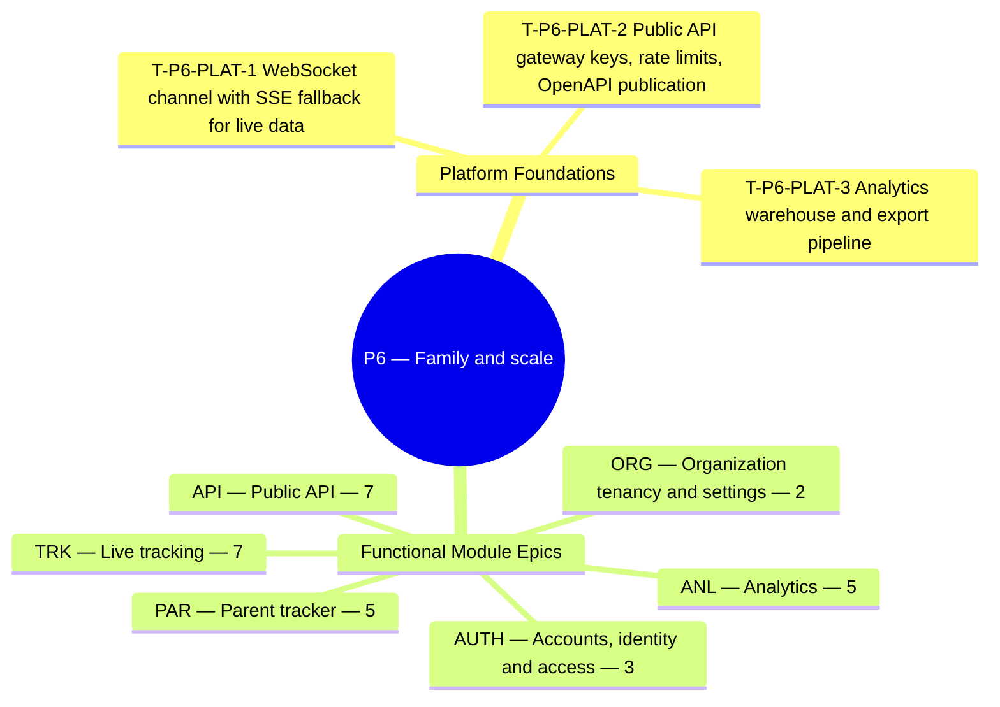

**Theme.** Family and scale — live tracking, parent tracker, analytics, public API

**Definition of done.** Parents see their children live; organizations get analytics and integrations. *([BRD section 3.3](/en/docs/brd#33-delivery-phases))*

**32 delivery tasks** (**29** functional tasks: **19** Must, **6** Should, **4** Could + **3** cross-cutting platform foundation tasks) across **6** SRS modules. Every task below carries its complete specification, implementation deliverables, acceptance criteria, affected PostgreSQL tables, and cross-specification links across BRD, SRS, ERD, Plan, Workflows, User Flows, Architecture, Design, End-to-End Lifecycle, and Recommendations.

**Data model.** [ERD conventions](/en/docs/erd), [Access Control & RLS](/en/docs/erd/acl), and the [lookup catalog](/en/docs/erd/reference) apply to every table touched in this phase.

<MindmapBlock title="P6 Scope Mindmap — Family and scale" caption="Breakdown of platform foundations, module epics (32 tasks), and milestone gates for P6." trace={{"brd":[{"label":"BRD §3.3 Phases","href":"/en/docs/brd#33-delivery-phases"}],"srs":[{"label":"SRS Traceability","href":"/en/docs/srs/traceability"}],"erd":[{"label":"ERD Overview","href":"/en/docs/erd"}],"plan":[{"label":"Milestones","href":"/en/docs/plan/milestones"},{"label":"Build Guide","href":"/en/docs/plan/build-guide"}],"workflows":[{"label":"Workflow Coverage","href":"/en/docs/workflows/coverage"}],"architecture":[{"label":"Architecture","href":"/en/docs/architecture"}],"design":[{"label":"Design System","href":"/en/docs/design"}],"system":[{"label":"End-to-End Lifecycle","href":"/en/docs/system/lifecycle"}],"recommendations":[{"label":"Open Decisions","href":"/en/docs/recommendations/open-decisions"}]}}>

</MindmapBlock>

## Quick-jump task index

| Task | Module | Reference | Priority |
|---|---|---|---|
| [T-P6-PLAT-1 — WebSocket channel with SSE fallback for live data](#t-p6-plat-1) | `PLAT` | [NFR-PERF-06](/en/docs/srs/quality#81-performance-nfr-perf) | Must |
| [T-P6-PLAT-2 — Public API gateway: keys, rate limits, OpenAPI publication](#t-p6-plat-2) | `PLAT` | [NFR-SEC-13](/en/docs/srs/quality#82-security-nfr-sec) | Must |
| [T-P6-PLAT-3 — Analytics warehouse and export pipeline](#t-p6-plat-3) | `PLAT` | [NFR-SCL](/en/docs/srs/quality#84-scalability-nfr-scl) | Must |
| [T-P6-AUTH-1 — Passkey registration](#t-p6-auth-1) | `AUTH` | [FR-AUTH-11](/en/docs/srs/requirements/auth#fr-auth-11--passkey-registration) | Must |
| [T-P6-AUTH-2 — Passkey sign-in](#t-p6-auth-2) | `AUTH` | [FR-AUTH-12](/en/docs/srs/requirements/auth#fr-auth-12--passkey-sign-in) | Must |
| [T-P6-AUTH-3 — Passkey management and device-loss recovery](#t-p6-auth-3) | `AUTH` | [FR-AUTH-13](/en/docs/srs/requirements/auth#fr-auth-13--passkey-management-and-device-loss-recovery) | Should |
| [T-P6-ORG-1 — CRM and webhooks](#t-p6-org-1) | `ORG` | [FR-ORG-06](/en/docs/srs/requirements/org#fr-org-06--crm-and-webhooks) | Should |
| [T-P6-ORG-2 — Custom branding](#t-p6-org-2) | `ORG` | [FR-ORG-08](/en/docs/srs/requirements/org#fr-org-08--custom-branding) | Could |
| [T-P6-TRK-1 — Live vehicle location](#t-p6-trk-1) | `TRK` | [FR-TRK-01](/en/docs/srs/requirements/trk#fr-trk-01--live-vehicle-location) | Must |
| [T-P6-TRK-2 — Location collection](#t-p6-trk-2) | `TRK` | [FR-TRK-02](/en/docs/srs/requirements/trk#fr-trk-02--location-collection) | Must |
| [T-P6-TRK-3 — Passenger vehicle view](#t-p6-trk-3) | `TRK` | [FR-TRK-03](/en/docs/srs/requirements/trk#fr-trk-03--passenger-vehicle-view) | Must |
| [T-P6-TRK-4 — Per-trip child tracking switch](#t-p6-trk-4) | `TRK` | [FR-TRK-04](/en/docs/srs/requirements/trk#fr-trk-04--per-trip-child-tracking-switch) | Must |
| [T-P6-TRK-5 — Tracking data scope](#t-p6-trk-5) | `TRK` | [FR-TRK-05](/en/docs/srs/requirements/trk#fr-trk-05--tracking-data-scope) | Must |
| [T-P6-TRK-6 — End of tracking](#t-p6-trk-6) | `TRK` | [FR-TRK-06](/en/docs/srs/requirements/trk#fr-trk-06--end-of-tracking) | Must |
| [T-P6-TRK-7 — No live position for travelers](#t-p6-trk-7) | `TRK` | [FR-TRK-07](/en/docs/srs/requirements/trk#fr-trk-07--no-live-position-for-travelers) | Must |
| [T-P6-PAR-1 — Linking a child](#t-p6-par-1) | `PAR` | [FR-PAR-01](/en/docs/srs/requirements/par#fr-par-01--linking-a-child) | Must |
| [T-P6-PAR-2 — Parent view scope](#t-p6-par-2) | `PAR` | [FR-PAR-02](/en/docs/srs/requirements/par#fr-par-02--parent-view-scope) | Must |
| [T-P6-PAR-3 — Eligibility](#t-p6-par-3) | `PAR` | [FR-PAR-03](/en/docs/srs/requirements/par#fr-par-03--eligibility) | Must |
| [T-P6-PAR-4 — Child-data restrictions](#t-p6-par-4) | `PAR` | [FR-PAR-05](/en/docs/srs/requirements/par#fr-par-05--child-data-restrictions) | Must |
| [T-P6-PAR-5 — Link ends with the booking](#t-p6-par-5) | `PAR` | [FR-PAR-06](/en/docs/srs/requirements/par#fr-par-06--link-ends-with-the-booking) | Must |
| [T-P6-ANL-1 — Organization analytics](#t-p6-anl-1) | `ANL` | [FR-ANL-01](/en/docs/srs/requirements/anl#fr-anl-01--organization-analytics) | Must |
| [T-P6-ANL-2 — Supplier analytics](#t-p6-anl-2) | `ANL` | [FR-ANL-02](/en/docs/srs/requirements/anl#fr-anl-02--supplier-analytics) | Should |
| [T-P6-ANL-3 — Admin analytics](#t-p6-anl-3) | `ANL` | [FR-ANL-03](/en/docs/srs/requirements/anl#fr-anl-03--admin-analytics) | Must |
| [T-P6-ANL-4 — Ranges, freshness and export](#t-p6-anl-4) | `ANL` | [FR-ANL-04](/en/docs/srs/requirements/anl#fr-anl-04--ranges-freshness-and-export) | Should |
| [T-P6-ANL-5 — Privacy in analytics](#t-p6-anl-5) | `ANL` | [FR-ANL-05](/en/docs/srs/requirements/anl#fr-anl-05--privacy-in-analytics) | Must |
| [T-P6-API-1 — Public API](#t-p6-api-1) | `API` | [FR-API-01](/en/docs/srs/requirements/api#fr-api-01--public-api) | Could |
| [T-P6-API-2 — API key lifecycle](#t-p6-api-2) | `API` | [FR-API-02](/en/docs/srs/requirements/api#fr-api-02--api-key-lifecycle) | Could |
| [T-P6-API-3 — Read resource endpoints](#t-p6-api-3) | `API` | [FR-API-03](/en/docs/srs/requirements/api#fr-api-03--read-resource-endpoints) | Could |
| [T-P6-API-4 — API conventions](#t-p6-api-4) | `API` | [FR-API-04](/en/docs/srs/requirements/api#fr-api-04--api-conventions) | Must |
| [T-P6-API-5 — OpenAPI publication](#t-p6-api-5) | `API` | [FR-API-05](/en/docs/srs/requirements/api#fr-api-05--openapi-publication) | Should |
| [T-P6-API-6 — Rate limiting behavior](#t-p6-api-6) | `API` | [FR-API-06](/en/docs/srs/requirements/api#fr-api-06--rate-limiting-behavior) | Should |
| [T-P6-API-7 — Webhook contract parity](#t-p6-api-7) | `API` | [FR-API-07](/en/docs/srs/requirements/api#fr-api-07--webhook-contract-parity) | Must |

## Cross-cutting

These platform-wide engineering tasks establish the runtime, database, integration, and observability foundations required to close this phase gate.

### T-P6-PLAT-1 — WebSocket channel with SSE fallback for live data

<TaskCard id="T-P6-PLAT-1" title="WebSocket channel with SSE fallback for live data" phase="P6" module="PLAT" priority="Must" kind="platform" surfaces={["Realtime Gateway","Redis Pub/Sub","Parent Tracker","Organization Dashboard"]} tables={["child_links","trip_vehicles"]} trace={{"brd":[{"label":"BRD P6 Gate","href":"/en/docs/brd#33-delivery-phases"}],"srs":[{"label":"NFR-PERF-06","href":"/en/docs/srs/quality#81-performance-nfr-perf"}],"erd":[{"label":"Operations","href":"/en/docs/erd/domains/operations"},{"label":"Fleet and trips","href":"/en/docs/erd/domains/fleet-and-trips"},{"label":"child_links","href":"/en/docs/erd/domains/operations#child_links","detail":"table"},{"label":"trip_vehicles","href":"/en/docs/erd/domains/fleet-and-trips#trip_vehicles","detail":"table"},{"label":"ACL & RLS","href":"/en/docs/erd/acl"}],"plan":[{"label":"Milestones","href":"/en/docs/plan/milestones"},{"label":"Test Strategy","href":"/en/docs/plan/testing"}],"workflows":[{"label":"trip-day","href":"/en/docs/workflows/trip-day"}],"userFlows":[{"label":"Role Flows","href":"/en/docs/user-flows"}],"architecture":[{"label":"Architecture","href":"/en/docs/architecture#system-context"}],"design":[{"label":"Design System","href":"/en/docs/design#parent-tracker"}],"system":[{"label":"STAGE-07","href":"/en/docs/system/lifecycle#stage-07"}],"recommendations":[{"label":"REC-TRK-07","href":"/en/docs/recommendations/architecture-and-ops#rec-trk-07"}]}}>

**Platform scope.** Scale the authenticated WebSocket gateway (with automatic Server-Sent Events fallback on restrictive mobile networks) backed by Redis Pub/Sub for sub-500ms seat-map updates, live operations boards, and per-vehicle parent GPS streams.

**Implementation deliverables.**

- Per-channel subscribe authorization verifying tenant scope, active trip status, and parent-child link eligibility (`BRL-29`) at connect time and revoking immediately when a trip ends.
- TimescaleDB `tracking_points` hypertable with 90-day raw GPS retention purge (`BRD §8.5`).

**Acceptance & verification criteria.**

- Given an ordinary traveler (not an eligible linked parent) subscribing to a vehicle GPS topic, when authorization runs, then subscription is rejected (`403`, `BRL-29`).
- Given WebSocket upgrade blocked by a corporate proxy, when the client connects, then SSE fallback establishes automatically within 2 seconds.

</TaskCard>

### T-P6-PLAT-2 — Public API gateway: keys, rate limits, OpenAPI publication

<TaskCard id="T-P6-PLAT-2" title="Public API gateway: keys, rate limits, OpenAPI publication" phase="P6" module="PLAT" priority="Must" kind="platform" surfaces={["Public REST API","Organization Dashboard"]} tables={[]} trace={{"brd":[{"label":"BRD P6 Gate","href":"/en/docs/brd#33-delivery-phases"}],"srs":[{"label":"NFR-SEC-13","href":"/en/docs/srs/quality#82-security-nfr-sec"}],"erd":[{"label":"Organizations","href":"/en/docs/erd/domains/organizations"},{"label":"Platform","href":"/en/docs/erd/domains/platform"},{"label":"ACL & RLS","href":"/en/docs/erd/acl"}],"plan":[{"label":"Milestones","href":"/en/docs/plan/milestones"},{"label":"Test Strategy","href":"/en/docs/plan/testing"}],"workflows":[{"label":"scheduled-jobs","href":"/en/docs/workflows/scheduled-jobs"}],"userFlows":[{"label":"Role Flows","href":"/en/docs/user-flows"}],"architecture":[{"label":"Architecture","href":"/en/docs/architecture#integrations"}],"design":[{"label":"Design System","href":"/en/docs/design#organization-dashboard"}],"system":[{"label":"STAGE-08","href":"/en/docs/system/lifecycle#stage-08"}],"recommendations":[{"label":"REC-ARCH-01","href":"/en/docs/recommendations/architecture-and-ops#rec-arch-01"}]}}>

**Platform scope.** Expose the `/api/v1/*` partner gateway with SHA-256 hashed tenant API keys, Redis token-bucket rate limiters returning standard `RateLimit-*` headers, cursor-paginated resources, and machine-verified OpenAPI 3.1 documentation.

**Implementation deliverables.**

- API key lifecycle UI & endpoints (create, show-once secret, scope, 24h overlap rotation, instant revoke).
- CI contract check ensuring published OpenAPI 3.1 schema and outbound webhook payloads never drift (`FR-API-05`, `FR-API-07`).

**Acceptance & verification criteria.**

- Given an organization exceeds its plan API quota, when calling `/api/v1/trips`, then `429 Too Many Requests` is returned with `Retry-After` header.

</TaskCard>

### T-P6-PLAT-3 — Analytics warehouse and export pipeline

<TaskCard id="T-P6-PLAT-3" title="Analytics warehouse and export pipeline" phase="P6" module="PLAT" priority="Must" kind="platform" surfaces={["Read Replicas","Worker","Organization Dashboard","Admin Console"]} tables={["bookings","trips"]} trace={{"brd":[{"label":"BRD P6 Gate","href":"/en/docs/brd#33-delivery-phases"}],"srs":[{"label":"NFR-SCL","href":"/en/docs/srs/quality#84-scalability-nfr-scl"}],"erd":[{"label":"Platform","href":"/en/docs/erd/domains/platform"},{"label":"Finance","href":"/en/docs/erd/domains/finance"},{"label":"bookings","href":"/en/docs/erd/domains/booking-and-payment#bookings","detail":"table"},{"label":"trips","href":"/en/docs/erd/domains/fleet-and-trips#trips","detail":"table"},{"label":"ACL & RLS","href":"/en/docs/erd/acl"}],"plan":[{"label":"Milestones","href":"/en/docs/plan/milestones"},{"label":"Test Strategy","href":"/en/docs/plan/testing"}],"workflows":[{"label":"scheduled-jobs","href":"/en/docs/workflows/scheduled-jobs"}],"userFlows":[{"label":"Role Flows","href":"/en/docs/user-flows"}],"architecture":[{"label":"Architecture","href":"/en/docs/architecture#data-architecture"}],"design":[{"label":"Design System","href":"/en/docs/design#organization-dashboard"}],"system":[{"label":"STAGE-08","href":"/en/docs/system/lifecycle#stage-08"}],"recommendations":[{"label":"REC-DATA-02","href":"/en/docs/recommendations/architecture-and-ops#rec-data-02"}]}}>

**Platform scope.** Build continuous materialized rollups on PostgreSQL read replicas (`<=5m` lag) and async CSV/XLSX export workers delivering tenant-isolated KPIs and admin marketplace funnels with zero primary-DB contention and zero child-data exposure.

**Implementation deliverables.**

- Incremental rollup views refreshing every `<=5 minutes` on read replicas (`BR-ANL-04`) + RLS-scoped query router.
- Async export worker writing signed temporary download files cleaned up by media retention rules.

**Acceptance & verification criteria.**

- Given a large 12-month analytics export requested by an organization, when running, then primary OLTP booking p95 latency is unaffected and child fields are absent.

</TaskCard>

## AUTH — Accounts, identity and access

**Data model.** [Identity and access](/en/docs/erd/domains/identity-and-access) — the data-model domains and tables this module's requirements read and write.

### T-P6-AUTH-1 — Passkey registration

<TaskCard id="T-P6-AUTH-1" title="Passkey registration" phase="P6" module="AUTH" priority="Must" surfaces={["Visitor Web","Traveler App","Organization Dashboard","Admin Console"]} tables={["user_roles"]} trace={{"brd":[{"label":"BR-AUTH-09","href":"/en/docs/brd/requirements#61-accounts-and-access-auth","detail":"P6"},{"label":"BRL-20","href":"/en/docs/brd/requirements#7-business-rules","detail":"rule"}],"srs":[{"label":"FR-AUTH-11","href":"/en/docs/srs/requirements/auth#fr-auth-11--passkey-registration","detail":"Must"},{"label":"Quality NFRs","href":"/en/docs/srs/quality"}],"erd":[{"label":"Identity and access","href":"/en/docs/erd/domains/identity-and-access"},{"label":"user_roles","href":"/en/docs/erd/domains/identity-and-access#user_roles","detail":"table"}],"plan":[{"label":"P6 Milestone","href":"/en/docs/plan/milestones"},{"label":"Testing Pyramid","href":"/en/docs/plan/testing"}],"workflows":[{"label":"scheduled-jobs","href":"/en/docs/workflows/scheduled-jobs"}],"userFlows":[{"label":"UF-SHR-17","href":"/en/docs/user-flows/shared#uf-shr-17-passkey-registration-management-and-device-loss-recovery"}],"architecture":[{"label":"Architecture","href":"/en/docs/architecture#service-model"}],"design":[{"label":"Design Surface","href":"/en/docs/design#forms-and-validation"}],"system":[{"label":"STAGE-01","href":"/en/docs/system/lifecycle#stage-01"}],"recommendations":[{"label":"REC-SEC-09","href":"/en/docs/recommendations/architecture-and-ops#rec-sec-09"}]}}>

**Specification ([FR-AUTH-11](/en/docs/srs/requirements/auth#fr-auth-11--passkey-registration)).** Users shall register passkeys (WebAuthn) on their account and later from account settings. The first passkey requires a one-time code verification per [BRL-20](/en/docs/brd/requirements#7-business-rules) before the credential is stored. The platform stores only the credential id and public key; the private key never leaves the device. [OPEN: which platforms ship passkey registration first.](/en/docs/recommendations/open-decisions#open-04)

**Implementation deliverables.**

- **Domain & API logic:** Implement authentication handlers, session/token rotation, lockout rate-limits, and role/tenant context switching with full auditability.
- **Persistence & RLS:** Read/write operations on `user_roles` enforcing base-column conventions, soft-delete filters, and tenant/role access control ([ACL](/en/docs/erd/acl)).
- **Verification & telemetry:** Automated unit/integration coverage mapped to `FR-AUTH-11` acceptance scenarios ([Test Strategy](/en/docs/plan/testing)) with structured trace/audit emission.

**Acceptance criteria.**

- Given a verified account, when the user registers a passkey, then the credential is stored and listed in settings.
- Given an unverified contact, when the user registers the first passkey, then registration waits for a one-time code per [BRL-20](/en/docs/brd/requirements#7-business-rules).
- Given a registered passkey, when the user registers a second one from settings, then it is added without repeating the one-time code.

**Business trace & governing rules.**

- [BR-AUTH-09](/en/docs/brd/requirements#61-accounts-and-access-auth): Users register passkeys (WebAuthn) on their account and from account settings. [OPEN: which platforms ship passkey registration first.]

</TaskCard>

### T-P6-AUTH-2 — Passkey sign-in

<TaskCard id="T-P6-AUTH-2" title="Passkey sign-in" phase="P6" module="AUTH" priority="Must" surfaces={["Visitor Web","Traveler App","Organization Dashboard","Admin Console"]} tables={["user_roles"]} trace={{"brd":[{"label":"BR-AUTH-10","href":"/en/docs/brd/requirements#61-accounts-and-access-auth","detail":"P6"}],"srs":[{"label":"FR-AUTH-12","href":"/en/docs/srs/requirements/auth#fr-auth-12--passkey-sign-in","detail":"Must"},{"label":"Quality NFRs","href":"/en/docs/srs/quality"}],"erd":[{"label":"Identity and access","href":"/en/docs/erd/domains/identity-and-access"},{"label":"user_roles","href":"/en/docs/erd/domains/identity-and-access#user_roles","detail":"table"}],"plan":[{"label":"P6 Milestone","href":"/en/docs/plan/milestones"},{"label":"Testing Pyramid","href":"/en/docs/plan/testing"}],"workflows":[{"label":"scheduled-jobs","href":"/en/docs/workflows/scheduled-jobs"}],"userFlows":[{"label":"UF-SHR-03","href":"/en/docs/user-flows/shared#uf-shr-03-sign-in"},{"label":"UF-SHR-17","href":"/en/docs/user-flows/shared#uf-shr-17-passkey-registration-management-and-device-loss-recovery"}],"architecture":[{"label":"Architecture","href":"/en/docs/architecture#service-model"}],"design":[{"label":"Design Surface","href":"/en/docs/design#forms-and-validation"}],"system":[{"label":"STAGE-01","href":"/en/docs/system/lifecycle#stage-01"}],"recommendations":[{"label":"REC-SEC-09","href":"/en/docs/recommendations/architecture-and-ops#rec-sec-09"}]}}>

**Specification ([FR-AUTH-12](/en/docs/srs/requirements/auth#fr-auth-12--passkey-sign-in)).** Users shall sign in with a registered passkey as an alternative to their role's password or one-time code method. The server validates the ceremony's challenge and origin, checks the assertion against the stored public key and rejects a credential whose counter does not advance past the last seen value. A revoked credential cannot sign in.

**Implementation deliverables.**

- **Domain & API logic:** Implement authentication handlers, session/token rotation, lockout rate-limits, and role/tenant context switching with full auditability.
- **Persistence & RLS:** Read/write operations on `user_roles` enforcing base-column conventions, soft-delete filters, and tenant/role access control ([ACL](/en/docs/erd/acl)).
- **Verification & telemetry:** Automated unit/integration coverage mapped to `FR-AUTH-12` acceptance scenarios ([Test Strategy](/en/docs/plan/testing)) with structured trace/audit emission.

**Acceptance criteria.**

- Given a registered passkey, when the user signs in with it, then the session opens like a password sign-in.
- Given an assertion whose counter value is at or below the last seen value, when the server verifies it, then the credential is rejected as cloned and another method is required.
- Given a revoked passkey, when its credential is presented, then sign-in is refused.

**Business trace & governing rules.**

- [BR-AUTH-10](/en/docs/brd/requirements#61-accounts-and-access-auth): Users sign in with a registered passkey as an alternative to their role's password or one-time code method.

</TaskCard>

### T-P6-AUTH-3 — Passkey management and device-loss recovery

<TaskCard id="T-P6-AUTH-3" title="Passkey management and device-loss recovery" phase="P6" module="AUTH" priority="Should" surfaces={["Visitor Web","Traveler App","Organization Dashboard","Admin Console"]} tables={["user_roles"]} trace={{"brd":[{"label":"BR-AUTH-11","href":"/en/docs/brd/requirements#61-accounts-and-access-auth","detail":"P6"},{"label":"BRL-20","href":"/en/docs/brd/requirements#7-business-rules","detail":"rule"}],"srs":[{"label":"FR-AUTH-13","href":"/en/docs/srs/requirements/auth#fr-auth-13--passkey-management-and-device-loss-recovery","detail":"Should"},{"label":"Quality NFRs","href":"/en/docs/srs/quality"}],"erd":[{"label":"Identity and access","href":"/en/docs/erd/domains/identity-and-access"},{"label":"user_roles","href":"/en/docs/erd/domains/identity-and-access#user_roles","detail":"table"}],"plan":[{"label":"P6 Milestone","href":"/en/docs/plan/milestones"},{"label":"Testing Pyramid","href":"/en/docs/plan/testing"}],"workflows":[{"label":"scheduled-jobs","href":"/en/docs/workflows/scheduled-jobs"}],"userFlows":[{"label":"UF-SHR-17","href":"/en/docs/user-flows/shared#uf-shr-17-passkey-registration-management-and-device-loss-recovery"}],"architecture":[{"label":"Architecture","href":"/en/docs/architecture#service-model"}],"design":[{"label":"Design Surface","href":"/en/docs/design#forms-and-validation"}],"system":[{"label":"STAGE-01","href":"/en/docs/system/lifecycle#stage-01"}],"recommendations":[{"label":"REC-SEC-09","href":"/en/docs/recommendations/architecture-and-ops#rec-sec-09"}]}}>

**Specification ([FR-AUTH-13](/en/docs/srs/requirements/auth#fr-auth-13--passkey-management-and-device-loss-recovery)).** Users shall list and revoke registered passkeys from account settings in any active session. Every revocation requires a one-time code re-verification per [BRL-20](/en/docs/brd/requirements#7-business-rules). A user who loses the device holding a passkey revokes it from another active session and registers a new passkey after re-verification. [OPEN: which platforms and surfaces expose passkey management and recovery.](/en/docs/recommendations/open-decisions#open-05)

**Implementation deliverables.**

- **Domain & API logic:** Implement authentication handlers, session/token rotation, lockout rate-limits, and role/tenant context switching with full auditability.
- **Persistence & RLS:** Read/write operations on `user_roles` enforcing base-column conventions, soft-delete filters, and tenant/role access control ([ACL](/en/docs/erd/acl)).
- **Verification & telemetry:** Automated unit/integration coverage mapped to `FR-AUTH-13` acceptance scenarios ([Test Strategy](/en/docs/plan/testing)) with structured trace/audit emission.

**Acceptance criteria.**

- Given two active sessions, when the user revokes a passkey from the second, then the revoked credential cannot sign in anywhere.
- Given a revocation request without a one-time code, when it is submitted, then revocation is refused.
- Given a lost device holding the last passkey, when the user re-verifies and registers a new passkey from another session, then the old credential is removed and the new one signs in.

**Business trace & governing rules.**

- [BR-AUTH-11](/en/docs/brd/requirements#61-accounts-and-access-auth): A user who loses a device recovers by having the stored passkey removed and re-verifying their identity before registering a new one.

</TaskCard>

## ORG — Organization tenancy and settings

**Data model.** [Finance](/en/docs/erd/domains/finance), [Organizations](/en/docs/erd/domains/organizations) — the data-model domains and tables this module's requirements read and write.

### T-P6-ORG-1 — CRM and webhooks

<TaskCard id="T-P6-ORG-1" title="CRM and webhooks" phase="P6" module="ORG" priority="Should" surfaces={["Organization Dashboard","Admin Console"]} tables={["organizations","organization_members"]} trace={{"brd":[{"label":"BR-ORG-06","href":"/en/docs/brd/requirements#63-organizations-and-employees-org","detail":"P6"}],"srs":[{"label":"FR-ORG-06","href":"/en/docs/srs/requirements/org#fr-org-06--crm-and-webhooks","detail":"Should"},{"label":"Quality NFRs","href":"/en/docs/srs/quality"}],"erd":[{"label":"Finance","href":"/en/docs/erd/domains/finance"},{"label":"Organizations","href":"/en/docs/erd/domains/organizations"},{"label":"organizations","href":"/en/docs/erd/domains/organizations#organizations","detail":"table"},{"label":"organization_members","href":"/en/docs/erd/domains/organizations#organization_members","detail":"table"}],"plan":[{"label":"P6 Milestone","href":"/en/docs/plan/milestones"},{"label":"Testing Pyramid","href":"/en/docs/plan/testing"}],"workflows":[{"label":"scheduled-jobs","href":"/en/docs/workflows/scheduled-jobs#countdowns-per-record-timers"}],"userFlows":[{"label":"UF-ORG-17","href":"/en/docs/user-flows/organization#uf-org-17-crm-and-webhooks"},{"label":"UF-ORG-24","href":"/en/docs/user-flows/organization#uf-org-24-consume-the-public-api"}],"architecture":[{"label":"Architecture","href":"/en/docs/architecture#data-architecture"}],"design":[{"label":"Design Surface","href":"/en/docs/design#organization-dashboard"}],"system":[{"label":"STAGE-02","href":"/en/docs/system/lifecycle#stage-02"}],"recommendations":[{"label":"REC-DATA-02","href":"/en/docs/recommendations/architecture-and-ops#rec-data-02"}]}}>

**Specification ([FR-ORG-06](/en/docs/srs/requirements/org#fr-org-06--crm-and-webhooks)).** An organization shall connect a CRM and register webhook endpoints for trip published, trip cancelled, booking confirmed, booking cancelled, check-in and check-out events. Deliveries are signed (COM-04), retried 5 times over 24 hours, then the owner is emailed; deliveries can be replayed for 7 days; after a secret rotation the old secret stays valid for 24 hours. No plan gate applies (D-62 to D-64). Endpoint count per plan is [OPEN: D-65]. CRM targets are [OPEN: [OD-18](/en/docs/brd/compliance#11-open-decisions)].

**Implementation deliverables.**

- **Domain & API logic:** Enforce PostgreSQL RLS tenant isolation (`app.current_organization_id`), workspace provisioning on approval, org-owned staff boundaries, and signed outbound webhooks.
- **Persistence & RLS:** Read/write operations on `organizations`, `organization_members` enforcing base-column conventions, soft-delete filters, and tenant/role access control ([ACL](/en/docs/erd/acl)).
- **Verification & telemetry:** Automated unit/integration coverage mapped to `FR-ORG-06` acceptance scenarios ([Test Strategy](/en/docs/plan/testing)) with structured trace/audit emission.

**Acceptance criteria.**

- Given an endpoint subscribed to booking confirmed, when a booking is confirmed, then a signed event with an event ID is delivered.
- Given five failed attempts over 24 hours, when the last fails, then the owner is emailed and the delivery shows as failed with a replay option.

**Business trace & governing rules.**

- [BR-ORG-06](/en/docs/brd/requirements#63-organizations-and-employees-org): Organizations can connect a CRM and send trip, booking and check-in events to external apps through signed webhooks.

</TaskCard>

### T-P6-ORG-2 — Custom branding

<TaskCard id="T-P6-ORG-2" title="Custom branding" phase="P6" module="ORG" priority="Could" surfaces={["Organization Dashboard","Admin Console"]} tables={["organizations"]} trace={{"brd":[{"label":"BR-ORG-08","href":"/en/docs/brd/requirements#63-organizations-and-employees-org","detail":"P6"}],"srs":[{"label":"FR-ORG-08","href":"/en/docs/srs/requirements/org#fr-org-08--custom-branding","detail":"Could"},{"label":"Quality NFRs","href":"/en/docs/srs/quality"}],"erd":[{"label":"Finance","href":"/en/docs/erd/domains/finance"},{"label":"Organizations","href":"/en/docs/erd/domains/organizations"},{"label":"organizations","href":"/en/docs/erd/domains/organizations#organizations","detail":"table"}],"plan":[{"label":"P6 Milestone","href":"/en/docs/plan/milestones"},{"label":"Testing Pyramid","href":"/en/docs/plan/testing"}],"workflows":[{"label":"applications","href":"/en/docs/workflows/applications"}],"userFlows":[{"label":"UF-ORG-20","href":"/en/docs/user-flows/organization#uf-org-20-branding-enterprise"}],"architecture":[{"label":"Architecture","href":"/en/docs/architecture#data-architecture"}],"design":[{"label":"Design Surface","href":"/en/docs/design#organization-dashboard"}],"system":[{"label":"STAGE-02","href":"/en/docs/system/lifecycle#stage-02"}],"recommendations":[{"label":"REC-DATA-02","href":"/en/docs/recommendations/architecture-and-ops#rec-data-02"}]}}>

**Specification ([FR-ORG-08](/en/docs/srs/requirements/org#fr-org-08--custom-branding)).** Enterprise organizations shall upload a logo and brand colors applied to their public trip pages, emails and invoice PDFs.

**Implementation deliverables.**

- **Domain & API logic:** Enforce PostgreSQL RLS tenant isolation (`app.current_organization_id`), workspace provisioning on approval, org-owned staff boundaries, and signed outbound webhooks.
- **Persistence & RLS:** Read/write operations on `organizations` enforcing base-column conventions, soft-delete filters, and tenant/role access control ([ACL](/en/docs/erd/acl)).
- **Verification & telemetry:** Automated unit/integration coverage mapped to `FR-ORG-08` acceptance scenarios ([Test Strategy](/en/docs/plan/testing)) with structured trace/audit emission.

**Acceptance criteria.**

- Given a Growth organization, when it opens branding settings, then they are locked with an upgrade prompt.

**Business trace & governing rules.**

- [BR-ORG-08](/en/docs/brd/requirements#63-organizations-and-employees-org): Enterprise organizations can apply custom branding to traveler-facing trip pages, emails and invoices.

</TaskCard>

## TRK — Live tracking

**Data model.** [Fleet and trips](/en/docs/erd/domains/fleet-and-trips), [Operations](/en/docs/erd/domains/operations) — the data-model domains and tables this module's requirements read and write.

### T-P6-TRK-1 — Live vehicle location

<TaskCard id="T-P6-TRK-1" title="Live vehicle location" phase="P6" module="TRK" priority="Must" surfaces={["Driver App","Organization Dashboard","Parent Tracker","Admin Console"]} tables={["checkin_events"]} trace={{"brd":[{"label":"BR-TRK-01","href":"/en/docs/brd/requirements#69-check-in-moderators-and-tracking-chk-mod-trk","detail":"P6"}],"srs":[{"label":"FR-TRK-01","href":"/en/docs/srs/requirements/trk#fr-trk-01--live-vehicle-location","detail":"Must"},{"label":"Quality NFRs","href":"/en/docs/srs/quality"}],"erd":[{"label":"Fleet and trips","href":"/en/docs/erd/domains/fleet-and-trips"},{"label":"Operations","href":"/en/docs/erd/domains/operations"},{"label":"checkin_events","href":"/en/docs/erd/domains/operations#checkin_events","detail":"table"}],"plan":[{"label":"P6 Milestone","href":"/en/docs/plan/milestones"},{"label":"Testing Pyramid","href":"/en/docs/plan/testing"}],"workflows":[{"label":"scheduled-jobs","href":"/en/docs/workflows/scheduled-jobs#continuous-pipelines"},{"label":"trip-day","href":"/en/docs/workflows/trip-day#timers-and-rules"},{"label":"trip-day","href":"/en/docs/workflows/trip-day#stories"}],"userFlows":[{"label":"UF-ORG-12","href":"/en/docs/user-flows/organization#uf-org-12-live-operations"}],"architecture":[{"label":"Architecture","href":"/en/docs/architecture#data-architecture"}],"design":[{"label":"Design Surface","href":"/en/docs/design#parent-tracker"}],"system":[{"label":"STAGE-07","href":"/en/docs/system/lifecycle#stage-07"}],"recommendations":[{"label":"REC-TRK-07","href":"/en/docs/recommendations/architecture-and-ops#rec-trk-07"}]}}>

**Specification ([FR-TRK-01](/en/docs/srs/requirements/trk#fr-trk-01--live-vehicle-location)).** Operations staff with trip access shall see each vehicle's live position, updated within 500 ms of arrival.

**Implementation deliverables.**

- **Domain & API logic:** Build GPS telemetry ingestion into TimescaleDB `tracking_points`, WebSocket/SSE live fan-out, strict traveler exclusion (`BRL-29`), and auto-stop on trip completion.
- **Persistence & RLS:** Read/write operations on `checkin_events` enforcing base-column conventions, soft-delete filters, and tenant/role access control ([ACL](/en/docs/erd/acl)).
- **Verification & telemetry:** Automated unit/integration coverage mapped to `FR-TRK-01` acceptance scenarios ([Test Strategy](/en/docs/plan/testing)) with structured trace/audit emission.

**Acceptance criteria.**

- Given a new GPS point for vehicle 2, when the map is open, then vehicle 2 moves within 500 ms.

**Business trace & governing rules.**

- [BR-TRK-01](/en/docs/brd/requirements#69-check-in-moderators-and-tracking-chk-mod-trk): Operations staff see each vehicle's live location and which vehicle each passenger is in. Travelers never see the live vehicle position ([BRL-29](/en/docs/brd/requirements#7-business-rules)).

</TaskCard>

### T-P6-TRK-2 — Location collection

<TaskCard id="T-P6-TRK-2" title="Location collection" phase="P6" module="TRK" priority="Must" surfaces={["Driver App","Organization Dashboard","Parent Tracker","Admin Console"]} tables={["checkin_events"]} trace={{"brd":[{"label":"BR-TRK-01","href":"/en/docs/brd/requirements#69-check-in-moderators-and-tracking-chk-mod-trk","detail":"P6"}],"srs":[{"label":"FR-TRK-02","href":"/en/docs/srs/requirements/trk#fr-trk-02--location-collection","detail":"Must"},{"label":"Quality NFRs","href":"/en/docs/srs/quality"}],"erd":[{"label":"Fleet and trips","href":"/en/docs/erd/domains/fleet-and-trips"},{"label":"Operations","href":"/en/docs/erd/domains/operations"},{"label":"checkin_events","href":"/en/docs/erd/domains/operations#checkin_events","detail":"table"}],"plan":[{"label":"P6 Milestone","href":"/en/docs/plan/milestones"},{"label":"Testing Pyramid","href":"/en/docs/plan/testing"}],"workflows":[{"label":"scheduled-jobs","href":"/en/docs/workflows/scheduled-jobs#continuous-pipelines"},{"label":"trip-day","href":"/en/docs/workflows/trip-day#timers-and-rules"},{"label":"trip-day","href":"/en/docs/workflows/trip-day#stories"}],"userFlows":[{"label":"UF-DRV-04","href":"/en/docs/user-flows/driver#uf-drv-04-run-an-assigned-vehicle"}],"architecture":[{"label":"Architecture","href":"/en/docs/architecture#data-architecture"}],"design":[{"label":"Design Surface","href":"/en/docs/design#parent-tracker"}],"system":[{"label":"STAGE-07","href":"/en/docs/system/lifecycle#stage-07"}],"recommendations":[{"label":"REC-TRK-07","href":"/en/docs/recommendations/architecture-and-ops#rec-trk-07"}]}}>

**Specification ([FR-TRK-02](/en/docs/srs/requirements/trk#fr-trk-02--location-collection)).** The driver app (or the moderator app as fallback) shall send a point every 5 to 10 seconds only while the trip is In Progress, batching up to 10 points per request and buffering up to 60 minutes offline (D-34, D-121).

**Implementation deliverables.**

- **Domain & API logic:** Build GPS telemetry ingestion into TimescaleDB `tracking_points`, WebSocket/SSE live fan-out, strict traveler exclusion (`BRL-29`), and auto-stop on trip completion.
- **Persistence & RLS:** Read/write operations on `checkin_events` enforcing base-column conventions, soft-delete filters, and tenant/role access control ([ACL](/en/docs/erd/acl)).
- **Verification & telemetry:** Automated unit/integration coverage mapped to `FR-TRK-02` acceptance scenarios ([Test Strategy](/en/docs/plan/testing)) with structured trace/audit emission.

**Acceptance criteria.**

- Given the trip has not started, when the device is online, then no points are sent.

**Business trace & governing rules.**

- [BR-TRK-01](/en/docs/brd/requirements#69-check-in-moderators-and-tracking-chk-mod-trk): Operations staff see each vehicle's live location and which vehicle each passenger is in. Travelers never see the live vehicle position ([BRL-29](/en/docs/brd/requirements#7-business-rules)).

</TaskCard>

### T-P6-TRK-3 — Passenger vehicle view

<TaskCard id="T-P6-TRK-3" title="Passenger vehicle view" phase="P6" module="TRK" priority="Must" surfaces={["Driver App","Organization Dashboard","Parent Tracker","Admin Console"]} tables={["trips","checkin_events"]} trace={{"brd":[{"label":"BR-TRK-01","href":"/en/docs/brd/requirements#69-check-in-moderators-and-tracking-chk-mod-trk","detail":"P6"}],"srs":[{"label":"FR-TRK-03","href":"/en/docs/srs/requirements/trk#fr-trk-03--passenger-vehicle-view","detail":"Must"},{"label":"Quality NFRs","href":"/en/docs/srs/quality"}],"erd":[{"label":"Fleet and trips","href":"/en/docs/erd/domains/fleet-and-trips"},{"label":"Operations","href":"/en/docs/erd/domains/operations"},{"label":"trips","href":"/en/docs/erd/domains/fleet-and-trips#trips","detail":"table"},{"label":"checkin_events","href":"/en/docs/erd/domains/operations#checkin_events","detail":"table"}],"plan":[{"label":"P6 Milestone","href":"/en/docs/plan/milestones"},{"label":"Testing Pyramid","href":"/en/docs/plan/testing"}],"workflows":[{"label":"trip-day","href":"/en/docs/workflows/trip-day"}],"userFlows":[{"label":"UF-ORG-12","href":"/en/docs/user-flows/organization#uf-org-12-live-operations"}],"architecture":[{"label":"Architecture","href":"/en/docs/architecture#data-architecture"}],"design":[{"label":"Design Surface","href":"/en/docs/design#parent-tracker"}],"system":[{"label":"STAGE-07","href":"/en/docs/system/lifecycle#stage-07"}],"recommendations":[{"label":"REC-TRK-07","href":"/en/docs/recommendations/architecture-and-ops#rec-trk-07"}]}}>

**Specification ([FR-TRK-03](/en/docs/srs/requirements/trk#fr-trk-03--passenger-vehicle-view)).** Operations shall see which vehicle each checked-in passenger is in.

**Implementation deliverables.**

- **Domain & API logic:** Build GPS telemetry ingestion into TimescaleDB `tracking_points`, WebSocket/SSE live fan-out, strict traveler exclusion (`BRL-29`), and auto-stop on trip completion.
- **Persistence & RLS:** Read/write operations on `trips`, `checkin_events` enforcing base-column conventions, soft-delete filters, and tenant/role access control ([ACL](/en/docs/erd/acl)).
- **Verification & telemetry:** Automated unit/integration coverage mapped to `FR-TRK-03` acceptance scenarios ([Test Strategy](/en/docs/plan/testing)) with structured trace/audit emission.

**Acceptance criteria.**

- Given P checked in to vehicle 2 and not out, when operations looks up P, then vehicle 2 shows.

**Business trace & governing rules.**

- [BR-TRK-01](/en/docs/brd/requirements#69-check-in-moderators-and-tracking-chk-mod-trk): Operations staff see each vehicle's live location and which vehicle each passenger is in. Travelers never see the live vehicle position ([BRL-29](/en/docs/brd/requirements#7-business-rules)).

</TaskCard>

### T-P6-TRK-4 — Per-trip child tracking switch

<TaskCard id="T-P6-TRK-4" title="Per-trip child tracking switch" phase="P6" module="TRK" priority="Must" surfaces={["Driver App","Organization Dashboard","Parent Tracker","Admin Console"]} tables={["trips"]} trace={{"brd":[{"label":"BR-PAR-04","href":"/en/docs/brd/requirements#69-check-in-moderators-and-tracking-chk-mod-trk","detail":"P6"}],"srs":[{"label":"FR-TRK-04","href":"/en/docs/srs/requirements/trk#fr-trk-04--per-trip-child-tracking-switch","detail":"Must"},{"label":"Quality NFRs","href":"/en/docs/srs/quality"}],"erd":[{"label":"Fleet and trips","href":"/en/docs/erd/domains/fleet-and-trips"},{"label":"Operations","href":"/en/docs/erd/domains/operations"},{"label":"trips","href":"/en/docs/erd/domains/fleet-and-trips#trips","detail":"table"}],"plan":[{"label":"P6 Milestone","href":"/en/docs/plan/milestones"},{"label":"Testing Pyramid","href":"/en/docs/plan/testing"}],"workflows":[{"label":"trip-day","href":"/en/docs/workflows/trip-day"}],"userFlows":[{"label":"UF-PAR-03","href":"/en/docs/user-flows/parent#uf-par-03-live-map"}],"architecture":[{"label":"Architecture","href":"/en/docs/architecture#data-architecture"}],"design":[{"label":"Design Surface","href":"/en/docs/design#parent-tracker"}],"system":[{"label":"STAGE-07","href":"/en/docs/system/lifecycle#stage-07"}],"recommendations":[{"label":"REC-TRK-07","href":"/en/docs/recommendations/architecture-and-ops#rec-trk-07"}]}}>

**Specification ([FR-TRK-04](/en/docs/srs/requirements/trk#fr-trk-04--per-trip-child-tracking-switch)).** Parent live tracking shall be available only where the trip's child tracking switch is on ([FR-PAR-03](/en/docs/srs/requirements/par#fr-par-03--eligibility)).

**Implementation deliverables.**

- **Domain & API logic:** Build GPS telemetry ingestion into TimescaleDB `tracking_points`, WebSocket/SSE live fan-out, strict traveler exclusion (`BRL-29`), and auto-stop on trip completion.
- **Persistence & RLS:** Read/write operations on `trips` enforcing base-column conventions, soft-delete filters, and tenant/role access control ([ACL](/en/docs/erd/acl)).
- **Verification & telemetry:** Automated unit/integration coverage mapped to `FR-TRK-04` acceptance scenarios ([Test Strategy](/en/docs/plan/testing)) with structured trace/audit emission.

**Acceptance criteria.**

- Given the switch is off, when a parent opens the tracker, then no live position shows.

**Business trace & governing rules.**

- [BR-PAR-04](/en/docs/brd/requirements#69-check-in-moderators-and-tracking-chk-mod-trk): Child tracking is available where the parent is on Explorer or VIP and the organization is on Growth or Enterprise with tracking enabled for the trip ([OD-05](/en/docs/brd/compliance#11-open-decisions)). Live position is shown only while the trip is In Progress (D-317).

</TaskCard>

### T-P6-TRK-5 — Tracking data scope

<TaskCard id="T-P6-TRK-5" title="Tracking data scope" phase="P6" module="TRK" priority="Must" surfaces={["Driver App","Organization Dashboard","Parent Tracker","Admin Console"]} tables={["trips","checkin_events"]} trace={{"brd":[{"label":"BRL-01","href":"/en/docs/brd/requirements#7-business-rules","detail":"rule"},{"label":"BRL-29","href":"/en/docs/brd/requirements#7-business-rules","detail":"rule"}],"srs":[{"label":"FR-TRK-05","href":"/en/docs/srs/requirements/trk#fr-trk-05--tracking-data-scope","detail":"Must"},{"label":"Quality NFRs","href":"/en/docs/srs/quality"}],"erd":[{"label":"Fleet and trips","href":"/en/docs/erd/domains/fleet-and-trips"},{"label":"Operations","href":"/en/docs/erd/domains/operations"},{"label":"trips","href":"/en/docs/erd/domains/fleet-and-trips#trips","detail":"table"},{"label":"checkin_events","href":"/en/docs/erd/domains/operations#checkin_events","detail":"table"}],"plan":[{"label":"P6 Milestone","href":"/en/docs/plan/milestones"},{"label":"Testing Pyramid","href":"/en/docs/plan/testing"}],"workflows":[{"label":"trip-day","href":"/en/docs/workflows/trip-day#timers-and-rules"}],"userFlows":[{"label":"parent","href":"/en/docs/user-flows/parent"}],"architecture":[{"label":"Architecture","href":"/en/docs/architecture#data-architecture"}],"design":[{"label":"Design Surface","href":"/en/docs/design#parent-tracker"}],"system":[{"label":"STAGE-07","href":"/en/docs/system/lifecycle#stage-07"}],"recommendations":[{"label":"REC-TRK-07","href":"/en/docs/recommendations/architecture-and-ops#rec-trk-07"}]}}>

**Specification ([FR-TRK-05](/en/docs/srs/requirements/trk#fr-trk-05--tracking-data-scope)).** Positions and passenger movement shall be visible only to the owning organization's staff with operations access, admins, and eligible linked parents.

**Implementation deliverables.**

- **Domain & API logic:** Build GPS telemetry ingestion into TimescaleDB `tracking_points`, WebSocket/SSE live fan-out, strict traveler exclusion (`BRL-29`), and auto-stop on trip completion.
- **Persistence & RLS:** Read/write operations on `trips`, `checkin_events` enforcing base-column conventions, soft-delete filters, and tenant/role access control ([ACL](/en/docs/erd/acl)).
- **Verification & telemetry:** Automated unit/integration coverage mapped to `FR-TRK-05` acceptance scenarios ([Test Strategy](/en/docs/plan/testing)) with structured trace/audit emission.

**Acceptance criteria.**

- Given another organization's user requests positions, when processed, then the response is not found.

</TaskCard>

### T-P6-TRK-6 — End of tracking

<TaskCard id="T-P6-TRK-6" title="End of tracking" phase="P6" module="TRK" priority="Must" surfaces={["Driver App","Organization Dashboard","Parent Tracker","Admin Console"]} tables={["trips","checkin_events"]} trace={{"brd":[{"label":"BR-TRK-01","href":"/en/docs/brd/requirements#69-check-in-moderators-and-tracking-chk-mod-trk","detail":"P6"},{"label":"BR-PAR-03","href":"/en/docs/brd/requirements#69-check-in-moderators-and-tracking-chk-mod-trk","detail":"P6"}],"srs":[{"label":"FR-TRK-06","href":"/en/docs/srs/requirements/trk#fr-trk-06--end-of-tracking","detail":"Must"},{"label":"Quality NFRs","href":"/en/docs/srs/quality"}],"erd":[{"label":"Fleet and trips","href":"/en/docs/erd/domains/fleet-and-trips"},{"label":"Operations","href":"/en/docs/erd/domains/operations"},{"label":"trips","href":"/en/docs/erd/domains/fleet-and-trips#trips","detail":"table"},{"label":"checkin_events","href":"/en/docs/erd/domains/operations#checkin_events","detail":"table"}],"plan":[{"label":"P6 Milestone","href":"/en/docs/plan/milestones"},{"label":"Testing Pyramid","href":"/en/docs/plan/testing"}],"workflows":[{"label":"trip-day","href":"/en/docs/workflows/trip-day#timers-and-rules"}],"userFlows":[{"label":"UF-DRV-04","href":"/en/docs/user-flows/driver#uf-drv-04-run-an-assigned-vehicle"},{"label":"UF-PAR-03","href":"/en/docs/user-flows/parent#uf-par-03-live-map"}],"architecture":[{"label":"Architecture","href":"/en/docs/architecture#data-architecture"}],"design":[{"label":"Design Surface","href":"/en/docs/design#parent-tracker"}],"system":[{"label":"STAGE-07","href":"/en/docs/system/lifecycle#stage-07"}],"recommendations":[{"label":"REC-TRK-07","href":"/en/docs/recommendations/architecture-and-ops#rec-trk-07"}]}}>

**Specification ([FR-TRK-06](/en/docs/srs/requirements/trk#fr-trk-06--end-of-tracking)).** When the trip is marked ended, collection shall stop and an end event go to linked parents and operations.

**Implementation deliverables.**

- **Domain & API logic:** Build GPS telemetry ingestion into TimescaleDB `tracking_points`, WebSocket/SSE live fan-out, strict traveler exclusion (`BRL-29`), and auto-stop on trip completion.
- **Persistence & RLS:** Read/write operations on `trips`, `checkin_events` enforcing base-column conventions, soft-delete filters, and tenant/role access control ([ACL](/en/docs/erd/acl)).
- **Verification & telemetry:** Automated unit/integration coverage mapped to `FR-TRK-06` acceptance scenarios ([Test Strategy](/en/docs/plan/testing)) with structured trace/audit emission.

**Acceptance criteria.**

- Given the trip is ended, when a new point arrives, then it is rejected.

**Business trace & governing rules.**

- [BR-TRK-01](/en/docs/brd/requirements#69-check-in-moderators-and-tracking-chk-mod-trk): Operations staff see each vehicle's live location and which vehicle each passenger is in. Travelers never see the live vehicle position ([BRL-29](/en/docs/brd/requirements#7-business-rules)).
- [BR-PAR-03](/en/docs/brd/requirements#69-check-in-moderators-and-tracking-chk-mod-trk): Parents are notified when boarding is confirmed, the trip starts, a stop is reached and the trip ends.

</TaskCard>

### T-P6-TRK-7 — No live position for travelers

<TaskCard id="T-P6-TRK-7" title="No live position for travelers" phase="P6" module="TRK" priority="Must" surfaces={["Driver App","Organization Dashboard","Parent Tracker","Admin Console"]} tables={["trips","checkin_events"]} trace={{"brd":[{"label":"BRL-29","href":"/en/docs/brd/requirements#7-business-rules","detail":"rule"}],"srs":[{"label":"FR-TRK-07","href":"/en/docs/srs/requirements/trk#fr-trk-07--no-live-position-for-travelers","detail":"Must"},{"label":"Quality NFRs","href":"/en/docs/srs/quality"}],"erd":[{"label":"Fleet and trips","href":"/en/docs/erd/domains/fleet-and-trips"},{"label":"Operations","href":"/en/docs/erd/domains/operations"},{"label":"trips","href":"/en/docs/erd/domains/fleet-and-trips#trips","detail":"table"},{"label":"checkin_events","href":"/en/docs/erd/domains/operations#checkin_events","detail":"table"}],"plan":[{"label":"P6 Milestone","href":"/en/docs/plan/milestones"},{"label":"Testing Pyramid","href":"/en/docs/plan/testing"}],"workflows":[{"label":"trip-day","href":"/en/docs/workflows/trip-day#timers-and-rules"}],"userFlows":[{"label":"UF-TRV-08","href":"/en/docs/user-flows/traveler#uf-trv-08-trip-day"}],"architecture":[{"label":"Architecture","href":"/en/docs/architecture#data-architecture"}],"design":[{"label":"Design Surface","href":"/en/docs/design#parent-tracker"}],"system":[{"label":"STAGE-07","href":"/en/docs/system/lifecycle#stage-07"}],"recommendations":[{"label":"REC-TRK-07","href":"/en/docs/recommendations/architecture-and-ops#rec-trk-07"}]}}>

**Specification ([FR-TRK-07](/en/docs/srs/requirements/trk#fr-trk-07--no-live-position-for-travelers)).** Travelers shall never see a vehicle's live position or ETA; their trip-day view shows the vehicle, seat, check-in status and the schedule (D-317).

**Implementation deliverables.**

- **Domain & API logic:** Build GPS telemetry ingestion into TimescaleDB `tracking_points`, WebSocket/SSE live fan-out, strict traveler exclusion (`BRL-29`), and auto-stop on trip completion.
- **Persistence & RLS:** Read/write operations on `trips`, `checkin_events` enforcing base-column conventions, soft-delete filters, and tenant/role access control ([ACL](/en/docs/erd/acl)).
- **Verification & telemetry:** Automated unit/integration coverage mapped to `FR-TRK-07` acceptance scenarios ([Test Strategy](/en/docs/plan/testing)) with structured trace/audit emission.

**Acceptance criteria.**

- Given a traveler on an In Progress trip, when they open trip day, then no map position or distance is shown.

</TaskCard>

## PAR — Parent tracker

**Data model.** [Operations](/en/docs/erd/domains/operations), [Platform](/en/docs/erd/domains/platform) — the data-model domains and tables this module's requirements read and write.

### T-P6-PAR-1 — Linking a child

<TaskCard id="T-P6-PAR-1" title="Linking a child" phase="P6" module="PAR" priority="Must" surfaces={["Parent Tracker","Traveler App"]} tables={["child_links"]} trace={{"brd":[{"label":"BR-PAR-02","href":"/en/docs/brd/requirements#610-parents-and-children-par","detail":"P6"},{"label":"BRL-10","href":"/en/docs/brd/requirements#7-business-rules","detail":"rule"}],"srs":[{"label":"FR-PAR-01","href":"/en/docs/srs/requirements/par#fr-par-01--linking-a-child","detail":"Must"},{"label":"Quality NFRs","href":"/en/docs/srs/quality"}],"erd":[{"label":"Operations","href":"/en/docs/erd/domains/operations"},{"label":"Platform","href":"/en/docs/erd/domains/platform"},{"label":"child_links","href":"/en/docs/erd/domains/operations#child_links","detail":"table"}],"plan":[{"label":"P6 Milestone","href":"/en/docs/plan/milestones"},{"label":"Testing Pyramid","href":"/en/docs/plan/testing"}],"workflows":[{"label":"trip-day","href":"/en/docs/workflows/trip-day"}],"userFlows":[{"label":"UF-PAR-01","href":"/en/docs/user-flows/parent#uf-par-01-link-a-child"}],"architecture":[{"label":"Architecture","href":"/en/docs/architecture#data-architecture"}],"design":[{"label":"Design Surface","href":"/en/docs/design#parent-tracker"}],"system":[{"label":"STAGE-07","href":"/en/docs/system/lifecycle#stage-07"}],"recommendations":[{"label":"REC-SEC-09","href":"/en/docs/recommendations/architecture-and-ops#rec-sec-09"}]}}>

**Specification ([FR-PAR-01](/en/docs/srs/requirements/par#fr-par-01--linking-a-child)).** A parent shall link a child passenger to a booking with a valid booking reference, the child's name as on the booking, and a guardianship declaration recorded as consent (D-126). Invalid or mismatched input is refused with a generic message.

**Implementation deliverables.**

- **Domain & API logic:** Enforce booking-bound child linking with guardianship declaration, dual-plan eligibility gates (`OD-05`), zero child-data marketing leakage, and automatic link expiry.
- **Persistence & RLS:** Read/write operations on `child_links` enforcing base-column conventions, soft-delete filters, and tenant/role access control ([ACL](/en/docs/erd/acl)).
- **Verification & telemetry:** Automated unit/integration coverage mapped to `FR-PAR-01` acceptance scenarios ([Test Strategy](/en/docs/plan/testing)) with structured trace/audit emission.

**Acceptance criteria.**

- Given a valid reference and matching name, when submitted with the declaration, then the child is linked.
- Given an invalid reference, when submitted, then it is refused without revealing booking details.

**Business trace & governing rules.**

- [BR-PAR-02](/en/docs/brd/requirements#610-parents-and-children-par): Parents link a child to a booking with a valid booking reference and a guardianship declaration (D-126). The link ends when the booking is cancelled or refunded.

</TaskCard>

### T-P6-PAR-2 — Parent view scope

<TaskCard id="T-P6-PAR-2" title="Parent view scope" phase="P6" module="PAR" priority="Must" surfaces={["Parent Tracker","Traveler App"]} tables={["child_links"]} trace={{"brd":[{"label":"BR-PAR-01","href":"/en/docs/brd/requirements#610-parents-and-children-par","detail":"P6"},{"label":"BRL-10","href":"/en/docs/brd/requirements#7-business-rules","detail":"rule"}],"srs":[{"label":"FR-PAR-02","href":"/en/docs/srs/requirements/par#fr-par-02--parent-view-scope","detail":"Must"},{"label":"Quality NFRs","href":"/en/docs/srs/quality"}],"erd":[{"label":"Operations","href":"/en/docs/erd/domains/operations"},{"label":"Platform","href":"/en/docs/erd/domains/platform"},{"label":"child_links","href":"/en/docs/erd/domains/operations#child_links","detail":"table"}],"plan":[{"label":"P6 Milestone","href":"/en/docs/plan/milestones"},{"label":"Testing Pyramid","href":"/en/docs/plan/testing"}],"workflows":[{"label":"trip-day","href":"/en/docs/workflows/trip-day"}],"userFlows":[{"label":"UF-PAR-02","href":"/en/docs/user-flows/parent#uf-par-02-child-trip-status"}],"architecture":[{"label":"Architecture","href":"/en/docs/architecture#data-architecture"}],"design":[{"label":"Design Surface","href":"/en/docs/design#parent-tracker"}],"system":[{"label":"STAGE-07","href":"/en/docs/system/lifecycle#stage-07"}],"recommendations":[{"label":"REC-SEC-09","href":"/en/docs/recommendations/architecture-and-ops#rec-sec-09"}]}}>

**Specification ([FR-PAR-02](/en/docs/srs/requirements/par#fr-par-02--parent-view-scope)).** A parent shall see only linked children's vehicle, seat, check-in status and programs.

**Implementation deliverables.**

- **Domain & API logic:** Enforce booking-bound child linking with guardianship declaration, dual-plan eligibility gates (`OD-05`), zero child-data marketing leakage, and automatic link expiry.
- **Persistence & RLS:** Read/write operations on `child_links` enforcing base-column conventions, soft-delete filters, and tenant/role access control ([ACL](/en/docs/erd/acl)).
- **Verification & telemetry:** Automated unit/integration coverage mapped to `FR-PAR-02` acceptance scenarios ([Test Strategy](/en/docs/plan/testing)) with structured trace/audit emission.

**Acceptance criteria.**

- Given two linked children and another passenger on a different booking, when the tracker opens, then only the two children show.

**Business trace & governing rules.**

- [BR-PAR-01](/en/docs/brd/requirements#610-parents-and-children-par): Parents see only their own linked children: vehicle, seat, check-in status and programs. Child data is never used for marketing, advertising or model training.

</TaskCard>

### T-P6-PAR-3 — Eligibility

<TaskCard id="T-P6-PAR-3" title="Eligibility" phase="P6" module="PAR" priority="Must" surfaces={["Parent Tracker","Traveler App"]} tables={["child_links"]} trace={{"brd":[{"label":"BR-PAR-04","href":"/en/docs/brd/requirements#610-parents-and-children-par","detail":"P6"}],"srs":[{"label":"FR-PAR-03","href":"/en/docs/srs/requirements/par#fr-par-03--eligibility","detail":"Must"},{"label":"Quality NFRs","href":"/en/docs/srs/quality"}],"erd":[{"label":"Operations","href":"/en/docs/erd/domains/operations"},{"label":"Platform","href":"/en/docs/erd/domains/platform"},{"label":"child_links","href":"/en/docs/erd/domains/operations#child_links","detail":"table"}],"plan":[{"label":"P6 Milestone","href":"/en/docs/plan/milestones"},{"label":"Testing Pyramid","href":"/en/docs/plan/testing"}],"workflows":[{"label":"trip-day","href":"/en/docs/workflows/trip-day"}],"userFlows":[{"label":"UF-PAR-03","href":"/en/docs/user-flows/parent#uf-par-03-live-map"}],"architecture":[{"label":"Architecture","href":"/en/docs/architecture#data-architecture"}],"design":[{"label":"Design Surface","href":"/en/docs/design#parent-tracker"}],"system":[{"label":"STAGE-07","href":"/en/docs/system/lifecycle#stage-07"}],"recommendations":[{"label":"REC-SEC-09","href":"/en/docs/recommendations/architecture-and-ops#rec-sec-09"}]}}>

**Specification ([FR-PAR-03](/en/docs/srs/requirements/par#fr-par-03--eligibility)).** Child tracking shall be available where the parent is on Explorer or VIP and the organization is on Growth or Enterprise with the trip switch on ([OD-05](/en/docs/brd/compliance#11-open-decisions), proposed). Live position shows only while the trip is In Progress (D-317). The blocked state says whether the parent's plan or the organization's setting is the reason; only the plan case offers an upgrade.

**Implementation deliverables.**

- **Domain & API logic:** Enforce booking-bound child linking with guardianship declaration, dual-plan eligibility gates (`OD-05`), zero child-data marketing leakage, and automatic link expiry.
- **Persistence & RLS:** Read/write operations on `child_links` enforcing base-column conventions, soft-delete filters, and tenant/role access control ([ACL](/en/docs/erd/acl)).
- **Verification & telemetry:** Automated unit/integration coverage mapped to `FR-PAR-03` acceptance scenarios ([Test Strategy](/en/docs/plan/testing)) with structured trace/audit emission.

**Acceptance criteria.**

- Given a Free parent, when linking, then an upgrade prompt shows.
- Given the organization is on Starter, when the parent opens the trip, then tracking is unavailable with no upgrade offered.

**Business trace & governing rules.**

- [BR-PAR-04](/en/docs/brd/requirements#610-parents-and-children-par): Child tracking is available where the parent is on Explorer or VIP and the organization is on Growth or Enterprise with tracking enabled for the trip ([OD-05](/en/docs/brd/compliance#11-open-decisions)). Live position is shown only while the trip is In Progress (D-317).

</TaskCard>

### T-P6-PAR-4 — Child-data restrictions

<TaskCard id="T-P6-PAR-4" title="Child-data restrictions" phase="P6" module="PAR" priority="Must" surfaces={["Parent Tracker","Traveler App"]} tables={["child_links"]} trace={{"brd":[{"label":"BR-PAR-01","href":"/en/docs/brd/requirements#610-parents-and-children-par","detail":"P6"},{"label":"BRL-10","href":"/en/docs/brd/requirements#7-business-rules","detail":"rule"}],"srs":[{"label":"FR-PAR-05","href":"/en/docs/srs/requirements/par#fr-par-05--child-data-restrictions","detail":"Must"},{"label":"Quality NFRs","href":"/en/docs/srs/quality"}],"erd":[{"label":"Operations","href":"/en/docs/erd/domains/operations"},{"label":"Platform","href":"/en/docs/erd/domains/platform"},{"label":"child_links","href":"/en/docs/erd/domains/operations#child_links","detail":"table"}],"plan":[{"label":"P6 Milestone","href":"/en/docs/plan/milestones"},{"label":"Testing Pyramid","href":"/en/docs/plan/testing"}],"workflows":[{"label":"trip-day","href":"/en/docs/workflows/trip-day#timers-and-rules"}],"userFlows":[{"label":"parent","href":"/en/docs/user-flows/parent"}],"architecture":[{"label":"Architecture","href":"/en/docs/architecture#data-architecture"}],"design":[{"label":"Design Surface","href":"/en/docs/design#parent-tracker"}],"system":[{"label":"STAGE-07","href":"/en/docs/system/lifecycle#stage-07"}],"recommendations":[{"label":"REC-SEC-09","href":"/en/docs/recommendations/architecture-and-ops#rec-sec-09"}]}}>

**Specification ([FR-PAR-05](/en/docs/srs/requirements/par#fr-par-05--child-data-restrictions)).** Child data shall not be used for marketing, advertising, analytics events or model training and shall not appear in any marketing export or audience.

**Implementation deliverables.**

- **Domain & API logic:** Enforce booking-bound child linking with guardianship declaration, dual-plan eligibility gates (`OD-05`), zero child-data marketing leakage, and automatic link expiry.
- **Persistence & RLS:** Read/write operations on `child_links` enforcing base-column conventions, soft-delete filters, and tenant/role access control ([ACL](/en/docs/erd/acl)).
- **Verification & telemetry:** Automated unit/integration coverage mapped to `FR-PAR-05` acceptance scenarios ([Test Strategy](/en/docs/plan/testing)) with structured trace/audit emission.

**Acceptance criteria.**

- Given a marketing audience is built, when generated, then no child-linked record is included.

**Business trace & governing rules.**

- [BR-PAR-01](/en/docs/brd/requirements#610-parents-and-children-par): Parents see only their own linked children: vehicle, seat, check-in status and programs. Child data is never used for marketing, advertising or model training.

</TaskCard>

### T-P6-PAR-5 — Link ends with the booking

<TaskCard id="T-P6-PAR-5" title="Link ends with the booking" phase="P6" module="PAR" priority="Must" surfaces={["Parent Tracker","Traveler App"]} tables={["child_links"]} trace={{"brd":[{"label":"BR-PAR-02","href":"/en/docs/brd/requirements#610-parents-and-children-par","detail":"P6"},{"label":"BRL-10","href":"/en/docs/brd/requirements#7-business-rules","detail":"rule"}],"srs":[{"label":"FR-PAR-06","href":"/en/docs/srs/requirements/par#fr-par-06--link-ends-with-the-booking","detail":"Must"},{"label":"Quality NFRs","href":"/en/docs/srs/quality"}],"erd":[{"label":"Operations","href":"/en/docs/erd/domains/operations"},{"label":"Platform","href":"/en/docs/erd/domains/platform"},{"label":"child_links","href":"/en/docs/erd/domains/operations#child_links","detail":"table"}],"plan":[{"label":"P6 Milestone","href":"/en/docs/plan/milestones"},{"label":"Testing Pyramid","href":"/en/docs/plan/testing"}],"workflows":[{"label":"trip-day","href":"/en/docs/workflows/trip-day"}],"userFlows":[{"label":"UF-PAR-06","href":"/en/docs/user-flows/parent#uf-par-06-link-ends"}],"architecture":[{"label":"Architecture","href":"/en/docs/architecture#data-architecture"}],"design":[{"label":"Design Surface","href":"/en/docs/design#parent-tracker"}],"system":[{"label":"STAGE-07","href":"/en/docs/system/lifecycle#stage-07"}],"recommendations":[{"label":"REC-SEC-09","href":"/en/docs/recommendations/architecture-and-ops#rec-sec-09"}]}}>

**Specification ([FR-PAR-06](/en/docs/srs/requirements/par#fr-par-06--link-ends-with-the-booking)).** A child link shall end when its booking is cancelled or refunded.

**Implementation deliverables.**

- **Domain & API logic:** Enforce booking-bound child linking with guardianship declaration, dual-plan eligibility gates (`OD-05`), zero child-data marketing leakage, and automatic link expiry.
- **Persistence & RLS:** Read/write operations on `child_links` enforcing base-column conventions, soft-delete filters, and tenant/role access control ([ACL](/en/docs/erd/acl)).
- **Verification & telemetry:** Automated unit/integration coverage mapped to `FR-PAR-06` acceptance scenarios ([Test Strategy](/en/docs/plan/testing)) with structured trace/audit emission.

**Acceptance criteria.**

- Given a refunded booking, when saved, then the parent no longer sees the child's status.

**Business trace & governing rules.**

- [BR-PAR-02](/en/docs/brd/requirements#610-parents-and-children-par): Parents link a child to a booking with a valid booking reference and a guardianship declaration (D-126). The link ends when the booking is cancelled or refunded.

</TaskCard>

## ANL — Analytics

**Data model.** [Platform](/en/docs/erd/domains/platform) — the data-model domains and tables this module's requirements read and write.

### T-P6-ANL-1 — Organization analytics

<TaskCard id="T-P6-ANL-1" title="Organization analytics" phase="P6" module="ANL" priority="Must" surfaces={["Organization Dashboard","Driver App","Photographer Studio","Admin Console"]} tables={[]} trace={{"brd":[{"label":"BR-ANL-01","href":"/en/docs/brd/requirements#617-analytics-anl","detail":"P6"}],"srs":[{"label":"FR-ANL-01","href":"/en/docs/srs/requirements/anl#fr-anl-01--organization-analytics","detail":"Must"},{"label":"Quality NFRs","href":"/en/docs/srs/quality"}],"erd":[{"label":"Platform","href":"/en/docs/erd/domains/platform"}],"plan":[{"label":"P6 Milestone","href":"/en/docs/plan/milestones"},{"label":"Testing Pyramid","href":"/en/docs/plan/testing"}],"workflows":[{"label":"scheduled-jobs","href":"/en/docs/workflows/scheduled-jobs"}],"userFlows":[{"label":"UF-ORG-16","href":"/en/docs/user-flows/organization#uf-org-16-analytics"}],"architecture":[{"label":"Architecture","href":"/en/docs/architecture#data-architecture"}],"design":[{"label":"Design Surface","href":"/en/docs/design#organization-dashboard"}],"system":[{"label":"STAGE-08","href":"/en/docs/system/lifecycle#stage-08"}],"recommendations":[{"label":"REC-DATA-02","href":"/en/docs/recommendations/architecture-and-ops#rec-data-02"}]}}>

**Specification ([FR-ANL-01](/en/docs/srs/requirements/anl#fr-anl-01--organization-analytics)).** Organizations shall see analytics by trip (views, conversion, bookings, revenue, occupancy, programs), by page (trip and organization page traffic and sources), by customer (new and returning travelers, repeat rate) and by provider (deals, costs, response time). Growth gets basic, Enterprise full; Starter none.

**Implementation deliverables.**

- **Domain & API logic:** Serve read-replica analytics (`<5m` freshness) by organization, trip, customer, supplier, and platform page, with CSV exports and strict child/PII redaction.
- **Verification & telemetry:** Automated unit/integration coverage mapped to `FR-ANL-01` acceptance scenarios ([Test Strategy](/en/docs/plan/testing)) with structured trace/audit emission.

**Acceptance criteria.**

- Given a Growth organization, when it opens trip analytics, then views, bookings and revenue show for the selected range.

**Business trace & governing rules.**

- [BR-ANL-01](/en/docs/brd/requirements#617-analytics-anl): Organizations see analytics by trip (views, conversion, bookings, revenue, occupancy, programs), by page (trip page and organization page traffic), by customer (new and returning travelers, repeat rate) and by provider (deals, costs, on-time record). Depth follows the plan (Growth basic, Enterprise full).

</TaskCard>

### T-P6-ANL-2 — Supplier analytics

<TaskCard id="T-P6-ANL-2" title="Supplier analytics" phase="P6" module="ANL" priority="Should" surfaces={["Organization Dashboard","Driver App","Photographer Studio","Admin Console"]} tables={[]} trace={{"brd":[{"label":"BR-ANL-02","href":"/en/docs/brd/requirements#617-analytics-anl","detail":"P6"}],"srs":[{"label":"FR-ANL-02","href":"/en/docs/srs/requirements/anl#fr-anl-02--supplier-analytics","detail":"Should"},{"label":"Quality NFRs","href":"/en/docs/srs/quality"}],"erd":[{"label":"Platform","href":"/en/docs/erd/domains/platform"}],"plan":[{"label":"P6 Milestone","href":"/en/docs/plan/milestones"},{"label":"Testing Pyramid","href":"/en/docs/plan/testing"}],"workflows":[{"label":"scheduled-jobs","href":"/en/docs/workflows/scheduled-jobs"}],"userFlows":[{"label":"UF-ADM-15","href":"/en/docs/user-flows/admin#uf-adm-15-platform-analytics-and-audit"}],"architecture":[{"label":"Architecture","href":"/en/docs/architecture#data-architecture"}],"design":[{"label":"Design Surface","href":"/en/docs/design#organization-dashboard"}],"system":[{"label":"STAGE-08","href":"/en/docs/system/lifecycle#stage-08"}],"recommendations":[{"label":"REC-DATA-02","href":"/en/docs/recommendations/architecture-and-ops#rec-data-02"}]}}>

**Specification ([FR-ANL-02](/en/docs/srs/requirements/anl#fr-anl-02--supplier-analytics)).** Drivers and photographers shall see bookings, earnings and deal response analytics at their plan's report depth.

**Implementation deliverables.**

- **Domain & API logic:** Serve read-replica analytics (`<5m` freshness) by organization, trip, customer, supplier, and platform page, with CSV exports and strict child/PII redaction.
- **Verification & telemetry:** Automated unit/integration coverage mapped to `FR-ANL-02` acceptance scenarios ([Test Strategy](/en/docs/plan/testing)) with structured trace/audit emission.

**Acceptance criteria.**

- Given a Basic driver, when analytics open, then the basic report shows without export.

**Business trace & governing rules.**

- [BR-ANL-02](/en/docs/brd/requirements#617-analytics-anl): Drivers and photographers see analytics for their own bookings and earnings at the depth of their plan.

</TaskCard>

### T-P6-ANL-3 — Admin analytics

<TaskCard id="T-P6-ANL-3" title="Admin analytics" phase="P6" module="ANL" priority="Must" surfaces={["Organization Dashboard","Driver App","Photographer Studio","Admin Console"]} tables={[]} trace={{"brd":[{"label":"BR-ANL-03","href":"/en/docs/brd/requirements#617-analytics-anl","detail":"P6"}],"srs":[{"label":"FR-ANL-03","href":"/en/docs/srs/requirements/anl#fr-anl-03--admin-analytics","detail":"Must"},{"label":"Quality NFRs","href":"/en/docs/srs/quality"}],"erd":[{"label":"Platform","href":"/en/docs/erd/domains/platform"}],"plan":[{"label":"P6 Milestone","href":"/en/docs/plan/milestones"},{"label":"Testing Pyramid","href":"/en/docs/plan/testing"}],"workflows":[{"label":"scheduled-jobs","href":"/en/docs/workflows/scheduled-jobs"}],"userFlows":[{"label":"UF-ADM-15","href":"/en/docs/user-flows/admin#uf-adm-15-platform-analytics-and-audit"}],"architecture":[{"label":"Architecture","href":"/en/docs/architecture#data-architecture"}],"design":[{"label":"Design Surface","href":"/en/docs/design#organization-dashboard"}],"system":[{"label":"STAGE-08","href":"/en/docs/system/lifecycle#stage-08"}],"recommendations":[{"label":"REC-DATA-02","href":"/en/docs/recommendations/architecture-and-ops#rec-data-02"}]}}>

**Specification ([FR-ANL-03](/en/docs/srs/requirements/anl#fr-anl-03--admin-analytics)).** Admins shall see platform analytics by market, organization, role and plan.

**Implementation deliverables.**

- **Domain & API logic:** Serve read-replica analytics (`<5m` freshness) by organization, trip, customer, supplier, and platform page, with CSV exports and strict child/PII redaction.
- **Verification & telemetry:** Automated unit/integration coverage mapped to `FR-ANL-03` acceptance scenarios ([Test Strategy](/en/docs/plan/testing)) with structured trace/audit emission.

**Acceptance criteria.**

- Given a market filter, when applied, then all charts show that market only.

**Business trace & governing rules.**

- [BR-ANL-03](/en/docs/brd/requirements#617-analytics-anl): Admin sees platform analytics by market, organization, role and plan.

</TaskCard>

### T-P6-ANL-4 — Ranges, freshness and export

<TaskCard id="T-P6-ANL-4" title="Ranges, freshness and export" phase="P6" module="ANL" priority="Should" surfaces={["Organization Dashboard","Driver App","Photographer Studio","Admin Console"]} tables={[]} trace={{"brd":[{"label":"BR-ANL-04","href":"/en/docs/brd/requirements#617-analytics-anl","detail":"P6"}],"srs":[{"label":"FR-ANL-04","href":"/en/docs/srs/requirements/anl#fr-anl-04--ranges-freshness-and-export","detail":"Should"},{"label":"Quality NFRs","href":"/en/docs/srs/quality"}],"erd":[{"label":"Platform","href":"/en/docs/erd/domains/platform"}],"plan":[{"label":"P6 Milestone","href":"/en/docs/plan/milestones"},{"label":"Testing Pyramid","href":"/en/docs/plan/testing"}],"workflows":[{"label":"scheduled-jobs","href":"/en/docs/workflows/scheduled-jobs"}],"userFlows":[{"label":"UF-ADM-15","href":"/en/docs/user-flows/admin#uf-adm-15-platform-analytics-and-audit"},{"label":"UF-ORG-16","href":"/en/docs/user-flows/organization#uf-org-16-analytics"}],"architecture":[{"label":"Architecture","href":"/en/docs/architecture#data-architecture"}],"design":[{"label":"Design Surface","href":"/en/docs/design#organization-dashboard"}],"system":[{"label":"STAGE-08","href":"/en/docs/system/lifecycle#stage-08"}],"recommendations":[{"label":"REC-DATA-02","href":"/en/docs/recommendations/architecture-and-ops#rec-data-02"}]}}>

**Specification ([FR-ANL-04](/en/docs/srs/requirements/anl#fr-anl-04--ranges-freshness-and-export)).** Analytics shall offer 7, 30 and 90-day presets and a custom range, lag the source by no more than 5 minutes, and export within 15 minutes (D-177, D-281).

**Implementation deliverables.**

- **Domain & API logic:** Serve read-replica analytics (`<5m` freshness) by organization, trip, customer, supplier, and platform page, with CSV exports and strict child/PII redaction.
- **Verification & telemetry:** Automated unit/integration coverage mapped to `FR-ANL-04` acceptance scenarios ([Test Strategy](/en/docs/plan/testing)) with structured trace/audit emission.

**Acceptance criteria.**

- Given a booking confirmed at 10:00, when analytics refresh at 10:05, then it is counted.

**Business trace & governing rules.**

- [BR-ANL-04](/en/docs/brd/requirements#617-analytics-anl): Analytics offer 7, 30 and 90-day presets and a custom range, lag the source by no more than 5 minutes, and exports are ready within 15 minutes (D-177, D-281).

</TaskCard>

### T-P6-ANL-5 — Privacy in analytics

<TaskCard id="T-P6-ANL-5" title="Privacy in analytics" phase="P6" module="ANL" priority="Must" surfaces={["Organization Dashboard","Driver App","Photographer Studio","Admin Console"]} tables={[]} trace={{"brd":[{"label":"BR-PAR-01","href":"/en/docs/brd/requirements#617-analytics-anl","detail":"P6"},{"label":"BR-ANL-01","href":"/en/docs/brd/requirements#617-analytics-anl","detail":"P6"}],"srs":[{"label":"FR-ANL-05","href":"/en/docs/srs/requirements/anl#fr-anl-05--privacy-in-analytics","detail":"Must"},{"label":"Quality NFRs","href":"/en/docs/srs/quality"}],"erd":[{"label":"Platform","href":"/en/docs/erd/domains/platform"}],"plan":[{"label":"P6 Milestone","href":"/en/docs/plan/milestones"},{"label":"Testing Pyramid","href":"/en/docs/plan/testing"}],"workflows":[{"label":"scheduled-jobs","href":"/en/docs/workflows/scheduled-jobs"}],"userFlows":[{"label":"UF-ADM-15","href":"/en/docs/user-flows/admin#uf-adm-15-platform-analytics-and-audit"}],"architecture":[{"label":"Architecture","href":"/en/docs/architecture#data-architecture"}],"design":[{"label":"Design Surface","href":"/en/docs/design#organization-dashboard"}],"system":[{"label":"STAGE-08","href":"/en/docs/system/lifecycle#stage-08"}],"recommendations":[{"label":"REC-DATA-02","href":"/en/docs/recommendations/architecture-and-ops#rec-data-02"}]}}>

**Specification ([FR-ANL-05](/en/docs/srs/requirements/anl#fr-anl-05--privacy-in-analytics)).** Analytics events shall exclude child-linked records and personal identifiers; page analytics use an anonymous identifier for visitors.

**Implementation deliverables.**

- **Domain & API logic:** Serve read-replica analytics (`<5m` freshness) by organization, trip, customer, supplier, and platform page, with CSV exports and strict child/PII redaction.
- **Verification & telemetry:** Automated unit/integration coverage mapped to `FR-ANL-05` acceptance scenarios ([Test Strategy](/en/docs/plan/testing)) with structured trace/audit emission.

**Acceptance criteria.**

- Given a parent views the tracker, when analytics events are written, then no child identifier is stored.

**Business trace & governing rules.**

- [BR-PAR-01](/en/docs/brd/requirements#617-analytics-anl): Parents see only their own linked children: vehicle, seat, check-in status and programs. Child data is never used for marketing, advertising or model training.
- [BR-ANL-01](/en/docs/brd/requirements#617-analytics-anl): Organizations see analytics by trip (views, conversion, bookings, revenue, occupancy, programs), by page (trip page and organization page traffic), by customer (new and returning travelers, repeat rate) and by provider (deals, costs, on-time record). Depth follows the plan (Growth basic, Enterprise full).

</TaskCard>

## API — Public API

**Data model.** [Organizations](/en/docs/erd/domains/organizations) — the data-model domains and tables this module's requirements read and write.

### T-P6-API-1 — Public API

<TaskCard id="T-P6-API-1" title="Public API" phase="P6" module="API" priority="Could" surfaces={["Organization Dashboard","Public REST API"]} tables={["organization_members"]} trace={{"brd":[{"label":"BR-API-01","href":"/en/docs/brd/requirements#617-analytics-anl","detail":"P6"}],"srs":[{"label":"FR-API-01","href":"/en/docs/srs/requirements/api#fr-api-01--public-api","detail":"Could"},{"label":"Quality NFRs","href":"/en/docs/srs/quality"}],"erd":[{"label":"Organizations","href":"/en/docs/erd/domains/organizations"},{"label":"organization_members","href":"/en/docs/erd/domains/organizations#organization_members","detail":"table"}],"plan":[{"label":"P6 Milestone","href":"/en/docs/plan/milestones"},{"label":"Testing Pyramid","href":"/en/docs/plan/testing"}],"workflows":[{"label":"scheduled-jobs","href":"/en/docs/workflows/scheduled-jobs"}],"userFlows":[{"label":"UF-ORG-24","href":"/en/docs/user-flows/organization#uf-org-24-consume-the-public-api"}],"architecture":[{"label":"Architecture","href":"/en/docs/architecture#integrations"}],"design":[{"label":"Design Surface","href":"/en/docs/design#organization-dashboard"}],"system":[{"label":"STAGE-08","href":"/en/docs/system/lifecycle#stage-08"}],"recommendations":[{"label":"REC-ARCH-01","href":"/en/docs/recommendations/architecture-and-ops#rec-arch-01"}]}}>

**Specification ([FR-API-01](/en/docs/srs/requirements/api#fr-api-01--public-api)).** Organizations and partners shall access trips and bookings through a versioned public API documented at docs.trips-enjoy.com, authenticated with organization API keys scoped by permission, and rate-limited per key.

**Implementation deliverables.**

- **Domain & API logic:** Publish versioned OpenAPI v1 endpoints, tenant-scoped hashed API keys with rotation, cursor pagination, per-plan rate-limit headers, and envelope parity with outbound webhooks.
- **Persistence & RLS:** Read/write operations on `organization_members` enforcing base-column conventions, soft-delete filters, and tenant/role access control ([ACL](/en/docs/erd/acl)).
- **Verification & telemetry:** Automated unit/integration coverage mapped to `FR-API-01` acceptance scenarios ([Test Strategy](/en/docs/plan/testing)) with structured trace/audit emission.

**Acceptance criteria.**

- Given a revoked API key, when used, then the request is refused as unauthenticated.

**Business trace & governing rules.**

- [BR-API-01](/en/docs/brd/requirements#617-analytics-anl): Organizations and partners can use a documented public API for trips and bookings.

</TaskCard>

### T-P6-API-2 — API key lifecycle

<TaskCard id="T-P6-API-2" title="API key lifecycle" phase="P6" module="API" priority="Could" surfaces={["Organization Dashboard","Public REST API"]} tables={["organization_members"]} trace={{"brd":[{"label":"BR-API-01","href":"/en/docs/brd/requirements#617-analytics-anl","detail":"P6"}],"srs":[{"label":"FR-API-02","href":"/en/docs/srs/requirements/api#fr-api-02--api-key-lifecycle","detail":"Could"},{"label":"Quality NFRs","href":"/en/docs/srs/quality"}],"erd":[{"label":"Organizations","href":"/en/docs/erd/domains/organizations"},{"label":"organization_members","href":"/en/docs/erd/domains/organizations#organization_members","detail":"table"}],"plan":[{"label":"P6 Milestone","href":"/en/docs/plan/milestones"},{"label":"Testing Pyramid","href":"/en/docs/plan/testing"}],"workflows":[{"label":"scheduled-jobs","href":"/en/docs/workflows/scheduled-jobs"}],"userFlows":[{"label":"UF-ORG-24","href":"/en/docs/user-flows/organization#uf-org-24-consume-the-public-api"}],"architecture":[{"label":"Architecture","href":"/en/docs/architecture#integrations"}],"design":[{"label":"Design Surface","href":"/en/docs/design#organization-dashboard"}],"system":[{"label":"STAGE-08","href":"/en/docs/system/lifecycle#stage-08"}],"recommendations":[{"label":"REC-ARCH-01","href":"/en/docs/recommendations/architecture-and-ops#rec-arch-01"}]}}>

**Specification ([FR-API-02](/en/docs/srs/requirements/api#fr-api-02--api-key-lifecycle)).** Organizations shall manage their own API keys: create a key with a chosen scope from the permission set, list active keys, and revoke a key at once; a revoked key is refused as unauthenticated on its next use.

**Implementation deliverables.**

- **Domain & API logic:** Publish versioned OpenAPI v1 endpoints, tenant-scoped hashed API keys with rotation, cursor pagination, per-plan rate-limit headers, and envelope parity with outbound webhooks.
- **Persistence & RLS:** Read/write operations on `organization_members` enforcing base-column conventions, soft-delete filters, and tenant/role access control ([ACL](/en/docs/erd/acl)).
- **Verification & telemetry:** Automated unit/integration coverage mapped to `FR-API-02` acceptance scenarios ([Test Strategy](/en/docs/plan/testing)) with structured trace/audit emission.

**Acceptance criteria.**

- Given an employee without the API permission, when they open key management, then it is refused.
- Given a revoked key, when a request arrives within one minute of revocation, then it is refused as unauthenticated.

**Business trace & governing rules.**

- [BR-API-01](/en/docs/brd/requirements#617-analytics-anl): Organizations and partners can use a documented public API for trips and bookings.

</TaskCard>

### T-P6-API-3 — Read resource endpoints

<TaskCard id="T-P6-API-3" title="Read resource endpoints" phase="P6" module="API" priority="Could" surfaces={["Organization Dashboard","Public REST API"]} tables={["organization_members"]} trace={{"brd":[{"label":"BR-API-01","href":"/en/docs/brd/requirements#617-analytics-anl","detail":"P6"}],"srs":[{"label":"FR-API-03","href":"/en/docs/srs/requirements/api#fr-api-03--read-resource-endpoints","detail":"Could"},{"label":"Quality NFRs","href":"/en/docs/srs/quality"}],"erd":[{"label":"Organizations","href":"/en/docs/erd/domains/organizations"},{"label":"organization_members","href":"/en/docs/erd/domains/organizations#organization_members","detail":"table"}],"plan":[{"label":"P6 Milestone","href":"/en/docs/plan/milestones"},{"label":"Testing Pyramid","href":"/en/docs/plan/testing"}],"workflows":[{"label":"scheduled-jobs","href":"/en/docs/workflows/scheduled-jobs"}],"userFlows":[{"label":"UF-ORG-24","href":"/en/docs/user-flows/organization#uf-org-24-consume-the-public-api"}],"architecture":[{"label":"Architecture","href":"/en/docs/architecture#integrations"}],"design":[{"label":"Design Surface","href":"/en/docs/design#organization-dashboard"}],"system":[{"label":"STAGE-08","href":"/en/docs/system/lifecycle#stage-08"}],"recommendations":[{"label":"REC-ARCH-01","href":"/en/docs/recommendations/architecture-and-ops#rec-arch-01"}]}}>

**Specification ([FR-API-03](/en/docs/srs/requirements/api#fr-api-03--read-resource-endpoints)).** The public API shall expose read endpoints for the published resource groups — trips, bookings and availability at minimum — returning the same data the organization sees in the dashboard, scoped to the calling organization's tenant.

**Implementation deliverables.**

- **Domain & API logic:** Publish versioned OpenAPI v1 endpoints, tenant-scoped hashed API keys with rotation, cursor pagination, per-plan rate-limit headers, and envelope parity with outbound webhooks.
- **Persistence & RLS:** Read/write operations on `organization_members` enforcing base-column conventions, soft-delete filters, and tenant/role access control ([ACL](/en/docs/erd/acl)).
- **Verification & telemetry:** Automated unit/integration coverage mapped to `FR-API-03` acceptance scenarios ([Test Strategy](/en/docs/plan/testing)) with structured trace/audit emission.

**Acceptance criteria.**

- Given a key scoped to read-only, when it requests another organization's trips, then the response is empty for that tenant, not an error.
- Given a trip in Draft, when it is requested through the API, then it is not returned.

**Business trace & governing rules.**

- [BR-API-01](/en/docs/brd/requirements#617-analytics-anl): Organizations and partners can use a documented public API for trips and bookings.

</TaskCard>

### T-P6-API-4 — API conventions

<TaskCard id="T-P6-API-4" title="API conventions" phase="P6" module="API" priority="Must" surfaces={["Organization Dashboard","Public REST API"]} tables={["organization_members"]} trace={{"brd":[{"label":"BR-API-01","href":"/en/docs/brd/requirements#617-analytics-anl","detail":"P6"}],"srs":[{"label":"FR-API-04","href":"/en/docs/srs/requirements/api#fr-api-04--api-conventions","detail":"Must"},{"label":"Quality NFRs","href":"/en/docs/srs/quality"}],"erd":[{"label":"Organizations","href":"/en/docs/erd/domains/organizations"},{"label":"organization_members","href":"/en/docs/erd/domains/organizations#organization_members","detail":"table"}],"plan":[{"label":"P6 Milestone","href":"/en/docs/plan/milestones"},{"label":"Testing Pyramid","href":"/en/docs/plan/testing"}],"workflows":[{"label":"scheduled-jobs","href":"/en/docs/workflows/scheduled-jobs"}],"userFlows":[{"label":"UF-ORG-24","href":"/en/docs/user-flows/organization#uf-org-24-consume-the-public-api"}],"architecture":[{"label":"Architecture","href":"/en/docs/architecture#integrations"}],"design":[{"label":"Design Surface","href":"/en/docs/design#organization-dashboard"}],"system":[{"label":"STAGE-08","href":"/en/docs/system/lifecycle#stage-08"}],"recommendations":[{"label":"REC-ARCH-01","href":"/en/docs/recommendations/architecture-and-ops#rec-arch-01"}]}}>

**Specification ([FR-API-04](/en/docs/srs/requirements/api#fr-api-04--api-conventions)).** Public API endpoints shall follow the interface conventions: URL versioning under /api/v1 with breaking changes only in a new major version, cursor pagination for list endpoints, and a single error envelope with a stable code, message and request identifier.

**Implementation deliverables.**

- **Domain & API logic:** Publish versioned OpenAPI v1 endpoints, tenant-scoped hashed API keys with rotation, cursor pagination, per-plan rate-limit headers, and envelope parity with outbound webhooks.
- **Persistence & RLS:** Read/write operations on `organization_members` enforcing base-column conventions, soft-delete filters, and tenant/role access control ([ACL](/en/docs/erd/acl)).
- **Verification & telemetry:** Automated unit/integration coverage mapped to `FR-API-04` acceptance scenarios ([Test Strategy](/en/docs/plan/testing)) with structured trace/audit emission.

**Acceptance criteria.**

- Given a breaking change to a response field, when it ships, then it ships under a new major version and /api/v1 keeps its shape.
- Given an error, when the response body is inspected, then the envelope contains code, message and the request identifier.

**Business trace & governing rules.**

- [BR-API-01](/en/docs/brd/requirements#617-analytics-anl): Organizations and partners can use a documented public API for trips and bookings.

</TaskCard>

### T-P6-API-5 — OpenAPI publication

<TaskCard id="T-P6-API-5" title="OpenAPI publication" phase="P6" module="API" priority="Should" surfaces={["Organization Dashboard","Public REST API"]} tables={["organization_members"]} trace={{"brd":[{"label":"BR-API-01","href":"/en/docs/brd/requirements#617-analytics-anl","detail":"P6"}],"srs":[{"label":"FR-API-05","href":"/en/docs/srs/requirements/api#fr-api-05--openapi-publication","detail":"Should"},{"label":"Quality NFRs","href":"/en/docs/srs/quality"}],"erd":[{"label":"Organizations","href":"/en/docs/erd/domains/organizations"},{"label":"organization_members","href":"/en/docs/erd/domains/organizations#organization_members","detail":"table"}],"plan":[{"label":"P6 Milestone","href":"/en/docs/plan/milestones"},{"label":"Testing Pyramid","href":"/en/docs/plan/testing"}],"workflows":[{"label":"scheduled-jobs","href":"/en/docs/workflows/scheduled-jobs"}],"userFlows":[{"label":"UF-ORG-24","href":"/en/docs/user-flows/organization#uf-org-24-consume-the-public-api"}],"architecture":[{"label":"Architecture","href":"/en/docs/architecture#integrations"}],"design":[{"label":"Design Surface","href":"/en/docs/design#organization-dashboard"}],"system":[{"label":"STAGE-08","href":"/en/docs/system/lifecycle#stage-08"}],"recommendations":[{"label":"REC-ARCH-01","href":"/en/docs/recommendations/architecture-and-ops#rec-arch-01"}]}}>

**Specification ([FR-API-05](/en/docs/srs/requirements/api#fr-api-05--openapi-publication)).** The public API shall publish an OpenAPI 3.1 specification generated from code at docs.trips-enjoy.com, refreshed with every deployment, so partners build against the contract rather than the implementation.

**Implementation deliverables.**

- **Domain & API logic:** Publish versioned OpenAPI v1 endpoints, tenant-scoped hashed API keys with rotation, cursor pagination, per-plan rate-limit headers, and envelope parity with outbound webhooks.
- **Persistence & RLS:** Read/write operations on `organization_members` enforcing base-column conventions, soft-delete filters, and tenant/role access control ([ACL](/en/docs/erd/acl)).
- **Verification & telemetry:** Automated unit/integration coverage mapped to `FR-API-05` acceptance scenarios ([Test Strategy](/en/docs/plan/testing)) with structured trace/audit emission.

**Acceptance criteria.**

- Given a deployed change that alters an endpoint, when the specification is fetched, then it reflects the deployed shape.

**Business trace & governing rules.**

- [BR-API-01](/en/docs/brd/requirements#617-analytics-anl): Organizations and partners can use a documented public API for trips and bookings.

</TaskCard>

### T-P6-API-6 — Rate limiting behavior

<TaskCard id="T-P6-API-6" title="Rate limiting behavior" phase="P6" module="API" priority="Should" surfaces={["Organization Dashboard","Public REST API"]} tables={["organization_members"]} trace={{"brd":[{"label":"BR-API-01","href":"/en/docs/brd/requirements#617-analytics-anl","detail":"P6"}],"srs":[{"label":"FR-API-06","href":"/en/docs/srs/requirements/api#fr-api-06--rate-limiting-behavior","detail":"Should"},{"label":"Quality NFRs","href":"/en/docs/srs/quality"}],"erd":[{"label":"Organizations","href":"/en/docs/erd/domains/organizations"},{"label":"organization_members","href":"/en/docs/erd/domains/organizations#organization_members","detail":"table"}],"plan":[{"label":"P6 Milestone","href":"/en/docs/plan/milestones"},{"label":"Testing Pyramid","href":"/en/docs/plan/testing"}],"workflows":[{"label":"scheduled-jobs","href":"/en/docs/workflows/scheduled-jobs"}],"userFlows":[{"label":"UF-ORG-24","href":"/en/docs/user-flows/organization#uf-org-24-consume-the-public-api"}],"architecture":[{"label":"Architecture","href":"/en/docs/architecture#integrations"}],"design":[{"label":"Design Surface","href":"/en/docs/design#organization-dashboard"}],"system":[{"label":"STAGE-08","href":"/en/docs/system/lifecycle#stage-08"}],"recommendations":[{"label":"REC-ARCH-01","href":"/en/docs/recommendations/architecture-and-ops#rec-arch-01"}]}}>

**Specification ([FR-API-06](/en/docs/srs/requirements/api#fr-api-06--rate-limiting-behavior)).** The public API shall rate-limit per key with published limits, return 429 with a Retry-After header when the limit is exceeded, and expose remaining-quota headers on every response.

**Implementation deliverables.**

- **Domain & API logic:** Publish versioned OpenAPI v1 endpoints, tenant-scoped hashed API keys with rotation, cursor pagination, per-plan rate-limit headers, and envelope parity with outbound webhooks.
- **Persistence & RLS:** Read/write operations on `organization_members` enforcing base-column conventions, soft-delete filters, and tenant/role access control ([ACL](/en/docs/erd/acl)).
- **Verification & telemetry:** Automated unit/integration coverage mapped to `FR-API-06` acceptance scenarios ([Test Strategy](/en/docs/plan/testing)) with structured trace/audit emission.

**Acceptance criteria.**

- Given a key over its limit, when the next request arrives, then the response is 429 and Retry-After names the wait.
- Given a key far under its limit, when any request succeeds, then the remaining-quota headers are present.

**Business trace & governing rules.**

- [BR-API-01](/en/docs/brd/requirements#617-analytics-anl): Organizations and partners can use a documented public API for trips and bookings.

</TaskCard>

### T-P6-API-7 — Webhook contract parity

<TaskCard id="T-P6-API-7" title="Webhook contract parity" phase="P6" module="API" priority="Must" surfaces={["Organization Dashboard","Public REST API"]} tables={["organization_members"]} trace={{"brd":[{"label":"BR-API-01","href":"/en/docs/brd/requirements#617-analytics-anl","detail":"P6"},{"label":"BR-ORG-06","href":"/en/docs/brd/requirements#617-analytics-anl","detail":"P6"}],"srs":[{"label":"FR-API-07","href":"/en/docs/srs/requirements/api#fr-api-07--webhook-contract-parity","detail":"Must"},{"label":"Quality NFRs","href":"/en/docs/srs/quality"}],"erd":[{"label":"Organizations","href":"/en/docs/erd/domains/organizations"},{"label":"organization_members","href":"/en/docs/erd/domains/organizations#organization_members","detail":"table"}],"plan":[{"label":"P6 Milestone","href":"/en/docs/plan/milestones"},{"label":"Testing Pyramid","href":"/en/docs/plan/testing"}],"workflows":[{"label":"scheduled-jobs","href":"/en/docs/workflows/scheduled-jobs"}],"userFlows":[{"label":"UF-ORG-24","href":"/en/docs/user-flows/organization#uf-org-24-consume-the-public-api"}],"architecture":[{"label":"Architecture","href":"/en/docs/architecture#integrations"}],"design":[{"label":"Design Surface","href":"/en/docs/design#organization-dashboard"}],"system":[{"label":"STAGE-08","href":"/en/docs/system/lifecycle#stage-08"}],"recommendations":[{"label":"REC-ARCH-01","href":"/en/docs/recommendations/architecture-and-ops#rec-arch-01"}]}}>

**Specification ([FR-API-07](/en/docs/srs/requirements/api#fr-api-07--webhook-contract-parity)).** Webhook deliveries shall use the same envelope and signing as the public API contract: an event identifier, type, occurred time and signature (COM-04), so partners verify both surfaces with one implementation; delivery behavior follows [FR-ORG-06](/en/docs/srs/requirements/org#fr-org-06--crm-and-webhooks).

**Implementation deliverables.**

- **Domain & API logic:** Publish versioned OpenAPI v1 endpoints, tenant-scoped hashed API keys with rotation, cursor pagination, per-plan rate-limit headers, and envelope parity with outbound webhooks.
- **Persistence & RLS:** Read/write operations on `organization_members` enforcing base-column conventions, soft-delete filters, and tenant/role access control ([ACL](/en/docs/erd/acl)).
- **Verification & telemetry:** Automated unit/integration coverage mapped to `FR-API-07` acceptance scenarios ([Test Strategy](/en/docs/plan/testing)) with structured trace/audit emission.

**Acceptance criteria.**

- Given a webhook with a rotated secret inside the 24-hour overlap, when the signature is checked with either secret, then verification succeeds.

**Business trace & governing rules.**

- [BR-API-01](/en/docs/brd/requirements#617-analytics-anl): Organizations and partners can use a documented public API for trips and bookings.
- [BR-ORG-06](/en/docs/brd/requirements#617-analytics-anl): Organizations can connect a CRM and send trip, booking and check-in events to external apps through signed webhooks.

</TaskCard>

