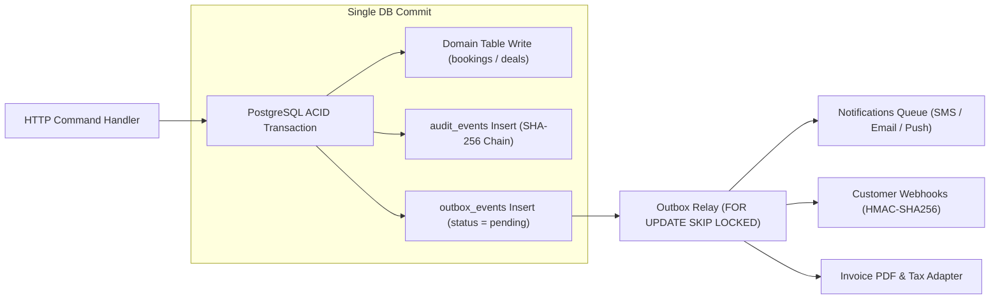
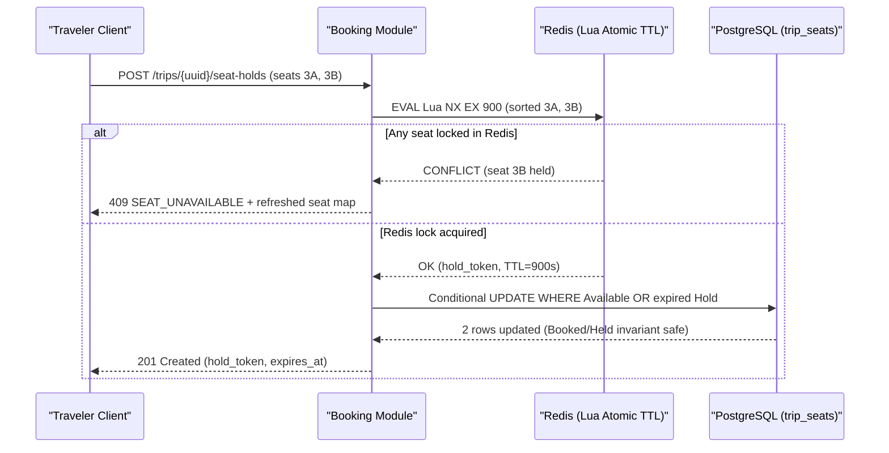
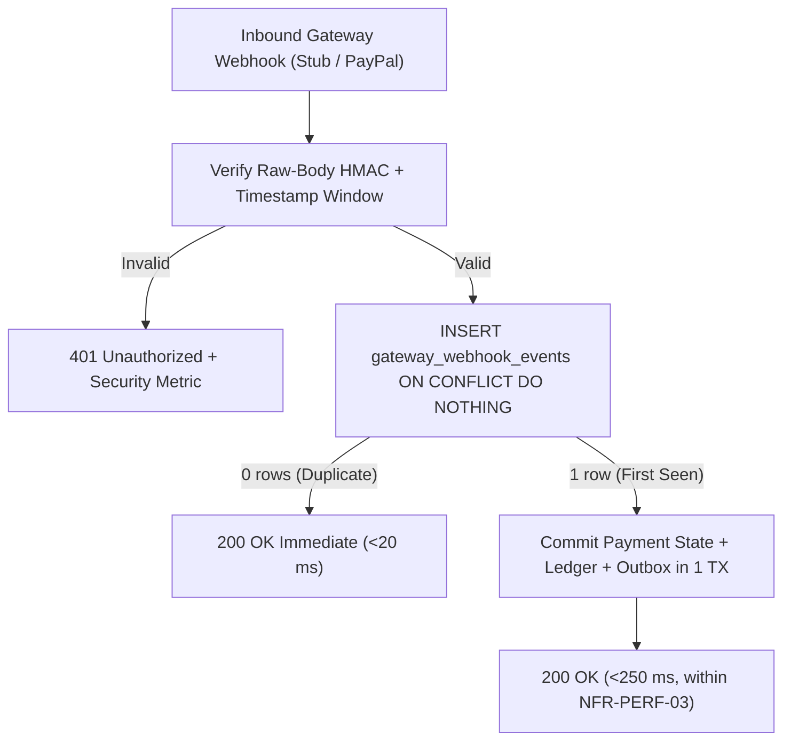
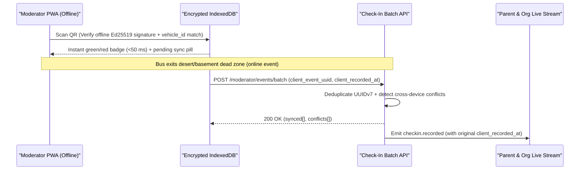

This playbook delivers **twelve implementation-grade engineering and operations blueprints (`REC-ARCH-01` through `REC-OPS-12`)** that translate Trips Enjoy's business rules (`BRL-*`), functional requirements (`FR-*`), non-functional SLOs (`NFR-*`), and entity schema (`ERD`) into resilient production patterns across **Egypt (`EG`)**, **Saudi Arabia (`SA`)**, and the **United Arab Emirates (`AE`)**.

<Callout type="info" title="Advisory Scope & Spec Alignment">
Every card below is tagged `Strategic Advisory` and reinforces—never contradicts—the baseline Modular Monolith architecture (`/en/docs/architecture`), PostgreSQL 16 + TimescaleDB schema (`/en/docs/erd`), and 6-phase delivery ladder (`/en/docs/plan`).
</Callout>

| Blueprint ID | Domain | Core Pattern | Primary Phase |
| :--- | :--- | :--- | :--- |
| [`REC-ARCH-01`](#rec-arch-01) | Architecture | Modular Monolith Package Boundaries & `FOR UPDATE SKIP LOCKED` Transactional Outbox | P1 |
| [`REC-DATA-02`](#rec-data-02) | Multi-Tenant Data | Transaction-Scoped PostgreSQL RLS (`SET LOCAL`) & TimescaleDB Chunk Compression | P1 & P6 |
| [`REC-BOOK-03`](#rec-book-03) | Concurrency | Contention-Free Seat Holds (Redis Lua Atomic TTL + Postgres Conditional Update) | P2 & P3 |
| [`REC-PAY-04`](#rec-pay-04) | Payments | Configurable Gateway Registry Routing (`Stub` + `PayPal`) & Webhook Idempotency | P2 & P5 |
| [`REC-TAX-05`](#rec-tax-05) | Tax & Invoicing | Phased ZATCA Phase 2 (`Fatoora` UBL 2.1 XML / TLV QR) & Egyptian ETA Readiness Adapter | P2 & P5 |
| [`REC-OFF-06`](#rec-off-06) | Offline Operations | Moderator Offline-First Check-In (`IndexedDB` Queue, Monotonic HLC & Conflict Resolution UI) | P3 |
| [`REC-TRK-07`](#rec-trk-07) | Live Telemetry | Battery-Aware Driver GPS Batching, Snap-to-Privacy Guards & Redis Pub/Sub Fan-Out | P6 |
| [`REC-MED-08`](#rec-med-08) | Media Pipeline | Resumable S3 Multipart Upload, Isolated `libvips` Workers, EXIF Purge & Signed CDN Cookies | P4 |
| [`REC-SEC-09`](#rec-sec-09) | Trust & Safety | Child-Data Export Firewall, Dual-Admin Safety Approvals & KMS-Anchored Audit Chain | P1 & P3 |
| [`REC-FIN-10`](#rec-fin-10) | Financial Ledger | Double-Entry Balance Triggers, Gapless Tenant Invoice Sequences & 04:00 Reconciliation | P2 & P5 |
| [`REC-UX-11`](#rec-ux-11) | RTL & Accessibility | Logical-Property RTL Engineering, Western Numerals (`0–9`), Market Timezones & Seat-Map A11y | P1–P6 |
| [`REC-OPS-12`](#rec-ops-12) | Production Readiness | Feature-Flag Rollout Gates, 120-Passenger 3-Bus Load/Chaos Drills & Incident Runbooks | P2–P6 |

---

## 1. Core Architecture, Tenancy & Concurrency

### REC-ARCH-01 — Modular Monolith Package Boundaries and Transactional Outbox

<RecommendationCard
  id="REC-ARCH-01"
  title="Strict Internal Module Contracts & Transactional Outbox Relay (SKIP LOCKED)"
  category="architecture"
  currentStatus="Strategic Advisory"
  targetPhase="P1 Foundation"
  owner="Principal / Backend Architecture"
  impact="Critical"
  recommendedResolution="Enforce compile-time package boundaries across the domain modules inside a single deployable TypeScript/Node (or Go/NestJS) Modular Monolith (`BRD §9.1`), prohibiting cross-module SQL joins or direct table mutations outside the owning module's repository. Commit every state transition + `audit_events` row + `outbox_events` row atomically in the same PostgreSQL ACID transaction, and drain `outbox_events` via a stateless worker loop polling `SELECT ... FOR UPDATE SKIP LOCKED LIMIT 100` into BullMQ/Redis streams for notifications, webhooks, invoices, and analytics."
  trace={{
    brd: [
      { label: 'BRD §9.1 Single Codebase', href: '/en/docs/brd/compliance#91-assumptions' },
    ],
    srs: [
      { label: '[NFR-MNT-01](/en/docs/srs/quality#89-maintainability-nfr-mnt) & [NFR-MNT-03](/en/docs/srs/quality#89-maintainability-nfr-mnt)', href: '/en/docs/srs/quality#89-maintainability-nfr-mnt' },
      { label: '[FR-NTF-06](/en/docs/srs/requirements/ntf#fr-ntf-06--no-duplicate-delivery) No Duplicate Delivery', href: '/en/docs/srs/requirements/ntf#fr-ntf-06--no-duplicate-delivery' },
    ],
    erd: [
      { label: 'Domain Relation Map', href: '/en/docs/erd#domain-relation-map' },
      { label: 'audit_events', href: '/en/docs/erd/domains/platform#audit_events' },
    ],
    plan: [
      { label: 'P1 — Foundation', href: '/en/docs/plan/p1' },
    ],
    workflows: [
      { label: 'Workflow Engine Contract', href: '/en/docs/workflows#the-engine-contract' },
    ],
    userFlows: [
      { label: '[UF-TRV-03](/en/docs/user-flows/traveler#uf-trv-03-book-a-trip) Book a Trip', href: '/en/docs/user-flows/traveler#uf-trv-03-book-a-trip' },
    ],
    architecture: [
      { label: 'Service Model', href: '/en/docs/architecture#service-model' },
    ],
    design: [
      { label: 'Admin Console', href: '/en/docs/design#admin-console' },
    ],
    system: [
      { label: 'Stage 01 — Foundation', href: '/en/docs/system/lifecycle#stage-01' },
      { label: 'Stage 05 — Booking & Outbox', href: '/en/docs/system/lifecycle#stage-05' },
    ],
    recommendations: [
      { label: 'OPEN-08 Audit Chain', href: '/en/docs/recommendations/open-decisions#open-08' },
    ],
  }}
>

- **Boundary Enforcement (`eslint-plugin-boundaries` / Nx tags):** Group code into explicit bounded contexts (`identity`, `onboarding`, `tenancy`, `catalog-trips`, `staffing-deals`, `booking-payments`, `operations-tracking`, `media`, `subscriptions`, `finance-ledger`, `notifications`). Modules communicate synchronously *only* through exported application-service interfaces (passing `UUIDv7` public IDs or internal `BIGINT` IDs) and asynchronously through typed domain events (`booking.confirmed.v1`, `deal.finalized.v1`).
- **Zero Dual-Write Bugs:** Never publish directly to Redis/BullMQ or an external SMS/email provider inside an HTTP handler before the PostgreSQL transaction commits. Writing to `outbox_events` inside the same transaction guarantees zero lost notifications when Redis blips and zero phantom emails when a DB constraint rolls back.
- **Consumer Idempotency:** Every downstream handler records `(consumer_name, event_uuid)` in `processed_events` (or checks a deterministic idempotency key such as `ntf:{event_uuid}:{channel}`) so at-least-once outbox replay never double-charges or double-messages (`FR-NTF-06`).
</RecommendationCard>

### REC-DATA-02 — PostgreSQL RLS Connection-Pool Safety and TimescaleDB Compression

<RecommendationCard
  id="REC-DATA-02"
  title="Transaction-Local RLS Context Reset & TimescaleDB Hypertable Lifecycle"
  category="architecture"
  currentStatus="Strategic Advisory"
  targetPhase="P1 (RLS) & P6 (TimescaleDB)"
  owner="Database & Backend Engineering"
  impact="Critical"
  recommendedResolution="Prevent cross-tenant connection-pool context bleed (`RSK-01`, `DAT-01`, `NFR-SEC-07`) by running PgBouncer in `transaction` pooling mode, connecting the application under a non-superuser role (`trips_app` with `NOBYPASSRLS`), and executing every request inside a wrapper transaction that issues `SELECT set_config('app.current_org_id', $1, true), set_config('app.current_user_id', $2, true), set_config('app.current_role', $3, true)` (`is_local = true` = `SET LOCAL`, auto-cleared on `COMMIT`/`ROLLBACK`). Partition `tracking_points` as a TimescaleDB hypertable (`7-day` chunks, native columnar compression after `7 days` segmented by `trip_vehicle_id`, automatic `drop_chunks` at `90 days` per `SRS §6.4`)."
  trace={{
    brd: [
      { label: 'RSK-01 Cross-Tenant Leaks', href: '/en/docs/brd/compliance#10-risks' },
    ],
    srs: [
      { label: '[DAT-01](/en/docs/srs/data#62-data-isolation) to [DAT-03](/en/docs/srs/data#62-data-isolation)', href: '/en/docs/srs/data#62-data-isolation' },
      { label: '[NFR-SEC-07](/en/docs/srs/quality#82-security-nfr-sec) RLS Isolation', href: '/en/docs/srs/quality#82-security-nfr-sec' },
      { label: 'SRS §6.4 90-Day GPS Retention', href: '/en/docs/srs/data#64-retention' },
    ],
    erd: [
      { label: 'ACL & RLS Policy Catalog', href: '/en/docs/erd/acl#policy-catalog' },
      { label: 'ID Policy (BIGINT + UUIDv7)', href: '/en/docs/erd#id-policy' },
    ],
    plan: [
      { label: 'P1 — Tenant Isolation', href: '/en/docs/plan/p1' },
      { label: 'P6 — Live Tracking', href: '/en/docs/plan/p6' },
    ],
    workflows: [
      { label: 'Continuous Pipelines & Purge', href: '/en/docs/workflows/scheduled-jobs#archive-and-retention-jobs' },
    ],
    userFlows: [
      { label: '[UF-ORG-02](/en/docs/user-flows/organization#uf-org-02-switch-organization) Switch Organization', href: '/en/docs/user-flows/organization#uf-org-02-switch-organization' },
    ],
    architecture: [
      { label: 'Data Architecture', href: '/en/docs/architecture#data-architecture' },
    ],
    design: [
      { label: 'Organization Dashboard', href: '/en/docs/design#organization-dashboard' },
    ],
    system: [
      { label: 'Stage 02 — Tenant Provisioning', href: '/en/docs/system/lifecycle#stage-02' },
      { label: 'Stage 07 — GPS Telemetry', href: '/en/docs/system/lifecycle#stage-07' },
    ],
    recommendations: [
      { label: 'OPEN-11 RLS Negative Suite', href: '/en/docs/recommendations/open-decisions#open-11' },
    ],
  }}
>
- **Why Session-Level `SET` Is Dangerous With Pools:** Using `SET app.current_org_id = '...'` without `LOCAL` persists on the pooled connection if an exception skips cleanup, risking Tenant B inheriting Tenant A's session variable. `set_config(..., true)` scopes settings strictly to the current PostgreSQL transaction, and `NULLIF(current_setting('app.current_org_id', true), '')::bigint` fails closed (`NULL` matches zero rows) if a developer ever forgets the middleware wrapper!
- **Dual-ID Hygiene (`ERD §ID Policy`):** Keep internal foreign keys and B-tree joins on 8-byte `BIGINT` (`organizations.id`, `trips.id`) for cache density, while exposing only monotonic `UUIDv7` (`uuid`) on REST URLs, JWT claims, WebSockets, and filenames so sequential row counts are never enumerable.
- **TimescaleDB Storage Reduction (>90%):** At `500` concurrent active vehicles (`NFR-SCL-01`) emitting 1 point every 3s, raw `tracking_points` generates ~`14.4M` rows/day (~`2.2 GB/day` uncompressed). Compressing chunks older than 7 days (`timescaledb.compress_segmentby = 'trip_vehicle_id'`, `compress_orderby = 'recorded_at DESC'`) shrinks 90-day storage from ~`198 GB` to ~`16 GB` while `drop_chunks(INTERVAL '90 days')` enforces `SRS §6.4` in `O(1)` metadata time without `VACUUM` bloat.
</RecommendationCard>

### REC-BOOK-03 — Contention-Free Seat Holds (Redis Lua + Postgres Defense-in-Depth)

<RecommendationCard
  id="REC-BOOK-03"
  title="Dual-Layer Atomic 15-Minute Seat Hold & Checkout Confirmation Pattern"
  category="architecture"
  currentStatus="Strategic Advisory"
  targetPhase="P2 (Capacity Hold) & P3 (Seat Map)"
  owner="Backend Engineering"
  impact="Critical"
  recommendedResolution="Eliminate double-seat allocation under flash-sale contention (`BRL-09`, `FR-SEAT-04`, `NFR-PERF-02` p95 < 400 ms) using a two-layer lock: (1) **Fast Contention Gate in Redis:** execute an atomic Lua script acquiring `SET seat:hold:{trip_vehicle_id}:{seat_no} {hold_token} NX EX 900` across all requested seats in sorted seat order (all-or-nothing rollback inside Lua if any seat is taken); (2) **Authoritative Source of Truth in PostgreSQL:** immediately run `UPDATE trip_seats SET state = 'Held', held_by_user_id = $1, hold_token = $2, hold_expires_at = now() + interval '15 minutes' WHERE trip_vehicle_id = $3 AND seat_number = ANY($4) AND (state = 'Available' OR (state = 'Held' AND hold_expires_at < now()))` verifying `rowCount == requestedSeats.length`."
  trace={{
    brd: [
      { label: '[BRL-09](/en/docs/brd/requirements#7-business-rules) 15-Minute Seat Hold', href: '/en/docs/brd/requirements#7-business-rules' },
    ],
    srs: [
      { label: '[FR-SEAT-04](/en/docs/srs/requirements/seat#fr-seat-04--seat-hold) & [FR-SEAT-05](/en/docs/srs/requirements/seat#fr-seat-05--seat-states)', href: '/en/docs/srs/requirements/seat#fr-seat-04--seat-hold' },
      { label: 'SRS §7.3 Seat State Machine', href: '/en/docs/srs/state-machines#73-seat' },
      { label: '[NFR-PERF-02](/en/docs/srs/quality#81-performance-nfr-perf) Seat Hold < 400ms', href: '/en/docs/srs/quality#81-performance-nfr-perf' },
    ],
    erd: [
      { label: 'trip_seats & bookings', href: '/en/docs/erd/domains/booking-and-payment#trip_seats' },
    ],
    plan: [
      { label: 'P2 — Booking & Checkout', href: '/en/docs/plan/p2' },
      { label: 'P3 — Interactive Seat Map', href: '/en/docs/plan/p3' },
    ],
    workflows: [
      { label: 'Booking & Payment', href: '/en/docs/workflows/booking-payment' },
    ],
    userFlows: [
      { label: '[UF-TRV-03](/en/docs/user-flows/traveler#uf-trv-03-book-a-trip) Book a Trip', href: '/en/docs/user-flows/traveler#uf-trv-03-book-a-trip' },
    ],
    architecture: [
      { label: 'Data Architecture', href: '/en/docs/architecture#data-architecture' },
    ],
    design: [
      { label: 'Traveler App — Seat Picker', href: '/en/docs/design#traveler-app' },
    ],
    system: [
      { label: 'Stage 05 — Seat Hold & Checkout', href: '/en/docs/system/lifecycle#stage-05' },
    ],
    recommendations: [
      { label: '[OD-09](/en/docs/brd/compliance#11-open-decisions) Seat Self-Selection', href: '/en/docs/recommendations/open-decisions#od-09' },
    ],
  }}
>

- **Sorted Lock Ordering Prevents Deadlocks:** Sorting `(trip_vehicle_id, seat_number)` lexicographically before both the Redis Lua multi-key lock and the PostgreSQL `UPDATE` prevents circular row-lock deadlocks when two travelers simultaneously select overlapping seat pairs (`[3A, 3B]` vs `[3B, 3C]`).
- **Late Gateway Webhook Recovery:** If a 3-D Secure challenge completes at minute `15:08` right after the 15-minute hold expired:
  - If those exact seats are still `Available`, re-claim and confirm the booking seamlessly.
  - If another traveler already grabbed `3B`, transition the payment to `Auto_Refund_Queued` (or assign equivalent `Company-Assigned` seats on non-self-select trips) and trigger an immediate `100%` gateway refund + notification—never double-assigning `trip_seats`.
</RecommendationCard>

---

## 2. Multi-Gateway MENA Payments & E-Invoicing

### REC-PAY-04 — Multi-Gateway MENA Payment Routing and Webhook Idempotency

<RecommendationCard
  id="REC-PAY-04"
  title="PaymentProvider Adapter Routing & Cryptographic Callback Idempotency"
  category="payments-tax"
  currentStatus="Strategic Advisory"
  targetPhase="P2 (Egypt) & P5 (Gulf + Dunning)"
  owner="Payments & Backend Engineering"
  impact="Critical"
  recommendedResolution="Isolate all payment and payout rails behind unified `PaymentGatewayPort` and `PayoutGatewayPort` interfaces (`createIntent`, `tokenizeForRecurring`, `capture`, `refund`, `disbursePayout`, `verifyWebhook`, `fetchSettlementReport`) routed by `(market_code, payment_method, flow_type)` via an Admin-configurable registry (`market_payment_methods`) per `OD-11`: ship **1) Stub Gateway** (deterministic local/CI test simulator) and **2) PayPal Adapter (`Sandbox` & `Live` for Checkout + Payouts)** out of the box, allowing Platform Admins to link any payment or payout gateway to **one or many countries** and switch active providers without redeploying code. Persist raw webhook payloads in `gateway_webhook_events` keyed by `UNIQUE (provider, provider_event_id)` BEFORE executing state changes (`FR-PAY-02`)."
  trace={{
    brd: [
      { label: '[OD-11](/en/docs/brd/compliance#11-open-decisions) Payment Gateways', href: '/en/docs/brd/compliance#11-open-decisions' },
      { label: 'RSK-02 Gateway Outages', href: '/en/docs/brd/compliance#10-risks' },
    ],
    srs: [
      { label: '[FR-PAY-01](/en/docs/srs/requirements/pay#fr-pay-01--payment-outcomes) to [FR-PAY-08](/en/docs/srs/requirements/pay#fr-pay-08--payment-pending)', href: '/en/docs/srs/requirements/pay' },
      { label: '[NFR-PERF-03](/en/docs/srs/quality#81-performance-nfr-perf) Callback < 500ms', href: '/en/docs/srs/quality#81-performance-nfr-perf' },
    ],
    erd: [
      { label: 'bookings & payments', href: '/en/docs/erd/domains/booking-and-payment#bookings' },
    ],
    plan: [
      { label: 'P2 — Egypt Checkout', href: '/en/docs/plan/p2' },
      { label: 'P5 — Gulf Rails & Subscriptions', href: '/en/docs/plan/p5' },
    ],
    workflows: [
      { label: 'Booking & Payment', href: '/en/docs/workflows/booking-payment' },
      { label: 'Money & Settlements', href: '/en/docs/workflows/money' },
    ],
    userFlows: [
      { label: '[UF-TRV-15](/en/docs/user-flows/traveler#uf-trv-15-payment-outcome-and-pending-resolution) Payment Pending', href: '/en/docs/user-flows/traveler#uf-trv-15-payment-outcome-and-pending-resolution' },
      { label: '[UF-ADM-12](/en/docs/user-flows/admin#uf-adm-12-payment-escalations) Payment Escalations', href: '/en/docs/user-flows/admin#uf-adm-12-payment-escalations' },
    ],
    architecture: [
      { label: 'Integrations', href: '/en/docs/architecture#integrations' },
    ],
    design: [
      { label: 'Traveler App — Checkout', href: '/en/docs/design#traveler-app' },
    ],
    system: [
      { label: 'Stage 05 — Payment Execution', href: '/en/docs/system/lifecycle#stage-05' },
    ],
    recommendations: [
      { label: '[OD-11](/en/docs/brd/compliance#11-open-decisions) Gateway Selection', href: '/en/docs/recommendations/open-decisions#od-11' },
    ],
  }}
>

- **Active Poll Recovery for `Payment_Pending` (`FR-PAY-08`, `D-37`):** Never rely solely on inbound webhooks—mobile browsers often close mid-3DS redirect. Run a background poller querying the gateway's transaction status API at `+2 min`, `+10 min`, `+30 min`, `+2h`, `+6h`, and `+24h`. If still unresolved at `24 hours`, open an `admin_payment_escalations` ticket (`UF-ADM-12`) so Finance resolves before departure.
</RecommendationCard>

### REC-TAX-05 — Phased ZATCA Phase 2 (Fatoora) and Egyptian ETA Readiness Adapter

<RecommendationCard
  id="REC-TAX-05"
  title="Pluggable TaxComplianceAdapter for Saudi ZATCA Phase 2 & Egyptian ETA E-Receipts"
  category="payments-tax"
  currentStatus="Strategic Advisory"
  targetPhase="P2 (PDF/QR Foundation) & P5 (ZATCA Phase 2 Live)"
  owner="Finance & Backend Engineering"
  impact="Critical"
  recommendedResolution="Design the `invoices` schema in P2 with nullable fiscal compliance columns (`tax_authority`, `invoice_hash`, `prev_invoice_hash`, `cryptographic_stamp`, `tlv_qr_base64`, `xml_s3_key`, `authority_uuid`, `clearance_status`) and encapsulate country-specific invoice rules behind an Admin-configurable per-country `TaxComplianceAdapter` registry (`markets.invoice_config`, triggered asynchronously from the outbox per `D-179`: 3 retries over 30 min, non-blocking to traveler booking confirmation): each country configures its own statutory invoice rules, numbering prefix, required tax fields, and active compliance adapter (**Egypt (`EG`):** VAT-compliant bilingual PDF in P2 + **Egyptian Tax Authority (`ETA`)** JSON E-Receipt / E-Invoice SDK readiness; **Saudi Arabia (`SA`, P5):** full ZATCA Phase 2 (*Fatoora*) UBL 2.1 XML, ECDSA `secp256k1` CSID signing, 9-tag TLV QR code, async **Reporting API** (`<= 24h`) for B2C simplified invoices (`0200000`), and synchronous **Clearance API** for B2B tax invoices (`0100000`); **UAE (`AE`, P5):** FTA-compliant 5% VAT Tax Invoice with TRN + Peppol PINT-AE readiness)."
  trace={{
    brd: [
      { label: 'BRD §8.4 Tax & Invoicing', href: '/en/docs/brd/compliance#84-tax-and-invoicing' },
      { label: '[OD-10](/en/docs/brd/compliance#11-open-decisions) ZATCA Scope', href: '/en/docs/brd/compliance#11-open-decisions' },
    ],
    srs: [
      { label: '[FR-ACC-08](/en/docs/srs/requirements/acc#fr-acc-08--invoices-across-all-parties) Invoices Across Parties', href: '/en/docs/srs/requirements/acc#fr-acc-08--invoices-across-all-parties' },
      { label: '[FR-ORG-07](/en/docs/srs/requirements/org#fr-org-07--b2b-and-b2c-invoices) B2B & B2C Invoices', href: '/en/docs/srs/requirements/org#fr-org-07--b2b-and-b2c-invoices' },
      { label: '[NFR-COM-08](/en/docs/srs/quality#810-compliance-nfr-com) E-Invoicing Gate', href: '/en/docs/srs/quality#810-compliance-nfr-com' },
    ],
    erd: [
      { label: 'invoices', href: '/en/docs/erd/domains/finance#invoices' },
    ],
    plan: [
      { label: 'P2 — Basic Receipts', href: '/en/docs/plan/p2' },
      { label: 'P5 — Gulf Tax & Full Invoices', href: '/en/docs/plan/p5' },
    ],
    workflows: [
      { label: 'Scheduled Jobs — Retries', href: '/en/docs/workflows/scheduled-jobs#retry-schedules-per-failure-chasing' },
    ],
    userFlows: [
      { label: '[UF-ORG-14](/en/docs/user-flows/organization#uf-org-14-invoices) Invoices', href: '/en/docs/user-flows/organization#uf-org-14-invoices' },
    ],
    architecture: [
      { label: 'Integrations', href: '/en/docs/architecture#integrations' },
    ],
    design: [
      { label: 'RTL & Bilingual PDFs', href: '/en/docs/design#rtl-and-localization' },
    ],
    system: [
      { label: 'Stage 05 — Invoices', href: '/en/docs/system/lifecycle#stage-05' },
      { label: 'Stage 08 — Settlements', href: '/en/docs/system/lifecycle#stage-08' },
    ],
    recommendations: [
      { label: '[OD-10](/en/docs/brd/compliance#11-open-decisions) ZATCA Resolution', href: '/en/docs/recommendations/open-decisions#od-10' },
      { label: '[OD-27](/en/docs/brd/compliance#11-open-decisions) Market VAT Rates', href: '/en/docs/recommendations/open-decisions#od-27' },
    ],
  }}
>
- **Principal vs Agent Invoice Clarity:**
  - **Traveler Booking Invoice (`FR-ORG-07`):** Issued in the **Organization's legal name & Tax ID** (generated by Trips Enjoy on the tenant's behalf with tenant-scoped sequential numbering) because the Organization is the principal supplier of the trip service.
  - **Platform Commission & Subscription Invoices (`FR-ACC-08`):** Issued by **Trips Enjoy's legal entity** to the Organization or Platform Supplier for SaaS subscriptions (`OD-26`) and marketplace commissions (`OD-15`).
  - **Credit & Debit Notes:** Refunds (`FR-PAY-03`) never mutate an issued invoice; they emit a linked Credit Note (`381` in UBL 2.1) referencing the original `invoices.uuid` (`DAT-08`).
</RecommendationCard>

---

## 3. Offline Check-In, Live GPS Tracking & Media Pipeline

### REC-OFF-06 — Moderator Offline-First Check-In Architecture

<RecommendationCard
  id="REC-OFF-06"
  title="Encrypted IndexedDB Manifest Cache, Monotonic Event Queue & Deterministic Conflict UI"
  category="operations"
  currentStatus="Strategic Advisory"
  targetPhase="P3 Operational Depth"
  owner="Frontend PWA & Operations Engineering"
  impact="Critical"
  recommendedResolution="Build the installable Moderator PWA (`FR-MOD-04`, `FR-CHK-05`) around an explicit local-first state engine (`Dexie.js` / `IndexedDB` encrypted with a session-derived WebCrypto `AES-GCM` key wiped on access revocation `FR-MOD-03`): pre-cache the vehicle's passenger manifest, QR HMAC public key, stop list, and seat map on sign-in (`UF-MOD-02`). Queue offline `Check_In`, `Check_Out`, and `Incident` events with `client_event_uuid` (`UUIDv7`), `client_recorded_at`, and monotonic sequence counters, flushing in batches of `50` within `< 60 seconds` of network restoration (`NFR-PERF-06`) via idempotent `POST /api/v1/moderator/events/batch`."
  trace={{
    brd: [
      { label: '[BRL-10](/en/docs/brd/requirements#7-business-rules) & [BRL-11](/en/docs/brd/requirements#7-business-rules) Check-In Rules', href: '/en/docs/brd/requirements#7-business-rules' },
    ],
    srs: [
      { label: '[FR-CHK-01](/en/docs/srs/requirements/chk#fr-chk-01--check-in-at-boarding) to [FR-CHK-07](/en/docs/srs/requirements/chk#fr-chk-07--occupancy)', href: '/en/docs/srs/requirements/chk' },
      { label: '[FR-MOD-01](/en/docs/srs/requirements/mod#fr-mod-01--vehicle-scoped-access) to [FR-MOD-06](/en/docs/srs/requirements/mod#fr-mod-06--report-lock)', href: '/en/docs/srs/requirements/mod' },
      { label: '[NFR-PERF-06](/en/docs/srs/quality#81-performance-nfr-perf) Sync < 60s', href: '/en/docs/srs/quality#81-performance-nfr-perf' },
    ],
    erd: [
      { label: 'checkin_events', href: '/en/docs/erd/domains/operations#checkin_events' },
    ],
    plan: [
      { label: 'P3 — Operational Depth', href: '/en/docs/plan/p3' },
    ],
    workflows: [
      { label: 'Trip Day Operations', href: '/en/docs/workflows/trip-day' },
    ],
    userFlows: [
      { label: '[UF-MOD-04](/en/docs/user-flows/moderator#uf-mod-04-check-in-a-passenger) Check-In', href: '/en/docs/user-flows/moderator#uf-mod-04-check-in-a-passenger' },
      { label: '[UF-MOD-06](/en/docs/user-flows/moderator#uf-mod-06-offline-queue) Offline Queue', href: '/en/docs/user-flows/moderator#uf-mod-06-offline-queue' },
    ],
    architecture: [
      { label: 'Service Model', href: '/en/docs/architecture#service-model' },
    ],
    design: [
      { label: 'Moderator App', href: '/en/docs/design#moderator-app' },
    ],
    system: [
      { label: 'Stage 07 — Offline Check-In', href: '/en/docs/system/lifecycle#stage-07' },
    ],
    recommendations: [
      { label: 'OPEN-14 PWA Browser Floor', href: '/en/docs/recommendations/open-decisions#open-14' },
    ],
  }}
>

- **Offline Cryptographic QR Verification (`FR-CHK-02`):** Encode `(booking_passenger_uuid, trip_uuid, trip_vehicle_id, seat_no, ed25519_sig)` inside each boarding QR code. Even with zero cellular bars at a desert assembly point (`Fayoum`, `AlUla`, `Hatta`), the Moderator PWA cryptographically rejects forged tickets and warns `"Wrong Vehicle — Assigned to Bus #2"` (`BRL-10`) in `< 50 ms`!
- **Conflict Resolution Rules:**
  - Same passenger checked in offline by two moderators on the same bus → keep earliest `client_recorded_at`, mark second event `deduplicated_merge` (no scary error).
  - Passenger cancelled/reassigned on server while moderator was offline → surface a prominent amber `"Sync Review Required (1)"` card in `UF-MOD-06` for explicit moderator confirmation.
</RecommendationCard>

### REC-TRK-07 — Battery-Aware Driver GPS Ingestion, Snap-to-Privacy and Fan-Out

<RecommendationCard
  id="REC-TRK-07"
  title="Adaptive GPS Telemetry Batching, Strict Privacy Gates & Redis Pub/Sub Fan-Out"
  category="architecture"
  currentStatus="Strategic Advisory"
  targetPhase="P6 Family & Scale"
  owner="Mobile & Realtime Engineering"
  impact="High"
  recommendedResolution="Meet the `3–5 second` live map freshness SLO (`NFR-PERF-05`, `500` concurrent vehicles `NFR-SCL-01`) without draining driver phone batteries on 10-hour trips by using adaptive motion sampling (`3s` interval when speed `>= 3 m/s`, `30s` heartbeat when stationary >2 min, local SQLite ring-buffer during signal loss) and hard server-side privacy enforcement (`FR-TRK-02..07`): reject GPS writes unless `trips.status = 'In_Progress'`, strip raw driver phone telemetry metadata before publishing `(lat, lng, bearing, speed_kmh, updated_at)` to Redis Pub/Sub channel `vehicle:pos:{trip_vehicle_id}`, and block adult non-guardian Travelers from subscribing (`FR-TRK-07`)."
  trace={{
    brd: [
      { label: 'BRD §6.9 Tracking & §6.10 Parents', href: '/en/docs/brd/requirements#69-check-in-moderators-and-tracking-chk-mod-trk' },
      { label: '[BRL-06](/en/docs/brd/requirements#7-business-rules) & [BRL-07](/en/docs/brd/requirements#7-business-rules) Child Tracking', href: '/en/docs/brd/requirements#7-business-rules' },
    ],
    srs: [
      { label: '[FR-TRK-01](/en/docs/srs/requirements/trk#fr-trk-01--live-vehicle-location) to [FR-TRK-07](/en/docs/srs/requirements/trk#fr-trk-07--no-live-position-for-travelers)', href: '/en/docs/srs/requirements/trk' },
      { label: '[FR-PAR-02](/en/docs/srs/requirements/par#fr-par-02--parent-view-scope) to [FR-PAR-06](/en/docs/srs/requirements/par#fr-par-06--link-ends-with-the-booking)', href: '/en/docs/srs/requirements/par#fr-par-02--parent-view-scope' },
      { label: '[NFR-PERF-05](/en/docs/srs/quality#81-performance-nfr-perf) Live Update <= 5s', href: '/en/docs/srs/quality#81-performance-nfr-perf' },
    ],
    erd: [
      { label: 'child_links & operations', href: '/en/docs/erd/domains/operations#child_links' },
    ],
    plan: [
      { label: 'P6 — Live Tracking & Parent Tracker', href: '/en/docs/plan/p6' },
    ],
    workflows: [
      { label: 'Trip Day Operations', href: '/en/docs/workflows/trip-day' },
    ],
    userFlows: [
      { label: '[UF-DRV-04](/en/docs/user-flows/driver#uf-drv-04-run-an-assigned-vehicle) Run Vehicle', href: '/en/docs/user-flows/driver#uf-drv-04-run-an-assigned-vehicle' },
      { label: '[UF-PAR-03](/en/docs/user-flows/parent#uf-par-03-live-map) Live Map', href: '/en/docs/user-flows/parent#uf-par-03-live-map' },
    ],
    architecture: [
      { label: 'Data Architecture — TimescaleDB', href: '/en/docs/architecture#data-architecture' },
    ],
    design: [
      { label: 'Parent Tracker', href: '/en/docs/design#parent-tracker' },
    ],
    system: [
      { label: 'Stage 07 — Live GPS & Parent Map', href: '/en/docs/system/lifecycle#stage-07' },
    ],
    recommendations: [
      { label: 'OPEN-07 Driver & Parent Rate Limits', href: '/en/docs/recommendations/open-decisions#open-07' },
    ],
  }}
>
- **Four-Gate Privacy & Entitlement Check on WebSocket/SSE Handshake:**
  1. `trips.status == 'In_Progress'` (`FR-TRK-06` — socket force-closes with event `tracking.ended` the instant the trip completes).
  2. For Parents: `trips.child_tracking_enabled == true` (`FR-TRK-04`), active `child_links` row on that booking (`FR-PAR-06`), AND active `Explorer` or `VIP` subscription (`BRL-07`).
  3. Vehicle Isolation: Parents receive coordinates **only** for the single `trip_vehicle_id` carrying their linked child (`FR-TRK-03`, `FR-PAR-02`)—never other vehicles on the trip and never other passengers' names.
  4. Adult Traveler Exclusion: Standard adult travelers have **zero** live-map endpoint access (`FR-TRK-07`, `D-310`).
- **Write-Behind Batching:** Ingest API writes latest position to Redis (`HSET` + `PUBLISH`) immediately (`< 5 ms` fan-out to SSE/WebSocket gateways) and flushes buffered points to TimescaleDB `tracking_points` every `2 seconds` via bulk `COPY`/`UNNEST` (`~160` DB batch inserts/sec instead of `500` individual TXs/sec).
</RecommendationCard>

### REC-MED-08 — Resumable Multipart Media Pipeline, Worker Isolation and Signed CDN

<RecommendationCard
  id="REC-MED-08"
  title="Direct-to-S3 Multipart Upload, Sandboxed libvips Processing, Mandatory EXIF Stripping & Signed CDN"
  category="architecture"
  currentStatus="Strategic Advisory"
  targetPhase="P4 Marketplace Supply"
  owner="Media & Infrastructure Engineering"
  impact="High"
  recommendedResolution="Offload heavy photo uploads (`FR-MED-02`, up to hundreds of 25 MB JPEGs/HEICs per trip album within the 30-day upload window `FR-MED-01`) completely off API servers via **S3 Multipart Presigned URLs** (`8 MB` parts, resumable via `tus`/Uppy client state). Process uploaded objects asynchronously in an **isolated container worker pool** (`sharp`/`libvips` with memory caps + ClamAV/magic-byte check), **unconditionally stripping all EXIF GPS/camera/serial metadata** (`privacy + child safety`) while generating `thumb` (`400w` WebP/AVIF), `preview` (`1600w` watermarked if enabled on `Studio`/`Pro` `FR-MED-06`), and private `original`, served exclusively via short-lived **CloudFront Signed Cookies / Signed URLs** (`TTL = 15 min`)."
  trace={{
    brd: [
      { label: 'BRD §6.11 Media & Photographers', href: '/en/docs/brd/requirements#611-media-and-photographers-med-pho' },
      { label: '[BRL-08](/en/docs/brd/requirements#7-business-rules) Album Privacy Modes', href: '/en/docs/brd/requirements#7-business-rules' },
    ],
    srs: [
      { label: '[FR-MED-01](/en/docs/srs/requirements/med#fr-med-01--album-creation-window) to [FR-MED-09](/en/docs/srs/requirements/med#fr-med-09--file-lifecycle-and-orphan-cleanup)', href: '/en/docs/srs/requirements/med' },
      { label: '[NFR-SEC-09](/en/docs/srs/quality#82-security-nfr-sec) Private Media URLs', href: '/en/docs/srs/quality#82-security-nfr-sec' },
    ],
    erd: [
      { label: 'media domain', href: '/en/docs/erd/domains/media' },
    ],
    plan: [
      { label: 'P4 — Media & Photographer Studio', href: '/en/docs/plan/p4' },
    ],
    workflows: [
      { label: 'Media Albums', href: '/en/docs/workflows/media' },
    ],
    userFlows: [
      { label: '[UF-PHO-05](/en/docs/user-flows/photographer#uf-pho-05-create-and-upload-an-album) Upload Album', href: '/en/docs/user-flows/photographer#uf-pho-05-create-and-upload-an-album' },
      { label: '[UF-TRV-09](/en/docs/user-flows/traveler#uf-trv-09-albums) View Albums', href: '/en/docs/user-flows/traveler#uf-trv-09-albums' },
    ],
    architecture: [
      { label: 'Data Architecture — Object Storage', href: '/en/docs/architecture#data-architecture' },
    ],
    design: [
      { label: 'Photographer App', href: '/en/docs/design#photographer-app' },
    ],
    system: [
      { label: 'Stage 08 — Post-Trip Albums', href: '/en/docs/system/lifecycle#stage-08' },
    ],
    recommendations: [
      { label: 'OPEN-07 Upload Rate Limits', href: '/en/docs/recommendations/open-decisions#open-07' },
    ],
  }}
>
- **Why Worker Isolation Is Non-Negotiable:** Decoding malformed or 100-megapixel images inside the main API process can spike RSS memory by >1 GB and starve booking/check-in latency (`NFR-PERF-01`). Running `sharp`/`libvips` (`limitInputPixels: 100_000_000`, `concurrency: 2`) in dedicated media worker pods isolates CPU and memory completely.
- **Instant Access Revocation (`FR-MED-04`, `FR-MED-09`):** Never make S3 buckets public. When an organizer revokes a `Link-shared` album token or switches privacy mode (`Public-within-trip` / `Link-shared` / `Selected-users`), the API stops minting 15-minute signed cookies for that token immediately, and S3 Lifecycle rules abort incomplete multipart uploads after `48 hours` (`FR-MED-09`).
</RecommendationCard>

---

## 4. Security, Ledger Integrity, RTL UX & Operational Readiness

### REC-SEC-09 — Child-Safety Guardrails, Dual-Admin Approvals and Audit Chain

<RecommendationCard
  id="REC-SEC-09"
  title="Defense-in-Depth Child Data Firewall, Four-Eyes Safety Controls & Tamper-Evident Audit"
  category="security"
  currentStatus="Strategic Advisory"
  targetPhase="P1 (Audit/RBAC) & P3 (Child Safety)"
  owner="Security & Trust Engineering"
  impact="Critical"
  recommendedResolution="Enforce child-data isolation (`FR-PAR-05`, `NFR-COM-04`) structurally at the schema and serializer layers—not by developer convention: store minor passenger details in a dedicated table (`minor_passengers` / `child_links`) invisible to analytics views (`FR-ANL-05`), CRM sync serializers (`FR-ORG-06`), and marketing audience builders. Pair this with an Admin-configurable Child-Safety Escalation Engine (`OPEN-03`, `D-68`: configurable escalation contacts, on-call rotations, alert channels, and SLA timers seeded at `<= 15m` active trip / `<= 2h` non-active trip) and database-backed dual-admin ('four-eyes') state transitions for reinstating safety-suspended accounts (`D-233`, `FR-AUTH-08`) and out-of-policy refunds above threshold (`D-227`, `FR-PAY-04`), recording every privileged action into the `SHA-256` + KMS-anchored `audit_events` log (`OPEN-08`)."
  trace={{
    brd: [
      { label: 'BRD §8.1 Child Safety', href: '/en/docs/brd/compliance#81-child-safety' },
      { label: 'BRD §8.5 Audit & Retention', href: '/en/docs/brd/compliance#85-audit-and-retention' },
    ],
    srs: [
      { label: '[FR-PAR-05](/en/docs/srs/requirements/par#fr-par-05--child-data-restrictions) & [FR-PAR-07](/en/docs/srs/requirements/par#fr-par-07--child-safety-reporting)', href: '/en/docs/srs/requirements/par#fr-par-05--child-data-restrictions' },
      { label: '[NFR-COM-04](/en/docs/srs/quality#810-compliance-nfr-com) Child Data Firewall', href: '/en/docs/srs/quality#810-compliance-nfr-com' },
      { label: '[NFR-SEC-16](/en/docs/srs/quality#82-security-nfr-sec) Audit Tamper-Evidence', href: '/en/docs/srs/quality#82-security-nfr-sec' },
    ],
    erd: [
      { label: 'child_links', href: '/en/docs/erd/domains/operations#child_links' },
      { label: 'audit_events', href: '/en/docs/erd/domains/platform#audit_events' },
    ],
    plan: [
      { label: 'P1 — RBAC & Audit', href: '/en/docs/plan/p1' },
      { label: 'P3 — Child Safety', href: '/en/docs/plan/p3' },
    ],
    workflows: [
      { label: 'Trip Day Operations', href: '/en/docs/workflows/trip-day' },
    ],
    userFlows: [
      { label: '[UF-ADM-04](/en/docs/user-flows/admin#uf-adm-04-manage-an-account) Manage Account (4-Eyes)', href: '/en/docs/user-flows/admin#uf-adm-04-manage-an-account' },
      { label: '[UF-PAR-05](/en/docs/user-flows/parent#uf-par-05-report-a-child-safety-concern) Report Safety Concern', href: '/en/docs/user-flows/parent#uf-par-05-report-a-child-safety-concern' },
    ],
    architecture: [
      { label: 'Quality Attributes — Security', href: '/en/docs/architecture#quality-attributes' },
    ],
    design: [
      { label: 'Admin Console', href: '/en/docs/design#admin-console' },
    ],
    system: [
      { label: 'Stage 07 — Child Safety', href: '/en/docs/system/lifecycle#stage-07' },
    ],
    recommendations: [
      { label: 'OPEN-03 15-Min Safety Triage', href: '/en/docs/recommendations/open-decisions#open-03' },
      { label: 'OPEN-08 KMS Audit Chain', href: '/en/docs/recommendations/open-decisions#open-08' },
    ],
  }}
>
- **CI Static & Runtime Canary Check:** Add an automated CI test that seeds a booking with 2 linked children, triggers every analytics export (`FR-ACC-06`), webhook event (`FR-ORG-06`), and Public API endpoint (`FR-API-03`), and asserts that the children's names/IDs appear **nowhere** outside the authorized Moderator Manifest and Parent Tracker views.
- **Database Constraint on Four-Eyes Approval:** Enforce `CHECK (requested_by_admin_id <> approved_by_admin_id)` on `admin_dual_approvals` so even a bug in the Admin UI cannot allow the same admin to self-approve a safety reinstatement or high-value out-of-policy refund.
</RecommendationCard>

### REC-FIN-10 — Double-Entry Ledger Invariants, Gapless Invoices and Daily Reconciliation

<RecommendationCard
  id="REC-FIN-10"
  title="Minor-Unit Double-Entry Constraint Triggers, Gapless Tenant Sequences & 04:00 Reconciliation"
  category="payments-tax"
  currentStatus="Strategic Advisory"
  targetPhase="P2 (Core Ledger) & P5 (Full Settlements)"
  owner="Finance Engineering"
  impact="Critical"
  recommendedResolution="Store all monetary values strictly as integer minor units (`amount_minor BIGINT` + `currency CHAR(3)`, zero `FLOAT`/`REAL`, half-up rounding `D-157`) inside an append-only double-entry ledger (`ledger_journals` + `ledger_postings`, `FR-ACC-01`) protected by a `DEFERRABLE INITIALLY DEFERRED` PostgreSQL constraint trigger asserting `SUM(debit_minor) = SUM(credit_minor)` and homogeneous `currency` per journal before `COMMIT`. Allocate gapless per-issuer fiscal invoice numbers (`INV-EG-2026-000001`) via a dedicated `invoice_sequences (issuer_type, issuer_id, fiscal_year, last_val)` row locked only at final issuance, and run the automated `04:00` market-local gateway reconciliation job (`FR-PAY-05`, `FR-ACC-09`) comparing gateway settlement CSV/APIs against `ledger_postings`."
  trace={{
    brd: [
      { label: 'BRD §6.14 Accounting & Settlements', href: '/en/docs/brd/requirements#614-accounting-invoices-and-settlements-acc' },
      { label: '[BRL-25](/en/docs/brd/requirements#7-business-rules) Weekly Monday Payouts', href: '/en/docs/brd/requirements#7-business-rules' },
    ],
    srs: [
      { label: '[FR-ACC-01](/en/docs/srs/requirements/acc#fr-acc-01--double-entry-ledger) to [FR-ACC-10](/en/docs/srs/requirements/acc#fr-acc-10--archive-after-settlement)', href: '/en/docs/srs/requirements/acc' },
      { label: '[FR-PAY-05](/en/docs/srs/requirements/pay#fr-pay-05--gateway-reconciliation) Gateway Reconciliation', href: '/en/docs/srs/requirements/pay#fr-pay-05--gateway-reconciliation' },
      { label: '[FR-MKT-05](/en/docs/srs/requirements/mkt#fr-mkt-05--rounding-and-display) Minor Units & Rounding', href: '/en/docs/srs/requirements/mkt#fr-mkt-05--rounding-and-display' },
    ],
    erd: [
      { label: 'invoices & finance domain', href: '/en/docs/erd/domains/finance#invoices' },
    ],
    plan: [
      { label: 'P2 — Core Ledger', href: '/en/docs/plan/p2' },
      { label: 'P5 — Full Accounting & Exports', href: '/en/docs/plan/p5' },
    ],
    workflows: [
      { label: 'Money & Settlements', href: '/en/docs/workflows/money' },
      { label: 'Scheduled Jobs — Daily & Weekly', href: '/en/docs/workflows/scheduled-jobs#daily' },
    ],
    userFlows: [
      { label: '[UF-ORG-15](/en/docs/user-flows/organization#uf-org-15-accounting-and-settlements) Accounting & Settlements', href: '/en/docs/user-flows/organization#uf-org-15-accounting-and-settlements' },
      { label: '[UF-ADM-11](/en/docs/user-flows/admin#uf-adm-11-finance-operations) Finance Operations', href: '/en/docs/user-flows/admin#uf-adm-11-finance-operations' },
    ],
    architecture: [
      { label: 'Data Architecture', href: '/en/docs/architecture#data-architecture' },
    ],
    design: [
      { label: 'Admin Console — Finance', href: '/en/docs/design#admin-console' },
    ],
    system: [
      { label: 'Stage 08 — Ledger & Monday Payouts', href: '/en/docs/system/lifecycle#stage-08' },
    ],
    recommendations: [
      { label: '[OD-14](/en/docs/brd/compliance#11-open-decisions) Payout Floors', href: '/en/docs/recommendations/open-decisions#od-14' },
      { label: '[OD-15](/en/docs/brd/compliance#11-open-decisions) Commissions', href: '/en/docs/recommendations/open-decisions#od-15' },
    ],
  }}
>
- **Standard Chart of Sub-Ledger Accounts (Per Currency):**
  - `1100 Gateway Clearing Receivable` (debited on capture, credited on gateway bank settlement).
  - `2100 Traveler Escrow / Unearned Trip Liability` (credited on booking payment, released to `2200 Organization Payable` + `4100 Platform Booking Commission` + `2300 Output VAT Payable` upon trip `Completed` + 24h dispute-clear window).
  - `2210 Supplier Deal Escrow Payable` (held for Platform Driver / Photographer deals, released on Monday `06:00` weekly payout batch `BRL-25` when `>= OD-14` floor).
- **Zero-Drift Export Guarantee (`FR-ACC-07`):** Generate all CSV/XLSX exports directly from materialized ledger views (`ledger_postings`), never by re-summing mutable `bookings` rows, guaranteeing `0.00` discrepancy between dashboard KPIs, tax invoices, and accountant exports.
</RecommendationCard>

### REC-UX-11 — Arabic-First RTL Engineering, Numerals, Timezones and Seat-Map A11y

<RecommendationCard
  id="REC-UX-11"
  title="Logical-Property RTL CSS, Western Numerals (0–9), Explicit Market Timezones & Accessible Seat Selection"
  category="ux-rtl"
  currentStatus="Strategic Advisory"
  targetPhase="P1–P6 Cross-Cutting"
  owner="Design Systems & Frontend Engineering"
  impact="High"
  recommendedResolution="Enforce four cross-surface UI invariants from day 1 of P1 (`NFR-I18N-01..04`, `NFR-A11Y-01..04`): (1) **100% CSS Logical Properties** (`ms-*`, `me-*`, `ps-*`, `pe-*`, `start-*`, `end-*`, `text-start`, banning physical `ml-*`/`mr-*`/`left-*`/`right-*` via Stylelint/ESLint) + directional icon mirroring (`rtl:-scale-x-100` on arrows/chevrons/progress steppers, never on clocks, checkmarks, or logos); (2) **Mandatory Western Arabic Digits (`0–9`, `D-159`)** via `Intl.NumberFormat('ar-EG-u-nu-latn')` and `IBM Plex Sans Arabic` + `Inter` `tabular-nums` (`OPEN-15`); (3) **Explicit Market Timezone Rendering** (`Africa/Cairo`, `Asia/Riyadh`, `Asia/Dubai`)—always format trip departure/arrival in the **trip's origin timezone** (never silently shifting a Cairo `07:00` bus to `08:00` when viewed by a traveler in Dubai, `FR-MKT-03`); (4) **Synchronized Accessible Seat-Map List View (`NFR-A11Y-03`)** pairing the visual SVG bus grid with a keyboard/screen-reader-navigable grouped seat list (`Window` / `Aisle`, row number, status)."
  trace={{
    brd: [
      { label: 'BRD §5.3 Languages & Western Digits', href: '/en/docs/brd#53-markets' },
    ],
    srs: [
      { label: 'NFR-I18N-01 to NFR-I18N-04', href: '/en/docs/srs/quality#87-internationalization-nfr-i18n' },
      { label: 'NFR-A11Y-01 to NFR-A11Y-04', href: '/en/docs/srs/quality#88-accessibility-nfr-a11y' },
      { label: '[FR-MKT-03](/en/docs/srs/requirements/mkt#fr-mkt-03--cross-market-browsing) Cross-Market Browsing', href: '/en/docs/srs/requirements/mkt#fr-mkt-03--cross-market-browsing' },
    ],
    erd: [
      { label: 'markets', href: '/en/docs/erd/domains/lookups-and-markets#markets' },
    ],
    plan: [
      { label: 'P1 — UI Shell & RTL', href: '/en/docs/plan/p1' },
      { label: 'P3 — Seat Map A11y', href: '/en/docs/plan/p3' },
    ],
    workflows: [
      { label: 'Booking & Payment', href: '/en/docs/workflows/booking-payment' },
    ],
    userFlows: [
      { label: '[UF-SHR-13](/en/docs/user-flows/shared#uf-shr-13-language-and-layout) Language & Layout', href: '/en/docs/user-flows/shared#uf-shr-13-language-and-layout' },
      { label: '[UF-TRV-03](/en/docs/user-flows/traveler#uf-trv-03-book-a-trip) Book a Trip', href: '/en/docs/user-flows/traveler#uf-trv-03-book-a-trip' },
    ],
    architecture: [
      { label: 'Quality Attributes', href: '/en/docs/architecture#quality-attributes' },
    ],
    design: [
      { label: 'RTL & Localization', href: '/en/docs/design#rtl-and-localization' },
      { label: 'Accessibility', href: '/en/docs/design#accessibility' },
    ],
    system: [
      { label: 'Stage 05 — Seat Selection & Checkout', href: '/en/docs/system/lifecycle#stage-05' },
    ],
    recommendations: [
      { label: 'OPEN-15 Arabic Typography', href: '/en/docs/recommendations/open-decisions#open-15' },
    ],
  }}
>
- **Physical Bus Geometry vs UI Direction:** When flipping `EN → AR`, text and layout mirror RTL, **except physical vehicle top-down seat layouts** where `Driver Left (LHD)` is physical reality in Egypt, Saudi Arabia, and UAE! Label `"Front of Vehicle / مقدمة الحافلة"` and `"Door Side (Right) / جهة الباب"` explicitly rather than mirroring left/right bus columns into a non-existent right-hand-drive bus.
- **Outdoor Glare Contrast for Moderator & Driver Apps:** Enforce WCAG AA+ high-contrast tokens (`>= 7:1` on primary passenger status badges + shape/icon redundancy alongside green/amber/red) so boarding moderators standing in midday Cairo or Riyadh sun can read check-in states effortlessly.
</RecommendationCard>

### REC-OPS-12 — Progressive Phase Rollout Gates, Chaos Drills and Runbooks

<RecommendationCard
  id="REC-OPS-12"
  title="Feature-Flagged Phase Launches, 120-Passenger 3-Bus Simulation & Chaos GameDays"
  category="operations"
  currentStatus="Strategic Advisory"
  targetPhase="P2–P6 Release Gates"
  owner="SRE, QA & Operations"
  impact="High"
  recommendedResolution="Gate every phase promotion (`P2` through `P6`) behind runtime feature flags (`markets.is_enabled`, gateway circuit breakers, `child_tracking_enabled`) AND mandatory pre-launch simulation drills: (1) **P2 Financial Drill:** 500 concurrent seat-hold + gateway callback storm (including duplicate, out-of-order, and 16-minute late webhooks) asserting `0` double-booked seats and `0` unbalanced ledger journals; (2) **P3 Field Drill:** physical/emulated **120-passenger, 3-vehicle** trip simulation toggling airplane mode for 20 minutes mid-boarding and asserting `< 60s` batch reconciliation (`NFR-PERF-06`); (3) **P6 Scale Drill:** `500` simulated buses emitting 3s GPS telemetry (`~167 msg/s`) + `2,000` subscribed Parent Tracker clients asserting `<= 5s` p95 delivery (`NFR-PERF-05`); (4) **Quarterly Backup Restore Drill (`NFR-BKP-02`):** automated PITR restore verification meeting `RPO <= 5 min` and `RTO <= 1 hour`."
  trace={{
    brd: [
      { label: 'BRD §3.3 Delivery Phases', href: '/en/docs/brd#33-delivery-phases' },
      { label: 'BRD §10 Risks', href: '/en/docs/brd/compliance#10-risks' },
    ],
    srs: [
      { label: '[NFR-AVL-01](/en/docs/srs/quality#83-availability-nfr-avl) & [NFR-SCL-01](/en/docs/srs/quality#84-scalability-nfr-scl)', href: '/en/docs/srs/quality#83-availability-nfr-avl' },
      { label: '[NFR-BKP-01](/en/docs/srs/quality#811-backup-and-recovery-nfr-bkp) to [NFR-BKP-03](/en/docs/srs/quality#811-backup-and-recovery-nfr-bkp)', href: '/en/docs/srs/quality#811-backup-and-recovery-nfr-bkp' },
      { label: '[FR-MKT-04](/en/docs/srs/requirements/mkt#fr-mkt-04--market-switch) Market Switch', href: '/en/docs/srs/requirements/mkt#fr-mkt-04--market-switch' },
    ],
    erd: [
      { label: 'markets', href: '/en/docs/erd/domains/lookups-and-markets#markets' },
    ],
    plan: [
      { label: 'Phase Milestones', href: '/en/docs/plan/milestones' },
      { label: 'Testing Strategy', href: '/en/docs/plan/testing' },
    ],
    workflows: [
      { label: 'Scheduled Jobs & Pipelines', href: '/en/docs/workflows/scheduled-jobs' },
    ],
    userFlows: [
      { label: '[UF-ADM-13](/en/docs/user-flows/admin#uf-adm-13-configuration) Market & System Config', href: '/en/docs/user-flows/admin#uf-adm-13-configuration' },
    ],
    architecture: [
      { label: 'Deployment Topology', href: '/en/docs/architecture#deployment-topology' },
    ],
    design: [
      { label: 'Empty, Loading & Error States', href: '/en/docs/design#empty-loading-and-error-states' },
    ],
    system: [
      { label: 'End-to-End Lifecycle', href: '/en/docs/system/lifecycle' },
    ],
    recommendations: [
      { label: 'OPEN-10 Log Retention', href: '/en/docs/recommendations/open-decisions#open-10' },
      { label: 'OPEN-11 CI Coverage Gates', href: '/en/docs/recommendations/open-decisions#open-11' },
    ],
  }}
>
- **Five Mandatory On-Call Runbooks Before P2/P3:**
  1. **Payment Gateway Degradation (`RSK-02`):** One-click switch in `UF-ADM-13` hiding a degraded rail (e.g., a failing gateway) while keeping alternative rails (`PayPal` / secondary gateway) live and extending active seat holds by `+10 minutes`.
  2. **Child-Safety Incident Escalation (`OPEN-03`):** 15-minute PagerDuty triage checklist, direct bus moderator/driver bridge, and evidence snapshot.
  3. **Reconciliation Mismatch (`04:00` Alert):** Triage workflow for `gateway_settlement != ledger_postings` prior to the Monday `06:00` supplier payout release.
  4. **ZATCA / Tax Endpoint Outage (`D-179`):** Queue drain monitoring and manual batch replay once authority API recovers.
  5. **Database Failover & RLS Verification:** Post-failover smoke probe asserting `NOBYPASSRLS` enforcement before opening ingress traffic.
</RecommendationCard>
