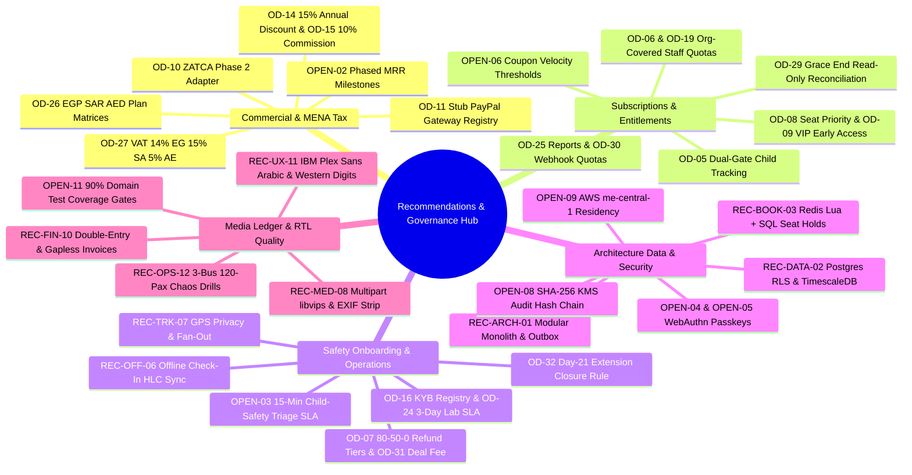

The **Recommendations & Open-Decision Resolutions Hub** bridges product governance, MENA regulatory compliance, and engineering execution across the **Trips Enjoy** platform. Every open or proposed product decision in [BRD §11](/en/docs/brd/compliance#11-open-decisions), every inline `[OPEN]` marker across the [BRD](/en/docs/brd), [SRS](/en/docs/srs), [ERD](/en/docs/erd), and [Design System](/en/docs/design), and every high-risk architectural boundary has a concrete, benchmarked resolution or implementation blueprint here.

<Callout type="info" title="Runtime-Configurable Governance & Locked Decisions">
All **32** product decisions (`OD-01`..`OD-32`) in [BRD §11](/en/docs/brd/compliance#11-open-decisions) and **13 of 15** inline `[OPEN]` specification markers are now formally **`Decided`** (`45 Decided`, `2 Deferred`: [OPEN-09](/en/docs/recommendations/open-decisions#open-09) cloud hosting region and [OPEN-11](/en/docs/recommendations/open-decisions#open-11) CI coverage enforcement). Crucially, commercial, tax, payment, payout, entitlement, and safety parameters are designed as **Admin-configurable runtime settings per country (`markets`) and per plan (`plans`, `plan_limits`, `plan_prices`)** so operations and finance teams can adjust rates, gateways, and limits without redeploying code.
</Callout>

## Governance Posture & How to Use This Hub

1. **47 Decision & Marker Cards (`OD-01`..`OD-32` + `OPEN-01`..`OPEN-15`):** [Open-Decision Resolutions](/en/docs/recommendations/open-decisions) documents the locked, runtime-configurable resolutions for all **32** `OD-*` decisions and **15** inline `OPEN-*` markers (`45 Decided` + `2 Deferred`) with MENA-benchmarked defaults (`EGP`, `SAR`, `AED`), explicit trade-offs, and validation gates.
2. **12 Deep Engineering & Operational Blueprints (`REC-ARCH-01`..`REC-OPS-12`):** [Architecture & Operations Blueprints](/en/docs/recommendations/architecture-and-ops) specifies production patterns for transactional outbox relays, PostgreSQL RLS pool safety, Redis + Postgres seat holds, multi-gateway MENA payments, ZATCA Phase 2 & Egyptian ETA adapters, offline moderator queues, GPS snap-to-privacy fan-out, resumable `libvips` media workers, child-safety guardrails, double-entry ledger invariants, RTL/Western-digit UX, and 3-bus 120-passenger chaos drills.
3. **Full Cross-Pillar Traceability:** Every card carries a `<TraceBar />` linking directly to upstream `BR-*`/`BRL-*` rules, `FR-*`/`NFR-*`/`DAT-*` requirements, exact PostgreSQL tables, phased delivery plans (`P1`–`P6`), system workflows, role user flows, architecture topology, UI surfaces, and the [8-Stage End-to-End Lifecycle](/en/docs/system/lifecycle).

## Visual Overview of Recommendation Tracks

<MindmapBlock
  title="Recommendations & Open-Decision Governance Framework"
  caption="How the 32 OD-* decisions, 15 inline OPEN-* markers, and 12 REC-* engineering blueprints govern phases P1 through P6."
  trace={{
    brd: [
      { label: 'BRD §11 Open Decisions', href: '/en/docs/brd/compliance#11-open-decisions' },
      { label: 'BRD §5 Commercial Model', href: '/en/docs/brd#5-commercial-model' },
    ],
    srs: [
      { label: 'SRS §11 Open Items & Conflicts', href: '/en/docs/srs/traceability#11-open-items-and-conflicts' },
      { label: 'SRS §8 Quality (NFR)', href: '/en/docs/srs/quality#8-non-functional-requirements' },
    ],
    erd: [
      { label: 'ERD Data Domains', href: '/en/docs/erd#domains' },
      { label: 'ACL & RLS', href: '/en/docs/erd/acl' },
    ],
    plan: [
      { label: 'Phase Milestones', href: '/en/docs/plan/milestones' },
      { label: 'Build Guide', href: '/en/docs/plan/build-guide' },
    ],
    workflows: [
      { label: 'Workflow Engine Contract', href: '/en/docs/workflows#the-engine-contract' },
      { label: 'Scheduled Jobs', href: '/en/docs/workflows/scheduled-jobs' },
    ],
    userFlows: [
      { label: 'Role User Flows', href: '/en/docs/user-flows' },
    ],
    architecture: [
      { label: 'System Architecture', href: '/en/docs/architecture' },
    ],
    design: [
      { label: 'Design System & RTL', href: '/en/docs/design#rtl-and-localization' },
    ],
    system: [
      { label: 'End-to-End Lifecycle', href: '/en/docs/system/lifecycle' },
    ],
    recommendations: [
      { label: '[OD-01](/en/docs/brd/compliance#11-open-decisions)..[OD-32](/en/docs/brd/compliance#11-open-decisions) & OPEN-01..15', href: '/en/docs/recommendations/open-decisions' },
      { label: 'REC-ARCH-01..REC-OPS-12', href: '/en/docs/recommendations/architecture-and-ops' },
    ],
  }}
>

</MindmapBlock>

## Phase-by-Phase Decision Gate Matrix

Every delivery phase in the [Delivery Plan](/en/docs/plan/milestones) requires its upstream decisions and architectural guardrails to be locked **before** sprint execution begins:

| Gate | Blocking `OD-*` Decisions | Blocking `OPEN-*` Markers | Companion `REC-*` Blueprints | Sign-Off Owners | Phase Exit Verification |
|---|---|---|---|---|---|
| **Before [P1](/en/docs/plan/p1)** (Foundation) | [OD-02](/en/docs/recommendations/open-decisions#od-02--preserving-unpublished-drafts-when-sessions-end), [OD-03](/en/docs/recommendations/open-decisions#od-03--mandatory-second-factor-for-organization-staff), [OD-12](/en/docs/recommendations/open-decisions#od-12--platform-admin-account-provisioning-and-mfa), [OD-21](/en/docs/recommendations/open-decisions#od-21--default-plan-tier-on-approval), [OD-23](/en/docs/recommendations/open-decisions#od-23--role-based-contact-verification-matrix), [OD-32](/en/docs/recommendations/open-decisions#od-32--changes-requested-application-closure-day-with-extension) | [OPEN-01](/en/docs/recommendations/open-decisions#open-01), [OPEN-08](/en/docs/recommendations/open-decisions#open-08), [OPEN-09](/en/docs/recommendations/open-decisions#open-09), [OPEN-10](/en/docs/recommendations/open-decisions#open-10), [OPEN-11](/en/docs/recommendations/open-decisions#open-11), [OPEN-12](/en/docs/recommendations/open-decisions#open-12), [OPEN-13](/en/docs/recommendations/open-decisions#open-13), [OPEN-14](/en/docs/recommendations/open-decisions#open-14), [OPEN-15](/en/docs/recommendations/open-decisions#open-15) | [REC-ARCH-01](/en/docs/recommendations/architecture-and-ops#rec-arch-01), [REC-DATA-02](/en/docs/recommendations/architecture-and-ops#rec-data-02), [REC-SEC-09](/en/docs/recommendations/architecture-and-ops#rec-sec-09), [REC-UX-11](/en/docs/recommendations/architecture-and-ops#rec-ux-11) | Product, Legal, Security, Engineering, Design | Cross-tenant RLS suite green; `audit_events` hash-chain verified; day-14 / day-21 onboarding timers passing. |
| **Before [P2](/en/docs/plan/p2)** (Egypt Pilot) | [OD-01](/en/docs/recommendations/open-decisions#od-01--launch-market-order), [OD-04](/en/docs/recommendations/open-decisions#od-04--seven-year-financial-and-tax-record-retention), [OD-07](/en/docs/recommendations/open-decisions#od-07--cancellation-refund-schedule-and-non-refundable-fees), [OD-11](/en/docs/recommendations/open-decisions#od-11--payment--payout-gateways-per-country), [OD-15](/en/docs/recommendations/open-decisions#od-15--booking-and-deal-commission-rates), [OD-20](/en/docs/recommendations/open-decisions#od-20--out-of-scope-coupon-rejection-message), [OD-27](/en/docs/recommendations/open-decisions#od-27--vat-rates-and-tax-display-rules-per-market) (Egypt 14% VAT) | [OPEN-04](/en/docs/recommendations/open-decisions#open-04), [OPEN-05](/en/docs/recommendations/open-decisions#open-05) | [REC-BOOK-03](/en/docs/recommendations/architecture-and-ops#rec-book-03), [REC-PAY-04](/en/docs/recommendations/architecture-and-ops#rec-pay-04), [REC-FIN-10](/en/docs/recommendations/architecture-and-ops#rec-fin-10) | Finance, Legal, Operations, Payments Eng | Stub + PayPal EGP callbacks idempotent; ledger balances to zero; 15-min seat hold contention test clean. |
| **Before [P3](/en/docs/plan/p3)** (Operational Depth) | [OD-06](/en/docs/recommendations/open-decisions#od-06--plan-coverage-for-vehicle-moderators), [OD-08](/en/docs/recommendations/open-decisions#od-08--priority-seat-selection-window-length), [OD-19](/en/docs/recommendations/open-decisions#od-19--organization-owned-driver-and-photographer-allowances), [OD-22](/en/docs/recommendations/open-decisions#od-22--prohibition-on-cancelling-in-progress-trips), [OD-25](/en/docs/recommendations/open-decisions#od-25--plan-gate-on-program-enrollment-reports) | [OPEN-03](/en/docs/recommendations/open-decisions#open-03) (Child-safety on-call & SLA), [OPEN-07](/en/docs/recommendations/open-decisions#open-07) | [REC-OFF-06](/en/docs/recommendations/architecture-and-ops#rec-off-06), [REC-OPS-12](/en/docs/recommendations/architecture-and-ops#rec-ops-12) | Operations, Safety Lead, Product, Mobile/PWA Eng | Named child-safety officer & PagerDuty 15-min SLA live; 3-bus 120-passenger offline check-in replay within 60s. |
| **Before [P4](/en/docs/plan/p4)** (Marketplace Supply) | [OD-13](/en/docs/recommendations/open-decisions#od-13--deal-negotiation-round-cap-and-72-hour-expiry), [OD-16](/en/docs/recommendations/open-decisions#od-16--automated-business-registry-and-tax-id-verification-provider), [OD-24](/en/docs/recommendations/open-decisions#od-24--driver-lab-test-completion-window), [OD-26](/en/docs/recommendations/open-decisions#od-26--plan-prices-per-role-and-market) (Price lock deadline), [OD-31](/en/docs/recommendations/open-decisions#od-31--deal-cancellation-fee-after-assignment) | [OPEN-13](/en/docs/recommendations/open-decisions#open-13) (Market lab legal sign-off) | [REC-MED-08](/en/docs/recommendations/architecture-and-ops#rec-med-08), [REC-SEC-09](/en/docs/recommendations/architecture-and-ops#rec-sec-09) | Finance, Operations, Legal, Media Eng | Signed Egypt lab legal opinion; `libvips` worker strips EXIF 100%; deal cancellation fee rules deterministic. |
| **Before [P5](/en/docs/plan/p5)** (Monetization & Gulf) | [OD-09](/en/docs/recommendations/open-decisions#od-09--vip-early-access-window-length), [OD-10](/en/docs/recommendations/open-decisions#od-10--country-driven-invoice-generation--e-invoicing-scope) (ZATCA), [OD-11](/en/docs/recommendations/open-decisions#od-11--payment--payout-gateways-per-country) (KSA/UAE), [OD-14](/en/docs/recommendations/open-decisions#od-14--annual-billing-discount), [OD-18](/en/docs/recommendations/open-decisions#od-18--native-crm-connectors-and-signed-webhook-policy), [OD-26](/en/docs/recommendations/open-decisions#od-26--plan-prices-per-role-and-market), [OD-27](/en/docs/recommendations/open-decisions#od-27--vat-rates-and-tax-display-rules-per-market) (SAR 15%, AED 5%), [OD-28](/en/docs/recommendations/open-decisions#od-28--free-trial-lengths-per-plan), [OD-29](/en/docs/recommendations/open-decisions#od-29--post-grace-subscription-expiry-behavior-d-08-vs-brl-02), [OD-30](/en/docs/recommendations/open-decisions#od-30--outbound-webhook-endpoint-allowances-per-plan) | [OPEN-02](/en/docs/recommendations/open-decisions#open-02), [OPEN-06](/en/docs/recommendations/open-decisions#open-06), [OPEN-09](/en/docs/recommendations/open-decisions#open-09) (KSA PDPL check) | [REC-PAY-04](/en/docs/recommendations/architecture-and-ops#rec-pay-04), [REC-TAX-05](/en/docs/recommendations/architecture-and-ops#rec-tax-05), [REC-FIN-10](/en/docs/recommendations/architecture-and-ops#rec-fin-10) | Finance, Tax Counsel, Product, Backend Eng | ZATCA Phase 2 XML/TLV QR validated in sandbox; `OD-29` suspended-billing state tested; SAR & AED plans live. |
| **Before [P6](/en/docs/plan/p6)** (Family & Scale) | [OD-05](/en/docs/recommendations/open-decisions#od-05--child-tracking-dual-plan-eligibility), [OD-17](/en/docs/recommendations/open-decisions#od-17--deferral-of-ratings-and-reviews-post-p6), [OD-18](/en/docs/recommendations/open-decisions#od-18--native-crm-connectors-and-signed-webhook-policy) | [OPEN-07](/en/docs/recommendations/open-decisions#open-07) (Parent & public API limits) | [REC-DATA-02](/en/docs/recommendations/architecture-and-ops#rec-data-02), [REC-TRK-07](/en/docs/recommendations/architecture-and-ops#rec-trk-07), [REC-OPS-12](/en/docs/recommendations/architecture-and-ops#rec-ops-12) | Product, SRE, Realtime Eng | 10,000 GPS points/sec load test green; zero child PII in `analytics_events`; WebSocket → SSE fallback verified. |

## Critical Spec Conflicts & High-Impact Defaults Resolved

Six high-visibility ambiguities and inter-document conflicts previously existed across the specification set. Each is resolved with a concrete engineering and commercial contract:

| Item | Conflict or Gap | Recommended Resolution Summary | Companion Blueprint |
|---|---|---|---|
| **[OD-29](/en/docs/recommendations/open-decisions#od-29--post-grace-subscription-expiry-behavior-d-08-vs-brl-02)** | `D-08` says downgrade to Basic/Starter and block new bookings when the 7-day grace period ends, whereas [BRL-02](/en/docs/brd/requirements#7-business-rules) requires an active paid plan for every non-traveler role (implying lockout). | **Suspended-Billing Read-Only Mode** (`Past_Due_Locked`) for Organizations, Platform Drivers, and Platform Photographers: existing confirmed trips, manifests, check-ins, album deliveries, and weekly payouts execute to completion so travelers are never stranded, while creating/publishing trips, bidding on deals, and adding resources fail closed (`402 PLAN_REQUIRED`) per `BRL-02`. Travelers downgrade cleanly to `Free`. | [REC-FIN-10](/en/docs/recommendations/architecture-and-ops#rec-fin-10) |
| **[OD-32](/en/docs/recommendations/open-decisions#od-32--changes-requested-application-closure-day-with-extension)** | Decision register states `Changes_Requested` applications close on day 14, whereas mobile flows propose day 21 when an extension is used. | **Deterministic `14 + 7 = 21` Rule:** Every `Changes_Requested` application receives a **14-calendar-day** base window (`closes_at = requested_at + 14d`). Applicants may claim **one** self-service **7-day extension** before expiry, advancing `closes_at` to **day 21** (`requested_at + 21d`), after which the hourly sweeper closes unsubmitted applications. | [REC-OPS-12](/en/docs/recommendations/architecture-and-ops#rec-ops-12) |
| **[OD-10](/en/docs/recommendations/open-decisions#od-10--country-driven-invoice-generation--e-invoicing-scope)** | Country tax invoicing varies across Egypt, Saudi Arabia (`ZATCA`), and UAE (`FTA`), and P5 launches Gulf markets requiring statutory B2B/B2C tax invoices. | Ship a **country-driven `TaxComplianceAdapter` registry** configured per country in `markets.invoice_config`: each country defines its own invoice numbering, tax fields, and adapter (Egypt PDF + ETA readiness in P2, **ZATCA Phase 2 UBL 2.1 XML / ECDSA / TLV QR** for Saudi Arabia in P5, and UAE FTA tax invoices in P5). | [REC-TAX-05](/en/docs/recommendations/architecture-and-ops#rec-tax-05) |
| **[OD-26](/en/docs/recommendations/open-decisions#od-26--plan-prices-per-role-and-market)** | Plan prices across 4 roles and 3 currencies (`EGP`, `SAR`, `AED`) must avoid P5 monetization delay (`RSK-07`) while remaining editable per market. | Seed complete **PPP-adjusted MENA catalog defaults** in `plan_prices` (Admin-configurable per country/currency, e.g., Org `Starter / Growth / Enterprise`: `1,490 / 4,490 / 11,900 EGP`, `299 / 899 / 2,499 SAR`, `299 / 899 / 2,499 AED`; Driver & Photographer tiers; Traveler `Explorer / VIP`: `99 / 249 EGP`, `29 / 69 SAR`, `29 / 69 AED`) with 15% annual discount ([OD-14](/en/docs/recommendations/open-decisions#od-14--annual-billing-discount)). | [REC-FIN-10](/en/docs/recommendations/architecture-and-ops#rec-fin-10) |
| **[OD-27](/en/docs/recommendations/open-decisions#od-27--vat-rates-and-tax-display-rules-per-market)** | Market VAT rates and B2C vs B2B tax presentation rules must adapt per country without code changes. | Seed `tax_rates` with Admin-configurable effective-dated country VAT rates: **Egypt `14%`**, **Saudi Arabia `15%`**, **UAE `5%`**. Display **VAT-inclusive** prices to B2C travelers at discovery/checkout with itemized VAT on receipts/invoices, and **VAT-exclusive + itemized VAT** on B2B settlements and subscription invoices. | [REC-TAX-05](/en/docs/recommendations/architecture-and-ops#rec-tax-05) |
| **[OPEN-03](/en/docs/recommendations/open-decisions#open-03)** | Child-safety escalation routing and triage SLAs (`D-68`) are mandatory before the P3 3-bus school/family pilot. | Ship an **Admin-configurable Child-Safety Escalation Engine**: configurable escalation contacts, on-call rotations, alert channels (email, SMS, push, PagerDuty/Slack/WhatsApp webhooks), and SLA timers seeded at **`<= 15 minutes`** during active trips (`<= 2 hours` non-active), plus dual-admin suspension lifting (`D-233`) and strict child PII isolation. | [REC-SEC-09](/en/docs/recommendations/architecture-and-ops#rec-sec-09) |

## Playbooks in This Section

<Cards>
  <Card
    title="Open-Decision & [OPEN] Resolutions (47 Cards)"
    description="Complete MENA-benchmarked resolutions and implementation guidance for [OD-01](/en/docs/brd/compliance#11-open-decisions)..[OD-32](/en/docs/brd/compliance#11-open-decisions) and OPEN-01..OPEN-15, with full cross-pillar TraceBars."
    href="/en/docs/recommendations/open-decisions"
  />
  <Card
    title="Architecture, Security & Operations Blueprints (12 Cards)"
    description="Production engineering blueprints REC-ARCH-01 through REC-OPS-12 covering outbox, RLS, seat holds, MENA gateways, ZATCA, offline sync, GPS, media, ledger and RTL."
    href="/en/docs/recommendations/architecture-and-ops"
  />
  <Card
    title="BRD §11 Open Decisions Register"
    description="Upstream business decision register tracking Decided, Proposed, and Open statuses alongside risk mitigations and stakeholder sign-off."
    href="/en/docs/brd/compliance#11-open-decisions"
  />
  <Card
    title="8-Stage End-to-End System Lifecycle"
    description="Walk through how every resolved decision and architectural blueprint executes live from account onboarding through weekly settlements."
    href="/en/docs/system/lifecycle"
  />
</Cards>
