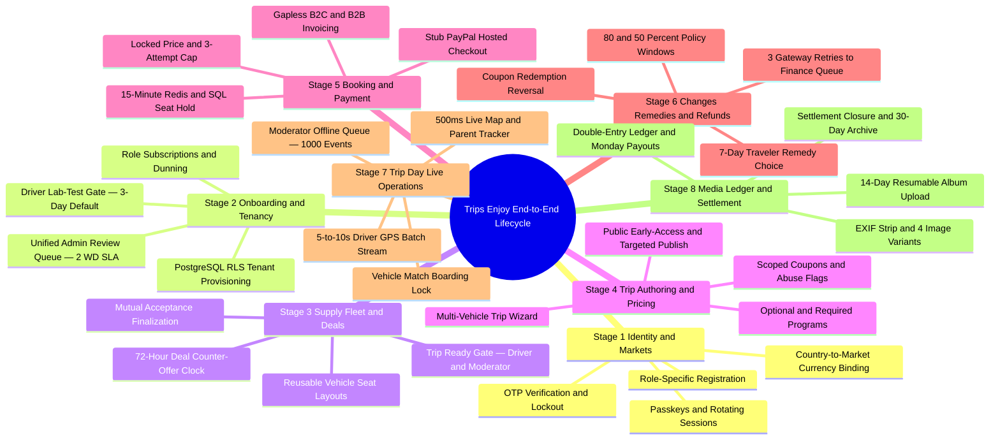
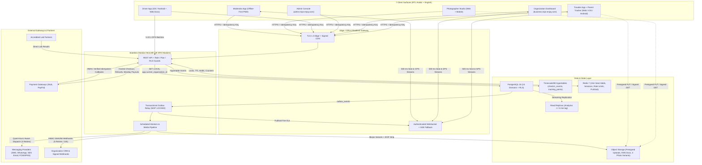
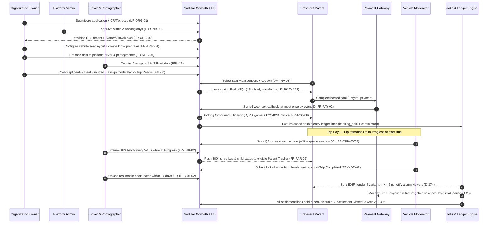

Trips Enjoy operates as a single, bilingual (`en` and `ar`), multi-tenant marketplace and trip-operations organism. Rather than splitting the business into disconnected booking, fleet, chat, and accounting tools, one modular monolith coordinates every actor — from an organization's commercial registration and driver lab-test clearance through seat holds, multi-gateway checkout, offline-capable bus boarding, live child tracking, watermarked photo albums, and double-entry financial settlement.

This **End-to-End System** hub connects all companion specifications into a single operational narrative so product managers, architects, backend/mobile engineers, QA teams, and finance operators can trace any action from user tap to PostgreSQL row, Redis lock, outbox event, scheduled job, and ledger entry.

<TraceBar
  brd={[
    { label: 'Executive Summary & Objectives', href: '/en/docs/brd#22-business-objectives-and-success-measures', detail: 'OBJ-01..08' },
    { label: 'Business Rules', href: '/en/docs/brd/requirements#7-business-rules', detail: '[BRL-01](/en/docs/brd/requirements#7-business-rules)..31' },
    { label: 'Open Decisions', href: '/en/docs/brd/compliance#11-open-decisions', detail: '[OD-01](/en/docs/brd/compliance#11-open-decisions)..32' },
  ]}
  srs={[
    { label: '28 Capability Modules', href: '/en/docs/srs#module-index', detail: '213 FRs' },
    { label: '10 State Machines', href: '/en/docs/srs/state-machines', detail: 'SRS §7' },
    { label: 'Quality & NFRs', href: '/en/docs/srs/quality', detail: 'NFR-PERF..BKP' },
  ]}
  erd={[
    { label: '14 Data Domains', href: '/en/docs/erd#domains', detail: 'BIGSERIAL + UUIDv7' },
    { label: 'ACL & PostgreSQL RLS', href: '/en/docs/erd/acl', detail: 'Tenant Isolation' },
  ]}
  plan={[
    { label: 'Delivery Roadmap (P1–P6)', href: '/en/docs/plan', detail: '231 Tasks' },
    { label: 'Phase Milestones', href: '/en/docs/plan/milestones', detail: 'Gates' },
  ]}
  workflows={[
    { label: 'System Workflows', href: '/en/docs/workflows', detail: 'Engine Contract' },
    { label: 'Scheduled Job Catalog', href: '/en/docs/workflows/scheduled-jobs', detail: 'Timers & Retries' },
  ]}
  userFlows={[
    { label: '8 Role Flow Suites', href: '/en/docs/user-flows', detail: '106 Flows' },
  ]}
  architecture={[
    { label: 'Modular Monolith & Topology', href: '/en/docs/architecture', detail: 'System Context' },
  ]}
  design={[
    { label: '7 Client Surfaces & RTL', href: '/en/docs/design', detail: 'Tokens & A11y' },
  ]}
  recommendations={[
    { label: 'Recommendations Playbook', href: '/en/docs/recommendations', detail: 'OD + REC Blueprints' },
  ]}
/>

## Platform Scale and Structural Spine

Every document in the specification reconciles against a deterministic set of engineering artefacts:

| Dimension | Canonical Count | Governing Rules & Enforcement Boundary | Primary Reference |
|---|---|---|---|
| **Functional Requirements** | `213` (`FR-*`) | MoSCoW-prioritized (`Must`, `Should`, `Could`) with Given/When/Then acceptance criteria across `28` SRS modules | [Software Requirements](/en/docs/srs) |
| **Capability Modules** | `28` modules | Strict domain boundaries inside a single deployable TypeScript modular monolith (`AUTH` through `API`) | [SRS Module Index](/en/docs/srs#module-index) |
| **Data Domains** | `14` domains | PostgreSQL 16 + TimescaleDB hypertables, `BIGSERIAL` internal FKs, `UUIDv7` public IDs, `lookups` instead of SQL enums, RLS on `organization_id` | [Data Model (ERD)](/en/docs/erd) |
| **Role User Flows** | `106` (`UF-*`) | 8 suites covering Traveler (`16`), Organization (`24`), Admin (`16`), Driver (`10`), Photographer (`9`), Moderator (`8`), Parent (`6`), and Shared (`17`) | [User Flows](/en/docs/user-flows) |
| **System Workflows & State Machines** | `10` machines | Trip, Booking, Seat, Deal, Application, Subscription, Coupon, Lab Test, Settlement, and Dispute + deterministic job catalog | [State Machines](/en/docs/srs/state-machines) · [Workflows](/en/docs/workflows) |
| **Phased Delivery Backlog** | `231` tasks | `213` functional tasks + `18` cross-cutting platform tasks delivered sequentially across `6` gated phases (`P1`–`P6`) | [Delivery Plan](/en/docs/plan) |
| **Client Surfaces** | `7` surfaces | Traveler App, Parent Tracker (inside Traveler App), Organization Dashboard, Admin Console, Driver App, Photographer Studio, and offline-capable Moderator PWA | [Design System](/en/docs/design#app-surfaces) |
| **Target Markets** | `3` launch markets | Country-derived configuration: Egypt (`EGP`, `Africa/Cairo`, `P2` pilot), Saudi Arabia (`SAR`, `Asia/Riyadh`, `P5`), UAE (`AED`, `Asia/Dubai`, `P5`) | [BRD Markets](/en/docs/brd#53-markets) |

## End-to-End Lifecycle Mindmap

A trip on Trips Enjoy is not an isolated catalog listing — it is the spine of an eight-stage operational loop that starts with verified identity and tenant onboarding and closes only when every passenger has disembarked, photo albums are archived, supplier payouts have cleared, and per-trip settlements are sealed.

<MindmapBlock
  title="Trips Enjoy Eight-Stage End-to-End Operational Lifecycle"
  caption="Visual map of the complete journey from account verification and tenant provisioning to trip-day live operations and double-entry settlement closure."
  trace={{
    system: [
      { label: '8-Stage Operational Journey', href: '/en/docs/system/lifecycle', detail: 'STAGE-01..08' },
      { label: 'Platform Mindmap Atlas', href: '/en/docs/system/mindmaps', detail: '7 Master Maps' },
    ],
    workflows: [
      { label: 'Trip Lifecycle', href: '/en/docs/workflows/trip-lifecycle' },
      { label: 'Booking & Payment', href: '/en/docs/workflows/booking-payment' },
      { label: 'Trip Day', href: '/en/docs/workflows/trip-day' },
      { label: 'Money & Settlements', href: '/en/docs/workflows/money' },
    ],
    recommendations: [
      { label: 'REC-ARCH-01 Modular Monolith & Outbox', href: '/en/docs/recommendations/architecture-and-ops#rec-arch-01' },
      { label: 'REC-FIN-10 Ledger Invariants', href: '/en/docs/recommendations/architecture-and-ops#rec-fin-10' },
    ],
  }}
>

- **Strict gating between stages:** A trip cannot enter `In Progress` unless Stage 3's `Ready` gate confirms every assigned vehicle has both an active driver (not paused by a pending lab test) and an assigned moderator ([BRL-07](/en/docs/brd/requirements#7-business-rules)).
- **Financial finality:** A trip cannot transition from `Post-Processing` to `Archived` until 30 days after `Completed` **and** Stage 8's per-trip settlement reaches `Closed` with zero open disputes ([BRL-25](/en/docs/brd/requirements#7-business-rules), [FR-ACC-10](/en/docs/srs/requirements/acc#fr-acc-10--archive-after-settlement)).
</MindmapBlock>

## Master Architecture and Data-Flow Topology

Every client surface communicates through a TLS-terminating edge and CDN into a stateless TypeScript/NestJS modular monolith. Synchronous commands mutate tenant-isolated PostgreSQL 16 tables and write domain events atomically into `outbox_events` inside the same database transaction. Internal background workers relay outbox events to notifications, search indexes, analytics projections, and HMAC-signed partner webhooks without coupling request latency to downstream third parties.

## Master Multi-Role Runtime Choreography

The sequence diagram below illustrates how a single multi-vehicle school or corporate trip threads across nine distinct actors and internal engines from initial tenant approval to Monday payout settlement:

## Cross-Specification Lifecycle Matrix

Use this matrix to jump from any operational stage in [8-Stage Operational Journey](/en/docs/system/lifecycle) into the exact authoritative sections across all nine companion pillars:

| Stage | Lifecycle Scope | BRD | SRS Modules & Machines | ERD Domains | User Flows | Workflows | Plan Phase | Recommendations |
|---|---|---|---|---|---|---|---|---|
| **[STAGE-01](/en/docs/system/lifecycle#stage-01)** | Identity, OTP, Passkeys, Multi-Role & Market Binding | [§6.1 AUTH](/en/docs/brd/requirements#61-accounts-and-access-auth), [§6.16 MKT](/en/docs/brd/requirements#616-markets-mkt) | [AUTH](/en/docs/srs/requirements/auth), [MKT](/en/docs/srs/requirements/mkt) | [Identity](/en/docs/erd/domains/identity-and-access), [Markets](/en/docs/erd/domains/lookups-and-markets) | [UF-SHR-01..17](/en/docs/user-flows/shared), [UF-TRV-02](/en/docs/user-flows/traveler#uf-trv-02-register-and-verify) | [Job Catalog](/en/docs/workflows/scheduled-jobs#countdowns-per-record-timers) | [P1](/en/docs/plan/p1), [P5](/en/docs/plan/p5) | [OD-02](/en/docs/recommendations/open-decisions#od-02--preserving-unpublished-drafts-when-sessions-end), [OD-23](/en/docs/recommendations/open-decisions#od-23--role-based-contact-verification-matrix) |
| **[STAGE-02](/en/docs/system/lifecycle#stage-02)** | Applications, Admin Queue, Lab Tests, Tenancy & Plans | [§6.2 ONB](/en/docs/brd/requirements#62-applications-and-approvals-onb), [§6.13 SUB](/en/docs/brd/requirements#613-plans-and-subscriptions-sub) | [ONB](/en/docs/srs/requirements/onb), [ORG](/en/docs/srs/requirements/org), [DRV](/en/docs/srs/requirements/drv), [SUB](/en/docs/srs/requirements/sub), [SM 7.5/7.6/7.8](/en/docs/srs/state-machines#75-application) | [Applications](/en/docs/erd/domains/applications), [Organizations](/en/docs/erd/domains/organizations), [Plans](/en/docs/erd/domains/plans-and-subscriptions) | [UF-ADM-02](/en/docs/user-flows/admin#uf-adm-02-review-an-application), [UF-DRV-05](/en/docs/user-flows/driver#uf-drv-05-lab-test-requested) | [Applications](/en/docs/workflows/applications), [Subscriptions](/en/docs/workflows/subscriptions) | [P1](/en/docs/plan/p1), [P4](/en/docs/plan/p4), [P5](/en/docs/plan/p5) | [OD-29](/en/docs/recommendations/open-decisions#od-29--post-grace-subscription-expiry-behavior-d-08-vs-brl-02), [OD-32](/en/docs/recommendations/open-decisions#od-32--changes-requested-application-closure-day-with-extension), [REC-DATA-02](/en/docs/recommendations/architecture-and-ops#rec-data-02) |
| **[STAGE-03](/en/docs/system/lifecycle#stage-03)** | Fleet, Seat Layouts, Supplier Deals & Ready Gate | [§6.4 FLT](/en/docs/brd/requirements#64-trips-programs-and-fleet-trip-prg-flt), [§6.5 STF](/en/docs/brd/requirements#65-staffing-and-deals-stf) | [FLT](/en/docs/srs/requirements/flt), [SEAT](/en/docs/srs/requirements/seat), [NEG](/en/docs/srs/requirements/neg), [STF](/en/docs/srs/requirements/stf), [SM 7.4](/en/docs/srs/state-machines#74-deal) | [Suppliers](/en/docs/erd/domains/suppliers), [Fleet & Trips](/en/docs/erd/domains/fleet-and-trips), [Deals](/en/docs/erd/domains/deals) | [UF-ORG-04](/en/docs/user-flows/organization#uf-org-04-fleet), [UF-ORG-07](/en/docs/user-flows/organization#uf-org-07-hire-a-platform-supplier-deal), [UF-DRV-03](/en/docs/user-flows/driver#uf-drv-03-respond-to-a-deal) | [Trip Lifecycle](/en/docs/workflows/trip-lifecycle) | [P2](/en/docs/plan/p2), [P3](/en/docs/plan/p3), [P4](/en/docs/plan/p4) | [OD-06](/en/docs/recommendations/open-decisions#od-06--plan-coverage-for-vehicle-moderators), [OD-13](/en/docs/recommendations/open-decisions#od-13--deal-negotiation-round-cap-and-72-hour-expiry), [OD-19](/en/docs/recommendations/open-decisions#od-19--organization-owned-driver-and-photographer-allowances) |
| **[STAGE-04](/en/docs/system/lifecycle#stage-04)** | Trip Wizard, Programs, Coupons & Publishing | [§6.4 TRIP/PRG](/en/docs/brd/requirements#64-trips-programs-and-fleet-trip-prg-flt), [§6.8 CPN](/en/docs/brd/requirements#68-coupons-cpn) | [TRIP](/en/docs/srs/requirements/trip), [PRG](/en/docs/srs/requirements/prg), [CPN](/en/docs/srs/requirements/cpn), [SM 7.1/7.7](/en/docs/srs/state-machines#71-trip-lifecycle) | [Fleet & Trips](/en/docs/erd/domains/fleet-and-trips#trips), [Coupons](/en/docs/erd/domains/coupons#coupons) | [UF-ORG-06](/en/docs/user-flows/organization#uf-org-06-create-a-trip-wizard), [UF-ORG-13](/en/docs/user-flows/organization#uf-org-13-coupons) | [Trip Lifecycle](/en/docs/workflows/trip-lifecycle) | [P2](/en/docs/plan/p2), [P3](/en/docs/plan/p3), [P5](/en/docs/plan/p5) | [OD-09](/en/docs/recommendations/open-decisions#od-09--vip-early-access-window-length), [OD-25](/en/docs/recommendations/open-decisions#od-25--plan-gate-on-program-enrollment-reports) |
| **[STAGE-05](/en/docs/system/lifecycle#stage-05)** | Discovery, 15m Seat Hold, Multi-Gateway Pay & Invoices | [§6.6 SEAT](/en/docs/brd/requirements#66-seats-seat), [§6.7 BKG](/en/docs/brd/requirements#67-booking-and-payment-bkg) | [TRV](/en/docs/srs/requirements/trv), [BKG](/en/docs/srs/requirements/bkg), [PAY](/en/docs/srs/requirements/pay), [SM 7.2/7.3](/en/docs/srs/state-machines#72-booking) | [Booking & Payment](/en/docs/erd/domains/booking-and-payment#bookings), [Finance](/en/docs/erd/domains/finance#invoices) | [UF-TRV-03](/en/docs/user-flows/traveler#uf-trv-03-book-a-trip), [UF-TRV-15](/en/docs/user-flows/traveler#uf-trv-15-payment-outcome-and-pending-resolution) | [Booking & Payment](/en/docs/workflows/booking-payment) | [P2](/en/docs/plan/p2), [P3](/en/docs/plan/p3), [P5](/en/docs/plan/p5) | [REC-BOOK-03](/en/docs/recommendations/architecture-and-ops#rec-book-03), [REC-PAY-04](/en/docs/recommendations/architecture-and-ops#rec-pay-04), [REC-TAX-05](/en/docs/recommendations/architecture-and-ops#rec-tax-05) |
| **[STAGE-06](/en/docs/system/lifecycle#stage-06)** | Cancellations, Policy Windows, Remedies & Refunds | [BRL-11/12/24/30](/en/docs/brd/requirements#7-business-rules) | [BKG](/en/docs/srs/requirements/bkg), [PAY](/en/docs/srs/requirements/pay), [CPN](/en/docs/srs/requirements/cpn), [ADM](/en/docs/srs/requirements/adm), [SM 7.10](/en/docs/srs/state-machines#710-dispute) | [Booking & Payment](/en/docs/erd/domains/booking-and-payment), [Finance](/en/docs/erd/domains/finance) | [UF-TRV-06](/en/docs/user-flows/traveler#uf-trv-06-cancel-a-booking), [UF-TRV-07](/en/docs/user-flows/traveler#uf-trv-07-choose-a-remedy-after-a-trip-change), [UF-ADM-16](/en/docs/user-flows/admin#uf-adm-16-out-of-policy-refund) | [Refunds](/en/docs/workflows/refunds) | [P2](/en/docs/plan/p2), [P5](/en/docs/plan/p5) | [OD-07](/en/docs/recommendations/open-decisions#od-07--cancellation-refund-schedule-and-non-refundable-fees), [OD-18](/en/docs/recommendations/open-decisions#od-18--native-crm-connectors-and-signed-webhook-policy) |
| **[STAGE-07](/en/docs/system/lifecycle#stage-07)** | Offline Check-in, Incidents, GPS & Live Parent Tracker | [§6.9 CHK/MOD/TRK](/en/docs/brd/requirements#69-check-in-moderators-and-tracking-chk-mod-trk), [§6.10 PAR](/en/docs/brd/requirements#610-parents-and-children-par) | [CHK](/en/docs/srs/requirements/chk), [MOD](/en/docs/srs/requirements/mod), [TRK](/en/docs/srs/requirements/trk), [PAR](/en/docs/srs/requirements/par), [NTF](/en/docs/srs/requirements/ntf) | [Operations](/en/docs/erd/domains/operations#checkin_events), [Child Links](/en/docs/erd/domains/operations#child_links) | [UF-MOD-04](/en/docs/user-flows/moderator#uf-mod-04-check-in-a-passenger), [UF-MOD-06](/en/docs/user-flows/moderator#uf-mod-06-offline-queue), [UF-PAR-03](/en/docs/user-flows/parent#uf-par-03-live-map) | [Trip Day](/en/docs/workflows/trip-day), [Notifications](/en/docs/workflows/notifications) | [P3](/en/docs/plan/p3), [P6](/en/docs/plan/p6) | [REC-OFF-06](/en/docs/recommendations/architecture-and-ops#rec-off-06), [REC-TRK-07](/en/docs/recommendations/architecture-and-ops#rec-trk-07), [REC-SEC-09](/en/docs/recommendations/architecture-and-ops#rec-sec-09) |
| **[STAGE-08](/en/docs/system/lifecycle#stage-08)** | Media Albums, Double-Entry Ledger, Payouts & Analytics | [§6.11 MED/PHO](/en/docs/brd/requirements#611-media-and-photographers-med-pho), [§6.14 ACC](/en/docs/brd/requirements#614-accounting-invoices-and-settlements-acc), [§6.17 ANL](/en/docs/brd/requirements#617-analytics-anl) | [MED](/en/docs/srs/requirements/med), [PHO](/en/docs/srs/requirements/pho), [ACC](/en/docs/srs/requirements/acc), [ANL](/en/docs/srs/requirements/anl), [API](/en/docs/srs/requirements/api), [SM 7.9](/en/docs/srs/state-machines#79-settlement) | [Media](/en/docs/erd/domains/media), [Finance](/en/docs/erd/domains/finance), [Platform](/en/docs/erd/domains/platform#audit_events) | [UF-PHO-05](/en/docs/user-flows/photographer#uf-pho-05-create-and-upload-an-album), [UF-ORG-15](/en/docs/user-flows/organization#uf-org-15-accounting-and-settlements), [UF-ADM-11](/en/docs/user-flows/admin#uf-adm-11-finance-operations) | [Media](/en/docs/workflows/media), [Money](/en/docs/workflows/money) | [P4](/en/docs/plan/p4), [P5](/en/docs/plan/p5), [P6](/en/docs/plan/p6) | [REC-MED-08](/en/docs/recommendations/architecture-and-ops#rec-med-08), [REC-FIN-10](/en/docs/recommendations/architecture-and-ops#rec-fin-10) |

## Core Architectural Invariants

Across all eight stages, six non-negotiable invariants hold on every API call, background worker run, and client screen:

1. **Three-Layer Tenant Isolation (`BRL-01`, `DAT-01`, `NFR-SEC-07`):** Every organization-owned table carries a non-null `organization_id` (denormalized onto child tables so policies require zero joins), enforced simultaneously by API guards, repository scoping, and PostgreSQL Row-Level Security (`SET LOCAL app.current_organization_id`). Cross-tenant probes always return generic `404` responses.
2. **Minor-Unit Money & Immutable Double-Entry Ledger (`BRL-18`, `DAT-08`, `D-157`):** No floating-point amount exists anywhere in the stack. Every charge, commission, coupon discount, gateway fee, refund, and supplier payout writes balanced `debit_minor` / `credit_minor` legs in `ledger_entries` within a `ledger_transactions` envelope; corrections never mutate rows and instead post explicit reversing transactions or credit notes (`D-181`).
3. **Zero Card Data on Platform Servers (`CON-02`, `UI-09`):** Checkout and subscription charges execute exclusively via hosted gateway pages or tokenized SDKs (the Stub gateway in testing, PayPal in Sandbox/Live), keeping Trips Enjoy outside raw PAN handling while processing inbound webhooks idempotently (`FR-PAY-02`).
4. **Fail-Closed Money & Plan Gates, Graceful Read Degradation (`FR-SUB-11`, `D-224`):** Server-side feature gates block limit-exceeding or money-moving mutations immediately if the subscription/plan evaluator is unavailable, whereas analytics (`<= 5 min` replica lag) and asynchronous exports (`<= 15 min`) degrade gracefully without blocking trip bookings or boarding scans.
5. **Child-Safety & Traveler Location Privacy (`CON-08`, `BRL-29`, `FR-PAR-05`, `FR-TRK-07`):** Child records are excluded from analytics, marketing, and AI training; parent links expire automatically when the booking ends; and regular adult travelers never receive live vehicle GPS coordinates or ETAs (`D-317`) — live map visibility is strictly restricted to organization operations and eligible linked parents while the trip is `In Progress`.
6. **Arabic-First RTL & Western Numerals (`CON-03`, `NFR-I18N-04`, `D-159`):** Every surface, notification template, receipt, and invoice ships in Arabic (full logical-CSS RTL mirroring) and English from day one, rendering Western digits (`0–9`) and explicit ISO currency codes (`EGP`, `SAR`, `AED`) everywhere.

## Explore the System Blueprint

<Cards>
  <Card
    title="8-Stage Operational Lifecycle"
    description="Step-by-step system and human choreography across STAGE-01..STAGE-08 with sequence diagrams, PostgreSQL/Redis mutations, exact timers, and failure recovery paths."
    icon="GitBranch"
    href="/en/docs/system/lifecycle"
  />
  <Card
    title="Platform Mindmap Atlas"
    description="Seven visual Mermaid mindmaps covering roles, commercial model, 28 SRS modules, 14 ERD domains, 10 workflows, 6 phases, and security/compliance."
    icon="Network"
    href="/en/docs/system/mindmaps"
  />
  <Card
    title="Recommendations & Open Decisions"
    description="MENA-benchmarked recommended resolutions for all 32 OD-* items, 15 inline [OPEN] markers, and 12 architecture & operations blueprints."
    icon="Lightbulb"
    href="/en/docs/recommendations"
  />
  <Card
    title="Phased Delivery Plan (P1–P6)"
    description="All 231 actionable engineering tasks (213 functional + 18 platform) traced across BRD, SRS, ERD, Workflows, Architecture, and Design."
    icon="ListTodo"
    href="/en/docs/plan"
  />
</Cards>
