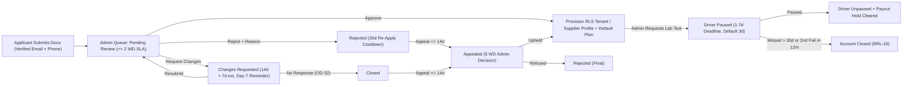
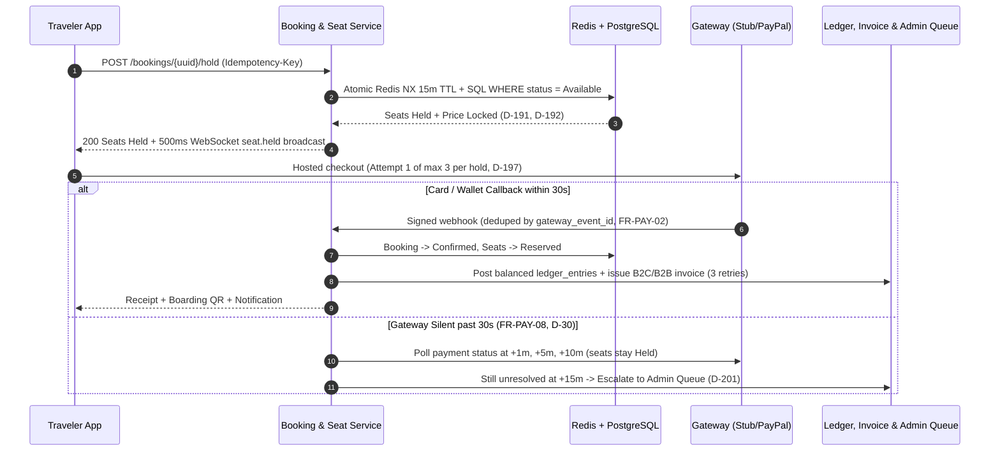
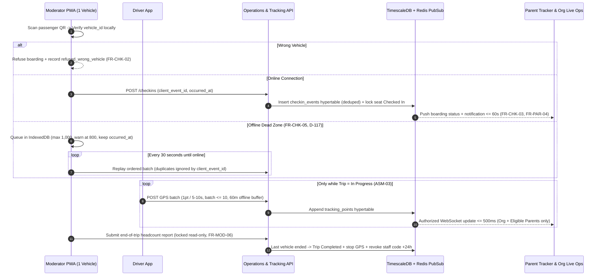
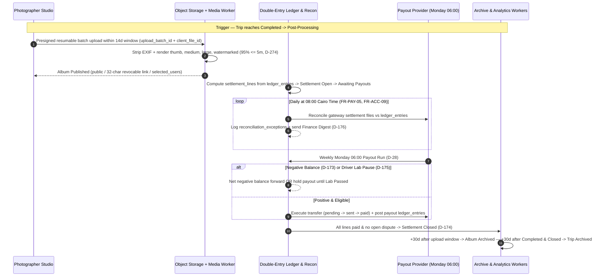

This document traces the complete operational life of Trips Enjoy across **eight sequential stages (`STAGE-01` through `STAGE-08`)**. Every stage documents the exact human and system choreography, active SRS state machines, PostgreSQL 16 and TimescaleDB tables mutated, Redis locks and transactional outbox events emitted, verbatim SLA timers, and failure/compensation paths — followed by a complete cross-specification `<TraceBar />`.

<Callout type="info" title="Reading Timers and State Guards">
Working-day SLAs (such as the 2-working-day application review target or 2-working-day refund dispatch) follow the responsible party's market calendar (`Africa/Cairo`, `Asia/Riyadh`, or `Asia/Dubai`). Absolute clock timers (`15-minute` seat holds, `72-hour` deal counters, `06:00` Monday payouts) run in UTC against `TIMESTAMPTZ` columns.
</Callout>

## Stage 1 — Identity, Verification and Market Assignment

<SystemStage
  stageNumber={1}
  id="STAGE-01"
  title="Identity, Verification, Multi-Role Accounts & Market Assignment"
  phaseIntroduced="P1 (Core Auth & Egypt Market) · P5 (Passkeys & Gulf Markets)"
  actors={['Visitor', 'Traveler', 'Organization Owner', 'Employee', 'Platform Supplier', 'Platform Admin']}
  stateMachines={['Session Token Rotation', 'OTP Challenge Window', '30-Day Deletion Grace']}
  tablesWritten={[
    'users',
    'user_roles',
    'auth_factors',
    'passkey_credentials',
    'otp_challenges',
    'sessions',
    'devices',
    'consents',
    'notification_preferences',
    'privacy_requests',
    'audit_logs',
  ]}
  eventsEmitted={['auth.otp.requested', 'auth.user.verified', 'auth.session.locked', 'auth.deletion.scheduled']}
  trace={{
    brd: [
      { label: '[BR-AUTH-01](/en/docs/brd/requirements#61-accounts-and-access-auth)..08', href: '/en/docs/brd/requirements#61-accounts-and-access-auth', detail: 'Accounts & Access' },
      { label: '[BR-MKT-01](/en/docs/brd/requirements#616-markets-mkt)..04', href: '/en/docs/brd/requirements#616-markets-mkt', detail: 'Country Markets' },
      { label: '[BRL-15](/en/docs/brd/requirements#7-business-rules) / 20 / 21 / 22 / 23 / 27', href: '/en/docs/brd/requirements#7-business-rules', detail: 'Auth & Market Rules' },
    ],
    srs: [
      { label: 'AUTH ([FR-AUTH-01](/en/docs/srs/requirements/auth#fr-auth-01--role-specific-registration-paths)..13)', href: '/en/docs/srs/requirements/auth', detail: '13 FRs' },
      { label: 'MKT ([FR-MKT-01](/en/docs/srs/requirements/mkt#fr-mkt-01--market-configuration)..05)', href: '/en/docs/srs/requirements/mkt', detail: '5 FRs' },
      { label: '[NFR-SEC-01](/en/docs/srs/quality#82-security-nfr-sec)..15', href: '/en/docs/srs/quality#82-security-nfr-sec', detail: 'Auth Security' },
    ],
    erd: [
      { label: 'users & user_roles', href: '/en/docs/erd/domains/identity-and-access#users', detail: 'Identity Domain' },
      { label: 'otp_challenges', href: '/en/docs/erd/domains/identity-and-access#otp_challenges', detail: '5m TTL' },
      { label: 'markets', href: '/en/docs/erd/domains/lookups-and-markets#markets', detail: 'Currency & Tax' },
      { label: 'ACL Actor Resolution', href: '/en/docs/erd/acl#actor-resolution', detail: 'JWT Claims' },
    ],
    plan: [
      { label: 'Phase P1 Foundation', href: '/en/docs/plan/p1', detail: 'Core Auth' },
      { label: 'Phase P5 Gulf Markets', href: '/en/docs/plan/p5', detail: 'MKT Switch' },
      { label: 'Phase P6 Passkeys', href: '/en/docs/plan/p6', detail: 'WebAuthn' },
    ],
    workflows: [
      { label: 'Countdowns & Token TTLs', href: '/en/docs/workflows/scheduled-jobs#countdowns-per-record-timers' },
      { label: 'Daily Deletion Job', href: '/en/docs/workflows/scheduled-jobs#daily' },
    ],
    userFlows: [
      { label: '[UF-SHR-01](/en/docs/user-flows/shared#uf-shr-01-sign-up-chooser)..05 & [UF-SHR-17](/en/docs/user-flows/shared#uf-shr-17-passkey-registration-management-and-device-loss-recovery)', href: '/en/docs/user-flows/shared#uf-shr-01-sign-up-chooser', detail: 'Sign-up, OTP, Passkeys' },
      { label: '[UF-TRV-02](/en/docs/user-flows/traveler#uf-trv-02-register-and-verify) Register & Verify', href: '/en/docs/user-flows/traveler#uf-trv-02-register-and-verify' },
    ],
    architecture: [
      { label: 'Stateless API & Redis Sessions', href: '/en/docs/architecture#service-model' },
    ],
    design: [
      { label: 'Forms, RTL & Western Digits', href: '/en/docs/design#rtl-and-localization' },
    ],
    recommendations: [
      { label: '[OD-02](/en/docs/brd/compliance#11-open-decisions) Token & Session Policy', href: '/en/docs/recommendations/open-decisions#od-02' },
      { label: '[OD-23](/en/docs/brd/compliance#11-open-decisions) OTP Resend & Lockout', href: '/en/docs/recommendations/open-decisions#od-23' },
      { label: 'OPEN-04 Passkey Rollout', href: '/en/docs/recommendations/open-decisions#open-04' },
    ],
  }}
>
### 1.1 Choreography and Runtime Execution

1. **Role-Specific Registration & Country Capture (`FR-AUTH-01`, `FR-AUTH-02`, `BRL-23`):** Visitors choose their entry track (`/register/traveler`, web-only `/register/organization`, `/register/driver`, or `/register/photographer`). Every registration form requires `country_code` (`EG`, `SA`, `AE`), which deterministically binds the account's `market_id` (`BRL-27`) — fixing default currency (`EGP`, `SAR`, `AED`), payment methods, tax regime, and default time zone (`Africa/Cairo`, `Asia/Riyadh`, `Asia/Dubai`).
2. **Contact Verification (`FR-AUTH-03`, `D-20`):** Travelers become active immediately on the `Free` plan once **at least one** of email or phone is verified via one-time code. Organizations, platform drivers, and platform photographers must verify **both** email and phone before their onboarding application can transition out of `Draft`.
3. **Role-Scoped Sign-In & Second Factor (`FR-AUTH-04`, `FR-AUTH-11..13`):** Travelers sign in with password, OTP, or WebAuthn passkey. Organization owners and employees require password plus SMS or TOTP second factor on every sign-in. Platform admins sign in on the isolated `admin.trips-enjoy.com` route with mandatory TOTP authenticator. Vehicle moderators sign in on the Moderator PWA using a trip-scoped staff code (`D-107`).
4. **Multi-Role & Multi-Organization Switching (`FR-AUTH-06`, `FR-AUTH-07`):** One `users` record can hold both `traveler` and `supplier` (`driver` or `photographer`) roles simultaneously (`ASM-01`), and an employee email invited to multiple organizations switches active tenant context via the workspace switcher (`UF-ORG-02`), minting a fresh tenant-scoped token without re-entering credentials.

### 1.2 Data Mutations, Redis State and Outbox Events

- **PostgreSQL Writes:** Inserts `users` (`id BIGSERIAL`, public `uuid UUIDv7`, KMS-encrypted PII columns + lookup hashes), `user_roles`, `consents` (immutable insert-only), and `notification_preferences`. Market assignment resolves `markets` and `currencies` from `countries.code`.
- **Redis Ephemeral State:** Stores active session metadata, rotating refresh-token families, per-IP/per-account rate-limit sliding windows, and failed-attempt counters (`auth:fail:{user_id}` and `otp:fail:{challenge_id}`).
- **Outbox Events:** Commits `auth.otp.requested` (routed to the urgent SMS/email lane bypassing quiet hours) and `auth.user.verified` inside `outbox_events`.

### 1.3 Timers, SLAs and Failure Compensation

- **OTP Lifespan & Brute-Force Pause (`BRL-20`, `D-58`, `D-59`):** Each OTP expires in **5 minutes**; resend unlocks after **45–60 seconds**; **5 wrong codes** pause verification for **15 minutes**.
- **Sign-In Lockout (`BRL-21`, `FR-AUTH-05`, `D-53`):** **5 failed sign-in attempts** lock the account across all roles for **15 minutes** and notify the account owner.
- **Session TTLs (`BRL-22`, `FR-AUTH-10`):** Access JWTs expire in **15 minutes**; mobile refresh tokens rotate on every use over a **30-day** window (replay of a rotated token revokes the entire session family); web dashboard sessions expire after **12 hours**.
- **Account Deletion Grace (`BRL-15`, `FR-AUTH-09`):** Self-service deletion places the user in a **30-day restore grace** (blocking active new bookings while preserving financial obligations); on **day 31**, the nightly purge anonymizes PII while retaining immutable ledger and audit references (`7 years`).
</SystemStage>

## Stage 2 — Applications, Lab Tests and Tenant Provisioning

<SystemStage
  stageNumber={2}
  id="STAGE-02"
  title="Organization & Supplier Applications, Lab Tests, Tenancy & Subscriptions"
  phaseIntroduced="P1 (Org Onboarding & RLS) · P4 (Suppliers & Lab Tests) · P5 (Full Plans & Dunning)"
  actors={['Applicant (Org / Driver / Photographer)', 'Platform Admin', 'Lab Partner', 'Organization Owner']}
  stateMachines={['7.5 Application', '7.6 Subscription', '7.8 Lab Test']}
  tablesWritten={[
    'applications',
    'application_documents',
    'application_decisions',
    'appeals',
    'organizations',
    'organization_members',
    'member_permissions',
    'invitations',
    'driver_profiles',
    'photographer_profiles',
    'portfolio_items',
    'lab_tests',
    'subscriptions',
    'subscription_charges',
    'usage_counters',
    'audit_events',
  ]}
  eventsEmitted={[
    'onboarding.application.submitted',
    'onboarding.application.approved',
    'tenant.organization.provisioned',
    'driver.lab_test.requested',
    'subscription.renewal.failed',
  ]}
  trace={{
    brd: [
      { label: '[BR-ONB-01](/en/docs/brd/requirements#62-applications-and-approvals-onb)..06', href: '/en/docs/brd/requirements#62-applications-and-approvals-onb', detail: 'Approvals' },
      { label: '[BR-ORG-01](/en/docs/brd/requirements#63-organizations-and-employees-org)..08', href: '/en/docs/brd/requirements#63-organizations-and-employees-org', detail: 'Workspaces' },
      { label: '[BR-SUB-01](/en/docs/brd/requirements#613-plans-and-subscriptions-sub)..09', href: '/en/docs/brd/requirements#613-plans-and-subscriptions-sub', detail: 'Plans & Dunning' },
      { label: '§8.2 Driver Lab Tests', href: '/en/docs/brd/compliance#82-driver-lab-tests-and-background-checks', detail: 'Safety Gate' },
    ],
    srs: [
      { label: 'ONB ([FR-ONB-01](/en/docs/srs/requirements/onb#fr-onb-01--application-and-supplier-access)..09)', href: '/en/docs/srs/requirements/onb', detail: '9 FRs' },
      { label: 'ORG & EMP', href: '/en/docs/srs/requirements/org', detail: 'Tenancy & RBAC' },
      { label: 'DRV ([FR-DRV-03](/en/docs/srs/requirements/drv#fr-drv-03--lab-test-pause)..06)', href: '/en/docs/srs/requirements/drv#fr-drv-03--lab-test-pause', detail: 'Lab Pause' },
      { label: 'SUB ([FR-SUB-01](/en/docs/srs/requirements/sub#fr-sub-01--plan-catalog)..11)', href: '/en/docs/srs/requirements/sub', detail: 'Plans & Gates' },
      { label: 'SM 7.5 / 7.6 / 7.8', href: '/en/docs/srs/state-machines#75-application', detail: 'State Machines' },
    ],
    erd: [
      { label: 'applications', href: '/en/docs/erd/domains/applications#applications' },
      { label: 'organizations & members', href: '/en/docs/erd/domains/organizations#organizations' },
      { label: 'driver_profiles & lab_tests', href: '/en/docs/erd/domains/suppliers#lab_tests' },
      { label: 'subscriptions', href: '/en/docs/erd/domains/plans-and-subscriptions#subscriptions' },
      { label: 'RLS Policy Catalog', href: '/en/docs/erd/acl#policy-catalog' },
    ],
    plan: [
      { label: 'Phase P1 Org Approval', href: '/en/docs/plan/p1' },
      { label: 'Phase P4 Suppliers & Labs', href: '/en/docs/plan/p4' },
      { label: 'Phase P5 Subscriptions', href: '/en/docs/plan/p5' },
    ],
    workflows: [
      { label: 'Applications Workflow', href: '/en/docs/workflows/applications' },
      { label: 'Subscriptions & Dunning', href: '/en/docs/workflows/subscriptions' },
    ],
    userFlows: [
      { label: '[UF-ADM-02](/en/docs/user-flows/admin#uf-adm-02-review-an-application) Review Application', href: '/en/docs/user-flows/admin#uf-adm-02-review-an-application' },
      { label: '[UF-ADM-06](/en/docs/user-flows/admin#uf-adm-06-request-and-review-a-lab-test) Request Lab Test', href: '/en/docs/user-flows/admin#uf-adm-06-request-and-review-a-lab-test' },
      { label: '[UF-DRV-05](/en/docs/user-flows/driver#uf-drv-05-lab-test-requested) Lab Test Requested', href: '/en/docs/user-flows/driver#uf-drv-05-lab-test-requested' },
      { label: '[UF-ORG-03](/en/docs/user-flows/organization#uf-org-03-invite-and-manage-employees) Invite Employees', href: '/en/docs/user-flows/organization#uf-org-03-invite-and-manage-employees' },
    ],
    architecture: [
      { label: 'PostgreSQL RLS Isolation', href: '/en/docs/architecture#data-architecture' },
    ],
    design: [
      { label: 'Admin Queue + Detail Pattern', href: '/en/docs/design#admin-console' },
    ],
    recommendations: [
      { label: '[OD-29](/en/docs/brd/compliance#11-open-decisions) Post-Grace Behavior', href: '/en/docs/recommendations/open-decisions#od-29' },
      { label: '[OD-32](/en/docs/brd/compliance#11-open-decisions) Changes-Requested Closure', href: '/en/docs/recommendations/open-decisions#od-32' },
      { label: 'REC-DATA-02 RLS Pool Safety', href: '/en/docs/recommendations/architecture-and-ops#rec-data-02' },
    ],
  }}
>
### 2.1 Choreography and Runtime Execution

1. **Application Submission (`FR-ONB-01`, `FR-ONB-06..08`):**
   - **Organizations** upload commercial registration and tax documents via presigned URLs to the restricted KMS-encrypted bucket and pick an initial plan (`Starter`, `Growth`, `Enterprise` — never charged prior to approval).
   - **Platform Drivers** submit national ID, driving license, optional own-vehicle registration and insurance valid `>= 3 months`, lab-test consent, and an initial lab result dated within **30 days** (`FR-ONB-08`), while retaining full traveler app access during review (`FR-TRV-06`).
   - **Platform Photographers** submit ID, equipment, service areas, rates, and at least **8 portfolio photos** (`FR-ONB-06`).
2. **Unified Admin Queue & Tenant Provisioning (`FR-ONB-02`, `FR-ORG-02`):** All applications enter one FIFO/SLA-sorted admin queue (`Pending Review`, median target **2 working days**). On `Approve`, a single database transaction creates the `organizations` row (or `driver_profiles` / `photographer_profiles`), seeds default owner `organization_members` + permissions, initializes `usage_counters`, and starts the subscription (`Starter` by default for orgs per `D-24`; `Basic` for suppliers per `D-78`).
3. **Employee & Own-Supplier Invitations (`FR-EMP-01..06`, `FR-ORG-03`):** Approved owners invite employees (email link valid **7 days**, `D-286`) and organization-owned drivers/photographers (SMS/email link valid **7 days**, `D-94`, accepted without platform admin review per `BRL-05` and invisible to other organizations).
4. **Continuous Driver Lab-Test Gate (`FR-DRV-03..06`, `FR-ADM-09`, `BRL-16`, `BRL-17`):** At any time after approval, an admin can trigger a random or incident-driven lab test. Immediately upon `Requested -> Pending`, the driver is **paused**: open deal offers auto-reject (`reason: provider paused`), payouts are placed on `held` (`D-175`), and the Driver App restricts access to four safe screens (profile, lab-test upload, past earnings, support).

### 2.2 Data Mutations, Redis State and Outbox Events

- **PostgreSQL & RLS Enforcement:** Every request inside an approved workspace runs `SET LOCAL app.current_organization_id = '<org_id>'` inside its transaction (`REC-DATA-02`), enforcing `organization_id` row-level security policies across all tenant tables (`NFR-SEC-07`). Every admin approval, rejection, permission edit, or dual-admin plan override (`D-227`) appends a hash-chained record to `audit_events` (`FR-ADM-10`).
- **Plan & Counter Checks:** `subscriptions` and `usage_counters` gate active trips/month (`D-143`), employee seats, vehicles/trip, programs/trip, and active/paused coupons (`D-203`). Monthly counters reset at `00:00` on the 1st in the owner's time zone (`FR-SUB-10`, `D-218`).

### 2.3 Timers, SLAs and Failure Compensation

- **Changes Requested & Appeals (`FR-ONB-04`, `FR-ONB-05`, `BRL-06`):** **14 days** to respond (reminder on **day 7**, one **7-day** extension; daily job closes unanswered applications per `OD-32`). Rejections allow one appeal within **14 days** (decided within **5 working days**) or re-application after **30 days**.
- **Lab-Test Deadlines (`BRL-16`, `FR-DRV-04..06`):** Default **3 days** (admin-configurable **1–7 days**). Missing the deadline moves the test to `Missed` and suspends the driver; suspension exceeding **30 days** or a **second failed test within 12 months** permanently closes the driver account. Lifting a suspension early requires a **second admin**.
- **Subscription Dunning & Fail-Closed Posture (`FR-SUB-03`, `FR-SUB-08`, `FR-SUB-11`):** Failed renewals enter a **7-day `Grace` period** with full features preserved and automatic charge retries + emails on **days 1, 3, 5, and 7** (`D-09`). Post-grace transition follows `D-08` / `OD-29`. If the plan evaluation service fails at runtime, limit-bearing or money-moving mutations **fail closed** while read screens stay live (`D-224`).
</SystemStage>

## Stage 3 — Fleet, Seat Layouts, Supplier Deals and Staffing

<SystemStage
  stageNumber={3}
  id="STAGE-03"
  title="Fleet Configuration, Seat Layouts, Supplier Deal Negotiation & Trip Staffing"
  phaseIntroduced="P2 (Basic Fleet) · P3 (Multi-Vehicle, Seat Maps & Moderators) · P4 (Marketplace Deals)"
  actors={['Organization Owner / Employee', 'Platform Driver', 'Platform Photographer', 'Own Staff', 'Vehicle Moderator']}
  stateMachines={['7.4 Deal', '7.1 Trip (Published -> Negotiating -> Ready)']}
  tablesWritten={[
    'vehicle_types',
    'vehicle_type_seats',
    'vehicles',
    'provider_vehicles',
    'availability_slots',
    'deals',
    'deal_offers',
    'trip_vehicles',
    'trip_staff_assignments',
    'trip_seats',
  ]}
  eventsEmitted={[
    'deal.proposed',
    'deal.countered',
    'deal.finalized',
    'deal.expired',
    'trip.staffing.ready',
    'trip.staffing.gap_alert',
  ]}
  trace={{
    brd: [
      { label: '[BR-FLT-01](/en/docs/brd/requirements#64-trips-programs-and-fleet-trip-prg-flt)..03', href: '/en/docs/brd/requirements#64-trips-programs-and-fleet-trip-prg-flt', detail: 'Fleet & Layouts' },
      { label: '[BR-STF-01](/en/docs/brd/requirements#65-staffing-and-deals-stf)..06', href: '/en/docs/brd/requirements#65-staffing-and-deals-stf', detail: 'Staffing & Deals' },
      { label: '[BRL-05](/en/docs/brd/requirements#7-business-rules) / 07 / 26', href: '/en/docs/brd/requirements#7-business-rules', detail: 'Ready Gate & 72h Expiry' },
    ],
    srs: [
      { label: 'FLT ([FR-FLT-01](/en/docs/srs/requirements/flt#fr-flt-01--reusable-vehicle-types)..06)', href: '/en/docs/srs/requirements/flt', detail: '6 FRs' },
      { label: 'SEAT ([FR-SEAT-01](/en/docs/srs/requirements/seat#fr-seat-01--company-assigned-by-default)..07)', href: '/en/docs/srs/requirements/seat', detail: '7 FRs' },
      { label: 'NEG ([FR-NEG-01](/en/docs/srs/requirements/neg#fr-neg-01--deal-proposal)..07)', href: '/en/docs/srs/requirements/neg', detail: '7 FRs' },
      { label: 'STF ([FR-STF-01](/en/docs/srs/requirements/stf#fr-stf-01--driver-tracks)..07)', href: '/en/docs/srs/requirements/stf', detail: '7 FRs' },
      { label: 'SM 7.4 Deal', href: '/en/docs/srs/state-machines#74-deal' },
    ],
    erd: [
      { label: 'trip_vehicles & staff', href: '/en/docs/erd/domains/fleet-and-trips#trip_vehicles' },
      { label: 'deals & deal_offers', href: '/en/docs/erd/domains/deals#deals', detail: 'Immutable Offers' },
      { label: 'driver_profiles', href: '/en/docs/erd/domains/suppliers#driver_profiles' },
    ],
    plan: [
      { label: 'Phase P2 Fleet Basics', href: '/en/docs/plan/p2' },
      { label: 'Phase P3 Seat Maps & Moderators', href: '/en/docs/plan/p3' },
      { label: 'Phase P4 Deal Negotiation', href: '/en/docs/plan/p4' },
    ],
    workflows: [
      { label: 'Trip Lifecycle & Ready Gate', href: '/en/docs/workflows/trip-lifecycle' },
      { label: 'Deal Expiry & Staffing Gap Timers', href: '/en/docs/workflows/scheduled-jobs#countdowns-per-record-timers' },
    ],
    userFlows: [
      { label: '[UF-ORG-04](/en/docs/user-flows/organization#uf-org-04-fleet) Fleet', href: '/en/docs/user-flows/organization#uf-org-04-fleet' },
      { label: '[UF-ORG-07](/en/docs/user-flows/organization#uf-org-07-hire-a-platform-supplier-deal) Hire Platform Supplier', href: '/en/docs/user-flows/organization#uf-org-07-hire-a-platform-supplier-deal' },
      { label: '[UF-ORG-08](/en/docs/user-flows/organization#uf-org-08-move-a-trip-to-ready) Move Trip to Ready', href: '/en/docs/user-flows/organization#uf-org-08-move-a-trip-to-ready' },
      { label: '[UF-DRV-03](/en/docs/user-flows/driver#uf-drv-03-respond-to-a-deal) Respond to Deal', href: '/en/docs/user-flows/driver#uf-drv-03-respond-to-a-deal' },
      { label: '[UF-PHO-03](/en/docs/user-flows/photographer#uf-pho-03-respond-to-a-deal) Respond to Deal', href: '/en/docs/user-flows/photographer#uf-pho-03-respond-to-a-deal' },
    ],
    architecture: [
      { label: 'WebSocket Deal Updates', href: '/en/docs/architecture#system-context' },
    ],
    design: [
      { label: 'Seat Map & Accessible List View', href: '/en/docs/design#accessibility' },
    ],
    recommendations: [
      { label: '[OD-06](/en/docs/brd/compliance#11-open-decisions) Moderator Plan Rule', href: '/en/docs/recommendations/open-decisions#od-06' },
      { label: '[OD-13](/en/docs/brd/compliance#11-open-decisions) Deal Expiry Window', href: '/en/docs/recommendations/open-decisions#od-13' },
      { label: '[OD-19](/en/docs/brd/compliance#11-open-decisions) Own-Supplier Plan Coverage', href: '/en/docs/recommendations/open-decisions#od-19' },
    ],
  }}
>
### 3.1 Choreography and Runtime Execution

1. **Reusable Vehicle Types & Fleet Registry (`FR-FLT-01..06`):** Organizations define reusable `vehicle_types` (e.g., 50-seat coach, 14-seat HiAce, VIP minibus) with a coordinate grid of labeled `vehicle_type_seats` (seat class, accessibility flag, aisle/window metadata) and register physical `vehicles` (plate, model, capacity, insurance). Vehicle types in use by active trips cannot be mutated destructively and are archived instead (`FR-FLT-06`).
2. **Two Staffing Tracks (`FR-STF-01`, `FR-STF-02`):**
   - **Organization-Owned Track (`Starter`+):** Direct assignment of the organization's own invited drivers and photographers (`BRL-05`), requiring zero deal negotiation.
   - **Platform Marketplace Track (`Growth` & `Enterprise` only, `FR-NEG-07`):** Organization searches available `driver_profiles` / `photographer_profiles` filtered by service region, availability slots, plan tier placement (`Featured` / `Top placement`), and active booking limits (`Basic: 3`, `Professional/Studio: 10`, `Premium/Pro: Unlimited`).
3. **Deal Negotiation State Machine (`FR-NEG-01..06`, `SM 7.4`):** Either side proposes a price in the organization's market currency (`Proposed`). Counter-offers alternate (`Countered by Provider` ↔ `Countered by Organization`), appending immutable `deal_offers` rows. Accepting current terms moves the deal to `Accepted by One Side`; only when the **second party accepts unchanged terms** does the deal become `Finalized` (`OBJ-04`), creating the binding `trip_staff_assignments` row and locking the agreed supplier cost for Stage 8 settlement.
4. **Moderator Assignment & The `Ready` Gate (`FR-STF-03`, `FR-STF-05`, `BRL-07`):** Every `trip_vehicles` entry must be assigned a dedicated vehicle moderator (by phone number, issuing a single-device staff code) **and** a valid driver. Once all vehicles on a published trip satisfy both assignments, the trip transitions to `Ready`.

### 3.2 Data Mutations, Redis State and Outbox Events

- **Seat Instantiation:** Attaching a `vehicle` (or `provider_vehicle`) to `trip_vehicles` materializes `trip_seats` from `vehicle_type_seats` with initial status `Available`. Removing a vehicle after bookings exist is blocked unless passengers are reassigned or remedied (`FR-FLT-05`).
- **Immutable Negotiation Trail:** `deal_offers` is append-only (`DAT-13`), preserving every proposed price, scope note, actor, and timestamp for admin deal auditing (`FR-NEG-06`, `UF-ADM-09`).
- **Realtime Channel:** Deal counter-offers and acceptances push over authenticated WebSockets (`COM-02`, `COM-03`) to the organization dashboard and supplier app.

### 3.3 Timers, SLAs and Failure Compensation

- **72-Hour Deal Offer Expiry (`BRL-26`, `FR-NEG-02`, `D-14`):** Any open deal with no response within **72 hours** of the last offer/counter automatically transitions to `Rejected (reason: expired)`.
- **Mid-Deal Lab Pause (`BRL-17`):** If a platform driver is paused for a lab test while a deal is open, the deal transitions immediately to `Rejected (reason: provider paused)`; if already `Finalized` on an upcoming trip, a staffing-gap alert fires immediately.
- **48h / 24h Staffing-Gap Reassignment (`FR-STF-07`, `D-185`, `D-187`):** If an assigned driver or moderator drops out or is suspended within **48 hours** of departure, urgent alerts fire to the organization; replacement is permitted up to **24 hours** before departure (or via admin emergency override), preventing an unstaffed vehicle from departing.
</SystemStage>

## Stage 4 — Trip Creation, Programs, Coupons and Publishing

<SystemStage
  stageNumber={4}
  id="STAGE-04"
  title="Trip Wizard, Multi-Vehicle Capacity, Programs, Coupons & Publishing"
  phaseIntroduced="P2 (Single-Vehicle Wizard) · P3 (Multi-Vehicle & Programs) · P5 (Coupons & VIP Early Access)"
  actors={['Organization Owner / Employee', 'Platform Driver', 'Platform Photographer', 'Platform Admin']}
  stateMachines={['7.1 Trip (Draft -> Published -> Filling Up -> Sold Out)', '7.7 Coupon']}
  tablesWritten={[
    'trips',
    'trip_stops',
    'trip_audiences',
    'programs',
    'program_tiers',
    'coupons',
    'coupon_programs',
    'coupon_audiences',
    'abuse_flags',
    'usage_counters',
  ]}
  eventsEmitted={['trip.published', 'trip.capacity.filling_up', 'trip.capacity.sold_out', 'coupon.activated', 'coupon.abuse_flagged']}
  trace={{
    brd: [
      { label: '[BR-TRIP-01](/en/docs/brd/requirements#64-trips-programs-and-fleet-trip-prg-flt)..07 & [BR-PRG-01](/en/docs/brd/requirements#64-trips-programs-and-fleet-trip-prg-flt)..04', href: '/en/docs/brd/requirements#64-trips-programs-and-fleet-trip-prg-flt', detail: 'Trips & Programs' },
      { label: '[BR-CPN-01](/en/docs/brd/requirements#68-coupons-cpn)..05', href: '/en/docs/brd/requirements#68-coupons-cpn', detail: 'Coupons' },
      { label: '[BRL-09](/en/docs/brd/requirements#7-business-rules) / 10 / 24', href: '/en/docs/brd/requirements#7-business-rules', detail: 'Coupon & Change Rules' },
    ],
    srs: [
      { label: 'TRIP ([FR-TRIP-01](/en/docs/srs/requirements/trip#fr-trip-01--trip-creation-wizard)..07)', href: '/en/docs/srs/requirements/trip', detail: '7 FRs' },
      { label: 'PRG ([FR-PRG-01](/en/docs/srs/requirements/prg#fr-prg-01--pricing-models)..06)', href: '/en/docs/srs/requirements/prg', detail: '6 FRs' },
      { label: 'CPN ([FR-CPN-01](/en/docs/srs/requirements/cpn#fr-cpn-01--creator-scope)..08)', href: '/en/docs/srs/requirements/cpn', detail: '8 FRs' },
      { label: 'SM 7.1 Trip & 7.7 Coupon', href: '/en/docs/srs/state-machines#71-trip-lifecycle' },
    ],
    erd: [
      { label: 'trips & programs', href: '/en/docs/erd/domains/fleet-and-trips#trips' },
      { label: 'coupons & abuse_flags', href: '/en/docs/erd/domains/coupons#coupons' },
    ],
    plan: [
      { label: 'Phase P2 Trip Wizard', href: '/en/docs/plan/p2' },
      { label: 'Phase P3 Multi-Vehicle & Programs', href: '/en/docs/plan/p3' },
      { label: 'Phase P5 Coupons & Early Access', href: '/en/docs/plan/p5' },
    ],
    workflows: [
      { label: 'Trip Lifecycle Workflow', href: '/en/docs/workflows/trip-lifecycle' },
    ],
    userFlows: [
      { label: '[UF-ORG-06](/en/docs/user-flows/organization#uf-org-06-create-a-trip-wizard) Create Trip Wizard', href: '/en/docs/user-flows/organization#uf-org-06-create-a-trip-wizard' },
      { label: '[UF-ORG-13](/en/docs/user-flows/organization#uf-org-13-coupons) & [UF-ORG-22](/en/docs/user-flows/organization#uf-org-22-coupon-lifecycle) Coupons', href: '/en/docs/user-flows/organization#uf-org-13-coupons' },
      { label: '[UF-ADM-08](/en/docs/user-flows/admin#uf-adm-08-coupons-and-abuse) Coupons & Abuse', href: '/en/docs/user-flows/admin#uf-adm-08-coupons-and-abuse' },
    ],
    architecture: [
      { label: 'Event-Driven Search Indexing', href: '/en/docs/srs#43-software-interfaces' },
    ],
    design: [
      { label: 'Wizard Stepper & Form Validation', href: '/en/docs/design#forms-and-validation' },
    ],
    recommendations: [
      { label: '[OD-09](/en/docs/brd/compliance#11-open-decisions) Early Access & Priority Windows', href: '/en/docs/recommendations/open-decisions#od-09' },
      { label: '[OD-25](/en/docs/brd/compliance#11-open-decisions) Coupon Stacking & Floor', href: '/en/docs/recommendations/open-decisions#od-25' },
      { label: 'OPEN-06 Coupon Abuse Velocity', href: '/en/docs/recommendations/open-decisions#open-06' },
    ],
  }}
>
### 4.1 Choreography and Runtime Execution

1. **Multi-Step Trip Wizard (`FR-TRIP-01`, `FR-TRIP-03`):** Organization staff author a `Draft` trip specifying bilingual title/description (`JSONB {"en","ar"}`), itinerary `trip_stops` (ordered coordinates and scheduled arrival/departure in the trip's time zone), base price in minor units of the organization's market currency (`ASM-05`), seat assignment mode (`company_assigned` default vs `self_selection` on `Growth`/`Enterprise`, `FR-SEAT-01`/`07`), child-tracking switch (`FR-TRK-04`), and one or more vehicles (`Starter: <= 2`, `Growth: <= 10`, `Enterprise: Unlimited`).
2. **Optional, Required & VIP Programs (`FR-PRG-01..06`):** Organizers attach `programs` and `program_tiers` (`Starter: <= 3`, `Growth: <= 15`, `Enterprise: Unlimited`) with per-person or flat pricing, independent capacity caps, and optional `VIP-only` traveler plan gating. Traveler plan discounts (`Explorer: 5%`, `VIP: 10%`) apply **only** to program prices, never the base trip price (`FR-TRV-04`).
3. **Entity-Scoped Coupons (`FR-CPN-01..08`, `BRL-09`, `BRL-10`):** Organizations, platform drivers, platform photographers, and platform admins create percentage or fixed-amount `coupons` strictly scoped to their own trips/bookings (`FR-CPN-02` rejects cross-entity usage at validation time). Active + paused coupons count against plan limits (`Starter: 5`, `Growth: 20`, Suppliers `Basic: 3` / `10` / `Unlimited`, `D-203`).
4. **Publishing & Visibility Tiers (`FR-TRIP-02`, `FR-TRV-02`):** Publishing increments the organization's monthly active-trip counter (`D-143`) and exposes the trip publicly (with optional `VIP` early-access and `Explorer`/`VIP` priority seat windows, `OD-09`) or privately to targeted `trip_audiences` (e.g., closed school or corporate roster).

### 4.2 Data Mutations, Redis State and Outbox Events

- **Capacity Threshold Transitions (`D-189`, `SM 7.1`):** As Stage 5 bookings reserve seats, the trip automatically transitions to `Filling Up` at **80% reserved capacity** and `Sold Out` at **100%** (reverting to `Filling Up` if a cancellation releases a seat while still bookable).
- **Search Index Lag:** `trip.published` and `trip.updated` outbox events update PostgreSQL FTS / search projections within **5–30 seconds** (`SRS §4.3`).

### 4.3 Timers, SLAs and Failure Compensation

- **Program Edits vs Post-Booking Trip Changes (`FR-TRIP-04`, `FR-TRIP-06`):** Non-destructive program additions stay open until departure, whereas changing a trip's date, route, or price after confirmed bookings exist triggers Stage 6's **7-day traveler remedy workflow** (`BRL-24`).
- **Coupon Velocity & Abuse Review (`FR-CPN-07`, `D-216`, `D-217`):** Rapid redemption anomalies raise `abuse_flags` without silently corrupting existing confirmed bookings, routing to the admin queue with a **2-working-day** review SLA.
</SystemStage>

## Stage 5 — Discovery, Seat Hold, Checkout, Payment and Invoicing

<SystemStage
  stageNumber={5}
  id="STAGE-05"
  title="Traveler Discovery, 15-Minute Seat Hold, Multi-Gateway Checkout & Gapless Invoicing"
  phaseIntroduced="P2 (EGP Checkout & Payments) · P3 (Live Seat Map) · P5 (SAR/AED Gateways, Coupons & Full B2B/B2C Invoices)"
  actors={['Visitor / Traveler', 'Parent / Guardian', 'Payment Gateway (Stub / PayPal)', 'Platform Admin']}
  stateMachines={['7.2 Booking (Cart -> Seats Held -> Payment Pending -> Confirmed)', '7.3 Seat (Available -> Held -> Reserved)']}
  tablesWritten={[
    'bookings',
    'booking_passengers',
    'booking_programs',
    'trip_seats',
    'child_links',
    'coupon_redemptions',
    'payments',
    'payment_attempts',
    'idempotency_keys',
    'ledger_transactions',
    'ledger_entries',
    'invoices',
    'invoice_lines',
  ]}
  eventsEmitted={[
    'seat.held',
    'seat.released',
    'booking.payment_pending',
    'booking.confirmed',
    'payment.escalated_admin',
    'invoice.issued',
  ]}
  trace={{
    brd: [
      { label: '[BR-SEAT-01](/en/docs/brd/requirements#66-seats-seat)..04', href: '/en/docs/brd/requirements#66-seats-seat', detail: 'Seats & Holds' },
      { label: '[BR-BKG-01](/en/docs/brd/requirements#67-booking-and-payment-bkg)..06', href: '/en/docs/brd/requirements#67-booking-and-payment-bkg', detail: 'Checkout & Pay' },
      { label: '[BRL-08](/en/docs/brd/requirements#7-business-rules) / 18 / 28', href: '/en/docs/brd/requirements#7-business-rules', detail: 'Hold, Ledger, Invoices' },
    ],
    srs: [
      { label: 'BKG ([FR-BKG-01](/en/docs/srs/requirements/bkg#fr-bkg-01--booking-composition)..07)', href: '/en/docs/srs/requirements/bkg', detail: '7 FRs' },
      { label: 'PAY ([FR-PAY-01](/en/docs/srs/requirements/pay#fr-pay-01--payment-outcomes)..08)', href: '/en/docs/srs/requirements/pay', detail: '8 FRs' },
      { label: 'SEAT ([FR-SEAT-02](/en/docs/srs/requirements/seat#fr-seat-02--live-seat-map) / 04 / 05)', href: '/en/docs/srs/requirements/seat#fr-seat-04--seat-hold', detail: '15m Hold' },
      { label: 'ORG ([FR-ORG-07](/en/docs/srs/requirements/org#fr-org-07--b2b-and-b2c-invoices) Invoices)', href: '/en/docs/srs/requirements/org#fr-org-07--b2b-and-b2c-invoices' },
      { label: 'SM 7.2 Booking & 7.3 Seat', href: '/en/docs/srs/state-machines#72-booking' },
    ],
    erd: [
      { label: 'bookings & trip_seats', href: '/en/docs/erd/domains/booking-and-payment#bookings' },
      { label: 'invoices & ledger_entries', href: '/en/docs/erd/domains/finance#invoices' },
      { label: 'child_links', href: '/en/docs/erd/domains/operations#child_links' },
    ],
    plan: [
      { label: 'Phase P2 Checkout & EGP Pay', href: '/en/docs/plan/p2' },
      { label: 'Phase P3 Live Seat Map', href: '/en/docs/plan/p3' },
      { label: 'Phase P5 Gulf Pay & Invoices', href: '/en/docs/plan/p5' },
    ],
    workflows: [
      { label: 'Booking & Payment Workflow', href: '/en/docs/workflows/booking-payment' },
      { label: 'Money & Invoice Numbering', href: '/en/docs/workflows/money' },
    ],
    userFlows: [
      { label: '[UF-TRV-03](/en/docs/user-flows/traveler#uf-trv-03-book-a-trip) Book a Trip', href: '/en/docs/user-flows/traveler#uf-trv-03-book-a-trip' },
      { label: '[UF-TRV-04](/en/docs/user-flows/traveler#uf-trv-04-apply-a-coupon) Apply a Coupon', href: '/en/docs/user-flows/traveler#uf-trv-04-apply-a-coupon' },
      { label: '[UF-TRV-15](/en/docs/user-flows/traveler#uf-trv-15-payment-outcome-and-pending-resolution) Payment Pending Resolution', href: '/en/docs/user-flows/traveler#uf-trv-15-payment-outcome-and-pending-resolution' },
      { label: '[UF-PAR-01](/en/docs/user-flows/parent#uf-par-01-link-a-child) Link a Child', href: '/en/docs/user-flows/parent#uf-par-01-link-a-child' },
      { label: '[UF-ADM-12](/en/docs/user-flows/admin#uf-adm-12-payment-escalations) Payment Escalations', href: '/en/docs/user-flows/admin#uf-adm-12-payment-escalations' },
    ],
    architecture: [
      { label: 'Idempotent Gateway Callbacks', href: '/en/docs/architecture#integrations' },
    ],
    design: [
      { label: 'Traveler Booking Stepper & Seat Map', href: '/en/docs/design#traveler-app' },
    ],
    recommendations: [
      { label: 'REC-BOOK-03 Contention-Free Seat Holds', href: '/en/docs/recommendations/architecture-and-ops#rec-book-03' },
      { label: 'REC-PAY-04 MENA Multi-Gateway Routing', href: '/en/docs/recommendations/architecture-and-ops#rec-pay-04' },
      { label: 'REC-TAX-05 ZATCA & Tax Readiness', href: '/en/docs/recommendations/architecture-and-ops#rec-tax-05' },
    ],
  }}
>
### 5.1 Choreography and Runtime Execution

1. **Cart Composition & Child Linking (`FR-BKG-01`, `FR-PAR-01`):** Travelers browse cross-market trips (`FR-MKT-03`, priced strictly in the trip organization's currency), add `booking_passengers` (linking minor passengers via `child_links` when booked by a parent/guardian), pick optional/required `booking_programs` (applying `5%` Explorer or `10%` VIP program discounts live, `FR-PRG-03`), and validate an optional coupon (`FR-CPN-03`). Unverified-velocity accounts are throttled at **5 booking attempts per hour** (`NFR-SEC-15`).
2. **Contention-Free Seat Hold & Price Lock (`FR-SEAT-04`, `BRL-08`, `D-191`, `D-192`):** Proceeding from `Cart` acquires an atomic Redis lock (`SET seat:hold:{trip_seat_id} {booking_uuid} NX EX 900`) paired with a conditional SQL update (`UPDATE trip_seats SET status_id = Held WHERE id = $1 AND status_id = Available`). WebSocket broadcasts update every viewer's seat map within **500 ms** (`FR-SEAT-02`). Starting the hold **locks the exact minor-unit line prices** for **15 minutes**.
3. **Hosted Gateway Handoff (`FR-BKG-02`, `FR-PAY-07`):** Client sends `Idempotency-Key` (`24h` retention, `NFR-SEC-06`) and opens the market-configured gateway — the `Stub` gateway (deterministic simulator for testing/CI environments) or `PayPal` (`Sandbox`/`Live`) — through hosted checkout.
4. **Idempotent Confirmation, Ledger & Invoicing (`FR-PAY-01`, `FR-PAY-02`, `FR-ORG-07`):** Upon HMAC-verified gateway callback (processed at most once per gateway event ID), the system atomically transitions `bookings -> Confirmed` and `trip_seats -> Reserved`, generates per-passenger boarding QR codes, writes balanced `booking_paid` + `commission` (`10%` placeholder, `D-15`/`OD-15`) + `gateway_fee` entries to `ledger_entries`, and issues an immutable `B2B` (if buyer tax number is present) or `B2C` invoice (`BRL-28`, `D-180`).

### 5.2 Data Mutations, Redis State and Outbox Events

- **Double-Defense Concurrency (`REC-BOOK-03`):** Redis absorbs high-contention seat clicks while PostgreSQL's conditional `status_id` update + partial index guarantees two bookings can never reserve the same `trip_seat_id` even across a Redis failover.
- **Immutable Accounting & Gapless Invoices (`REC-FIN-10`):** `ledger_transactions` enforces `SUM(debit_minor) = SUM(credit_minor)` per currency. `invoices` assigns sequential numbers per issuer and market; once issued, an invoice is never edited — adjustments issue linked `credit_note` rows (`original_invoice_id`, `D-181`).

### 5.3 Timers, SLAs and Failure Compensation

- **3-Attempt Payment Cap & Hold Expiry (`FR-BKG-03`, `D-191`, `D-197`):** Up to **3 failed payment attempts** are permitted within one 15-minute hold. If the hold expires before payment succeeds, seats auto-release to `Available` while the traveler's `Cart` is preserved; retrying re-verifies seat availability and starts a fresh 15-minute hold only if free.
- **30s Gateway Silence & Polling Escalation (`FR-PAY-08`, `D-30`, `D-201`):** No gateway response within **30 seconds** keeps seats `Held` while workers poll the gateway at **1, 5, and 10 minutes**; unresolved payments at **15 minutes** escalate to `UF-ADM-12` admin queue without dropping the traveler's seats.
- **Invoice Numbering Failure Isolation (`D-179`):** If sequential invoice numbering fails due to lock contention or tax-adapter error, numbering retries **3 times** asynchronously and then routes to finance review — **never rolling back a `Confirmed` paid booking**.
</SystemStage>

## Stage 6 — Cancellations, Policy Windows, Remedies and Refunds

<SystemStage
  stageNumber={6}
  id="STAGE-06"
  title="Traveler & Organization Cancellations, Policy Windows, Trip-Change Remedies & Refunds"
  phaseIntroduced="P2 (Policy Cancellations & Refunds) · P5 (Coupon Reversal, Credit Notes & Disputes)"
  actors={['Traveler', 'Organization Owner / Employee', 'Platform Admin', 'Payment Gateway', 'Finance Operator']}
  stateMachines={['7.2 Booking (Confirmed -> Cancelled -> Refund Pending -> Refunded)', '7.7 Coupon', '7.10 Dispute']}
  tablesWritten={[
    'bookings',
    'trip_seats',
    'booking_remedies',
    'refunds',
    'coupon_redemptions',
    'coupons',
    'ledger_transactions',
    'ledger_entries',
    'invoices',
    'disputes',
    'dispute_files',
    'audit_events',
  ]}
  eventsEmitted={[
    'booking.cancelled',
    'trip.change.remedy_opened',
    'refund.dispatched',
    'refund.confirmed',
    'refund.escalated_finance',
    'dispute.opened',
  ]}
  trace={{
    brd: [
      { label: '[BR-BKG-04](/en/docs/brd/requirements#67-booking-and-payment-bkg)..06', href: '/en/docs/brd/requirements#67-booking-and-payment-bkg', detail: 'Cancellations' },
      { label: '[BRL-11](/en/docs/brd/requirements#7-business-rules) / 12 / 19 / 24 / 30', href: '/en/docs/brd/requirements#7-business-rules', detail: 'Refund & Remedy Rules' },
      { label: '[BR-ADM-07](/en/docs/brd/requirements#615-platform-administration-adm) Disputes', href: '/en/docs/brd/requirements#615-platform-administration-adm' },
    ],
    srs: [
      { label: '[FR-BKG-04](/en/docs/srs/requirements/bkg#fr-bkg-04--traveler-cancellation-and-refund) & [FR-BKG-06](/en/docs/srs/requirements/bkg#fr-bkg-06--organization-cancellation-of-a-trip)', href: '/en/docs/srs/requirements/bkg#fr-bkg-04--traveler-cancellation-and-refund' },
      { label: '[FR-PAY-03](/en/docs/srs/requirements/pay#fr-pay-03--refund-execution) & [FR-PAY-04](/en/docs/srs/requirements/pay#fr-pay-04--refunds-outside-policy)', href: '/en/docs/srs/requirements/pay#fr-pay-03--refund-execution' },
      { label: '[FR-CPN-06](/en/docs/srs/requirements/cpn#fr-cpn-06--redemption-and-reversal) Reversal', href: '/en/docs/srs/requirements/cpn#fr-cpn-06--redemption-and-reversal' },
      { label: '[FR-TRIP-06](/en/docs/srs/requirements/trip#fr-trip-06--changes-that-affect-confirmed-bookings) Trip Changes', href: '/en/docs/srs/requirements/trip#fr-trip-06--changes-that-affect-confirmed-bookings' },
      { label: '[FR-ADM-04](/en/docs/srs/requirements/adm#fr-adm-04--dispute-outcomes-and-refunds) & [FR-ADM-08](/en/docs/srs/requirements/adm#fr-adm-08--dispute-handling)', href: '/en/docs/srs/requirements/adm#fr-adm-08--dispute-handling' },
      { label: 'SM 7.10 Dispute', href: '/en/docs/srs/state-machines#710-dispute' },
    ],
    erd: [
      { label: 'bookings & refunds', href: '/en/docs/erd/domains/booking-and-payment#bookings' },
      { label: 'coupons', href: '/en/docs/erd/domains/coupons#coupons' },
      { label: 'invoices (credit_note) & disputes', href: '/en/docs/erd/domains/finance#invoices' },
    ],
    plan: [
      { label: 'Phase P2 Policy Refunds', href: '/en/docs/plan/p2' },
      { label: 'Phase P5 Reversals & Disputes', href: '/en/docs/plan/p5' },
    ],
    workflows: [
      { label: 'Refunds Workflow', href: '/en/docs/workflows/refunds' },
      { label: 'Trip Lifecycle Remedies', href: '/en/docs/workflows/trip-lifecycle' },
    ],
    userFlows: [
      { label: '[UF-TRV-06](/en/docs/user-flows/traveler#uf-trv-06-cancel-a-booking) Cancel a Booking', href: '/en/docs/user-flows/traveler#uf-trv-06-cancel-a-booking' },
      { label: '[UF-TRV-07](/en/docs/user-flows/traveler#uf-trv-07-choose-a-remedy-after-a-trip-change) Choose a Remedy', href: '/en/docs/user-flows/traveler#uf-trv-07-choose-a-remedy-after-a-trip-change' },
      { label: '[UF-TRV-14](/en/docs/user-flows/traveler#uf-trv-14-open-a-dispute) Open a Dispute', href: '/en/docs/user-flows/traveler#uf-trv-14-open-a-dispute' },
      { label: '[UF-ORG-10](/en/docs/user-flows/organization#uf-org-10-change-a-trip-after-bookings) & [UF-ORG-11](/en/docs/user-flows/organization#uf-org-11-cancel-a-trip) Change/Cancel Trip', href: '/en/docs/user-flows/organization#uf-org-10-change-a-trip-after-bookings' },
      { label: '[UF-ADM-10](/en/docs/user-flows/admin#uf-adm-10-disputes) & [UF-ADM-16](/en/docs/user-flows/admin#uf-adm-16-out-of-policy-refund) Disputes & Overrides', href: '/en/docs/user-flows/admin#uf-adm-16-out-of-policy-refund' },
    ],
    architecture: [
      { label: 'Outbound Webhook Signing & Retries', href: '/en/docs/architecture#integrations' },
    ],
    design: [
      { label: 'Destructive Action Confirmations', href: '/en/docs/design#forms-and-validation' },
    ],
    recommendations: [
      { label: '[OD-07](/en/docs/brd/compliance#11-open-decisions) Refund Tiers & Non-Refundable Fee Policy', href: '/en/docs/recommendations/open-decisions#od-07' },
      { label: '[OD-18](/en/docs/brd/compliance#11-open-decisions) Cancellation Cutoff Window', href: '/en/docs/recommendations/open-decisions#od-18' },
    ],
  }}
>
### 6.1 Choreography and Runtime Execution

1. **Traveler Cancellation Policy Windows (`BRL-12`, `FR-BKG-04`, `D-07`, `OD-07`):** Before confirming cancellation, the Traveler App displays an exact minor-unit refund preview computed from time remaining until trip departure:
   - **`>= 48 hours` before departure:** **80%** refund (placeholder pending `OD-07`).
   - **`24` to `< 48 hours` before departure:** **50%** refund (placeholder).
   - **`< 24 hours` before departure:** **0%** automatic refund (`Cancelled` final); post-cut-off exception requests route to the organization (**2 working days** to decide) and then to platform admin (`D-151`).
   - **After departure or passenger check-in (`D-25`, `D-152`, `D-153`):** Cancellation is strictly blocked; issues use incident reporting or the `Dispute` workflow (`SM 7.10`).
2. **Material Trip Changes & Remedies (`BRL-24`, `FR-TRIP-06`, `D-148`):** When an organization alters departure time, itinerary, or pricing on a trip with confirmed bookings, affected travelers receive a `booking_remedies` prompt giving **7 days** to accept the updated trip or cancel for a **100% full refund** (unanswered remedies escalate to admin after day 7).
3. **Organization or Admin Trip Cancellation (`BRL-30`, `FR-BKG-06`, `D-150`):** Cancelling an entire trip records a mandatory reason, moves the trip to `Cancelled`, queues **100% full refunds** for every confirmed booking, and moves the trip to `Refunds Issued` once every gateway refund confirms.
4. **Coupon Reversal & Seat Re-Release (`BRL-11`, `FR-CPN-06`, `SM 7.3`):** Every refunded booking reverses its `coupon_redemptions` row, restores the traveler's per-user coupon quota, transitions an `Exhausted` coupon back to `Active` if its validity window is still open, and releases `trip_seats` (`Reserved -> Released -> Available` if the trip remains bookable).

### 6.2 Data Mutations, Redis State and Outbox Events

- **Gateway Confirmation Before Ledger Reversal (`FR-PAY-03`):** Cancelling with a positive refund sets `bookings` to `Refund Pending` ("refund in progress"). Only **after** the payment gateway confirms the refund does the booking become `Refunded`, posting reversing `ledger_entries` (revenue, commission, fees) and issuing a linked `credit_note` in `invoices` (`BRL-28`).
- **Audit & Partner Sync:** Out-of-policy admin refunds (`FR-PAY-04`, `BRL-19`) require a mandatory reason code written to `audit_events`. Signed `booking.cancelled` webhooks notify organization CRM endpoints (`FR-ORG-06`).

### 6.3 Timers, SLAs and Failure Compensation

- **2-Working-Day Dispatch & 3-Retry Ceiling (`FR-PAY-03`, `D-322`):** Approved refunds are sent to the gateway within **2 working days**. Gateway failures retry **3 times** with backoff; after the third failure, the record halts in `Refund Pending` inside the Finance Review queue (`UF-ADM-11`) rather than looping infinitely.
- **Dispute Resolution SLAs (`BR-ADM-07`, `FR-ADM-08`, `D-32`, `D-254`):** Any booking, payment, or deal dispute is acknowledged within **2 working days**, information requests allow **5 working days** to answer, admin outcome is recorded within **10 working days** of opening, and `Resolved` disputes close after a **7-day** appeal window (`SM 7.10`).
</SystemStage>

## Stage 7 — Trip Day Offline Check-in, Incidents and Live Parent Tracking

<SystemStage
  stageNumber={7}
  id="STAGE-07"
  title="Trip Day Operations — Offline Check-in, Vehicle Verification, Incidents & Live Parent Tracker"
  phaseIntroduced="P3 (3-Bus 120-Passenger Check-in & Moderator PWA) · P6 (Live GPS & Parent Tracker)"
  actors={['Vehicle Moderator', 'Driver (Platform / Own)', 'Traveler', 'Parent / Guardian', 'Organization Operations', 'Platform Admin']}
  stateMachines={[
    '7.1 Trip (Ready -> In Progress -> Partially Completed -> Completed)',
    '7.2 Booking (Confirmed -> Checked In -> Checked Out)',
    '7.3 Seat (Reserved -> Checked In -> Checked Out)',
  ]}
  tablesWritten={[
    'trips',
    'checkin_events',
    'trip_seats',
    'bookings',
    'incidents',
    'trip_reports',
    'tracking_points',
    'safety_cases',
    'notifications',
    'notification_deliveries',
  ]}
  eventsEmitted={[
    'trip.in_progress',
    'checkin.passenger.boarded',
    'checkin.refused_wrong_vehicle',
    'tracking.vehicle.position',
    'incident.reported',
    'safety.child_concern.escalated',
    'trip.completed',
  ]}
  trace={{
    brd: [
      { label: 'OBJ-01 / OBJ-02 / OBJ-07', href: '/en/docs/brd#22-business-objectives-and-success-measures', detail: '120 Pax & 60s SLA' },
      { label: 'BR-CHK / BR-MOD / BR-TRK', href: '/en/docs/brd/requirements#69-check-in-moderators-and-tracking-chk-mod-trk' },
      { label: '[BR-PAR-01](/en/docs/brd/requirements#610-parents-and-children-par)..05', href: '/en/docs/brd/requirements#610-parents-and-children-par', detail: 'Parent Tracker' },
      { label: '§8.1 Child Safety', href: '/en/docs/brd/compliance#81-child-safety' },
    ],
    srs: [
      { label: 'CHK ([FR-CHK-01](/en/docs/srs/requirements/chk#fr-chk-01--check-in-at-boarding)..07)', href: '/en/docs/srs/requirements/chk', detail: 'Offline Queue' },
      { label: 'MOD ([FR-MOD-01](/en/docs/srs/requirements/mod#fr-mod-01--vehicle-scoped-access)..06)', href: '/en/docs/srs/requirements/mod', detail: 'Scoped PWA' },
      { label: 'TRK ([FR-TRK-01](/en/docs/srs/requirements/trk#fr-trk-01--live-vehicle-location)..07)', href: '/en/docs/srs/requirements/trk', detail: 'Live GPS' },
      { label: 'PAR ([FR-PAR-01](/en/docs/srs/requirements/par#fr-par-01--linking-a-child)..07)', href: '/en/docs/srs/requirements/par', detail: 'Child Scope' },
      { label: 'NTF ([FR-NTF-01](/en/docs/srs/requirements/ntf#fr-ntf-01--channels-by-preference)..07)', href: '/en/docs/srs/requirements/ntf', detail: 'Reminders & Alerts' },
    ],
    erd: [
      { label: 'checkin_events (Hypertable)', href: '/en/docs/erd/domains/operations#checkin_events' },
      { label: 'child_links & safety_cases', href: '/en/docs/erd/domains/operations#child_links' },
      { label: 'Special Moderator & Parent ACL', href: '/en/docs/erd/acl#special-access-paths' },
    ],
    plan: [
      { label: 'Phase P3 Operational Depth', href: '/en/docs/plan/p3', detail: '3-Bus Pilot' },
      { label: 'Phase P6 Family & Scale', href: '/en/docs/plan/p6', detail: 'Live Tracking' },
    ],
    workflows: [
      { label: 'Trip Day Workflow', href: '/en/docs/workflows/trip-day' },
      { label: 'Notifications Pipeline', href: '/en/docs/workflows/notifications' },
    ],
    userFlows: [
      { label: '[UF-MOD-04](/en/docs/user-flows/moderator#uf-mod-04-check-in-a-passenger)..08 Boarding, Queue & Report', href: '/en/docs/user-flows/moderator#uf-mod-04-check-in-a-passenger' },
      { label: '[UF-DRV-04](/en/docs/user-flows/driver#uf-drv-04-run-an-assigned-vehicle) Run Assigned Vehicle', href: '/en/docs/user-flows/driver#uf-drv-04-run-an-assigned-vehicle' },
      { label: '[UF-ORG-12](/en/docs/user-flows/organization#uf-org-12-live-operations) Live Operations', href: '/en/docs/user-flows/organization#uf-org-12-live-operations' },
      { label: '[UF-PAR-02](/en/docs/user-flows/parent#uf-par-02-child-trip-status)..05 Parent Live Map & Safety', href: '/en/docs/user-flows/parent#uf-par-02-child-trip-status' },
    ],
    architecture: [
      { label: 'TimescaleDB Hypertables & WebSockets', href: '/en/docs/architecture#data-architecture' },
    ],
    design: [
      { label: 'Moderator Offline UI & Parent Tracker', href: '/en/docs/design#moderator-app' },
    ],
    recommendations: [
      { label: '[OD-22](/en/docs/brd/compliance#11-open-decisions) No-Show & Not-Boarded Flag', href: '/en/docs/recommendations/open-decisions#od-22' },
      { label: 'REC-OFF-06 Offline Check-in Queue', href: '/en/docs/recommendations/architecture-and-ops#rec-off-06' },
      { label: 'REC-TRK-07 GPS Ingestion & Privacy', href: '/en/docs/recommendations/architecture-and-ops#rec-trk-07' },
      { label: 'REC-SEC-09 Child-Safety Guardrails', href: '/en/docs/recommendations/architecture-and-ops#rec-sec-09' },
    ],
  }}
>
### 7.1 Choreography and Runtime Execution

1. **Pre-Departure Reminder & Start Transition (`FR-NTF-07`, `SM 7.1`):** An hourly scheduler sends trip reminders **24 hours before departure** (`D-27`). At departure time, once the `Ready` gate holds, the first departing vehicle transitions the trip to `In Progress`. Moderators sign in to the installable Moderator PWA with a vehicle-scoped staff code (`FR-MOD-01`, `FR-MOD-05`) that binds to **one device at a time** (`D-108`) and exposes **only** that vehicle's manifest.
2. **Vehicle-Matched Boarding & Offline Queue (`FR-CHK-01..05`, `OBJ-02`):** Scanning a passenger's QR code verifies `Confirmed` status and exact `trip_vehicle_id` match. A passenger at the wrong bus is refused immediately (`event_type: refused_wrong_vehicle`, `FR-CHK-02`). When cellular coverage drops in parking basements or desert highways, events persist in IndexedDB on the moderator's phone (**up to 1,000 events, warning banner at 800**, `D-117`) with original client timestamps and `client_event_id` deduplication keys, syncing FIFO every **30 seconds**.
3. **Driver GPS Streaming & Strict Parent Visibility (`FR-TRK-01..07`, `FR-PAR-02..05`):** Only while the trip is `In Progress` (`ASM-03`), the Driver App collects GPS points every **5–10 seconds**, sending batches of **up to 10 points** (with a **60-minute** offline device buffer, `D-34`, `D-121`). Organization live-ops (`UF-ORG-12`) sees all vehicles; parents on `Explorer` or `VIP` plans linked to children on an eligible organization (`Growth`/`Enterprise`) with per-trip child tracking enabled see **only** their linked child's vehicle, seat, check-in status, and live map within **500 ms** (`FR-PAR-03`). Regular adult travelers **never** receive live coordinates or ETAs (`FR-TRK-07`, `BRL-29`, `D-317`).
4. **Incidents, Child Safety & End-of-Trip Lock (`FR-CHK-06`, `FR-PAR-07`, `FR-MOD-02`, `FR-MOD-06`):** Moderators log categorized incidents from any manifest row; parents can raise one-tap `safety_cases` routed immediately to org + admin safety queues (`D-68`). As vehicles finish, the trip enters `Partially Completed`; once **every** vehicle moderator submits their headcount and mismatch-reason `trip_reports` (locked read-only upon submit), the trip transitions to `Completed` and live GPS tracking terminates (`FR-TRK-06`).

### 7.2 Data Mutations, Redis State and Outbox Events

- **TimescaleDB Hypertables:** Both `checkin_events` and `tracking_points` are append-only (`DAT-13`) TimescaleDB hypertables partitioned on `occurred_at` (`PK (id, occurred_at)`), sustaining high-frequency burst writes across multi-bus fleets without bloating transactional OLTP indexes.
- **Scoped Channel Authorization (`COM-03`):** WebSocket subscriptions validate tenant + role + `child_links` eligibility (`FR-PAR-03`) at handshake and revoke immediately if a booking ends (`FR-PAR-06`) or the trip leaves `In Progress`.

### 7.3 Timers, SLAs and Failure Compensation

- **60-Second Boarding SLA & Offline Survival (`OBJ-02`, `FR-CHK-03`, `FR-CHK-05`):** Online check-ins reach platform dashboards and parent notifications within **60 seconds**; offline queues retry every **30 seconds** preserving exact physical boarding order and timestamps. If phone GPS permission is denied on the moderator device, the check-in is still recorded without coordinates and flagged (`SRS §4.2`).
- **Moderator Access Expiry (`FR-MOD-03`, `D-107`):** Staff codes automatically expire **24 hours after trip end**, ensuring temporary bus supervisors never retain standing access.
- **Data Minimization & Retention (`FR-TRK-05`, `D-45`, `D-135`):** Raw `tracking_points` purge after **90 days** into anonymized hourly route summaries; `checkin_events` and child trip history purge after **1 year**.
</SystemStage>

## Stage 8 — Media Albums, Double-Entry Ledger, Payouts and Analytics

<SystemStage
  stageNumber={8}
  id="STAGE-08"
  title="Post-Trip Media Albums, Double-Entry Settlements, Monday Payouts, Analytics & Public API"
  phaseIntroduced="P2 (Daily Recon) · P4 (Media Albums & Monday Payouts) · P5 (Full Settlements) · P6 (Analytics & Public API)"
  actors={['Photographer (Platform / Own)', 'Traveler', 'Organization Owner', 'Platform Driver', 'Finance Admin', 'External Partner API']}
  stateMachines={['7.9 Settlement (Open -> Awaiting Payouts -> Disputed -> Closed)', '7.1 Trip (Completed -> Post-Processing -> Archived)']}
  tablesWritten={[
    'albums',
    'photos',
    'album_shared_links',
    'album_members',
    'download_logs',
    'settlements',
    'settlement_lines',
    'payout_runs',
    'payouts',
    'ledger_transactions',
    'ledger_entries',
    'reconciliation_exceptions',
    'analytics_events',
    'analytics_daily',
    'webhook_deliveries',
    'api_keys',
  ]}
  eventsEmitted={[
    'trip.post_processing.started',
    'album.published',
    'album.archived',
    'payout.run.executed',
    'reconciliation.digest.ready',
    'settlement.closed',
    'trip.archived',
  ]}
  trace={{
    brd: [
      { label: 'OBJ-06 Financial Accuracy', href: '/en/docs/brd#22-business-objectives-and-success-measures', detail: '100% Balanced' },
      { label: '[BR-MED-01](/en/docs/brd/requirements#611-media-and-photographers-med-pho)..05 & BR-PHO', href: '/en/docs/brd/requirements#611-media-and-photographers-med-pho' },
      { label: '[BR-ACC-01](/en/docs/brd/requirements#614-accounting-invoices-and-settlements-acc)..07', href: '/en/docs/brd/requirements#614-accounting-invoices-and-settlements-acc' },
      { label: '[BR-ANL-01](/en/docs/brd/requirements#617-analytics-anl)..04 & [BR-API-01](/en/docs/brd/requirements#617-analytics-anl)', href: '/en/docs/brd/requirements#617-analytics-anl' },
      { label: '[BRL-18](/en/docs/brd/requirements#7-business-rules) / 25 / 31', href: '/en/docs/brd/requirements#7-business-rules', detail: 'Ledger, Archive, Orphans' },
    ],
    srs: [
      { label: 'MED ([FR-MED-01](/en/docs/srs/requirements/med#fr-med-01--album-creation-window)..09)', href: '/en/docs/srs/requirements/med', detail: '9 FRs' },
      { label: 'PHO ([FR-PHO-01](/en/docs/srs/requirements/pho#fr-pho-01--portfolio)..06)', href: '/en/docs/srs/requirements/pho', detail: '6 FRs' },
      { label: 'ACC ([FR-ACC-01](/en/docs/srs/requirements/acc#fr-acc-01--double-entry-ledger)..10)', href: '/en/docs/srs/requirements/acc', detail: '10 FRs' },
      { label: 'ANL ([FR-ANL-01](/en/docs/srs/requirements/anl#fr-anl-01--organization-analytics)..05)', href: '/en/docs/srs/requirements/anl', detail: '5 FRs' },
      { label: 'API ([FR-API-01](/en/docs/srs/requirements/api#fr-api-01--public-api)..07)', href: '/en/docs/srs/requirements/api', detail: '7 FRs' },
      { label: 'SM 7.9 Settlement', href: '/en/docs/srs/state-machines#79-settlement' },
    ],
    erd: [
      { label: 'Media (albums, photos, download_logs)', href: '/en/docs/erd/domains/media' },
      { label: 'Finance (ledger, payouts, settlements)', href: '/en/docs/erd/domains/finance' },
      { label: 'Platform (analytics, audit_events)', href: '/en/docs/erd/domains/platform#audit_events' },
      { label: 'API Keys & Machine Access', href: '/en/docs/erd/acl#api-keys-and-machine-access' },
    ],
    plan: [
      { label: 'Phase P4 Media & Payouts', href: '/en/docs/plan/p4' },
      { label: 'Phase P5 Settlements & Exports', href: '/en/docs/plan/p5' },
      { label: 'Phase P6 Analytics & Public API', href: '/en/docs/plan/p6' },
    ],
    workflows: [
      { label: 'Media Pipeline', href: '/en/docs/workflows/media' },
      { label: 'Money & Settlements', href: '/en/docs/workflows/money' },
      { label: 'Weekly, Daily & Archive Jobs', href: '/en/docs/workflows/scheduled-jobs#weekly' },
    ],
    userFlows: [
      { label: '[UF-PHO-05](/en/docs/user-flows/photographer#uf-pho-05-create-and-upload-an-album)..07 Upload, Privacy & Watermark', href: '/en/docs/user-flows/photographer#uf-pho-05-create-and-upload-an-album' },
      { label: '[UF-TRV-09](/en/docs/user-flows/traveler#uf-trv-09-albums) View Albums', href: '/en/docs/user-flows/traveler#uf-trv-09-albums' },
      { label: '[UF-ORG-15](/en/docs/user-flows/organization#uf-org-15-accounting-and-settlements)..17 Settlements, Analytics & Webhooks', href: '/en/docs/user-flows/organization#uf-org-15-accounting-and-settlements' },
      { label: '[UF-ORG-24](/en/docs/user-flows/organization#uf-org-24-consume-the-public-api) Consume Public API', href: '/en/docs/user-flows/organization#uf-org-24-consume-the-public-api' },
      { label: '[UF-ADM-11](/en/docs/user-flows/admin#uf-adm-11-finance-operations) Finance Operations', href: '/en/docs/user-flows/admin#uf-adm-11-finance-operations' },
    ],
    architecture: [
      { label: 'Read Replicas & Object Storage CDN', href: '/en/docs/architecture#data-architecture' },
    ],
    design: [
      { label: 'Photographer Studio & Finance Tables', href: '/en/docs/design#photographer-app' },
    ],
    recommendations: [
      { label: '[OD-15](/en/docs/brd/compliance#11-open-decisions) Commission Rates', href: '/en/docs/recommendations/open-decisions#od-15' },
      { label: 'REC-MED-08 Media Pipeline & Signed CDN', href: '/en/docs/recommendations/architecture-and-ops#rec-med-08' },
      { label: 'REC-FIN-10 Ledger & Daily Reconciliation', href: '/en/docs/recommendations/architecture-and-ops#rec-fin-10' },
    ],
  }}
>
### 8.1 Choreography and Runtime Execution

1. **14-Day Album Upload & Variant Pipeline (`FR-MED-01..08`, `D-267`, `D-274`):** Reaching `Completed` opens a **14-day** upload window for assigned photographers (album count and privacy modes gated by plan: `Basic` = `1` public album; `Studio` = `5` albums, public + revocable **32-character** `shared_link` token; `Pro` = unlimited albums + `selected_users` mode). Photographers upload resumable batches directly to object storage via presigned URLs keyed on `(upload_batch_id, client_file_id)`. Isolated media workers strip EXIF metadata, compute a `perceptual_hash`, and generate **four variants** (`thumb`, `medium`, `large`, and `watermarked` at bottom-right `3%` inset / `30%` opacity for `Studio`/`Pro`, `D-275`), finishing **95% of photos within 5 minutes**.
2. **Automatic Per-Trip Settlement Computation (`FR-ACC-01..05`, `SM 7.9`):** Transitioning `Completed -> Post-Processing` opens a `settlements` record (`Open`) whose `settlement_lines` are derived deterministically from `ledger_entries` across all parties — traveler net payments, coupon absorption, finalized supplier deal payables, gateway fees, and platform commissions (`Awaiting Payouts`). If any party opens a dispute (`SM 7.10`), the settlement transitions to `Disputed` until resolved and adjusted.
3. **Weekly Monday Payout Run (`FR-ACC-03`, `D-28`, `D-173`, `D-175`):** Every **Monday at 06:00**, the payout scheduler aggregates cleared payables per currency and dispatches transfers via PayPal payouts, bank transfer, or local payout provider:
   - Accounts with a **negative balance** (from post-payout refunds/adjustments) skip payout and net automatically against future earnings in the same currency (`D-173`).
   - Drivers currently under a **lab-test pause** have their payout recorded as `held` (`hold_reason: lab_pause`, `D-175`) and released automatically once `Passed`.
4. **Daily Reconciliation, Analytics & Public API (`FR-PAY-05`, `FR-ACC-09`, `FR-ANL-01..05`, `FR-API-01..07`):** A daily job compares gateway settlement files against `ledger_entries`, writing mismatches to `reconciliation_exceptions` and emailing the **08:00 Cairo time** Finance Digest (`D-176`). Read-replica `analytics_daily` projections refresh within **5 minutes** (`D-281`, warning banner past **26 hours**, `D-250`) while excluding all child data (`FR-ANL-05`). Organizations integrate external ERPs/CRMs via scoped `api_keys` and HMAC-signed webhooks sharing an identical event envelope (`FR-API-07`).
5. **Settlement Closure & 30-Day Archival (`FR-ACC-10`, `BRL-25`, `D-26`, `D-268`):** Once every `settlement_lines` row is paid and zero disputes remain open (`D-174`), the settlement transitions to `Closed`. Exactly **30 days** after `Completed` (with settlement `Closed`), the archive job moves the trip to `Archived`; albums archive **30 days** after their 14-day upload window closes.

### 8.2 Data Mutations, Redis State and Outbox Events

- **Orphan File Hygiene (`BRL-31`, `FR-MED-09`):** An hourly sweep deletes any uploaded object (and its derived variants) that remains unlinked to an owning entity **24 hours** after upload unless system-created.
- **Immutable 7-Year Financial & Audit Retention (`DAT-08`, `SRS §6.4`):** `ledger_transactions`, `ledger_entries`, and `audit_events` are retained for **7 years** with object-lock backups (`35-day` daily snapshots, `7-day` PITR, `30-day` cross-region replicas); `download_logs` are kept **1 year** (`D-271`).

### 8.3 Timers, SLAs and Failure Compensation

- **Export SLA & Expiry (`FR-ACC-06`, `D-249`, `D-177`):** Reconciled accounting and analytics exports generate asynchronously within **15 minutes** and their signed download URLs expire after **7 days** — degrading independently without ever impacting checkout or check-in availability (`NFR-OBS-04`).
- **Webhook Resilience & Secret Rotation (`FR-ORG-06`, `D-62..64`):** Failed outbound partner webhooks retry **5 times over 24 hours** and remain replayable for **7 days**; rotating an endpoint secret keeps the previous secret valid for a **24-hour** dual-signing overlap window.
</SystemStage>

## End-to-End Failure Isolation and Recovery Summary

| Failure Scenario | Immediate System Posture | Automated Retry / Recovery | Human Escalation Gate |
|---|---|---|---|
| **Seat-hold expiry mid-payment** | Seat returns to `Available`; `Cart` preserved (`D-191`) | Retry re-checks seat availability and locks a fresh 15m hold if free | None required unless trip is `Sold Out` |
| **Gateway silent past 30 seconds** | Booking stays `Payment Pending`; seats stay `Held` (`FR-PAY-08`) | Worker polls gateway at `+1m`, `+5m`, and `+10m` (`D-30`) | Escalates to Admin Queue at `+15m` (`D-201`) |
| **Gateway rejects refund** | Booking stays `Refund Pending`; ledger unreversed (`FR-PAY-03`) | Worker retries gateway refund up to `3` times (`D-322`) | Halts in Finance Review queue (`UF-ADM-11`) |
| **Invoice numbering contention** | Booking stays `Confirmed`; receipt issued (`D-179`) | Worker retries sequential numbering `3` times | Routes to Finance Review without touching booking |
| **Moderator loses mobile signal** | Boarding scans validated & stored in IndexedDB (`<= 1,000`, warn `800`) | Retries ordered FIFO sync every `30s` with `client_event_id` dedup | Mismatch reason captured in locked `trip_reports` |
| **Driver enters tunnel / dead zone** | Driver App buffers GPS points locally up to `60 minutes` (`D-121`) | Flushes chronological batches of `10` points on reconnect | Live Ops shows last-seen timestamp until flush |
| **Plan / Subscription service down** | Money & limit-checked mutations **fail closed** (`FR-SUB-11`, `D-224`) | Health check isolates degraded task; read-only views remain live | Pager alert via OpenTelemetry & health monitors |
| **Partner webhook endpoint down** | Domain commit succeeds via `outbox_events` | `5` exponential retries over `24h`; `7-day` manual replay window | Organization dashboard shows delivery failure log |
