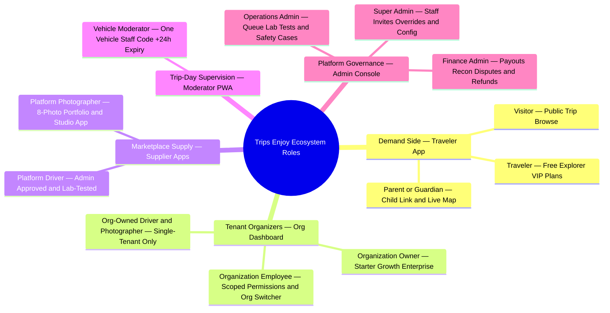
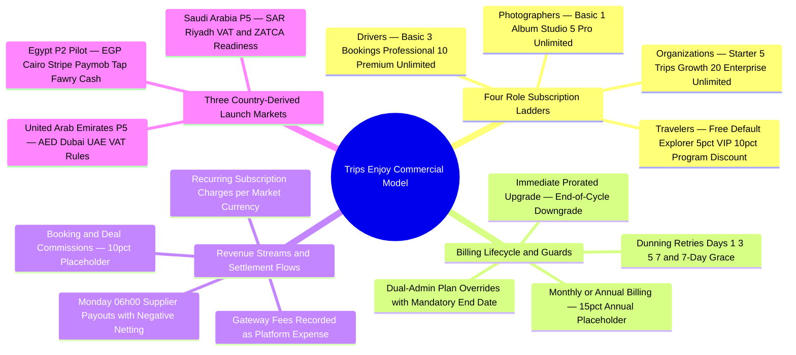
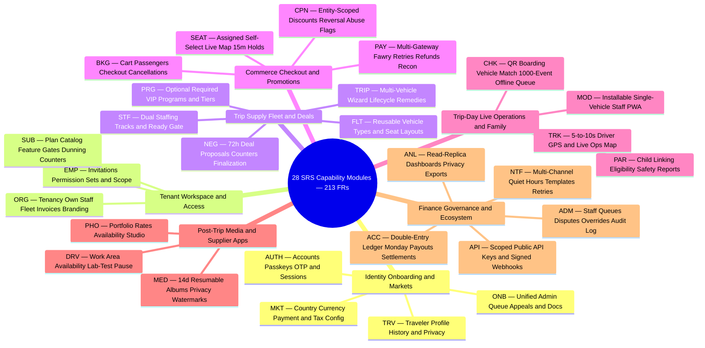
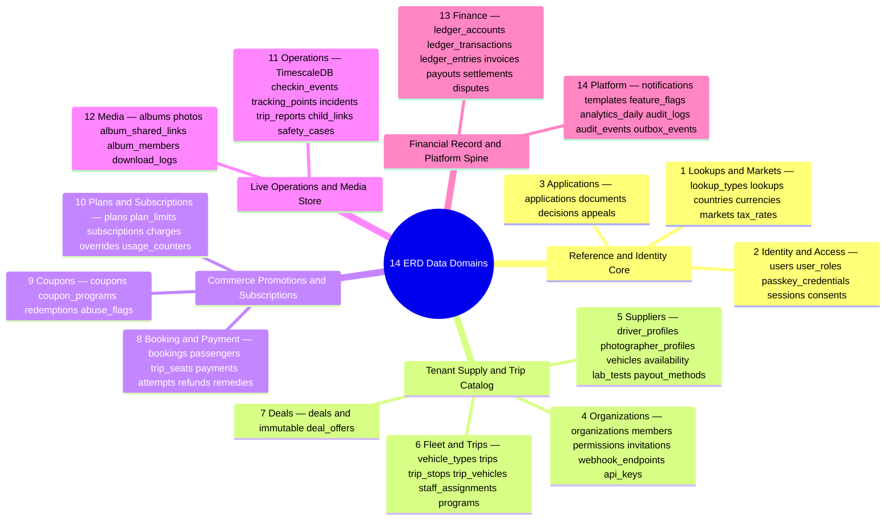
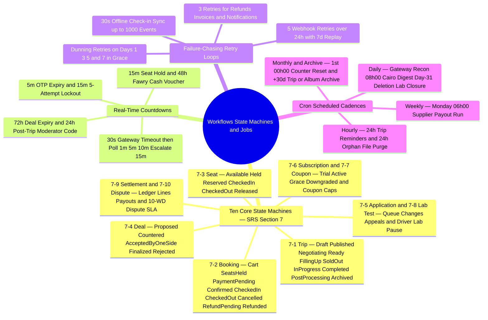
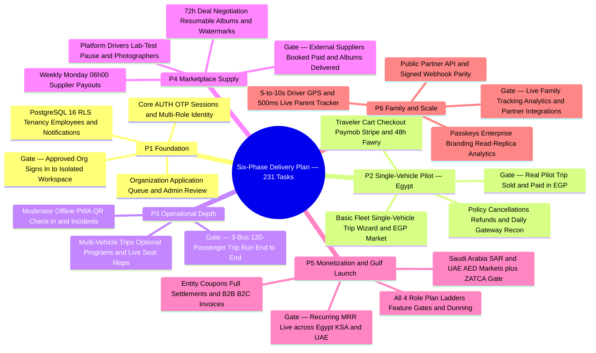
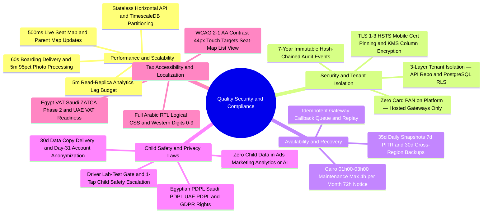

The **Platform Mindmap Atlas** provides a single-screen visual mental model for each structural dimension of Trips Enjoy. Every mindmap below pairs detailed architectural commentary with a `<MindmapBlock />` and a complete cross-pillar `<TraceBar />` so teams can move seamlessly from high-level topology to exact requirements, database tables, user flows, workflows, and engineering recommendations.

## 1. Ecosystem and Stakeholder Roles

Trips Enjoy serves **ten distinct user classes across seven client surfaces**, governed by role-specific onboarding gates, verification rules, and active-plan entitlements. Visitors browse publicly; travelers activate immediately upon verifying email or phone (`Free`, `Explorer`, `VIP`); parents unlock live child tracking inside the Traveler App (`Explorer`/`VIP` + eligible organization); organizations and independent platform suppliers pass through a unified 2-working-day admin approval queue; organization-owned staff and vehicle moderators operate strictly within the inviting tenant's boundary; and platform admins govern operations, finance, and safety from an isolated staff console (`admin.trips-enjoy.com`).

<MindmapBlock
  title="Ecosystem Actors, Approval Gates and Client Surfaces"
  caption="How 10 user classes authenticate, gain approval, hold plans and interact across 7 bilingual surfaces and 106 role user flows."
  trace={{
    brd: [
      { label: '§4.1 Roles & Plan Rules', href: '/en/docs/brd#41-roles', detail: '10 User Classes' },
      { label: '§4.3 Role Journeys', href: '/en/docs/brd#43-role-journeys-at-a-glance' },
    ],
    srs: [
      { label: '§3.1 Product Surfaces', href: '/en/docs/srs#31-product-perspective', detail: '7 Surfaces' },
      { label: '§3.3 User Classes', href: '/en/docs/srs#33-user-classes-and-characteristics' },
      { label: 'AUTH & ONB Modules', href: '/en/docs/srs/requirements/auth' },
    ],
    erd: [
      { label: 'users & user_roles', href: '/en/docs/erd/domains/identity-and-access#users' },
      { label: 'Role & Permission Catalog', href: '/en/docs/erd/acl#role-catalog' },
    ],
    plan: [
      { label: 'Phase P1 Identity & Org', href: '/en/docs/plan/p1' },
      { label: 'Phase P3 Moderator PWA', href: '/en/docs/plan/p3' },
      { label: 'Phase P4 Suppliers', href: '/en/docs/plan/p4' },
      { label: 'Phase P6 Parent Tracker', href: '/en/docs/plan/p6' },
    ],
    workflows: [
      { label: 'Applications Workflow', href: '/en/docs/workflows/applications' },
    ],
    userFlows: [
      { label: 'All 8 Role Flow Suites', href: '/en/docs/user-flows', detail: '106 UF Flows' },
    ],
    architecture: [
      { label: 'System Context & Edge', href: '/en/docs/architecture#system-context' },
    ],
    design: [
      { label: '7 App Surfaces', href: '/en/docs/design#app-surfaces' },
    ],
    system: [
      { label: 'STAGE-01 Identity', href: '/en/docs/system/lifecycle#stage-01' },
      { label: 'STAGE-02 Onboarding', href: '/en/docs/system/lifecycle#stage-02' },
    ],
    recommendations: [
      { label: 'OD-06 Moderator Plan Rule', href: '/en/docs/recommendations/open-decisions#od-06' },
      { label: 'OD-19 Own-Supplier Coverage', href: '/en/docs/recommendations/open-decisions#od-19' },
    ],
  }}
>

- **Multi-role identity (`ASM-01`, `FR-AUTH-06`):** A single account may act as both a `Traveler` and a `Platform Driver` or `Platform Photographer` without losing traveler access while a supplier application is under review (`FR-TRV-06`).
- **Strict scope isolation (`FR-MOD-01`, `FR-PAR-02`):** Vehicle moderators see only their single assigned vehicle's manifest, and parents see only their own linked children on eligible trips.
</MindmapBlock>

## 2. Business and Commercial Model

Per the [BRD §1 Document Control rule](/en/docs/brd#1-document-control), `brd/*` pages remain strictly prose and tables with zero embedded code or diagram fences; this section hosts the canonical visual map of Trips Enjoy's commercial architecture. Monetization combines **four role-based recurring subscription ladders**, **booking and deal commissions** (`10%` placeholder pending `OD-15`), **entity-scoped promotional coupons**, and **country-derived market rules** across Egypt (`EGP`), Saudi Arabia (`SAR`), and the UAE (`AED`), all posted in integer minor units to an immutable double-entry ledger.

<MindmapBlock
  title="Commercial Model, Role Plans, Revenue Streams and Country Markets"
  caption="Visual synthesis of BRD §5 — subscription tiers, feature gates, dunning rules, revenue/cost lines and MENA market configurations."
  trace={{
    brd: [
      { label: '§5.1 Role Plans & Limits', href: '/en/docs/brd#51-plans' },
      { label: '§5.2 Revenue & Costs', href: '/en/docs/brd#52-revenue-and-costs' },
      { label: '§5.3 Country Markets', href: '/en/docs/brd#53-markets' },
      { label: '§8.4 Tax & Invoicing', href: '/en/docs/brd/compliance#84-tax-and-invoicing' },
    ],
    srs: [
      { label: 'SUB (FR-SUB-01..11)', href: '/en/docs/srs/requirements/sub', detail: 'Plans & Dunning' },
      { label: 'MKT (FR-MKT-01..05)', href: '/en/docs/srs/requirements/mkt', detail: 'Markets' },
      { label: 'ACC (FR-ACC-01..10)', href: '/en/docs/srs/requirements/acc', detail: 'Ledger & Payouts' },
    ],
    erd: [
      { label: 'subscriptions & plans', href: '/en/docs/erd/domains/plans-and-subscriptions#subscriptions' },
      { label: 'markets & tax_rates', href: '/en/docs/erd/domains/lookups-and-markets#markets' },
      { label: 'invoices & ledger', href: '/en/docs/erd/domains/finance#invoices' },
    ],
    plan: [
      { label: 'Phase P2 Egypt EGP Pilot', href: '/en/docs/plan/p2' },
      { label: 'Phase P5 Monetization & Gulf', href: '/en/docs/plan/p5' },
    ],
    workflows: [
      { label: 'Subscriptions & Dunning', href: '/en/docs/workflows/subscriptions' },
      { label: 'Money & Monday Payouts', href: '/en/docs/workflows/money' },
    ],
    userFlows: [
      { label: 'UF-ORG-18 Plan & Billing', href: '/en/docs/user-flows/organization#uf-org-18-plan-and-billing' },
      { label: 'UF-SHR-06..07 Limits & Grace', href: '/en/docs/user-flows/shared#uf-shr-06-plan-limit-prompt' },
    ],
    architecture: [
      { label: 'Payment & Gateway Integrations', href: '/en/docs/architecture#integrations' },
    ],
    design: [
      { label: 'Currency Labels & Tabular Digits', href: '/en/docs/design#rtl-and-localization' },
    ],
    system: [
      { label: 'STAGE-05 Checkout & Invoices', href: '/en/docs/system/lifecycle#stage-05' },
      { label: 'STAGE-08 Ledger & Payouts', href: '/en/docs/system/lifecycle#stage-08' },
    ],
    recommendations: [
      { label: 'OD-10 ZATCA Scope', href: '/en/docs/recommendations/open-decisions#od-10' },
      { label: 'OD-15 Commission Rates', href: '/en/docs/recommendations/open-decisions#od-15' },
      { label: 'OD-26 & OD-27 Prices & VAT', href: '/en/docs/recommendations/open-decisions#od-26' },
      { label: 'REC-PAY-04 & REC-TAX-05', href: '/en/docs/recommendations/architecture-and-ops#rec-pay-04' },
    ],
  }}
>

- **Minor-unit precision (`D-157`, `UI-06`):** All prices, taxes, commissions, and discounts store as `BIGINT` minor units paired with ISO `currency_code`, rounded half-up per line with totals equal to the sum of rounded lines.
- **No silent lock-in on downgrade (`D-144`, `FR-SUB-09`):** Existing items above a lower tier's cap keep working after a downgrade, while creation of new items is blocked until active usage drops below the new limit.
</MindmapBlock>

## 3. Software Capability Modules

The [Software Requirements Specification](/en/docs/srs) partitions `213` functional requirements (`FR-*`) across **28 cohesive capability modules**. Inside the modular monolith, each capability module owns its REST controllers, WebSocket event emitters, domain services, server-side plan/permission guards, and state-machine transitions.

<MindmapBlock
  title="28 SRS Capability Modules Grouped by Functional Cluster"
  caption="Complete functional decomposition of all 213 requirements across 7 cohesive capability clusters."
  trace={{
    brd: [
      { label: '§6 Business Requirements (BR-*)', href: '/en/docs/brd/requirements#6-business-requirements' },
    ],
    srs: [
      { label: 'SRS §3.2 Module Summary', href: '/en/docs/srs#32-product-functions-by-module', detail: '28 Modules' },
      { label: 'Capabilities Overview', href: '/en/docs/srs/capabilities' },
      { label: 'SRS §10 Traceability Matrix', href: '/en/docs/srs/traceability#10-traceability-matrix', detail: '213 FRs' },
    ],
    erd: [
      { label: 'ERD §5 Requirement Traceability', href: '/en/docs/erd/reference#5-traceability' },
    ],
    plan: [
      { label: 'Phased Backlog (P1–P6)', href: '/en/docs/plan', detail: '213 Functional Tasks' },
    ],
    workflows: [
      { label: 'Workflow Coverage Matrix', href: '/en/docs/workflows/coverage', detail: '213/213 Covered' },
    ],
    userFlows: [
      { label: 'Role User Flows', href: '/en/docs/user-flows' },
    ],
    architecture: [
      { label: 'Modular Monolith Service Model', href: '/en/docs/architecture#service-model' },
    ],
    design: [
      { label: 'Shared Component Kit', href: '/en/docs/design#components' },
    ],
    recommendations: [
      { label: 'REC-ARCH-01 Package Boundaries', href: '/en/docs/recommendations/architecture-and-ops#rec-arch-01' },
    ],
  }}
>

- **100% traceability (`SRS §10`):** Every `FR-*` traces upstream to at least one `BR-*`, `BRL-*`, or `OD-*` in the BRD and downstream to an exact delivery task (`T-P*-*`), ERD table, and workflow/engine contract.
</MindmapBlock>

## 4. Data Domains and Tenancy

The [Entity-Relationship Design](/en/docs/erd) organizes PostgreSQL 16 + TimescaleDB into **14 data domains** governed by strict cross-cutting rules: internal `id BIGSERIAL` primary/foreign keys paired with public time-ordered `uuid UUIDv7` identifiers (`DAT-10`), `lookups` tables instead of SQL `ENUM` types, KMS column encryption with companion `*_hash` lookup indexes (`DAT-05`), `deleted_at` soft-delete with a 30-day restore window (`DAT-11`), append-only immutable financial/audit/event tables (`DAT-08`, `DAT-13`), and denormalized `organization_id` columns enforced by PostgreSQL Row-Level Security (`DAT-01`, `NFR-SEC-07`).

<MindmapBlock
  title="14 ERD Data Domains, PostgreSQL RLS Isolation and Immutability Spine"
  caption="How 101+ relational and hypertable entities partition across 14 domains with strict tenant isolation and append-only auditability."
  trace={{
    brd: [
      { label: 'BRL-01 Tenant Isolation & BRL-18 Ledger', href: '/en/docs/brd/requirements#7-business-rules' },
    ],
    srs: [
      { label: 'SRS §6 Data Requirements (DAT-01..15)', href: '/en/docs/srs/data', detail: 'Isolation & Retention' },
    ],
    erd: [
      { label: 'ERD Conventions & ID Policy', href: '/en/docs/erd#id-policy' },
      { label: 'All 14 Domain Schemas', href: '/en/docs/erd#domains' },
      { label: 'ACL & RLS Policy Catalog', href: '/en/docs/erd/acl#policy-catalog' },
      { label: 'Lookup Type Catalog', href: '/en/docs/erd/reference#4-lookup-type-catalog' },
    ],
    plan: [
      { label: 'Phase P1 Schema & RLS Foundation', href: '/en/docs/plan/p1' },
    ],
    workflows: [
      { label: 'Archive & Retention Purge Jobs', href: '/en/docs/workflows/scheduled-jobs#archive-and-retention-jobs' },
    ],
    userFlows: [
      { label: 'UF-TRV-13 & UF-ADM-05 Privacy Requests', href: '/en/docs/user-flows/traveler#uf-trv-13-privacy-requests' },
    ],
    architecture: [
      { label: 'Data Architecture & Replicas', href: '/en/docs/architecture#data-architecture' },
    ],
    design: [
      { label: 'Generic 404 Cross-Tenant Rule (IF-12)', href: '/en/docs/design#empty-loading-and-error-states' },
    ],
    recommendations: [
      { label: 'REC-DATA-02 RLS Connection-Pool Safety', href: '/en/docs/recommendations/architecture-and-ops#rec-data-02' },
      { label: 'OPEN-08 Hash-Chain Audit Logs', href: '/en/docs/recommendations/open-decisions#open-08' },
    ],
  }}
>

- **Zero-join RLS (`DAT-01`):** Every tenant-owned child row denormalizes `organization_id BIGINT NOT NULL` so PostgreSQL evaluates `organization_id = current_setting('app.current_organization_id')::bigint` via single-table index scans.
- **Insert-only immutable ledger & telemetry (`DAT-13`):** `ledger_transactions`, `ledger_entries`, `audit_logs`, `audit_events`, `deal_offers`, `checkin_events`, `tracking_points`, `consents`, and `outbox_events` prohibit `UPDATE` and `DELETE`; corrections post reversing rows.
</MindmapBlock>

## 5. System Workflows and Scheduled Jobs

Between human clicks, Trips Enjoy is driven by **10 formal SRS state machines** (`SRS §7`) and a deterministic **scheduled job and timer catalog** (`workflows/scheduled-jobs`). Every timer, retry ceiling, quiet-hour deferral, and reconciliation sweep has an explicit rule citation and escalation queue so no record can silently stall.

<MindmapBlock
  title="10 State Machines, Retry Pipelines and Scheduled Job Cadences"
  caption="The runtime engine view — how state guards, per-record countdowns, backoff retries and cron cadences orchestrate the platform."
  trace={{
    brd: [
      { label: '§7 Business Rules (BRL-06..31)', href: '/en/docs/brd/requirements#7-business-rules' },
    ],
    srs: [
      { label: 'SRS §7 All 10 State Machines', href: '/en/docs/srs/state-machines', detail: 'SM 7.1..7.10' },
    ],
    erd: [
      { label: 'outbox_events & idempotency_keys', href: '/en/docs/erd/domains/platform' },
    ],
    plan: [
      { label: 'Testing & Timer Verification', href: '/en/docs/plan/testing' },
    ],
    workflows: [
      { label: 'Workflows Engine Contract', href: '/en/docs/workflows#the-engine-contract' },
      { label: 'Complete Job Catalog', href: '/en/docs/workflows/scheduled-jobs', detail: 'All Cadences' },
    ],
    userFlows: [
      { label: 'UF-ADM-11 & UF-ADM-12 Escalation Queues', href: '/en/docs/user-flows/admin#uf-adm-12-payment-escalations' },
    ],
    architecture: [
      { label: 'Internal Workers & Outbox Pipeline', href: '/en/docs/architecture#service-model' },
    ],
    design: [
      { label: 'Notification Inbox & Quiet Hours', href: '/en/docs/design#notification-surfaces' },
    ],
    system: [
      { label: 'Failure Isolation Summary', href: '/en/docs/system/lifecycle#end-to-end-failure-isolation-and-recovery-summary' },
    ],
    recommendations: [
      { label: 'REC-ARCH-01 Outbox SKIP LOCKED', href: '/en/docs/recommendations/architecture-and-ops#rec-arch-01' },
      { label: 'REC-OPS-12 Chaos & Timer Drills', href: '/en/docs/recommendations/architecture-and-ops#rec-ops-12' },
    ],
  }}
>

- **At-most-once & idempotent guarantees:** Inbound payment callbacks deduplicate by gateway event ID (`FR-PAY-02`), mutating HTTP calls cache `Idempotency-Key` responses for **24 hours** (`NFR-SEC-06`), offline check-ins deduplicate by `client_event_id` (`FR-CHK-05`), and notifications deduplicate by `(user_id, event_key)` (`FR-NTF-06`).
</MindmapBlock>

## 6. Six-Phase Delivery Roadmap

Trips Enjoy ships incrementally across **six gated delivery phases (`P1`–`P6`)** comprising **231 engineering tasks** (`213` functional tasks traced 1:1 to `FR-*` requirements plus `18` cross-cutting platform tasks `T-P1-PLAT-1`..`T-P6-PLAT-3`). Every phase ends with an observable real-world milestone gate and explicitly tracks open decisions (`OD-*`) that must close before launch.

<MindmapBlock
  title="Six-Phase Delivery Roadmap (P1–P6) — 231 Tasks and Milestone Gates"
  caption="Progressive rollout from single-tenant foundation and Egypt EGP pilot to 3-bus operations, marketplace supply, Gulf launch and live family tracking."
  trace={{
    brd: [
      { label: '§3.3 Delivery Phases', href: '/en/docs/brd#33-delivery-phases', detail: 'P1..P6 DoD' },
    ],
    srs: [
      { label: 'MoSCoW Phase Alignment', href: '/en/docs/srs#25-document-conventions' },
    ],
    erd: [
      { label: 'Expand-Contract Schema Migrations', href: '/en/docs/erd' },
    ],
    plan: [
      { label: 'Delivery Plan Overview', href: '/en/docs/plan' },
      { label: 'P1 Foundation', href: '/en/docs/plan/p1' },
      { label: 'P2 Egypt Pilot', href: '/en/docs/plan/p2' },
      { label: 'P3 Operational Depth', href: '/en/docs/plan/p3' },
      { label: 'P4 Marketplace Supply', href: '/en/docs/plan/p4' },
      { label: 'P5 Monetization & Gulf', href: '/en/docs/plan/p5' },
      { label: 'P6 Family & Scale', href: '/en/docs/plan/p6' },
      { label: 'Milestones & Testing', href: '/en/docs/plan/milestones' },
    ],
    workflows: [
      { label: 'Workflow Phase Rollout', href: '/en/docs/workflows' },
    ],
    userFlows: [
      { label: 'Role Journeys by Phase', href: '/en/docs/user-flows' },
    ],
    architecture: [
      { label: 'Feature Flags & Deployment Rollout', href: '/en/docs/architecture#deployment-topology' },
    ],
    design: [
      { label: 'Design Governance & Parity Gate', href: '/en/docs/design#governance' },
    ],
    recommendations: [
      { label: 'Phase-Gated Decision Playbook', href: '/en/docs/recommendations' },
      { label: 'REC-OPS-12 Rollout & 3-Bus Load Drill', href: '/en/docs/recommendations/architecture-and-ops#rec-ops-12' },
    ],
  }}
>

- **Feature-flagged promotion (`NFR-MNT-03`):** Every phase deploys behind per-market, per-plan `feature_flags` using expand-contract database migrations (`NFR-MNT-01`) so unfinished next-phase capabilities never block production hotfixes.
</MindmapBlock>

## 7. Quality, Security and Compliance

Non-functional requirements (`SRS §8`, `NFR-*`) and regulatory commitments (`BRD §8`) are engineered directly into the request pipeline, storage topology, and CI/CD gates rather than bolted on after Phase 6.

<MindmapBlock
  title="Quality Attributes (NFR), Security Controls, Privacy and MENA Compliance"
  caption="Latency budgets, defense-in-depth security, child-data protection, tax/fiscal compliance and disaster recovery objectives."
  trace={{
    brd: [
      { label: '§8.1..8.5 Compliance, Child Safety, PDPL & Tax', href: '/en/docs/brd/compliance#8-compliance-safety-and-legal' },
      { label: '§10 Platform Risk Register', href: '/en/docs/brd/compliance#10-risks' },
    ],
    srs: [
      { label: 'SRS §8 All 11 NFR Groups', href: '/en/docs/srs/quality#8-non-functional-requirements', detail: 'PERF..BKP' },
      { label: 'SRS §9 API & Interface Rules', href: '/en/docs/srs/quality#9-interface-and-api-requirements' },
    ],
    erd: [
      { label: 'ACL, KMS Encryption & Audit Chain', href: '/en/docs/erd/acl' },
      { label: 'audit_events', href: '/en/docs/erd/domains/platform#audit_events' },
    ],
    plan: [
      { label: 'Verification & Test Pyramid', href: '/en/docs/plan/testing' },
    ],
    workflows: [
      { label: 'Retention, Backup & Maintenance Windows', href: '/en/docs/workflows/scheduled-jobs#archive-and-retention-jobs' },
    ],
    userFlows: [
      { label: 'UF-PAR-05 Child Safety Concern', href: '/en/docs/user-flows/parent#uf-par-05-report-a-child-safety-concern' },
      { label: 'UF-TRV-13 Data Copy & Deletion', href: '/en/docs/user-flows/traveler#uf-trv-13-privacy-requests' },
    ],
    architecture: [
      { label: 'Quality Attributes Enforcement Table', href: '/en/docs/architecture#quality-attributes' },
    ],
    design: [
      { label: 'WCAG 2.1 AA, Contrast & Keyboard A11y', href: '/en/docs/design#accessibility' },
    ],
    recommendations: [
      { label: 'REC-SEC-09 Child Safety & Audit Chain', href: '/en/docs/recommendations/architecture-and-ops#rec-sec-09' },
      { label: 'REC-UX-11 RTL & Seat-Map A11y', href: '/en/docs/recommendations/architecture-and-ops#rec-ux-11' },
      { label: 'OPEN-09 Data Residency Posture', href: '/en/docs/recommendations/open-decisions#open-09' },
    ],
  }}
>

- **Compliance by construction:** Child-safety exclusions (`CON-08`), PCI-DSS scope avoidance (`CON-02`), immutable 7-year financial/audit retention (`DAT-08`), and bilingual WCAG 2.1 AA accessibility (`NFR-A11Y-01..04`) are enforced by database schemas, shared UI kit primitives, and automated CI checks on every pull request.
</MindmapBlock>
